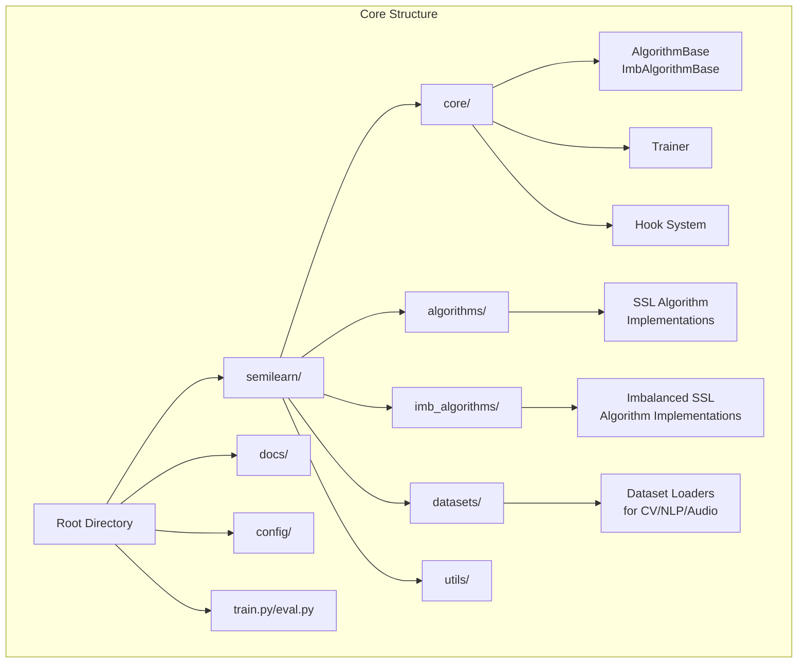
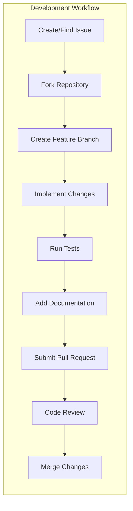
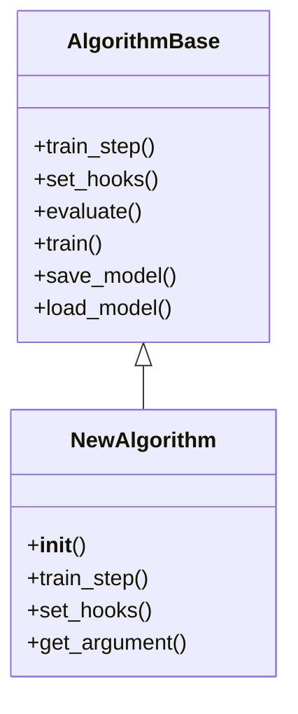
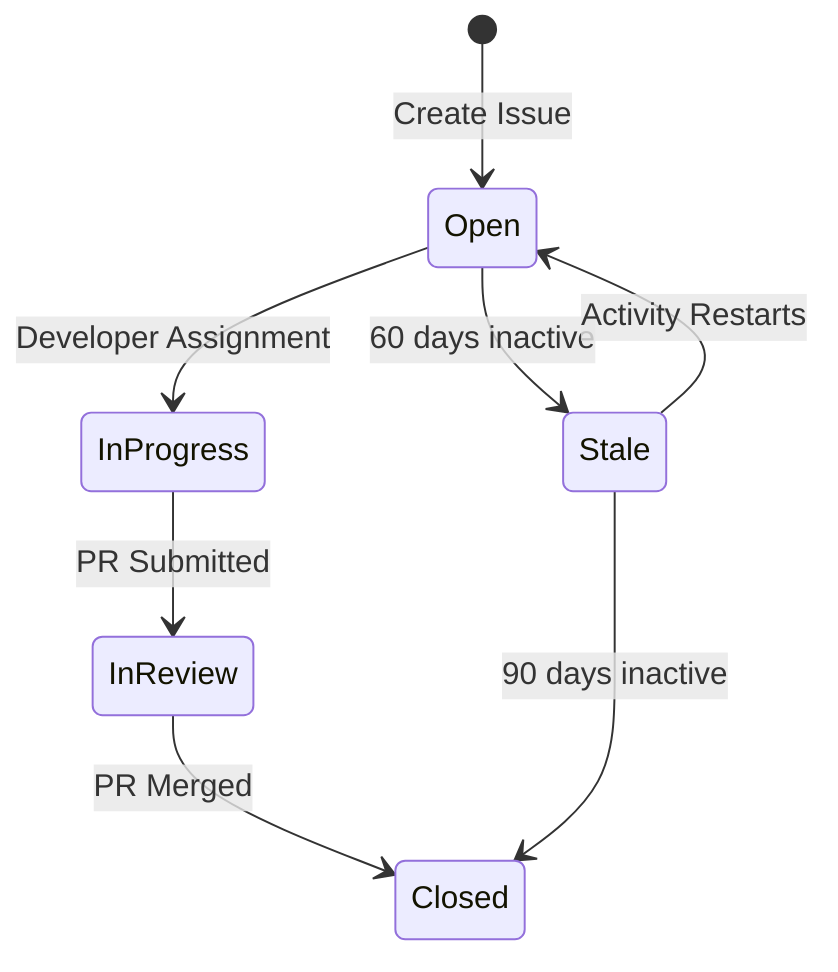

<!-- source: DeepWiki mcp.deepwiki.com · repo microsoft/Semi-supervised-learning · page 7 Contributing and Development · fetched 2026-10-26 -->

# Contributing and Development

<details>
<summary>Relevant source files</summary>

The following files were used as context for generating this wiki page:

- [.github/workflows/blank.yml](.github/workflows/blank.yml)
- [.github/workflows/issue.yml](.github/workflows/issue.yml)
- [.gitignore](.gitignore)
- [docs/Makefile](docs/Makefile)
- [docs/conf.py](docs/conf.py)
- [docs/index.rst](docs/index.rst)
- [docs/make.bat](docs/make.bat)
- [docs/requirements.txt](docs/requirements.txt)
- [semilearn/imb_algorithms/debiaspl/debiaspl.py](semilearn/imb_algorithms/debiaspl/debiaspl.py)

</details>


This document provides guidelines and information for those interested in contributing to the USB (Unified Semi-supervised learning Benchmark) framework. It covers development environment setup, project structure, contribution guidelines, and workflow for adding new components to the framework. For information about using the USB framework for experiments, see [Configuration and Experiment Management](#5).

## Development Environment Setup

Setting up a development environment for contributing to USB involves the following steps:

1. **Fork and Clone the Repository**

   ```bash
   git clone https://github.com/[your-username]/Semi-supervised-learning.git
   cd Semi-supervised-learning
   ```

2. **Create a Virtual Environment**

   ```bash
   python -m venv venv
   source venv/bin/activate  # On Windows: venv\Scripts\activate
   ```

3. **Install Dependencies**

   ```bash
   pip install -e .  # Install the package in development mode
   ```

4. **Install Documentation Dependencies** (if working on documentation)

   ```bash
   pip install -r docs/requirements.txt
   ```

## Project Structure Overview

Understanding the project structure is essential for making effective contributions.



Key directories and their purposes:

- **semilearn/core/**: Contains base classes and core functionality
- **semilearn/algorithms/**: Standard SSL algorithm implementations
- **semilearn/imb_algorithms/**: Imbalanced learning SSL algorithms
- **semilearn/datasets/**: Dataset loaders and processing
- **config/**: Configuration files for experiments
- **docs/**: Documentation files

Sources: [.gitignore:1-143](), [semilearn/imb_algorithms/debiaspl/debiaspl.py:1-62]()

## Contributing Guidelines

### Code Style and Standards

The USB project follows these coding standards:

1. **Consistent Documentation**: All classes and functions should have proper docstrings explaining their purpose, parameters, and return values.

2. **Registration Pattern**: New algorithms should be registered using the decorator pattern as shown in the example below:

```python
@IMB_ALGORITHMS.register('debiaspl')
class DebiasPL(ImbAlgorithmBase):
    """
    DebiasPL algorithm (https://openaccess.thecvf.com/...)
    
    Args:
        - args (`argparse`): algorithm arguments
        ...
    """
```

3. **Type Annotations**: Use appropriate type annotations where possible to improve code readability and debugging.

4. **Consistent Naming**: Follow the established naming conventions in the codebase.

Sources: [semilearn/imb_algorithms/debiaspl/debiaspl.py:12-34]()

### Development Workflow



Sources: [.github/workflows/blank.yml:1-36]()

### Pull Request Process

1. **Create a Feature Branch**: Always create a new branch for your changes
   ```bash
   git checkout -b feature/your-feature-name
   ```

2. **Keep Changes Focused**: Each pull request should address a single issue or feature

3. **Include Tests**: Add appropriate tests for your changes

4. **Update Documentation**: Ensure that documentation is updated to reflect your changes

5. **Follow the PR Template**: Include a clear description of changes and link to related issues

### Issue Management

Issues are automatically marked as stale after 60 days of inactivity and closed after 90 days if there is no activity, as configured in the GitHub workflow.

Sources: [.github/workflows/issue.yml:1-18]()

## Adding New Components

### Adding a New SSL Algorithm

To add a new SSL algorithm to the USB framework, follow these steps:

1. **Create a New Directory**: If your algorithm is a standard SSL algorithm, add it to `semilearn/algorithms/`. If it's an imbalanced learning algorithm, add it to `semilearn/imb_algorithms/`.

2. **Implement Algorithm Class**: Create a new class that inherits from either `AlgorithmBase` or `ImbAlgorithmBase`.



3. **Register Your Algorithm**: Use the appropriate decorator to register your algorithm.

4. **Implement Required Methods**: At minimum, implement `__init__()`, `train_step()`, and `set_hooks()` methods.

5. **Define Algorithm-Specific Arguments**: Implement the static `get_argument()` method to define custom arguments.

Example of algorithm registration and structure:

```python
@SSL_ALGORITHMS.register('new_algorithm')
class NewAlgorithm(AlgorithmBase):
    """
    Documentation for your algorithm
    """
    def __init__(self, args, **kwargs):
        super().__init__(args, **kwargs)
        # Initialize algorithm-specific components
        
    def train_step(self, x_lb, y_lb, x_ulb_w, x_ulb_s):
        # Implement training step
        
    def set_hooks(self):
        super().set_hooks()
        # Register algorithm-specific hooks
        
    @staticmethod
    def get_argument():
        return [
            SSL_Argument('--new_param', float, 0.5),
        ]
```

Sources: [semilearn/imb_algorithms/debiaspl/debiaspl.py:11-61]()

### Adding a New Dataset

To add a new dataset to the USB framework:

1. Create a new file in the appropriate dataset directory (CV/NLP/Audio)
2. Implement the dataset loader class
3. Register the dataset in the dataset registry

## Documentation Development

The USB project uses Sphinx for documentation generation. To work on documentation:

1. **Install Documentation Dependencies**:
   ```bash
   pip install -r docs/requirements.txt
   ```

2. **Edit Documentation Files**: Documentation source files are in the `docs` directory

3. **Build Documentation Locally**:
   ```bash
   cd docs
   make html
   ```

4. **View Documentation**: Open `docs/_build/html/index.html` in a web browser

The documentation uses reStructuredText (`.rst`) files and MyST parser for Markdown (`.md`) files.

Sources: [docs/requirements.txt:1-34](), [docs/conf.py:1-43](), [docs/Makefile:1-21](), [docs/make.bat:1-36]()

## Continuous Integration

The project uses GitHub Actions for continuous integration. The CI workflow runs on:
- Push to the main branch
- Pull requests targeting the main branch

The CI process includes:
- Code quality checks
- Unit tests
- Documentation build verification

Sources: [.github/workflows/blank.yml:1-36]()

## Issue Lifecycle



Sources: [.github/workflows/issue.yml:1-18]()

## Best Practices for Development

1. **Test Changes Thoroughly**: Ensure your changes work across different datasets and domains

2. **Maintain Backward Compatibility**: Avoid breaking existing functionality

3. **Document Design Decisions**: Include comments explaining why certain approaches were chosen

4. **Follow the Modular Design**: Leverage the existing hook system and extension points rather than modifying core code

5. **Consider Performance Impact**: Be mindful of performance implications, especially for algorithms that will be benchmarked

## Getting Help

If you need assistance with your contribution:

1. Check existing documentation and code examples
2. Search through existing issues and pull requests
3. Create a new issue with a detailed description of your problem or question

Sources: [docs/index.rst:1-42]()