# Page: Overview

# Overview

<details>
<summary>Relevant source files</summary>

The following files were used as context for generating this wiki page:

- [CHANGE_LOG.md](CHANGE_LOG.md)
- [README.md](README.md)
- [docs/algorithm_zoo.md](docs/algorithm_zoo.md)
- [docs/benchmark.md](docs/benchmark.md)
- [docs/contributors.md](docs/contributors.md)
- [docs/tutorial.md](docs/tutorial.md)
- [semilearn/algorithms/defixmatch/defixmatch.py](semilearn/algorithms/defixmatch/defixmatch.py)
- [semilearn/core/hooks/aim.py](semilearn/core/hooks/aim.py)
- [semilearn/datasets/audio_datasets/datasetbase.py](semilearn/datasets/audio_datasets/datasetbase.py)

</details>


This document provides an introduction to USB (Unified Semi-supervised Learning Benchmark), a comprehensive framework for semi-supervised learning research and applications across multiple domains. This overview explains the purpose, key features, and high-level architecture of the USB framework.

USB is a PyTorch-based framework that offers implementations of various semi-supervised learning (SSL) algorithms with support for computer vision (CV), natural language processing (NLP), and audio tasks. It is designed to be easy to use, extensible, and affordable for research groups of all sizes.

For detailed installation instructions, see [Installation and Setup](#1.1). For a deeper examination of the system architecture, refer to [System Architecture](#1.2).

## Purpose and Goals

USB aims to provide a unified benchmark for semi-supervised learning that:

1. Standardizes the implementation and evaluation of SSL algorithms
2. Supports multiple domains (CV, NLP, and audio) with a consistent interface
3. Enables fair comparisons between different SSL approaches
4. Offers a flexible framework for developing new SSL algorithms
5. Provides reproducible benchmarks for the research community

## High-Level Architecture

The USB framework consists of several interconnected components organized around a core architecture that supports multiple algorithms, datasets, and training methods.

### System Overview Diagram

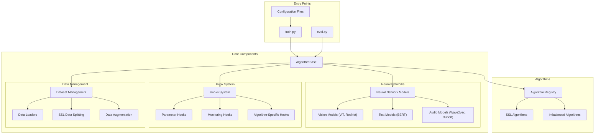

Sources: [README.md:112-118](), [semilearn/algorithms/defixmatch/defixmatch.py:11-14]()

### Algorithm Hierarchy

USB implements numerous SSL algorithms that all inherit from a common `AlgorithmBase` class, which provides the foundation for implementing SSL techniques.

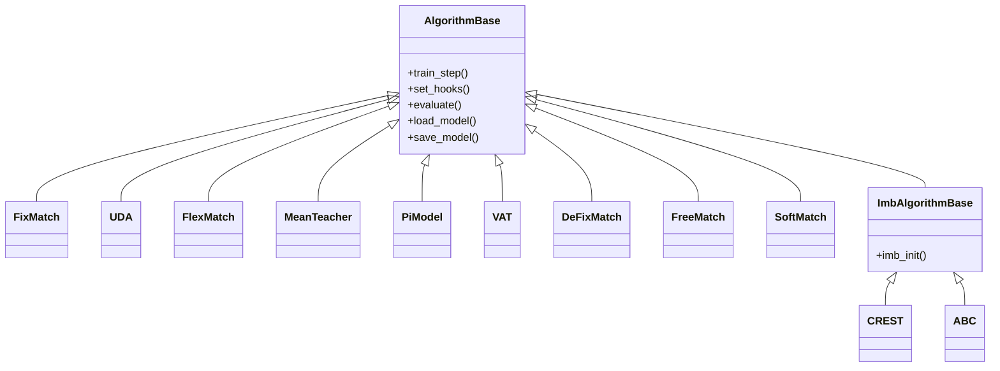

Sources: [docs/algorithm_zoo.md:1-21]()

## Key Features

USB offers several key features that make it a valuable tool for SSL research and applications:

| Feature | Description |
|---------|-------------|
| Multiple Domains | Supports CV, NLP, and audio tasks with a unified API |
| Algorithm Library | Implements 15+ SSL algorithms including FixMatch, UDA, MeanTeacher, etc. |
| Extensibility | Plugin architecture with hooks for customizing algorithm behavior |
| Benchmarking | Standardized evaluation across datasets and algorithms |
| Experiment Tracking | Integration with wandb, Aim, and other logging tools |
| Reproducibility | Configuration-based experiment setup for reproducible results |

Sources: [README.md:113-115](), [CHANGE_LOG.md:14-21]()

## Data Processing Pipeline

The USB framework handles data through a standardized pipeline that prepares it for semi-supervised learning:

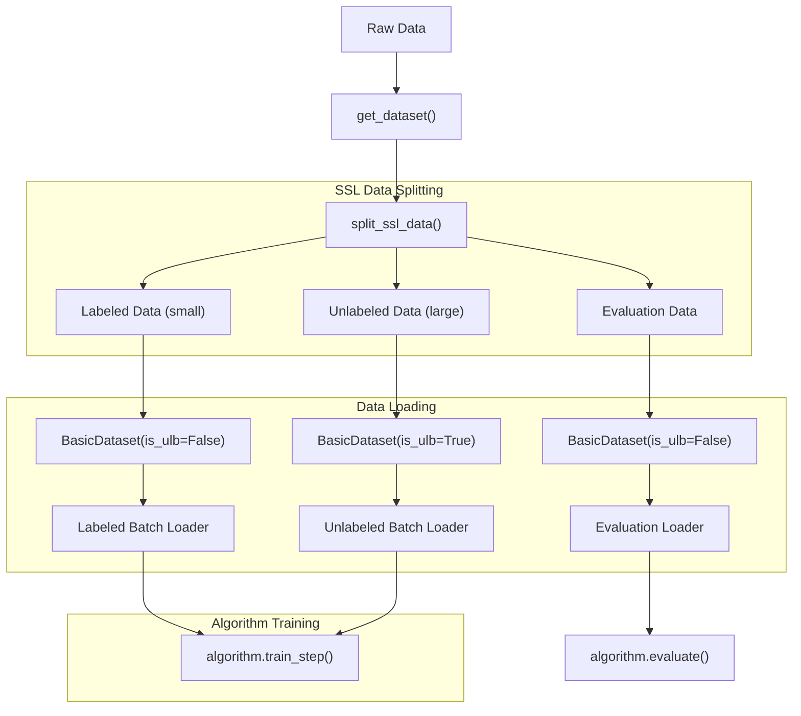

Sources: [semilearn/datasets/audio_datasets/datasetbase.py:45-135](), [docs/tutorial.md:72-82]()

## Hooks System

One of the unique aspects of USB is its hook system, which allows for customization of algorithm behavior at various points in the training process:

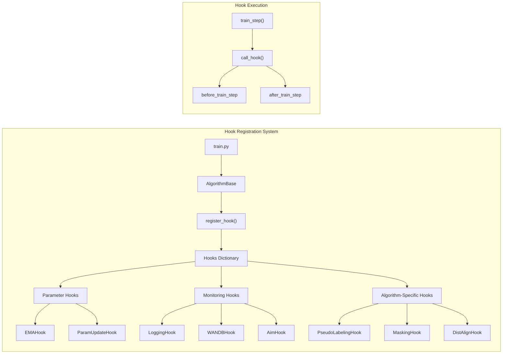

Sources: [semilearn/algorithms/defixmatch/defixmatch.py:43-46](), [semilearn/core/hooks/aim.py:9-49]()

## Supported Algorithms

USB implements numerous semi-supervised learning algorithms, including:

1. **Consistency-based methods**:
   - PiModel - Forces outputs of perturbed versions of data to be similar
   - MeanTeacher - Uses exponential moving average of model weights
   - VAT - Virtual Adversarial Training for robustness

2. **Pseudo-labeling methods**:
   - FixMatch - Uses weak augmentations for pseudo-label generation and strong augmentations for learning
   - FlexMatch - Dynamic class-specific thresholds for pseudo-labeling
   - DeFixMatch - Debiased version of FixMatch
   - SoftMatch - Addresses quantity-quality tradeoff in pseudo-labeling

3. **Contrastive methods**:
   - CoMatch - Combines consistency regularization and contrastive learning
   - SimMatch - Extends CoMatch with semantic and instance-level consistency

4. **Imbalanced learning methods**:
   - Various algorithms for handling class imbalance in SSL settings

Sources: [docs/algorithm_zoo.md:4-20]()

## Supported Datasets

USB provides support for datasets across three domains:

1. **Computer Vision**:
   - CIFAR-100, STL10, TissueMNIST, SemiAves, EuroSAT, ImageNet

2. **Natural Language Processing**:
   - IMDB, Amazon Review, Yelp Review, AG News, Yahoo! Answer

3. **Audio**:
   - GTZAN, UrbanSound8k, FSDNoisy18k, Keyword Spotting, ESC-50

Sources: [docs/benchmark.md:1-42]()

## Training Process Flow

The standard training process in USB follows this general flow:

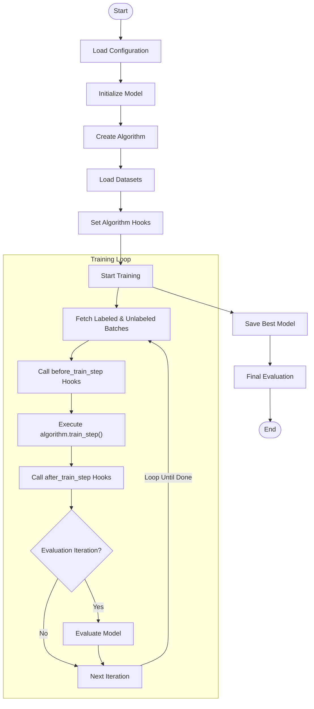

Sources: [README.md:147-150](), [docs/tutorial.md:86-90]()

## Summary

USB provides a comprehensive framework for semi-supervised learning research and application across multiple domains. Its modular design, extensible architecture, and rich algorithm library make it a valuable tool for both exploring existing SSL techniques and developing new approaches. The framework's standardized benchmarking capabilities enable fair comparisons between different methods, contributing to the advancement of the field.

In the following sections of the documentation, we will dive deeper into the individual components of the USB framework, explaining how to use them effectively and how to extend the framework with custom algorithms and datasets.

---

# Page: Installation and Setup

# Installation and Setup

<details>
<summary>Relevant source files</summary>

The following files were used as context for generating this wiki page:

- [.gitignore](.gitignore)
- [docs/Makefile](docs/Makefile)
- [docs/conf.py](docs/conf.py)
- [docs/index.rst](docs/index.rst)
- [docs/make.bat](docs/make.bat)
- [notebooks/Custom_Dataset.ipynb](notebooks/Custom_Dataset.ipynb)
- [requirements.txt](requirements.txt)
- [semilearn/__init__.py](semilearn/__init__.py)
- [semilearn/datasets/utils.py](semilearn/datasets/utils.py)
- [semilearn/nets/vit/vit.py](semilearn/nets/vit/vit.py)
- [setup.py](setup.py)

</details>


This page provides detailed instructions for installing and configuring the USB (Unified Semi-supervised learning Benchmark) framework. It covers all necessary steps to set up the environment, install the required dependencies, and prepare your system for running semi-supervised learning experiments.

For information about the overall architecture of the framework, see [System Architecture](#1.2).

## Prerequisites and Dependencies

Before installing USB, ensure your system meets the following requirements:

- **Python**: Version 3.9 or higher (as specified in [setup.py:44]())
- **GPU Support**: CUDA-compatible GPU recommended for training (but not required)

The framework depends on the following packages, as defined in [requirements.txt]():

| Category | Packages |
|----------|----------|
| Deep Learning | torch>=1.12.0, torchvision>=0.13.0, torchaudio>=0.12.0, timm>=0.5.4 |
| NLP | transformers>=4.30.0 |
| Data Processing | numpy>=1.24.4, scikit-learn>=1.0.2, Pillow>=9.0.0 |
| Visualization | tensorboard>=2.9.1, wandb, aim |

Sources: [requirements.txt:1-19](), [setup.py:19-44]()

## Installation Methods

### Installation Flow Diagram

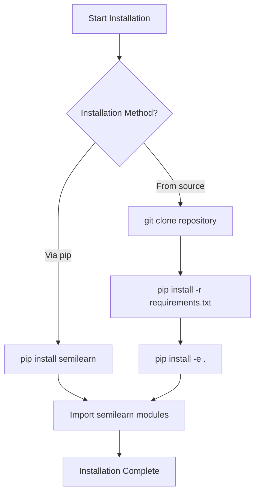

### Option 1: Install via pip

The simplest way to install USB is using pip:

```bash
pip install semilearn
```

This installs the `semilearn` package containing all components of the USB framework.

Sources: [docs/index.rst:16-18](), [setup.py:27-44]()

### Option 2: Install from source

For development or to access the latest features, install from source:

1. Clone the repository:
```bash
git clone https://github.com/microsoft/Semi-supervised-learning.git
cd Semi-supervised-learning
```

2. Install the dependencies:
```bash
pip install -r requirements.txt
```

3. Install the package in development mode:
```bash
pip install -e .
```

Sources: [setup.py:19-44](), [requirements.txt:1-19]()

## Directory Structure

After installation, the framework uses the following directory structure:

```
Project Directory/
├── semilearn/               # Main package
│   ├── algorithms/          # SSL algorithms implementation
│   ├── core/                # Core components and AlgorithmBase
│   ├── datasets/            # Dataset loaders
│   ├── lighting/            # Training framework
│   └── nets/                # Network architectures
├── data/                    # Dataset storage (created on first use)
└── saved_models/            # Model checkpoints
```

The directories `data/` and `saved_models/` will be created during usage. These and other development artifacts are excluded from version control as specified in [.gitignore:1-7]().

Sources: [.gitignore:1-7]()

## Data Setup

### Data Processing Pipeline

USB provides a structured pipeline for preparing data for semi-supervised learning:

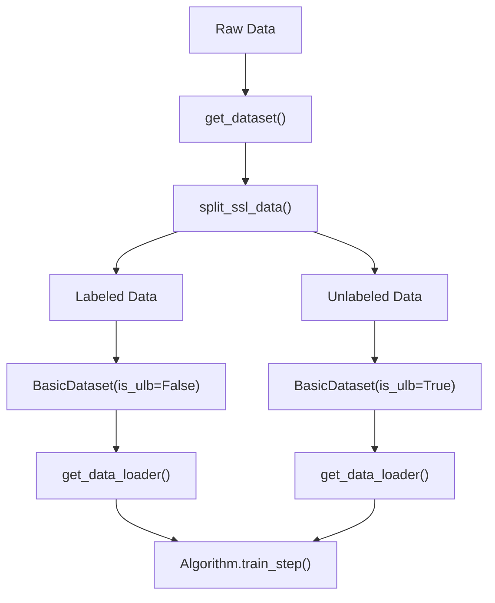

The key components of this pipeline are:

1. **Data Splitting**: The `split_ssl_data()` function divides your dataset into labeled and unlabeled portions
2. **Dataset Creation**: `BasicDataset` wraps the data with appropriate transforms
3. **Data Loading**: `get_data_loader()` creates DataLoader instances for training

Sources: [semilearn/datasets/utils.py:16-52](), [semilearn/__init__.py:4-8]()

### Setting Up Custom Data

For custom datasets, follow these steps:

1. Prepare your data in numpy array format
2. Split data into labeled and unlabeled sets using `split_ssl_data()`
3. Create transforms for your data domain
4. Create `BasicDataset` instances for labeled and unlabeled data
5. Create data loaders using `get_data_loader()`

Here's an example based on the Custom Dataset notebook:

```python
from semilearn import split_ssl_data, BasicDataset, get_data_loader

# Split data into labeled and unlabeled sets
lb_data, lb_target, ulb_data, ulb_target = split_ssl_data(
    config, data, target, config.num_classes,
    config.num_labels, include_lb_to_ulb=config.include_lb_to_ulb
)

# Create datasets with appropriate transforms
lb_dataset = BasicDataset(config.algorithm, lb_data, lb_target, 
                         config.num_classes, train_transform, is_ulb=False)
ulb_dataset = BasicDataset(config.algorithm, ulb_data, ulb_target, 
                         config.num_classes, train_transform, is_ulb=True, 
                         strong_transform=train_strong_transform)

# Create data loaders
train_lb_loader = get_data_loader(config, lb_dataset, config.batch_size)
train_ulb_loader = get_data_loader(config, ulb_dataset, 
                                  int(config.batch_size * config.uratio))
```

Sources: [notebooks/Custom_Dataset.ipynb:171-189](), [notebooks/Custom_Dataset.ipynb:226-229]()

## Configuration Setup

USB uses a configuration system to define all aspects of the training process. The configuration includes algorithm selection, network architecture, and training parameters.

### Configuration Components and Flow

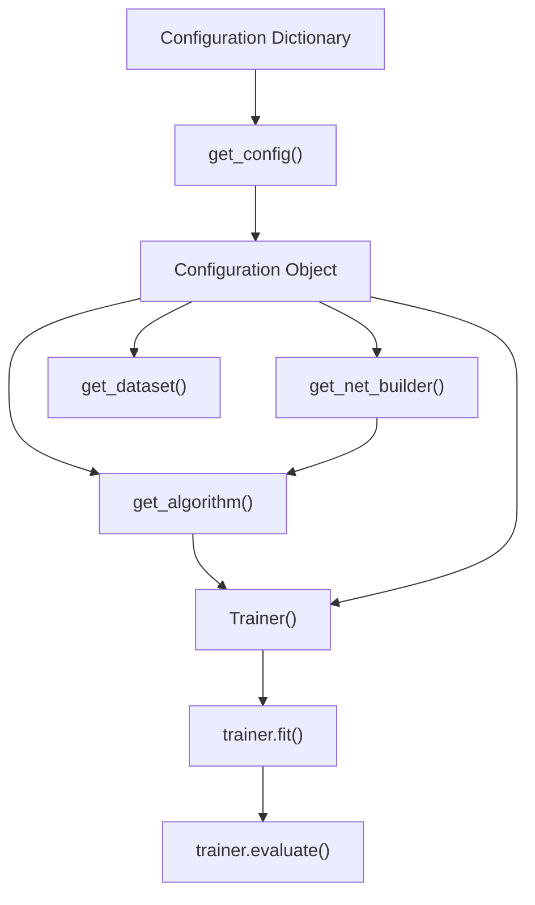

### Basic Configuration Example

```python
from semilearn import get_config

config = {
    # Algorithm configuration
    'algorithm': 'fixmatch',
    'hard_label': True,
    'uratio': 2,
    
    # Network configuration
    'net': 'vit_tiny_patch2_32',
    'use_pretrain': True, 
    
    # Optimization configuration
    'epoch': 20,
    'batch_size': 16,
    'optim': 'AdamW',
    'lr': 5e-4,
    
    # Dataset configuration
    'dataset': 'cifar10',
    'num_labels': 40,
    'num_classes': 10,
    
    # Device configuration
    'gpu': 0,
    'num_workers': 2,
}

config = get_config(config)
```

Sources: [notebooks/Custom_Dataset.ipynb:85-121](), [semilearn/__init__.py:8]()

## Complete Setup Example

Here's a complete example to set up and run your first experiment:

```python
from semilearn import get_algorithm, get_net_builder, get_config, Trainer

# 1. Create configuration
config = {
    'algorithm': 'fixmatch',
    'net': 'vit_tiny_patch2_32',
    'use_pretrain': True,
    'dataset': 'cifar10',
    'num_labels': 40,
    'num_classes': 10,
    'batch_size': 16,
    'gpu': 0
}
config = get_config(config)

# 2. Create model and algorithm
net_builder = get_net_builder(config.net, from_name=False)
algorithm = get_algorithm(config, net_builder)

# 3. Create trainer and run
trainer = Trainer(config, algorithm)
trainer.fit(train_lb_loader, train_ulb_loader, eval_loader)
```

This setup creates a configuration, initializes a model using the specified network architecture, sets up the SSL algorithm, and creates a trainer to run the experiment.

Sources: [notebooks/Custom_Dataset.ipynb:144-146](), [notebooks/Custom_Dataset.ipynb:282-285]()

## Model Selection

USB provides several network architectures that can be used for different tasks. For computer vision tasks, Vision Transformers (ViT) and CNN models are available:

```python
# Example of using ViT model
config = {
    'net': 'vit_tiny_patch2_32',  # Small ViT for 32x32 images
    'use_pretrain': True,
    # Other configuration parameters...
}

# For larger images
config = {
    'net': 'vit_base_patch16_224',  # Base ViT for 224x224 images
    'use_pretrain': True,
    # Other configuration parameters...
}
```

The models are defined in [semilearn/nets/vit/vit.py:241-291]() and selected via the `get_net_builder()` function.

## Verification

To verify your installation works correctly:

```python
from semilearn import get_net_builder, get_algorithm, get_config

# Create a minimal configuration
config = {
    'algorithm': 'fixmatch',
    'net': 'vit_tiny_patch2_32',
    'num_classes': 10,
    'gpu': 0
}
config = get_config(config)

# Try to create a model
net_builder = get_net_builder(config.net, from_name=False)
algorithm = get_algorithm(config, net_builder)
print("Installation successful!")
```

This simple code will attempt to import necessary modules and create a model, which confirms that all dependencies are properly installed.

## Troubleshooting

### Common Issues

| Issue | Solution |
|-------|----------|
| Missing dependencies | Ensure all requirements from `requirements.txt` are installed |
| CUDA out of memory | Reduce batch size or model size |
| Module not found errors | Make sure the package is installed or you're in the correct directory |
| Import errors | Check Python version compatibility (requires Python 3.9+) |

### Path Issues

If you encounter path-related errors:
- Check if the `data/` directory exists and has write permissions
- Make sure paths in configuration are correctly specified 
- Verify the existence of required directories (create them if necessary)

The framework automatically handles some directory creation, but you might need to manually create directories in some cases.

## Next Steps

For more detailed information on:
- Using specific algorithms, see [Algorithms](#3)
- Working with datasets, see [Datasets and Data Handling](#4)
- Training and evaluating models, see [Training Framework](#2.2)

Sources: [semilearn/__init__.py:4-8](), [notebooks/Custom_Dataset.ipynb:282-285]()

---

# Page: System Architecture

# System Architecture

<details>
<summary>Relevant source files</summary>

The following files were used as context for generating this wiki page:

- [README.md](README.md)
- [docs/algorithm_zoo.md](docs/algorithm_zoo.md)
- [docs/benchmark.md](docs/benchmark.md)
- [docs/contributors.md](docs/contributors.md)
- [docs/tutorial.md](docs/tutorial.md)
- [requirements.txt](requirements.txt)
- [semilearn/__init__.py](semilearn/__init__.py)
- [semilearn/algorithms/defixmatch/defixmatch.py](semilearn/algorithms/defixmatch/defixmatch.py)
- [semilearn/datasets/audio_datasets/datasetbase.py](semilearn/datasets/audio_datasets/datasetbase.py)
- [semilearn/nets/vit/vit.py](semilearn/nets/vit/vit.py)

</details>


## Purpose and Scope

This document describes the high-level architecture of the USB (Unified Semi-supervised Learning Benchmark) framework. It provides an overview of the key components, their relationships, and the overall system design. The architecture is designed to support semi-supervised learning algorithms across multiple domains including Computer Vision (CV), Natural Language Processing (NLP), and Audio classification tasks.

This page focuses on the structural organization of the system and how the components interact. For detailed information on specific algorithms implemented in USB, see [Basic SSL Algorithms](#3.1) and [Advanced SSL Algorithms](#3.2). For details on dataset handling, refer to [Datasets and Data Handling](#4).

Sources: [README.md:112-118](), [docs/algorithm_zoo.md:1-21]()

## High-Level Architecture Overview

USB is designed with modularity and extensibility in mind. The framework allows researchers to easily implement, evaluate, and compare different semi-supervised learning algorithms across diverse domains.

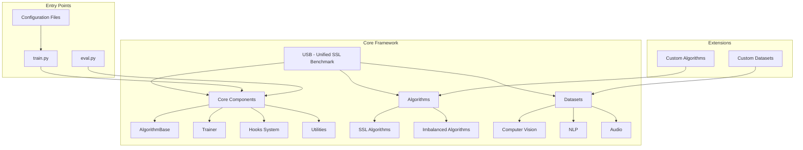

The architecture consists of:

1. **Core Components**: The foundational elements of the framework including `AlgorithmBase`, `Trainer`, Hooks system, and utility functions.
2. **Algorithms**: Various SSL algorithms including traditional methods like FixMatch, FlexMatch, and specialized algorithms for imbalanced datasets.
3. **Datasets**: Support for multiple domains (CV, NLP, Audio) with standardized interfaces.
4. **Entry Points**: Main scripts for training (`train.py`), evaluation (`eval.py`), and configuration management.
5. **Extensions**: Support for custom algorithms and datasets.

Sources: [README.md:112-118](), [semilearn/__init__.py:1-9]()

## Core Components

### AlgorithmBase

The `AlgorithmBase` class serves as the foundation for all SSL algorithms in USB. It provides common functionality for training, evaluation, and model management.

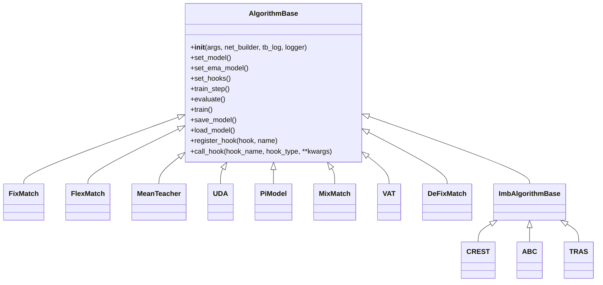

Each algorithm inherits from `AlgorithmBase` and implements its own `train_step()` method to define the specific training behavior. The base class handles common operations such as model initialization, optimization, hook registration, and evaluation.

Sources: [semilearn/algorithms/defixmatch/defixmatch.py:11-135]()

### Training Framework

The training framework is centered around the `Trainer` class, which orchestrates the training process, handles device management, and coordinates evaluation.

```mermaid
flowchart TD
    subgraph "Training Process"
        Start["Start Training"] --> LoadConfig["Load Configuration"]
        LoadConfig --> InitModel["Initialize Model"]
        InitModel --> CreateAlgo["Create Algorithm Instance"]
        CreateAlgo --> LoadData["Load Datasets"]
        LoadData --> TrainLoop["Training Loop"]
        
        TrainLoop --> LabeledBatch["Process Labeled Batch"]
        LabeledBatch --> UnlabeledBatch["Process Unlabeled Batch"]
        UnlabeledBatch --> AlgoStep["Algorithm.train_step()"]
        AlgoStep --> CallHooks["Call Registered Hooks"]
        CallHooks --> CheckEval["Evaluation Checkpoint?"]
        CheckEval -->|"Yes"| Evaluate["Evaluate Model"]
        CheckEval -->|"No"| NextIter["Next Iteration"]
        Evaluate --> NextIter
        NextIter --> |"Until max iterations"| LabeledBatch
        
        TrainLoop --> SaveModel["Save Best Model"]
        SaveModel --> FinalEval["Final Evaluation"]
        FinalEval --> End["End Training"]
    end
```

The training process starts by loading a configuration, initializing the model and algorithm, and then entering the training loop. In each iteration, the framework processes labeled and unlabeled batches, calls the algorithm's `train_step()` method, and invokes registered hooks.

Sources: [docs/tutorial.md:88-90](), [README.md:226-242]()

### Hooks System

The hooks system provides a flexible mechanism for extending and customizing algorithm behavior without modifying the core implementation.

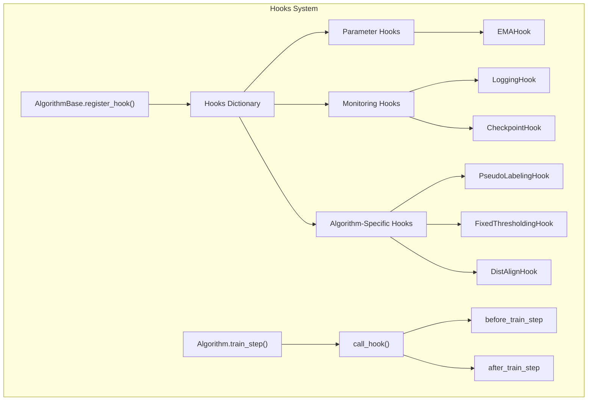

Hooks are registered with `AlgorithmBase` and called at specific points during the training process. This modular design allows for easy extension and customization of algorithm behavior.

Sources: [semilearn/algorithms/defixmatch/defixmatch.py:43-46]()

### Dataset Handling

USB provides a unified interface for handling datasets across different domains (CV, NLP, Audio) with support for data augmentation and semi-supervised learning splits.

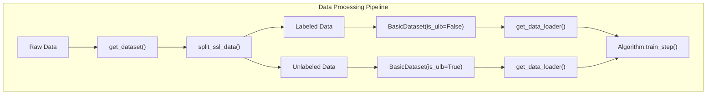

The data processing pipeline starts with raw data, which is split into labeled and unlabeled sets using `split_ssl_data()`. These sets are then wrapped in `BasicDataset` instances with appropriate transformations, and fed into data loaders for training.

Sources: [semilearn/datasets/audio_datasets/datasetbase.py:45-135](), [docs/tutorial.md:72-82]()

## Algorithm Structure

USB implements a wide range of semi-supervised learning algorithms, all following a consistent structure through inheritance from `AlgorithmBase`.

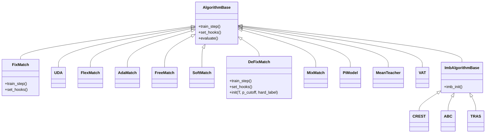

Each algorithm defines its own `train_step()` method that implements the specific training logic, and may register custom hooks via `set_hooks()`. Algorithms for imbalanced datasets inherit from `ImbAlgorithmBase`, which extends `AlgorithmBase` with functionality specific to handling class imbalance.

Sources: [semilearn/algorithms/defixmatch/defixmatch.py:11-135](), [docs/algorithm_zoo.md:1-21]()

## Model Architectures

USB supports various model architectures across different domains, including:

1. **Computer Vision**: Vision Transformers (ViT), Wide ResNets, etc.
2. **NLP**: BERT, Transformers
3. **Audio**: Wave2vec, Hubert

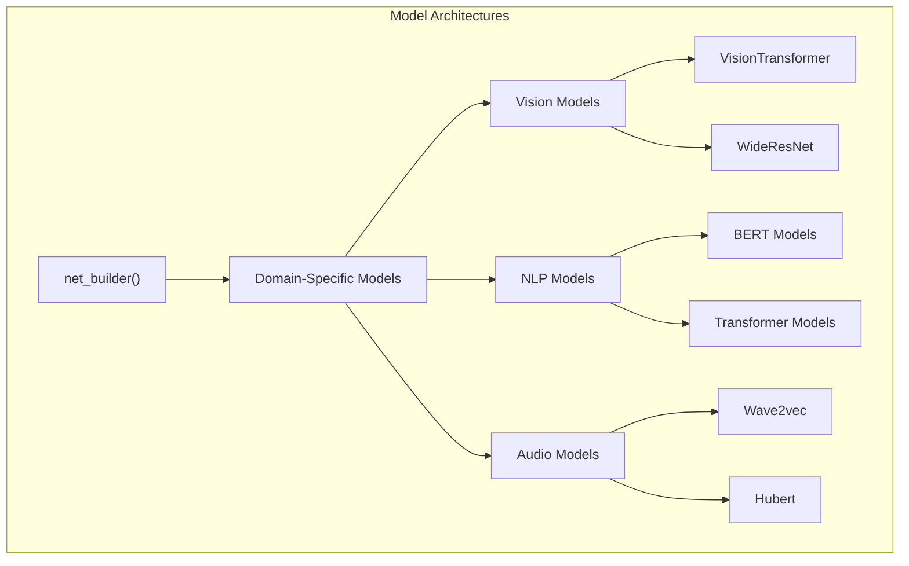

The `VisionTransformer` class, for example, implements an attention-based architecture for computer vision tasks:

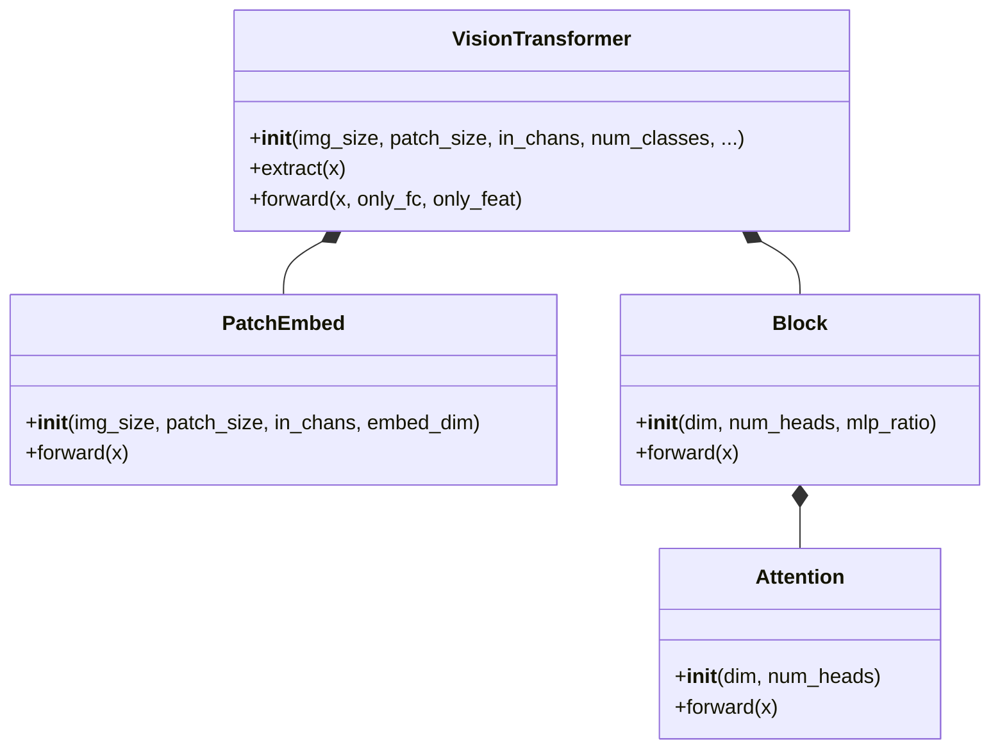

Sources: [semilearn/nets/vit/vit.py:132-196](), [semilearn/nets/vit/vit.py:18-42]()

## Data Flow in Training

The data flow during training illustrates how labeled and unlabeled data are processed through the system:

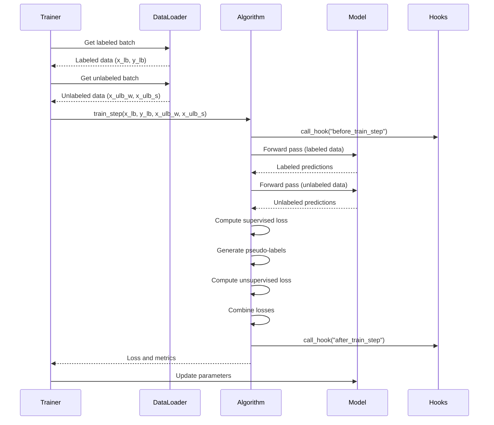

This diagram shows how the `Trainer` coordinates the data flow, how the `Algorithm` processes labeled and unlabeled data, and how hooks are called at specific points in the process.

Sources: [semilearn/algorithms/defixmatch/defixmatch.py:48-125]()

## Implementation Example: DeFixMatch Algorithm

To illustrate how algorithms are implemented in USB, let's look at the DeFixMatch algorithm:

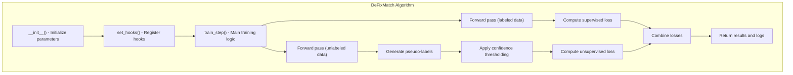

DeFixMatch extends FixMatch by introducing a de-biasing component that uses pseudo-labels generated for labeled data to counteract confirmation bias. The algorithm registers the `PseudoLabelingHook` and `FixedThresholdingHook` to handle pseudo-label generation and confidence thresholding.

Sources: [semilearn/algorithms/defixmatch/defixmatch.py:11-135]()

## Configuration and Extension Points

USB provides several extension points for customization:

### Algorithm Registration

New algorithms are registered using the `@ALGORITHMS.register` decorator:

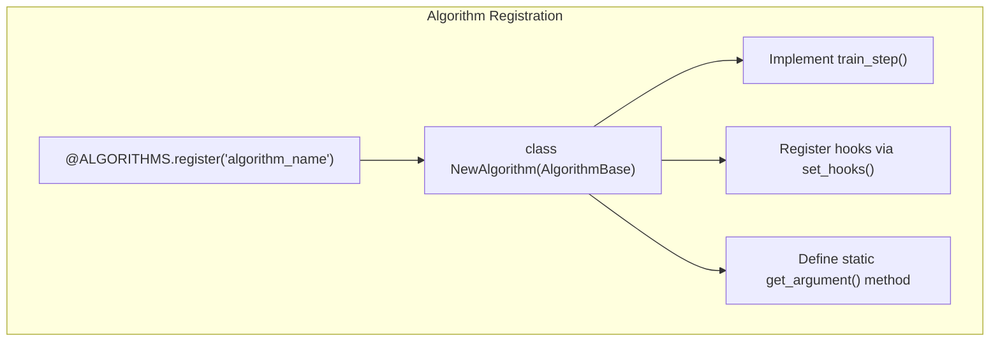

### Custom Datasets

Custom datasets can be integrated by:

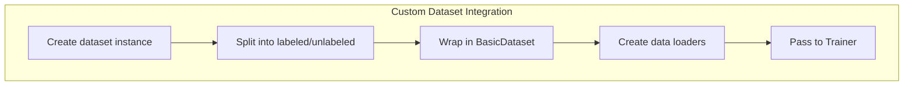

This flexible architecture allows researchers to easily extend USB with new algorithms and datasets.

Sources: [docs/tutorial.md:108-208](), [semilearn/algorithms/defixmatch/defixmatch.py:11-12]()

## Summary

The USB framework provides a unified architecture for implementing, evaluating, and comparing semi-supervised learning algorithms across multiple domains. Its modular design centered around the `AlgorithmBase` class and the hooks system enables easy extension and customization. The framework handles the complexities of semi-supervised learning, including data splitting, augmentation, and algorithm-specific optimizations, providing a solid foundation for research in this field.

Sources: [README.md:112-118](), [semilearn/__init__.py:1-9]()

---

# Page: Core Components

# Core Components

<details>
<summary>Relevant source files</summary>

The following files were used as context for generating this wiki page:

- [semilearn/core/algorithmbase.py](semilearn/core/algorithmbase.py)
- [semilearn/core/utils/build.py](semilearn/core/utils/build.py)
- [semilearn/core/utils/misc.py](semilearn/core/utils/misc.py)
- [semilearn/imb_algorithms/abc/abc.py](semilearn/imb_algorithms/abc/abc.py)
- [semilearn/imb_algorithms/tras/tras.py](semilearn/imb_algorithms/tras/tras.py)
- [semilearn/lighting/config.py](semilearn/lighting/config.py)
- [semilearn/lighting/trainer.py](semilearn/lighting/trainer.py)
- [train.py](train.py)

</details>


This document outlines the fundamental building blocks that form the foundation of the USB (Unified Semi-supervised Learning Benchmark) framework. Core components manage the training, evaluation, and execution of semi-supervised learning algorithms.

For specific algorithm implementations, see [Algorithms](#3). For dataset management, see [Datasets and Data Handling](#4).

## Core Components Overview

The USB framework is built around several key components that work together to provide a unified platform for semi-supervised learning research:

```mermaid
classDiagram
    class AlgorithmBase {
        +train_step()
        +train()
        +evaluate()
        +set_hooks()
        +save_model()
        +load_model()
    }

    class ImbAlgorithmBase {
        +imb_init()
    }

    class Trainer {
        +fit()
        +evaluate()
        +predict()
    }

    class HooksSystem {
        +register_hook()
        +call_hook()
    }

    class Utils {
        +get_dataset()
        +get_data_loader()
        +get_optimizer()
        +get_net_builder()
    }

    AlgorithmBase <|-- ImbAlgorithmBase
    AlgorithmBase -- HooksSystem
    AlgorithmBase -- Utils
    AlgorithmBase <-- Trainer
```

Sources: [semilearn/core/algorithmbase.py:20-507](), [semilearn/lighting/trainer.py:15-131](), [semilearn/core/utils/build.py:14-255]()

## AlgorithmBase

The `AlgorithmBase` class serves as the foundation for all semi-supervised learning algorithms in USB. It provides a standardized interface and common functionality that all algorithms share.

```mermaid
classDiagram
    class AlgorithmBase {
        +args: argparse
        +num_classes: int
        +ema_m: float
        +epochs: int
        +lambda_u: float
        +it: int
        +epoch: int
        +best_eval_acc: float
        +model: nn.Module
        +ema_model: nn.Module
        +dataset_dict: dict
        +loader_dict: dict
        +optimizer: Optimizer
        +scheduler: LRScheduler
        +hooks_dict: OrderedDict
        
        +set_dataset()
        +set_data_loader()
        +set_optimizer()
        +set_model()
        +set_ema_model()
        +set_hooks()
        +process_batch()
        +train_step()
        +train()
        +evaluate()
        +save_model()
        +load_model()
        +register_hook()
        +call_hook()
    }
```

Sources: [semilearn/core/algorithmbase.py:20-507]()

### Key Functions

| Method | Purpose |
|--------|---------|
| `__init__` | Initializes common parameters, datasets, models, and hooks |
| `set_dataset` | Loads and prepares datasets for training and evaluation |
| `set_data_loader` | Creates data loaders for labeled, unlabeled, and evaluation data |
| `set_model` | Initializes the neural network model |
| `set_ema_model` | Creates Exponential Moving Average (EMA) model for evaluation |
| `set_optimizer` | Sets up optimizer and learning rate scheduler |
| `set_hooks` | Registers default hooks for training |
| `train_step` | Implemented by specific algorithms for a single training step |
| `train` | Orchestrates the training process using hooks |
| `evaluate` | Evaluates model performance on validation/test data |
| `save_model` | Saves model state for checkpointing |
| `load_model` | Loads model state from checkpoint |

Sources: [semilearn/core/algorithmbase.py:34-507]()

### Training Process

The training process in `AlgorithmBase` follows a structured flow:

```mermaid
flowchart TD
    A["train()"] --> B["call_hook('before_run')"]
    B --> C[Loop through epochs]
    C --> D["call_hook('before_train_epoch')"]
    D --> E[Loop through batches]
    E --> F["call_hook('before_train_step')"]
    F --> G["train_step()"]
    G --> H["call_hook('after_train_step')"]
    H --> I[Increment iteration counter]
    I --> J{More batches?}
    J -->|Yes| E
    J -->|No| K["call_hook('after_train_epoch')"]
    K --> L{More epochs?}
    L -->|Yes| C
    L -->|No| M["call_hook('after_run')"]
```

Sources: [semilearn/core/algorithmbase.py:285-315]()

### Evaluation Process

The evaluation process assesses model performance:

```mermaid
flowchart TD
    A["evaluate()"] --> B["model.eval()"]
    B --> C["ema.apply_shadow()"]
    C --> D[Loop through evaluation data]
    D --> E["Compute model outputs"]
    E --> F["Calculate loss and metrics"]
    F --> G{More data?}
    G -->|Yes| D
    G -->|No| H["Calculate overall metrics"]
    H --> I["Create evaluation dictionary"]
    I --> J["ema.restore()"]
    J --> K["model.train()"]
    K --> L["Return results"]
```

Sources: [semilearn/core/algorithmbase.py:317-372]()

## ImbAlgorithmBase

`ImbAlgorithmBase` extends `AlgorithmBase` to handle class-imbalanced semi-supervised learning scenarios. It adds specialized functionality for dealing with imbalanced data distributions.

```mermaid
classDiagram
    AlgorithmBase <|-- ImbAlgorithmBase
    
    class ImbAlgorithmBase {
        +lb_imb_ratio: float
        +ulb_imb_ratio: float
        +imb_algorithm: str
        
        +imb_init()
        +set_optimizer()
    }
```

Sources: [semilearn/core/algorithmbase.py:510-534]()

## Hooks System

The hooks system is a powerful mechanism that enables extensibility and customization of the training process. Hooks are registered with specific priority levels and called at predefined points during training.

```mermaid
flowchart TD
    subgraph "Hook Registration"
        A["register_hook()"] --> B["Set hook priority"]
        B --> C["Insert into sorted list"]
        C --> D["Update hooks_dict"]
    end
    
    subgraph "Hook Execution"
        E["call_hook()"] --> F{Hook name provided?}
        F -->|Yes| G["Call specific hook"]
        F -->|No| H["Call all applicable hooks"]
    end
    
    subgraph "Default Hooks"
        I["set_hooks()"] --> J["ParamUpdateHook"]
        I --> K["EMAHook"]
        I --> L["EvaluationHook"]
        I --> M["CheckpointHook"]
        I --> N["DistSamplerSeedHook"]
        I --> O["TimerHook"]
        I --> P["LoggingHook"]
    end
```

Sources: [semilearn/core/algorithmbase.py:439-498](), [semilearn/core/algorithmbase.py:201-216]()

### Default Hooks

The framework registers several default hooks for common training functionality:

| Hook | Priority | Purpose |
|------|----------|---------|
| `ParamUpdateHook` | HIGHEST | Updates model parameters during training |
| `EMAHook` | HIGH | Updates Exponential Moving Average model |
| `EvaluationHook` | HIGH | Performs periodic model evaluation |
| `CheckpointHook` | HIGH | Saves model checkpoints |
| `DistSamplerSeedHook` | NORMAL | Manages seeds for distributed sampling |
| `TimerHook` | LOW | Tracks training time |
| `LoggingHook` | LOWEST | Logs training metrics |
| `WANDBHook` | LOWEST | Logs to Weights & Biases (optional) |
| `AimHook` | LOWEST | Logs to Aim (optional) |

Sources: [semilearn/core/algorithmbase.py:201-216]()

## Training Framework

The training framework in USB provides the entry point for training semi-supervised learning algorithms. There are two main implementations:

1. **Command-line Interface**: Defined in [train.py]()
2. **Lighting Trainer**: A more streamlined API in [semilearn/lighting/trainer.py]()

### Command-line Training Flow

```mermaid
flowchart TD
    A["main()"] --> B["Parse arguments"]
    B --> C["Setup distributed training"]
    C --> D["main_worker()"]
    D --> E["Set random seed"]
    E --> F["Initialize logger"]
    F --> G["Build network"]
    G --> H["Create algorithm instance"]
    H --> I["Send model to device"]
    I --> J{Resume training?}
    J -->|Yes| K["Load checkpoint"]
    J -->|No| L["Start fresh"]
    K --> M["model.train()"]
    L --> M
    M --> N["Print results"]
```

Sources: [train.py:257-403]()

### Configuration Management

USB uses a flexible configuration system that can be set through:

1. Command-line arguments
2. Configuration files (YAML)
3. Pre-defined algorithm-specific configs

```mermaid
flowchart TD
    A["get_config()"] --> B["Define base arguments"]
    B --> C["Parse initial args"]
    C --> D["Load from config file"]
    D --> E["Add algorithm-specific args"]
    E --> F{Imbalanced algorithm?}
    F -->|Yes| G["Add imbalance-specific args"]
    F -->|No| H["Skip"]
    G --> I["Final parsed args"]
    H --> I
```

Sources: [train.py:29-254](), [semilearn/lighting/config.py:11-154]()

## Utility Functions

The USB framework includes several utility functions that facilitate common operations:

### Network Building

```python
# Build network from name
net_builder = get_net_builder(args.net, args.net_from_name)
model = net_builder(num_classes=args.num_classes)
```

Sources: [semilearn/core/utils/build.py:14-39]()

### Dataset and Data Loader Creation

```python
# Create datasets
dataset_dict = get_dataset(args, algorithm, dataset, num_labels, num_classes)

# Create data loaders
train_loader = get_data_loader(args, dataset_dict['train_lb'], batch_size)
```

Sources: [semilearn/core/utils/build.py:60-180]()

### Optimizer and Scheduler Creation

```python
# Create optimizer
optimizer = get_optimizer(model, args.optim, args.lr, args.momentum, args.weight_decay)

# Create scheduler
scheduler = get_cosine_schedule_with_warmup(optimizer, num_train_iter, num_warmup_steps)
```

Sources: [semilearn/core/utils/build.py:183-241]()

## Integration Between Components

The components of USB are designed to work together seamlessly. Here's how they interact:

```mermaid
sequenceDiagram
    participant Train as train.py
    participant AlgBase as AlgorithmBase
    participant Model as Neural Network
    participant Data as Dataset/DataLoader
    participant Hook as Hooks System
    
    Train->>AlgBase: create algorithm instance
    AlgBase->>Data: set_dataset()
    AlgBase->>Data: set_data_loader()
    AlgBase->>Model: set_model()
    AlgBase->>Model: set_ema_model()
    AlgBase->>Hook: set_hooks()
    Train->>AlgBase: train()
    
    loop Each Epoch
        AlgBase->>Hook: call_hook("before_train_epoch")
        loop Each Batch
            AlgBase->>Hook: call_hook("before_train_step")
            AlgBase->>AlgBase: train_step()
            AlgBase->>Model: forward pass
            AlgBase->>Model: backward pass
            AlgBase->>Hook: call_hook("after_train_step")
        end
        AlgBase->>Hook: call_hook("after_train_epoch")
        AlgBase->>AlgBase: evaluate()
    end
    
    Train->>AlgBase: get final results
```

Sources: [train.py:257-403](), [semilearn/core/algorithmbase.py:285-315]()

## Summary

The core components of USB provide a flexible and extensible framework for implementing semi-supervised learning algorithms. The modular design allows researchers to focus on algorithm development while leveraging the common infrastructure for:

- Dataset management and loading
- Model initialization and training
- Evaluation and metrics tracking
- Checkpoint management
- Logging and visualization

The hooks system enables customization of the training process at various stages, making it easy to extend the framework with new functionality without modifying the core code.

Sources: [semilearn/core/algorithmbase.py:20-507](), [train.py:257-403]()

---

# Page: AlgorithmBase

# AlgorithmBase

<details>
<summary>Relevant source files</summary>

The following files were used as context for generating this wiki page:

- [semilearn/algorithms/adamatch/adamatch.py](semilearn/algorithms/adamatch/adamatch.py)
- [semilearn/algorithms/fixmatch/fixmatch.py](semilearn/algorithms/fixmatch/fixmatch.py)
- [semilearn/algorithms/flexmatch/flexmatch.py](semilearn/algorithms/flexmatch/flexmatch.py)
- [semilearn/algorithms/uda/uda.py](semilearn/algorithms/uda/uda.py)
- [semilearn/core/algorithmbase.py](semilearn/core/algorithmbase.py)
- [train.py](train.py)

</details>


This document details the `AlgorithmBase` class, which serves as the foundation for all semi-supervised learning (SSL) algorithms in the USB (Unified Semi-supervised learning Benchmark) framework. The `AlgorithmBase` class provides a standardized structure for implementing, training, and evaluating SSL algorithms, along with common utilities and hooks for customization.

For information about specific SSL algorithms that inherit from AlgorithmBase, see [Algorithms](#3). For details about the training framework that uses AlgorithmBase, see [Training Framework](#2.2).

## 1. Purpose and Responsibilities

The `AlgorithmBase` class serves as an abstract base class that defines the common interface and functionality for all SSL algorithms. Its main responsibilities include:

1. Managing model initialization and configuration
2. Setting up datasets and data loaders
3. Configuring optimizers and schedulers
4. Implementing the training loop structure
5. Providing evaluation methods
6. Managing model checkpointing
7. Supporting a flexible hook system for customizing behavior

All algorithm implementations in the USB framework inherit from this base class and override specific methods to implement their unique SSL approaches.

Sources: [semilearn/core/algorithmbase.py:20-507]()

## 2. Class Structure and Inheritance Hierarchy

```mermaid
classDiagram
    class AlgorithmBase {
        +__init__(args, net_builder, tb_log, logger)
        +init(**kwargs)
        +set_dataset()
        +set_data_loader()
        +set_optimizer()
        +set_model()
        +set_ema_model()
        +set_hooks()
        +process_batch()
        +process_out_dict()
        +process_log_dict()
        +train_step()
        +train()
        +evaluate()
        +get_save_dict()
        +save_model()
        +load_model()
        +register_hook()
        +call_hook()
    }
    
    AlgorithmBase <|-- FixMatch
    AlgorithmBase <|-- UDA
    AlgorithmBase <|-- FlexMatch
    AlgorithmBase <|-- AdaMatch
    AlgorithmBase <|-- ImbAlgorithmBase
    
    ImbAlgorithmBase <|-- CREST
    ImbAlgorithmBase <|-- ABC
    
    class FixMatch {
        +init(T, p_cutoff, hard_label)
        +train_step()
        +set_hooks()
    }
    
    class UDA {
        +init(T, p_cutoff, tsa_schedule)
        +train_step()
        +set_hooks()
        +TSA()
    }
    
    class FlexMatch {
        +init(T, p_cutoff, hard_label, thresh_warmup)
        +train_step()
        +set_hooks()
    }
    
    class AdaMatch {
        +init(p_cutoff, T, hard_label, ema_p)
        +train_step()
        +set_hooks()
    }
    
    class ImbAlgorithmBase {
        +imb_init()
        +set_optimizer()
    }
```

This diagram shows how `AlgorithmBase` serves as the foundation for all SSL algorithms in the USB framework. Specific algorithms like FixMatch, UDA, FlexMatch, and AdaMatch directly inherit from AlgorithmBase, while imbalanced learning algorithms inherit from ImbAlgorithmBase, which itself extends AlgorithmBase.

Sources: 
- [semilearn/core/algorithmbase.py:20-507]()
- [semilearn/core/algorithmbase.py:510-534]()
- [semilearn/algorithms/fixmatch/fixmatch.py:11-114]()
- [semilearn/algorithms/uda/uda.py:12-136]()
- [semilearn/algorithms/flexmatch/flexmatch.py:15-140]()
- [semilearn/algorithms/adamatch/adamatch.py:14-141]()

## 3. Initialization and Core Attributes

When initializing an `AlgorithmBase` instance, several important components are set up:

```mermaid
flowchart TD
    subgraph "AlgorithmBase.__init__()"
        A["Parse arguments"] --> B["Initialize attributes"]
        B --> C["Set up dataset"]
        C --> D["Create data loaders"]
        D --> E["Build model"]
        E --> F["Create EMA model"]
        F --> G["Configure optimizer & scheduler"]
        G --> H["Set up loss functions"]
        H --> I["Register hooks"]
    end
```

The initialization process includes the following key components:

| Component | Description | Relevant Method |
|-----------|-------------|-----------------|
| Model | The main neural network | `set_model()` |
| EMA Model | Exponential moving average of the model for evaluation | `set_ema_model()` |
| Dataset | Training and evaluation datasets | `set_dataset()` |
| Data Loaders | Iterators for the datasets | `set_data_loader()` |
| Optimizer & Scheduler | For model parameter updates | `set_optimizer()` |
| Hooks | Extensible components for customizing behavior | `set_hooks()` |
| Loss Functions | CE loss and consistency loss | Initialized directly in `__init__` |

Key attributes initialized in the constructor include:

```python
self.args = args  # Algorithm arguments
self.num_classes = args.num_classes  # Number of classes
self.ema_m = args.ema_m  # EMA momentum
self.epochs = args.epoch  # Number of epochs
self.num_train_iter = args.num_train_iter  # Total training iterations
self.num_eval_iter = args.num_eval_iter  # Evaluation frequency
self.lambda_u = args.ulb_loss_ratio  # Unsupervised loss weight
self.use_amp = args.amp  # Automatic mixed precision
```

Sources:
- [semilearn/core/algorithmbase.py:34-103]()
- [semilearn/core/algorithmbase.py:174-184]()
- [semilearn/core/algorithmbase.py:186-199]()

## 4. The Hook System

One of the most powerful features of `AlgorithmBase` is its hook system, which enables flexible customization of the training process without modifying the core code.

```mermaid
flowchart TD
    subgraph "Hook Registration and Execution"
        RegHook["register_hook(hook, name, priority)"] --> HooksList["self._hooks (priority sorted)"]
        HooksList --> HooksDict["self.hooks_dict (name-keyed)"]
        
        Train["train()"] --> CallHook["call_hook(hook_point, hook_name)"]
        CallHook --> ExecHook["Execute hook method"]
        
        subgraph "Hook Points"
            HP1["before_run"]
            HP2["before_train_epoch"]
            HP3["before_train_step"]
            HP4["after_train_step"]
            HP5["after_train_epoch"]
            HP6["after_run"]
        end
    end
```

The `AlgorithmBase` registers several built-in hooks by default:

| Hook | Priority | Purpose |
|------|----------|---------|
| `ParamUpdateHook` | HIGHEST | Updates model parameters during training |
| `EMAHook` | HIGH | Updates the EMA model |
| `EvaluationHook` | HIGH | Periodically evaluates the model |
| `CheckpointHook` | HIGH | Saves model checkpoints |
| `DistSamplerSeedHook` | NORMAL | Manages distributed training seeds |
| `TimerHook` | LOW | Times training operations |
| `LoggingHook` | LOWEST | Logs training progress |
| `WANDBHook` (optional) | LOWEST | Integrates with Weights & Biases |
| `AimHook` (optional) | LOWEST | Integrates with Aim |

Algorithm-specific hooks are registered by their respective algorithm classes. For example, FixMatch registers:
- `PseudoLabelingHook` - Generates pseudo-labels for unlabeled data
- `FixedThresholdingHook` - Applies thresholding to pseudo-labels

Sources:
- [semilearn/core/algorithmbase.py:201-216]()
- [semilearn/core/algorithmbase.py:439-498]()
- [semilearn/algorithms/fixmatch/fixmatch.py:43-46]()

## 5. The Training Process

The `train()` method implements the main training loop, which iterates over epochs and batches, calling the algorithm-specific `train_step()` method and managing hooks.

```mermaid
flowchart TD
    subgraph "AlgorithmBase.train()"
        A["call_hook('before_run')"] --> B["Loop over epochs"]
        B --> C["call_hook('before_train_epoch')"]
        C --> D["Loop over batches"]
        D --> E["call_hook('before_train_step')"]
        E --> F["train_step()"]
        F --> G["call_hook('after_train_step')"]
        G --> H["Increment iteration counter"]
        H --> D
        D --> I["call_hook('after_train_epoch')"]
        I --> B
        B --> J["call_hook('after_run')"]
    end
```

The `train_step()` method is an abstract method that must be implemented by each algorithm subclass. It typically follows this pattern:

1. Process labeled and unlabeled batches
2. Forward pass through the model
3. Calculate supervised loss (from labeled data)
4. Generate pseudo-labels for unlabeled data
5. Apply algorithm-specific processing (thresholding, sharpening, etc.)
6. Calculate unsupervised loss
7. Combine losses and return

For example, the FixMatch algorithm's `train_step()` method:
1. Processes labeled data to compute supervised loss
2. Generates pseudo-labels from weakly-augmented unlabeled data
3. Applies confidence thresholding to filter out uncertain predictions
4. Computes unsupervised loss by comparing strongly-augmented unlabeled predictions with pseudo-labels
5. Combines the losses with appropriate weighting

Sources:
- [semilearn/core/algorithmbase.py:285-315]()
- [semilearn/algorithms/fixmatch/fixmatch.py:48-105]()

## 6. Algorithm-Specific Customization

Algorithms that inherit from `AlgorithmBase` customize its behavior in several ways:

1. **Implementing `train_step()`**: Define the specific training step logic
2. **Overriding `init()`**: Set algorithm-specific parameters
3. **Customizing `set_hooks()`**: Register algorithm-specific hooks
4. **Extending `get_save_dict()`**: Add algorithm-specific state to checkpoints

Here's a comparison of how different algorithms customize `AlgorithmBase`:

| Algorithm | Key Parameters | Special Hooks | Unique Features |
|-----------|---------------|--------------|-----------------|
| FixMatch | T (temperature), p_cutoff (threshold) | FixedThresholdingHook | Simple confidence-based masking |
| FlexMatch | T, p_cutoff, thresh_warmup | FlexMatchThresholdingHook | Class-wise dynamic thresholding |
| UDA | T, p_cutoff, tsa_schedule | FixedThresholdingHook | Training Signal Annealing (TSA) |
| AdaMatch | T, p_cutoff, ema_p | DistAlignEMAHook, AdaMatchThresholdingHook | Distribution alignment |

Sources:
- [semilearn/algorithms/fixmatch/fixmatch.py:33-46]()
- [semilearn/algorithms/flexmatch/flexmatch.py:43-57]()
- [semilearn/algorithms/uda/uda.py:35-48]()
- [semilearn/algorithms/adamatch/adamatch.py:37-54]()

## 7. Evaluation and Model Management

`AlgorithmBase` provides several methods for model evaluation and management:

### 7.1 Evaluation

The `evaluate()` method:
1. Sets the model to evaluation mode
2. Applies the EMA model for better evaluation performance
3. Iterates through evaluation data
4. Computes multiple metrics (top-1/top-5 accuracy, balanced accuracy, precision, recall, F1 score)
5. Generates a confusion matrix
6. Returns an evaluation dictionary

### 7.2 Model Saving and Loading

The `save_model()` and `load_model()` methods handle model checkpointing, saving/loading:
- Model parameters
- EMA model parameters
- Optimizer state
- Training iteration and epoch counters
- Best evaluation metrics
- Algorithm-specific state (through `get_save_dict()`)

This enables seamless resumption of training from checkpoints.

Sources:
- [semilearn/core/algorithmbase.py:317-372]()
- [semilearn/core/algorithmbase.py:375-437]()

## 8. Implementation Process for New Algorithms

To implement a new SSL algorithm using `AlgorithmBase`:

1. Create a new class that inherits from `AlgorithmBase`
2. Implement the `init()` method to set algorithm-specific parameters
3. Override `set_hooks()` to register any custom hooks
4. Implement the `train_step()` method with the algorithm's specific training logic
5. Optionally override `get_save_dict()` and `load_model()` if the algorithm needs to save additional state
6. Register the algorithm using the `@ALGORITHMS.register()` decorator

Example structure for a new algorithm:

```python
@ALGORITHMS.register('new_algorithm')
class NewAlgorithm(AlgorithmBase):
    def __init__(self, args, net_builder, tb_log=None, logger=None):
        super().__init__(args, net_builder, tb_log, logger)
        self.init(param1=args.param1, param2=args.param2)
    
    def init(self, param1, param2):
        self.param1 = param1
        self.param2 = param2
    
    def set_hooks(self):
        self.register_hook(CustomHook(), "CustomHook")
        super().set_hooks()
    
    def train_step(self, x_lb, y_lb, x_ulb_w, x_ulb_s):
        # Implement algorithm-specific training step
        # Calculate losses and return results
        pass
    
    @staticmethod
    def get_argument():
        return [
            SSL_Argument('--param1', float, 0.5),
            SSL_Argument('--param2', float, 0.95),
        ]
```

Sources:
- [semilearn/algorithms/fixmatch/fixmatch.py:11-114]()
- [semilearn/algorithms/uda/uda.py:12-136]()

---

# Page: Training Framework

# Training Framework

<details>
<summary>Relevant source files</summary>

The following files were used as context for generating this wiki page:

- [notebooks/Beginner_Example.ipynb](notebooks/Beginner_Example.ipynb)
- [notebooks/Custom_Algorithm.ipynb](notebooks/Custom_Algorithm.ipynb)
- [semilearn/core/algorithmbase.py](semilearn/core/algorithmbase.py)
- [semilearn/lighting/config.py](semilearn/lighting/config.py)
- [semilearn/lighting/trainer.py](semilearn/lighting/trainer.py)
- [train.py](train.py)

</details>


The Training Framework is the core component of the USB (Unified Semi-supervised Learning Benchmark) that orchestrates the entire training process. This document explains how training is configured, executed, and evaluated in the USB framework.

For information about the base algorithm implementation, see [AlgorithmBase](#2.1). For details on the hook system used to extend training behavior, see [Hooks System](#2.3).

## Overview

The Training Framework provides a unified system for training semi-supervised learning algorithms across different domains (computer vision, NLP, audio). It manages configuration, model setup, training loops, evaluation, and distributed training processes.

```mermaid
flowchart TD
    subgraph "Training Framework Components"
        config["Configuration System"]
        train["Training Process"]
        eval["Evaluation Process"]
        dist["Distributed Training"]
    end
    
    config --> |"Feeds parameters"| train
    train --> |"Periodically calls"| eval
    dist --> |"Wraps"| train
    
    subgraph "External Components"
        alg["Algorithm Implementation"]
        data["Datasets & Data Loaders"]
        hooks["Hooks System"]
    end
    
    train --> |"Instantiates"| alg
    train --> |"Uses"| data
    alg --> |"Registers"| hooks
    hooks --> |"Modify"| train
```

Sources: [train.py:257-403](), [semilearn/core/algorithmbase.py:20-282]()

## Configuration System

The configuration system allows users to define training parameters through command-line arguments or configuration files.

### Configuration Parameters

The configuration parameters are categorized into:

| Category | Description | Examples |
|----------|-------------|----------|
| Saving & Loading | Model checkpoint management | `save_dir`, `save_name`, `resume`, `load_path` |
| Training Configuration | Core training parameters | `epoch`, `num_train_iter`, `batch_size`, `uratio` |
| Optimizer Configuration | Learning rate and optimization | `optim`, `lr`, `momentum`, `weight_decay` |
| Backbone Configuration | Model architecture settings | `net`, `net_from_name`, `use_pretrain` |
| Algorithm Configuration | Algorithm-specific settings | `algorithm`, `use_cat`, `amp` |
| Data Configuration | Dataset parameters | `data_dir`, `dataset`, `num_classes`, `train_sampler` |
| Distributed Training | Multi-GPU settings | `world-size`, `rank`, `dist-url`, `gpu` |

```mermaid
flowchart LR
    cmd["Command Line Arguments"] --> parser["ArgumentParser"]
    file["Config File"] --> parser
    
    parser --> base_args["Base Arguments"]
    parser --> alg_args["Algorithm-specific Arguments"]
    parser --> imb_args["Imbalance-specific Arguments"]
    
    base_args --> config["Final Configuration"]
    alg_args --> config
    imb_args --> config
    
    config --> main["Training Process"]
```

Sources: [train.py:29-254](), [semilearn/lighting/config.py:11-154]()

### Configuration Generation Process

The configuration generation process happens in `get_config()`:

1. Define base arguments for all training aspects
2. Parse initial arguments
3. Load algorithm-specific arguments
4. Load imbalance algorithm-specific arguments (if applicable)
5. Override arguments from config file (if specified)
6. Set up distributed training parameters

Sources: [train.py:29-254](), [semilearn/lighting/config.py:11-154]()

## Training Process

The training process is orchestrated by the `main()` and `main_worker()` functions in `train.py`, which initialize the environment and delegate the actual training to the algorithm's `train()` method.

```mermaid
sequenceDiagram
    participant train as train.py
    participant algo as Algorithm
    participant model as Model
    participant data as DataLoader
    participant hooks as Hooks
    
    train->>train: Parse config
    train->>train: Setup environment
    train->>algo: Initialize algorithm
    algo->>model: Create model
    algo->>data: Create data loaders
    algo->>hooks: Register hooks
    
    train->>algo: Call train()
    activate algo
    
    loop For each epoch
        algo->>hooks: before_train_epoch
        
        loop For each batch
            algo->>data: Get labeled batch
            algo->>data: Get unlabeled batch
            algo->>hooks: before_train_step
            algo->>algo: train_step()
            algo->>hooks: after_train_step
            
            alt Evaluation iteration
                algo->>algo: evaluate()
                algo->>algo: save_model() if best
            end
        end
        
        algo->>hooks: after_train_epoch
    end
    
    deactivate algo
    
    train->>train: Print results
```

Sources: [train.py:257-403](), [semilearn/core/algorithmbase.py:284-315]()

### Initialization

The initialization phase includes:

1. Parsing configuration from command line or config file
2. Setting up environment (random seed, CUDA, etc.)
3. Setting up distributed training if needed
4. Initializing the algorithm with the appropriate network builder
5. Setting up logging

Sources: [train.py:257-376](), [semilearn/core/algorithmbase.py:35-103]()

### Training Loop

The core training loop is implemented in `AlgorithmBase.train()` and performs:

1. Iterate through epochs
2. Iterate through batches of labeled and unlabeled data
3. Call hooks before/after each training step
4. Call algorithm-specific `train_step()` method
5. Periodically evaluate the model and save checkpoints

The training process stops when:
- The maximum number of iterations (`num_train_iter`) is reached
- The maximum number of epochs is reached

Sources: [semilearn/core/algorithmbase.py:284-315]()

### Training Step

The `train_step()` method is implemented by each algorithm and defines how a single batch is processed:

1. Process labeled and unlabeled data
2. Compute supervised loss (labeled data)
3. Compute unsupervised loss (unlabeled data)
4. Update model parameters
5. Record metrics

Sources: [semilearn/core/algorithmbase.py:273-282]()

## Evaluation Process

Evaluation is performed periodically during training and at the end of training. The evaluation process:

1. Switches the model to evaluation mode
2. Applies EMA (Exponential Moving Average) model if enabled
3. Computes forward pass on evaluation dataset
4. Calculates metrics (accuracy, precision, recall, F1)
5. Logs confusion matrix
6. Returns the model to training mode

```mermaid
flowchart TD
    start["Evaluation Start"] --> mode["Set model.eval()"]
    mode --> ema["Apply EMA shadow model"]
    ema --> loop["For each batch in eval loader"]
    
    loop --> forward["Forward pass through model"]
    forward --> compute["Compute loss"]
    compute --> collect["Collect predictions"]
    collect --> end_loop["End batch loop"]
    
    end_loop --> metrics["Calculate metrics:
    - Top-1 accuracy
    - Top-5 accuracy
    - Balanced accuracy
    - Precision
    - Recall
    - F1 score"]
    
    metrics --> confusion["Generate confusion matrix"]
    confusion --> restore["Restore original model"]
    restore --> train_mode["Set model.train()"]
    train_mode --> finish["Return evaluation results"]
```

Sources: [semilearn/core/algorithmbase.py:317-372](), [semilearn/lighting/trainer.py:80-93]()

## Distributed Training Support

USB supports distributed training across multiple GPUs using PyTorch's DistributedDataParallel.

```mermaid
flowchart TD
    start["main()"] --> is_dist{"Distributed
    Training?"}
    
    is_dist -->|"Yes"| mp["Launch processes with
    mp.spawn()"]
    is_dist -->|"No"| direct["Call main_worker
    directly"]
    
    mp --> init["Initialize process group
    dist.init_process_group()"]
    direct --> worker["main_worker()"]
    
    init --> worker
    
    worker --> model["Create model"]
    model --> cuda["Send model to CUDA device"]
    cuda --> ddp{"Use DistributedDataParallel?"}
    
    ddp -->|"Yes"| wrap["Wrap model with
    DistributedDataParallel"]
    ddp -->|"No"| train["Start training"]
    
    wrap --> train
```

Key components of distributed training:
- `world_size`: Total number of processes
- `rank`: Process ID
- `dist_url`: URL for initializing process group
- `dist_backend`: Backend for distributed communication (usually NCCL)
- `multiprocessing_distributed`: Whether to use multiprocessing for distributed training

Sources: [train.py:303-317](), [train.py:337-351]()

## Simplified Training Interface

The `Trainer` class in `semilearn/lighting/trainer.py` provides a simplified interface for training:

```mermaid
classDiagram
    class Trainer {
        +__init__(config, algorithm, verbose)
        +fit(train_lb_loader, train_ulb_loader, eval_loader)
        +evaluate(data_loader, use_ema_model=False)
        +predict(data_loader, use_ema_model=False, return_gt=False)
    }
    
    class Algorithm {
        +train_step()
        +train()
        +evaluate()
        +model
        +ema_model
    }
    
    Trainer --> Algorithm: uses
```

This interface is particularly useful for interactive environments like Jupyter notebooks, as seen in the example notebooks.

Sources: [semilearn/lighting/trainer.py:15-131](), [notebooks/Beginner_Example.ipynb]()

## Integration with Algorithms

The Training Framework is designed to work with any algorithm that inherits from `AlgorithmBase`. Each algorithm must implement:

- `train_step()`: Defines how a single batch is processed
- Algorithm-specific parameters (via `get_argument()`)
- Optional hooks for customizing the training process

```mermaid
flowchart TD
    subgraph "Training Framework"
        train_py["train.py"]
        config["Configuration"]
        trainer["Trainer"]
    end
    
    subgraph "Algorithm Base"
        alg_base["AlgorithmBase"]
        train_method["train()"]
        eval_method["evaluate()"]
    end
    
    subgraph "SSL Algorithms"
        fixmatch["FixMatch"]
        flexmatch["FlexMatch"]
        freematch["FreeMatch"]
        other["Other Algorithms..."]
    end
    
    train_py --> |"instantiates"| alg_base
    config --> |"configures"| alg_base
    trainer --> |"wraps"| alg_base
    
    alg_base <-- |"inherits"| fixmatch
    alg_base <-- |"inherits"| flexmatch
    alg_base <-- |"inherits"| freematch
    alg_base <-- |"inherits"| other
    
    train_method --> |"calls algorithm-specific"| train_step["train_step()"]
    fixmatch --> |"implements"| train_step
    flexmatch --> |"implements"| train_step
    freematch --> |"implements"| train_step
    other --> |"implements"| train_step
```

Sources: [semilearn/core/algorithmbase.py:20-106](), [semilearn/core/algorithmbase.py:273-282]()

## Example Usage

Below is a simplified example of using the Training Framework based on the provided notebook:

1. Define configuration:
```python
config = {
    'algorithm': 'fixmatch',
    'net': 'vit_tiny_patch2_32',
    'epoch': 1,
    'num_train_iter': 5000,
    'batch_size': 16,
    'dataset': 'cifar10',
    'num_labels': 40,
    # ... other config params
}
config = get_config(config)
```

2. Create algorithm:
```python
algorithm = get_algorithm(config, get_net_builder(config.net, from_name=False))
```

3. Create datasets and data loaders:
```python
dataset_dict = get_dataset(config, config.algorithm, config.dataset, config.num_labels)
train_lb_loader = get_data_loader(config, dataset_dict['train_lb'], config.batch_size)
train_ulb_loader = get_data_loader(config, dataset_dict['train_ulb'], 
                                  int(config.batch_size * config.uratio))
eval_loader = get_data_loader(config, dataset_dict['eval'], config.eval_batch_size)
```

4. Train:
```python
trainer = Trainer(config, algorithm)
trainer.fit(train_lb_loader, train_ulb_loader, eval_loader)
```

5. Evaluate:
```python
results = trainer.evaluate(eval_loader)
```

Sources: [notebooks/Beginner_Example.ipynb](), [notebooks/Custom_Algorithm.ipynb]()

## Creating Custom Algorithms

To create a custom algorithm:

1. Inherit from an existing algorithm or `AlgorithmBase`
2. Implement the `train_step()` method
3. Register the algorithm with the `@ALGORITHMS.register('algorithm_name')` decorator
4. Implement `get_argument()` if needed for algorithm-specific parameters

For example:
```python
@ALGORITHMS.register('custom_algorithm')
class CustomAlgorithm(AlgorithmBase):
    def train_step(self, idx_lb, x_lb, y_lb, idx_ulb, x_ulb_w, x_ulb_s):
        # Implement training step
        # ...
        return out_dict, log_dict
    
    @staticmethod
    def get_argument():
        return [
            # Define algorithm-specific arguments
        ]
```

Sources: [notebooks/Custom_Algorithm.ipynb](), [semilearn/core/algorithmbase.py:501-507]()

## Summary

The Training Framework is a flexible and extensible system for training semi-supervised learning algorithms. It provides:

- A unified configuration system
- A standard training process that can be customized with hooks
- Support for distributed training
- A comprehensive evaluation process
- Easy integration with custom algorithms

This framework enables consistent experimentation with different SSL algorithms across various domains and datasets, making it a powerful tool for research and development in semi-supervised learning.

---

# Page: Hooks System

# Hooks System

<details>
<summary>Relevant source files</summary>

The following files were used as context for generating this wiki page:

- [CHANGE_LOG.md](CHANGE_LOG.md)
- [semilearn/core/criterions/consistency.py](semilearn/core/criterions/consistency.py)
- [semilearn/core/hooks/aim.py](semilearn/core/hooks/aim.py)
- [semilearn/core/hooks/evaluation.py](semilearn/core/hooks/evaluation.py)
- [semilearn/core/hooks/timer.py](semilearn/core/hooks/timer.py)
- [semilearn/core/hooks/wandb.py](semilearn/core/hooks/wandb.py)
- [semilearn/imb_algorithms/__init__.py](semilearn/imb_algorithms/__init__.py)
- [semilearn/imb_algorithms/cossl/cossl.py](semilearn/imb_algorithms/cossl/cossl.py)
- [semilearn/imb_algorithms/cossl/utils.py](semilearn/imb_algorithms/cossl/utils.py)
- [semilearn/imb_algorithms/crest/crest.py](semilearn/imb_algorithms/crest/crest.py)
- [semilearn/imb_algorithms/saw/saw.py](semilearn/imb_algorithms/saw/saw.py)
- [semilearn/imb_algorithms/saw/utils.py](semilearn/imb_algorithms/saw/utils.py)

</details>


The Hooks System in the USB (Unified Semi-supervised Learning Benchmark) is an extensible event-based mechanism that allows for customizing and extending the training workflow without modifying the core algorithm code. It enables separation of concerns between the main training logic and auxiliary functionality like logging, evaluation, parameter updates, and algorithm-specific operations.

For information about the overall training framework see [Training Framework](#2.2), and for algorithm implementation details see [Algorithms](#3).

## System Architecture

The Hooks System follows an observer pattern where various "hooks" can be registered to be called at specific points during the training lifecycle.

### Hook Lifecycle

```mermaid
flowchart TD
    subgraph "Hook Lifecycle"
        B["before_run()"] --> B1["before_train_epoch()"]
        B1 --> B2["before_train_step()"]
        B2 --> A2["after_train_step()"]
        A2 --> |"next iteration"| B2
        A2 --> |"epoch complete"| A1["after_train_epoch()"]
        A1 --> |"next epoch"| B1
        A1 --> |"training complete"| A["after_run()"]
    end
```

Sources: [semilearn/imb_algorithms/crest/crest.py:184-232](), [semilearn/core/hooks/evaluation.py:15-38]()

### Hook Registration and Priority System

```mermaid
classDiagram
    class AlgorithmBase {
        +hooks_dict
        +register_hook(hook, name, priority)
        +call_hook(hook_point)
        +set_hooks()
    }
    
    class Hook {
        +before_run(algorithm)
        +after_run(algorithm)
        +before_train_epoch(algorithm)
        +after_train_epoch(algorithm)
        +before_train_step(algorithm)
        +after_train_step(algorithm)
        +every_n_iters(algorithm, n)
        +is_last_iter(algorithm)
    }
    
    AlgorithmBase --> "many" Hook: registers
    
    class PriorityLevels {
        HIGHEST
        HIGH
        NORMAL
        LOW
        LOWEST
    }
    
    AlgorithmBase --> PriorityLevels: uses
```

Sources: [semilearn/imb_algorithms/crest/crest.py:53-58](), [semilearn/imb_algorithms/cossl/cossl.py:176-177](), [semilearn/imb_algorithms/saw/saw.py:37-49]()

Hooks are registered with a priority level that determines their execution order during each hook point. The available priority levels are:

- `HIGHEST`: Executed first
- `HIGH`: Executed after highest priority hooks
- `NORMAL`: Default priority level
- `LOW`: Executed after normal priority hooks
- `LOWEST`: Executed last

## Standard Hooks

The USB framework provides several standard hooks for different purposes:

### Monitoring Hooks

```mermaid
classDiagram
    class Hook {
        +before_run(algorithm)
        +after_run(algorithm)
        +before_train_step(algorithm)
        +after_train_step(algorithm)
    }
    
    Hook <|-- WANDBHook
    Hook <|-- AimHook
    Hook <|-- TimerHook
    Hook <|-- LoggingHook
    
    class WANDBHook {
        +log_key_list
        +before_run(algorithm)
        +after_train_step(algorithm)
        +after_run(algorithm)
    }
    
    class AimHook {
        +log_key_list
        +before_run(algorithm)
        +after_train_step(algorithm)
    }
    
    class TimerHook {
        +before_run(algorithm)
        +before_train_step(algorithm)
        +after_train_step(algorithm)
    }
```

Sources: [semilearn/core/hooks/wandb.py:9-62](), [semilearn/core/hooks/aim.py:9-49](), [semilearn/core/hooks/timer.py:8-27]()

#### WANDBHook

The WANDBHook integrates with Weights & Biases to track experiments. It:
- Initializes W&B run with appropriate metadata in `before_run()`
- Logs metrics at regular intervals in `after_train_step()`
- Closes the W&B run in `after_run()`

#### AimHook

Similar to WANDBHook, AimHook integrates with the Aim experiment tracking tool:
- Sets up the Aim run with experiment configuration and tags
- Logs metrics and evaluation results at specified intervals

#### TimerHook

The TimerHook measures execution time for training:
- Creates CUDA events for timing in `before_run()`
- Records the data loading time in `before_train_step()`
- Calculates and logs the run time in `after_train_step()`

### Evaluation and Checkpoint Hooks

```mermaid
classDiagram
    class Hook {
        +after_train_step(algorithm)
        +after_run(algorithm)
    }
    
    Hook <|-- EvaluationHook
    Hook <|-- CheckpointHook
    
    class EvaluationHook {
        +after_train_step(algorithm)
        +after_run(algorithm)
    }
    
    class CheckpointHook {
        +after_train_step(algorithm)
        +after_run(algorithm)
    }
```

Sources: [semilearn/core/hooks/evaluation.py:9-38]()

#### EvaluationHook

The EvaluationHook periodically evaluates the model during training:
- Runs evaluation at specified intervals in `after_train_step()`
- Updates and tracks the best performance metrics
- Loads the best model and evaluates on the test set in `after_run()`

### Algorithm-Specific Hooks

Many SSL algorithms implement custom hooks for specialized functionality:

```mermaid
classDiagram
    class Hook {
        +before_run(algorithm)
        +before_train_epoch(algorithm)
        +after_train_epoch(algorithm)
    }
    
    Hook <|-- SAWWeightsHook
    Hook <|-- CoSSLParamUpdateHook
    Hook <|-- ParamUpdateHook
    
    class SAWWeightsHook {
        +y_lb_cnt
        +num_ulb
        +before_run(algorithm)
        +before_train_epoch(algorithm)
        +after_train_epoch(algorithm)
    }
    
    class CoSSLParamUpdateHook {
        +after_train_step(algorithm)
        +before_train_epoch(algorithm)
    }
    
    class ParamUpdateHook {
        +after_train_step(algorithm)
    }
```

Sources: [semilearn/imb_algorithms/saw/utils.py:22-57](), [semilearn/imb_algorithms/cossl/cossl.py:50-99]()

#### SAWWeightsHook

The SAWWeightsHook implements class weighting functionality for the SAW algorithm:
- Computes effective weights for labeled and unlabeled data in `before_run()`
- Updates the loss function weights in `before_train_epoch()`
- Recomputes unlabeled data weights based on predictions in `after_train_epoch()`

#### CoSSLParamUpdateHook

The CoSSLParamUpdateHook extends parameter updates for the CoSSL algorithm:
- Handles normal parameter updates plus teacher classifier updates
- Initializes the teacher classifier with warmup in `before_train_epoch()`

## Hook Registration Process

Hooks are registered with the algorithm base class through the `register_hook` method. The registration process typically happens in the `set_hooks()` method of the algorithm.

```mermaid
sequenceDiagram
    participant A as Algorithm
    participant AB as AlgorithmBase
    participant H as Hook
    
    A->>AB: set_hooks()
    AB->>AB: register default hooks
    A->>AB: register_hook(hook, name, priority)
    AB->>AB: store hook in hooks_dict
    
    Note over A,AB: During training
    A->>AB: call_hook("before_train_step")
    AB->>H: before_train_step(algorithm)
```

Sources: [semilearn/imb_algorithms/crest/crest.py:53-71](), [semilearn/imb_algorithms/saw/saw.py:37-49]()

## Common Hook Patterns

### Conditional Execution

Hooks often use utilities like `every_n_iters()` to conditionally execute logic:

```python
def after_train_step(self, algorithm):
    if self.every_n_iters(algorithm, algorithm.num_log_iter):
        # Log metrics every num_log_iter iterations
        self.run.log(log_dict, step=algorithm.it)
    
    if self.every_n_iters(algorithm, algorithm.num_eval_iter):
        # Evaluate model every num_eval_iter iterations
        self.run.log({'eval/best-acc': algorithm.best_eval_acc}, step=algorithm.it)
```

Sources: [semilearn/core/hooks/wandb.py:50-59](), [semilearn/core/hooks/evaluation.py:14-24]()

### Algorithm State Access and Modification

Hooks have direct access to the algorithm instance and can read or modify its state:

```python
def before_run(self, algorithm):
    algorithm.x_lb_weights = effective_weights(self.y_lb_cnt).cuda(algorithm.gpu)
    algorithm.print_fn("labeled data class weights: {}".format(algorithm.x_lb_weights))
```

Sources: [semilearn/imb_algorithms/saw/utils.py:28-36]()

## Algorithm-Specific Hook Usage Examples

Different SSL algorithms use the hooks system in different ways:

### SAW Algorithm

The SAW algorithm uses hooks to implement class weighting:

```mermaid
flowchart TD
    A[SAW Algorithm] --> B["register SAWWeightsHook"]
    B --> C["before_run: compute initial weights"]
    C --> D["before_train_epoch: set weights in loss functions"]
    D --> E["after_train_epoch: update weights based on predictions"]
```

Sources: [semilearn/imb_algorithms/saw/saw.py:37-49](), [semilearn/imb_algorithms/saw/utils.py:22-57]()

### CReST Algorithm

The CReST algorithm replaces standard hooks with specialized versions:

```mermaid
flowchart TD
    A[CReST Algorithm] --> B["set_hooks()"]
    B --> C["Register CReSTCheckpointHook"]
    B --> D["Register CReSTLoggingHook"]
    B --> E["Register ProgressiveDistAlignEMAHook"]
```

Sources: [semilearn/imb_algorithms/crest/crest.py:53-71]()

## Implementing Custom Hooks

To create a custom hook, you need to inherit from the `Hook` base class and implement the desired lifecycle methods:

```python
class CustomHook(Hook):
    def __init__(self, custom_param):
        super().__init__()
        self.custom_param = custom_param
        
    def before_run(self, algorithm):
        # Initialization logic
        pass
        
    def after_train_step(self, algorithm):
        # Logic to execute after each training step
        if self.every_n_iters(algorithm, 100):
            # Do something every 100 iterations
            pass
```

Register your custom hook in your algorithm's `set_hooks` method:

```python
def set_hooks(self):
    super().set_hooks()
    self.register_hook(CustomHook(custom_param=42), "CustomHook", "NORMAL")
```

## Summary

The Hooks System provides a flexible, extensible way to customize the training process in the USB framework. By separating core algorithm logic from auxiliary functionality, it enables:

1. Clean, modular code organization
2. Easy addition of new monitoring, logging, and evaluation features
3. Algorithm-specific customizations without modifying the core training loop
4. Conditional execution at specific points in the training process

This architecture makes the USB framework highly adaptable to different SSL algorithms and research needs.

Sources: [CHANGE_LOG.md:29-31]()

---

# Page: Algorithms

# Algorithms

<details>
<summary>Relevant source files</summary>

The following files were used as context for generating this wiki page:

- [docs/algorithm_zoo.md](docs/algorithm_zoo.md)
- [docs/benchmark.md](docs/benchmark.md)
- [docs/contributors.md](docs/contributors.md)
- [docs/tutorial.md](docs/tutorial.md)
- [semilearn/algorithms/adamatch/adamatch.py](semilearn/algorithms/adamatch/adamatch.py)
- [semilearn/algorithms/fixmatch/fixmatch.py](semilearn/algorithms/fixmatch/fixmatch.py)
- [semilearn/algorithms/flexmatch/flexmatch.py](semilearn/algorithms/flexmatch/flexmatch.py)
- [semilearn/algorithms/mixmatch/mixmatch.py](semilearn/algorithms/mixmatch/mixmatch.py)
- [semilearn/algorithms/pimodel/pimodel.py](semilearn/algorithms/pimodel/pimodel.py)
- [semilearn/algorithms/remixmatch/remixmatch.py](semilearn/algorithms/remixmatch/remixmatch.py)
- [semilearn/algorithms/uda/uda.py](semilearn/algorithms/uda/uda.py)

</details>


## Introduction

This page provides an overview of the Semi-Supervised Learning (SSL) algorithms implemented in the USB (Unified Semi-Supervised Learning Benchmark) framework. The framework includes implementations of numerous state-of-the-art SSL algorithms across different categories, all built on a unified architecture for fair comparison and extensibility.

For more detailed information on specific algorithm categories, see the following pages:
- [Basic SSL Algorithms](#3.1): Documentation of fundamental SSL algorithms like FixMatch, UDA, PiModel, and MeanTeacher
- [Advanced SSL Algorithms](#3.2): Documentation of more sophisticated SSL algorithms like FreeMatch, SoftMatch, and FlexMatch
- [Imbalanced Learning Algorithms](#3.3): Documentation of algorithms designed specifically for imbalanced datasets
- [Custom Algorithm Development](#3.4): Guide for developing and implementing your own custom SSL algorithms

## Algorithm Hierarchy

In the USB framework, all SSL algorithms inherit from a common base class, `AlgorithmBase`, which provides core functionality for training, evaluation, and model management. Imbalanced learning algorithms inherit from `ImbAlgorithmBase`, which extends `AlgorithmBase` with functionality specific to imbalanced datasets.

### Algorithm Class Hierarchy

```mermaid
classDiagram
    AlgorithmBase <|-- FixMatch
    AlgorithmBase <|-- UDA
    AlgorithmBase <|-- FlexMatch
    AlgorithmBase <|-- AdaMatch
    AlgorithmBase <|-- FreeMatch
    AlgorithmBase <|-- SoftMatch
    AlgorithmBase <|-- DeFixMatch
    AlgorithmBase <|-- RemixMatch
    AlgorithmBase <|-- MixMatch
    AlgorithmBase <|-- PiModel
    AlgorithmBase <|-- MeanTeacher
    AlgorithmBase <|-- CoMatch
    AlgorithmBase <|-- Dash
    AlgorithmBase <|-- SimMatch
    AlgorithmBase <|-- VAT
    AlgorithmBase <|-- CRMatch
    
    ImbAlgorithmBase <|-- CREST
    ImbAlgorithmBase <|-- ABC
    ImbAlgorithmBase <|-- TRAS
    ImbAlgorithmBase <|-- SAW
    ImbAlgorithmBase <|-- CoSSL
    ImbAlgorithmBase <|-- DebiasPL
    
    AlgorithmBase <|-- ImbAlgorithmBase
    
    class AlgorithmBase {
        +train_step()
        +set_hooks()
        +evaluate()
        +train()
        +save_model()
        +load_model()
    }
    
    class ImbAlgorithmBase {
        +imb_init()
    }
```

Sources: [semilearn/algorithms/fixmatch/fixmatch.py](), [semilearn/algorithms/mixmatch/mixmatch.py](), [semilearn/algorithms/remixmatch/remixmatch.py]()

## Implemented Algorithms

The USB framework implements 16 popular SSL algorithms:

| Algorithm | Key Characteristics | Primary Techniques |
|-----------|---------------------|-------------------|
| FixMatch | Simple and effective | Pseudo-labeling with confidence thresholding |
| UDA | Strong augmentation | Consistency regularization |
| FlexMatch | Adapts to class difficulty | Class-specific thresholds |
| AdaMatch | Designed for domain adaptation | Relative thresholding and distribution alignment |
| FreeMatch | Dynamic threshold adjustment | Self-adaptive thresholding |
| SoftMatch | Soft pseudo-labeling | Distribution-aware target sharpening |
| MixMatch | Distribution interpolation | Mixup and label guessing |
| RemixMatch | Enhanced MixMatch | Distribution alignment and stronger augmentation |
| PiModel | Simple consistency | MSE between different augmentations |
| MeanTeacher | Uses EMA model | Teacher-student consistency |
| CoMatch | Contrastive learning | Graph-based feature consistency |
| Dash | Gradually increasing threshold | Non-convex optimization |
| SimMatch | Multi-level consistency | Semantic and instance-level similarity |
| VAT | Adversarial perturbations | Robustness to adversarial examples |
| CRMatch | Feature-level consistency | Consistency and equivariance regularization |
| DeFixMatch | Debiased pseudo-labeling | Addresses confirmation bias |

Sources: [docs/algorithm_zoo.md]()

## Algorithm Training Process

The general workflow of SSL algorithms in USB involves processing labeled and unlabeled data, computing losses, and updating model parameters. Here's a typical workflow using FixMatch as an example:

```mermaid
flowchart TD
    Start["train_step(x_lb, y_lb, x_ulb_w, x_ulb_s)"] --> ForwardLB["Forward pass on labeled data (x_lb)"]
    ForwardLB --> ForwardULB["Forward pass on unlabeled data
    (weakly augmented: x_ulb_w
    strongly augmented: x_ulb_s)"]
    ForwardULB --> SupLoss["Compute supervised loss on labeled data"]
    SupLoss --> GenPseudo["Generate pseudo-labels from x_ulb_w
    (using PseudoLabelingHook)"]
    GenPseudo --> ApplyThresh["Apply confidence thresholding
    (using ThresholdingHook)"]
    ApplyThresh --> UnsupLoss["Compute unsupervised loss between
    x_ulb_s predictions and pseudo-labels"]
    UnsupLoss --> TotalLoss["Compute total loss
    (sup_loss + lambda_u * unsup_loss)"]
    TotalLoss --> Return["Return loss and logs"]
```

Sources: [semilearn/algorithms/fixmatch/fixmatch.py:48-105]()

## Key Concepts and Techniques

SSL algorithms in USB utilize several key concepts and techniques:

### Pseudo-labeling

Pseudo-labeling is a technique where a model's predictions on unlabeled data are used as targets for further training. In USB, this is implemented through the `PseudoLabelingHook`, which transforms model logits into pseudo-labels.

Example from FixMatch:
```python
pseudo_label = self.call_hook("gen_ulb_targets", "PseudoLabelingHook", 
                              logits=probs_x_ulb_w,
                              use_hard_label=self.use_hard_label,
                              T=self.T,
                              softmax=False)
```

Sources: [semilearn/algorithms/fixmatch/fixmatch.py:87-91]()

### Consistency Regularization

Consistency regularization enforces that a model's predictions should be consistent under different perturbations of the same input. Many USB algorithms apply this principle by ensuring predictions on weakly and strongly augmented versions of unlabeled data are similar.

Example from PiModel:
```python
unsup_loss = self.consistency_loss(logits_x_ulb_s,
                                  self.compute_prob(logits_x_ulb_w.detach()),
                                  'mse')
```

Sources: [semilearn/algorithms/pimodel/pimodel.py:56-59]()

### Confidence Thresholding

Confidence thresholding filters out uncertain predictions by applying a threshold to the predicted probabilities. Different algorithms implement various thresholding strategies:

- **Fixed Thresholding**: Used by FixMatch, applies a constant threshold (e.g., 0.95)
- **Class-Adaptive Thresholding**: Used by FlexMatch, adjusts thresholds based on class learning difficulty
- **Dynamic Thresholding**: Used by FreeMatch, adapts thresholds during training

Example from FixMatch:
```python
mask = self.call_hook("masking", "MaskingHook", logits_x_ulb=probs_x_ulb_w, softmax_x_ulb=False)
```

Sources: [semilearn/algorithms/fixmatch/fixmatch.py:84]()

### Mixup

Mixup is a data augmentation technique that creates new training samples by linearly interpolating between pairs of samples and their labels. MixMatch and RemixMatch incorporate mixup into their SSL approaches.

Example from MixMatch:
```python
mixed_x, mixed_y, _ = mixup_one_target(inputs, input_labels,
                                      self.mixup_alpha,
                                      is_bias=True)
```

Sources: [semilearn/algorithms/mixmatch/mixmatch.py:88-90]()

### Distribution Alignment

Distribution alignment adjusts the predicted class distribution on unlabeled data to match a target distribution (often derived from labeled data). This helps address class imbalance issues.

Example from RemixMatch:
```python
self.register_hook(
    DistAlignEMAHook(num_classes=self.num_classes, p_target_type='gt', p_target=lb_class_dist), 
    "DistAlignHook")
```

Sources: [semilearn/algorithms/remixmatch/remixmatch.py:96-98]()

## Algorithm Integration with Framework Components

The algorithms in USB interact with several other components of the framework:

### Hooks System

Algorithms use hooks to extend and customize their behavior. Each algorithm registers the hooks it needs during initialization and calls them at specific points in the training process.

```mermaid
graph TD
    subgraph "Algorithm Registration"
        A["AlgorithmBase"] --> B["register_hook()"]
        B --> C["Hooks Dictionary"]
        
        C --> D["PseudoLabelingHook"]
        C --> E["ThresholdingHook"]
        C --> F["DistAlignHook"]
        C --> G["Other Hooks"]
    end
    
    subgraph "Hook Execution in Training Step"
        H["train_step()"] --> I["call_hook()"]
        I --> J["gen_ulb_targets (PseudoLabelingHook)"]
        I --> K["masking (ThresholdingHook)"]
        I --> L["dist_align (DistAlignHook)"]
    end
```

Sources: [semilearn/algorithms/fixmatch/fixmatch.py:43-46]()

### Algorithm Registration System

In USB, algorithms are registered with a central registry using the `@ALGORITHMS.register` decorator. This allows for easy instantiation of algorithms based on configuration files.

Example from FixMatch:
```python
@ALGORITHMS.register('fixmatch')
class FixMatch(AlgorithmBase):
    # Implementation
```

Each algorithm also defines its configuration arguments using the `get_argument` static method:

```python
@staticmethod
def get_argument():
    return [
        SSL_Argument('--hard_label', str2bool, True),
        SSL_Argument('--T', float, 0.5),
        SSL_Argument('--p_cutoff', float, 0.95),
    ]
```

Sources: [semilearn/algorithms/fixmatch/fixmatch.py:11-14, 108-114]()

## Algorithm-Specific Parameters

Different algorithms require different parameters to control their behavior. Here are examples of key parameters for several algorithms:

| Algorithm | Key Parameters | Description |
|-----------|----------------|-------------|
| FixMatch | `p_cutoff` | Confidence threshold for pseudo-labels |
| | `T` | Temperature for prediction sharpening |
| | `hard_label` | Whether to use hard or soft pseudo-labels |
| MixMatch | `T` | Temperature for sharpening |
| | `mixup_alpha` | Parameter for Beta distribution in mixup |
| | `unsup_warm_up` | Ramp-up ratio for unsupervised loss |
| FlexMatch | `p_cutoff` | Base confidence threshold |
| | `thresh_warmup` | Whether to warm up thresholds |
| RemixMatch | `T` | Temperature for sharpening |
| | `rot_loss_ratio` | Weight for rotation loss |
| | `kl_loss_ratio` | Weight for KL divergence loss |
| UDA | `T` | Temperature for sharpening |
| | `p_cutoff` | Confidence threshold |
| | `tsa_schedule` | Training signal annealing schedule |

Sources: [semilearn/algorithms/fixmatch/fixmatch.py:108-114](), [semilearn/algorithms/mixmatch/mixmatch.py:131-138](), [semilearn/algorithms/flexmatch/flexmatch.py:133-140](), [semilearn/algorithms/remixmatch/remixmatch.py:221-228](), [semilearn/algorithms/uda/uda.py:128-135]()

## Datasets and Evaluation

The USB framework evaluates SSL algorithms on a diverse range of datasets across three domains:

1. **Computer Vision**: CIFAR-100, STL10, TissueMNIST, SemiAves, EuroSAT, ImageNet
2. **Natural Language Processing**: IMDB, Amazon Review, Yelp Review, AG News, Yahoo! Answer
3. **Audio**: GTZAN, UrbanSound8k, FSDNoisy18k, Keyword Spotting, ESC-50

For detailed information about these datasets, see the [Datasets and Data Handling](#4) page.

Sources: [docs/benchmark.md:1-42]()

## Conclusion

The Algorithms subsystem is the core of the USB framework, providing implementations of numerous state-of-the-art SSL algorithms within a unified architecture. This enables fair comparison across algorithms and easy extension with new methods. The modular design, with the common `AlgorithmBase` class and flexible hook system, allows for both standardization and customization.

For detailed information on specific algorithm categories, implementation details, and best practices for using and extending these algorithms, refer to the specialized pages linked at the beginning of this document.

---

# Page: Basic SSL Algorithms

# Basic SSL Algorithms

<details>
<summary>Relevant source files</summary>

The following files were used as context for generating this wiki page:

- [semilearn/algorithms/adamatch/adamatch.py](semilearn/algorithms/adamatch/adamatch.py)
- [semilearn/algorithms/comatch/comatch.py](semilearn/algorithms/comatch/comatch.py)
- [semilearn/algorithms/fixmatch/fixmatch.py](semilearn/algorithms/fixmatch/fixmatch.py)
- [semilearn/algorithms/flexmatch/flexmatch.py](semilearn/algorithms/flexmatch/flexmatch.py)
- [semilearn/algorithms/meanteacher/meanteacher.py](semilearn/algorithms/meanteacher/meanteacher.py)
- [semilearn/algorithms/mixmatch/mixmatch.py](semilearn/algorithms/mixmatch/mixmatch.py)
- [semilearn/algorithms/pimodel/pimodel.py](semilearn/algorithms/pimodel/pimodel.py)
- [semilearn/algorithms/remixmatch/remixmatch.py](semilearn/algorithms/remixmatch/remixmatch.py)
- [semilearn/algorithms/uda/uda.py](semilearn/algorithms/uda/uda.py)

</details>


This page documents the core semi-supervised learning (SSL) algorithms implemented in the USB (Unified Semi-supervised Learning Benchmark) framework. These algorithms form the foundation of the SSL approach in this codebase, providing implementations of widely-used methods in the literature that serve as baselines for more advanced techniques. For advanced SSL algorithms, see [Advanced SSL Algorithms](#3.2), and for imbalanced learning algorithms, see [Imbalanced Learning Algorithms](#3.3).

## Overview of Basic SSL Algorithms

The USB framework implements several fundamental SSL algorithms that operate on similar principles but with different specific mechanisms. Each algorithm inherits from the `AlgorithmBase` class (covered in [AlgorithmBase](#2.1)) and follows a consistent interface pattern while implementing its unique approach to leveraging unlabeled data.

```mermaid
graph TD
    subgraph "Basic SSL Algorithm Taxonomy"
        A["AlgorithmBase"] --> B["Consistency-based"]
        A --> C["Pseudo-labeling"]
        A --> D["Hybrid Approaches"]
        
        B --> B1["MeanTeacher"]
        B --> B2["PiModel"]
        B --> B3["VAT"]
        
        C --> C1["FixMatch"]
        C --> C2["UDA"]
        C --> C3["FlexMatch"]
        
        D --> D1["MixMatch"]
        D --> D2["ReMixMatch"]
        D --> D3["CoMatch"]
    end
```

Sources: [semilearn/algorithms/fixmatch/fixmatch.py](), [semilearn/algorithms/meanteacher/meanteacher.py](), [semilearn/algorithms/pimodel/pimodel.py](), [semilearn/algorithms/uda/uda.py](), [semilearn/algorithms/mixmatch/mixmatch.py](), [semilearn/algorithms/remixmatch/remixmatch.py]()

## Common SSL Principles

Basic SSL algorithms in the framework share several key principles:

1. **Consistency Regularization**: Enforcing consistent predictions on different augmented versions of the same unlabeled image
2. **Pseudo-Labeling**: Generating artificial labels for unlabeled data based on model predictions
3. **Confidence Thresholding**: Filtering out low-confidence predictions to maintain high-quality pseudo-labels
4. **Distribution Alignment**: Aligning the distribution of class predictions on unlabeled data with the distribution observed in labeled data

```mermaid
flowchart LR
    subgraph "SSL Core Mechanisms"
        A["Input Data"] --> B["Labeled Data"]
        A --> C["Unlabeled Data"]
        
        C --> D["Weak Augmentation"]
        C --> E["Strong Augmentation"]
        
        D --> F["Pseudo-label Generation"]
        F --> G["Confidence Thresholding"]
        G --> H["Pseudo-labeled Data"]
        
        B --> I["Supervised Loss"]
        H --> J["Unsupervised Loss"]
        
        I --> K["Total Loss"]
        J --> K
        
        style K stroke-width:2px
    end
```

Sources: [semilearn/algorithms/fixmatch/fixmatch.py:48-105](), [semilearn/algorithms/uda/uda.py:50-110]()

## Algorithm Implementations

### FixMatch

FixMatch is a simple yet effective SSL algorithm that combines consistency regularization with pseudo-labeling.

**Key characteristics:**
- Uses weakly-augmented images to generate pseudo-labels
- Applies confidence thresholding to filter unreliable pseudo-labels
- Enforces consistency between pseudo-labels and predictions on strongly-augmented versions

```mermaid
sequenceDiagram
    participant L as "Labeled Data"
    participant UW as "Unlabeled Data (Weak Aug)"
    participant US as "Unlabeled Data (Strong Aug)"
    participant M as "Model"
    participant T as "Thresholding"
    
    L->>M: Forward Pass
    UW->>M: Forward Pass (detached)
    M->>T: Generate Pseudo-labels
    T->>T: Apply Confidence Mask (p > p_cutoff)
    US->>M: Forward Pass
    M->>M: Apply CE Loss(Strong, Pseudo-labels)
    M->>M: Combine Supervised & Unsupervised Loss
```

**Implementation details:**
- Uses fixed threshold `p_cutoff` (default 0.95) for confidence filtering
- Uses temperature `T` (default 0.5) for sharpening pseudo-labels
- Option for hard or soft labels through `hard_label` parameter

Sources: [semilearn/algorithms/fixmatch/fixmatch.py]()

### UDA (Unsupervised Data Augmentation)

UDA applies consistency regularization with a focus on using strong data augmentation techniques to generate diverse views of unlabeled data.

**Key characteristics:**
- Similar to FixMatch but with different augmentation strategies
- Includes Training Signal Annealing (TSA) to gradually release the supervised training signal
- Uses soft pseudo-labels rather than hard labels

**Implementation details:**
- Supports different TSA schedules: linear, exponential, logarithmic, or none
- Uses confidence threshold `p_cutoff` (default 0.8)
- Temperature parameter `T` (default 0.4) for controlling sharpness of pseudo-labels

Sources: [semilearn/algorithms/uda/uda.py]()

### MeanTeacher

MeanTeacher uses an exponential moving average (EMA) of model parameters to create a teacher model that generates stable targets for unlabeled data.

**Key characteristics:**
- Maintains a teacher model as the EMA of the student model
- Teacher model generates pseudo-labels for unlabeled data
- Applies consistency between student predictions and teacher pseudo-labels

**Implementation details:**
- Uses MSE loss for consistency regularization
- Gradual warm-up of unsupervised loss weight through `unsup_warm_up` parameter
- Does not use confidence thresholding, relying on teacher model quality instead

Sources: [semilearn/algorithms/meanteacher/meanteacher.py]()

### PiModel

PiModel is one of the simplest SSL algorithms, applying consistency regularization between different augmented views of the same unlabeled example.

**Key characteristics:**
- Uses the same model to process two differently augmented versions of unlabeled data
- Enforces consistency between predictions on both versions
- Simpler than MeanTeacher as it doesn't maintain a separate teacher model

**Implementation details:**
- Uses MSE loss for consistency regularization
- Uses a warm-up parameter `unsup_warm_up` (default 0.4) to gradually increase the unsupervised loss weight
- No confidence thresholding

Sources: [semilearn/algorithms/pimodel/pimodel.py]()

### MixMatch

MixMatch introduces the concept of mixing labeled and unlabeled data through interpolation techniques.

**Key characteristics:**
- Averages predictions on multiple augmented versions of unlabeled samples
- Applies temperature sharpening to create pseudo-labels
- Uses MixUp to blend labeled and unlabeled examples

**Implementation details:**
- Uses parameter `T` (default 0.5) for temperature sharpening
- MixUp blending parameter `mixup_alpha` (default 0.5)
- Option for manifold mixup through `mixup_manifold` parameter
- Uses MSE loss for consistency between mixed predictions

Sources: [semilearn/algorithms/mixmatch/mixmatch.py]()

### ReMixMatch

ReMixMatch extends MixMatch with additional techniques including distribution alignment and augmentation anchoring.

**Key characteristics:**
- Adds rotation-based self-supervision as an auxiliary task
- Implements distribution alignment to match class distributions
- Uses a stronger form of augmentation than MixMatch

**Implementation details:**
- Adds rotation prediction loss with weight `rot_loss_ratio` (default 0.5)
- Adds KL divergence loss with weight `kl_loss_ratio` (default 0.5)
- Temperature parameter `T` (default 0.5) for sharpening
- Uses DistAlignEMAHook for distribution alignment

Sources: [semilearn/algorithms/remixmatch/remixmatch.py]()

## Common Implementation Patterns

Basic SSL algorithms in the USB framework follow several common implementation patterns:

```mermaid
classDiagram
    class AlgorithmBase {
        +train_step()
        +set_hooks()
        +evaluate()
        +get_save_dict()
        +load_model()
    }
    
    class BasicSSLAlgorithm {
        +init(T, p_cutoff, etc)
        +train_step()
        +set_hooks()
    }
    
    AlgorithmBase <|-- BasicSSLAlgorithm
    
    class Hooks {
        PseudoLabelingHook
        MaskingHook
        DistAlignHook
    }
    
    BasicSSLAlgorithm --> Hooks: registers
```

Sources: [semilearn/algorithms/fixmatch/fixmatch.py:43-46](), [semilearn/algorithms/uda/uda.py:45-48](), [semilearn/algorithms/flexmatch/flexmatch.py:54-57]()

## Key Components Table

The following table summarizes the key components and parameters of each basic SSL algorithm:

| Algorithm | Key Parameters | Hooks Used | Loss Functions | Special Features |
|-----------|----------------|------------|----------------|------------------|
| FixMatch | `T` (0.5), `p_cutoff` (0.95) | PseudoLabelingHook, FixedThresholdingHook | CE Loss | Hard label option |
| UDA | `T` (0.4), `p_cutoff` (0.8) | PseudoLabelingHook, FixedThresholdingHook | CE Loss | TSA schedules |
| MeanTeacher | `unsup_warm_up` (0.4) | EMAHook | MSE Loss | Teacher-student |
| PiModel | `unsup_warm_up` (0.4) | None | MSE Loss | Simple consistency |
| MixMatch | `T` (0.5), `mixup_alpha` (0.5) | None | MSE Loss | MixUp |
| ReMixMatch | `T` (0.5), `rot_loss_ratio` (0.5) | DistAlignEMAHook | CE Loss, Rotation Loss | Self-supervision |

Sources: [semilearn/algorithms/fixmatch/fixmatch.py:108-114](), [semilearn/algorithms/uda/uda.py:128-135](), [semilearn/algorithms/meanteacher/meanteacher.py:79-83](), [semilearn/algorithms/pimodel/pimodel.py:71-75](), [semilearn/algorithms/mixmatch/mixmatch.py:131-138](), [semilearn/algorithms/remixmatch/remixmatch.py:219-228]()

## Training Process Flow

All basic SSL algorithms follow a similar training process flow, with variations in how they generate and utilize pseudo-labels:

```mermaid
flowchart TD
    A["Input Data"] --> B["Forward Pass (Labeled)"]
    A --> C["Forward Pass (Unlabeled Weak)"]
    A --> D["Forward Pass (Unlabeled Strong)"]
    
    B --> E["Supervised Loss"]
    
    C --> F["Generate Pseudo-labels"]
    F --> G["Apply Thresholding/Masking"]
    
    G --> H["Filtered Pseudo-labels"]
    
    D --> I["Prediction on Strong Aug"]
    
    H --> J["Unsupervised Loss"]
    I --> J
    
    E --> K["Total Loss = sup_loss + λ * unsup_loss"]
    J --> K
    
    K --> L["Optimizer Step"]
```

Sources: [semilearn/algorithms/fixmatch/fixmatch.py:48-105](), [semilearn/algorithms/uda/uda.py:50-110](), [semilearn/algorithms/meanteacher/meanteacher.py:36-76]()

## Algorithm Registration and Configuration

All algorithms are registered with the framework using the `@ALGORITHMS.register` decorator and provide their configuration options through the `get_argument` static method:

```python
@ALGORITHMS.register('fixmatch')
class FixMatch(AlgorithmBase):
    # Implementation...
    
    @staticmethod
    def get_argument():
        return [
            SSL_Argument('--hard_label', str2bool, True),
            SSL_Argument('--T', float, 0.5),
            SSL_Argument('--p_cutoff', float, 0.95),
        ]
```

Each algorithm can be instantiated through the framework's configuration system, which passes the appropriate arguments to the algorithm constructor.

Sources: [semilearn/algorithms/fixmatch/fixmatch.py:11-12](), [semilearn/algorithms/fixmatch/fixmatch.py:108-114]()

## Integration with Hooks System

Most basic SSL algorithms utilize the hooks system for modularity and extensibility:

```mermaid
sequenceDiagram
    participant Algorithm
    participant PseudoLabelingHook
    participant MaskingHook
    participant DistAlignHook
    
    Algorithm->>Algorithm: set_hooks()
    Algorithm->>PseudoLabelingHook: register_hook()
    Algorithm->>MaskingHook: register_hook()
    Algorithm->>DistAlignHook: register_hook()
    
    Algorithm->>Algorithm: train_step()
    Algorithm->>PseudoLabelingHook: call_hook("gen_ulb_targets")
    PseudoLabelingHook-->>Algorithm: pseudo_labels
    Algorithm->>MaskingHook: call_hook("masking")
    MaskingHook-->>Algorithm: confidence_mask
    Algorithm->>DistAlignHook: call_hook("dist_align")
    DistAlignHook-->>Algorithm: aligned_probs
```

Sources: [semilearn/algorithms/fixmatch/fixmatch.py:43-46](), [semilearn/algorithms/fixmatch/fixmatch.py:84-91](), [semilearn/algorithms/remixmatch/remixmatch.py:90-98]()

This modular design allows for easy extension and modification of algorithm behavior through the hooks system, which is detailed in [Hooks System](#2.3).

---

# Page: Advanced SSL Algorithms

# Advanced SSL Algorithms

<details>
<summary>Relevant source files</summary>

The following files were used as context for generating this wiki page:

- [semilearn/algorithms/crmatch/crmatch.py](semilearn/algorithms/crmatch/crmatch.py)
- [semilearn/algorithms/dash/dash.py](semilearn/algorithms/dash/dash.py)
- [semilearn/algorithms/freematch/__init__.py](semilearn/algorithms/freematch/__init__.py)
- [semilearn/algorithms/freematch/freematch.py](semilearn/algorithms/freematch/freematch.py)
- [semilearn/algorithms/freematch/utils.py](semilearn/algorithms/freematch/utils.py)
- [semilearn/algorithms/simmatch/simmatch.py](semilearn/algorithms/simmatch/simmatch.py)
- [semilearn/algorithms/softmatch/softmatch.py](semilearn/algorithms/softmatch/softmatch.py)
- [semilearn/algorithms/utils/misc.py](semilearn/algorithms/utils/misc.py)
- [semilearn/algorithms/vat/vat.py](semilearn/algorithms/vat/vat.py)

</details>


This page documents the advanced Semi-Supervised Learning (SSL) algorithms implemented in the USB framework. These algorithms extend basic SSL techniques (see [Basic SSL Algorithms](#3.1)) with more sophisticated mechanisms for threshold adaptation, confidence weighting, and distribution alignment to improve performance across different datasets and domains.

## Overview of Advanced SSL Algorithms

Advanced SSL algorithms in USB enhance the learning process by incorporating mechanisms that dynamically adjust to data characteristics during training, rather than relying on fixed thresholds or static weighting. These algorithms typically address key challenges in semi-supervised learning:

1. **Threshold Adaptation**: Dynamically adjusting confidence thresholds for pseudo-label selection
2. **Distribution Alignment**: Correcting distribution shift between labeled and unlabeled data
3. **Sample Weighting**: Using statistical properties to weight unlabeled samples
4. **Entropy Regularization**: Encouraging more confident predictions

The following diagram shows the relationship between these advanced algorithms and the base framework:

```mermaid
graph TD
    subgraph "AlgorithmBase"
        Base["AlgorithmBase Class"]
    end

    subgraph "Advanced SSL Algorithms"
        FreeMatch["FreeMatch"]
        SoftMatch["SoftMatch"]
        Dash["Dash"]
        SimMatch["SimMatch"]
        CRMatch["CRMatch"]
        VAT["VAT"]
    end

    subgraph "Custom Hooks"
        FMHook["FreeMatchThresholingHook"]
        SMHook["SoftMatchWeightingHook"]
        DashHook["DashThresholdingHook"]
    end

    Base --> FreeMatch
    Base --> SoftMatch
    Base --> Dash
    Base --> SimMatch
    Base --> CRMatch
    Base --> VAT

    FreeMatch --> FMHook
    SoftMatch --> SMHook
    Dash --> DashHook
```

Sources: [semilearn/algorithms/freematch/freematch.py:47-153](), [semilearn/algorithms/softmatch/softmatch.py:13-146](), [semilearn/algorithms/dash/dash.py:16-231]()

## FreeMatch

FreeMatch is an advanced SSL algorithm that introduces Self-Adaptive Thresholding (SAT) to dynamically adjust confidence thresholds during training, eliminating the need for manual threshold tuning.

### Key Features

1. **Self-Adaptive Threshold (SAT)**: Automatically adjusts confidence thresholds based on the model's current performance
2. **Class-wise Threshold Modulation**: Adjusts thresholds per class to account for class imbalance
3. **Entropy-based Regularization**: Encourages confident predictions on unlabeled data

### Implementation Architecture

```mermaid
classDiagram
    class AlgorithmBase {
        +train_step()
        +set_hooks()
    }

    class FreeMatch {
        -T
        -use_hard_label
        -ema_p
        -use_quantile
        -clip_thresh
        -lambda_e
        +init()
        +set_hooks()
        +train_step()
        +get_save_dict()
        +load_model()
    }

    class FreeMatchThresholingHook {
        -num_classes
        -m
        -p_model
        -label_hist
        -time_p
        +update()
        +masking()
    }

    class PseudoLabelingHook {
        +gen_ulb_targets()
    }

    AlgorithmBase <|-- FreeMatch
    FreeMatch o-- FreeMatchThresholingHook
    FreeMatch o-- PseudoLabelingHook
```

Sources: [semilearn/algorithms/freematch/freematch.py:47-153](), [semilearn/algorithms/freematch/utils.py:10-69]()

### Self-Adaptive Threshold Mechanism

The core innovation of FreeMatch is its Self-Adaptive Threshold mechanism, implemented in the `FreeMatchThresholingHook` class. This hook:

1. Tracks the model's prediction confidence distribution with exponential moving average
2. Updates class distribution statistics with `p_model` and `label_hist`
3. Calculates adaptive thresholds based on these statistics
4. Modulates thresholds based on class frequency to handle imbalance

```python
mask = max_probs.ge(self.time_p * mod[max_idx]).to(max_probs.dtype)
```

The threshold is adjusted by this formula, where `self.time_p` is the global confidence threshold and `mod` is the class-specific modulation factor.

Sources: [semilearn/algorithms/freematch/utils.py:10-69]()

### Entropy Loss

FreeMatch also incorporates an entropy loss to encourage confident predictions:

```python
ent_loss, _ = entropy_loss(mask, logits_x_ulb_s, self.p_model, self.label_hist)
total_loss = sup_loss + self.lambda_u * unsup_loss + self.lambda_e * ent_loss
```

This regulates the model to make more balanced predictions across classes while maintaining high confidence.

Sources: [semilearn/algorithms/freematch/freematch.py:112-118]()

## SoftMatch

SoftMatch is an advanced algorithm that replaces the hard binary mask used in most SSL algorithms with a continuous weighting mechanism based on statistical confidence measures.

### Key Features

1. **Statistical Confidence Weighting**: Weighs unlabeled samples based on their deviation from mean confidence
2. **Distribution Alignment**: Aligns prediction distribution with target distribution
3. **Per-class Statistics**: Maintains class-wise confidence statistics

### Implementation Architecture

```mermaid
classDiagram
    class AlgorithmBase {
        +train_step()
        +set_hooks()
    }

    class SoftMatch {
        -T
        -use_hard_label
        -dist_align
        -dist_uniform
        -ema_p
        -n_sigma
        -per_class
        +init()
        +set_hooks()
        +train_step()
        +get_save_dict()
        +load_model()
    }

    class SoftMatchWeightingHook {
        -num_classes
        -n_sigma
        -momentum
        -prob_max_mu_t
        -prob_max_var_t
        -per_class
        +update()
        +masking()
    }

    class PseudoLabelingHook {
        +gen_ulb_targets()
    }

    class DistAlignEMAHook {
        +dist_align()
    }

    AlgorithmBase <|-- SoftMatch
    SoftMatch o-- SoftMatchWeightingHook
    SoftMatch o-- PseudoLabelingHook
    SoftMatch o-- DistAlignEMAHook
```

Sources: [semilearn/algorithms/softmatch/softmatch.py:13-146]()

### Statistical Confidence Weighting Mechanism

The key innovation of SoftMatch is replacing binary masking with a continuous weight function based on statistical confidence measures:

1. Calculates the mean and variance of maximum prediction probabilities
2. Weighs samples based on deviation from the mean (using Gaussian-like weighting)
3. Can operate either globally or on a per-class basis

This allows more gradual incorporation of uncertain samples, rather than the hard threshold approach used in other algorithms.

## Dash

Dash (Dynamic Threshold Adjustment in Semi-supervised learning) introduces a dynamic threshold that automatically adapts throughout training.

### Key Features

1. **Dynamic Threshold**: Adjusts threshold based on validation loss
2. **Warmup Stage**: Initializes model with supervised learning before using unlabeled data
3. **Progressive Threshold Reduction**: Gradually reduces threshold to include more unlabeled samples

### Implementation Architecture

```mermaid
flowchart TD
    subgraph "Dash Algorithm"
        Init["Initialize Model"]
        Warmup["Supervised Warmup Phase"]
        ComputeRho["Compute Initial Threshold (ρ)"]
        Train["Training Loop"]
        UpdateRho["Update Threshold"]
    end

    Init --> Warmup
    Warmup --> ComputeRho
    ComputeRho --> Train
    Train --> UpdateRho
    UpdateRho --> Train
```

Sources: [semilearn/algorithms/dash/dash.py:16-231]()

### Dynamic Threshold Mechanism

The threshold in Dash is computed as:

```
ρ = max(ρ_min, ρ_init * (C * γ^t))
```

Where:
- `ρ_init` is the initial threshold (set from validation loss)
- `C` and `γ` are hyperparameters
- `t` is the training progress
- `ρ_min` is the minimum threshold value

This allows the algorithm to adaptively include more unlabeled samples as training progresses.

Sources: [semilearn/algorithms/dash/dash.py:60-153]()

## Other Advanced Algorithms

### SimMatch

SimMatch introduces similarity-based pseudo-label refinement using a memory bank of feature embeddings.

**Key Features:**
- Maintains a feature memory bank from labeled samples
- Computes similarities between unlabeled samples and memory bank
- Refines pseudo-labels using similarity information
- Smooths pseudo-labels with neighborhood consistency

Sources: [semilearn/algorithms/simmatch/simmatch.py:13-259]()

### CRMatch

CRMatch combines consistency regularization with a self-supervised rotation prediction task.

**Key Features:**
- Additional rotation prediction task as auxiliary self-supervision
- Dense classifier for stronger feature learning
- Fixed confidence threshold for pseudo-labeling

Sources: [semilearn/algorithms/crmatch/crmatch.py:16-292]()

### VAT (Virtual Adversarial Training)

VAT generates adversarial perturbations to unlabeled data and enforces consistency in predictions.

**Key Features:**
- Computes adversarial perturbations with respect to KL divergence
- Applies entropy minimization for confident predictions
- Can operate on input space or embedding space

Sources: [semilearn/algorithms/vat/vat.py:14-146]()

## Algorithm Comparison

The following table compares key features of the advanced SSL algorithms:

| Algorithm | Key Innovation | Thresholding Mechanism | Distribution Handling | Extra Loss |
|-----------|---------------|----------------------|---------------------|-----------|
| FreeMatch | Self-Adaptive Threshold | Dynamic, class-wise | Class distribution tracking | Entropy loss |
| SoftMatch | Statistical weighting | Continuous, based on statistics | Distribution alignment | CE with soft weights |
| Dash | Dynamic threshold | Based on validation loss | None specified | Standard consistency |
| SimMatch | Memory bank | Fixed threshold | Queue-based alignment | Similarity loss |
| CRMatch | Rotation prediction | Fixed threshold | None specified | Rotation loss |
| VAT | Adversarial perturbation | None | None | KL divergence + entropy |

## Common Configuration Parameters

Advanced SSL algorithms typically share these configuration parameters:

```python
# Common parameters
SSL_Argument('--T', float, 0.5)  # Temperature for sharpening
SSL_Argument('--hard_label', str2bool, True)  # Use hard labels or soft
SSL_Argument('--ema_p', float, 0.999)  # EMA momentum

# FreeMatch specific
SSL_Argument('--ent_loss_ratio', float, 0.01)  # Entropy loss weight
SSL_Argument('--use_quantile', str2bool, False)  # Use quantile for threshold
SSL_Argument('--clip_thresh', str2bool, False)  # Clip threshold

# SoftMatch specific
SSL_Argument('--n_sigma', int, 2)  # Number of std deviations for weighting
SSL_Argument('--per_class', str2bool, False)  # Per-class statistics
```

Sources: [semilearn/algorithms/freematch/freematch.py:144-153](), [semilearn/algorithms/softmatch/softmatch.py:136-146](), [semilearn/algorithms/utils/misc.py:8-32]()

## Integration with the USB Framework

Advanced SSL algorithms are integrated into the USB framework through:

1. Registration with the `ALGORITHMS` registry using the decorator pattern
2. Implementation of key methods from `AlgorithmBase`
3. Custom hooks for specialized functionality
4. Configuration parameter definitions

For example, FreeMatch is registered and configured as:

```python
@ALGORITHMS.register('freematch')
class FreeMatch(AlgorithmBase):
    # Implementation
    
    @staticmethod
    def get_argument():
        return [
            SSL_Argument('--hard_label', str2bool, True),
            SSL_Argument('--T', float, 0.5),
            # Other parameters
        ]
```

Sources: [semilearn/algorithms/freematch/freematch.py:47-153](), [semilearn/core/utils.py]()

## Summary

Advanced SSL algorithms in the USB framework extend basic consistency-based methods with sophisticated techniques for adaptive thresholding, sample weighting, and distribution alignment. These algorithms generally provide better performance and robustness across different datasets and domains by dynamically adapting to the data characteristics during training.

To implement a custom advanced SSL algorithm, see [Custom Algorithm Development](#3.4) for guidance.

---

# Page: Imbalanced Learning Algorithms

# Imbalanced Learning Algorithms

<details>
<summary>Relevant source files</summary>

The following files were used as context for generating this wiki page:

- [.github/workflows/blank.yml](.github/workflows/blank.yml)
- [.github/workflows/issue.yml](.github/workflows/issue.yml)
- [semilearn/core/criterions/consistency.py](semilearn/core/criterions/consistency.py)
- [semilearn/core/hooks/wandb.py](semilearn/core/hooks/wandb.py)
- [semilearn/core/utils/build.py](semilearn/core/utils/build.py)
- [semilearn/core/utils/misc.py](semilearn/core/utils/misc.py)
- [semilearn/imb_algorithms/abc/abc.py](semilearn/imb_algorithms/abc/abc.py)
- [semilearn/imb_algorithms/cossl/cossl.py](semilearn/imb_algorithms/cossl/cossl.py)
- [semilearn/imb_algorithms/cossl/utils.py](semilearn/imb_algorithms/cossl/utils.py)
- [semilearn/imb_algorithms/debiaspl/debiaspl.py](semilearn/imb_algorithms/debiaspl/debiaspl.py)
- [semilearn/imb_algorithms/saw/saw.py](semilearn/imb_algorithms/saw/saw.py)
- [semilearn/imb_algorithms/saw/utils.py](semilearn/imb_algorithms/saw/utils.py)
- [semilearn/imb_algorithms/tras/tras.py](semilearn/imb_algorithms/tras/tras.py)

</details>


## Purpose and Scope

This page documents the imbalanced learning algorithms implemented in the USB (Unified Semi-supervised learning Benchmark) framework. These algorithms are specifically designed to address class imbalance problems in semi-supervised learning scenarios, where the distribution of labeled and unlabeled data may be imbalanced across different classes. For information about standard semi-supervised learning algorithms, see [Basic SSL Algorithms](#3.1) and [Advanced SSL Algorithms](#3.2).

## Overview of Imbalanced Learning in SSL

Semi-supervised learning typically assumes balanced class distributions. However, real-world datasets often exhibit significant class imbalances that can degrade model performance. Imbalanced learning algorithms in USB address this challenge by applying various techniques such as logit adjustment, re-weighting samples, debiasing pseudo-labels, and targeted feature augmentation.

```mermaid
graph TD
    subgraph "Imbalanced Learning Challenges"
        C1["Class Imbalance Issues"] --> C2["Biased Model Predictions"]
        C1 --> C3["Poor Minority Class Performance"]
        C1 --> C4["Confirmation Bias in Pseudo-Labels"]
    end
    
    subgraph "Imbalanced Learning Solutions"
        S1["Logit Adjustment"] --> SC1["TRAS"]
        S2["Reweighting Samples"] --> SC2["SAW"]
        S3["Auxiliary Classifiers"] --> SC3["ABC"]
        S4["Debiased Pseudo-Labeling"] --> SC4["DebiasPL"]
        S5["Collaborative Sampling"] --> SC5["CoSSL"]
    end
    
    C2 --> S1
    C3 --> S2
    C3 --> S3
    C4 --> S4
    C3 --> S5
```

Sources: [semilearn/imb_algorithms/tras/tras.py](), [semilearn/imb_algorithms/saw/saw.py](), [semilearn/imb_algorithms/abc/abc.py](), [semilearn/imb_algorithms/debiaspl/debiaspl.py](), [semilearn/imb_algorithms/cossl/cossl.py]()

## Core Architecture

All imbalanced learning algorithms in USB inherit from the `ImbAlgorithmBase` class, which extends the standard `AlgorithmBase` class. This design provides a unified interface for implementing imbalanced learning techniques while maintaining compatibility with the core SSL framework.

```mermaid
classDiagram
    AlgorithmBase <|-- ImbAlgorithmBase
    ImbAlgorithmBase <|-- TRAS
    ImbAlgorithmBase <|-- ABC
    ImbAlgorithmBase <|-- DebiasPL
    ImbAlgorithmBase <|-- SAW
    ImbAlgorithmBase <|-- CoSSL
    
    class AlgorithmBase {
        +train_step()
        +evaluate()
        +set_hooks()
        +register_hook()
    }
    
    class ImbAlgorithmBase {
        +imb_init()
        +process_batch()
    }
    
    class TRAS {
        +imb_init(A, B, tro, warmup_epochs)
        +compute_prob()
        +train_step()
    }
    
    class ABC {
        +imb_init(abc_p_cutoff, abc_loss_ratio)
        +compute_abc_loss()
        +evaluate()
    }
    
    class DebiasPL {
        +imb_init(tau, ema_p)
        +compute_prob()
        +set_hooks()
    }
    
    class SAW {
        +set_hooks()
        +set_dataset()
        +set_data_loader()
    }
    
    class CoSSL {
        +imb_init(max_lam, tfe_augment, tfe_u_ratio, warm_epoch)
        +set_hooks()
        +train_step()
    }
```

Sources: [semilearn/core/utils/build.py](), [semilearn/imb_algorithms/tras/tras.py](), [semilearn/imb_algorithms/abc/abc.py](), [semilearn/imb_algorithms/debiaspl/debiaspl.py](), [semilearn/imb_algorithms/saw/saw.py](), [semilearn/imb_algorithms/cossl/cossl.py]()

## Implemented Algorithms

The USB framework includes several state-of-the-art imbalanced learning algorithms, each with its unique approach to handling class imbalance. Here's a comparison of the key properties:

| Algorithm | Core Technique | Base SSL Algorithm | Key Components |
|-----------|---------------|-------------------|----------------|
| TRAS | Logit Adjustment | FixMatch | Transfer & Share mechanism, Class-aware logit adjustment |
| ABC | Auxiliary Classifier | Any | Class-balanced sampling, Auxiliary classifier with controlled sampling |
| DebiasPL | Pseudo-Label Debiasing | Most (not MixMatch, MeanTeacher, PiModel) | Adjusted confidence threshold, Distribution alignment |
| SAW | Sample-Aware Weighting | Any | Effective number-based weighting, Separate weights for labeled and unlabeled data |
| CoSSL | Collaborative Sampling | Any | Teacher-student model, Feature mixing, Class-balanced sampling |

Sources: [semilearn/imb_algorithms/tras/tras.py](), [semilearn/imb_algorithms/abc/abc.py](), [semilearn/imb_algorithms/debiaspl/debiaspl.py](), [semilearn/imb_algorithms/saw/saw.py](), [semilearn/imb_algorithms/cossl/cossl.py]()

### TRAS (Transfer & Share)

TRAS (Transfer & Share) algorithm utilizes logit adjustment to address class imbalance by transferring knowledge from majority to minority classes. It adjusts the logits based on the class distribution observed in the labeled data.

```mermaid
flowchart TD
    subgraph "TRAS Algorithm"
        init["1. Initialize with A, B, tro parameters"]
        compute_T["2. Compute T_logit based on class distribution"]
        train["3. Train base SSL model"]
        sup_loss["4. Compute supervised TRAS loss"]
        gen_pseudo["5. Generate pseudo-labels"]
        adjust["6. Apply logit adjustment"]
        unsup_loss["7. Compute unsupervised TRAS loss"]
        loss["8. Combine losses"]
        
        init --> compute_T
        compute_T --> train
        train --> sup_loss
        train --> gen_pseudo
        gen_pseudo --> adjust
        adjust --> unsup_loss
        sup_loss --> loss
        unsup_loss --> loss
    end
```

Key components of TRAS:
- Custom loss functions: `TRASLogitsAdjCELoss` and `TRASKLLoss`
- Logit adjustment parameter (`la`) based on class distribution
- Warmup period during which standard SSL training is performed

TRAS is built specifically on top of FixMatch and adjusts the decision boundary to account for class imbalance.

Sources: [semilearn/imb_algorithms/tras/tras.py:15-60](), [semilearn/imb_algorithms/tras/tras.py:60-163]()

### ABC (Adaptively Balancing Confidence)

ABC uses an auxiliary classifier to handle class imbalance. It maintains two classifiers - the main one from the base SSL algorithm and an auxiliary one specifically designed to balance class performance.

Key features of ABC:
- Uses an auxiliary classifier with different sampling strategies
- Applies Bernoulli masking based on class distribution
- Adjusts masking as training progresses to gradually shift from imbalanced to balanced distributions

The algorithm computes loss on both labeled and unlabeled data using the auxiliary classifier, which is trained to be more balanced across classes.

Sources: [semilearn/imb_algorithms/abc/abc.py:15-36](), [semilearn/imb_algorithms/abc/abc.py:38-156]()

### DebiasPL (Debiased Pseudo-Labeling)

DebiasPL addresses the confirmation bias problem in pseudo-labeling by adjusting the confidence threshold based on class frequency.

```mermaid
flowchart LR
    subgraph "DebiasPL Process"
        input["Input"] --> logits["Compute Logits"]
        logits --> p_hat["Update Class Prior p_hat"]
        p_hat --> debias["Debias Logits: logits - τ * log(p_hat)"]
        debias --> probs["Compute Class Probabilities"]
        probs --> threshold["Apply Thresholding"]
        threshold --> pl["Generate Pseudo-Labels"]
    end
```

Key components:
- Estimation of class prior distribution `p_hat` using exponential moving average
- Logit adjustment using the tau parameter: `logits - tau * log(p_hat)`
- Custom hook `DebiasPLHook` for distribution alignment

DebiasPL can work with most SSL algorithms except for MixMatch, MeanTeacher, and PiModel.

Sources: [semilearn/imb_algorithms/debiaspl/debiaspl.py:12-61]()

### SAW (Sample-Aware Weighting)

SAW applies effective number-based weighting to both labeled and unlabeled data. It calculates different weights for labeled and unlabeled samples based on their effective number and distributional characteristics.

Key features:
- Uses `effective_weights` calculation based on class frequency
- Applies different weights to labeled loss and unlabeled consistency loss
- Dynamically updates unlabeled data weights based on model predictions

The algorithm implements custom loss functions `SAWCELoss` and `SAWConsistencyLoss` that incorporate the sample weights.

Sources: [semilearn/imb_algorithms/saw/saw.py:16-83](), [semilearn/imb_algorithms/saw/utils.py:13-88]()

### CoSSL (Collaborative Sample Selection Learning)

CoSSL employs a collaborative sampling strategy with an additional teacher classifier. It warmups a specialized teacher model and uses feature mixing to balance class distributions.

```mermaid
flowchart TD
    subgraph "CoSSL Training Process"
        warm["1. Warmup Period"] --> teacher["2. Initialize Teacher Classifier"]
        teacher --> features["3. Extract Features"]
        features --> mix["4. Mix Features from Minority & Majority"]
        mix --> balance["5. Create Class-Balanced Features"]
        balance --> train["6. Train Main & Teacher Classifiers"]
    end
```

Key components:
- Feature extraction and mixing using `TFE` (TransFer and Exploration)
- Teacher-student collaborative learning
- Class-balanced sampling through weighted feature generation
- Specialized optimizer for the teacher classifier

CoSSL has a more complex implementation with additional training procedures for the teacher classifier.

Sources: [semilearn/imb_algorithms/cossl/cossl.py:20-273](), [semilearn/imb_algorithms/cossl/utils.py:65-150]()

## Integration with USB Framework

Imbalanced learning algorithms are integrated into the USB framework using the registration mechanism and hook system. Each algorithm is registered with the `IMB_ALGORITHMS` registry.

```mermaid
graph TB
    subgraph "Imbalanced Algorithm Registration & Execution"
        reg["IMB_ALGORITHMS Registry"] --> algo["ImbAlgorithmBase"]
        algo --> hooks["Set Hooks"]
        algo --> train["Override train_step()"]
        algo --> eval["Override evaluate()"]
        
        hooks --> h1["Algorithm-Specific Hooks"]
        train --> p1["Process batch data"]
        train --> p2["Apply imbalance handling"]
        train --> p3["Calculate additional losses"]
        eval --> e1["Adjust evaluation process"]
    end
```

Key integration points:
1. Registration via `@IMB_ALGORITHMS.register('algorithm_name')`
2. Initialization of algorithm-specific parameters via `imb_init()`
3. Override of core methods like `train_step()` and `evaluate()`
4. Custom hooks for specialized behavior

Sources: [semilearn/imb_algorithms/tras/tras.py:59](), [semilearn/imb_algorithms/abc/abc.py:38](), [semilearn/imb_algorithms/debiaspl/debiaspl.py:12](), [semilearn/imb_algorithms/saw/saw.py:16](), [semilearn/imb_algorithms/cossl/cossl.py:100]()

## Configuration and Usage

To use imbalanced learning algorithms, you need to specify both the base SSL algorithm and the imbalanced learning algorithm in your configuration. Each imbalanced algorithm provides static `get_argument()` methods that define its configuration parameters.

Example configuration parameters:

| Algorithm | Key Parameters | Description |
|-----------|---------------|-------------|
| TRAS | `tras_A`, `tras_B`, `tras_tro`, `tras_warmup_epochs` | Control logit adjustment and warmup period |
| ABC | `abc_p_cutoff`, `abc_loss_ratio` | Threshold for auxiliary classifier and loss ratio |
| DebiasPL | `debiaspl_tau`, `debiaspl_ema_p` | Control debiasing strength and EMA momentum |
| SAW | No specific parameters | Uses internal weighting mechanism |
| CoSSL | `cossl_max_lam`, `cossl_tfe_augment`, `cossl_warm_epoch` | Control feature mixing and warmup |

Usage example:
```python
# Configuration for TRAS algorithm with FixMatch base
args.algorithm = 'fixmatch'  # Base SSL algorithm
args.imb_algorithm = 'tras'  # Imbalanced learning algorithm
args.tras_A = 2
args.tras_B = 2
args.tras_tro = 1.0
args.tras_warmup_epochs = 10
```

Sources: [semilearn/imb_algorithms/tras/tras.py:155-162](), [semilearn/imb_algorithms/abc/abc.py:151-156](), [semilearn/imb_algorithms/debiaspl/debiaspl.py:56-61](), [semilearn/imb_algorithms/cossl/cossl.py:259-272]()

## Data Flow in Imbalanced Learning

```mermaid
flowchart TD
    subgraph "Data Processing for Imbalanced Learning"
        input["Input Data"] --> split["Split into Labeled/Unlabeled"]
        split --> analyze["Analyze Class Distribution"]
        analyze --> weights["Compute Class Weights/Adjustments"]
        weights --> train["Train with Imbalance Handling"]
        
        train --> L1["Labeled Data Forward Pass"]
        train --> U1["Unlabeled Data Forward Pass"]
        
        L1 --> LL["Apply Class-Weighted Loss"]
        U1 --> PL["Generate Balanced Pseudo-Labels"]
        PL --> UL["Apply Imbalance-Aware Consistency Loss"]
        
        LL --> combined["Combined Loss"]
        UL --> combined
        combined --> backprop["Backpropagation"]
    end
```

The data flow in imbalanced learning algorithms typically involves:
1. Analyzing the class distribution in labeled data
2. Computing adjustments or weights based on this distribution
3. Applying these adjustments during the training process
4. Special handling of pseudo-labeling to prevent reinforcement of bias

Sources: [semilearn/core/utils/build.py:60-108](), [semilearn/imb_algorithms/tras/tras.py:100-143](), [semilearn/imb_algorithms/saw/utils.py:22-56]()

## Monitoring and Evaluation

Imbalanced learning algorithms include specialized monitoring via the hooks system, with metrics tracked in Tensorboard, Wandb, or other logging systems. Key metrics include class-specific accuracy, precision, recall, and F1 scores, which are particularly important for imbalanced datasets.

The framework's `WANDBHook` includes imbalance-specific tags when using imbalanced learning algorithms:

```python
data_setting = f'setting: {algorithm.args.dataset}_lb{algorithm.args.num_labels}_{algorithm.args.lb_imb_ratio}_ulb{algorithm.args.ulb_num_labels}_{algorithm.args.ulb_imb_ratio}'
alg = f'alg: {algorithm.args.algorithm}'
imb_alg = f'imb_alg: {algorithm.args.imb_algorithm}'
tags = [benchmark, dataset, data_setting, alg, imb_alg]
```

Sources: [semilearn/core/hooks/wandb.py:9-62]()

## Best Practices and Tips

When using imbalanced learning algorithms, consider the following best practices:

1. **Choose the right algorithm** based on your dataset characteristics:
   - For severe imbalance, TRAS and SAW tend to work well
   - For moderate imbalance, ABC and DebiasPL can be effective
   - For complex tasks with sufficient data, CoSSL can provide strong performance

2. **Tune algorithm-specific parameters** carefully, as they can significantly impact performance:
   - Warmup periods are important for algorithms like TRAS and CoSSL
   - Adjustment strengths (tau in DebiasPL, A/B in TRAS) should be tuned based on imbalance severity

3. **Monitor class-specific metrics** rather than just overall accuracy:
   - Precision, recall, and F1 scores for minority classes
   - Confusion matrix to identify class-specific issues

4. **Consider combining techniques** for very challenging imbalanced datasets, such as:
   - Data augmentation for minority classes
   - Sample re-weighting (SAW) with logit adjustment (TRAS)

---

# Page: Custom Algorithm Development

# Custom Algorithm Development

<details>
<summary>Relevant source files</summary>

The following files were used as context for generating this wiki page:

- [notebooks/Beginner_Example.ipynb](notebooks/Beginner_Example.ipynb)
- [notebooks/Custom_Algorithm.ipynb](notebooks/Custom_Algorithm.ipynb)
- [semilearn/algorithms/adamatch/adamatch.py](semilearn/algorithms/adamatch/adamatch.py)
- [semilearn/algorithms/fixmatch/fixmatch.py](semilearn/algorithms/fixmatch/fixmatch.py)
- [semilearn/algorithms/flexmatch/flexmatch.py](semilearn/algorithms/flexmatch/flexmatch.py)
- [semilearn/algorithms/uda/uda.py](semilearn/algorithms/uda/uda.py)

</details>


## Purpose and Scope

This document provides a comprehensive guide for developing custom semi-supervised learning (SSL) algorithms within the USB (Unified Semi-supervised learning Benchmark) framework. It covers the architecture of algorithms, the process of creating and registering new algorithms, and best practices for algorithm development. For general information about the existing SSL algorithms, see [Basic SSL Algorithms](#3.1) and [Advanced SSL Algorithms](#3.2).

## Algorithm Architecture in USB

The USB framework is designed to facilitate the development of new SSL algorithms through a modular and extensible architecture. All algorithms inherit from a common base class and utilize a hook system for customization.

```mermaid
classDiagram
    class AlgorithmBase {
      +init()
      +set_hooks()
      +train_step()
      +train()
      +evaluate()
      +get_save_dict()
      +load_model()
    }
    
    AlgorithmBase <|-- FixMatch
    AlgorithmBase <|-- UDA
    AlgorithmBase <|-- FlexMatch
    AlgorithmBase <|-- CustomAlgorithm
    
    FixMatch <|-- CustomFixMatchVariant
    
    class CustomAlgorithm {
      +init()
      +set_hooks()
      +train_step()
    }
    
    class CustomFixMatchVariant {
      +train_step()
    }
```

*Diagram: Algorithm inheritance hierarchy showing how custom algorithms can extend the base class or existing algorithms*

Sources: [semilearn/algorithms/fixmatch/fixmatch.py:12-34](https://github.com/microsoft/Semi-supervised-learning/blob/master/semilearn/algorithms/fixmatch/fixmatch.py), [notebooks/Custom_Algorithm.ipynb:76-78](https://github.com/microsoft/Semi-supervised-learning/blob/master/notebooks/Custom_Algorithm.ipynb)

### Key Components of an Algorithm

Every algorithm in USB consists of the following essential components:

1. **Registration** - Algorithms are registered with the framework using the `@ALGORITHMS.register()` decorator
2. **Initialization** - Custom parameters and configurations are set in the `init()` method
3. **Hooks** - Specialized functionality is added through the hook system in `set_hooks()`
4. **Training Logic** - The core algorithm logic is implemented in the `train_step()` method

```mermaid
graph TD
    subgraph "Custom Algorithm Development"
        A["1. Choose Base Algorithm"] --> B["2. Create New Class"]
        B --> C["3. Register with Decorator"]
        C --> D["4. Override Methods"]
        D --> E["5. Define Custom Logic"]
        E --> F["6. Test and Validate"]
    end
    
    subgraph "Required Methods"
        G["train_step()"] 
        H["init()"]
        I["set_hooks() (optional)"]
    end
    
    D --> G
    D --> H
    D --> I
```

*Diagram: Custom algorithm development workflow*

Sources: [notebooks/Custom_Algorithm.ipynb:42-44](https://github.com/microsoft/Semi-supervised-learning/blob/master/notebooks/Custom_Algorithm.ipynb), [semilearn/algorithms/fixmatch/fixmatch.py:11-36](https://github.com/microsoft/Semi-supervised-learning/blob/master/semilearn/algorithms/fixmatch/fixmatch.py)

## Creating a Custom Algorithm

### Method 1: Extending from AlgorithmBase

For creating an entirely new algorithm, extend directly from `AlgorithmBase`:

```mermaid
graph LR
    subgraph "Direct Extension"
        A["AlgorithmBase"] --> B["CustomAlgorithm"]
    end
    
    subgraph "Required Implementations"
        B --> C["init(custom_params)"]
        B --> D["set_hooks()"]
        B --> E["train_step(x_lb, y_lb, x_ulb_w, x_ulb_s)"]
    end
```

*Diagram: Direct extension from AlgorithmBase*

Sources: [semilearn/algorithms/fixmatch/fixmatch.py:33-46](https://github.com/microsoft/Semi-supervised-learning/blob/master/semilearn/algorithms/fixmatch/fixmatch.py)

### Method 2: Extending from an Existing Algorithm

For creating a variant of an existing algorithm, extend from that algorithm:

```mermaid
graph LR
    subgraph "Algorithm Variant"
        A["FixMatch/UDA/FlexMatch/etc."] --> B["CustomVariant"]
    end
    
    subgraph "Typically Override"
        B --> C["train_step()"]
        B --> D["Other specialized methods"]
    end
```

*Diagram: Creating an algorithm variant*

Sources: [notebooks/Custom_Algorithm.ipynb:76-138](https://github.com/microsoft/Semi-supervised-learning/blob/master/notebooks/Custom_Algorithm.ipynb)

### Step-by-Step Guide

1. **Choose a base class**: Decide whether to extend directly from `AlgorithmBase` or from an existing algorithm
2. **Create your class**: Define a new class that inherits from the chosen base
3. **Register your algorithm**: Use the `@ALGORITHMS.register('algorithm_name')` decorator
4. **Initialize parameters**: Implement or override the `init()` method with custom parameters
5. **Set up hooks**: Override the `set_hooks()` method to register custom hooks
6. **Implement core logic**: Define the `train_step()` method with your algorithm's logic

## The Hook System

The hook system in USB provides a powerful way to customize algorithm behavior without reimplementing common functionality. Hooks are registered in the `set_hooks()` method and can be called during training.

```mermaid
graph TD
    subgraph "Hook Registration"
        A["set_hooks()"] --> B["register_hook(hook_instance, hook_name)"]
    end
    
    subgraph "Hook Execution"
        C["train_step()"] --> D["call_hook(method_name, hook_name, **kwargs)"]
    end
    
    subgraph "Common Hooks"
        E["PseudoLabelingHook"] 
        F["ThresholdingHook"]
        G["DistAlignHook"]
        H["CustomHook"]
    end
    
    B --> E
    B --> F
    B --> G
    B --> H
```

*Diagram: Hook system architecture*

Sources: [semilearn/algorithms/fixmatch/fixmatch.py:43-46](https://github.com/microsoft/Semi-supervised-learning/blob/master/semilearn/algorithms/fixmatch/fixmatch.py), [semilearn/algorithms/flexmatch/flexmatch.py:54-57](https://github.com/microsoft/Semi-supervised-learning/blob/master/semilearn/algorithms/flexmatch/flexmatch.py)

### Common Hooks

1. **PseudoLabelingHook**: Generates pseudo-labels for unlabeled data
2. **ThresholdingHook variants**: Define confidence thresholds for pseudo-labels
   - FixedThresholdingHook
   - FlexMatchThresholdingHook
   - AdaMatchThresholdingHook
3. **DistAlignHook**: Aligns the distribution of pseudo-labels

## Custom Algorithm Example: FixMatch with Entropy Minimization

Let's examine a practical example of creating a custom algorithm by extending FixMatch and adding an entropy minimization loss.

```mermaid
graph TD
    subgraph "FixMatchEntropy Implementation"
        A["Inherit from FixMatch"] --> B["Register with @ALGORITHMS.register"]
        B --> C["Override train_step()"]
        C --> D["Add entropy minimization loss"]
        D --> E["Keep rest of FixMatch logic"]
    end
    
    subgraph "Key Components"
        F["entropy_loss function"]
        G["FixMatch consistency loss"]
        H["Supervised loss"]
    end
    
    D --> F
    E --> G
    E --> H
```

*Diagram: FixMatchEntropy algorithm implementation*

Sources: [notebooks/Custom_Algorithm.ipynb:62-138](https://github.com/microsoft/Semi-supervised-learning/blob/master/notebooks/Custom_Algorithm.ipynb)

### 1. Define the custom algorithm class

```python
@ALGORITHMS.register('fixmatch_entropy')
class FixMatchEntropy(FixMatch):
    # Override train_step method
    def train_step(self, idx_lb, x_lb, y_lb, x_ulb_w, x_ulb_s):
        # Implementation details...
```

Sources: [notebooks/Custom_Algorithm.ipynb:76-78](https://github.com/microsoft/Semi-supervised-learning/blob/master/notebooks/Custom_Algorithm.ipynb)

### 2. Implement the entropy loss function

```python
def entropy_loss(ul_y):
    p = F.softmax(ul_y, dim=1)
    return -(p * F.log_softmax(ul_y, dim=1)).sum(dim=1).mean(dim=0)
```

Sources: [notebooks/Custom_Algorithm.ipynb:71-73](https://github.com/microsoft/Semi-supervised-learning/blob/master/notebooks/Custom_Algorithm.ipynb)

### 3. Add entropy loss to the train_step method

The key modification in the `train_step` method is the addition of entropy minimization:

```python
# NOTE: add entropy loss here
loss_entmin = entropy_loss(logits_x_ulb_w)
```

Sources: [notebooks/Custom_Algorithm.ipynb:128-129](https://github.com/microsoft/Semi-supervised-learning/blob/master/notebooks/Custom_Algorithm.ipynb)

### 4. Using the custom algorithm

To use the custom algorithm, simply specify it in the configuration:

```python
config = {
    'algorithm': 'fixmatch_entropy',
    # Other configuration parameters...
}
```

Sources: [notebooks/Custom_Algorithm.ipynb:169-170](https://github.com/microsoft/Semi-supervised-learning/blob/master/notebooks/Custom_Algorithm.ipynb)

## Data Flow in Custom Algorithms

Understanding how data flows through the algorithm is essential for custom algorithm development:

```mermaid
sequenceDiagram
    participant Trainer
    participant Algorithm
    participant PseudoLabelingHook
    participant ThresholdingHook
    participant Model
    
    Trainer->>Algorithm: train_step(x_lb, y_lb, x_ulb_w, x_ulb_s)
    Algorithm->>Model: Forward Pass (labeled + unlabeled)
    Model-->>Algorithm: logits_x_lb, logits_x_ulb_w, logits_x_ulb_s
    
    Algorithm->>Algorithm: Compute supervised loss
    
    Algorithm->>ThresholdingHook: call_hook("masking", logits_x_ulb)
    ThresholdingHook-->>Algorithm: mask
    
    Algorithm->>PseudoLabelingHook: call_hook("gen_ulb_targets", logits)
    PseudoLabelingHook-->>Algorithm: pseudo_label
    
    Algorithm->>Algorithm: Compute unsupervised loss
    
    Algorithm->>Algorithm: Compute custom loss components
    
    Algorithm->>Algorithm: Combine losses
    Algorithm-->>Trainer: out_dict, log_dict
```

*Diagram: Data flow in a custom algorithm's train_step method*

Sources: [semilearn/algorithms/fixmatch/fixmatch.py:48-105](https://github.com/microsoft/Semi-supervised-learning/blob/master/semilearn/algorithms/fixmatch/fixmatch.py), [notebooks/Custom_Algorithm.ipynb:78-138](https://github.com/microsoft/Semi-supervised-learning/blob/master/notebooks/Custom_Algorithm.ipynb)

## Best Practices for Custom Algorithm Development

### 1. Choose the right base class

- Extend directly from `AlgorithmBase` for fundamentally new algorithms
- Extend from existing algorithms (like `FixMatch`, `UDA`, etc.) for variations

### 2. Maintain the standard interface

- Keep the same parameter signatures for core methods like `train_step()`
- Return the expected output dictionaries (`out_dict` and `log_dict`)

### 3. Leverage the hook system

- Use existing hooks where possible instead of reimplementing functionality
- Create custom hooks for reusable algorithm components

### 4. Add custom arguments

If your algorithm needs custom hyperparameters, define them using the static `get_argument()` method:

```python
@staticmethod
def get_argument():
    return [
        SSL_Argument('--custom_param', type, default_value, 'description'),
        # More parameters...
    ]
```

Sources: [semilearn/algorithms/fixmatch/fixmatch.py:108-114](https://github.com/microsoft/Semi-supervised-learning/blob/master/semilearn/algorithms/fixmatch/fixmatch.py), [semilearn/algorithms/flexmatch/flexmatch.py:133-140](https://github.com/microsoft/Semi-supervised-learning/blob/master/semilearn/algorithms/flexmatch/flexmatch.py)

### 5. Handle model saving and loading

If your algorithm maintains state beyond the model weights, override:
- `get_save_dict()` to include custom state
- `load_model()` to restore custom state

Sources: [semilearn/algorithms/flexmatch/flexmatch.py:119-131](https://github.com/microsoft/Semi-supervised-learning/blob/master/semilearn/algorithms/flexmatch/flexmatch.py), [semilearn/algorithms/adamatch/adamatch.py:119-132](https://github.com/microsoft/Semi-supervised-learning/blob/master/semilearn/algorithms/adamatch/adamatch.py)

## Summary

Developing custom algorithms in the USB framework involves:

1. Selecting an appropriate base class
2. Registering your algorithm with the `@ALGORITHMS.register()` decorator
3. Implementing the required methods (`init()`, `train_step()`)
4. Utilizing the hook system for modular functionality
5. Properly handling input and output data

By following these guidelines, you can efficiently develop and test new SSL algorithms within the unified benchmark system.

---

# Page: Datasets and Data Handling

# Datasets and Data Handling

<details>
<summary>Relevant source files</summary>

The following files were used as context for generating this wiki page:

- [notebooks/Custom_Dataset.ipynb](notebooks/Custom_Dataset.ipynb)
- [semilearn/core/utils/build.py](semilearn/core/utils/build.py)
- [semilearn/core/utils/misc.py](semilearn/core/utils/misc.py)
- [semilearn/datasets/utils.py](semilearn/datasets/utils.py)
- [semilearn/imb_algorithms/abc/abc.py](semilearn/imb_algorithms/abc/abc.py)
- [semilearn/imb_algorithms/tras/tras.py](semilearn/imb_algorithms/tras/tras.py)
- [setup.py](setup.py)

</details>


This document provides a comprehensive guide to the dataset management and data handling mechanisms in the USB (Unified Semi-supervised learning Benchmark) framework. It covers how data is loaded, processed, split into labeled and unlabeled sets, and fed into SSL algorithms. For information about supported datasets and their specific implementations, see [Supported Datasets](#4.1).

## 1. Data Handling Architecture

The USB framework uses a systematic approach to data handling that supports a wide range of datasets across different domains (computer vision, NLP, and audio) while enabling various semi-supervised learning scenarios. The following diagram illustrates the overall data processing pipeline:

```mermaid
flowchart TB
    RawData["Raw Data"] --> GetDataset["get_dataset()"]
    GetDataset --> DatasetDict["Dataset Dictionary"]
    
    DatasetDict --> LB["train_lb (Labeled Dataset)"]
    DatasetDict --> ULB["train_ulb (Unlabeled Dataset)"]
    DatasetDict --> Eval["eval (Evaluation Dataset)"]
    DatasetDict --> Test["test (Test Dataset)"]
    
    LB --> LBDataLoader["get_data_loader()"]
    ULB --> ULBDataLoader["get_data_loader()"]
    Eval --> EvalDataLoader["get_data_loader()"]
    
    LBDataLoader --> Algorithm["Algorithm.train_step()"]
    ULBDataLoader --> Algorithm
    EvalDataLoader --> Evaluation["Algorithm.evaluate()"]
    
    subgraph "Data Preparation"
        GetDataset
        DatasetDict
    end
    
    subgraph "Data Loading"
        LBDataLoader
        ULBDataLoader
        EvalDataLoader
    end
    
    subgraph "Training Process"
        Algorithm
        Evaluation
    end
```

Sources: [semilearn/core/utils/build.py:60-108](), [semilearn/datasets/utils.py:16-52]()

## 2. Dataset Preparation and Loading

### 2.1 Dataset Creation Process

The USB framework provides a unified interface for loading datasets across different domains. The main entry point is the `get_dataset` function which returns a dictionary containing labeled, unlabeled, evaluation, and test datasets.

```mermaid
classDiagram
    class DatasetDict {
        train_lb: BasicDataset
        train_ulb: BasicDataset
        eval: BasicDataset
        test: BasicDataset
    }
    
    class BasicDataset {
        algorithm: str
        data: np.ndarray
        targets: np.ndarray
        num_classes: int
        transform: Transform
        is_ulb: bool
        strong_transform: Transform
        onehot: bool
        __getitem__()
        __len__()
    }
    
    class DatasetCreator {
        get_cifar()
        get_svhn()
        get_stl10()
        get_imagenet()
        get_medmnist()
        get_semi_aves()
        get_eurosat()
        get_json_dset()
        get_pkl_dset()
    }
    
    DatasetCreator --> DatasetDict: creates
    DatasetDict *-- BasicDataset
```

Sources: [semilearn/core/utils/build.py:60-108]()

### 2.2 Data Splitting for Semi-Supervised Learning

A critical component of semi-supervised learning is the division of data into labeled and unlabeled sets. The USB framework uses the `split_ssl_data` function to handle this process:

```mermaid
flowchart TB
    InputData["Data & Targets"] --> SplitSSL["split_ssl_data()"]
    
    subgraph "Configuration Parameters"
        NumLabels["lb_num_labels"]
        UlbNumLabels["ulb_num_labels"]
        LbImbRatio["lb_imbalance_ratio"]
        UlbImbRatio["ulb_imbalance_ratio"]
        IncludeLbToUlb["include_lb_to_ulb"]
    end
    
    NumLabels --> SplitSSL
    UlbNumLabels --> SplitSSL
    LbImbRatio --> SplitSSL
    UlbImbRatio --> SplitSSL
    IncludeLbToUlb --> SplitSSL
    
    SplitSSL --> SampleData["sample_labeled_unlabeled_data()"]
    
    subgraph "Class-Balanced/Imbalanced Sampling"
        SampleData --> ImbalanceCheck{"Is Imbalanced?"}
        ImbalanceCheck -->|Yes| MakeImbalance["make_imbalance_data()"]
        ImbalanceCheck -->|No| BalancedSample["Equal Samples per Class"]
        MakeImbalance --> ClassSamplers["Class-wise Sampling"]
        BalancedSample --> ClassSamplers
    end
    
    ClassSamplers --> FinalIndices["lb_idx, ulb_idx"]
    FinalIndices --> Output["Labeled & Unlabeled Data/Targets"]
```

Sources: [semilearn/datasets/utils.py:16-52](), [semilearn/datasets/utils.py:59-120](), [semilearn/datasets/utils.py:123-136]()

The data splitting process supports:
- Balanced class distribution (equal samples per class)
- Imbalanced class distribution (controlled by imbalance ratio)
- Option to include labeled data in the unlabeled set
- Persistent indices (saved to disk for reproducibility)

## 3. Data Loaders and Batch Processing

### 3.1 Data Loader Creation

The USB framework provides the `get_data_loader` function to create PyTorch DataLoader objects with appropriate configurations:

```mermaid
flowchart LR
    subgraph "Input Parameters"
        Dataset["Dataset"]
        BatchSize["batch_size"]
        Shuffle["shuffle"]
        NumWorkers["num_workers"]
        DataSampler["data_sampler"]
    end
    
    Dataset --> DataLoaderFunction["get_data_loader()"]
    BatchSize --> DataLoaderFunction
    Shuffle --> DataLoaderFunction
    NumWorkers --> DataLoaderFunction
    DataSampler --> DataLoaderFunction
    
    DataLoaderFunction --> SamplerCheck{"Sampler Type?"}
    
    SamplerCheck -->|"None"| BasicLoader["Standard DataLoader"]
    SamplerCheck -->|"String (e.g., RandomSampler)"| NameToSampler["name2sampler mapping"]
    SamplerCheck -->|"Custom Sampler"| CustomSamplerLoader["DataLoader with custom sampler"]
    
    NameToSampler --> DistributedCheck{"Distributed?"}
    DistributedCheck -->|"Yes"| DistributedSampler["Distributed Sampler Wrapper"]
    DistributedCheck -->|"No"| StandardSampler["Standard Sampler"]
    
    DistributedSampler --> SamplerLoader["DataLoader with sampler"]
    StandardSampler --> SamplerLoader
    
    BasicLoader --> ReturnLoader["Return DataLoader"]
    SamplerLoader --> ReturnLoader
    CustomSamplerLoader --> ReturnLoader
```

Sources: [semilearn/core/utils/build.py:111-180]()

### 3.2 Domain-Specific Data Processing

The USB framework supports different data domains (vision, text, audio) with specialized processing:

| Domain | Data Type | Collator Function | Special Processing |
|--------|-----------|-------------------|-------------------|
| Vision | Images | None (default) | Resize, normalization, augmentation |
| NLP | Text | BERT collators | Tokenization, padding, truncation |
| Audio | Waveforms | Wave2Vec/Hubert collators | Sample rate conversion, padding, chunking |

Sources: [semilearn/datasets/utils.py:139-154]()

## 4. Imbalanced Dataset Handling

The USB framework provides robust support for imbalanced datasets, which is particularly important for real-world scenarios where class distributions are rarely uniform.

### 4.1 Creating Imbalanced Datasets

The function `make_imbalance_data` applies an exponential decay to the number of samples per class:

```mermaid
flowchart LR
    subgraph "Input Parameters"
        MaxNumLabels["max_num_labels"]
        NumClasses["num_classes"]
        Gamma["gamma (imbalance ratio)"]
    end
    
    MaxNumLabels --> MakeImbalance["make_imbalance_data()"]
    NumClasses --> MakeImbalance
    Gamma --> MakeImbalance
    
    MakeImbalance --> CalculateMu["μ = (1/|γ|)^(1/(num_classes-1))"]
    CalculateMu --> ClassSamples["Calculate samples per class"]
    ClassSamples --> ForEachClass["For each class c"]
    
    ForEachClass --> LastClass{"Is Last Class?"}
    LastClass -->|"Yes"| SetMinClass["samples[c] = max_num_labels/|γ|"]
    LastClass -->|"No"| CalcSamples["samples[c] = max_num_labels * μ^c"]
    
    SetMinClass --> ReverseCheck{"γ < 0?"}
    CalcSamples --> ReverseCheck
    
    ReverseCheck -->|"Yes"| ReverseList["Reverse the list"]
    ReverseCheck -->|"No"| ReturnSamples["Return samples per class"]
    ReverseList --> ReturnSamples
```

Sources: [semilearn/datasets/utils.py:123-136]()

### 4.2 Imbalance-Aware Algorithms

The framework includes several algorithms specifically designed to handle imbalanced datasets:

| Algorithm | Description | Class-Balancing Technique |
|-----------|-------------|---------------------------|
| TRAS | Transfer & Share | Logit adjustment with class-distribution-aware thresholding |
| ABC | Auxiliary Balanced Classifier | Auxiliary classifier with dynamic balancing masks |
| CREST | Class-Rebalancing Self-Training | Rebalancing through sample weighting and thresholding |
| SAW | Sample Aware Weighting | Dynamic sample weighting based on class distributions |
| CoSSL | Co-modeling for SSL | Collaborative learning with diversity-promoting regularization |
| DebiasPL | Debiasing Pseudo-Labels | Adjusting pseudo-label distribution to match true distribution |

Sources: [semilearn/imb_algorithms/tras/tras.py:1-163](), [semilearn/imb_algorithms/abc/abc.py:1-157]()

## 5. Custom Dataset Integration

Integrating a custom dataset into the USB framework involves several steps:

```mermaid
flowchart TB
    RawData["Raw Data (Numpy arrays, etc.)"] --> SplitData["split_ssl_data()"]
    SplitData --> LabeledData["Labeled Data & Targets"]
    SplitData --> UnlabeledData["Unlabeled Data & Targets"]
    SplitData --> EvalData["Evaluation Data & Targets"]
    
    subgraph "Define Transformations"
        WeakTransform["train_transform (weak)"]
        StrongTransform["train_strong_transform (strong)"]
        EvalTransform["eval_transform"]
    end
    
    LabeledData --> CreateLBDataset["BasicDataset(algorithm, data, targets, num_classes, transform, is_ulb=False)"]
    UnlabeledData --> CreateULBDataset["BasicDataset(algorithm, data, targets, num_classes, transform, is_ulb=True, strong_transform)"]
    EvalData --> CreateEvalDataset["BasicDataset(algorithm, data, targets, num_classes, transform, is_ulb=False)"]
    
    WeakTransform --> CreateLBDataset
    WeakTransform --> CreateULBDataset
    StrongTransform --> CreateULBDataset
    EvalTransform --> CreateEvalDataset
    
    CreateLBDataset --> LBLoader["get_data_loader(..., lb_dataset, batch_size)"]
    CreateULBDataset --> ULBLoader["get_data_loader(..., ulb_dataset, batch_size*uratio)"]
    CreateEvalDataset --> EvalLoader["get_data_loader(..., eval_dataset, eval_batch_size)"]
    
    LBLoader --> Algorithm["algorithm.fit(lb_loader, ulb_loader, eval_loader)"]
    ULBLoader --> Algorithm
    EvalLoader --> Algorithm
```

Sources: [notebooks/Custom_Dataset.ipynb:1-316]()

### 5.1 Example: Custom Dataset Creation

The following steps demonstrate how to create a custom dataset:

1. Prepare your data in a suitable format (e.g., numpy arrays)
2. Use `split_ssl_data` to divide into labeled and unlabeled sets
3. Define transformations (weak and strong augmentations)
4. Create `BasicDataset` instances for labeled, unlabeled, and evaluation data
5. Create data loaders with `get_data_loader`
6. Pass the data loaders to the algorithm's training function

Sources: [notebooks/Custom_Dataset.ipynb:171-214]()

## 6. Data Augmentation Strategies

Data augmentation is crucial for semi-supervised learning, especially for methods that rely on consistency regularization. The USB framework supports different augmentation strategies depending on the data domain:

| Domain | Weak Augmentation | Strong Augmentation | Purpose |
|--------|-------------------|---------------------|---------|
| Vision | Random crop, flip | RandAugment, CTAugment | Create diverse views of the same image |
| NLP | Word dropout, synonym replacement | Back-translation, word shuffle | Generate semantically similar texts |
| Audio | Time shifting, noise injection | Time masking, frequency masking | Create variations while preserving content |

For custom augmentation, transformations can be defined and passed to the `BasicDataset` constructor:

```python
train_transform = transforms.Compose([
    transforms.RandomHorizontalFlip(),
    transforms.RandomCrop(32, padding=int(32 * 0.125)),
    transforms.ToTensor(),
    transforms.Normalize([0.5, 0.5, 0.5], [0.5, 0.5, 0.5])
])

train_strong_transform = transforms.Compose([
    # More aggressive augmentations here
])

lb_dataset = BasicDataset(algorithm, lb_data, lb_target, num_classes, 
                         train_transform, is_ulb=False)
ulb_dataset = BasicDataset(algorithm, ulb_data, ulb_target, num_classes,
                           train_transform, is_ulb=True, 
                           strong_transform=train_strong_transform)
```

Sources: [notebooks/Custom_Dataset.ipynb:177-189]()

## 7. Data Handling in Distributed Training

The USB framework supports distributed training through PyTorch's DistributedDataParallel. The data loading mechanism adapts to distributed settings by:

1. Using appropriate samplers for distributed training
2. Adjusting batch sizes per GPU
3. Supporting synchronized batch normalization

```mermaid
flowchart TB
    subgraph "Data Loader Creation"
        GetDataLoader["get_data_loader()"]
        DistributedCheck{"distributed=True?"}
        DistributedCheck -->|"Yes"| DistributedSetup["Setup distributed samplers"]
        DistributedCheck -->|"No"| StandardSetup["Use standard samplers"]
        
        DistributedSetup --> AdjustBatchSize["Adjust batch size per GPU"]
        DistributedSetup --> SetupReplicas["Configure num_replicas and rank"]
        SetupReplicas --> CalculateSamples["Calculate samples per worker"]
        CalculateSamples --> CreateDistLoader["Create DataLoader with distributed sampler"]
        
        StandardSetup --> CreateStdLoader["Create standard DataLoader"]
        
        CreateDistLoader --> ReturnLoader["Return DataLoader"]
        CreateStdLoader --> ReturnLoader
    end
    
    subgraph "Model Setup"
        ModelToCUDA["send_model_cuda()"]
        CheckDistributed{"distributed=True?"}
        CheckDistributed -->|"Yes"| SetupDDP["Setup DistributedDataParallel"]
        CheckDistributed -->|"No"| SetupDP["Setup DataParallel"]
        
        SetupDDP --> SyncBN["Convert to SyncBatchNorm"]
        SyncBN --> WrapDDP["Wrap with DistributedDataParallel"]
        
        SetupDP --> WrapDP["Wrap with DataParallel"]
        
        WrapDDP --> ReturnModel["Return wrapped model"]
        WrapDP --> ReturnModel
    end
```

Sources: [semilearn/core/utils/build.py:144-172](), [semilearn/core/utils/misc.py:39-70]()

## 8. Conclusion

The USB framework provides a comprehensive and flexible data handling system that supports a wide range of datasets across different domains. Key features include:

1. Unified interface for dataset creation and loading
2. Support for both balanced and imbalanced class distributions
3. Flexible data splitting for semi-supervised learning
4. Domain-specific data processing and augmentation
5. Support for distributed training

This architecture enables researchers to easily implement and compare different semi-supervised learning algorithms across various datasets and settings.

---

# Page: Supported Datasets

# Supported Datasets

<details>
<summary>Relevant source files</summary>

The following files were used as context for generating this wiki page:

- [README.md](README.md)
- [results/README.md](results/README.md)
- [semilearn/algorithms/defixmatch/defixmatch.py](semilearn/algorithms/defixmatch/defixmatch.py)
- [semilearn/datasets/audio_datasets/datasetbase.py](semilearn/datasets/audio_datasets/datasetbase.py)

</details>


## Purpose and Scope

This document provides a comprehensive overview of all datasets supported by the USB (Unified Semi-supervised Learning Benchmark) framework across Computer Vision (CV), Natural Language Processing (NLP), and Audio domains. It details dataset characteristics, organization, and loading mechanisms. For information about data augmentation techniques and processing pipelines, see [Data Augmentation and Processing](#4.2).

## Dataset Overview

USB supports 15 diverse datasets across three domains, providing a comprehensive benchmark for semi-supervised learning algorithms. Each dataset is configured with specific label settings to create semi-supervised learning scenarios.

```mermaid
graph TD
    subgraph "USB_Dataset_Framework"
        DatasetRoot["Dataset Management"] --> CV["Computer Vision Datasets"]
        DatasetRoot --> NLP["NLP Datasets"]
        DatasetRoot --> Audio["Audio Datasets"]
        
        CV --> CV1["CIFAR-10/100"]
        CV --> CV2["SVHN"]
        CV --> CV3["STL-10"]
        CV --> CV4["EuroSat"]
        CV --> CV5["TissueMNIST"]
        CV --> CV6["Semi-Aves"]
        
        NLP --> NLP1["IMDB"]
        NLP --> NLP2["Amazon Review"]
        NLP --> NLP3["Yelp Review"]
        NLP --> NLP4["AG News"]
        NLP --> NLP5["Yahoo! Answer"]
        
        Audio --> Audio1["Keyword Spotting"]
        Audio --> Audio2["ESC-50"]
        Audio --> Audio3["UrbanSound8k"]
        Audio --> Audio4["FSDnoisy18k"]
        Audio --> Audio5["GTZAN"]
    end
```

Sources: [README.md:113-115](), [results/README.md:8-66]()

## Computer Vision Datasets

USB supports both classic CV benchmark datasets and additional specialized datasets to provide comprehensive evaluation.

### Classic CV Benchmarks

| Dataset   | #Label Settings    | #Training data | #Test data | #Class | Description |
|-----------|-------------------|----------------|------------|--------|-------------|
| CIFAR-10  | 4 / 25 / 400      | 50,000         | 10,000     | 10     | 32x32 color images in 10 categories |
| CIFAR-100 | 4 / 25 / 100      | 50,000         | 10,000     | 100    | 32x32 color images in 100 categories |
| SVHN      | 4 / 25 / 100      | 604,388        | 26,032     | 10     | Street View House Numbers |
| STL-10    | 4 / 25 / 100      | 100,000        | 10,000     | 10     | 96x96 color images in 10 categories |

### Additional USB CV Datasets

| Dataset     | #Label Settings | #Training data    | #Test data | #Class | Description |
|-------------|----------------|-------------------|------------|--------|-------------|
| EuroSat     | 2 / 4          | 16,200            | 5,400      | 10     | Satellite imagery of European land cover types |
| TissueMNIST | 10 / 50        | 165,466           | 47,280     | 8      | Medical tissue images across 8 categories |
| Semi-Aves   | 15-53          | 3,959 / 26,640    | 4,000      | 200    | Bird species classification dataset |

Sources: [results/README.md:8-34]()

## Natural Language Processing Datasets

USB includes five diverse NLP datasets covering sentiment analysis, topic classification, and question answering tasks.

| Dataset       | #Label Settings | #Training data | #Val data | #Test data | #Class | Description |
|---------------|----------------|----------------|-----------|------------|--------|-------------|
| IMDB          | 10 / 50        | 23,000         | 2,000     | 25,000     | 2      | Movie reviews sentiment analysis |
| Amazon Review | 50 / 200       | 250,000        | 25,000    | 65,000     | 5      | Product reviews with star ratings |
| Yelp Review   | 50 / 200       | 250,000        | 25,000    | 50,000     | 5      | Business reviews with star ratings |
| AG News       | 10 / 50        | 100,000        | 10,000    | 7,600      | 4      | News article classification |
| Yahoo! Answer | 50 / 200       | 500,000        | 50,000    | 60,000     | 10     | Question-answer classification |

Sources: [results/README.md:35-50]()

## Audio Datasets

USB supports five audio classification datasets covering different domains such as environmental sounds, music, and speech.

| Dataset          | #Label Settings | #Training data | #Val data | #Test data | #Class | Description |
|------------------|----------------|----------------|-----------|------------|--------|-------------|
| Keyword Spotting | 5 / 20         | 18,538         | 2,577     | 2,567      | 10     | Speech command recognition |
| ESC-50           | 5 / 10         | 1,200          | 400       | 400        | 50     | Environmental sound classification |
| UrbanSound8k     | 10 / 40        | 7,079          | 816       | 837        | 10     | Urban sound classification |
| FSDnoisy18k      | 52-171         | 1,772 / 15,813 | -         | 947        | 20     | Noisy audio classification |
| GTZAN            | 10 / 40        | 7,000          | 1,500     | 1,500      | 10     | Music genre classification |

Sources: [results/README.md:51-66]()

## Dataset Processing Pipeline

The framework follows a standardized processing pipeline for all datasets, providing unified access to semi-supervised learning settings across domains.

```mermaid
flowchart LR
    subgraph "Dataset_Loading_Process"
        RawData["Raw Dataset"] --> DatasetLoader["get_dataset()"]
        DatasetLoader --> Split["split_ssl_data()"]
        
        Split --> LabeledSet["Labeled Set"]
        Split --> UnlabeledSet["Unlabeled Set"]
        Split --> EvalSet["Evaluation Set"]
        
        LabeledSet --> BDL["BasicDataset(is_ulb=False)"]
        UnlabeledSet --> BDU["BasicDataset(is_ulb=True)"]
        EvalSet --> BDE["BasicDataset(is_ulb=False)"]
        
        BDL --> LDL["DataLoader(labeled)"]
        BDU --> LDU["DataLoader(unlabeled)"]
        BDE --> LDE["DataLoader(eval)"]
        
        LDL --> Alg["Algorithm.train_step()"]
        LDU --> Alg
        LDE --> Eval["Algorithm.evaluate()"]
    end
```

Sources: [semilearn/datasets/audio_datasets/datasetbase.py:45-135]()

## BasicDataset Class

The `BasicDataset` class serves as the foundation for all datasets in USB, handling both labeled and unlabeled data, and providing appropriate transformations based on the specific SSL algorithm.

```mermaid
classDiagram
    class BasicDataset {
        +__init__(alg, data, targets, num_classes, is_ulb, onehot, ...)
        +__getitem__(idx)
        +__len__()
        -transform
        -strong_transform
    }
    
    BasicDataset -- AlgorithmBase : supports
    BasicDataset -- DataAugmentation : uses
    
    class AlgorithmBase {
        +train_step()
    }
    
    class DataAugmentation {
        +weak_augmentation()
        +strong_augmentation()
    }
```

The `BasicDataset` class handles:
- Data loading for both labeled and unlabeled examples
- Domain-specific transformations (like audio waveform transforms)
- Different data processing strategies based on the SSL algorithm
- Input preparation for various SSL algorithms including weak/strong augmentation pairs

Sources: [semilearn/datasets/audio_datasets/datasetbase.py:45-135]()

## Domain-Specific Processing

### Audio Processing

For audio datasets, USB provides specialized transformations including:

- Random subsampling to handle variable-length audio
- Speed modification (0.5-2.0x)
- Pitch shifting (-2.0 to +4.0)
- Gain adjustment
- Reverberation effects

The `WaveformTransforms` class implements these transformations using torchaudio's sox effects pipeline.

Sources: [semilearn/datasets/audio_datasets/datasetbase.py:14-41]()

## Dataset Usage in Algorithms

Semi-supervised learning algorithms leverage the dataset infrastructure in different ways. The framework automatically handles the appropriate data loading pattern based on the algorithm.

```mermaid
flowchart TD
    subgraph "Algorithm_Dataset_Interactions"
        Algorithm["AlgorithmBase"] --> |"Access via BasicDataset"| Data["Dataset"]
        
        Data --> FullySup["Fully Supervised\n(wav only)"]
        Data --> PseudoLabel["PseudoLabel/VAT\n(wav only)"]
        Data --> Consistency["PiModel/MeanTeacher\n(wav, wav_w)"]
        Data --> StrongAug["FixMatch/FlexMatch\n(wav, wav_s)"]
        Data --> MultiAug["CoMatch/ReMixMatch\n(wav, wav_s, wav_s_)"]
    end
```

Different algorithms access data in different patterns:
- Fully supervised algorithms use standard data loading
- Consistency-based algorithms (PiModel, MeanTeacher) use multiple weak augmentations
- Strong augmentation algorithms (FixMatch, FlexMatch) use weak-strong augmentation pairs
- More complex algorithms like CoMatch and ReMixMatch use multiple augmentation views

Sources: [semilearn/datasets/audio_datasets/datasetbase.py:111-132](), [semilearn/algorithms/defixmatch/defixmatch.py:48-125]()

## Using Custom Datasets

To use custom datasets with USB, users need to implement:

1. A dataset loading function that returns data in the format expected by `BasicDataset`
2. Proper data splitting for labeled/unlabeled sets using `split_ssl_data()`
3. Appropriate transforms for the data domain

The framework is designed to be easily extensible to new datasets while maintaining the same interface for algorithm development and evaluation.

---

# Page: Data Augmentation and Processing

# Data Augmentation and Processing

<details>
<summary>Relevant source files</summary>

The following files were used as context for generating this wiki page:

- [README.md](README.md)
- [notebooks/Custom_Dataset.ipynb](notebooks/Custom_Dataset.ipynb)
- [semilearn/algorithms/defixmatch/defixmatch.py](semilearn/algorithms/defixmatch/defixmatch.py)
- [semilearn/datasets/audio_datasets/datasetbase.py](semilearn/datasets/audio_datasets/datasetbase.py)
- [semilearn/datasets/utils.py](semilearn/datasets/utils.py)
- [setup.py](setup.py)

</details>


## Purpose and Scope

This document details the data augmentation and processing pipelines used in the USB (Unified Semi-supervised learning Benchmark) framework. It covers how data is split between labeled and unlabeled sets, the augmentation techniques employed across different domains (CV, NLP, Audio), and the dataset classes that implement these functionalities. For information about the supported datasets themselves, see [Supported Datasets](#4.1).

## 1. Data Processing Overview

The USB framework employs a systematic approach to data processing for semi-supervised learning, where data preprocessing and augmentation play critical roles in algorithm performance. The processing pipeline includes data splitting, transformation, and augmentation steps that prepare data for training SSL algorithms.

```mermaid
flowchart TD
    RawData["Raw Data"] --> DataSplitting["Data Splitting"]
    DataSplitting --> LabeledData["Labeled Data"]
    DataSplitting --> UnlabeledData["Unlabeled Data"]
    
    LabeledData --> |"Weak Augmentation"| WeakAugLB["Weakly Augmented Labeled"]
    
    UnlabeledData --> |"Weak Augmentation"| WeakAugULB["Weakly Augmented Unlabeled"]
    UnlabeledData --> |"Strong Augmentation"| StrongAugULB["Strongly Augmented Unlabeled"]
    
    WeakAugLB --> DataLoaders["Data Loaders"]
    WeakAugULB --> DataLoaders
    StrongAugULB --> DataLoaders
    
    DataLoaders --> SSLAlgorithm["SSL Algorithm Training"]
```

Sources: [semilearn/datasets/utils.py:16-52](), [notebooks/Custom_Dataset.ipynb:171-189]()

## 2. Data Splitting

### 2.1 SSL Data Splitting

The process of splitting data into labeled and unlabeled sets is fundamental to semi-supervised learning. USB provides utilities to perform this splitting while maintaining certain properties (e.g., class balance):

```mermaid
classDiagram
    class split_ssl_data {
        +args
        +data
        +targets
        +num_classes
        +lb_num_labels
        +ulb_num_labels
        +lb_imbalance_ratio
        +ulb_imbalance_ratio
        +include_lb_to_ulb
    }
    
    class sample_labeled_unlabeled_data {
        +args
        +data
        +target
        +num_classes
        +lb_num_labels
        +ulb_num_labels
        +lb_imbalance_ratio
        +ulb_imbalance_ratio
    }
    
    split_ssl_data --> sample_labeled_unlabeled_data: "calls"
    
    class make_imbalance_data {
        +max_num_labels
        +num_classes
        +gamma
    }
    
    sample_labeled_unlabeled_data --> make_imbalance_data: "uses for imbalanced setting"
```

The main function for data splitting is `split_ssl_data`, which separates the dataset into labeled and unlabeled portions according to specified parameters:

- `lb_num_labels`: Number of labeled samples
- `ulb_num_labels`: Number of unlabeled samples (optional)
- `lb_imbalance_ratio`: Controls class imbalance in labeled data
- `ulb_imbalance_ratio`: Controls class imbalance in unlabeled data
- `include_lb_to_ulb`: If True, labeled data is also included in unlabeled data

Sources: [semilearn/datasets/utils.py:16-52](), [semilearn/datasets/utils.py:59-120]()

### 2.2 Imbalanced Data Handling

For imbalanced learning scenarios, USB provides `make_imbalance_data` function to create class-imbalanced data distributions using an exponential formulation:

```
samples_per_class[c] = max_num_labels * μ^c
```

where μ = (1/|γ|)^(1/(num_classes-1)) and γ is the imbalance ratio parameter.

Sources: [semilearn/datasets/utils.py:123-136]()

## 3. Data Augmentation Techniques

USB implements domain-specific augmentation techniques for computer vision, NLP, and audio data. These augmentations are crucial for SSL algorithms that rely on consistency regularization between weakly and strongly augmented views.

### 3.1 Computer Vision Augmentations

For computer vision tasks, USB provides weak and strong augmentation pairs:

| Augmentation Type | Typical Transforms |
|-------------------|-------------------|
| Weak Augmentation | Random Horizontal Flip, Random Crop |
| Strong Augmentation | RandAugment, Cutout, Color Jitter |

Example of defining CV augmentations:

```python
# Weak augmentation
train_transform = transforms.Compose([
    transforms.RandomHorizontalFlip(),
    transforms.RandomCrop(32, padding=int(32 * 0.125), padding_mode='reflect'),
    transforms.ToTensor(),
    transforms.Normalize([0.5, 0.5, 0.5], [0.5, 0.5, 0.5])
])

# Strong augmentation
train_strong_transform = transforms.Compose([
    transforms.RandomHorizontalFlip(),
    transforms.RandomCrop(32, padding=int(32 * 0.125), padding_mode='reflect'),
    # RandAugment would be added here for strong augmentation
    transforms.ToTensor(),
    transforms.Normalize([0.5, 0.5, 0.5], [0.5, 0.5, 0.5])
])
```

Sources: [notebooks/Custom_Dataset.ipynb:178-186]()

### 3.2 Audio Augmentations

For audio data, USB implements the `WaveformTransforms` class which provides transformations such as:

1. Speed modification
2. Pitch shifting
3. Attenuation/gain adjustment
4. Reverberation

The audio augmentation pipeline includes:

```mermaid
flowchart LR
    Raw["Raw Audio"] --> |"random_subsample"| Cropped["Temporal Crop"]
    Cropped --> |"WaveformTransforms"| Aug["Augmented Audio"]
    Aug --> |"random_subsample"| Final["Final Audio Sample"]
```

For strong augmentations, multiple effects are randomly applied from the effects list, followed by sample rate normalization.

Sources: [semilearn/datasets/audio_datasets/datasetbase.py:14-41](), [semilearn/datasets/utils.py:169-175]()

### 3.3 Algorithm-Specific Augmentation Strategies

Different SSL algorithms require specific augmentation strategies:

| Algorithm | Augmentation Strategy |
|-----------|------------------------|
| FixMatch, DeFixMatch, FreeMatch, etc. | Weak + Strong augmentation pairs |
| PiModel, MeanTeacher | Two weak augmentations |
| CoMatch, RemixMatch | Weak + Two strong augmentations |
| VAT | Adversarial perturbation |

Sources: [semilearn/datasets/audio_datasets/datasetbase.py:111-132](), [semilearn/algorithms/defixmatch/defixmatch.py:48-125]()

## 4. Dataset Classes

### 4.1 BasicDataset Structure

The core dataset class in USB is `BasicDataset`, which handles the data and augmentation process:

```mermaid
classDiagram
    class BasicDataset {
        +alg: Algorithm name
        +data: Input data
        +targets: Labels
        +num_classes: Number of classes
        +is_ulb: If unlabeled data
        +transform: Weak augmentation
        +strong_transform: Strong augmentation
        +__getitem__(): Get augmented sample(s)
    }
    
    BasicDataset --> "AlgorithmBase" : "adapts augmentations based on algorithm"
```

The `__getitem__` method of `BasicDataset` provides different outputs depending on:
1. Whether the data is labeled or unlabeled
2. Which SSL algorithm is being used

Sources: [semilearn/datasets/audio_datasets/datasetbase.py:45-135](), [notebooks/Custom_Dataset.ipynb:188-189]()

### 4.2 Data Loader Integration

Data loaders in USB integrate with the dataset classes to provide batched data for training:

```mermaid
flowchart TD
    BD["BasicDataset"] --> DL["get_data_loader()"]
    DL --> |"Labeled Data"| LBL["train_lb_loader"]
    DL --> |"Unlabeled Data"| ULBL["train_ulb_loader"]
    DL --> |"Evaluation Data"| EVAL["eval_loader"]
    
    subgraph "Algorithm Training"
        LBL --> |"x_lb, y_lb"| TS["train_step()"]
        ULBL --> |"x_ulb_w, x_ulb_s"| TS
    end
    
    EVAL --> |"Evaluate performance"| EV["evaluate()"]
```

The data loaders handle batching, shuffling, and parallel loading of data, with different batch sizes for labeled and unlabeled data controlled by the `uratio` parameter.

Sources: [notebooks/Custom_Dataset.ipynb:226-229]()

## 5. Custom Data Integration

### 5.1 Creating Custom Datasets

To use custom datasets with USB, you need to:

1. Prepare your data in a compatible format (typically numpy arrays)
2. Split the data into labeled and unlabeled sets using `split_ssl_data`
3. Define appropriate transforms for weak and strong augmentation
4. Create `BasicDataset` instances for labeled and unlabeled data
5. Create data loaders using `get_data_loader`

Example workflow:

```python
# 1. Prepare data
data = ...  # Your custom data
target = ... # Your labels

# 2. Split data
lb_data, lb_target, ulb_data, ulb_target = split_ssl_data(
    config, data, target, num_classes, num_labels
)

# 3. Define transforms
train_transform = ...  # Weak augmentation
train_strong_transform = ...  # Strong augmentation

# 4. Create datasets
lb_dataset = BasicDataset(alg, lb_data, lb_target, num_classes, 
                         train_transform, is_ulb=False)
ulb_dataset = BasicDataset(alg, ulb_data, ulb_target, num_classes,
                          train_transform, is_ulb=True, 
                          strong_transform=train_strong_transform)

# 5. Create data loaders
train_lb_loader = get_data_loader(config, lb_dataset, batch_size)
train_ulb_loader = get_data_loader(config, ulb_dataset, batch_size * uratio)
```

Sources: [notebooks/Custom_Dataset.ipynb:171-229]()

## 6. Implementation Details

### 6.1 Domain-Specific Collators

For different data domains, USB provides specialized collator functions to handle batching properly:

```mermaid
flowchart TD
    GC["get_collactor()"] --> |"net='bert_base_uncased'"| BERT["get_bert_base_uncased_collactor"]
    GC --> |"net='wave2vecv2_base'"| W2V["get_wave2vecv2_base_collactor"]
    GC --> |"net='hubert_base'"| HB["get_hubert_base_collactor"]
    GC --> |"net='...'"|OTHER["Other collators"]
```

These collators handle specific requirements for each model type, such as tokenization for BERT or resampling for audio models.

Sources: [semilearn/datasets/utils.py:139-154]()

### 6.2 Audio Data Processing

For audio data, the framework includes utilities like `random_subsample` for cropping audio to a specified length:

```python
def random_subsample(wav, max_length, sample_rate=16000):
    """Randomly sample chunks of `max_length` seconds from the input audio"""
    sample_length = int(round(sample_rate * max_length))
    if len(wav) <= sample_length:
        return wav
    random_offset = random.randint(0, len(wav) - sample_length - 1)
    return wav[random_offset : random_offset + sample_length]
```

This function enables consistent audio input length while preserving randomness during training.

Sources: [semilearn/datasets/utils.py:169-175](), [semilearn/datasets/audio_datasets/datasetbase.py:106-109]()

## Summary

Data augmentation and processing are core components of the USB framework, providing the foundation for SSL algorithms to learn from both labeled and unlabeled data. The modular design allows for easy adaptation to different domains and integration of custom datasets, while maintaining a unified approach to semi-supervised learning across CV, NLP, and audio tasks.

---

# Page: Configuration and Experiment Management

# Configuration and Experiment Management

<details>
<summary>Relevant source files</summary>

The following files were used as context for generating this wiki page:

- [scripts/config_generator_classic_cv.py](scripts/config_generator_classic_cv.py)
- [scripts/config_generator_classic_cv_imb.py](scripts/config_generator_classic_cv_imb.py)
- [scripts/config_generator_usb_audio.py](scripts/config_generator_usb_audio.py)
- [scripts/config_generator_usb_cv.py](scripts/config_generator_usb_cv.py)
- [scripts/config_generator_usb_nlp.py](scripts/config_generator_usb_nlp.py)
- [semilearn/lighting/config.py](semilearn/lighting/config.py)
- [semilearn/lighting/trainer.py](semilearn/lighting/trainer.py)

</details>


This document provides a detailed explanation of the configuration and experiment management system in the USB (Unified Semi-supervised learning Benchmark) framework. It covers how experiment configurations are created, managed, and tracked throughout the training process. For information about the specific algorithms and their implementations, see [Algorithms](#3), and for details about dataset handling, see [Datasets and Data Handling](#4).

## 1. Configuration System Overview

The USB framework uses a comprehensive configuration system to manage experiments across different domains (computer vision, NLP, audio) and algorithms. This system enables reproducible research by ensuring all parameters are explicitly defined and tracked.

```mermaid
flowchart TD
    subgraph "Configuration Generation"
        ConfigScripts["Config Generator Scripts"] --> |Generate| YAMLFiles["YAML Config Files"]
        YAMLFiles --> |Loaded by| ConfigParser["Configuration Parser"]
    end
    
    subgraph "Experiment Setup"
        ConfigParser --> |Initialize| Algorithm["Algorithm Instance"]
        Algorithm --> |Used by| Trainer["Trainer"]
    end
    
    subgraph "Experiment Tracking"
        Trainer --> |Logs to| Logging["Logging Systems"]
        Logging --> TensorBoard["TensorBoard"]
        Logging --> Wandb["Weights & Biases"]
        Logging --> Aim["Aim"]
    end
    
    subgraph "Experiment Results"
        Trainer --> |Saves| Models["Model Checkpoints"]
        Trainer --> |Generates| Metrics["Performance Metrics"]
    end
```

Sources: [scripts/config_generator_classic_cv.py:10-36](). [semilearn/lighting/config.py:11-153](). [semilearn/lighting/trainer.py:15-131]().

### 1.1 Configuration File Structure

Configuration files in USB are stored as YAML files with a hierarchical structure. They are organized by algorithm type and dataset, with naming conventions that reflect the experiment parameters.

Example configuration file structure:
```
config/
├── classic_cv/
│   ├── fixmatch/
│   │   ├── fixmatch_cifar10_40_0.yaml
│   │   └── ...
│   ├── flexmatch/
│   │   └── ...
├── classic_cv_imb/
│   └── ...
├── usb_cv/
│   └── ...
├── usb_nlp/
│   └── ...
└── usb_audio/
    └── ...
```

Sources: [scripts/config_generator_classic_cv.py:24-36](). [scripts/config_generator_classic_cv_imb.py:13-62]().

## 2. Configuration Generation

The USB framework includes several scripts for generating configuration files for different domains and experiment types. These scripts create YAML configuration files with appropriate parameters for each algorithm and dataset combination.

### 2.1 Configuration Generation Process

```mermaid
flowchart LR
    subgraph "Experiment Parameters"
        Algorithms["Algorithm Selection"]
        Datasets["Dataset Selection"]
        Seeds["Seeds for Reproducibility"]
        LabelAmounts["Labeled Data Amounts"]
    end
    
    subgraph "Config Generation Functions"
        create_classic_config["create_classic_config()"]
        create_usb_cv_config["create_usb_cv_config()"]
        create_usb_nlp_config["create_usb_nlp_config()"]
        create_usb_audio_config["create_usb_audio_config()"]
        create_classic_cv_imb_config["create_classic_cv_imb_config()"]
    end
    
    subgraph "Configuration Files"
        ClassicCV["classic_cv/*.yaml"]
        ClassicCVImb["classic_cv_imb/*.yaml"]
        USBCV["usb_cv/*.yaml"]
        USBNLP["usb_nlp/*.yaml"]
        USBAudio["usb_audio/*.yaml"]
    end
    
    Algorithms --> create_classic_config
    Datasets --> create_classic_config
    Seeds --> create_classic_config
    LabelAmounts --> create_classic_config
    
    create_classic_config --> ClassicCV
    create_usb_cv_config --> USBCV
    create_usb_nlp_config --> USBNLP
    create_usb_audio_config --> USBAudio
    create_classic_cv_imb_config --> ClassicCVImb
    
    create_configuration["create_configuration()"] --> |"Format & Write YAML"| ClassicCV
    create_configuration --> |"Format & Write YAML"| ClassicCVImb
    create_configuration --> |"Format & Write YAML"| USBCV
    create_configuration --> |"Format & Write YAML"| USBNLP
    create_configuration --> |"Format & Write YAML"| USBAudio
```

Sources: [scripts/config_generator_classic_cv.py:39-255](). [scripts/config_generator_usb_cv.py:39-230](). [scripts/config_generator_usb_nlp.py:39-232](). [scripts/config_generator_usb_audio.py:39-231](). [scripts/config_generator_classic_cv_imb.py:65-252]().

### 2.2 Domain-Specific Configuration Generators

The framework provides specialized configuration generators for different research domains:

| Domain | Generator Script | Purpose |
|--------|------------------|---------|
| Classic CV | `config_generator_classic_cv.py` | Configurations for traditional CV datasets (CIFAR-10, CIFAR-100, SVHN, STL-10) |
| Imbalanced CV | `config_generator_classic_cv_imb.py` | Configurations for imbalanced SSL experiments |
| USB CV | `config_generator_usb_cv.py` | CV configurations with modern architectures (ViT) |
| USB NLP | `config_generator_usb_nlp.py` | NLP datasets with transformer models |
| USB Audio | `config_generator_usb_audio.py` | Audio datasets with speech models |

Sources: [scripts/config_generator_classic_cv.py:258-376](). [scripts/config_generator_classic_cv_imb.py:254-616](). [scripts/config_generator_usb_cv.py:290-472](). [scripts/config_generator_usb_nlp.py:235-356](). [scripts/config_generator_usb_audio.py:234-351]().

## 3. Configuration Parameters

The USB framework uses a comprehensive set of parameters to control experiment behavior. These parameters can be organized into several categories:

### 3.1 Common Configuration Parameters

```mermaid
classDiagram
    class Configuration {
        <<Component>>
        +basic_config
        +save_config
        +training_config
        +optimization_config
        +network_config
        +data_config
        +algorithm_config
        +distributed_config
        +tracking_config
    }
    
    class basic_config {
        seed: int
        gpu: int
    }
    
    class save_config {
        save_dir: str
        save_name: str
        resume: bool
        load_path: str
        overwrite: bool
    }
    
    class training_config {
        epoch: int
        num_train_iter: int
        num_eval_iter: int
        num_log_iter: int
        num_warmup_iter: int
        batch_size: int
        eval_batch_size: int
        ema_m: float
    }
    
    class optimization_config {
        optim: str
        lr: float
        momentum: float
        weight_decay: float
        layer_decay: float
        amp: bool
        clip: float
    }
    
    class network_config {
        net: str
        net_from_name: bool
        use_pretrain: bool
        pretrain_path: str
    }
    
    class data_config {
        data_dir: str
        dataset: str
        num_classes: int
        train_sampler: str
        num_workers: int
    }
    
    class algorithm_config {
        algorithm: str
        ulb_loss_ratio: float
        p_cutoff: float
        uratio: int
        use_cat: bool
    }
    
    class distributed_config {
        world_size: int
        rank: int
        multiprocessing_distributed: bool
        dist_url: str
        dist_backend: str
    }
    
    class tracking_config {
        use_tensorboard: bool
        use_wandb: bool
        use_aim: bool
    }
    
    Configuration *-- basic_config
    Configuration *-- save_config
    Configuration *-- training_config
    Configuration *-- optimization_config
    Configuration *-- network_config
    Configuration *-- data_config
    Configuration *-- algorithm_config
    Configuration *-- distributed_config
    Configuration *-- tracking_config
```

Sources: [semilearn/lighting/config.py:18-127](). [scripts/config_generator_classic_cv.py:42-253]().

### 3.2 Domain-Specific Parameters

#### 3.2.1 Computer Vision Parameters

```
img_size: Specifies the image size (e.g., 32, 96, 224)
crop_ratio: Ratio for image cropping during augmentation (typical value: 0.875)
```

Sources: [scripts/config_generator_classic_cv.py:212-216](). [scripts/config_generator_usb_cv.py:242-244]().

#### 3.2.2 NLP Parameters

```
max_length: Maximum sequence length for tokenized text (default: 512)
```

Sources: [scripts/config_generator_usb_nlp.py:216](). [semilearn/lighting/config.py:100]().

#### 3.2.3 Audio Parameters

```
max_length_seconds: Maximum audio length in seconds
sample_rate: Audio sampling rate (typically 16000 Hz)
```

Sources: [scripts/config_generator_usb_audio.py:212-213](). [semilearn/lighting/config.py:103-104]().

### 3.3 Algorithm-Specific Parameters

Different SSL algorithms require specific parameters to control their behavior. Here are examples for some common algorithms:

| Algorithm | Key Parameters |
|-----------|----------------|
| FixMatch | `hard_label`, `T` (temperature), `p_cutoff` |
| FlexMatch | `hard_label`, `T`, `thresh_warmup`, `p_cutoff` |
| UDA | `tsa_schedule`, `T`, `p_cutoff` |
| MixMatch | `mixup_alpha`, `T`, `ulb_loss_ratio`, `unsup_warm_up` |
| MeanTeacher | `ulb_loss_ratio`, `unsup_warm_up`, `ema_m` |
| FreeMatch | `hard_label`, `T`, `ema_p`, `ent_loss_ratio` |
| SoftMatch | `hard_label`, `T`, `dist_align`, `dist_uniform`, `ema_p` |

Sources: [scripts/config_generator_classic_cv.py:63-203](). [scripts/config_generator_usb_cv.py:90-190](). [scripts/config_generator_usb_nlp.py:78-192](). [scripts/config_generator_usb_audio.py:75-188]().

### 3.4 Imbalanced Learning Parameters

For imbalanced learning scenarios, additional parameters are available:

```
lb_imb_ratio: Imbalance ratio for labeled data
ulb_imb_ratio: Imbalance ratio for unlabeled data
ulb_num_labels: Number of labels for unlabeled data
imb_algorithm: Name of the imbalanced learning algorithm
```

Sources: [scripts/config_generator_classic_cv_imb.py:14-38](). [scripts/config_generator_classic_cv_imb.py:161-164](). [semilearn/lighting/config.py:90-93]().

## 4. Configuration Workflow

The configuration workflow in USB involves generating, loading, and applying configurations to experiments.

```mermaid
sequenceDiagram
    participant Script as "Main Script"
    participant ConfigGen as "Config Generator"
    participant Parser as "Config Parser"
    participant Algorithm as "SSL Algorithm"
    participant Trainer as "Trainer"
    
    Script->>ConfigGen: Call with experiment parameters
    ConfigGen->>ConfigGen: Create configuration dictionary
    ConfigGen->>ConfigGen: Write YAML file
    
    Script->>Parser: Load config from YAML
    Parser->>Parser: Parse and validate config
    Parser->>Algorithm: Initialize with config
    
    Algorithm->>Algorithm: Set up model, optimizer, hooks
    Algorithm->>Trainer: Pass algorithm to trainer
    
    Trainer->>Trainer: Set up training environment
    Trainer->>Trainer: Begin training loop
    
    loop Training Iterations
        Trainer->>Algorithm: Get labeled/unlabeled batches
        Algorithm->>Algorithm: Process batches
        Algorithm->>Algorithm: Perform train_step
        Trainer->>Trainer: Log metrics
        
        alt Evaluation Iteration
            Trainer->>Algorithm: Evaluate
            Algorithm->>Algorithm: Compute metrics
            Trainer->>Trainer: Save checkpoint if best
        end
    end
    
    Trainer->>Trainer: Save final model
```

Sources: [semilearn/lighting/config.py:11-153](). [semilearn/lighting/trainer.py:15-77]().

### 4.1 Configuration Loading and Parsing

The configuration is loaded and parsed using the `get_config` function in `semilearn/lighting/config.py`. This function:

1. Sets up an argument parser with default values
2. Overwrites defaults with values from the config file
3. Adds algorithm-specific parameters
4. Adds imbalanced learning parameters if applicable
5. Sets derived parameters (e.g., save_name, dist_url)

Sources: [semilearn/lighting/config.py:11-153]().

### 4.2 Using Configuration in Training

The `Trainer` class uses the configuration to set up and manage the training process:

1. Sets up the logger using the save path derived from config
2. Initializes the model and EMA mechanism
3. Manages the training loop based on configured iterations/epochs
4. Performs evaluation at the specified frequency
5. Saves checkpoints according to the configuration

Sources: [semilearn/lighting/trainer.py:15-77]().

## 5. Experiment Tracking

USB supports multiple experiment tracking tools to monitor and analyze training progress and results.

### 5.1 Supported Tracking Tools

```mermaid
graph TD
    subgraph "Experiment Tracking System"
        Config["Configuration"] --> |"use_tensorboard=True"| TB["TensorBoard"]
        Config --> |"use_wandb=True"| WB["Weights & Biases"]
        Config --> |"use_aim=True"| Aim["Aim"]
        
        TB --> Metrics["Metrics Visualization"]
        WB --> Metrics
        Aim --> Metrics
        
        TB --> ModelComparison["Model Comparison"]
        WB --> ModelComparison
        Aim --> ModelComparison
        
        WB --> |"Advanced Features"| HPSearch["Hyperparameter Search"]
        WB --> |"Advanced Features"| TeamSharing["Team Sharing"]
    end
```

Sources: [semilearn/lighting/config.py:23-25](). [scripts/config_generator_classic_cv.py:52-54](). [scripts/config_generator_usb_cv.py:65-67]().

### 5.2 Configuring Tracking Options

Tracking options are configured through the following parameters:

```
use_tensorboard: Enable TensorBoard logging
use_wandb: Enable Weights & Biases logging
use_aim: Enable Aim logging
```

These can be set in the configuration file or through command-line arguments.

Sources: [semilearn/lighting/config.py:23-25](). [scripts/config_generator_classic_cv.py:52-54]().

### 5.3 Experiment Naming and Organization

Experiments are organized using a structured naming convention that encodes key information about the experiment:

```
{algorithm}_{dataset}_{num_labels}_{seed}
```

For imbalanced learning experiments, additional components are added:

```
{algorithm}_{imb_algorithm}_{dataset}_lb{num_lb}_{imb_lb}_ulb{num_ulb}_{imb_ulb}_{seed}
```

This naming convention helps track experiments and makes it easier to compare results.

Sources: [scripts/config_generator_classic_cv.py:10-16](). [scripts/config_generator_classic_cv_imb.py:14-38]().

## 6. Best Practices

### 6.1 Directory Structure

Maintain a consistent directory structure for experiments:

```
config/          # Configuration files
  classic_cv/
  usb_cv/
  ...
saved_models/    # Saved model checkpoints
  classic_cv/
  usb_cv/
  ...
```

Sources: [scripts/config_generator_classic_cv.py:46](). [scripts/config_generator_usb_cv.py:60]().

### 6.2 Reproducibility

To ensure reproducible experiments:

1. Always set the `seed` parameter in your configuration
2. Save the full configuration alongside model checkpoints
3. Use version control for your configuration scripts

Sources: [scripts/config_generator_classic_cv.py:240](). [semilearn/lighting/config.py:119-120]().

### 6.3 Configuration Templates

For new experiments, start with an existing configuration template and modify only the necessary parameters. This helps maintain consistency across experiments.

```yaml
# Example configuration template for FixMatch on CIFAR-10
algorithm: fixmatch
dataset: cifar10
num_labels: 40
seed: 0
hard_label: True
T: 0.5
p_cutoff: 0.95
ulb_loss_ratio: 1.0
```

Sources: [scripts/config_generator_classic_cv.py:63-68]().

## 7. Advanced Configuration

### 7.1 Distributed Training

For multi-GPU training, configure the distributed parameters:

```
world_size: Number of nodes for distributed training
rank: Node rank for distributed training
dist_url: URL used to set up distributed training
dist_backend: Distributed backend (typically "nccl")
multiprocessing_distributed: Whether to use multi-processing distributed training
```

Sources: [semilearn/lighting/config.py:111-127](). [scripts/config_generator_classic_cv.py:242-247]().

### 7.2 Customizing Configurations

To add custom parameters:

1. Add parameters to the appropriate configuration generation function
2. Add default values in `semilearn/lighting/config.py`
3. If algorithm-specific, use the `get_argument()` method of the algorithm class

Sources: [semilearn/lighting/config.py:132-143]().

### 7.3 Hyperparameter Optimization

When performing hyperparameter optimization:

1. Use the configuration generation scripts as templates
2. Modify parameters programmatically
3. Track results using Weights & Biases or similar tools

Sources: [scripts/config_generator_classic_cv.py:258-376]().

---

# Page: Configuration Generation

# Configuration Generation

<details>
<summary>Relevant source files</summary>

The following files were used as context for generating this wiki page:

- [scripts/config_generator_classic_cv.py](scripts/config_generator_classic_cv.py)
- [scripts/config_generator_classic_cv_imb.py](scripts/config_generator_classic_cv_imb.py)
- [scripts/config_generator_usb_audio.py](scripts/config_generator_usb_audio.py)
- [scripts/config_generator_usb_cv.py](scripts/config_generator_usb_cv.py)
- [scripts/config_generator_usb_nlp.py](scripts/config_generator_usb_nlp.py)

</details>


This document explains the configuration generation system in the USB (Unified Semi-supervised Learning Benchmark) framework. The system is responsible for automating the creation of experiment configuration files across multiple domains (computer vision, NLP, and audio) for various SSL algorithms, datasets, and settings.

For information on experiment tracking and monitoring, see [Experiment Tracking](#5.2).

## 1. Overview

The configuration generation system creates structured YAML configuration files that define all aspects of a semi-supervised learning experiment. These generated files serve as input to the training framework, ensuring consistent and reproducible experiments.

The system supports configuration generation for:
- Classic computer vision benchmarks (CIFAR10, CIFAR100, STL10, etc.)
- Imbalanced learning scenarios
- Advanced computer vision with transformers
- Natural language processing tasks
- Audio classification tasks

```mermaid
flowchart TB
    subgraph "Configuration Generation System"
        A["Configuration Creation"] --> B["YAML Generation"]
        B --> C["Experiment Execution"]
    end
    
    subgraph "Configuration Creation"
        A1["Algorithm Parameters"] --> A
        A2["Dataset Parameters"] --> A
        A3["Model Parameters"] --> A
        A4["Training Parameters"] --> A
    end
    
    subgraph "YAML Generation"
        B1["Create Directory Structure"] --> B
        B2["Write Configuration Files"] --> B
    end
    
    C --> D["Training Process"]
```

Sources: [scripts/config_generator_classic_cv.py:10-36](), [scripts/config_generator_usb_cv.py:10-36](), [scripts/config_generator_usb_nlp.py:10-36](), [scripts/config_generator_usb_audio.py:10-36]()

## 2. Configuration Generation Architecture

The configuration generation system is organized into domain-specific generators. Each generator follows a similar pattern but includes customizations for their specific domains.

```mermaid
classDiagram
    class ConfigGeneratorBase {
        create_configuration()
        create_domain_config()
        exp_domain()
    }
    
    ConfigGeneratorBase <|-- ClassicCVGenerator
    ConfigGeneratorBase <|-- ImbalancedCVGenerator
    ConfigGeneratorBase <|-- USBCVGenerator
    ConfigGeneratorBase <|-- USBNLPGenerator
    ConfigGeneratorBase <|-- USBAudioGenerator
    
    class ClassicCVGenerator {
        create_classic_config()
        exp_classic_cv()
    }
    
    class ImbalancedCVGenerator {
        create_classic_cv_imb_config()
        exp_classic_cv_imb()
    }
    
    class USBCVGenerator {
        create_usb_cv_config()
        exp_usb_cv()
    }
    
    class USBNLPGenerator {
        create_usb_nlp_config()
        exp_usb_nlp()
    }
    
    class USBAudioGenerator {
        create_usb_audio_config()
        exp_usb_speech()
    }
```

Sources: [scripts/config_generator_classic_cv.py](), [scripts/config_generator_classic_cv_imb.py](), [scripts/config_generator_usb_cv.py](), [scripts/config_generator_usb_nlp.py](), [scripts/config_generator_usb_audio.py]()

## 3. Core Components and Functions

Each configuration generator consists of three main function types:

### 3.1 Configuration Creation Functions

These functions create a configuration dictionary populated with parameters specific to an algorithm, dataset, and experiment setting.

```mermaid
flowchart LR
    A["create_domain_config()"] --> B["Create Empty Config"]
    B --> C["Set Algorithm Parameters"]
    C --> D["Set Dataset Parameters"]
    D --> E["Set Model Parameters"]
    E --> F["Set Training Parameters"]
    F --> G["Return Complete Config"]
```

For example, the `create_classic_config()` function in the classic computer vision generator:

```python
def create_classic_config(alg, seed, dataset, net, num_classes, num_labels, img_size, port, weight_decay):
    cfg = {}
    cfg["algorithm"] = alg
    
    # Set save config
    cfg["save_dir"] = "./saved_models/classic_cv"
    
    # Set algorithm-specific parameters
    if alg == "fixmatch":
        cfg["hard_label"] = True
        cfg["T"] = 0.5
        cfg["p_cutoff"] = 0.95
        # more parameters...
    elif alg == "flexmatch":
        # flexmatch specific parameters...
    # more algorithms...
    
    # Set dataset, model, and optimization parameters
    # ...
    
    return cfg
```

Sources: [scripts/config_generator_classic_cv.py:39-255](), [scripts/config_generator_usb_cv.py:39-286](), [scripts/config_generator_usb_nlp.py:39-232](), [scripts/config_generator_usb_audio.py:39-231]()

### 3.2 Configuration Writing Function

This common function takes a configuration dictionary and writes it to a YAML file with appropriate naming and directory structure:

```python
def create_configuration(cfg, cfg_file):
    # Create a save name based on algorithm, dataset, labels, and seed
    cfg["save_name"] = "{alg}_{dataset}_{num_lb}_{seed}".format(
        alg=cfg["algorithm"],
        dataset=cfg["dataset"],
        num_lb=cfg["num_labels"],
        seed=cfg["seed"],
    )
    
    # Setup resume configuration
    cfg["resume"] = True
    cfg["load_path"] = "{}/{}/latest_model.pth".format(
        cfg["save_dir"], cfg["save_name"]
    )
    
    # Create directory if needed
    alg_file = cfg_file + cfg["algorithm"] + "/"
    if not os.path.exists(alg_file):
        os.mkdir(alg_file)
    
    # Write configuration to YAML file
    with open(alg_file + cfg["save_name"] + ".yaml", "w", encoding="utf-8") as w:
        lines = []
        for k, v in cfg.items():
            line = str(k) + ": " + str(v)
            lines.append(line)
        for line in lines:
            w.writelines(line)
            w.write("\n")
```

Sources: [scripts/config_generator_classic_cv.py:10-36](), [scripts/config_generator_usb_cv.py:10-36](), [scripts/config_generator_usb_nlp.py:10-36](), [scripts/config_generator_usb_audio.py:10-36]()

### 3.3 Experiment Functions

These functions orchestrate the generation of multiple configurations by iterating through combinations of algorithms, datasets, and seeds:

```mermaid
flowchart TD
    A["exp_domain()"] --> B["Loop Through Algorithms"]
    B --> C["Loop Through Datasets"]
    C --> D["Loop Through Seeds"]
    D --> E["Set Domain Parameters"]
    E --> F["Create Configuration"]
    F --> G["Write YAML File"]
    D --> |"Next Seed"| E
    C --> |"Next Dataset"| D
    B --> |"Next Algorithm"| C
```

For example, the `exp_classic_cv()` function:

```python
def exp_classic_cv(label_amount):
    # Create directories
    config_file = r"./config/classic_cv/"
    save_path = r"./saved_models/classic_cv"
    
    # Define algorithms, datasets, and seeds
    algs = ["flexmatch", "fixmatch", "uda", "pseudolabel", ...]
    datasets = ["cifar100", "svhn", "stl10", "cifar10"]
    seeds = [0]
    
    # Loop through combinations
    for alg in algs:
        for dataset in datasets:
            for seed in seeds:
                # Set dataset-specific parameters
                if dataset == "cifar10":
                    num_classes = 10
                    num_labels = label_amount[0]
                    # more parameters...
                elif dataset == "cifar100":
                    # cifar100 specific parameters...
                # more datasets...
                
                # Create and write configuration
                cfg = create_classic_config(...)
                create_configuration(cfg, config_file)
```

Sources: [scripts/config_generator_classic_cv.py:258-376](), [scripts/config_generator_usb_cv.py:290-472](), [scripts/config_generator_usb_nlp.py:235-356](), [scripts/config_generator_usb_audio.py:234-351]()

## 4. Domain-Specific Configuration Generators

### 4.1 Classic Computer Vision Generator

Generates configurations for standard computer vision benchmarks with traditional models.

Key features:
- Support for CIFAR10, CIFAR100, SVHN, STL10
- Primarily uses WideResNet architectures
- Configures SGD optimizer with momentum

```python
# Example label configurations
label_amount = {
    "s": [40, 400, 40, 40],    # Small label set
    "m": [250, 2500, 250, 250], # Medium label set
    "l": [4000, 10000, 1000, 1000], # Large label set
}
```

Sources: [scripts/config_generator_classic_cv.py]()

### 4.2 Imbalanced Learning Generator

Extends the classic generator with support for class-imbalanced scenarios.

Key features:
- Configures imbalance ratios for both labeled and unlabeled data
- Supports imbalanced algorithms (CREST, DARP, ABC, etc.)
- Includes settings for different imbalance scenarios (long-tailed, reversed, etc.)

```python
# Example imbalanced settings
settings = {
    "cifar10": [
        {
            "lb_num_labels": 1500,
            "ulb_num_labels": 3000,
            "lb_imb_ratio": 100,
            "ulb_imb_ratio": 100,
        },
        # More settings...
    ],
    # More datasets...
}
```

Sources: [scripts/config_generator_classic_cv_imb.py]()

### 4.3 USB Computer Vision Generator

Generates configurations for computer vision tasks using more advanced models like Vision Transformers.

Key features:
- Support for pre-trained models
- Layer-wise learning rate decay
- More diverse set of datasets including EuroSAT, TissueMNIST, Semi-Aves

Sources: [scripts/config_generator_usb_cv.py]()

### 4.4 USB NLP Generator

Generates configurations for natural language processing tasks.

Key features:
- BERT-based models
- Text length configuration
- Support for datasets like IMDb, AG News, Amazon Review

Sources: [scripts/config_generator_usb_nlp.py]()

### 4.5 USB Audio Generator

Generates configurations for audio classification tasks.

Key features:
- Hubert and Wave2Vec models
- Audio-specific parameters (sample rate, max length in seconds)
- Support for datasets like ESC-50, FSDNoisy, UrbanSound8K

Sources: [scripts/config_generator_usb_audio.py]()

## 5. Configuration File Structure

The generated YAML configuration files follow a structured format with several key sections:

```mermaid
flowchart LR
    CONFIG["YAML Configuration"] --> A["Basic Information"]
    CONFIG --> B["Algorithm Parameters"]
    CONFIG --> C["Model Parameters"]
    CONFIG --> D["Dataset Parameters"]
    CONFIG --> E["Training Parameters"]
    CONFIG --> F["Optimization Parameters"]
    CONFIG --> G["Distributed Training Parameters"]
    CONFIG --> H["Logging Parameters"]
    
    subgraph "Basic Info"
        A1["algorithm"]
        A2["seed"]
        A3["save_name"]
        A4["save_dir"]
    end
    
    subgraph "Algorithm-Specific"
        B1["hard_label"]
        B2["T (temperature)"]
        B3["p_cutoff (threshold)"]
        B4["ulb_loss_ratio"]
    end
```

Here's an example of a generated configuration file structure:

```yaml
algorithm: fixmatch
save_dir: ./saved_models/classic_cv
save_name: fixmatch_cifar10_40_0
resume: True
load_path: ./saved_models/classic_cv/fixmatch_cifar10_40_0/latest_model.pth
overwrite: True
use_tensorboard: True
epoch: 1024
num_train_iter: 1048576
num_eval_iter: 5120
num_log_iter: 256
num_labels: 40
batch_size: 64
eval_batch_size: 256
hard_label: True
T: 0.5
p_cutoff: 0.95
ulb_loss_ratio: 1.0
uratio: 7
ema_m: 0.999
crop_ratio: 0.875
img_size: 32
optim: SGD
lr: 0.03
momentum: 0.9
weight_decay: 0.0005
layer_decay: 1.0
amp: False
clip: 0.0
use_cat: True
net: wrn_28_2
net_from_name: False
data_dir: ./data
dataset: cifar10
train_sampler: RandomSampler
num_classes: 10
num_workers: 1
seed: 0
world_size: 1
rank: 0
multiprocessing_distributed: True
dist_url: tcp://127.0.0.1:10001
dist_backend: nccl
gpu: None
```

Sources: [scripts/config_generator_classic_cv.py:10-36]()

## 6. Generating Configurations

The configuration generation process typically follows these steps:

1. Define the label amounts for each dataset:
   ```python
   label_amount = {
       "s": [40, 400, 40, 40],  # small label set
       "m": [250, 2500, 250, 250],  # medium label set
       "l": [4000, 10000, 1000, 1000],  # large label set
   }
   ```

2. Call the experiment function with the desired label amount:
   ```python
   for i in label_amount:  # iterate through small, medium, large
       exp_classic_cv(label_amount=label_amount[i])
   ```

3. The experiment function iterates through combinations of algorithms, datasets, and seeds, creating a configuration for each combination.

4. Each configuration is written to a YAML file with a name that reflects its settings.

Sources: [scripts/config_generator_classic_cv.py:362-376](), [scripts/config_generator_usb_cv.py:463-472](), [scripts/config_generator_usb_nlp.py:344-356](), [scripts/config_generator_usb_audio.py:338-351]()

## 7. Using Generated Configurations

The generated configuration files are used as input to the training script:

```bash
python train.py --c config/classic_cv/fixmatch/fixmatch_cifar10_40_0.yaml
```

The training script loads the YAML file and uses the parameters to set up the experiment, including:
- Creating the correct algorithm instance
- Loading the specified dataset
- Configuring the model and optimizer
- Setting up training and evaluation loops

Sources: [scripts/config_generator_classic_cv.py:10-36]()

## 8. Extending the Configuration System

To add support for a new algorithm or dataset, you would:

1. Add the algorithm parameters to the configuration creation function:
   ```python
   def create_classic_config(...):
       # existing code...
       elif alg == "new_algorithm":
           cfg["new_param1"] = value1
           cfg["new_param2"] = value2
       # more code...
   ```

2. Add the dataset parameters to the experiment function:
   ```python
   def exp_classic_cv(...):
       # existing code...
       elif dataset == "new_dataset":
           num_classes = X
           num_labels = label_amount[Y]
           # other dataset-specific parameters
       # more code...
   ```

3. Add the algorithm to the list of algorithms in the experiment function:
   ```python
   algs = ["flexmatch", "fixmatch", "new_algorithm", ...]
   ```

4. Add the dataset to the list of datasets in the experiment function:
   ```python
   datasets = ["cifar10", "cifar100", "new_dataset", ...]
   ```

Sources: [scripts/config_generator_classic_cv.py:39-255](), [scripts/config_generator_classic_cv.py:258-376]()

## 9. Summary

The configuration generation system in USB enables systematic experimentation with semi-supervised learning algorithms across various domains. By automating the creation of configuration files, it ensures consistency and reproducibility while allowing researchers to easily run large-scale benchmarking experiments.

The modular design allows adding new algorithms, datasets, and parameters with minimal code changes, making it a flexible foundation for semi-supervised learning research.

---

# Page: Experiment Tracking

# Experiment Tracking

<details>
<summary>Relevant source files</summary>

The following files were used as context for generating this wiki page:

- [CHANGE_LOG.md](CHANGE_LOG.md)
- [semilearn/core/criterions/consistency.py](semilearn/core/criterions/consistency.py)
- [semilearn/core/hooks/aim.py](semilearn/core/hooks/aim.py)
- [semilearn/core/hooks/evaluation.py](semilearn/core/hooks/evaluation.py)
- [semilearn/core/hooks/wandb.py](semilearn/core/hooks/wandb.py)
- [semilearn/imb_algorithms/cossl/cossl.py](semilearn/imb_algorithms/cossl/cossl.py)
- [semilearn/imb_algorithms/cossl/utils.py](semilearn/imb_algorithms/cossl/utils.py)
- [semilearn/imb_algorithms/saw/saw.py](semilearn/imb_algorithms/saw/saw.py)
- [semilearn/imb_algorithms/saw/utils.py](semilearn/imb_algorithms/saw/utils.py)

</details>


## Purpose and Scope

This document covers the experiment tracking capabilities within the USB (Unified Semi-supervised learning Benchmark) framework. Experiment tracking enables researchers to monitor training progress, compare algorithm performance, and visualize results. This page details the tracking system architecture, supported platforms, configurable metrics, and integration methods. For information about configuration generation, see [Configuration Generation](#5.1).

## Tracking System Architecture

The USB framework implements experiment tracking through a hook-based system, where tracking functionality is integrated into the training process as specialized hooks that capture and log metrics at specified intervals.

```mermaid
flowchart TB
    subgraph "Training Process"
        TR["Training Loop"]
        EV["Evaluation"]
    end

    subgraph "Hook System"
        HK["Hook Registry"]
        WAH["WANDBHook"]
        AIM["AimHook"]
        LOG["LoggingHook"]
        EVH["EvaluationHook"]
    end

    subgraph "Tracking Platforms"
        WDB["Weights & Biases"]
        AS["Aim"]
        TB["TensorBoard"]
    end

    TR --> HK
    EV --> HK
    
    HK --> WAH
    HK --> AIM
    HK --> LOG
    HK --> EVH
    
    WAH --> WDB
    AIM --> AS
    LOG --> TB
    
    classDef plain fill:#f9f9f9,stroke:#333,stroke-width:1px;
    classDef normal fill:#f9f9f9,stroke:#333,stroke-width:1px;
    class TR,EV,HK,WAH,AIM,LOG,EVH,WDB,AS,TB normal;
```

Sources: [semilearn/core/hooks/wandb.py](), [semilearn/core/hooks/aim.py](), [CHANGE_LOG.md]()

The experiment tracking system is responsible for:
1. Collecting metrics during training and evaluation
2. Logging these metrics to various platforms
3. Organizing experiments with appropriate tags and metadata
4. Supporting experiment resumption

## Tracking Hooks Implementation

The tracking hooks are implemented as specialized classes that inherit from the base `Hook` class. Each platform has its own dedicated hook implementation.

```mermaid
classDiagram
    Hook <|-- WANDBHook
    Hook <|-- AimHook
    Hook <|-- EvaluationHook
    
    class Hook {
        +before_run()
        +after_run()
        +before_train_step()
        +after_train_step()
        +before_train_epoch()
        +after_train_epoch()
        +every_n_iters()
        +is_last_iter()
    }
    
    class WANDBHook {
        -log_key_list
        -run
        +before_run()
        +after_train_step()
        +after_run()
    }
    
    class AimHook {
        -log_key_list
        -run
        +before_run()
        +after_train_step()
    }
    
    class EvaluationHook {
        +after_train_step()
        +after_run()
    }
```

Sources: [semilearn/core/hooks/wandb.py](), [semilearn/core/hooks/aim.py](), [semilearn/core/hooks/evaluation.py]()

## Supported Tracking Platforms

### Weights & Biases (Wandb)

Wandb is integrated through the `WANDBHook` class, which logs metrics, configures run metadata, and organizes experiments in projects.

Key features:
- Automatic tagging of experiments with dataset, algorithm, and data distribution information
- Periodic logging of metrics at specified intervals
- Support for experiment resumption
- Organization of experiments within projects

The hook logs metrics at every `num_log_iter` iterations, with evaluation metrics logged at every `num_eval_iter` iterations.

Implementation details:
- Initializes a Wandb run with appropriate tags and configuration in `before_run()`
- Logs metrics in `after_train_step()` if the required logging interval is reached
- Finalizes the run in `after_run()`

Sources: [semilearn/core/hooks/wandb.py:9-62]()

### Aim

Aim is integrated through the `AimHook` class, offering similar functionality to Wandb but using the Aim platform.

Key features:
- Experiment organization by name and project
- Configuration storage
- Tagging system similar to Wandb
- Metric tracking at specified intervals

Recent updates include fixes for hard-coded repository paths and support for resuming tracking on the same run when resuming training.

Sources: [semilearn/core/hooks/aim.py:9-49](), [CHANGE_LOG.md:3-6]()

### TensorBoard

TensorBoard logging is also supported in the USB framework, with logging frequency configurable through the `num_log_iter` parameter.

Sources: [CHANGE_LOG.md:3]()

## Tracked Metrics

The USB framework tracks a comprehensive set of metrics during training and evaluation:

```
Training Metrics:
- train/sup_loss: Supervised loss on labeled data
- train/unsup_loss: Unsupervised loss on unlabeled data
- train/total_loss: Combined total loss
- train/util_ratio: Utilization ratio for unlabeled data
- train/run_time: Runtime per iteration
- train/prefetch_time: Data prefetching time
- lr: Current learning rate

Evaluation Metrics:
- eval/top-1-acc: Top-1 accuracy
- eval/precision: Precision
- eval/recall: Recall
- eval/F1: F1 score
- eval/best-acc: Best accuracy achieved so far
```

Some algorithms may log additional algorithm-specific metrics, such as:
- `train/tea_loss`: Teacher loss in CoSSL algorithm

Sources: [semilearn/core/hooks/wandb.py:16-18](), [semilearn/core/hooks/aim.py:16-18](), [semilearn/imb_algorithms/cossl/cossl.py:247-248]()

## Data Flow for Experiment Tracking

The following diagram illustrates the data flow during training and how metrics are captured and logged to tracking platforms:

```mermaid
flowchart TD
    subgraph "Algorithm"
        TS["train_step()"]
        LOG["log_dict"]
        EV["evaluate()"]
        RES["results_dict"]
    end

    subgraph "Hooks"
        PAR["ParamUpdateHook"]
        EVH["EvaluationHook"]
        WAN["WANDBHook"]
        AIM["AimHook"]
    end

    subgraph "Tracking Platforms"
        WDB["Weights & Biases"]
        AS["Aim"]
        TB["TensorBoard"]
    end

    TS --> LOG
    EV --> RES

    LOG --> PAR
    LOG --> WAN
    LOG --> AIM
    
    RES --> EVH
    
    WAN --> WDB
    AIM --> AS
    
    PAR --> TS
    EVH --> EV
```

Sources: [semilearn/core/hooks/wandb.py:50-59](), [semilearn/core/hooks/aim.py:42-49](), [semilearn/core/hooks/evaluation.py:14-22]()

## Special Tracking for Imbalanced Learning

The USB framework includes specialized tracking for imbalanced learning algorithms, which track additional metrics related to class distribution and weights:

1. For SAW (Stochastic Weight Averaging) algorithm:
   - Tracks labeled and unlabeled data class weights
   - Updates weights after each epoch based on pseudo-label distributions
   - Preserves weights when saving/loading models

2. For CoSSL (Collaboration-based Semi-Supervised Learning) algorithm:
   - Tracks teacher loss in addition to standard metrics
   - Uses custom parameter update hooks for specialized tracking

Sources: [semilearn/imb_algorithms/saw/utils.py:22-56](), [semilearn/imb_algorithms/cossl/cossl.py:50-79]()

## Configuration and Usage

To configure experiment tracking in USB, you need to:

1. Specify the tracking platform in your configuration
2. Set appropriate logging intervals
3. Configure platform-specific settings

### Example Configuration Parameters

| Parameter | Description | Default Value |
|-----------|-------------|---------------|
| `use_wandb` | Enable Weights & Biases tracking | `False` |
| `use_aim` | Enable Aim tracking | `False` |
| `num_log_iter` | Logging frequency (iterations) | `10` |
| `num_eval_iter` | Evaluation frequency (iterations) | `500` |
| `save_name` | Experiment name | `{algorithm}_{dataset}` |
| `save_dir` | Directory for saving experiment data | `./saved_models` |

### Resume Functionality

Both Wandb and Aim support resuming training from a checkpoint while continuing to track metrics in the same experiment run. This is achieved through:

1. For Wandb: Setting `resume='auto'` when `args.resume` is `True`
2. For Aim: Using the same experiment name when resuming training

Sources: [semilearn/core/hooks/wandb.py:32-36](), [CHANGE_LOG.md:4]()

## Best Practices

1. **Consistent Naming**: Use consistent experiment naming to easily group and compare related experiments.

2. **Appropriate Tagging**: The hooks automatically add tags for:
   - Benchmark (`benchmark: {project}`)
   - Dataset (`dataset: {algorithm.args.dataset}`)
   - Data setting (`setting: {dataset}_lb{num_labels}_{lb_imb_ratio}_ulb{ulb_num_labels}_{ulb_imb_ratio}`)
   - Algorithm (`alg: {algorithm.args.algorithm}`)
   - Imbalanced algorithm (`imb_alg: {algorithm.args.imb_algorithm}`)

3. **Logging Frequency**: Set appropriate logging and evaluation frequencies:
   - Lower `num_log_iter` for more detailed training curves but larger storage requirements
   - Higher `num_eval_iter` to reduce evaluation overhead during training

4. **Storage Management**: Configure appropriate save directories to organize experiment results.

Sources: [semilearn/core/hooks/wandb.py:26-31](), [semilearn/core/hooks/aim.py:31-40]()

## Conclusion

The experiment tracking system in USB provides comprehensive monitoring and visualization of training processes across multiple platforms. Through the hook-based architecture, metrics are captured at configurable intervals and organized with meaningful metadata to facilitate experiment comparison and analysis.

---

# Page: Benchmarking Results

# Benchmarking Results

<details>
<summary>Relevant source files</summary>

The following files were used as context for generating this wiki page:

- [results/README.md](results/README.md)
- [results/classic_cv.csv](results/classic_cv.csv)
- [results/classic_cv_imb.csv](results/classic_cv_imb.csv)
- [results/usb_audio.csv](results/usb_audio.csv)

</details>


## Purpose and Scope

This page documents the comprehensive benchmark results available in the USB (Unified Semi-supervised Learning Benchmark) framework. It provides an overview of performance metrics for various SSL algorithms across computer vision, natural language processing, and audio domains. The benchmarks serve as a standardized evaluation framework for comparing algorithm effectiveness under different conditions and dataset properties.

For information on how to run your own benchmark experiments, see [Configuration and Experiment Management](#5).

Sources: [results/README.md:1-3]()

## Benchmark Organization

USB provides benchmark results across three major domains, with multiple datasets and label settings for each domain. The benchmarks evaluate all implemented SSL algorithms under consistent conditions to ensure fair comparison.

### Benchmark Structure

```mermaid
flowchart TD
    subgraph "USB_Benchmarks"
        direction TB
        
        BM["USB Benchmarks"] --> CV["Computer Vision"]
        BM --> NLP["Natural Language Processing"]
        BM --> Audio["Audio"]
        
        CV --> ClassicCV["Classic CV Benchmarks"]
        CV --> USBNewCV["USB CV Benchmarks"]
        CV --> ImbalancedCV["Imbalanced Learning"]
        
        ClassicCV --> CCV_Datasets["CIFAR-10/100, SVHN, STL-10"]
        USBNewCV --> USBCV_Datasets["EuroSat, TissueMNIST, Semi-Aves"]
        ImbalancedCV --> IMB_Datasets["Class-imbalanced variants"]
        
        NLP --> NLP_Datasets["IMDB, Amazon Review, Yelp Review, AG News, Yahoo! Answer"]
        
        Audio --> Audio_Datasets["Keyword Spotting, ESC-50, UrbanSound8k, FSDnoisy18k, GTZAN"]
    end
```

Sources: [results/README.md:5-66]()

### Algorithm Coverage

The benchmarks include evaluation results for 14 core SSL algorithms with multiple variations for imbalanced learning scenarios:

```mermaid
classDiagram
    class "AlgorithmTypes" {
        Standard SSL Algorithms
        Imbalanced Learning Algorithms
    }
    
    class "StandardSSL" {
        FixMatch
        FlexMatch
        FreeMatch
        SoftMatch
        UDA
        PiModel
        MeanTeacher
        VAT
        MixMatch
        RemixMatch
        AdaMatch
        CoMatch
        Dash
        SimMatch
        CRMatch
    }
    
    class "ImbalancedSSL" {
        CREST
        CREST+
        DARP
        ABC
        DASO
        SAW
        ADSH
        DebiasPL
        CoSSL
    }
    
    "AlgorithmTypes" --> "StandardSSL"
    "AlgorithmTypes" --> "ImbalancedSSL"
```

Sources: [results/README.md:3](), [results/classic_cv.csv:3-19](), [results/classic_cv_imb.csv:4-24]()

## Benchmark Datasets

### Computer Vision Datasets

The CV benchmarks are divided into classic benchmarks and USB-specific benchmarks, with varying label counts to test algorithm performance under different labeled data availability.

| Dataset | Label Counts | Training Data | Test Data | Classes |
|---------|--------------|---------------|-----------|---------|
| **Classic CV** |
| CIFAR-10 | 4 / 25 / 400 / 4000 | 50,000 | 10,000 | 10 |
| CIFAR-100 | 4 / 25 / 100 / 400 / 2500 / 10000 | 50,000 | 10,000 | 100 |
| SVHN | 4 / 25 / 100 / 1000 | 604,388 | 26,032 | 10 |
| STL-10 | 4 / 25 / 100 | 100,000 | 10,000 | 10 |
| **USB CV** |
| CIFAR-100 | 2 / 4 | 50,000 | 10,000 | 100 |
| STL-10 | 4 / 10 | 5,000 / 100,000 | 8,000 | 10 |
| EuroSat | 2 / 4 | 16,200 | 5,400 | 10 |
| TissueMNIST | 10 / 50 | 165,466 | 47,280 | 8 |
| Semi-Aves | 15-53 | 3,959 / 26,640 | 4,000 | 200 |

Sources: [results/README.md:9-14](), [results/README.md:24-31]()

### NLP Datasets

| Dataset | Label Counts | Training Data | Val Data | Test Data | Classes |
|---------|--------------|---------------|----------|-----------|---------|
| IMDB | 10 / 50 | 23,000 | 2,000 | 25,000 | 2 |
| Amazon Review | 50 / 200 | 250,000 | 25,000 | 65,000 | 5 |
| Yelp Review | 50 / 200 | 250,000 | 25,000 | 50,000 | 5 |
| AG News | 10 / 50 | 100,000 | 10,000 | 7,600 | 4 |
| Yahoo! Answer | 50 / 200 | 500,000 | 50,000 | 60,000 | 10 |

Sources: [results/README.md:40-47]()

### Audio Datasets

| Dataset | Label Counts | Training Data | Val Data | Test Data | Classes |
|---------|--------------|---------------|----------|-----------|---------|
| Keyword Spotting | 5 / 20 | 18,538 | 2,577 | 2,567 | 10 |
| ESC-50 | 5 / 10 | 1,200 | 400 | 400 | 50 |
| UrbanSound8k | 10 / 40 | 7,079 | 816 | 837 | 10 |
| FSDnoisy18k | 52-171 | 1,772 / 15,813 | - | 947 | 20 |
| GTZAN | 10 / 40 | 7,000 | 1,500 | 1,500 | 10 |

Sources: [results/README.md:56-63]()

## Performance Overview

### Classic CV Benchmark Results

The following diagram illustrates the relative performance of SSL algorithms on CIFAR-10 with 40, 250, and 4000 labels, showing error rates (lower is better):

```mermaid
graph LR
    subgraph "CIFAR-10 Error Rates"
        direction TB
        
        subgraph "40 Labels"
            C40["CIFAR-10 (40)"]
            C40_FM["FixMatch: 8.33%"]
            C40_FM2["FlexMatch: 5.21%"]
            C40_FM3["FreeMatch: 4.97%"]
            C40_SM["SoftMatch: 5.06%"]
            C40_RM["RemixMatch: 14.50%"]
            
            C40 --> C40_FM
            C40 --> C40_FM2
            C40 --> C40_FM3
            C40 --> C40_SM
            C40 --> C40_RM
        end
        
        subgraph "250 Labels"
            C250["CIFAR-10 (250)"]
            C250_FM["FixMatch: 4.97%"]
            C250_FM2["FlexMatch: 5.00%"]
            C250_FM3["FreeMatch: 4.85%"]
            C250_SM["SoftMatch: 4.84%"]
            C250_RM["RemixMatch: 9.21%"]
            
            C250 --> C250_FM
            C250 --> C250_FM2
            C250 --> C250_FM3
            C250 --> C250_SM
            C250 --> C250_RM
        end
        
        subgraph "4000 Labels"
            C4000["CIFAR-10 (4000)"]
            C4000_FM["FixMatch: 4.29%"]
            C4000_FM2["FlexMatch: 4.28%"]
            C4000_FM3["FreeMatch: 4.14%"]
            C4000_SM["SoftMatch: 4.27%"]
            C4000_RM["RemixMatch: 4.88%"]
            
            C4000 --> C4000_FM
            C4000 --> C4000_FM2
            C4000 --> C4000_FM3
            C4000 --> C4000_SM
            C4000 --> C4000_RM
        end
    end
```

Key observations:
- FreeMatch and SoftMatch achieve the lowest error rates on CIFAR-10
- Performance gap between algorithms decreases as the number of labels increases
- Fully supervised baseline error rate is ~4.6% (with all labels)

Sources: [results/classic_cv.csv:1-19]()

### Imbalanced Learning Results

For class-imbalanced settings, specialized algorithms show significant improvements over standard SSL approaches:

```mermaid
graph TB
    subgraph "CIFAR-10 Imbalanced (r_lb=100, r_ulb=100)"
        direction LR
        
        C10["CIFAR-10 Imbalanced"]
        
        C10 --> C10_FIX["FixMatch: 76.69%"]
        C10 --> C10_ABC["FixMatch+ABC: 83.88%"]
        C10 --> C10_COSSL["FixMatch+CoSSL: 85.28%"]
        C10 --> C10_SAW["FixMatch+SAW: 80.78%"]
        
        C10 --> C10_REMIX["RemixMatch: 78.79%"]
        C10 --> C10_REMIX_COSSL["RemixMatch+CoSSL: 86.41%"]
    end
```

Key insights:
- CoSSL achieves the best performance for both FixMatch and RemixMatch base algorithms
- ABC provides significant improvement over base FixMatch
- Other imbalanced learning approaches like SAW and CREST also improve performance

Sources: [results/classic_cv_imb.csv:4-24]()

### Audio Domain Results

The following table highlights performance on audio datasets (error rates in %):

| Algorithm | GTZAN (100) | GTZAN (400) | UrbanSound8k (100) | UrbanSound8k (400) |
|-----------|-------------|-------------|---------------------|---------------------|
| Supervised | 52.73±2.86 | 32.04±0.51 | 42.65±1.63 | 27.60±1.19 |
| FixMatch | 41.47±1.62 | 21.89±1.01 | 40.02±6.62 | 20.83±2.31 |
| SimMatch | 30.69±1.63 | 21.16±0.06 | 30.63±6.10 | 19.95±2.11 |
| SoftMatch | 32.71±2.18 | 21.24±1.02 | 35.32±6.59 | 21.43±2.37 |
| FreeMatch | 33.31±1.06 | 21.42±0.44 | 41.58±4.06 | 27.36±0.78 |

Sources: [results/usb_audio.csv:1-19]()

## Benchmark Data Organization

The benchmark results are organized in the repository as follows:

```mermaid
graph TD
    subgraph "Results_Organization"
        direction TB
        
        Results["results/ directory"] --> README["README.md: Overview"]
        Results --> ClassicCV["classic_cv.csv: Standard CV results"]
        Results --> ClassicCV_IMB["classic_cv_imb.csv: Imbalanced CV results"]
        Results --> USBCV["usb_cv.xls: USB CV results"]
        Results --> USBNLP["usb_nlp.xls: NLP results"]
        Results --> USBAudio["usb_audio.csv: Audio results"]
    end
```

Each result file contains benchmark data in the following format:
- Row 1: Dataset names with label counts
- Row 2-N: Algorithm names followed by performance metrics (error rates with standard deviation)

Sources: [results/README.md:16-18](), [results/README.md:32-34](), [results/README.md:48-50](), [results/README.md:64-66]()

## Key Performance Trends

Based on the benchmark results, several important observations can be made about SSL algorithm performance:

### Effect of Label Count

```mermaid
graph LR
    subgraph "Performance vs. Label Count"
        direction TB
        
        Labels["Label Count"] --> Few["Few Labels (2-40)"]
        Labels --> Medium["Medium Labels (100-250)"]
        Labels --> Many["Many Labels (1000+)"]
        
        Few --> FewObs["- Larger performance gap between algorithms
                       - Advanced SSL algorithms significantly outperform supervised baseline
                       - Algorithm-specific optimizations matter most"]
        
        Medium --> MediumObs["- Moderate performance differences
                            - Most SSL algorithms perform well
                            - Algorithm choice still important"]
        
        Many --> ManyObs["- Small performance differences
                         - Diminishing returns from SSL
                         - Approaching supervised performance"]
    end
```

Sources: [results/classic_cv.csv:1-19]()

### Domain-Specific Performance

Different SSL algorithms excel in different domains:

1. **Computer Vision**:
   - FreeMatch, SoftMatch, and FlexMatch perform best on CIFAR-10/100
   - For imbalanced datasets, CoSSL and ABC provide significant improvements

2. **Audio**:
   - SimMatch shows the best performance on GTZAN and UrbanSound8k
   - RemixMatch performs poorly on audio datasets (unlike in CV)

3. **NLP**:
   - Results available in the USB NLP Excel file (not shown in CSV format)

Sources: [results/classic_cv.csv:1-19](), [results/usb_audio.csv:1-19]()

## Accessing and Using Benchmark Results

The benchmark results can be used for:

1. **Algorithm Selection**: Choose the best algorithm for your specific domain and label count
2. **Performance Expectations**: Set realistic expectations for SSL performance on your dataset
3. **Baseline Comparison**: Compare your custom algorithm against established baselines
4. **Research Insights**: Identify patterns and areas for improvement in SSL algorithms

To access the complete benchmark results:
- Classic CV: [results/classic_cv.xls]()
- USB CV: [results/usb_cv.xls]()
- USB NLP: [results/usb_nlp.xls]()
- USB Audio: [results/usb_audio.xls]()

Sources: [results/README.md:16-18](), [results/README.md:32-34](), [results/README.md:48-50](), [results/README.md:64-66]()

## Reproducing Benchmark Results

To reproduce the benchmark results, you can use the configuration files provided in the repository. The reproduction process follows the standard training workflow described in [Training Framework](#2.2).

For running benchmarks with specific label counts and dataset settings, refer to the configuration generation system detailed in [Configuration Generation](#5.1).

Sources: [results/README.md:1-3]()

---

# Page: Contributing and Development

# Contributing and Development

<details>
<summary>Relevant source files</summary>

The following files were used as context for generating this wiki page:

- [.github/workflows/blank.yml](.github/workflows/blank.yml)
- [.github/workflows/issue.yml](.github/workflows/issue.yml)
- [.gitignore](.gitignore)
- [docs/Makefile](docs/Makefile)
- [docs/conf.py](docs/conf.py)
- [docs/index.rst](docs/index.rst)
- [docs/make.bat](docs/make.bat)
- [docs/requirements.txt](docs/requirements.txt)
- [semilearn/imb_algorithms/debiaspl/debiaspl.py](semilearn/imb_algorithms/debiaspl/debiaspl.py)

</details>


This document provides guidelines and information for those interested in contributing to the USB (Unified Semi-supervised learning Benchmark) framework. It covers development environment setup, project structure, contribution guidelines, and workflow for adding new components to the framework. For information about using the USB framework for experiments, see [Configuration and Experiment Management](#5).

## Development Environment Setup

Setting up a development environment for contributing to USB involves the following steps:

1. **Fork and Clone the Repository**

   ```bash
   git clone https://github.com/[your-username]/Semi-supervised-learning.git
   cd Semi-supervised-learning
   ```

2. **Create a Virtual Environment**

   ```bash
   python -m venv venv
   source venv/bin/activate  # On Windows: venv\Scripts\activate
   ```

3. **Install Dependencies**

   ```bash
   pip install -e .  # Install the package in development mode
   ```

4. **Install Documentation Dependencies** (if working on documentation)

   ```bash
   pip install -r docs/requirements.txt
   ```

## Project Structure Overview

Understanding the project structure is essential for making effective contributions.

```mermaid
graph TD
    subgraph "Core Structure"
        Root["Root Directory"] --> Semilearn["semilearn/"]
        Root --> Docs["docs/"]
        Root --> Config["config/"]
        Root --> Scripts["train.py/eval.py"]
        
        Semilearn --> Core["core/"]
        Semilearn --> Algorithms["algorithms/"]
        Semilearn --> ImbAlgorithms["imb_algorithms/"]
        Semilearn --> Datasets["datasets/"]
        Semilearn --> Utils["utils/"]
        
        Core --> BaseClasses["AlgorithmBase
        ImbAlgorithmBase"]
        Core --> TrainingClasses["Trainer"]
        Core --> HookSystem["Hook System"]
        
        Algorithms --> SSLAlgos["SSL Algorithm
        Implementations"]
        ImbAlgorithms --> ImbSSLAlgos["Imbalanced SSL
        Algorithm Implementations"]
        Datasets --> DataLoaders["Dataset Loaders
        for CV/NLP/Audio"]
    end
```

Key directories and their purposes:

- **semilearn/core/**: Contains base classes and core functionality
- **semilearn/algorithms/**: Standard SSL algorithm implementations
- **semilearn/imb_algorithms/**: Imbalanced learning SSL algorithms
- **semilearn/datasets/**: Dataset loaders and processing
- **config/**: Configuration files for experiments
- **docs/**: Documentation files

Sources: [.gitignore:1-143](), [semilearn/imb_algorithms/debiaspl/debiaspl.py:1-62]()

## Contributing Guidelines

### Code Style and Standards

The USB project follows these coding standards:

1. **Consistent Documentation**: All classes and functions should have proper docstrings explaining their purpose, parameters, and return values.

2. **Registration Pattern**: New algorithms should be registered using the decorator pattern as shown in the example below:

```python
@IMB_ALGORITHMS.register('debiaspl')
class DebiasPL(ImbAlgorithmBase):
    """
    DebiasPL algorithm (https://openaccess.thecvf.com/...)
    
    Args:
        - args (`argparse`): algorithm arguments
        ...
    """
```

3. **Type Annotations**: Use appropriate type annotations where possible to improve code readability and debugging.

4. **Consistent Naming**: Follow the established naming conventions in the codebase.

Sources: [semilearn/imb_algorithms/debiaspl/debiaspl.py:12-34]()

### Development Workflow

```mermaid
flowchart LR
    subgraph "Development Workflow"
        Issue["Create/Find Issue"] --> Fork["Fork Repository"]
        Fork --> Branch["Create Feature Branch"]
        Branch --> Develop["Implement Changes"]
        Develop --> Test["Run Tests"]
        Test --> Document["Add Documentation"]
        Document --> PR["Submit Pull Request"]
        PR --> Review["Code Review"]
        Review --> Merge["Merge Changes"]
    end
```

Sources: [.github/workflows/blank.yml:1-36]()

### Pull Request Process

1. **Create a Feature Branch**: Always create a new branch for your changes
   ```bash
   git checkout -b feature/your-feature-name
   ```

2. **Keep Changes Focused**: Each pull request should address a single issue or feature

3. **Include Tests**: Add appropriate tests for your changes

4. **Update Documentation**: Ensure that documentation is updated to reflect your changes

5. **Follow the PR Template**: Include a clear description of changes and link to related issues

### Issue Management

Issues are automatically marked as stale after 60 days of inactivity and closed after 90 days if there is no activity, as configured in the GitHub workflow.

Sources: [.github/workflows/issue.yml:1-18]()

## Adding New Components

### Adding a New SSL Algorithm

To add a new SSL algorithm to the USB framework, follow these steps:

1. **Create a New Directory**: If your algorithm is a standard SSL algorithm, add it to `semilearn/algorithms/`. If it's an imbalanced learning algorithm, add it to `semilearn/imb_algorithms/`.

2. **Implement Algorithm Class**: Create a new class that inherits from either `AlgorithmBase` or `ImbAlgorithmBase`.

```mermaid
classDiagram
    class AlgorithmBase {
        +train_step()
        +set_hooks()
        +evaluate()
        +train()
        +save_model()
        +load_model()
    }
    
    class NewAlgorithm {
        +__init__()
        +train_step()
        +set_hooks()
        +get_argument()
    }
    
    AlgorithmBase <|-- NewAlgorithm
```

3. **Register Your Algorithm**: Use the appropriate decorator to register your algorithm.

4. **Implement Required Methods**: At minimum, implement `__init__()`, `train_step()`, and `set_hooks()` methods.

5. **Define Algorithm-Specific Arguments**: Implement the static `get_argument()` method to define custom arguments.

Example of algorithm registration and structure:

```python
@SSL_ALGORITHMS.register('new_algorithm')
class NewAlgorithm(AlgorithmBase):
    """
    Documentation for your algorithm
    """
    def __init__(self, args, **kwargs):
        super().__init__(args, **kwargs)
        # Initialize algorithm-specific components
        
    def train_step(self, x_lb, y_lb, x_ulb_w, x_ulb_s):
        # Implement training step
        
    def set_hooks(self):
        super().set_hooks()
        # Register algorithm-specific hooks
        
    @staticmethod
    def get_argument():
        return [
            SSL_Argument('--new_param', float, 0.5),
        ]
```

Sources: [semilearn/imb_algorithms/debiaspl/debiaspl.py:11-61]()

### Adding a New Dataset

To add a new dataset to the USB framework:

1. Create a new file in the appropriate dataset directory (CV/NLP/Audio)
2. Implement the dataset loader class
3. Register the dataset in the dataset registry

## Documentation Development

The USB project uses Sphinx for documentation generation. To work on documentation:

1. **Install Documentation Dependencies**:
   ```bash
   pip install -r docs/requirements.txt
   ```

2. **Edit Documentation Files**: Documentation source files are in the `docs` directory

3. **Build Documentation Locally**:
   ```bash
   cd docs
   make html
   ```

4. **View Documentation**: Open `docs/_build/html/index.html` in a web browser

The documentation uses reStructuredText (`.rst`) files and MyST parser for Markdown (`.md`) files.

Sources: [docs/requirements.txt:1-34](), [docs/conf.py:1-43](), [docs/Makefile:1-21](), [docs/make.bat:1-36]()

## Continuous Integration

The project uses GitHub Actions for continuous integration. The CI workflow runs on:
- Push to the main branch
- Pull requests targeting the main branch

The CI process includes:
- Code quality checks
- Unit tests
- Documentation build verification

Sources: [.github/workflows/blank.yml:1-36]()

## Issue Lifecycle

```mermaid
stateDiagram-v2
    [*] --> Open: Create Issue
    Open --> InProgress: Developer Assignment
    InProgress --> InReview: PR Submitted
    InReview --> Closed: PR Merged
    Open --> Stale: 60 days inactive
    Stale --> Closed: 90 days inactive
    Stale --> Open: Activity Restarts
```

Sources: [.github/workflows/issue.yml:1-18]()

## Best Practices for Development

1. **Test Changes Thoroughly**: Ensure your changes work across different datasets and domains

2. **Maintain Backward Compatibility**: Avoid breaking existing functionality

3. **Document Design Decisions**: Include comments explaining why certain approaches were chosen

4. **Follow the Modular Design**: Leverage the existing hook system and extension points rather than modifying core code

5. **Consider Performance Impact**: Be mindful of performance implications, especially for algorithms that will be benchmarked

## Getting Help

If you need assistance with your contribution:

1. Check existing documentation and code examples
2. Search through existing issues and pull requests
3. Create a new issue with a detailed description of your problem or question

Sources: [docs/index.rst:1-42]()