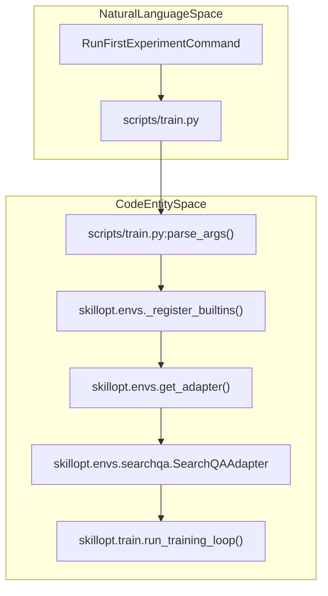
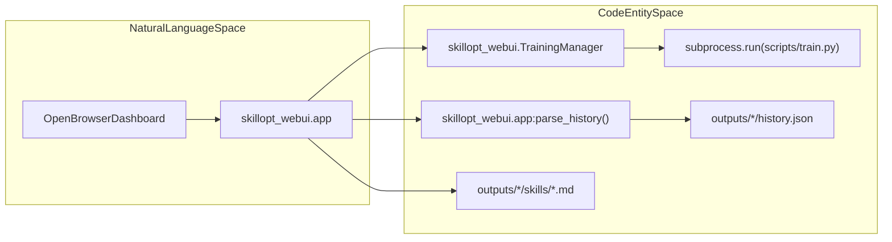

<!-- source: DeepWiki mcp.deepwiki.com · repo microsoft/SkillOpt · page 1.1 Getting Started · fetched 2026-10-26 -->

# Getting Started

<details>
<summary>Relevant source files</summary>

The following files were used as context for generating this wiki page:

- [.env.example](.env.example)
- [docs/guide/dl-analogy.md](docs/guide/dl-analogy.md)
- [docs/guide/first-experiment.md](docs/guide/first-experiment.md)
- [docs/guide/installation.md](docs/guide/installation.md)
- [docs/guide/new-backend.md](docs/guide/new-backend.md)
- [docs/guide/skill-document.md](docs/guide/skill-document.md)
- [docs/guide/training-loop.md](docs/guide/training-loop.md)
- [docs/index.md](docs/index.md)
- [plugins/openclaw/skillopt_sleep_openclaw.py](plugins/openclaw/skillopt_sleep_openclaw.py)
- [skillopt_sleep/harvest_pi.py](skillopt_sleep/harvest_pi.py)
- [tests/test_backend_pi.py](tests/test_backend_pi.py)
- [tests/test_harvest_pi.py](tests/test_harvest_pi.py)

</details>


## Purpose and Scope

This page provides a comprehensive guide for new users to install SkillOpt, configure environment variables using `.env` templates, materialize benchmark datasets, execute a first optimization experiment on SearchQA, inspect generated training outputs, launch the Gradio WebUI, and perform standalone evaluations [docs/guide/installation.md:1](), [docs/guide/first-experiment.md:1]().

---

## 1. Installation and Requirements

SkillOpt requires **Python 3.10+** [docs/guide/installation.md:5](). You can install via PyPI for stable releases or clone the source repository for full benchmark configs, data materializers, and development scripts [docs/guide/installation.md:12-44]().

### Source Installation

```bash
git clone https://github.com/microsoft/SkillOpt.git
cd SkillOpt
python -m pip install -e .
```

### Optional Benchmark and UI Dependencies

Install optional extras depending on the environments and interfaces you plan to use [docs/guide/installation.md:46-108]():

* **SearchQA**: `python -m pip install -e ".[searchqa]"` [docs/guide/installation.md:88-90]()
* **ALFWorld**: `python -m pip install -e ".[alfworld]"` [docs/guide/installation.md:52-54]()
* **WebUI Dashboard**: `python -m pip install -e ".[webui]"` [docs/guide/installation.md:94-96]()
* **Development Suite**: `python -m pip install -e ".[dev]"` [docs/guide/installation.md:100-102]()

Sources: `[docs/guide/installation.md:1-108]()`

---

## 2. Environment Variable Setup

SkillOpt configures model endpoints and authentication keys through environment variables [.env.example:1-4](). Copy the template file and export the variables into your active shell session [docs/guide/installation.md:112-126]().

```bash
cp .env.example .env
set -a
source .env
set +a
```

### Supported Backend Variables

| Backend Family | Required Environment Variables | Description |
| :--- | :--- | :--- |
| **Azure OpenAI** | `AZURE_OPENAI_ENDPOINT`, `AZURE_OPENAI_API_KEY`, `AZURE_OPENAI_AUTH_MODE` | Primary hosted model integration (`api_key`, `azure_cli`, or `managed_identity`) [.env.example:6-16](), [docs/guide/installation.md:131-139]() |
| **OpenAI-Compatible** | `OPENAI_COMPATIBLE_BASE_URL`, `OPENAI_COMPATIBLE_API_KEY`, `OPENAI_COMPATIBLE_MODEL` | Generic research backend for DeepSeek, vLLM, Groq, Ollama, etc. [.env.example:18-33](), [docs/guide/installation.md:153-157]() |
| **Claude Code CLI** | `CLAUDE_CLI_BIN`, `ANTHROPIC_API_KEY` | CLI-based adapter (`claude_chat`) wrapping `claude -p` [.env.example:46-51](), [docs/guide/installation.md:141-145]() |
| **Qwen Local** | `QWEN_CHAT_BASE_URL`, `QWEN_CHAT_MODEL`, `QWEN_CHAT_THINKING_MODE` | Local server configuration for Qwen models [.env.example:53-61]() |

Sources: `[.env.example:1-72]()`, `[docs/guide/installation.md:110-174]()`

---

## 3. Data Materialization

SkillOpt benchmark datasets require structured directory layouts (`train/`, `valid_seen/`, `valid_unseen/`) containing task items [docs/guide/first-experiment.md:19-33](). For **SearchQA**, the repository includes an ID-only manifest that must be materialized before training [docs/guide/first-experiment.md:19-28]().

```python
python scripts/materialize_searchqa.py
```

This script reads raw item references from `data/searchqa_id_split/` and writes complete runnable JSON payloads to `data/searchqa_split/` [docs/guide/first-experiment.md:30-32]().

Sources: `[docs/guide/first-experiment.md:19-33]()`

---

## 4. Running a First Experiment (SearchQA)

SearchQA serves as the standard text-only baseline experiment [docs/guide/first-experiment.md:17](). Launch training using `scripts/train.py` with the provided SearchQA YAML configuration [docs/guide/first-experiment.md:73-77]().

```bash
python scripts/train.py \
  --config configs/searchqa/default.yaml \
  --out_root outputs/searchqa_quickstart
```

### Initialization and Execution Flow

The diagram below bridges the natural language command space to the underlying code entities invoked during experiment startup and the main optimization loop.

**Training Initialization and ReflACT Flow**


Sources: `[docs/guide/first-experiment.md:73-77]`, `[docs/guide/training-loop.md:1-24]()`

---

## 5. Reading Training Output

Each training execution stores versioned artifacts under the specified `out_root` directory [docs/guide/first-experiment.md:84-103]().

```text
outputs/searchqa_quickstart/
├── config.json
├── runtime_state.json
├── history.json
├── best_skill.md
├── skills/
│   └── skill_v0001.md
├── steps/
│   └── step_0001/
│       ├── candidate_skill.md
│       ├── step_record.json
│       └── trajectory_digest.json
├── slow_update/
│   └── epoch_01/
└── meta_skill/
    └── epoch_01/
```

| Output Artifact | Technical Role |
| :--- | :--- |
| `best_skill.md` | The highest-scoring markdown skill document discovered across all evaluated steps [docs/guide/first-experiment.md:91]() |
| `history.json` | Chronological log recording step scores, accepted edits, and gate outcomes [docs/guide/first-experiment.md:90]() |
| `steps/step_XXXX/` | Per-step intermediate candidate skills, patch lists, and trajectory analysis digests [docs/guide/first-experiment.md:94-98]() |
| `runtime_state.json` | Serialized optimizer state enabling automatic checkpoint resumption [docs/guide/first-experiment.md:89]() |

Sources: `[docs/guide/first-experiment.md:84-103]()`

---

## 6. Launching the WebUI

The WebUI provides a Gradio-based graphical dashboard for configuring hyperparameters, launching background training runs, and monitoring optimization history [docs/guide/first-experiment.md:120-132]().

```bash
python -m skillopt_webui.app --port 7860
```

### WebUI Subprocess Architecture

The WebUI bridges browser interactions with underlying training scripts and filesystem artifacts through a dedicated process manager.

**WebUI to Code Entity Mapping**


Sources: `[docs/guide/first-experiment.md:120-132]`, `[docs/index.md:1-215]()`

---

## 7. Standalone Evaluation

To evaluate any trained skill checkpoint against specific dataset splits without running optimization loops, execute `scripts/eval_only.py` [docs/guide/first-experiment.md:105-114]().

```bash
python scripts/eval_only.py \
  --config configs/searchqa/default.yaml \
  --skill outputs/searchqa_quickstart/best_skill.md \
  --split valid_unseen
```

Supported evaluation splits include `train`, `valid_seen` (validation selection split), and `valid_unseen` (held-out test split) [docs/guide/first-experiment.md:110-114]().

Sources: `[docs/guide/first-experiment.md:105-114]()`

---

