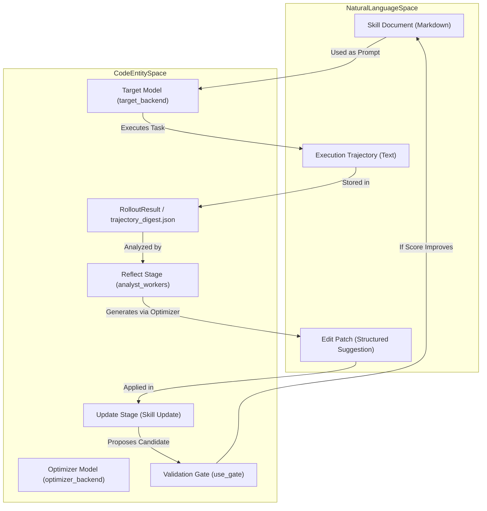
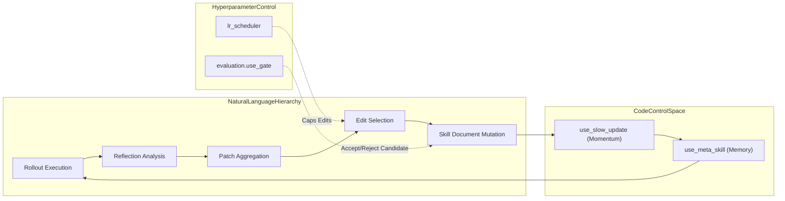

<!-- source: DeepWiki mcp.deepwiki.com · repo microsoft/SkillOpt · page 1.2 Deep Learning Analogy · fetched 2026-10-26 -->

# Deep Learning Analogy

Relevant source files

The following files were used as context for generating this wiki page:

- [README.md](README.md)
- [docs/guide/dl-analogy.md](docs/guide/dl-analogy.md)
- [docs/guide/first-experiment.md](docs/guide/first-experiment.md)
- [docs/guide/skill-document.md](docs/guide/skill-document.md)
- [docs/guide/training-loop.md](docs/guide/training-loop.md)
- [docs/index.md](docs/index.md)
- [index.html](index.html)
- [skillopt-assets/arxiv-logomark-small.svg](skillopt-assets/arxiv-logomark-small.svg)
- [skillopt.html](skillopt.html)

SkillOpt is built upon a fundamental architectural insight: **optimizing natural-language prompt instructions (skills) follows the same mathematical and structural patterns as training neural networks.** By mapping textual operations to standard Deep Learning (DL) primitives, SkillOpt allows practitioners to apply well-understood optimization theory to the domain of prompt engineering.

## 1. Core Conceptual Mapping

The following table defines the one-to-one mapping between standard Deep Learning concepts and their implementation within the SkillOpt framework.

| Deep Learning Concept | SkillOpt Counterpart | Technical Implementation |
| :--- | :--- | :--- |
| **Model Weights** | **Skill Document** | A Markdown file (`skill.md`) containing instructions, few-shot examples, and guidance blocks. [docs/guide/dl-analogy.md:9-9](), [docs/guide/skill-document.md:7-9]() |
| **Forward Pass** | **Rollout** | The Target Model executes a batch of tasks using the current skill document. [docs/guide/training-loop.md:28-30](), [docs/guide/dl-analogy.md:10-10]() |
| **Loss Function** | **Task Evaluator** | A scoring function within the `EnvAdapter` that compares model output to ground truth. [docs/guide/dl-analogy.md:11-11]() |
| **Backpropagation** | **Reflect** | The Optimizer Model analyzes execution trajectories to identify failure causes and produce edit patches. [docs/guide/training-loop.md:38-40](), [docs/guide/dl-analogy.md:12-12]() |
| **Gradients** | **Edit Patches** | Structured natural language suggestions for modifying specific sections of the skill. [docs/guide/dl-analogy.md:13-13](), [docs/guide/training-loop.md:40-42]() |
| **Gradient Aggregation** | **Patch Aggregation** | Hierarchical merging of semantically similar edit patches to avoid redundancy. [docs/guide/dl-analogy.md:14-14](), [docs/guide/training-loop.md:51-53]() |
| **Gradient Clipping** | **Edit Selection** | Ranking proposed patches and capping the total number applied based on the budget. [docs/guide/training-loop.md:55-57](), [docs/guide/dl-analogy.md:15-15]() |
| **Learning Rate** | `learning_rate` | A configuration parameter that defines the maximum number of edits applied per step. [docs/guide/dl-analogy.md:16-16](), [docs/guide/training-loop.md:57-61]() |
| **SGD Step** | **Skill Update** | Applying the selected textual patches to the Markdown document. [docs/guide/dl-analogy.md:18-18](), [docs/guide/training-loop.md:70-72]() |
| **Validation Set** | **Selection Split** | A held-out set of tasks used by the Gate stage to verify improvement before accepting an update. [docs/guide/dl-analogy.md:19-19](), [docs/guide/training-loop.md:76-78]() |
| **Momentum** | **Slow Update** | Longitudinal comparison at epoch boundaries to prevent catastrophic forgetting. [docs/guide/dl-analogy.md:22-22](), [docs/guide/training-loop.md:84-86]() |
| **Meta-learning** | **Meta Skill** | Cross-epoch optimizer strategy memory that persists across the training run. [docs/guide/dl-analogy.md:23-23](), [docs/guide/training-loop.md:95-97]() |

Sources: [docs/guide/dl-analogy.md:5-31](), [docs/guide/training-loop.md:7-24](), [docs/guide/training-loop.md:28-101](), [docs/guide/skill-document.md:7-60]()

---

## 2. The ReflACT Optimization Loop

The "ReflACT" loop mirrors the standard training iteration in DL. Below is a diagram bridging the natural language optimization space to the specific code entities and data structures that handle the data flow.

### Diagram: Optimization Data Flow from Text to Code Entities

Sources: [docs/guide/training-loop.md:7-24](), [docs/guide/training-loop.md:30-36](), [docs/guide/training-loop.md:40-44](), [docs/guide/training-loop.md:74-81]()

---

## 3. Advanced Optimization Mechanisms

SkillOpt implements advanced DL concepts like scheduling and meta-learning to stabilize the optimization of text.

### Learning Rate and Scheduling
In SkillOpt, the `learning_rate` represents the "edit budget"—the number of distinct modifications allowed in a single update step [docs/guide/dl-analogy.md:16-16](). Just as in neural network training, an `lr_scheduler` is used to adjust this budget over time to ensure convergence [docs/guide/training-loop.md:64-65](). Supported modes include:
* **cosine**: Starts with high exploration (many edits) and tapers smoothly to fine-tuning [docs/guide/dl-analogy.md:46-46](), [docs/guide/training-loop.md:66-66]().
* **linear**: Constant reduction of the edit budget [docs/guide/training-loop.md:67-67]().
* **constant**: A fixed number of edits per step [docs/guide/training-loop.md:68-68]().
* **autonomous**: The optimizer model decides its own step size based on trajectory analysis [docs/guide/dl-analogy.md:17-17]().

### Epoch-Boundary Mechanisms
While the **Step** handles immediate feedback, the **Epoch** boundary introduces two stabilization mechanisms:

1.  **Slow Update (Momentum Analogy)**: The system performs a longitudinal comparison of the current skill against the previous epoch's version. It identifies regressions and generates high-level guidance, often stored in a protected `<!-- SLOW_UPDATE_START -->` block [docs/guide/training-loop.md:86-93](), [docs/guide/skill-document.md:48-50]().
2.  **Meta Skill (Meta-Learning Analogy)**: The optimizer maintains a "Meta-Skill" memory. This document records successful optimization strategies across epochs and is provided as context for future reflection and update stages [docs/guide/training-loop.md:95-100](), [docs/guide/dl-analogy.md:23-23]().

Sources: [docs/guide/dl-analogy.md:17-24](), [docs/guide/training-loop.md:55-100](), [docs/guide/skill-document.md:45-59]()

### Diagram: Optimizer Hierarchy and Code Control Mapping

Sources: [docs/guide/training-loop.md:7-24](), [docs/guide/training-loop.md:55-100](), [docs/guide/first-experiment.md:51-70]()

---

## 4. Hyperparameter Transfer Rules

Practitioners can apply standard DL intuitions when configuring SkillOpt experiments.

*   **Learning Rate (4-16)**: Values in this range typically balance exploration and stability. Too low (1-2) leads to stagnation; too high (>20) leads to "noisy" skills where instructions may contradict each other or overflow context [docs/guide/dl-analogy.md:47-47]().
*   **Batch Size**: Unlike DL, where larger batches provide more accurate gradient estimates, SkillOpt faces diminishing returns and high API costs with very large rollout batches. The `batch_size` (e.g., 40) should be balanced against provider limits [docs/guide/dl-analogy.md:52-52](), [docs/guide/first-experiment.md:54-56]().
*   **Convergence**: Skills typically converge much faster than neural networks. Usually, 2-4 epochs are sufficient to reach peak performance [docs/guide/dl-analogy.md:53-53](), [docs/guide/first-experiment.md:54-55]().
*   **Gating and Validation**: The `Gate` stage acts as validation-based model selection. If an update does not improve performance on the selection split (analogous to a validation set), it is rejected, preventing the model from diverging [docs/guide/dl-analogy.md:19-20](), [docs/guide/training-loop.md:77-81]().

Sources: [docs/guide/dl-analogy.md:38-53](), [docs/guide/training-loop.md:74-81](), [docs/guide/first-experiment.md:51-70]()

---

