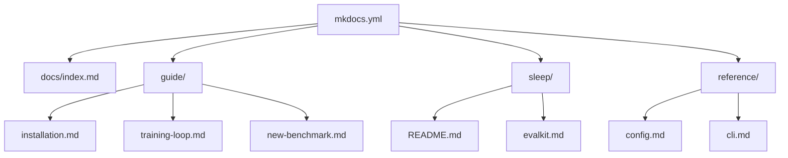
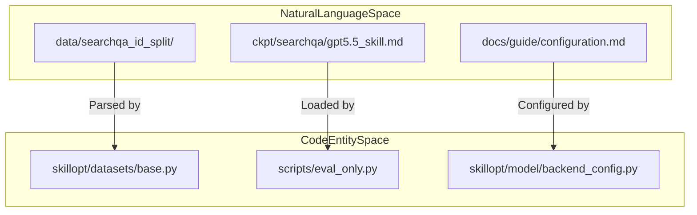
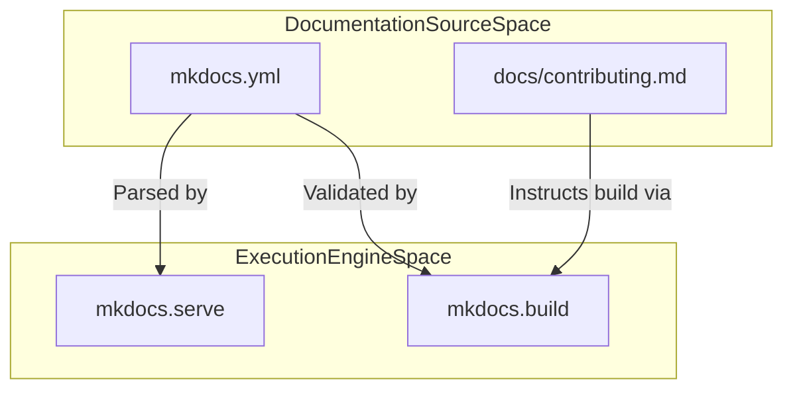

<!-- source: DeepWiki mcp.deepwiki.com · repo microsoft/SkillOpt · page 1.3 Documentation Site and Repository Layout · fetched 2026-10-26 -->

# Documentation Site and Repository Layout

<details>
<summary>Relevant source files</summary>

The following files were used as context for generating this wiki page:

- [ckpt/README.md](ckpt/README.md)
- [ckpt/alfworld/gpt5.5_skill.md](ckpt/alfworld/gpt5.5_skill.md)
- [ckpt/docvqa/gpt5.5_skill.md](ckpt/docvqa/gpt5.5_skill.md)
- [ckpt/livemath/gpt5.5_skill.md](ckpt/livemath/gpt5.5_skill.md)
- [ckpt/officeqa/gpt5.5_skill.md](ckpt/officeqa/gpt5.5_skill.md)
- [ckpt/searchqa/gpt5.5_skill.md](ckpt/searchqa/gpt5.5_skill.md)
- [ckpt/spreadsheetbench/gpt5.5_skill.md](ckpt/spreadsheetbench/gpt5.5_skill.md)
- [configs/features/soft_gate.yaml](configs/features/soft_gate.yaml)
- [data/README.md](data/README.md)
- [data/livemathematicianbench_id_split/split_manifest.json](data/livemathematicianbench_id_split/split_manifest.json)
- [docs/contributing.md](docs/contributing.md)
- [docs/review_guidelines.md](docs/review_guidelines.md)
- [mkdocs.yml](mkdocs.yml)
- [tests/test_data_manifests.py](tests/test_data_manifests.py)

</details>


## Purpose and Scope
This page details the structural organization of the SkillOpt codebase, focusing on the documentation site layout (`docs/` and `mkdocs.yml`), data split manifests (`data/`), and trained skill checkpoints (`ckpt/`). It explains how documentation is organized into trees (`guide/`, `reference/`, `sleep/`), how lightweight data manifests link upstream datasets to internal loaders, and how pre-trained skill artifacts are stored and evaluated.

---

## Documentation Site Architecture (`mkdocs.yml`)
The SkillOpt documentation site is generated using **MkDocs Material**, configured via `mkdocs.yml` [mkdocs.yml:1-86](). The site integrates navigation for getting started guides, core training concepts, deployment-time Sleep engine guides, extension tutorials, and reference documentation [mkdocs.yml:40-67]().

The build and preview workflow relies on Python package extras and CLI commands defined in project documentation:
```bash
pip install -e ".[docs]"
mkdocs serve  # Preview locally at http://localhost:8000
mkdocs build --strict  # Strict validation build
```
[docs/contributing.md:55-60]()

### Navigation and Document Trees
The `nav` block in `mkdocs.yml` defines the documentation layout:
- **Home**: `index.md` [mkdocs.yml:41]()
- **Getting Started**: Installation (`guide/installation.md`), First Experiment (`guide/first-experiment.md`), Configuration (`guide/configuration.md`) [mkdocs.yml:43-46]()
- **Core Concepts**: Training Loop (`guide/training-loop.md`), Skill Document (`guide/skill-document.md`), Deep Learning Analogy (`guide/dl-analogy.md`) [mkdocs.yml:47-50]()
- **SkillOpt-Sleep**: Overview (`sleep/README.md`), Paired A/B Evalkit (`sleep/evalkit.md`), Multi-skill Staging (`sleep/multi-skill-staging.md`), OpenAI-compatible Endpoints (`sleep/openai-compatible-endpoints.md`), Results (`sleep/RESULTS.md`) [mkdocs.yml:51-56]()
- **Extension Guides**: Add a New Benchmark (`guide/new-benchmark.md`), Local Environment Smoke Tests (`guide/local-env-smoke.md`), Add a New Model Backend (`guide/new-backend.md`) [mkdocs.yml:57-60]()
- **Reference**: Configuration Reference (`reference/config.md`), CLI Reference (`reference/cli.md`), API Reference (`reference/api.md`) [mkdocs.yml:61-64]()


*Sources: `mkdocs.yml` [mkdocs.yml:1-87]*, `docs/contributing.md` [docs/contributing.md:53-60]*

---

## Data Split Manifests (`data/`)
The `data/` directory houses lightweight split manifests corresponding to the official evaluation splits used in the SkillOpt paper [data/README.md:1-12](). These manifests decouple raw benchmark distribution storage from repository tracking.

### Manifest Directory Layout
Every released manifest directory adheres to a standardized file layout containing stable IDs or source-path hints rather than full text payloads [data/README.md:14-25]():

```text
data/<benchmark>_<manifest_type>/
|-- split_manifest.json
|-- train/items.json
|-- val/items.json
`-- test/items.json
```

The `split_manifest.json` schema records metadata, split ratios, counts, and item fields. For example, `data/livemathematicianbench_id_split/split_manifest.json` defines [data/livemathematicianbench_id_split/split_manifest.json:1-34]():
```json
{
  "benchmark": "LiveMathematicianBench",
  "manifest_type": "id_split",
  "source_repo": "LiveMathematicianBench/LiveMathematicianBench",
  "split_mode": "ratio",
  "split_ratio": "2:1:7",
  "counts": {
    "train": 35,
    "val": 17,
    "test": 125
  }
}
```

### Dataset Coverage and Materialization
Integrity tests ensure that declared manifest counts match item files across all data split directories [tests/test_data_manifests.py:9-23]():
```python
def test_split_manifest_counts_match_item_files() -> None:
    manifest_paths = sorted(DATA_DIR.glob("*/split_manifest.json"))
    for manifest_path in manifest_paths:
        manifest = json.loads(manifest_path.read_text(encoding="utf-8"))
        for split_name in SPLIT_NAMES:
            declared_count = manifest["counts"][split_name]
            items_path = manifest_path.parent / split_name / "items.json"
            actual_count = len(json.loads(items_path.read_text(encoding="utf-8")))
            assert declared_count == actual_count
```

| Manifest Directory | Benchmark | Counts (Train/Val/Test) | Raw Data Source | `split_dir` Parameter |
|---|---|---|---|---|
| `searchqa_id_split/` | SearchQA | 400 / 200 / 1400 | `lucadiliello/searchqa` | `data/searchqa_split` |
| `livemathematicianbench_id_split/` | LiveMathematicianBench | 35 / 17 / 125 | `LiveMathematicianBench/LiveMathematicianBench` | `data/livemathematicianbench_split` |
| `docvqa_id_split/` | DocVQA | 107 / 53 / 374 | `lmms-lab/DocVQA` | `data/docvqa/splits` |
| `officeqa_id_split/` | OfficeQA | 50 / 24 / 172 | `databricks/officeqa` | `data/officeqa_split` |
| `spreadsheetbench_id_split/` | SpreadsheetBench | 80 / 40 / 280 | `KAKA22/SpreadsheetBench` | `data/spreadsheetbench_split` |
| `alfworld_path_split/` | ALFWorld | 39 / 18 / 134 | `alfworld/alfworld` | `data/alfworld_path_split` |

*Sources: `data/README.md` [data/README.md:1-68]*, `data/livemathematicianbench_id_split/split_manifest.json` [data/livemathematicianbench_id_split/split_manifest.json:1-34]*, `tests/test_data_manifests.py` [tests/test_data_manifests.py:1-24]*

---

## Trained Skill Checkpoints (`ckpt/`)
The `ckpt/` directory contains paper-aligned reference skill checkpoints (`gpt5.5_skill.md`) for each supported benchmark [ckpt/README.md:1-7](). These files serve as portable optimization artifacts that can be evaluated directly without executing the training pipeline [ckpt/README.md:3-6]().

### Checkpoint Mapping
| Benchmark | Skill Artifact Path | Matching Configuration |
|---|---|---|
| SearchQA | `ckpt/searchqa/gpt5.5_skill.md` | `configs/searchqa/default.yaml` |
| ALFWorld | `ckpt/alfworld/gpt5.5_skill.md` | `configs/alfworld/default.yaml` |
| DocVQA | `ckpt/docvqa/gpt5.5_skill.md` | `configs/docvqa/default.yaml` |
| LiveMathematicianBench | `ckpt/livemath/gpt5.5_skill.md` | `configs/livemathematicianbench/default.yaml` |
| OfficeQA | `ckpt/officeqa/gpt5.5_skill.md` | `configs/officeqa/default.yaml` |
| SpreadsheetBench | `ckpt/spreadsheetbench/gpt5.5_skill.md` | `configs/spreadsheetbench/default.yaml` |

*Sources: `ckpt/README.md` [ckpt/README.md:1-28]*

### Evaluating Checkpoints
Checkpoints are evaluated using `scripts/eval_only.py`, bypassing optimizer loops [ckpt/README.md:33-37]() and passing the skill file directly:
```bash
python scripts/eval_only.py \
  --config configs/searchqa/default.yaml \
  --skill ckpt/searchqa/gpt5.5_skill.md \
  --split valid_unseen \
  --split_dir data/searchqa_split
```
[ckpt/README.md:43-50]()

Each skill checkpoint is a Markdown document incorporating structured instructions and a protected `SLOW_UPDATE` block at the end that stores longitudinal epoch guidance [ckpt/README.md:29-31]() (e.g., `ckpt/docvqa/gpt5.5_skill.md` [ckpt/docvqa/gpt5.5_skill.md:25-26](), `ckpt/officeqa/gpt5.5_skill.md` [ckpt/officeqa/gpt5.5_skill.md:49-50]()).

---

## System Bridging: Manifests and Checkpoints to Code Entities
The following diagrams bridge the natural language documentation and assets space to the concrete Python code entities responsible for loading, evaluation, and publishing.


*Sources: `data/README.md` [data/README.md:1-54]*, `ckpt/README.md` [ckpt/README.md:1-57]*, `mkdocs.yml` [mkdocs.yml:40-67]*


*Sources: `mkdocs.yml` [mkdocs.yml:1-87]*, `docs/contributing.md` [docs/contributing.md:53-60]*

---

