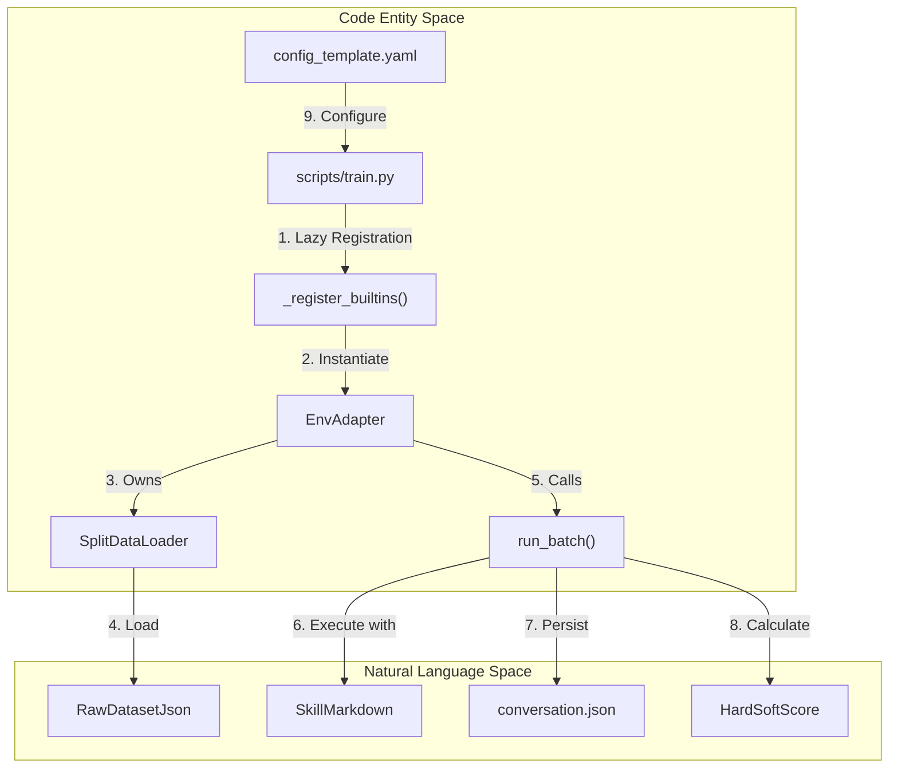
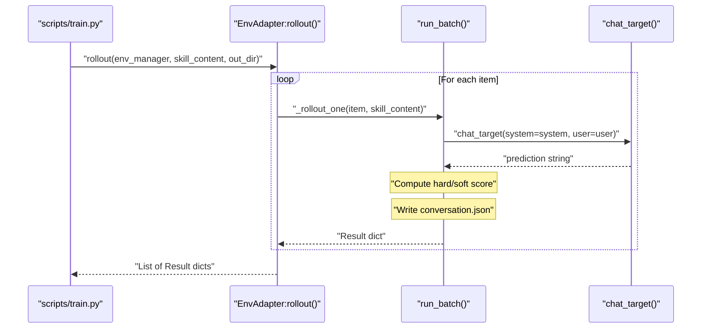

<!-- source: DeepWiki mcp.deepwiki.com · repo microsoft/SkillOpt · page 10.1 Adding a New Benchmark · fetched 2026-10-26 -->

# Addings a New Benchmark

<details>
<summary>Relevant source files</summary>

The following files were used as context for generating this wiki page:

- [docs/guide/new-benchmark.md](docs/guide/new-benchmark.md)
- [skillopt/envs/_template/README.md](skillopt/envs/_template/README.md)
- [skillopt/envs/_template/config_template.yaml](skillopt/envs/_template/config_template.yaml)
- [skillopt/envs/_template/env_template.py](skillopt/envs/_template/env_template.py)
- [skillopt/envs/_template/loader_template.py](skillopt/envs/_template/loader_template.py)
- [skillopt/envs/alfworld/adapter.py](skillopt/envs/alfworld/adapter.py)
- [skillopt/envs/base.py](skillopt/envs/base.py)
- [skillopt/envs/docvqa/adapter.py](skillopt/envs/docvqa/adapter.py)
- [skillopt/envs/livemathematicianbench/adapter.py](skillopt/envs/livemathematicianbench/adapter.py)
- [skillopt/envs/officeqa/adapter.py](skillopt/envs/officeqa/adapter.py)
- [skillopt/envs/searchqa/adapter.py](skillopt/envs/searchqa/adapter.py)

</details>


This guide provides a step-by-step developer walkthrough for extending SkillOpt with a custom benchmark using the scaffold provided in `skillopt/envs/_template` [skillopt/envs/_template/README.md:1-13](). By implementing a small set of classes, you enable the ReflACT training and evaluation loop to optimize textual skill documents for any task-based environment.

## What You Need to Build

To integrate a new benchmark, you must implement four core components:
1. **`SplitDataLoader` subclass**: Loads raw training, validation, and test item dictionaries from disk or normalizes single raw files [docs/guide/new-benchmark.md:15-16](), [skillopt/envs/_template/loader_template.py:37-50]().
2. **Rollout helper**: Executes the target model on task items under the current skill document, scores predictions, and persists per-item conversation trajectories [docs/guide/new-benchmark.md:17-19](), [docs/guide/new-benchmark.md:104-165]().
3. **`EnvAdapter` subclass**: Wires the dataloader and rollout routine into SkillOpt's lifecycle hooks (`build_train_env`, `build_eval_env`, `rollout`, and `get_task_types`) [docs/guide/new-benchmark.md:20-23](), [skillopt/envs/_template/env_template.py:22-151]().
4. **YAML configuration**: References the registered benchmark name alongside standard train, gradient, and optimizer hyperparameters [docs/guide/new-benchmark.md:24-25](), [skillopt/envs/_template/config_template.yaml:1-55]().

Lazy registration in entrypoint scripts ensures your benchmark is discoverable without pulling in optional dependencies at startup [docs/guide/new-benchmark.md:27-28](), [skillopt/envs/_template/README.md:36-40]().

**Benchmark Integration Flow**

Sources: [docs/guide/new-benchmark.md:11-29](), [skillopt/envs/_template/README.md:1-13](), [skillopt/envs/base.py:37-60]()

---

## Step 1 — Create the Benchmark Package

Copy the template package under `skillopt/envs/` and rename the files and internal class structures [skillopt/envs/_template/README.md:16-29]():

```bash
cp -r skillopt/envs/_template skillopt/envs/my_benchmark
cd skillopt/envs/my_benchmark
mv env_template.py adapter.py
mv loader_template.py dataloader.py
```

Sources: [docs/guide/new-benchmark.md:32-37](), [skillopt/envs/_template/README.md:14-25]()

---

## Step 2 — Implement the Data Loader

Subclass `SplitDataLoader` in `dataloader.py` [skillopt/envs/_template/loader_template.py:37-50](). The base class handles split modes (`split_dir` vs `ratio`), while your implementation focuses on parsing split paths and normalizing item fields [skillopt/envs/_template/loader_template.py:1-12]().

Key requirements:
* Implement `load_split_items(split_path)` to return a list of dictionaries [skillopt/envs/_template/loader_template.py:52-83]().
* Ensure every normalized item dictionary contains a unique string `id` and required task keys (`question`, `ground_truth`, `task_type`) [docs/guide/new-benchmark.md:52-60](), [skillopt/envs/_template/loader_template.py:21-34]().

Sources: [docs/guide/new-benchmark.md:39-74](), [skillopt/envs/_template/loader_template.py:1-84]()

---

## Step 3 — Write the Rollout Helper and Environment Adapter

Subclass `EnvAdapter` in `adapter.py` [skillopt/envs/_template/env_template.py:22-30](). This class defines how environment instances are built from batches and delegates task execution to your rollout helper.

### Key Lifecycle Hooks

| Method | Role | Cited Code |
| :--- | :--- | :--- |
| `setup(cfg)` | One-time initialization with the full configuration dictionary. | [skillopt/envs/_template/env_template.py:68-71]() |
| `build_train_env` | Constructs the training environment manager or item list from a `BatchSpec`. | [skillopt/envs/_template/env_template.py:81-85]() |
| `build_eval_env` | Constructs the validation/test environment manager for a given split and batch size. | [skillopt/envs/_template/env_template.py:87-91]() |
| `rollout` | Executes episodes under the current `skill_content` and writes out trajectory artifacts. | [skillopt/envs/_template/env_template.py:95-128]() |
| `get_task_types` | Returns distinct task-type category strings for stratified sampling during reflection. | [skillopt/envs/_template/env_template.py:139-151]() |

**Rollout Execution Sequence**

Sources: [docs/guide/new-benchmark.md:83-165](), [skillopt/envs/_template/env_template.py:66-151](), [skillopt/envs/base.py:171-185]()

---

## Step 4 — Register the Benchmark

SkillOpt uses lazy registration inside CLI scripts to avoid loading heavy optional dependencies [docs/guide/new-benchmark.md:27-28](), [skillopt/envs/_template/README.md:36-40](). Add a `try...except ImportError` block to `_register_builtins()` in both `scripts/train.py` and `scripts/eval_only.py` [skillopt/envs/_template/README.md:36-40]():

```python
try:
    from skillopt.envs.my_benchmark.adapter import MyBenchmarkAdapter
    _ENV_REGISTRY["my_benchmark"] = MyBenchmarkAdapter
except ImportError:
    pass
```

Sources: [docs/guide/new-benchmark.md:27-28](), [skillopt/envs/_template/README.md:36-40]()

---

## Step 5 — Create YAML Configuration

Create your configuration file at `configs/my_benchmark/default.yaml` using the template format [skillopt/envs/_template/README.md:41-43](). Use `_base_` as a string path to inherit global defaults [skillopt/envs/_template/config_template.yaml:9]():

```yaml
_base_: ../_base_/default.yaml

env:
  name: my_benchmark
  data_path: data/my_benchmark
  split_mode: ratio
  split_ratio: "2:1:7"
  workers: 4

optimizer:
  learning_rate: 4
  lr_scheduler: cosine
```

Sources: [skillopt/envs/_template/config_template.yaml:1-55](), [skillopt/envs/_template/README.md:41-43]()

---

## Step 6 — Run Training and Evaluation

Launch training using the CLI entrypoint with your configuration file [skillopt/envs/_template/README.md:45-46](), [docs/guide/new-benchmark.md:241-243]():

```bash
python scripts/train.py --config configs/my_benchmark/default.yaml
```

To evaluate a baseline or initial skill without executing the training optimizer loop, run `eval_only.py` [docs/guide/new-benchmark.md:241-243]():

```bash
python scripts/eval_only.py \
    --config configs/my_benchmark/default.yaml \
    --skill skillopt/envs/my_benchmark/skills/initial.md
```

Sources: [docs/guide/new-benchmark.md:241-243](), [skillopt/envs/_template/README.md:45-46]()

---

## Implementation Tips

* **Trajectory Persistence**: The shared `EnvAdapter.reflect()` implementation expects each rollout item to persist its conversation at `<out_dir>/predictions/<item_id>/conversation.json` [docs/guide/new-benchmark.md:119-132](), [skillopt/envs/_template/README.md:32-35]().
* **Scoring Signals**: The optimizer relies exclusively on `hard` (0/1) and `soft` (float in `[0, 1]`) values returned by rollout results [docs/guide/new-benchmark.md:95-103](), [skillopt/envs/_template/env_template.py:109-112]().
* **Model Routing**: Always use `skillopt.model.chat_target` for model completions inside your rollout helper rather than raw client libraries, ensuring seamless backend switching via YAML configuration [docs/guide/new-benchmark.md:174-177]().

Sources: [docs/guide/new-benchmark.md:11-185](), [skillopt/envs/_template/README.md:30-35]()

---

