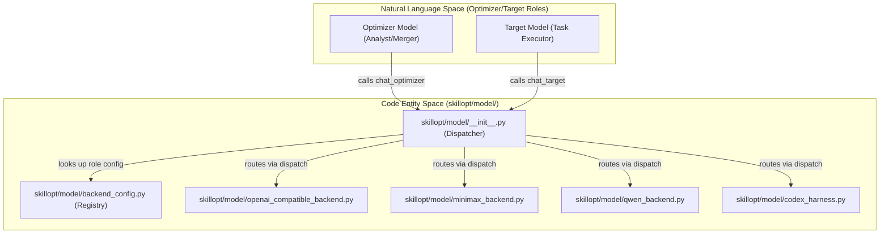
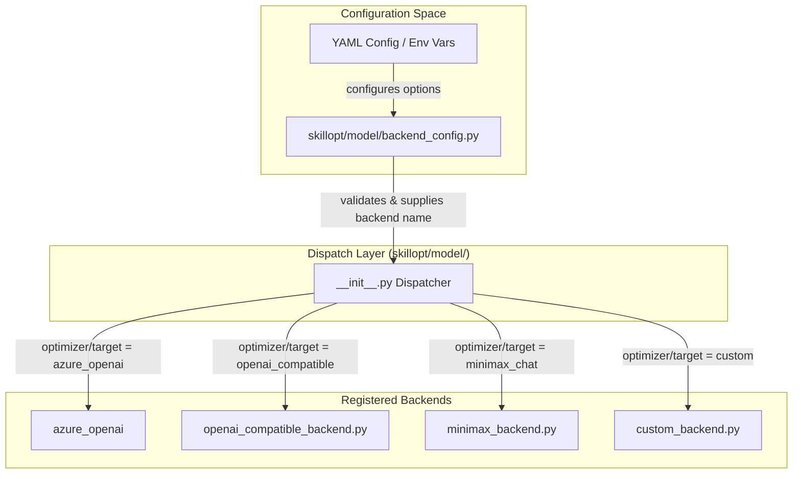

<!-- source: DeepWiki mcp.deepwiki.com · repo microsoft/SkillOpt · page 10.2 Adding a New Model Backend · fetched 2026-10-26 -->

# Adding a New Model Backend

<details>
<summary>Relevant source files</summary>

The following files were used as context for generating this wiki page:

- [.env.example](.env.example)
- [docs/guide/new-backend.md](docs/guide/new-backend.md)
- [skillopt/model/common.py](skillopt/model/common.py)
- [skillopt/model/copilot_backend.py](skillopt/model/copilot_backend.py)
- [skillopt/model/minimax_backend.py](skillopt/model/minimax_backend.py)
- [skillopt/model/openai_compatible_backend.py](skillopt/model/openai_compatible_backend.py)
- [tests/test_copilot_exec_backend.py](tests/test_copilot_exec_backend.py)
- [tests/test_copilot_tool_scope.py](tests/test_copilot_tool_scope.py)
- [tests/test_minimax_backend.py](tests/test_minimax_backend.py)
- [tests/test_openai_compatible_backend.py](tests/test_openai_compatible_backend.py)

</details>


SkillOpt provides a modular, function-based interface for integrating Large Language Model (LLM) providers [docs/guide/new-backend.md:3-5](). Unlike traditional inheritance-heavy frameworks, SkillOpt uses a module contract where each backend is a Python module exposing a standardized set of functions for chat, token tracking, and deployment settings [docs/guide/new-backend.md:3-6]().

## Backend Architecture and Data Flow

The model layer is managed by a central dispatcher in `skillopt/model` that routes calls to specific backend implementations based on runtime configuration for the `optimizer` and `target` roles [docs/guide/new-backend.md:111-118]().

### Model Dispatch Hierarchy
This diagram bridges the natural language space (roles in the training loop) to the concrete code entities in the `skillopt/model/` package.


**Sources:** [docs/guide/new-backend.md:111-124](), [skillopt/model/common.py:18-35]()

## The OpenAI-Compatible Shortcut

Before implementing a new backend from scratch, developers should check whether their provider speaks the OpenAI Chat Completions protocol [docs/guide/new-backend.md:13-17](). If so, the built-in **`openai_compatible`** backend (`skillopt/model/openai_compatible_backend.py`) can be used with zero code changes [docs/guide/new-backend.md:13-16]().

A single `base_url` and `api_key` pair supports providers like DeepSeek, Groq, Together AI, Ollama, vLLM, SGLang, and LiteLLM [docs/guide/new-backend.md:18-30]().

### Configuration via Environment Variables and Python API
The generic backend resolves configuration using shared environment variables (`OPENAI_COMPATIBLE_BASE_URL`, `OPENAI_COMPATIBLE_API_KEY`, `OPENAI_COMPATIBLE_MODEL`) with role-specific overrides (`OPTIMIZER_OPENAI_COMPATIBLE_*` and `TARGET_OPENAI_COMPATIBLE_*`) [skillopt/model/openai_compatible_backend.py:73-95]().

| Variable | Scope / Role | Description |
| :--- | :--- | :--- |
| `OPENAI_COMPATIBLE_BASE_URL` | Shared | Endpoint URL (e.g., `https://api.deepseek.com/v1`) |
| `OPENAI_COMPATIBLE_API_KEY` | Shared | Provider API key |
| `OPENAI_COMPATIBLE_MODEL` | Shared | Default model deployment ID |
| `OPTIMIZER_OPENAI_COMPATIBLE_*` | Optimizer | Role-specific overrides for optimizer |
| `TARGET_OPENAI_COMPATIBLE_*` | Target | Role-specific overrides for target |

**Sources:** [skillopt/model/openai_compatible_backend.py:73-95](), [docs/guide/new-backend.md:63-68]()

## Step-by-Step Implementation Guide

If a provider requires custom transport logic or non-standard payload structures, create a dedicated module (e.g., `skillopt/model/custom_backend.py`).

### 1. Implement the Module Contract
The active module must expose the chat and token-tracking functions required by the dispatcher [docs/guide/new-backend.md:136-149]().

| Function | Signature Requirements | Purpose |
| :--- | :--- | :--- |
| `chat_optimizer` | `(system, user, ...)` -> `(text, usage_dict)` | Executes optimizer prompt in text format |
| `chat_target` | `(system, user, ...)` -> `(text, usage_dict)` | Executes target prompt in text format |
| `chat_optimizer_messages` | `(messages, ...)` -> `(text, usage_dict)` | Message-list call for optimizer (supports tools) |
| `chat_target_messages` | `(messages, ...)` -> `(text, usage_dict)` | Message-list call for target (supports tools) |
| `get_token_summary` | `()` -> `dict` | Returns per-stage token counters plus `_total` |
| `reset_token_tracker` | `()` -> `None` | Clears internal token statistics |
| `set_optimizer_deployment` | `(name)` -> `None` | Dynamically updates optimizer model name |
| `set_target_deployment` | `(name)` -> `None` | Dynamically updates target model name |

**Sources:** [docs/guide/new-backend.md:136-149](), [skillopt/model/common.py:87-134]()

### 2. Token Tracking Integration
Backends must instantiate and record usage via `TokenTracker` from `skillopt.model.common` so that overall token budgets and costs are correctly audited [skillopt/model/common.py:87-134](), [skillopt/model/minimax_backend.py:102-137]().

```python
from skillopt.model.common import TokenTracker
tracker = TokenTracker()

# Record usage after a successful completion:
tracker.record(stage, prompt_tokens, completion_tokens)
```
**Sources:** [skillopt/model/common.py:87-104](), [skillopt/model/minimax_backend.py:102-137]()

### 3. Registration in Common and Backend Config
To wire the new backend into SkillOpt's configuration system, update the following core modules:

1. **`skillopt/model/common.py`**: Add the backend canonical name and default model ID to `_BACKEND_DEFAULT_MODELS`, and register any shorthand aliases in `_BACKEND_ALIASES` [skillopt/model/common.py:18-64]().
2. **`skillopt/model/backend_config.py`**: Register the backend identifiers in the configuration whitelists and validation routines [skillopt/model/backend_config.py:49-84]().

### Model Selection and Dispatch Flow
This diagram illustrates how configuration variables flow through `backend_config.py` to route dispatch calls in `skillopt/model/` to the appropriate backend module.


**Sources:** [skillopt/model/backend_config.py:49-84](), [docs/guide/new-backend.md:111-124]()

## Execution-Only and Agentic Harness Backends
Certain backends (such as `codex_exec`, `claude_code_exec`, and `copilot_exec`) operate as execution harnesses rather than standard stateless chat endpoints [docs/guide/new-backend.md:149-152](). They manage workspace setup, subprocess invocation, and output parsing (e.g., parsing JSONL event streams from local CLI tools) [tests/test_copilot_exec_backend.py:122-168](), [skillopt/model/copilot_backend.py:79-100](). Target-only execution harnesses raise `NotImplementedError` if mistakenly invoked as chat optimizers [tests/test_copilot_exec_backend.py:91-95]().

**Sources:** [tests/test_copilot_exec_backend.py:91-168](), [skillopt/model/copilot_backend.py:79-140](), [docs/guide/new-backend.md:149-152]()

---

