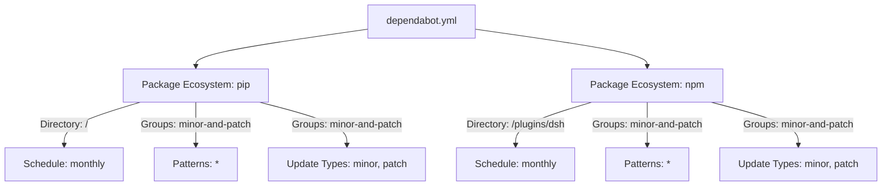

<!-- source: DeepWiki mcp.deepwiki.com · repo microsoft/SkillOpt · page 10.3 Testing, Packaging, and CI · fetched 2026-10-26 -->

# Testing, Packaging, and CI

<details>
<summary>Relevant source files</summary>

The following files were used as context for generating this wiki page:

- [.github/dependabot.yml](.github/dependabot.yml)
- [.github/workflows/ci.yml](.github/workflows/ci.yml)
- [pyproject.toml](pyproject.toml)
- [skillopt/types.py](skillopt/types.py)
- [skillopt_webui/app.py](skillopt_webui/app.py)
- [tests/__init__.py](tests/__init__.py)
- [tests/test_backend_opencode_live.py](tests/test_backend_opencode_live.py)
- [tests/test_pi_integration.py](tests/test_pi_integration.py)
- [tests/test_scoring.py](tests/test_scoring.py)
- [tests/test_types.py](tests/test_types.py)
- [tests/test_unmatched_edits_reporting.py](tests/test_unmatched_edits_reporting.py)
- [tests/test_webui_build_gradio.py](tests/test_webui_build_gradio.py)

</details>


This page details the testing infrastructure, Python packaging configuration, and continuous integration (CI) setup for the SkillOpt codebase. It covers the organization of the `tests/` directory, the use of `pyproject.toml` for packaging and entry points, the GitHub Actions workflow defined in `ci.yml`, and how Dependabot is configured for dependency updates. It also explains the distinction between running offline and live tests.

## Testing Suite Organization and Fixtures

The `tests/` directory contains various test modules, each focusing on specific components or functionalities of the SkillOpt project. Tests are written using `pytest`.

### Test Categories

*   **Unit Tests**: These tests verify individual functions, classes, or modules in isolation. Examples include `tests/test_types.py` which validates the serialization and deserialization of core data structures like `Edit` and `Patch` [tests/test_types.py:1-262]().
*   **Integration Tests**: These tests verify the interaction between multiple components. For instance, `tests/test_scoring.py` checks the `compute_score` utility function which aggregates results from various sources [tests/test_scoring.py:1-73]().
*   **WebUI Tests**: Specific tests for the Gradio-based WebUI are located in `tests/test_webui_build_gradio.py` and `tests/test_webui_env_preflight.py`. These ensure the UI builds correctly across different Gradio versions and that environment preflight checks function as expected [tests/test_webui_build_gradio.py:1-76]().
*   **Live/Opt-in Tests**: Some tests interact with external services or require specific environment configurations. These are typically marked with `pytest.mark.skipif` and require explicit environment variables to be enabled. An example is `tests/test_backend_opencode_live.py`, which makes real calls to the OpenCode CLI and is skipped unless `SKILLOPT_TEST_REAL_OPENCODE=1` is set [tests/test_backend_opencode_live.py:1-180](). These tests are generally excluded from standard CI runs to maintain hermeticity and speed.
*   **Sleep Engine Tests**: Tests related to the `skillopt_sleep` component, such as `tests/test_pi_integration.py`, verify the configuration and source-routing for various harvesting mechanisms [tests/test_pi_integration.py:1-83]().

### Key Test Files and Their Focus

*   `tests/test_types.py`: Focuses on the `Edit`, `Patch`, and `RolloutResult` dataclasses, ensuring their correct creation, serialization (`to_dict`), and deserialization (`from_dict`) [skillopt/types.py:26-99]().
*   `tests/test_scoring.py`: Verifies the `compute_score` function for calculating hard and soft accuracies from a list of results, and `skill_hash` for deterministic content hashing [skillopt/utils/scoring:1-73]().
*   `tests/test_webui_build_gradio.py`: Specifically tests the Gradio WebUI's ability to build and launch, paying close attention to theme application across different Gradio major versions (e.g., `gr.Blocks(theme=...)` vs. `launch(theme=...)`) [tests/test_webui_build_gradio.py:1-76]().
*   `tests/test_backend_opencode_live.py`: Contains opt-in tests for the `OpenCodeCliBackend` that interact with a live OpenCode installation. These tests are crucial for verifying real-world integration but are isolated due to their external dependencies and potential cost [tests/test_backend_opencode_live.py:1-180]().
*   `tests/test_unmatched_edits_reporting.py`: Ensures that unmatched edits (edits that failed to apply) are correctly reported in the user-facing `report.md` artifact of the Sleep engine [tests/test_unmatched_edits_reporting.py:1-57]().

### Running Tests

Tests can be run using `pytest` from the root of the repository.

```bash
# Run all tests
python -m pytest

# Run specific test file
python -m pytest tests/test_types.py

# Run live OpenCode tests (requires environment variables)
SKILLOPT_TEST_REAL_OPENCODE=1 SKILLOPT_SLEEP_OPENCODE_MODEL="<your_model_name>" python -m pytest tests/test_backend_opencode_live.py
```

### Diagram: Test Suite Organization

```mermaid
graph TD
    A[tests/] --> B[test_types.py]
    A --> C[test_scoring.py]
    A --> D[test_webui_build_gradio.py]
    A --> E[test_webui_env_preflight.py]
    A --> F[test_backend_opencode_live.py]
    A --> G[test_pi_integration.py]
    A --> H[test_unmatched_edits_reporting.py]

    B -- "Dataclass Serialization" --> skillopt_types_Edit(skillopt.types.Edit)
    B -- "Dataclass Serialization" --> skillopt_types_Patch(skillopt.types.Patch)
    C -- "Accuracy Calculation" --> skillopt_utils_scoring_compute_score(skillopt.utils.scoring.compute_score)
    C -- "Content Hashing" --> skillopt_utils_scoring_skill_hash(skillopt.utils.scoring.skill_hash)
    D -- "Gradio UI Build/Launch" --> skillopt_webui_app_build_ui(skillopt_webui.app.build_ui)
    D -- "Gradio UI Build/Launch" --> skillopt_webui_app_build_launch_kwargs(skillopt_webui.app.build_launch_kwargs)
    E -- "Environment Preflight" --> skillopt_webui_app_validate_training_config(skillopt_webui.app.validate_training_config)
    F -- "Live OpenCode CLI Calls" --> skillopt_sleep_backend_OpenCodeCliBackend(skillopt_sleep.backend.OpenCodeCliBackend)
    G -- "Pi Integration Config" --> skillopt_sleep_config_load_config(skillopt_sleep.config.load_config)
    G -- "Pi Integration Harvest" --> skillopt_sleep_harvest_sources_harvest_for_config(skillopt_sleep.harvest_sources.harvest_for_config)
    H -- "Report Generation" --> skillopt_sleep_cycle__render_report_md(skillopt_sleep.cycle._render_report_md)
```


Sources:
[tests/test_types.py:1-262]()
[tests/test_scoring.py:1-73]()
[tests/test_webui_build_gradio.py:1-76]()
[tests/test_backend_opencode_live.py:1-180]()
[tests/test_pi_integration.py:1-83]()
[tests/test_unmatched_edits_reporting.py:1-57]()
[skillopt/types.py:26-99]()
[skillopt/utils/scoring.py:1-28]()
[skillopt_webui/app.py:25-178]()
[skillopt_sleep/backend.py]()
[skillopt_sleep/config.py]()
[skillopt_sleep/harvest_sources.py]()
[skillopt_sleep/cycle.py]()

## pyproject.toml Packaging and Entry Points

The `pyproject.toml` file defines how the SkillOpt project is built and packaged, adhering to modern Python standards. It specifies project metadata, dependencies, optional dependencies, and command-line entry points.

### Project Metadata

The `[project]` section defines the project's name (`skillopt`), version (`0.2.0`), description, authors, license, and Python version requirements (`>=3.10`) [pyproject.toml:5-11](). It also lists keywords and classifiers for discoverability on PyPI [pyproject.toml:15-25]().

### Dependencies

The `dependencies` array lists the core packages required for SkillOpt to run [pyproject.toml:26-34](). These include `openai`, `pyyaml`, `numpy`, `openpyxl`, `azure-identity`, `azure-core`, and `httpx`.

### Optional Dependencies

The `[project.optional-dependencies]` section allows users to install additional packages for specific functionalities, such as benchmark environments, model backends, or development tools [pyproject.toml:36-64]().

*   `alfworld`: For the ALFWorld benchmark [pyproject.toml:38]().
*   `claude`: For the Claude model backend [pyproject.toml:40]().
*   `qwen`: For the Qwen local model backend via vLLM [pyproject.toml:42]().
*   `searchqa`: For SearchQA data materialization [pyproject.toml:44]().
*   `docs`: For building the documentation site [pyproject.toml:46]().
*   `webui`: For the Gradio WebUI dashboard, with specific version constraints to ensure compatibility across different Gradio major versions [pyproject.toml:48-55]().
*   `dev`: For development tools like `ruff` (linter/formatter) and `pytest` (testing framework) [pyproject.toml:57]().
*   `all`: A meta-dependency to install all optional dependencies except `docs`, `dev`, and `webui` [pyproject.toml:59-64]().

### Command-Line Entry Points

The `[project.scripts]` section defines console scripts that are installed as executable commands when the package is installed [pyproject.toml:66-69]().

*   `skillopt-train`: Points to the `main` function in `scripts.train`.
*   `skillopt-eval`: Points to the `main` function in `scripts.eval_only`.
*   `skillopt-sleep`: Points to the `main` function in `skillopt_sleep.__main__`.

These entry points allow users to run core SkillOpt functionalities directly from their terminal after installation.

### Package Discovery

The `[tool.setuptools.packages.find]` section configures `setuptools` to discover packages within the repository. It explicitly includes `skillopt`, `skillopt_sleep`, `skillopt_webui`, and `scripts` [pyproject.toml:77-81](). This ensures that all relevant Python modules are included in the distribution.

### Diagram: pyproject.toml Structure and Relationships

```mermaid
graph TD
    A[pyproject.toml] --> B[Project Metadata]
    A --> C[Dependencies]
    A --> D[Optional Dependencies]
    A --> E[Command-Line Entry Points]
    A --> F[Package Discovery]

    B -- "Name, Version, Authors, License" --> ProjectName["name = skillopt"]
    B --> ProjectVersion["version = 0.2.0"]
    B --> ProjectPython["requires-python = >=3.10"]

    C -- "Core Libraries" --> DepOpenAI["openai>=1.30.0"]
    C --> DepPyYAML["pyyaml>=6.0"]
    C --> DepNumpy["numpy>=1.24.0"]

    D -- "Benchmark-specific" --> OptDepAlfworld["alfworld = [...]"]
    D -- "Model Backend" --> OptDepClaude["claude = [...]"]
    D -- "Model Backend" --> OptDepQwen["qwen = [...]"]
    D -- "Data Materialization" --> OptDepSearchQA["searchqa = [...]"]
    D -- "Documentation" --> OptDepDocs["docs = [...]"]
    D -- "WebUI" --> OptDepWebUI["webui = [gradio>=5.50.0,<7]"]
    D -- "Development Tools" --> OptDepDev["dev = [ruff, pytest]"]
    D -- "All Optional" --> OptDepAll["all = [...]"]

    E -- "Training Script" --> EntryTrain["skillopt-train = scripts.train:main"]
    E -- "Evaluation Script" --> EntryEval["skillopt-eval = scripts.eval_only:main"]
    E -- "Sleep Engine" --> EntrySleep["skillopt-sleep = skillopt_sleep.__main__:main"]

    F -- "Includes" --> PkgSkillOpt["skillopt*"]
    F --> PkgSkillOptSleep["skillopt_sleep*"]
    F --> PkgSkillOptWebUI["skillopt_webui*"]
    F --> PkgScripts["scripts*"]
```


Sources:
[pyproject.toml:1-92]()

## GitHub Actions CI Workflow (`ci.yml`)

The `ci.yml` file defines the continuous integration (CI) workflow for the SkillOpt repository using GitHub Actions. This workflow automatically runs tests and builds documentation on `push` and `pull_request` events to the `main` branch [.github/workflows/ci.yml:3-7]().

The workflow consists of three main jobs: `test`, `webui`, and `docs`.

### 1. `test` Job

This job runs the core test suite across different Python versions.

*   **Runs on**: `ubuntu-latest` [.github/workflows/ci.yml:10]().
*   **Strategy**: Uses a matrix to test against Python versions `3.10`, `3.11`, and `3.12` [.github/workflows/ci.yml:12-15](). `fail-fast` is set to `false` to allow all matrix combinations to complete even if one fails.
*   **Steps**:
    1.  `actions/checkout@v4`: Checks out the repository code.
    2.  `actions/setup-python@v5`: Sets up the specified Python version.
    3.  `Install`: Installs the project in editable mode with `dev` optional dependencies (`pip install -e ".[dev]"`) [.github/workflows/ci.yml:22]().
    4.  `Pytest`: Executes `pytest -q` to run all discovered tests. Importantly, `SKILLOPT_TEST_REAL_OPENCODE` and `SKILLOPT_TEST_REAL_OPENCODE_SOURCE` environment variables are explicitly set to `"0"` to disable live backend/transcript tests, ensuring the CI run remains hermetic and fast [.github/workflows/ci.yml:24-29]().

### 2. `webui` Job

This job specifically tests the Gradio WebUI, focusing on compatibility across different Gradio major versions.

*   **Runs on**: `ubuntu-latest` [.github/workflows/ci.yml:38]().
*   **Strategy**: Uses a matrix to test against specific Gradio versions (`5.50.0` and `6.26.0`) [.github/workflows/ci.yml:40-42](). This is crucial because Gradio's API for theme handling changed between major versions (e.g., `Blocks(theme=...)` vs. `launch(theme=...)`) [pyproject.toml:48-55]().
*   **Steps**:
    1.  Checkout and Python setup (Python `3.11` is used for this job).
    2.  `Install (core + pinned gradio)`: Installs the project with `dev` dependencies and then explicitly pins the `gradio` version from the matrix (`pip install -e ".[dev]" "gradio==${{ matrix.gradio-version }}"`) [.github/workflows/ci.yml:49]().
    3.  `Pytest (gradio webui)`: Runs specific WebUI tests (`tests/test_webui_build_gradio.py` and `tests/test_webui_env_preflight.py`) [.github/workflows/ci.yml:51]().

### 3. `docs` Job

This job ensures that the project documentation can be built successfully.

*   **Runs on**: `ubuntu-latest` [.github/workflows/ci.yml:54]().
*   **Steps**:
    1.  Checkout and Python setup (Python `3.11` is used).
    2.  `Install`: Installs the project with `docs` optional dependencies (`pip install -e ".[docs]"`) [.github/workflows/ci.yml:61]().
    3.  `Build docs (strict)`: Executes `mkdocs build --strict` to build the documentation. The `--strict` flag ensures that any warnings are treated as errors, preventing broken documentation from being published [.github/workflows/ci.yml:63]().

### Diagram: CI Workflow

```mermaid
graph TD
    A[On: push, pull_request to main] --> B{CI Workflow}

    B --> J1[Job: test]
    J1 --> J1S1[Checkout Code]
    J1 --> J1S2[Setup Python (3.10, 3.11, 3.12)]
    J1 --> J1S3[Install .[dev]]
    J1 --> J1S4[Run Pytest (SKILLOPT_TEST_REAL_OPENCODE=0)]

    B --> J2[Job: webui]
    J2 --> J2S1[Checkout Code]
    J2 --> J2S2[Setup Python (3.11)]
    J2 --> J2S3[Install .[dev] + Pinned Gradio (5.50.0, 6.26.0)]
    J2 --> J2S4[Run Pytest (WebUI specific)]

    B --> J3[Job: docs]
    J3 --> J3S1[Checkout Code]
    J3 --> J3S2[Setup Python (3.11)]
    J3 --> J3S3[Install .[docs]]
    J3 --> J3S4[Build Docs (strict)]
```
Sources:
[.github/workflows/ci.yml:1-63]()
[pyproject.toml:48-55]()

## Dependabot Configuration

Dependabot is configured via `.github/dependabot.yml` to automate dependency updates for the project.

*   **Version**: Uses Dependabot configuration version 2 [.github/dependabot.yml:1]().
*   **Package Ecosystems**:
    *   **`pip`**: Configured for Python dependencies in the root directory (`/`). It checks for updates monthly and groups minor and patch updates together [.github/dependabot.yml:3-14]().
    *   **`npm`**: Configured for Node.js dependencies within the `/plugins/dsh` directory. This is likely for a specific plugin that uses JavaScript/TypeScript. Similar to `pip`, it checks monthly and groups minor and patch updates [.github/dependabot.yml:15-25]().

This setup ensures that the project's dependencies are regularly updated, helping to maintain security and incorporate new features while minimizing breaking changes by grouping update types.


Sources:
[.github/dependabot.yml:1-25]()

## Running Live vs. Offline Tests

SkillOpt distinguishes between offline (hermetic) and live (external-facing) tests to balance development speed, cost, and thoroughness.

### Offline Tests

*   **Purpose**: These tests are designed to run quickly and reliably without external dependencies. They are hermetic, meaning their results are predictable and do not depend on network access, external services, or specific environment configurations beyond Python and installed packages.
*   **Execution**: All tests run by default are considered offline tests. The CI workflow primarily relies on these tests.
*   **Examples**:
    *   `tests/test_types.py`: Verifies dataclass serialization logic [tests/test_types.py:1-262]().
    *   `tests/test_scoring.py`: Checks utility functions like `compute_score` and `skill_hash` [tests/test_scoring.py:1-73]().
    *   `tests/test_webui_build_gradio.py`: Ensures the WebUI can build its components without actually launching a full server that requires network access [tests/test_webui_build_gradio.py:1-76]().
*   **CI Integration**: The `test` job in `ci.yml` explicitly disables live tests by setting `SKILLOPT_TEST_REAL_OPENCODE="0"` [.github/workflows/ci.yml:24-29]().

### Live Tests

*   **Purpose**: These tests interact with real external services, such as LLM APIs (e.g., OpenAI, Azure OpenAI, OpenCode CLI) or specific benchmark environments that require external setup. They are crucial for verifying end-to-end functionality and integration with real-world systems.
*   **Characteristics**:
    *   **Opt-in**: Live tests are not run by default. They require specific environment variables to be set (e.g., `SKILLOPT_TEST_REAL_OPENCODE=1`) [tests/test_backend_opencode_live.py:33]().
    *   **External Dependencies**: May incur costs (API calls), require authentication (API keys, managed identities), and depend on the availability and configuration of external services.
    *   **Non-hermetic**: Their results can be influenced by external factors, making them less suitable for fast, frequent CI runs.
*   **Execution**: To run live tests, the necessary environment variables must be set. For example, to run the live OpenCode tests:
    ```bash
    SKILLOPT_TEST_REAL_OPENCODE=1 SKILLOPT_SLEEP_OPENCODE_MODEL="<your_model_name>" python -m pytest tests/test_backend_opencode_live.py
    ```
    The `_live_settings` function in `tests/test_backend_opencode_live.py` enforces the presence of `SKILLOPT_SLEEP_OPENCODE_MODEL` [tests/test_backend_opencode_live.py:42-57]().
*   **Examples**:
    *   `tests/test_backend_opencode_live.py`: Makes actual calls to the OpenCode CLI to test its integration, including tool replay and MCP (Managed Code Provider) interaction [tests/test_backend_opencode_live.py:161-180]().

This separation allows developers to quickly iterate on code changes with offline tests, while still having the capability to thoroughly validate integrations with live services when needed.
Sources:
[tests/test_types.py:1-262]()
[tests/test_scoring.py:1-73]()
[tests/test_webui_build_gradio.py:1-76]()
[tests/test_backend_opencode_live.py:1-180]()
[.github/workflows/ci.yml:24-29]()

---

