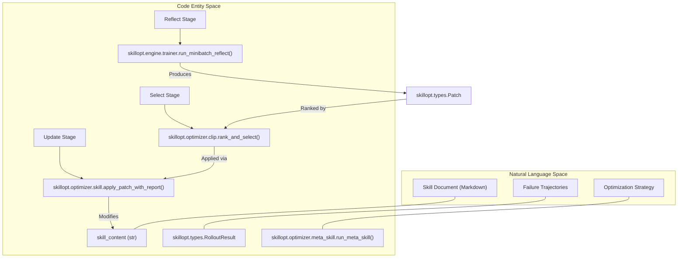

<!-- source: DeepWiki mcp.deepwiki.com · repo microsoft/SkillOpt · page 11 Glossary · fetched 2026-10-26 -->

# Glossary

Relevant source files

The following files were used as context for generating this wiki page:

- [README.md](README.md)
- [configs/_base_/default.yaml](configs/_base_/default.yaml)
- [docs/guide/configuration.md](docs/guide/configuration.md)
- [docs/reference/config.md](docs/reference/config.md)
- [index.html](index.html)
- [skillopt-assets/arxiv-logomark-small.svg](skillopt-assets/arxiv-logomark-small.svg)
- [skillopt.html](skillopt.html)
- [skillopt/config.py](skillopt/config.py)
- [skillopt/engine/trainer.py](skillopt/engine/trainer.py)
- [skillopt_sleep/__main__.py](skillopt_sleep/__main__.py)
- [skillopt_sleep/config.py](skillopt_sleep/config.py)
- [skillopt_sleep/cycle.py](skillopt_sleep/cycle.py)
- [skillopt_sleep/evidence.py](skillopt_sleep/evidence.py)
- [skillopt_sleep/staging.py](skillopt_sleep/staging.py)
- [tests/test_sleep_adopt_skill_subset.py](tests/test_sleep_adopt_skill_subset.py)
- [tests/test_sleep_scheduler_safety.py](tests/test_sleep_scheduler_safety.py)
- [tests/test_sleep_staging_fanout.py](tests/test_sleep_staging_fanout.py)

This page provides definitions for codebase-specific terms, abbreviations, and domain concepts used throughout the SkillOpt project. It serves as a technical reference for onboarding engineers to understand the mapping between high-level optimization concepts and their specific implementations in the code.

## Core Optimization Concepts

### Skill Document
The **Skill Document** is the primary trainable artifact in SkillOpt. It is a Markdown file containing natural language instructions, strategies, and few-shot examples that guide a "frozen" Target Model. In the deep learning analogy, the Skill Document represents the **model weights**.
*   **Implementation**: Represented as a string variable `skill_content` throughout the pipeline.
*   **Code Pointers**:
    *   `best_skill.md` (default output filename) [README.md:40-40]()
    *   `skillopt.optimizer.skill.apply_patch_with_report` [skillopt/engine/trainer.py:34-34]()

### Rollout
A **Rollout** is the execution of a set of tasks by the Target Model using the current Skill Document. This is analogous to a **forward pass** in neural network training.
*   **Implementation**: Handled by environment-specific adapters. Results are captured in `RolloutResult` objects.
*   **Code Pointers**:
    *   `skillopt.types.RolloutResult` [docs/reference/api.md:154-160]()
    *   `EnvAdapter.rollout` [docs/reference/api.md:51-60]()

### Reflect (Gradient Computation)
**Reflect** is the process where an Optimizer Model analyzes trajectories (logs) from a rollout to identify why the agent succeeded or failed. It produces "Edit Patches," which are analogous to **gradients**.
*   **Implementation**: Uses "Analyst" prompts to process minibatches of trajectories.
*   **Code Pointers**:
    *   `run_minibatch_reflect` [docs/reference/api.md:67-68]()
    *   `run_error_analyst_minibatch` [skillopt/engine/trainer.py:18-18]()

### Edit Patch
An **Edit Patch** is a structured proposal for modifying the Skill Document. It contains one or more `Edit` operations (append, replace, delete, etc.).
*   **Implementation**: Defined as the `Patch` dataclass.
*   **Code Pointers**:
    *   `skillopt.types.Patch` [docs/reference/api.md:145-150]()
    *   `skillopt.types.Edit` [docs/reference/api.md:135-143]()

### Learning Rate (Edit Budget)
In SkillOpt, the **Learning Rate** defines the maximum number of edits (the "budget") allowed to be applied to the Skill Document in a single update step. This prevents "noisy" updates from causing catastrophic forgetting.
*   **Implementation**: Controlled by the `edit_budget` parameter and managed by a `scheduler`.
*   **Code Pointers**:
    *   `decide_autonomous_learning_rate` [skillopt/engine/trainer.py:31-31]()
    *   `build_scheduler` [skillopt/engine/trainer.py:33-33]()

Sources: [README.md:40-40](), [skillopt/engine/trainer.py:18-34](), [docs/reference/api.md:51-160]()

---

## SkillOpt-Sleep Concepts

### Nightly Cycle
The **Nightly Cycle** is the offline self-evolution process for local agents (e.g., Claude Code, Codex). It consists of five stages: Harvest, Mine, Replay, Consolidate, and Stage.
*   **Implementation**: Orchestrated by `run_sleep_cycle`.
*   **Code Pointers**:
    *   `skillopt_sleep.cycle.run_sleep_cycle` [skillopt_sleep/cycle.py:37-37]()

### Harvest
The process of scanning local agent transcript directories (e.g., `~/.claude/projects`) to find recent user-assistant interactions.
*   **Code Pointers**:
    *   `harvest_for_config` [skillopt_sleep/cycle.py:27-27]()
    *   `skillopt_sleep.config.CLAUDE_HOME` [skillopt_sleep/config.py:20-20]()

### Mine
Extracting specific, checkable tasks from harvested transcripts. It filters out meta-prompts and redacts secrets.
*   **Code Pointers**:
    *   `mine` [skillopt_sleep/cycle.py:30-30]()
    *   `redact_secrets` [skillopt_sleep/staging.py:44-44]()

### Replay
Executing mined tasks against the current local skill and memory (e.g., `CLAUDE.md`) using a `Backend` to generate new trajectories and scores.
*   **Code Pointers**:
    *   `replay_batch` [skillopt_sleep/cycle.py:31-31]()
    *   `skillopt_sleep.backend.Backend` [skillopt_sleep/cycle.py:23-23]()

Sources: [skillopt_sleep/cycle.py:3-4](), [skillopt_sleep/cycle.py:23-37](), [skillopt_sleep/config.py:20-20](), [skillopt_sleep/staging.py:44-44]()

---

## System Architecture Diagrams

### Concept to Code Mapping: The ReflACT Loop
This diagram bridges high-level optimization terminology with the specific classes and functions that implement them.

**Sources**: [skillopt/engine/trainer.py:1-13](), [docs/reference/api.md:145-160](), [skillopt/engine/trainer.py:29-34]()

### Data Flow: Sleep Engine Lifecycle
This diagram tracks the transformation of local agent data into a validated skill proposal.

```mermaid
flowchart LR
    subgraph "Data Acquisition"
        H["skillopt_sleep.harvest_sources.harvest_for_config()"] --> D["skillopt_sleep.types.SessionDigest"]
        D --> M["skillopt_sleep.mine.mine()"]
        M --> T["skillopt_sleep.types.TaskRecord"]
    end

    subgraph "Evaluation & Optimization"
        T --> R["skillopt_sleep.replay.replay_batch()"]
        R --> C["skillopt_sleep.multi_skill.consolidate_groups()"]
        C --> S["skillopt_sleep.staging.write_staging()"]
        S --> AD["skillopt_sleep.staging.adopt()"]
    end
```

**Sources**: [skillopt_sleep/cycle.py:3-4](), [skillopt_sleep/cycle.py:26-38](), [skillopt_sleep/staging.py:48-49]()

---

## Technical Glossary Table

| Term | Definition | Code Pointer |
| :--- | :--- | :--- |
| **Analyst** | An LLM-powered worker that examines trajectories to suggest edits. | `run_error_analyst_minibatch` [skillopt/engine/trainer.py:18]() |
| **BatchSpec** | A descriptor for a data batch, including split name, size, and seed. | `skillopt.datasets.base.BatchSpec` [skillopt/engine/trainer.py:25]() |
| **Gate** | A validation mechanism that evaluates a candidate skill on a held-out split. | `evaluate_gate` [skillopt/engine/trainer.py:27]() |
| **Longitudinal Pair** | A comparison of performance on the *same task* across two different epochs. | `build_comparison_pairs` [skillopt/engine/trainer.py:47]() |
| **Meta Skill** | Optimizer-side memory that tracks cross-epoch strategy without modifying the target skill. | `run_meta_skill` [skillopt/engine/trainer.py:29]() |
| **Slow Update** | An epoch-boundary mechanism that injects "protected" guidance into the skill document. | `run_slow_update` [skillopt/engine/trainer.py:51]() |
| **Target Model** | The LLM agent that actually performs the tasks (e.g., GPT-4o, Claude). | `set_target_deployment` [skillopt/engine/trainer.py:72]() |
| **Optimizer Model** | The LLM that performs the reflection, merging, and ranking. | `set_optimizer_deployment` [skillopt/engine/trainer.py:74]() |
| **Trajectory** | The full log of interactions for a single task rollout. | `conversation.json` [docs/reference/api.md:70-71]() |
| **EditRecord** | The SkillOpt-Sleep equivalent of a Patch Edit, tracking target section and operation. | `skillopt_sleep.types.EditRecord` [skillopt_sleep/evidence.py:10-10]() |
| **SleepConfig** | Configuration object for SkillOpt-Sleep, handling defaults and overrides. | `skillopt_sleep.config.SleepConfig` [skillopt_sleep/config.py:96-96]() |
| **Staging** | The process of writing skill proposals and reports to a temporary directory for human review before adoption. | `skillopt_sleep.staging.write_staging` [skillopt_sleep/staging.py:24-24]() |
| **Redaction** | The process of removing sensitive information (e.g., API keys, passwords) from logs and reports. | `skillopt_sleep.staging.redact_secrets` [skillopt_sleep/staging.py:24-24]() |

Sources: [skillopt/engine/trainer.py:18-74](), [skillopt_sleep/config.py:96-96](), [skillopt_sleep/evidence.py:10-10](), [skillopt_sleep/staging.py:24-24](), [docs/reference/api.md:70-71]()

---

## Domain Concepts

### Epoch-Boundary Mechanisms
SkillOpt uses two specific mechanisms to stabilize learning over long durations:
1.  **Slow Update**: This acts like **momentum**. It performs a longitudinal comparison of adjacent-epoch rollouts and writes a "protected" section in the skill document [skillopt/engine/trainer.py:46-53]().
2.  **Meta Skill**: This is "Optimizer Memory." It distills instructions for the *Optimizer* on how to be a better analyst based on past epoch performance [skillopt/optimizer/meta_skill.py:1-7]().

### Update Modes
The system supports different ways of applying "gradients" to the "weights":
*   **patch**: The standard mode where specific lines are inserted or replaced [skillopt/engine/trainer.py:151]().
*   **rewrite_from_suggestions**: The optimizer provides suggestions, and the LLM rewrites the entire document section [skillopt/engine/trainer.py:32]().
*   **full_rewrite_minibatch**: A more aggressive mode where the analyst rewrites the skill based directly on the minibatch evidence [skillopt/engine/trainer.py:56]().

Sources: [skillopt/engine/trainer.py:1-60](), [skillopt_sleep/cycle.py:1-110](), [skillopt_sleep/backend.py:1-116](), [docs/reference/api.md:1-165]().