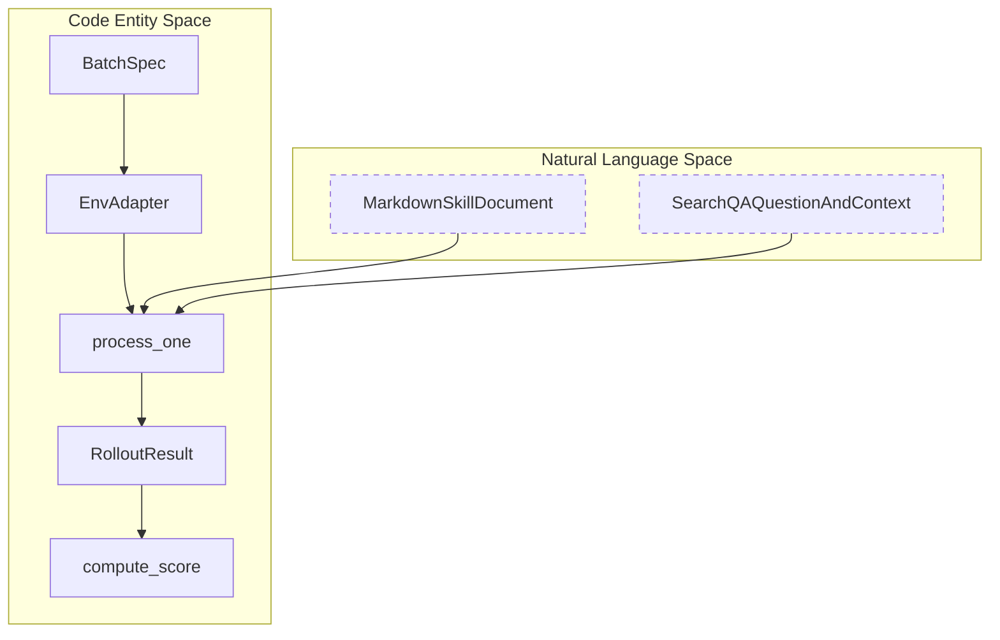
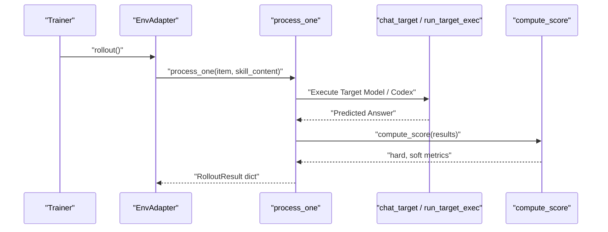

<!-- source: DeepWiki mcp.deepwiki.com · repo microsoft/SkillOpt · page 2.1 Rollout Stage · fetched 2026-10-26 -->

# Rollout Stage

Relevant source files

The following files were used as context for generating this wiki page:

- [skillopt/envs/searchqa/rollout.py](skillopt/envs/searchqa/rollout.py)
- [skillopt/utils/scoring.py](skillopt/utils/scoring.py)

The **Rollout Stage** is the initial phase of the ReflACT training loop [skillopt/engine/trainer.py:4-4](). In this stage, the **Target Model** executes tasks from the current training minibatch using instructions provided by the current skill document. The primary objective is to generate execution trajectories, predicted answers, and performance metrics that serve as experience for subsequent reflection and optimization stages.

Sources: [skillopt/engine/trainer.py:4-4]()

---

## Rollout Architecture and Data Flow

The rollout process bridges natural language instructions (the skill document and task specifications) with concrete execution code handled by environment adapters and inference runtimes [skillopt/envs/searchqa/rollout.py:153-210]().

**Rollout Data Flow: From Specification to Scored Results**

Sources: [skillopt/envs/searchqa/rollout.py:153-210](), [skillopt/utils/scoring.py:7-23](), [skillopt/datasets/base.py:18-18]()

---

## Single-Item Execution and Prompt Construction

Task execution for benchmarks like SearchQA is orchestrated per-item via `process_one` [skillopt/envs/searchqa/rollout.py:153-163]() which coordinates context preparation, prompt formatting, model invocation, and evaluation.

### Context Management and Truncation
To respect context token budgets, large context passages are truncated at document boundaries (`[DOC]`) using `_truncate_context` [skillopt/envs/searchqa/rollout.py:41-54]() up to `_MAX_CONTEXT_CHARS` (6,000 characters) [skillopt/envs/searchqa/rollout.py:26-26]().

### Prompt Assembly
System prompts and user prompts are dynamically constructed based on the active skill document:
* `_build_system`: Formats the skill section using the `rollout_system` prompt template [skillopt/envs/searchqa/rollout.py:57-62]().
* `_build_user`: Merges truncated context, questions, previous trace snapshots, and diagnostic instructions [skillopt/envs/searchqa/rollout.py:65-86]().
* `_build_codex_skill`: Renders specialized markdown skill wrappers when executing via the codex harness [skillopt/envs/searchqa/rollout.py:89-98]().

### Systemic Failure Handling
If all rollout rows fail before an agent response is generated, `_raise_on_systemic_failure` intercepts the batch, analyzes the failure reasons using a `Counter`, and raises a `RuntimeError` to abort the step [skillopt/envs/searchqa/rollout.py:29-38]().

Sources: [skillopt/envs/searchqa/rollout.py:26-98](), [skillopt/envs/searchqa/rollout.py:153-163]()

---

## Target Model Execution and Harness Integration

Depending on the configured backend, rollouts execute either through direct chat APIs or workspace-isolated execution harnesses (such as `codex_harness`) [skillopt/envs/searchqa/rollout.py:101-147]().

**Target Model Interaction Pattern**

Sources: [skillopt/envs/searchqa/rollout.py:153-210](), [skillopt/utils/scoring.py:7-23]()

When `is_target_exec_backend()` is active, `_run_codex_once` prepares a workspace directory (`codex_exec`), writes the task description and skill markdown, and invokes `run_target_exec` with configured timeouts [skillopt/envs/searchqa/rollout.py:101-147]().

Sources: [skillopt/envs/searchqa/rollout.py:101-147](), [skillopt/model/__init__.py:1-20]()

---

## Scoring and RolloutResult Objects

Once execution completes, responses are evaluated against ground truth answers. The scoring logic computes hard and soft metrics via `compute_score` [skillopt/utils/scoring.py:7-23]().

### Scoring Utilities
* `compute_score(results)`: Iterates over episode results, extracting `.hard` / `get("hard")` and `.soft` / `get("soft")` attributes or dictionary keys, and returns normalized accuracy averages [skillopt/utils/scoring.py:7-23]().
* `skill_hash(content)`: Generates a short 16-character SHA-256 hash of the skill text for caching and tracking purposes [skillopt/utils/scoring.py:26-28]().

### RolloutResult Attributes
The resulting structured objects capture trajectory outcomes:

| Field | Type | Description |
| :--- | :--- | :--- |
| `id` | `str` | Unique identifier for the task item [skillopt/types.py:111-111](). |
| `hard` | `float` | Binary success (`1.0`) or failure (`0.0`), or smoothed reward [skillopt/types.py:112-112](), [skillopt/utils/scoring.py:10-10](). |
| `soft` | `float` | Continuous partial credit score (`0.0` to `1.0`) [skillopt/types.py:113-113](). |
| `n_turns` | `int` | Number of interaction turns in the trajectory [skillopt/types.py:114-114](). |
| `fail_reason` | `str` | Qualitative reason for failure if execution failed [skillopt/types.py:115-115](). |
| `target_system_prompt` | `str` | The exact system prompt containing the skill used during rollout [skillopt/types.py:121-121](). |
| `extras` | `dict` | Environment-specific metadata and debugging logs [skillopt/types.py:124-124](). |

Sources: [skillopt/types.py:105-177](), [skillopt/utils/scoring.py:7-28]()

---

## Longitudinal Comparison Support

To support **Slow Update** and **Meta Skill** mechanisms [skillopt/engine/trainer.py:29-53](), rollout results from the current step are compared with historical trajectories. The trainer constructs comparison pairs to categorize trajectories as improved or regressed, allowing the optimizer to focus on behavioral deltas resulting from skill updates [skillopt/engine/trainer.py:46-53]().

Sources: [skillopt/engine/trainer.py:46-53](), [skillopt/optimizer/slow_update.py:46-53]()

---

