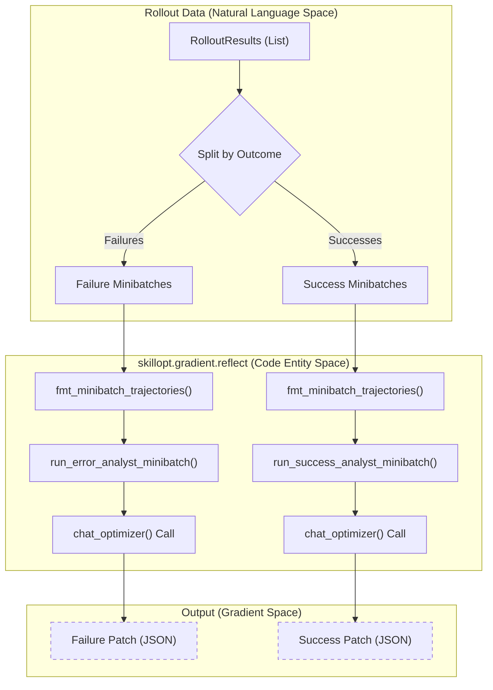
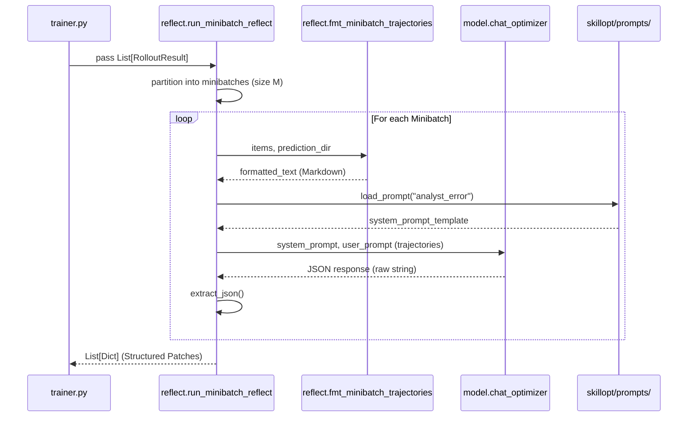

<!-- source: DeepWiki mcp.deepwiki.com · repo microsoft/SkillOpt · page 2.2 Reflect Stage (Gradient Computation) · fetched 2026-10-26 -->

# Reflect Stage (Gradient Computation)

Relevant source files

The following files were used as context for generating this wiki page:

- [.gitignore](.gitignore)
- [skillopt/envs/spreadsheetbench/adapter.py](skillopt/envs/spreadsheetbench/adapter.py)
- [skillopt/envs/spreadsheetbench/rollout.py](skillopt/envs/spreadsheetbench/rollout.py)
- [skillopt/gradient/aggregate.py](skillopt/gradient/aggregate.py)
- [skillopt/gradient/reflect.py](skillopt/gradient/reflect.py)
- [skillopt/model/claude_code_backend.py](skillopt/model/claude_code_backend.py)
- [tests/test_aggregate_fallback.py](tests/test_aggregate_fallback.py)
- [tests/test_hierarchical_merge.py](tests/test_hierarchical_merge.py)
- [tests/test_trainer_failure_patterns.py](tests/test_trainer_failure_patterns.py)

The **Reflect Stage** is the second phase of the SkillOpt training loop. It is directly analogous to **gradient computation** in deep learning: it analyzes rollout errors and successes (trajectories) and produces a "gradient" (structured edit patches) indicating how the skill document weights should be updated to improve task performance.

Instead of analyzing each trajectory independently, SkillOpt groups rollout results into minibatches of size $M$. The Optimizer Model analyzes these minibatches together to identify systematic patterns rather than overfitting to individual edge cases [skillopt/gradient/reflect.py:1-6]().

---

## Purpose and Scope

The scope of this page covers:
- Minibatch trajectory formatting and clipping rules [skillopt/gradient/reflect.py:54-106]()
- Parallel error and success analyst execution using `ThreadPoolExecutor` [skillopt/gradient/reflect.py:28]()
- The two-level prompt priority system (environment-specific overrides vs. generic defaults) [skillopt/gradient/reflect.py:8-12]()
- Integration with model backends via `chat_optimizer()` [skillopt/gradient/reflect.py:30]()

Sources: [skillopt/gradient/reflect.py:1-49]()

---

## Implementation Overview

The Reflect stage is implemented in `skillopt/gradient/reflect.py`. It transforms raw conversation logs into structured JSON patches containing revise suggestions or edit operations.

### Key Functions and Data Flow

| Function | Role | Code Reference |
| :--- | :--- | :--- |
| `run_minibatch_reflect` | Main entry point; partitions rollouts into failure/success minibatches and dispatches to workers | [skillopt/gradient/reflect.py:204-245]() |
| `fmt_minibatch_trajectories` | Aggregates multiple conversation logs and metadata into a single text block for the optimizer | [skillopt/gradient/reflect.py:112-115]() |
| `run_error_analyst_minibatch` | Invokes the optimizer model to analyze a batch of failed tasks | [skillopt/gradient/reflect.py:248-251]() |
| `run_success_analyst_minibatch` | Invokes the optimizer model to analyze a batch of successful tasks for reinforcing patterns | [skillopt/gradient/reflect.py:315-318]() |

### Reflect Process Diagram
This diagram illustrates how rollout results are processed into gradient patches, bridging natural language spaces to code entity spaces.

Sources: [skillopt/gradient/reflect.py:1-21](), [skillopt/gradient/reflect.py:204-245]()

---

## Trajectory Formatting

To allow the Optimizer Model to understand what happened during a rollout, the `fmt_trajectory` function converts complex JSON conversation logs into human-readable text [skillopt/gradient/reflect.py:65-106]().

### Supported Conversation Formats
The formatter automatically handles different agent architectures:
1. **Tool-call records**: Common in ReAct-style agents (`type: tool_call`, `cmd`, `obs`) [skillopt/gradient/reflect.py:83-87]().
2. **Step records**: Structured step-by-step reasoning and feedback (`step`, `action`, `env_feedback`, `reasoning`) [skillopt/gradient/reflect.py:88-96]().
3. **System/Role messages**: Standard chat completion format roles (`role: system/agent`, `content`) [skillopt/gradient/reflect.py:97-104]().

### Context Preservation and Enrichment
* **Full Context**: Trajectory text clipping is disabled by default so the optimizer can examine the full context window without truncation [skillopt/gradient/reflect.py:54-57]().
* **Reference Data**: Formatted outputs include hidden ground truth references and target system prompts [skillopt/gradient/reflect.py:160-178]().
* **Environment Verification**: For complex tasks (such as `SpreadsheetBench`), output verification reports detailing cell-level mismatches are appended directly to the trajectory [skillopt/envs/spreadsheetbench/rollout.py:108-119]().

Sources: [skillopt/gradient/reflect.py:54-106](), [skillopt/gradient/reflect.py:160-178](), [skillopt/envs/spreadsheetbench/rollout.py:108-119]()

---

## Minibatch Analysis & Parallel Workers

Minibatch analysis groups multiple similar tasks together to extract robust patterns.

### Error Analyst (`analyst_error`)
The error analyst identifies systematic failure patterns across the minibatch, ignoring isolated edge cases in favor of high-impact editing rules [skillopt/gradient/reflect.py:248-251]().
* **Prompt Loading**: Loaded via `load_prompt("analyst_error")` [skillopt/gradient/reflect.py:257]().
* **Skill-Aware Augmentation**: When enabled, prompts are augmented to extract execution lapses into protected appendices [skillopt/gradient/reflect.py:261-267]().

### Success Analyst (`analyst_success`)
The success analyst analyzes successful trajectories to identify hidden positive behaviors or best practices not yet formalized in the skill document [skillopt/gradient/reflect.py:315-318]().
* **Prompt Loading**: Loaded via `load_prompt("analyst_success")` [skillopt/gradient/reflect.py:324]().

### Parallel Execution
Minibatches are distributed across background threads using `ThreadPoolExecutor`, enabling concurrent LLM calls to the optimizer backend [skillopt/gradient/reflect.py:28]().

Sources: [skillopt/gradient/reflect.py:248-375](), [skillopt/optimizer/skill_aware.py:1-20]()

---

## Two-Level Prompt Priority System

The Reflect stage uses a two-level prompt hierarchy:
1. **Environment-Specific Override**: The `EnvAdapter` is queried first via `adapter.get_prompt(stage)`. If a custom implementation is returned, it takes precedence [skillopt/gradient/reflect.py:8-12]().
2. **Generic Default**: If no override exists, the system falls back to standard Markdown templates located in `skillopt/prompts/` [skillopt/gradient/reflect.py:8-12]().

### Mapping Prompts to Code Entities

| Logic Component | Default Prompt File | Code Reference |
| :--- | :--- | :--- |
| Error Analyst | `analyst_error_rewrite.md` | `load_prompt("analyst_error")` [skillopt/gradient/reflect.py:257]() |
| Success Analyst | `analyst_success_rewrite.md` | `load_prompt("analyst_success")` [skillopt/gradient/reflect.py:324]() |
| Meta-Skill Context | Dynamic injection | `format_meta_skill_context()` [skillopt/gradient/reflect.py:31]() |

Sources: [skillopt/gradient/reflect.py:8-12](), [skillopt/gradient/reflect.py:257-324]()

---

## Technical Data Flow: Rollout to Patch

This sequence diagram tracks the lifecycle of rollout results turning into structured patches through model dispatching.

Sources: [skillopt/gradient/reflect.py:204-245]()

---

