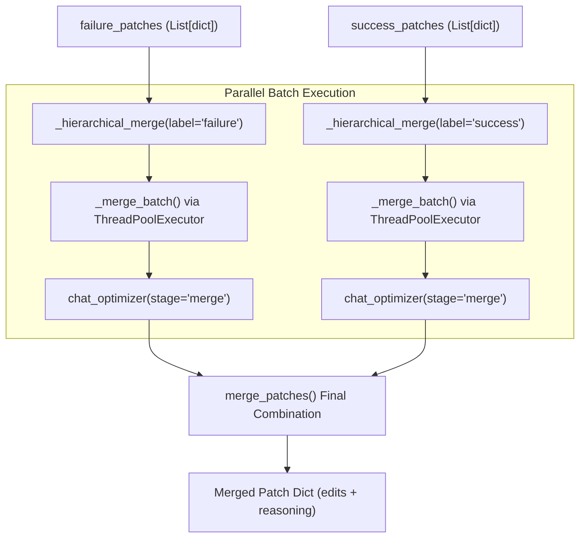
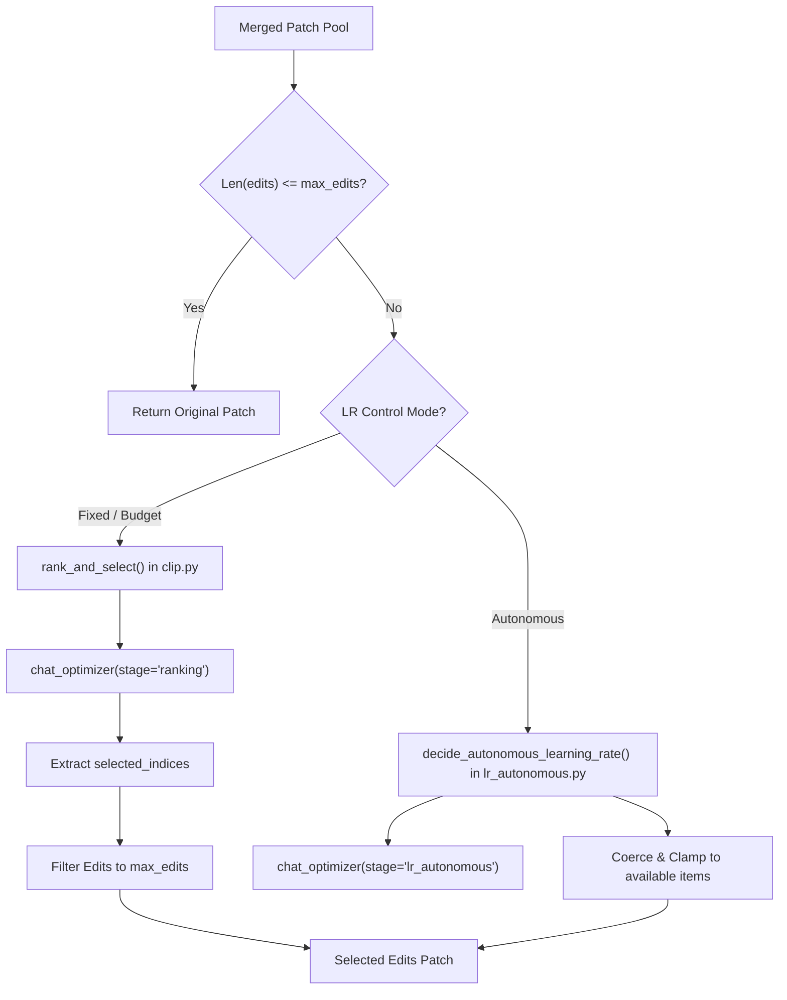
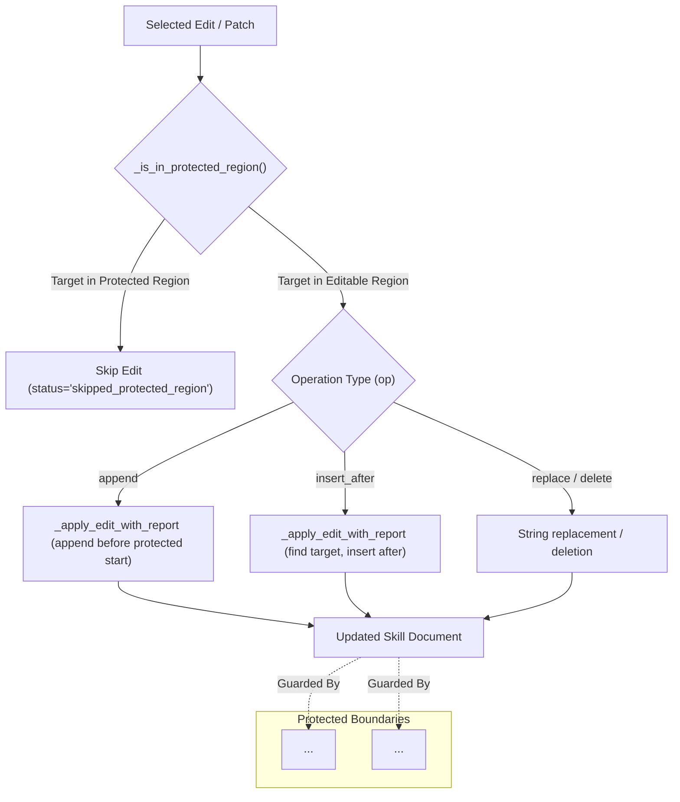

<!-- source: DeepWiki mcp.deepwiki.com · repo microsoft/SkillOpt · page 2.3 Aggregate, Select, and Update Stages · fetched 2026-10-26 -->

# Aggregate, Select, and Update Stages

Relevant source files

The following files were used as context for generating this wiki page:

- [skillopt/envs/spreadsheetbench/adapter.py](skillopt/envs/spreadsheetbench/adapter.py)
- [skillopt/envs/spreadsheetbench/rollout.py](skillopt/envs/spreadsheetbench/rollout.py)
- [skillopt/gradient/aggregate.py](skillopt/gradient/aggregate.py)
- [skillopt/optimizer/appendix.py](skillopt/optimizer/appendix.py)
- [skillopt/optimizer/clip.py](skillopt/optimizer/clip.py)
- [skillopt/optimizer/lr_autonomous.py](skillopt/optimizer/lr_autonomous.py)
- [skillopt/optimizer/skill.py](skillopt/optimizer/skill.py)
- [skillopt/optimizer/skill_aware.py](skillopt/optimizer/skill_aware.py)
- [skillopt/optimizer/slow_update.py](skillopt/optimizer/slow_update.py)
- [skillopt/optimizer/update_modes.py](skillopt/optimizer/update_modes.py)
- [tests/test_aggregate_fallback.py](tests/test_aggregate_fallback.py)
- [tests/test_hierarchical_merge.py](tests/test_hierarchical_merge.py)
- [tests/test_skill_aware_reflection.py](tests/test_skill_aware_reflection.py)
- [tests/test_slow_update_robustness.py](tests/test_slow_update_robustness.py)
- [tests/test_trainer_failure_patterns.py](tests/test_trainer_failure_patterns.py)

The middle stages of the ReflACT loop (Stages 3, 4, and 5) transform raw edit patches produced by the Reflect stage into a single, optimized candidate skill document. This pipeline performs hierarchical patch merging, importance-based ranking (textual gradient clipping), autonomous learning rate adjustment, and document-level application while preserving protected regions.

---

## 1. Aggregate Stage: Hierarchical Patch Merging

The Aggregate stage takes independently generated patches from parallel analyst workers and merges them into a single coherent patch [skillopt/gradient/aggregate.py:1-6](). It prioritizes failure-driven patches over success-driven ones.

### Implementation Logic
The merging process executes in three distinct phases:
1. **Failure Merge**: All patches derived from failed trajectories are merged hierarchically [skillopt/gradient/aggregate.py:168-168]().
2. **Success Merge**: All patches derived from successful trajectories are merged hierarchically [skillopt/gradient/aggregate.py:169-169]().
3. **Final Merge**: Both groups are combined with failure priority [skillopt/gradient/aggregate.py:170-170]().

If the patch count exceeds `batch_size`, `_hierarchical_merge` groups items into batches and dispatches same-level batches in parallel via a `ThreadPoolExecutor` [skillopt/gradient/aggregate.py:92-136](). Batch sizes below 2 are clamped to 2 as defense-in-depth [skillopt/gradient/aggregate.py:92-95](). Fallback concatenation is triggered automatically if optimizer calls or JSON parsing fail [skillopt/gradient/aggregate.py:60-76]().

### Diagram: Hierarchical Merge Flow (Natural Language Space to Code Entity Space)
This diagram maps the conceptual aggregation stages to the underlying Python functions and classes in `skillopt/gradient/aggregate.py`.

Sources: [skillopt/gradient/aggregate.py:28-186]()

---

## 2. Select Stage: Gradient Clipping and Autonomous LR

The Select stage functions as a textual gradient clipper, controlling step size by selecting the top-$L$ edits or delegating budget decisions to an autonomous optimizer module [skillopt/optimizer/clip.py:1-6]().

### Importance-Based Ranking (`rank_and_select`)
When the proposed edit pool exceeds `max_edits`, `rank_and_select()` formats the edit pool and queries the optimizer model using ranking prompt templates [skillopt/optimizer/clip.py:25-78](). It parses the `selected_indices` JSON array, validates indices against bounds and uniqueness, and returns the filtered patch [skillopt/optimizer/clip.py:79-100](). If parsing or API execution fails, it falls back to head truncation [skillopt/optimizer/clip.py:101-109]().

### Autonomous Learning Rate (`decide_autonomous_learning_rate`)
When `lr_control_mode` is set to `autonomous`, `decide_autonomous_learning_rate()` evaluates current rollout metrics (`rollout_hard`, `rollout_soft`, `rollout_n`) alongside proposed update items [skillopt/optimizer/lr_autonomous.py:31-65](). The optimizer returns an integer learning rate allocation, which is coerced, clamped to available items, and recorded with fallback telemetry [skillopt/optimizer/lr_autonomous.py:85-108]().

### Diagram: Selection and Budget Clipping Flow
This diagram illustrates the control flow between `rank_and_select` and `decide_autonomous_learning_rate`.

Sources: [skillopt/optimizer/clip.py:25-109](), [skillopt/optimizer/lr_autonomous.py:31-108]()

---

## 3. Update Stage: Applying Edits and Protected Regions

The Update stage applies selected edits to the current skill document, mirroring `optimizer.step()` in neural networks [skillopt/optimizer/skill.py:1-6]().

### Update Modes and Application Functions
*   **Patch Mode**: Iterates over edits via `apply_patch_with_report()` executing granular operations (`append`, `insert_after`, `replace`, `delete`) [skillopt/optimizer/skill.py:85-162]().
*   **Rewrite Modes**: Leverages rewrite handlers (`rewrite_skill_from_suggestions`) to overwrite document sections based on complete suggestions [skillopt/optimizer/rewrite.py:12-59]().

### Protected Regions
All update operations respect protected regions defined by strict document markers:
*   **Slow Update Region**: Bounded by `<!-- SLOW_UPDATE_START -->` and `<!-- SLOW_UPDATE_END -->` [skillopt/optimizer/slow_update.py:32-33]().
*   **Skill-Aware Appendix**: Bounded by `<!-- APPENDIX_START -->` and `<!-- APPENDIX_END -->` [skillopt/optimizer/appendix.py:36-37]().

`_is_in_protected_region()` verifies target positions and silently skips edits attempting modification inside protected areas [skillopt/optimizer/skill.py:33-58](). Append and insert-after fallbacks insert content strictly before the earliest protected region to keep protected blocks at the document tail [skillopt/optimizer/skill.py:33-40]().

### Diagram: Update Stage and Protected Region Guardrails
This diagram maps the code entities enforcing safe document modification in `skillopt/optimizer/skill.py`, `slow_update.py`, and `appendix.py`.

Sources: [skillopt/optimizer/skill.py:33-180](), [skillopt/optimizer/slow_update.py:32-89](), [skillopt/optimizer/appendix.py:36-156]()

---

