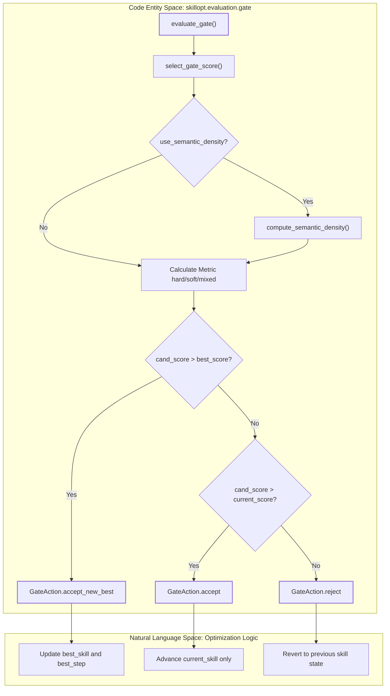
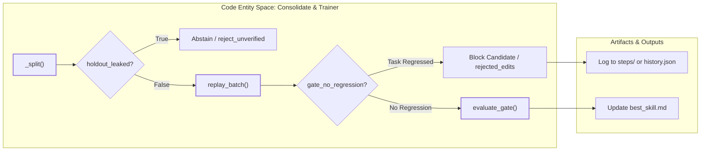

<!-- source: DeepWiki mcp.deepwiki.com · repo microsoft/SkillOpt · page 2.4 Validation Gate · fetched 2026-10-26 -->

# Validation Gate

Relevant source files

The following files were used as context for generating this wiki page:

- [skillopt/evaluation/__init__.py](skillopt/evaluation/__init__.py)
- [skillopt/evaluation/gate.py](skillopt/evaluation/gate.py)
- [tests/test_consolidate_split.py](tests/test_consolidate_split.py)
- [tests/test_gate.py](tests/test_gate.py)
- [tests/test_gate_no_regression.py](tests/test_gate_no_regression.py)
- [tests/test_holdout_integrity.py](tests/test_holdout_integrity.py)
- [tests/test_semantic_density.py](tests/test_semantic_density.py)

The **Validation Gate** is the quality control and model selection mechanism used to evaluate a candidate skill document against a held-out selection split [skillopt/evaluation/gate.py:3-5](). Analogous to validation-based early stopping in neural network training, it compares the candidate's score against the current and best scores, deciding whether to commit the edits, advance the state, or reject the update [skillopt/evaluation/gate.py:3-5]().

Sources: [skillopt/evaluation/gate.py:3-5]()

## Gate Logic and Decision Flow

The Gate evaluates candidate performance by projecting hard and soft scores into a single comparison metric using `select_gate_score` and `evaluate_gate` [skillopt/evaluation/gate.py:85-132](), [skillopt/evaluation/gate.py:151-224]().

### Decision Types (`GateAction`)
The `evaluate_gate` function returns a `GateResult` containing one of three actions [skillopt/evaluation/gate.py:30]():
1. **`accept_new_best`**: The candidate skill outperforms both the current active score and the best-so-far score [skillopt/evaluation/gate.py:201-209](). The candidate becomes both the active skill and the new `best_skill` reference.
2. **`accept`**: The candidate skill outperforms the current active score but does not exceed the historical best score [skillopt/evaluation/gate.py:210-216](). The active skill updates, but the best-so-far checkpoint is preserved.
3. **`reject`**: The candidate skill fails to beat the current score [skillopt/evaluation/gate.py:217-223](). The system reverts to the previous skill state.

### Metric Selection and Scoring
The gate supports three primary modes via `GateMetric` [skillopt/evaluation/gate.py:31]():
* **`hard`**: Compares exact-match accuracy (`cand_hard`) [skillopt/evaluation/gate.py:116-117]().
* **`soft`**: Compares partial credit or F1 scores (`cand_soft`) [skillopt/evaluation/gate.py:118-119]().
* **`mixed`**: Computes a weighted average `(1 - w) * hard + w * soft` where `w` is defined by `mixed_weight` [skillopt/evaluation/gate.py:120-122]().

Additionally, the gate can factor in **Semantic Density** via `compute_semantic_density`, which evaluates the proportion of high-influence leading words (e.g., `MUST`, `ALWAYS`, `NEVER`) while stripping protected metadata regions like `SLOW_UPDATE` or `APPENDIX` blocks [skillopt/evaluation/gate.py:46-82]().

### Diagram: Gate Evaluation Flow

Title: Gate Decision Mapping between Natural Language Space and Code Entity Space

Sources: [skillopt/evaluation/gate.py:46-132](), [skillopt/evaluation/gate.py:151-224]()

## Data Structures

The outcome of validation gating is encapsulated in `GateResult` [skillopt/evaluation/gate.py:34-44]().

### `GateResult` Dataclass
| Field | Type | Description |
| :--- | :--- | :--- |
| `action` | `GateAction` | Decision outcome (`accept_new_best`, `accept`, or `reject`) [skillopt/evaluation/gate.py:38](). |
| `current_skill` | `str` | Updated skill text content for the current state [skillopt/evaluation/gate.py:39](). |
| `current_score` | `float` | Metric-space score of the current skill [skillopt/evaluation/gate.py:40](). |
| `best_skill` | `str` | Best-so-far skill text content [skillopt/evaluation/gate.py:41](). |
| `best_score` | `float` | Metric-space score of the best-so-far checkpoint [skillopt/evaluation/gate.py:42](). |
| `best_step` | `int` | Global training step where the best skill was accepted [skillopt/evaluation/gate.py:43](). |

Sources: [skillopt/evaluation/gate.py:34-44]()

## Holdout Integrity and Split Verification

Before executing score comparisons, the system enforces a strict holdout contract via `_split` in consolidation workflows to prevent data leakage between training and validation sets [tests/test_consolidate_split.py:1-5]().

* **Leak Detection**: If tasks lack a proper held-out validation slice (e.g., all tasks belong to `train` or `val` exclusively without disjoint splits), `_split` flags a holdout leak (`holdout_leaked = True`) [tests/test_holdout_integrity.py:22-36]().
* **Gate Abstention**: When holdout leakage is detected, the gate abstains from accepting unverified edits (`gate_action == "reject_unverified"`), surfacing proposals as unverified suggestions rather than strict negative feedback [tests/test_holdout_integrity.py:92-113](), [tests/test_holdout_integrity.py:164-185]().
* **Test Isolation**: Tasks flagged under the `test` split are strictly excluded from both training and validation slices [tests/test_consolidate_split.py:22-31]().

Sources: [tests/test_holdout_integrity.py:1-113](), [tests/test_consolidate_split.py:1-48]()

## Regression Control and Rejected-Edit Buffer

To prevent regressions across individual held-out tasks when `gate_no_regression` is enabled, the gate inspects task-level deltas [tests/test_gate_no_regression.py:1-192]().

* **No-Regression Constraint**: When `gate_no_regression=True`, a candidate skill is blocked if any held-out task experiences score regression relative to the baseline, even if the aggregate mean score improves [tests/test_gate_no_regression.py:158-192]().
* **Rejected-Edit Buffer**: When a candidate trial fails the gate or triggers regression checks, the applied edits are moved to `rejected_edits`. These are tracked in history artifacts and surfaced to subsequent reflection cycles to prevent repeating ineffective changes [tests/test_gate_no_regression.py:164-170]().

Sources: [tests/test_gate_no_regression.py:140-214]()

### Diagram: Validation and Rejection Data Flow

Title: Validation and Rejection Flow in Trainer and Consolidate Loops

Sources: [tests/test_holdout_integrity.py:92-113](), [tests/test_gate_no_regression.py:140-214]()

## Key Functions

### `evaluate_gate`
Defined in `skillopt/evaluation/gate.py:151-224`, this function compares candidate performance against current and best scores to produce a `GateResult`.

### `select_gate_score`
Defined in `skillopt/evaluation/gate.py:85-132`, this function projects hard, soft, and mixed metrics into a single scalar value, incorporating semantic density weighting if configured.

### `compute_semantic_density`
Defined in `skillopt/evaluation/gate.py:46-82`, this function calculates instruction density by measuring leading high-influence terms while ignoring protected block comments.

Sources: [skillopt/evaluation/gate.py:46-132](), [skillopt/evaluation/gate.py:151-224]()

---

