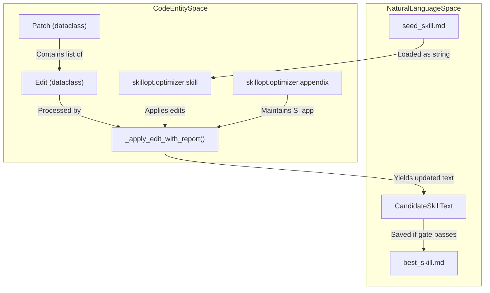
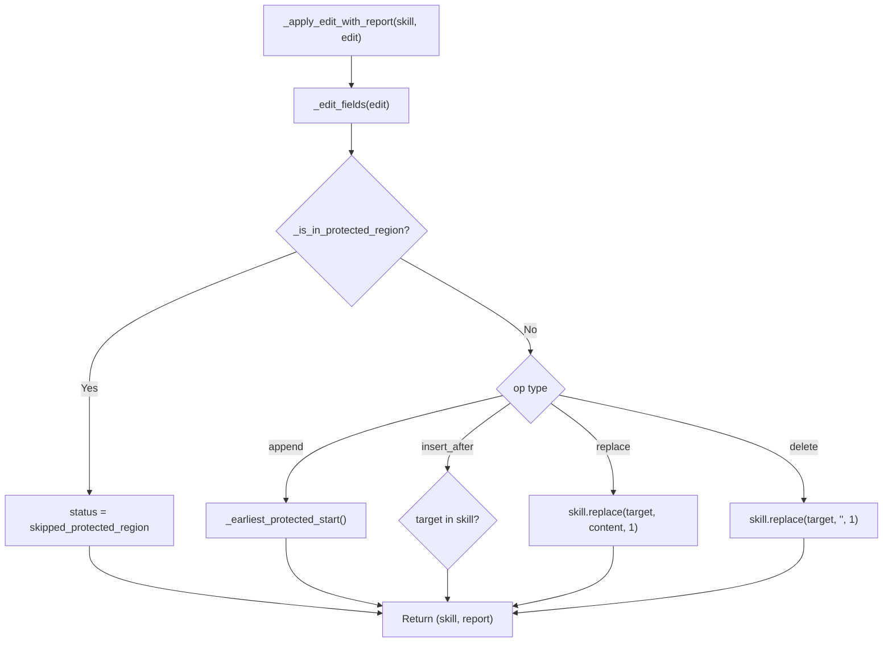

<!-- source: DeepWiki mcp.deepwiki.com · repo microsoft/SkillOpt · page 3 Skill Document · fetched 2026-10-26 -->

# Skill Document

Relevant source files

The following files were used as context for generating this wiki page:

- [ckpt/alfworld/gpt5.5_skill.md](ckpt/alfworld/gpt5.5_skill.md)
- [ckpt/docvqa/gpt5.5_skill.md](ckpt/docvqa/gpt5.5_skill.md)
- [ckpt/livemath/gpt5.5_skill.md](ckpt/livemath/gpt5.5_skill.md)
- [ckpt/officeqa/gpt5.5_skill.md](ckpt/officeqa/gpt5.5_skill.md)
- [ckpt/searchqa/gpt5.5_skill.md](ckpt/searchqa/gpt5.5_skill.md)
- [ckpt/spreadsheetbench/gpt5.5_skill.md](ckpt/spreadsheetbench/gpt5.5_skill.md)
- [skillopt/optimizer/appendix.py](skillopt/optimizer/appendix.py)
- [skillopt/optimizer/skill.py](skillopt/optimizer/skill.py)
- [skillopt/optimizer/skill_aware.py](skillopt/optimizer/skill_aware.py)
- [tests/test_skill_aware_reflection.py](tests/test_skill_aware_reflection.py)

## Purpose and Scope

This page covers the **Skill Document** as the central trainable artifact in SkillOpt. It defines how natural language strategies, heuristics, and error-correction rules serve as prompt weights for a frozen LLM agent [README.md:31-33](). 

As a PARENT page, this document provides a high-level overview of skill Markdown structure, lifecycle, edit operations, and transferability. For deep technical details on learning rate schedulers and optimizer prompt libraries, see the child pages:
- [Learning Rate and Scheduler](#3.1)
- [Optimizer Prompts Library](#3.2)

---

## Structure and Content

Skill documents are human-readable, model-interpretable Markdown files stored in training output directories (e.g., `ckpt/` or `steps/`). They organize task-specific knowledge into hierarchical sections such as task strategies, common patterns, and edge cases [ckpt/searchqa/gpt5.5_skill.md:1-52]().

Protected regions use special HTML comment markers to shield longitudinal guidance and execution notes from step-level edits:
- **Slow Update**: Managed via `<!-- SLOW_UPDATE_START -->` and `<!-- SLOW_UPDATE_END -->` [skillopt/optimizer/skill.py:14-15]().
- **Appendix (EmbodiSkill S_app)**: Managed via `<!-- APPENDIX_START -->` and `<!-- APPENDIX_END -->` to hold execution-lapse reminders without modifying the main task body [skillopt/optimizer/appendix.py:1-6]().

### Lifecycle of a Skill
1. **Seed Skill**: Initialized from a seed file or an empty state [docs/guide/first-experiment.md:84-91]().
2. **Candidate Skill**: Produced by applying a ranked set of edits during the Update stage [skillopt/optimizer/skill.py:1-6]().
3. **Best Skill (`best_skill.md`)**: Saved when a candidate passes the Validation Gate [docs/guide/training-loop.md:74-81]().

Sources: [skillopt/optimizer/skill.py:1-30](), [skillopt/optimizer/appendix.py:1-29](), [docs/guide/first-experiment.md:84-91]()

---

## Skill Document Operations

The `skillopt.optimizer.skill` and `skillopt.optimizer.appendix` modules handle text-space modifications, acting as the textual equivalent of `optimizer.step()` in neural networks [skillopt/optimizer/skill.py:1-6]().

### Atomic Edit Operations
The `Edit` type supports four primary operations [skillopt/optimizer/skill.py:98-145]():
- **`append`**: Inserts content at the end of the document or before the earliest protected region [skillopt/optimizer/skill.py:98-106]().
- **`insert_after`**: Places content immediately following a specified target string [skillopt/optimizer/skill.py:108-122]().
- **`replace`**: Swaps a target string with new content [skillopt/optimizer/skill.py:124-132]().
- **`delete`**: Removes a target string from the document [skillopt/optimizer/skill.py:134-142]().

Edits targeting text within protected regions (`_PROTECTED_REGIONS`) are automatically skipped or intercepted [skillopt/optimizer/skill.py:27-58]().

Sources: [skillopt/optimizer/skill.py:1-163](), [skillopt/optimizer/appendix.py:1-156]()

---

## Natural Language Space to Code Entity Space

The following diagrams bridge the natural language representations of skills to their corresponding code entities in the repository.

### Diagram 1: Skill File and Dataclass Flow

Sources: [skillopt/optimizer/skill.py:85-163](), [skillopt/optimizer/appendix.py:141-156]()

### Diagram 2: Protected Region Interception Logic

Sources: [skillopt/optimizer/skill.py:33-145]()

---

## Transferability

Skill documents generalize well across models and execution harnesses:
- **Cross-Model**: Skills optimized with a strong model (e.g., `GPT-4o`) can be transferred to boost smaller or alternative models like `Claude-3.5-Sonnet` or `Qwen-2.5` [README.md:46-48]().
- **Cross-Harness**: Plain Markdown artifacts can be deployed across direct chat, `codex_exec`, or `claude_code_exec` execution harnesses without architectural changes [README.md:41-43]().

Sources: [README.md:31-50]()

---

## Sub-Topics and Detailed Child Pages

For comprehensive technical breakdowns, refer to the following child pages:
- **[Learning Rate and Scheduler](#3.1)** — Covers the textual learning rate (edit budget), scheduler modes (constant, linear, cosine, autonomous), and the autonomous LR decision module.
- **[Optimizer Prompts Library](#3.2)** — Catalogs Markdown prompt templates in `skillopt/prompts`: analyst, merge, ranking, rewrite, slow_update, meta_skill, and environment-specific overrides.

Sources: [skillopt/optimizer/skill.py:1-200](), [docs/guide/training-loop.md:1-105]()

---

