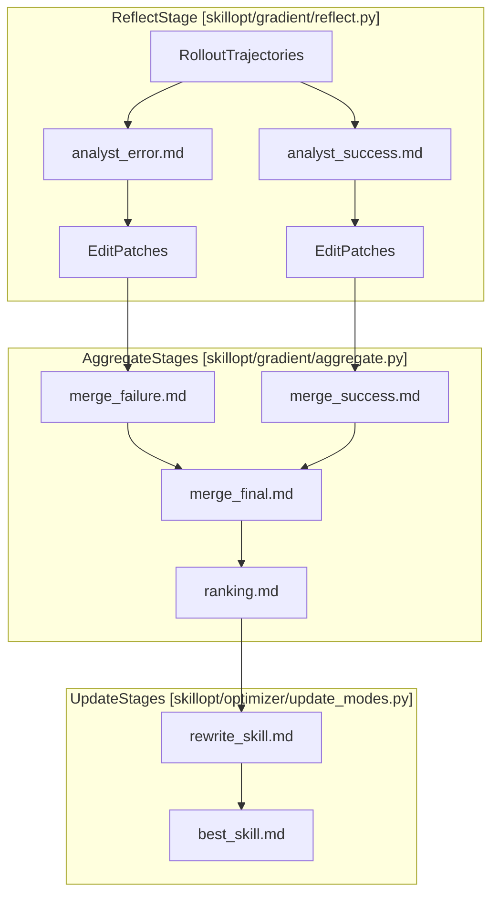
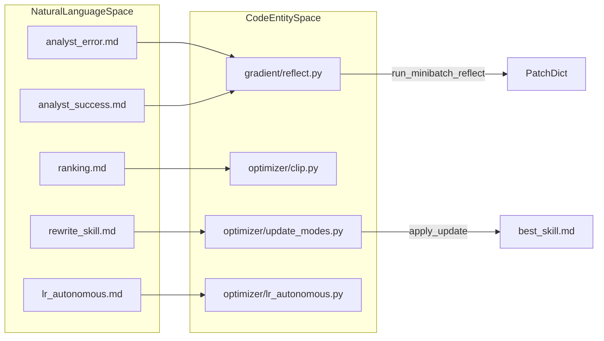

<!-- source: DeepWiki mcp.deepwiki.com · repo microsoft/SkillOpt · page 3.2 Optimizer Prompts Library · fetched 2026-10-26 -->

# Optimizer Prompts Library

Relevant source files

The following files were used as context for generating this wiki page:

- [.gitignore](.gitignore)
- [skillopt/gradient/reflect.py](skillopt/gradient/reflect.py)
- [skillopt/model/claude_code_backend.py](skillopt/model/claude_code_backend.py)
- [skillopt/optimizer/appendix.py](skillopt/optimizer/appendix.py)
- [skillopt/optimizer/skill.py](skillopt/optimizer/skill.py)
- [skillopt/optimizer/skill_aware.py](skillopt/optimizer/skill_aware.py)
- [tests/test_skill_aware_reflection.py](tests/test_skill_aware_reflection.py)

The **Optimizer Prompts Library** catalogs the Markdown-based templates in `skillopt/prompts/` and environment-specific overrides that dictate how the Optimizer Model interprets trajectory minibatches, aggregates edits, ranks updates, and maintains longitudinal memory. SkillOpt employs a hierarchical override system where benchmark-specific prompt variants supersede default optimization templates.

Sources: [skillopt/gradient/reflect.py:1-21](), [skillopt/optimizer/skill_aware.py:1-24]()

---

## Prompt Architecture and Data Flow

The optimizer leverages update modes defined in `skillopt/optimizer/update_modes.py` to process patches (`append`, `replace`, `delete`), suggest rewrites, or perform full minibatch updates [skillopt/optimizer/update_modes.py:1-45](). 

The following diagram traces the data flow from raw rollout trajectories through analyst evaluation, aggregation, and final update application.

### Optimizer Data Flow: From Trajectories to Skills
"Optimizer Data Flow"

Sources: [skillopt/gradient/reflect.py:18-21](), [skillopt/optimizer/update_modes.py:78-87]()

---

## Core Prompt Catalog

### 1. Analyst Prompts (Gradient Computation)
Analyst prompts serve as the gradient calculators of the system, transforming failure and success minibatches into structured insights.

*   **`analyst_error`**: Analyzes failure patterns across minibatches. When skill-aware reflection (EmbodiSkill) is enabled via `skillopt/optimizer/skill_aware.py`, the prompt is augmented with `ERROR_SUFFIX` to distinguish `SKILL_DEFECT` (leading to body edits) from `EXECUTION_LAPSE` (leading to protected appendix notes) [skillopt/optimizer/skill_aware.py:61-91]().
*   **`analyst_success`**: Extracts winning patterns from successful trajectories. Augmented with `SUCCESS_SUFFIX` when skill-aware reflection is active to categorize updates as `DISCOVERY` or `OPTIMIZATION` [skillopt/optimizer/skill_aware.py:94-106]().
*   **`lr_autonomous`**: Powers `decide_autonomous_learning_rate`, evaluating rollout metrics and proposal complexity to select a dynamic update budget [skillopt/optimizer/lr_autonomous.py:31-41]().

Sources: [skillopt/gradient/reflect.py:1-21](), [skillopt/optimizer/skill_aware.py:61-106]()

### 2. Merge Prompts (Aggregation)
Because minibatch analysis executes in parallel using `ThreadPoolExecutor`, aggregation prompts consolidate multiple partial suggestions [skillopt/gradient/aggregate.py:83-115]().

*   **`merge_failure` / `merge_success`**: Deduplicates overlapping suggestions and resolves conflicting directives.
*   **`merge_final`**: Combines failure-driven corrections and success-driven discoveries into a unified candidate patch [skillopt/gradient/aggregate.py:152-160]().

Sources: [skillopt/gradient/aggregate.py:83-160]()

### 3. Selection and Update Prompts
*   **`ranking` / `ranking_rewrite`**: Acts as a gradient clipper, ordering edits by systematic impact to fit within the active learning rate (edit budget) [skillopt/optimizer/clip.py:25-31]().
*   **`rewrite_skill`**: Used during `rewrite_from_suggestions` mode to integrate selected patches into a clean standalone document.

Sources: [skillopt/optimizer/clip.py:25-31](), [skillopt/optimizer/update_modes.py:1-45]()

### 4. Epoch-Boundary Prompts
*   **`slow_update`**: Compares task performance across epochs to generate longitudinal guidance protected within `<!-- SLOW_UPDATE_START -->` and `<!-- SLOW_UPDATE_END -->` markers [skillopt/optimizer/skill.py:14-15]().
*   **`meta_skill`**: Captures cross-epoch optimizer memory, instructing future optimizer passes on effective editing strategies for the current environment [skillopt/optimizer/meta_skill.py:18-30]().

Sources: [skillopt/optimizer/skill.py:14-15](), [skillopt/optimizer/meta_skill.py:18-30]()

---

## Two-Level Override System

Prompt loading uses the `load_prompt` utility to check environment-specific overrides before falling back to default templates [skillopt/prompts/__init__.py]().

| Priority | Location | Description |
| :--- | :--- | :--- |
| **1. Environment-Specific** | `skillopt/envs/<env_name>/prompts/` | Benchmark-specific prompt overrides tuned for domain failure modes. |
| **2. Default** | `skillopt/prompts/` | General-purpose templates used across all non-overridden environments. |

Sources: [skillopt/gradient/reflect.py:8-12](), [skillopt/prompts/__init__.py]()

---

## Code Entity Mapping

The following diagram bridges natural language prompt templates to their corresponding Python code entities in `skillopt/`.

### Prompt-to-Code Mapping
"PromptToCodeMapping"

Sources: [skillopt/gradient/reflect.py:18-21](), [skillopt/optimizer/clip.py:75-78](), [skillopt/optimizer/lr_autonomous.py:76-82]()

---

## Implementation Details

### JSON Enforcement and Parsing
Optimizer prompts mandate strict JSON formatting to ensure reliable programmatic parsing. The system extracts structured payloads via `extract_json` [skillopt/utils.py:1-20](). When skill-aware reflection is enabled, responses are parsed to extract both standard patches and `appendix_notes` [skillopt/optimizer/skill_aware.py:122-150]().

### Protected Document Sections
To prevent step-level edits from corrupting longitudinal insights or execution lapse reminders, `skillopt/optimizer/skill.py` enforces protected region boundaries:
*   **Slow Update Markers**: `<!-- SLOW_UPDATE_START -->` and `<!-- SLOW_UPDATE_END -->` [skillopt/optimizer/skill.py:14-15]().
*   **Appendix Markers**: `<!-- APPENDIX_START -->` and `<!-- APPENDIX_END -->` [skillopt/optimizer/skill.py:19-20]().

Functions like `_is_in_protected_region` and `_apply_edit_with_report` ensure step-level edits targeting these blocks are skipped or safely positioned [skillopt/optimizer/skill.py:43-107]().

Sources: [skillopt/optimizer/skill.py:14-107](), [skillopt/optimizer/skill_aware.py:122-150](), [skillopt/utils.py:1-20]()

---

