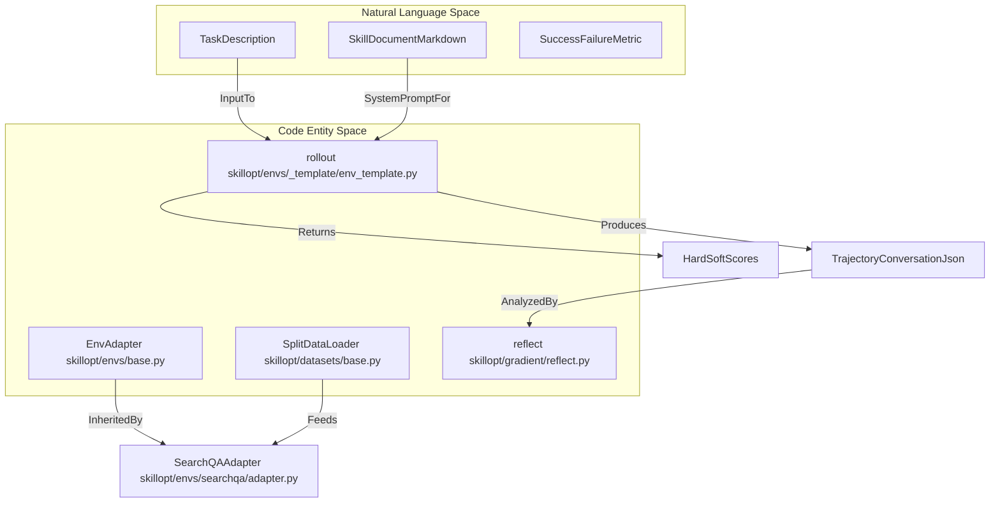
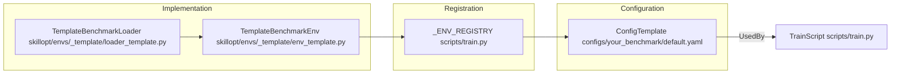

<!-- source: DeepWiki mcp.deepwiki.com · repo microsoft/SkillOpt · page 4 Environment Adapters and Benchmarks · fetched 2026-10-26 -->

# Environment Adapters and Benchmarks

Relevant source files

The following files were used as context for generating this wiki page:

- [docs/guide/new-benchmark.md](docs/guide/new-benchmark.md)
- [skillopt/envs/_template/README.md](skillopt/envs/_template/README.md)
- [skillopt/envs/_template/config_template.yaml](skillopt/envs/_template/config_template.yaml)
- [skillopt/envs/_template/env_template.py](skillopt/envs/_template/env_template.py)
- [skillopt/envs/_template/loader_template.py](skillopt/envs/_template/loader_template.py)
- [skillopt/envs/alfworld/adapter.py](skillopt/envs/alfworld/adapter.py)
- [skillopt/envs/base.py](skillopt/envs/base.py)
- [skillopt/envs/docvqa/adapter.py](skillopt/envs/docvqa/adapter.py)
- [skillopt/envs/livemathematicianbench/adapter.py](skillopt/envs/livemathematicianbench/adapter.py)
- [skillopt/envs/officeqa/adapter.py](skillopt/envs/officeqa/adapter.py)
- [skillopt/envs/searchqa/adapter.py](skillopt/envs/searchqa/adapter.py)

The `EnvAdapter` abstraction is the bridge between the SkillOpt optimization engine and various task domains [skillopt/envs/base.py:37-42](). By standardizing how tasks are executed, scored, and analyzed, SkillOpt can optimize skill documents across diverse environments ranging from simple question-swering to complex embodied agents and code execution.

### The Adapter Pattern

SkillOpt utilizes the Adapter design pattern to decouple the core ReflACT training loop from environment-specific implementation details. Every benchmark must implement a subclass of `EnvAdapter` [skillopt/envs/base.py:37-42]().

The `EnvAdapter` is responsible for:
1. **Task Execution**: Implementing the `rollout` logic to run the target model against a set of tasks using the current skill document [skillopt/envs/_template/env_template.py:95-128]().
2. **Evaluation**: Providing scoring signals (typically `hard` for 0/1 and `soft` for floats in `[0, 1]`) to determine success or failure [skillopt/envs/_template/env_template.py:120-122]().
3. **Data Loading**: Integrating with a `SplitDataLoader` to manage dataset splits (train/val/test) and batch sampling [skillopt/envs/base.py:54-56]().
4. **Reflection Context**: Attaching "hidden" reference material (like ground truth explanations or internal environment state) that the Optimizer Model uses during the reflection stage but is invisible to the Target Model during rollout [skillopt/envs/base.py:62-99]().

### Natural Language Space to Code Entity Space

The following diagram illustrates how the abstract concepts of a "Benchmark" and "Task Execution" map to specific classes and methods within the codebase.

**Benchmark Architecture Mapping**

Sources: [skillopt/envs/base.py:37-100](), [skillopt/envs/_template/env_template.py:15-64](), [docs/guide/new-benchmark.md:13-28]()

---

### Built-in Benchmarks

SkillOpt includes several built-in benchmark environments, categorized by their interaction patterns and complexity. The system uses a lazy registration pattern in `scripts/train.py` and `scripts/eval_only.py` to avoid unnecessary dependency loading [scripts/eval_only.py:50-106]().

| Benchmark | Category | Core Mechanism |
| :--- | :--- | :--- |
| **SearchQA** | Information Retrieval | Single-turn QA with retrieved snippets [skillopt/envs/searchqa/adapter.py:13-96](). |
| **DocVQA** | Visual Reasoning | QA based on document images and OCR text [skillopt/envs/docvqa/adapter.py:9-90](). |
| **SpreadsheetBench** | Code Generation | ReAct-style cell manipulation and Python codegen [docs/guide/new-benchmark.md:178-182](). |
| **ALFWorld** | Embodied AI | Multi-step interactive simulator (Ray-parallelized) [skillopt/envs/alfworld/adapter.py:47-104](). |
| **LiveMath** | Mathematical Reasoning | Multi-step reasoning for math problems [skillopt/envs/livemathematicianbench/adapter.py:13-129](). |
| **OfficeQA** | Tool-Use | Task completion using simulated office tools [skillopt/envs/officeqa/adapter.py:11-112](). |

#### [SearchQA and DocVQA Adapters](#4.1)
These adapters focus on text and visual information retrieval. They implement specialized data loading and scoring mechanics tailored for QA tasks.
* For details, see [SearchQA and DocVQA Adapters](#4.1).

#### [SpreadsheetBench Adapter](#4.2)
This environment tests the agent's ability to manipulate data. It integrates with execution harnesses to run generated code against actual spreadsheet files and verify the resulting state.
* For details, see [SpreadsheetBench Adapter](#4.2).

#### [ALFWorld Adapter](#4.3)
A complex embodied environment where agents perform tasks in a simulated house. This adapter handles Ray-based parallelism for simulators and manages long-horizon trajectories.
* For details, see [ALFWorld Adapter](#4.3).

#### [LiveMathematicianBench and OfficeQA Adapters](#4.4)
These adapters focus on reasoning and tool-augmented workflows. They often include environment-specific prompt overrides to help the optimizer understand domain-specific failure modes.
* For details, see [LiveMathematicianBench and OfficeQA Adapters](#4.4).

Sources: [skillopt/envs/searchqa/adapter.py:1-96](), [skillopt/envs/docvqa/adapter.py:1-90](), [skillopt/envs/alfworld/adapter.py:47-104](), [skillopt/envs/livemathematicianbench/adapter.py:1-129](), [skillopt/envs/officeqa/adapter.py:1-112]()

---

### Adding New Benchmarks

Adding a new benchmark involves implementing a `SplitDataLoader` subclass, a rollout helper, and an `EnvAdapter` subclass [docs/guide/new-benchmark.md:11-25]().

**New Benchmark Integration Flow**

Sources: [docs/guide/new-benchmark.md:13-28](), [skillopt/envs/_template/README.md:1-46](), [scripts/eval_only.py:108-123]()

A template for creating new environments is provided in `skillopt/envs/_template/` [skillopt/envs/_template/env_template.py:1-151](). Developers must implement the `rollout` method to define how the Target Model receives the `skill_content` and produces scored results [skillopt/envs/_template/env_template.py:95-128]().

Sources:
- [skillopt/envs/base.py:1-200]()
- [skillopt/envs/_template/env_template.py:1-151]()
- [docs/guide/new-benchmark.md:1-200]()
- [skillopt/envs/_template/config_template.yaml:1-55]()
- [scripts/eval_only.py:47-123]()

---

