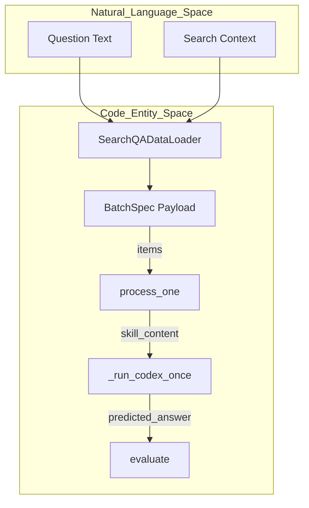
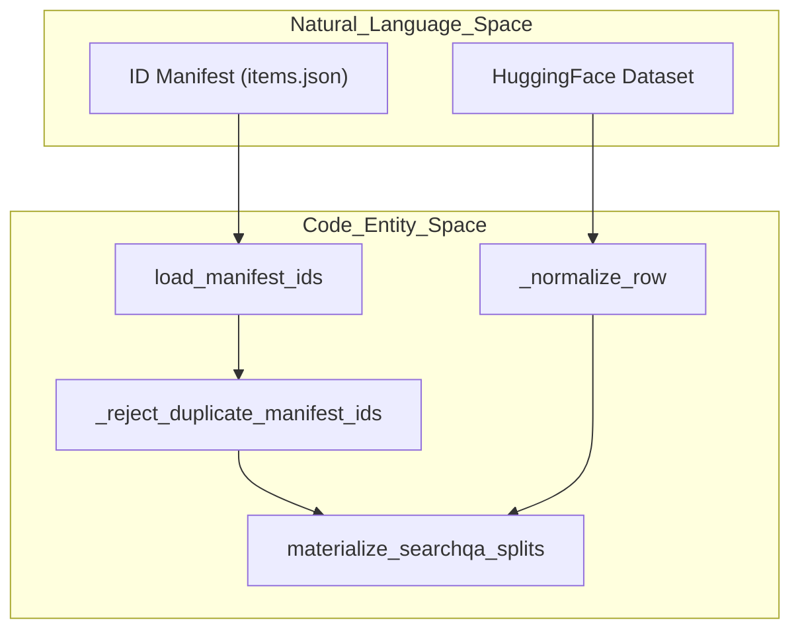
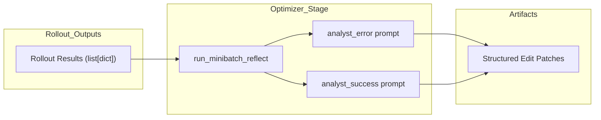

<!-- source: DeepWiki mcp.deepwiki.com · repo microsoft/SkillOpt · page 4.1 SearchQA and DocVQA Adapters · fetched 2026-10-26 -->

# SearchQA and DocVQA Adapters

Relevant source files

The following files were used as context for generating this wiki page:

- [configs/docvqa/default.yaml](configs/docvqa/default.yaml)
- [configs/officeqa/default.yaml](configs/officeqa/default.yaml)
- [configs/searchqa/default.yaml](configs/searchqa/default.yaml)
- [configs/spreadsheetbench/default.yaml](configs/spreadsheetbench/default.yaml)
- [scripts/materialize_searchqa.py](scripts/materialize_searchqa.py)
- [skillopt/envs/searchqa/rollout.py](skillopt/envs/searchqa/rollout.py)
- [tests/test_materialize_searchqa.py](tests/test_materialize_searchqa.py)
- [tests/test_searchqa_rollout_failfast.py](tests/test_searchqa_rollout_failfast.py)

This page details the implementation of the `SearchQAAdapter` and `DocVQAAdapter`, which facilitate information retrieval and visual document question-answering within the SkillOpt framework. These adapters manage the lifecycle of a task from data loading to parallel rollout, score evaluation, and structured reflection.

Sources: [skillopt/envs/searchqa/rollout.py:1-10](), [configs/searchqa/default.yaml:1-32](), [configs/docvqa/default.yaml:1-28]()

---

## Overview

Both adapters inherit from the `EnvAdapter` base class and implement the standard ReflACT interface. While `SearchQA` focuses on text-based context grounding and QA execution [skillopt/envs/searchqa/rollout.py:1-10](), `DocVQA` extends this to multimodal inputs by handling image-based document understanding.

### Key Responsibilities
*   **Data Loading**: Interfacing with data loaders to provide batches of questions, contexts, and optional document images [configs/searchqa/default.yaml:22-32](), [configs/docvqa/default.yaml:17-28]().
*   **Rollout Management**: Orchestrating parallel execution of the Target Model using environment-specific prompts [skillopt/envs/searchqa/rollout.py:57-147]().
*   **Materialization**: Using utility scripts to transform lightweight ID manifests into full runnable benchmark payloads [scripts/materialize_searchqa.py:91-143]().

Sources: [skillopt/envs/searchqa/rollout.py:1-147](), [configs/searchqa/default.yaml:1-32](), [scripts/materialize_searchqa.py:91-143]()

---

## Data Flow and Code Entity Mapping

The following diagrams illustrate how natural language tasks and datasets are mapped to code entities during rollout and materialization.

### Rollout and Evaluation Pipeline

Sources: [skillopt/envs/searchqa/rollout.py:41-147](), [skillopt/envs/searchqa/rollout.py:153-210]()

### Materialization Pipeline

Sources: [scripts/materialize_searchqa.py:37-143](), [tests/test_materialize_searchqa.py:29-79]()

---

## SearchQA Adapter

The `SearchQAAdapter` is designed for single-turn QA tasks where the model must extract answers from provided text passages.

### Rollout Mechanics
1.  **Context Truncation**: To fit within LLM context windows, the adapter uses `_truncate_context` to clip text at `[DOC]` boundaries, defaulting to 6,000 characters [skillopt/envs/searchqa/rollout.py:41-54]().
2.  **Prompt Construction**: The system prompt is built by injecting the current `skill_content` into a template loaded via `load_prompt("rollout_system", env="searchqa")` [skillopt/envs/searchqa/rollout.py:57-62]().
3.  **Execution & Codex Workspace**: If target execution backends are used, `_run_codex_once` prepares a workspace via `prepare_workspace` and dispatches tasks to `run_target_exec` [skillopt/envs/searchqa/rollout.py:101-147]().
4.  **Systemic Failure Protection**: The rollout logic includes `_raise_on_systemic_failure` to abort immediately if all items in a batch fail before receiving an agent response due to infrastructure or endpoint errors [skillopt/envs/searchqa/rollout.py:29-38](), [tests/test_searchqa_rollout_failfast.py:8-18]().

Sources: [skillopt/envs/searchqa/rollout.py:29-147](), [tests/test_searchqa_rollout_failfast.py:8-25]()

### Data Materialization
SearchQA uses a materialization script to convert ID manifests into runnable datasets [scripts/materialize_searchqa.py:1-170](). The `materialize_searchqa_splits` function handles:
*   Loading official Hugging Face dataset IDs from JSON split manifests [scripts/materialize_searchqa.py:37-44]().
*   Validating against duplicate IDs across splits and missing entries [scripts/materialize_searchqa.py:47-66](), [scripts/materialize_searchqa.py:102-124]().
*   Normalizing rows to include `id`, `question`, `context`, and `answers` [scripts/materialize_searchqa.py:73-88]().
*   Writing the final `items.json` and `split_manifest.json` files [scripts/materialize_searchqa.py:126-141]().

Sources: [scripts/materialize_searchqa.py:37-143](), [tests/test_materialize_searchqa.py:29-79]()

---

## DocVQA Adapter

The `DocVQAAdapter` handles visual question answering, requiring the Target Model to process document images alongside textual queries.

### Multimodal Configuration and Parameters
The DocVQA adapter configuration establishes parameters for visual document processing [configs/docvqa/default.yaml:1-28]():

| Parameter | Description | Default |
| :--- | :--- | :--- |
| `minibatch_size` | Size of trajectory minibatches for the optimizer gradient stage | 8 |
| `learning_rate` | Textual learning rate (edit budget per epoch) | 4 |
| `max_turns` | Reasoning turns per task | 1 |
| `workers` | Number of parallel worker threads for rollout | 16 |
| `image_detail` | Detail level setting for image processing payloads | auto |

Sources: [configs/docvqa/default.yaml:10-28]()

---

## Reflection and Gradient Computation

Both adapters leverage the `EnvAdapter` base logic for reflection, which bridges the gap between raw rollout results and textual skill updates.

### Reflection Architecture

Sources: [configs/searchqa/default.yaml:11-13](), [configs/docvqa/default.yaml:10-12]()

### Implementation Details
*   **Minibatching**: Results are partitioned into minibatches (default size 8) to provide the optimizer with diverse success and failure examples [configs/searchqa/default.yaml:11-12](), [configs/docvqa/default.yaml:10-11]().
*   **Resume Support**: Rollout implementations are resume-aware, allowing training loops to recover cached trajectories and evaluation metrics from intermediate states.
*   **Task Type Breakdown**: Adapters expose task type groupings to allow the training engine to report granular performance metrics across distinct sub-categories.

Sources: [configs/searchqa/default.yaml:11-16](), [configs/docvqa/default.yaml:10-15]()

---

