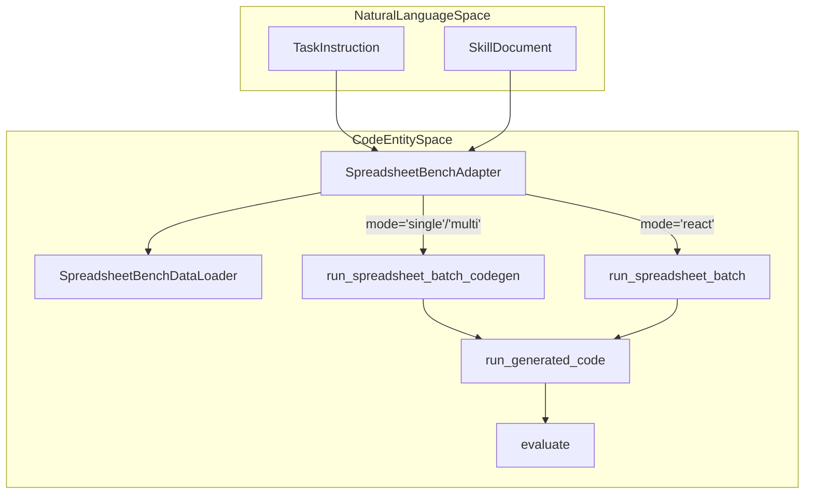
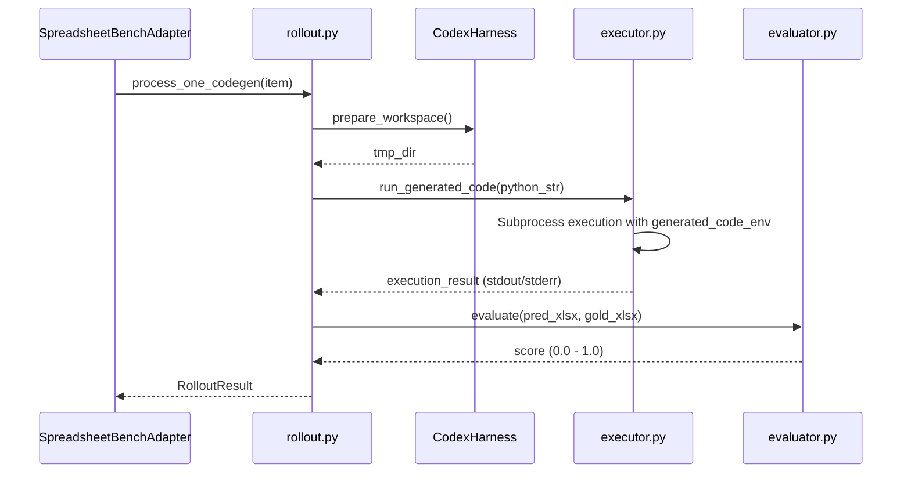

<!-- source: DeepWiki mcp.deepwiki.com · repo microsoft/SkillOpt · page 4.2 SpreadsheetBench Adapter · fetched 2026-10-26 -->

# SpreadsheetBench Adapter

<details>
<summary>Relevant source files</summary>

The following files were used as context for generating this wiki page:

- [skillopt/envs/spreadsheetbench/adapter.py](skillopt/envs/spreadsheetbench/adapter.py)
- [skillopt/envs/spreadsheetbench/codegen_agent.py](skillopt/envs/spreadsheetbench/codegen_agent.py)
- [skillopt/envs/spreadsheetbench/executor.py](skillopt/envs/spreadsheetbench/executor.py)
- [skillopt/envs/spreadsheetbench/prompts/react_system.md](skillopt/envs/spreadsheetbench/prompts/react_system.md)
- [skillopt/envs/spreadsheetbench/react_agent.py](skillopt/envs/spreadsheetbench/react_agent.py)
- [skillopt/envs/spreadsheetbench/rollout.py](skillopt/envs/spreadsheetbench/rollout.py)
- [skillopt/gradient/aggregate.py](skillopt/gradient/aggregate.py)
- [tests/test_aggregate_fallback.py](tests/test_aggregate_fallback.py)
- [tests/test_executor_env_isolation.py](tests/test_executor_env_isolation.py)
- [tests/test_hierarchical_merge.py](tests/test_hierarchical_merge.py)
- [tests/test_react_agent_no_shell.py](tests/test_react_agent_no_shell.py)
- [tests/test_staging_redaction_azure.py](tests/test_staging_redaction_azure.py)
- [tests/test_trainer_failure_patterns.py](tests/test_trainer_failure_patterns.py)

</details>


The SpreadsheetBench Adapter connects the SkillOpt ReflACT training loop to the SpreadsheetBench benchmark. It manages the execution of spreadsheet manipulation tasks using two distinct agent architectures: a **Codegen Agent** (pure code generation) and a **ReAct Agent** (iterative tool-use). The adapter handles data loading, parallelized rollouts, and the integration with the Codex execution harness for secure code evaluation.

## Architecture and Data Flow

The adapter follows the standard `EnvAdapter` pattern, dispatching tasks to specialized agents based on the configuration mode. It bridges the gap between the natural language instructions and the Python-based spreadsheet manipulation space.

### System-to-Code Mapping
The following diagram illustrates how high-level SpreadsheetBench concepts map to specific code entities within the adapter.

**SpreadsheetBench Entity Mapping**

Sources: [skillopt/envs/spreadsheetbench/adapter.py:27-102](), [skillopt/envs/spreadsheetbench/rollout.py:3-32]()

## Core Components

### SpreadsheetBenchAdapter
The main entry point for the environment implemented in `SpreadsheetBenchAdapter`. It initializes the `SpreadsheetBenchDataLoader` and manages the `rollout` and `reflect` stages.

*   **Rollout Dispatch**: Depending on `self.mode`, it invokes `run_spreadsheet_batch_codegen` or `run_spreadsheet_batch` [skillopt/envs/spreadsheetbench/adapter.py:121-150]().
*   **Task Types**: Categorizes tasks into `cell_level` and `sheet_level` for per-category performance breakdowns [skillopt/envs/spreadsheetbench/adapter.py:23-23]().

### Codegen Agent
The `CodegenAgent` matches the official SpreadsheetBench evaluation setting where the LLM generates a Python block without explicit tool-calling metadata.

| Mode | Logic |
| :--- | :--- |
| `single` | One LLM call → extract ```python``` block → execute → done [skillopt/envs/spreadsheetbench/codegen_agent.py:4-4](). |
| `multi` | Up to `max_turns` LLM calls; after each, execute code and feed execution errors back for self-correction [skillopt/envs/spreadsheetbench/codegen_agent.py:5-6](). |

### ReAct Agent
The `ReActAgent` uses a bash-like tool interface (`_run_bash`) to interact with the spreadsheet environment. It can execute Python commands and write Python scripts to disk using `write_file` via `_write_file` to avoid shell escaping issues [skillopt/envs/spreadsheetbench/react_agent.py:53-76]().

Sources: [skillopt/envs/spreadsheetbench/adapter.py:27-68](), [skillopt/envs/spreadsheetbench/codegen_agent.py:1-10](), [skillopt/envs/spreadsheetbench/react_agent.py:1-15]()

## Rollout Mechanics and Sandbox Isolation

The rollout process involves setting up temporary workspaces and scrubbing the environment variables to ensure safe execution of LLM-generated code.

### Execution Flow
The following diagram shows the lifecycle of a single task rollout, bridging the agent logic to the execution environment.

**Task Rollout Lifecycle**

Sources: [skillopt/envs/spreadsheetbench/rollout.py:168-210](), [skillopt/envs/spreadsheetbench/executor.py:57-126](), [skillopt/envs/spreadsheetbench/evaluator.py:1-15](), [skillopt/model/codex_harness.py:38-38]()

### Environment Scrubbing
`run_generated_code` and `generated_code_env` prevent the leakage of parent process cloud credentials and API keys by isolating the child process environment to safe passthrough variables (`PYTHONPATH`, `LANG`, etc.) [skillopt/envs/spreadsheetbench/executor.py:31-90]().

Sources: [skillopt/envs/spreadsheetbench/rollout.py:168-210](), [skillopt/envs/spreadsheetbench/executor.py:1-126](), [skillopt/envs/spreadsheetbench/codegen_agent.py:24-40]()

## Auto-Verification and Trajectory Enrichment

To assist the **Reflect Stage**, the adapter generates a human-readable verification report.
*   **Cell Comparison**: It reopens the predicted `.xlsx` and compares it against the gold file using `openpyxl` via `_auto_verify_output` [skillopt/envs/spreadsheetbench/rollout.py:108-126]().
*   **Noise Reduction**: Correct empty cells are collapsed to prevent large reports from flooding the LLM context [skillopt/envs/spreadsheetbench/rollout.py:159-170]().
*   **Truncation**: Reports exceeding `_MAX_REPORT_CHARS` (12,000) are head+tail truncated to keep both leading and trailing errors visible [skillopt/envs/spreadsheetbench/rollout.py:105-105]().

### Verification Feedback and Previews
In `multi` or `react` modes, the agent receives feedback via `_build_eval_feedback`, stripping "golden" values from verification reports so the target model receives feedback on *which* cells are wrong without leaking the correct answer [skillopt/envs/spreadsheetbench/codegen_agent.py:46-83](). Workbook previews are generated using `_preview_workbook` to summarize dimensions and initial cell values [skillopt/envs/spreadsheetbench/codegen_agent.py:88-119]().

Sources: [skillopt/envs/spreadsheetbench/rollout.py:90-175](), [skillopt/envs/spreadsheetbench/codegen_agent.py:46-119]()

## Configuration Reference

The adapter is configured via the `env` section of the YAML configuration.

| Parameter | Role | Default |
| :--- | :--- | :--- |
| `mode` | Agent architecture: `single`, `multi`, or `react` | `single` [skillopt/envs/spreadsheetbench/adapter.py:50-50]() |
| `exec_timeout` | Maximum time (seconds) for Python code execution | `600` [skillopt/envs/spreadsheetbench/adapter.py:40-40]() |
| `workers` | Number of parallel rollout threads | `64` [skillopt/envs/spreadsheetbench/adapter.py:41-41]() |
| `minibatch_size` | Number of trajectories analyzed in one Reflect call | `8` [skillopt/envs/spreadsheetbench/adapter.py:44-44]() |

Sources: [skillopt/envs/spreadsheetbench/adapter.py:29-68]()

---

