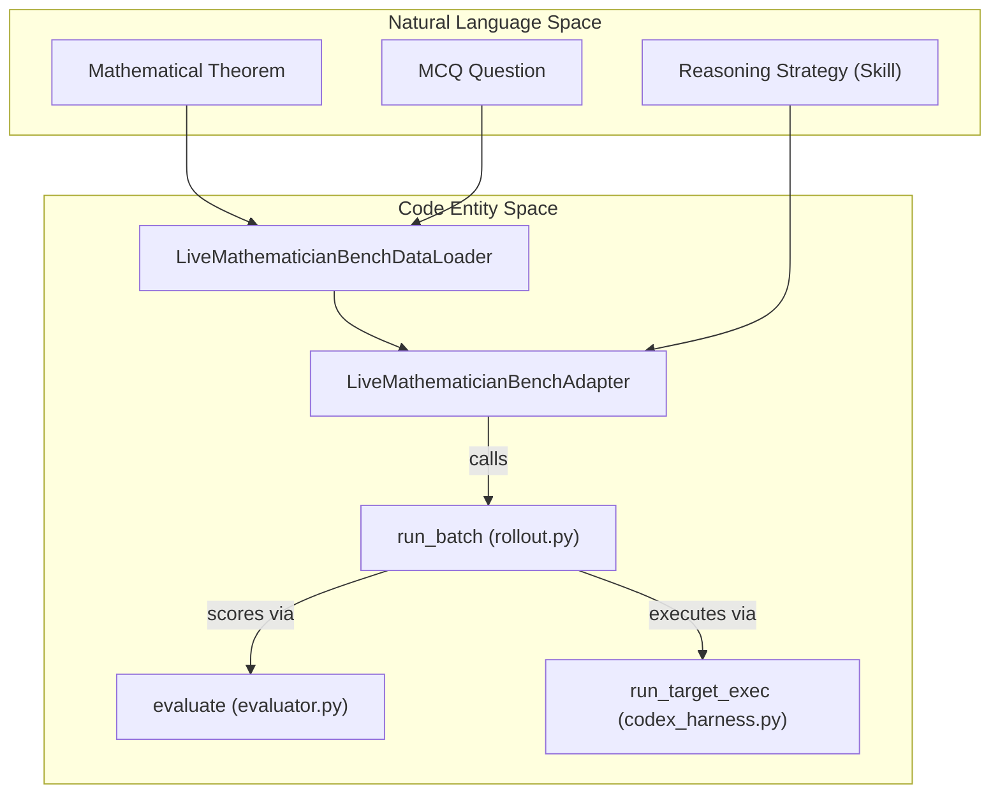
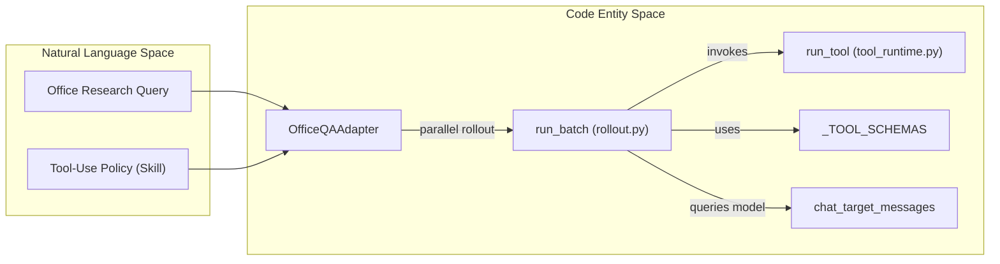

<!-- source: DeepWiki mcp.deepwiki.com · repo microsoft/SkillOpt · page 4.4 LiveMathematicianBench and OfficeQA Adapters · fetched 2026-10-26 -->

# LiveMathematicianBench and OfficeQA Adapters

Relevant source files

The following files were used as context for generating this wiki page:

- [data/livemathematicianbench_id_split/test/items.json](data/livemathematicianbench_id_split/test/items.json)
- [data/livemathematicianbench_id_split/val/items.json](data/livemathematicianbench_id_split/val/items.json)
- [skillopt/envs/alfworld/adapter.py](skillopt/envs/alfworld/adapter.py)
- [skillopt/envs/alfworld/rollout.py](skillopt/envs/alfworld/rollout.py)
- [skillopt/envs/docvqa/adapter.py](skillopt/envs/docvqa/adapter.py)
- [skillopt/envs/livemathematicianbench/adapter.py](skillopt/envs/livemathematicianbench/adapter.py)
- [skillopt/envs/livemathematicianbench/rollout.py](skillopt/envs/livemathematicianbench/rollout.py)
- [skillopt/envs/officeqa/adapter.py](skillopt/envs/officeqa/adapter.py)
- [skillopt/envs/officeqa/rollout.py](skillopt/envs/officeqa/rollout.py)
- [skillopt/envs/officeqa/tool_runtime.py](skillopt/envs/officeqa/tool_runtime.py)
- [skillopt/envs/searchqa/adapter.py](skillopt/envs/searchqa/adapter.py)
- [tests/test_alfworld_paths.py](tests/test_alfworld_paths.py)

This page details the implementation of the environment adapters for **LiveMathematicianBench** (theorem-grounded mathematical reasoning) and **OfficeQA** (tool-augmented office task automation). These adapters bridge the SkillOpt optimization loop with specialized evaluation environments involving theorem grounding, multi-turn tool use, and sandbox code execution.

---

## LiveMathematicianBench Adapter

The `LiveMathematicianBenchAdapter` (`[skillopt/envs/livemathematicianbench/adapter.py:13-129]()`) is designed for theorem-grounded mathematical multiple-choice questions (MCQs). It evaluates a model's ability to reason about mathematical statements given a theorem or a proof sketch.

### Rollout and Evaluation Flow
The rollout process supports both standard chat-based execution and code-execution via the Codex harness. When `is_target_exec_backend()` (`[skillopt/envs/livemathematicianbench/rollout.py:148]()`) evaluates to true, the adapter uses `_run_codex_once` (`[skillopt/envs/livemathematicianbench/rollout.py:64-108]()`) to solve the problem within a sandboxed environment (`[skillopt/envs/livemathematicianbench/rollout.py:95-107]()`).

The environment provides two optional context fields:
1. **Theorem**: The formal statement of a mathematical theorem (`[skillopt/envs/livemathematicianbench/adapter.py:18-21]()`).
2. **Sketch**: A high-level proof sketch providing reasoning steps (`[skillopt/envs/livemathematicianbench/adapter.py:19-23]()`).

The `process_one` function handles execution logic, capturing the model response and passing it to the `evaluate` function to determine exact match and F1 metrics (`[skillopt/envs/livemathematicianbench/rollout.py:111-182]()`).

### Data Handling
The adapter utilizes `LiveMathematicianBenchDataLoader` to manage dataset splits (`[skillopt/envs/livemathematicianbench/adapter.py:74-84]()`). It supports optional choice shuffling (`[skillopt/envs/livemathematicianbench/adapter.py:59]()`) to prevent position-based biases. Reference text for the optimizer is constructed from the theorem and sketch fields (`[skillopt/envs/livemathematicianbench/adapter.py:16-24]`).

Sources: `[skillopt/envs/livemathematicianbench/adapter.py:13-129]()`, `[skillopt/envs/livemathematicianbench/rollout.py:64-182]()`

---

## OfficeQA Adapter

The `OfficeQAAdapter` (`[skillopt/envs/officeqa/adapter.py:11-112]()`) handles complex office-related queries that require multi-turn reasoning and tool interaction. It supports multiple search modes and local file operations (`[skillopt/envs/officeqa/rollout.py:67-114]()`).

### Tool Integration and Search Modes
The adapter supports three primary search modes defined in `rollout.py`:
* `offline`: Uses local tools (`glob`, `read`, `grep`) to inspect a document corpus (`[skillopt/envs/officeqa/rollout.py:107-114]()`).
* `custom_search`: Uses a controller-managed search loop with `<search_queries>` tags (`[skillopt/envs/officeqa/rollout.py:94-106]()`).
* `azure_search`: Leverages built-in model search capabilities (`[skillopt/envs/officeqa/rollout.py:87-93]()`).

The tool schemas for local file operations are defined in `_TOOL_SCHEMAS`, including `glob` for pattern matching, `read` for reading text excerpts, and `grep` for literal pattern searching (`[skillopt/envs/officeqa/rollout.py:17-61]()`).

### Implementation Logic
The `rollout` method in `OfficeQAAdapter` manages parallel execution across configured `workers` (`[skillopt/envs/officeqa/adapter.py:84-104]()`). It tracks `max_tool_turns` to ensure the agent converges on an answer within a specified budget (`[skillopt/envs/officeqa/rollout.py:121-134]()`). The `tool_runtime.py` module provides underlying logic for resolving document roots and executing file-system tools (`[skillopt/envs/officeqa/tool_runtime.py:53-107]()`).

Sources: `[skillopt/envs/officeqa/adapter.py:11-112]()`, `[skillopt/envs/officeqa/rollout.py:17-134]()`, `[skillopt/envs/officeqa/tool_runtime.py:53-107]()`

---

## Technical Architecture

The following diagrams bridge the natural language reasoning space to the code entity space for both adapters.

### LiveMathematicianBench Execution Logic

Sources: `[skillopt/envs/livemathematicianbench/adapter.py:13-126]`, `[skillopt/envs/livemathematicianbench/rollout.py:111-182]`, `[skillopt/model/codex_harness.py:102-108]`

### OfficeQA Tool and Search Interaction

Sources: `[skillopt/envs/officeqa/rollout.py:17-134]()`, `[skillopt/envs/officeqa/tool_runtime.py:12-13]()`

---

## Environment-Specific Analyst Prompts

Both adapters override default reflection behavior by providing specialized context to the optimizer model, ensuring the optimizer understands the unique constraints of each domain (e.g., mathematical precision vs. tool efficiency).

### LiveMathematicianBench Analyst Prompting
The analyst stage for `LiveMathematicianBench` is configured via the `EnvAdapter` base class logic, leveraging `LiveMathematicianBenchDataLoader` to provide the optimizer with relevant mathematical context (theorems and sketches) during reflection (`[skillopt/envs/livemathematicianbench/adapter.py:16-40]()`). This helps the optimizer identify mathematical reasoning gaps.

### OfficeQA Analyst Prompting
The `OfficeQAAdapter` configuration includes `max_tool_turns` and `search_mode`, which are critical for the analyst to evaluate whether the agent fails due to tool misuse or insufficient search depth (`[skillopt/envs/officeqa/adapter.py:27-29]()`). The reflection stage analyzes how the agent used tools like `glob`, `read`, and `grep` (`[skillopt/envs/officeqa/rollout.py:17-61]()`).

Sources: `[skillopt/envs/livemathematicianbench/adapter.py:16-40]()`, `[skillopt/envs/officeqa/adapter.py:27-29]()`, `[skillopt/envs/officeqa/rollout.py:17-61]()`

---

