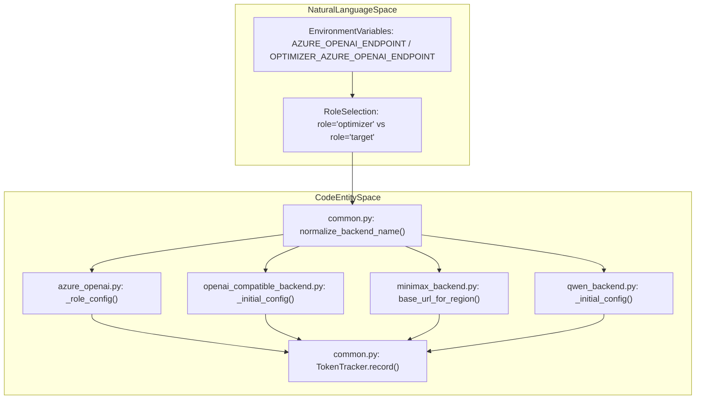
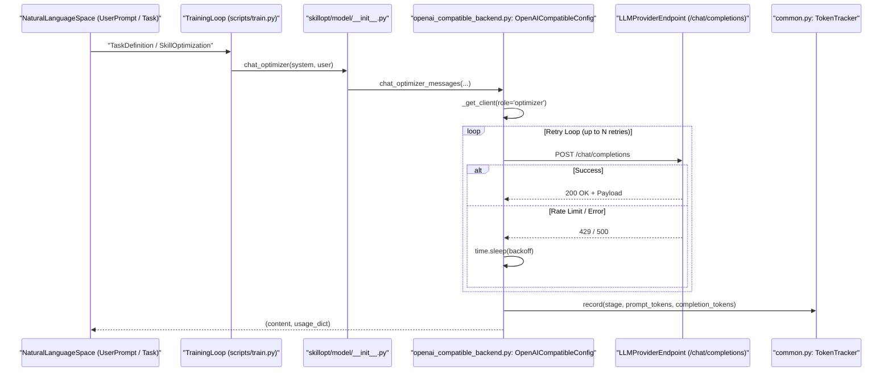

<!-- source: DeepWiki mcp.deepwiki.com · repo microsoft/SkillOpt · page 5.1 Azure OpenAI and OpenAI-Compatible Backends · fetched 2026-10-26 -->

# Azure OpenAI and OpenAI-Compatible Backends

Relevant source files

The following files were used as context for generating this wiki page:

- [skillopt/model/azure_openai.py](skillopt/model/azure_openai.py)
- [skillopt/model/common.py](skillopt/model/common.py)
- [skillopt/model/copilot_backend.py](skillopt/model/copilot_backend.py)
- [skillopt/model/minimax_backend.py](skillopt/model/minimax_backend.py)
- [skillopt/model/openai_compatible_backend.py](skillopt/model/openai_compatible_backend.py)
- [skillopt/model/qwen_backend.py](skillopt/model/qwen_backend.py)
- [tests/test_copilot_exec_backend.py](tests/test_copilot_exec_backend.py)
- [tests/test_copilot_tool_scope.py](tests/test_copilot_tool_scope.py)
- [tests/test_minimax_backend.py](tests/test_minimax_backend.py)
- [tests/test_openai_compatible_backend.py](tests/test_openai_compatible_backend.py)
- [tests/test_qwen_backend.py](tests/test_qwen_backend.py)

This page details the implementation of the Azure OpenAI and OpenAI-Compatible backends within SkillOpt. These backends provide the core inference capabilities for both the **Optimizer Model** (which generates skill updates) and the **Target Model** (which executes tasks). The system is designed with a dual-deployment architecture, allowing different configurations, endpoints, and authentication methods for each role while maintaining unified token tracking and retry logic.

Sources: [skillopt/model/azure_openai.py:1-5](), [skillopt/model/openai_compatible_backend.py:1-24]()

## Dual-Deployment Configuration

SkillOpt distinguishes between the `optimizer` and `target` roles. This allows users to utilize a high-capacity model (e.g., GPT-4o) for complex optimization reasoning and a smaller or more specialized model for task execution [skillopt/model/azure_openai.py:104-105]().

The configuration for these roles is managed via environment variables that fall back to a global default if role-specific values are not provided:

| Parameter | Optimizer Env Var | Target Env Var | Global Fallback |
| :--- | :--- | :--- | :--- |
| **Endpoint** | `OPTIMIZER_AZURE_OPENAI_ENDPOINT` | `TARGET_AZURE_OPENAI_ENDPOINT` | `AZURE_OPENAI_ENDPOINT` |
| **API Key** | `OPTIMIZER_AZURE_OPENAI_API_KEY` | `TARGET_AZURE_OPENAI_API_KEY` | `AZURE_OPENAI_API_KEY` |
| **Version** | `OPTIMIZER_AZURE_OPENAI_API_VERSION` | `TARGET_AZURE_OPENAI_API_VERSION` | `AZURE_OPENAI_API_VERSION` |
| **Auth Mode** | `OPTIMIZER_AZURE_OPENAI_AUTH_MODE` | `TARGET_AZURE_OPENAI_AUTH_MODE` | `AZURE_OPENAI_AUTH_MODE` |

Sources: [skillopt/model/azure_openai.py:24-105]()

## Authentication Modes

The Azure OpenAI backend supports several authentication modes, configured via `AZURE_OPENAI_AUTH_MODE` [skillopt/model/azure_openai.py:33]():

1.  **API Key**: Standard authentication using the `api_key` parameter.
2.  **Azure CLI**: Uses the local Azure CLI identity to fetch tokens. It includes a caching mechanism `_AZ_CLI_TOKEN_CACHE` to avoid redundant subprocess calls [skillopt/model/azure_openai.py:109]().
3.  **Managed Identity**: Uses managed identity credentials for secure, keyless authentication in Azure environments [skillopt/model/azure_openai.py:38-41]().
4.  **OpenAI Compatible**: Selected via `openai_compatible` (or `compat`). This mode uses the plain `OpenAI` client instead of `AzureOpenAI`, avoiding Azure-specific URL structures like `?api-version=...` [skillopt/model/azure_openai.py:20]().

Sources: [skillopt/model/azure_openai.py:20-109]()

## Generic OpenAI-Compatible Backend

For providers like DeepSeek, Groq, Ollama, or vLLM, SkillOpt provides a specialized backend module `skillopt/model/openai_compatible_backend.py`. This backend uses the standard OpenAI SDK to talk to any `/chat/completions` endpoint [skillopt/model/openai_compatible_backend.py:1-24]().

**Configuration Precedence:**
1. Role-specific variables (e.g., `OPTIMIZER_OPENAI_COMPATIBLE_BASE_URL`) [skillopt/model/openai_compatible_backend.py:75]().
2. Generic variables (e.g., `OPENAI_COMPATIBLE_BASE_URL`) [skillopt/model/openai_compatible_backend.py:76]().
3. Default fallbacks (e.g., `https://api.openai.com/v1`) [skillopt/model/openai_compatible_backend.py:46]().

Sources: [skillopt/model/openai_compatible_backend.py:46-95]()

## MiniMax and Qwen Backend Integrations

In addition to the generic compatible backend, SkillOpt includes specialized integrations for providers with unique protocol conventions:

*   **MiniMax Backend (`skillopt/model/minimax_backend.py`)**: Communicates with MiniMax region-specific endpoints (`global_en` vs `cn_zh`) [skillopt/model/minimax_backend.py:20-27]() using standard HTTP/JSON requests (`urllib.request`) [skillopt/model/minimax_backend.py:8-10](). It handles model-specific thinking properties, such as forcing adaptive thinking on models like `MiniMax-M2` where thinking cannot be disabled [skillopt/model/minimax_backend.py:73-84]().
*   **Qwen Backend (`skillopt/model/qwen_backend.py`)**: Supports vLLM/SGLang extensions via `chat_template_kwargs` with a 3-state wire policy (`server_default`, `enabled`, `disabled`) [skillopt/model/qwen_backend.py:46-57](), allowing precise control over reasoning/thinking token generation.

Sources: [skillopt/model/minimax_backend.py:20-98](), [skillopt/model/qwen_backend.py:46-131]()

## Implementation, Token Tracking, and Data Flow

The following diagrams bridge the natural language and configuration space to specific code entities across Azure, generic compatible, MiniMax, and Qwen backends.

**Model Backend Architecture**

Sources: [skillopt/model/common.py:67-70](), [skillopt/model/azure_openai.py:191-198](), [skillopt/model/openai_compatible_backend.py:80-95](), [skillopt/model/minimax_backend.py:43-45](), [skillopt/model/qwen_backend.py:149-167]()

**Inference Execution Sequence**

Sources: [skillopt/model/common.py:87-104](), [skillopt/model/openai_compatible_backend.py:166-180]()

### Key Functions and Classes

| Entity | Role | Path |
| :--- | :--- | :--- |
| `TokenTracker` | Thread-safe class for accumulating token usage per stage (`reflect`, `rollout`, etc.). | [skillopt/model/common.py:87-132]() |
| `OpenAICompatibleConfig` | Dataclass holding base_url, api_key, deployment, and timeouts for generic compatible backends. | [skillopt/model/openai_compatible_backend.py:49-57]() |
| `QwenChatConfig` | Configuration dataclass handling Qwen thinking modes and deployment settings. | [skillopt/model/qwen_backend.py:24-38]() |
| `normalize_backend_name` | Maps backend aliases (e.g., `azure`, `compat`, `minimax`) to canonical names. | [skillopt/model/common.py:67-70]() |

Sources: [skillopt/model/common.py:67-132](), [skillopt/model/openai_compatible_backend.py:49-57](), [skillopt/model/qwen_backend.py:24-38]()

---

