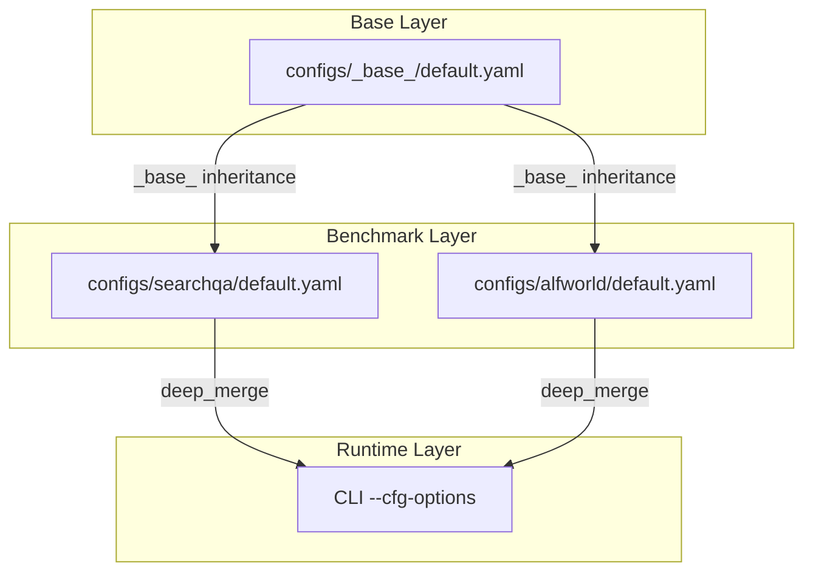
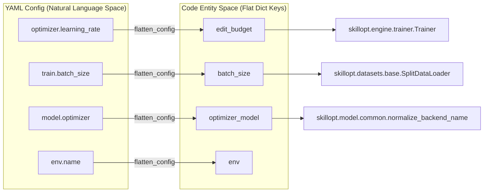
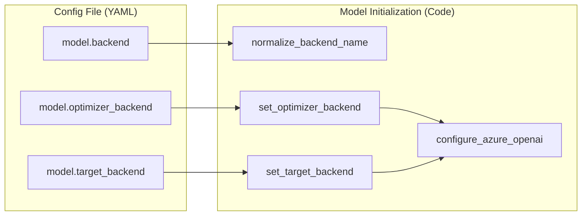

<!-- source: DeepWiki mcp.deepwiki.com · repo microsoft/SkillOpt · page 6 Configuration System · fetched 2026-10-26 -->

# Configuration System

<details>
<summary>Relevant source files</summary>

The following files were used as context for generating this wiki page:

- [configs/_base_/default.yaml](configs/_base_/default.yaml)
- [docs/guide/configuration.md](docs/guide/configuration.md)
- [docs/reference/config.md](docs/reference/config.md)
- [skillopt/config.py](skillopt/config.py)
- [skillopt/engine/trainer.py](skillopt/engine/trainer.py)
- [tests/test_env_section_survives_dedup.py](tests/test_env_section_survives_dedup.py)

</details>


The SkillOpt configuration system is a hierarchical YAML-based engine designed to manage the complexity of text-space optimization [skillopt/config.py:1-14](). It supports recursive inheritance via a `_base_` mechanism, structured sections for logical grouping (e.g., `model`, `gradient`, `optimizer`), and a backward-compatible flattening layer that maps structured keys to the internal flat dictionary used by the training loop [skillopt/config.py:3-14]().

## Configuration Structure

SkillOpt utilizes a structured format to separate concerns across different subsystems. The system identifies a "structured" configuration by the presence of specific section headers [skillopt/config.py:25-27]().

### Core Sections
| Section | Purpose |
| :--- | :--- |
| `model` | Backend selection (Azure, OpenAI, Qwen, MiniMax), model versions, and execution harness settings (Codex, Claude Code) [configs/_base_/default.yaml:4-78](). |
| `train` | High-level loop parameters: epochs, batch size, accumulation steps, and random seeds [configs/_base_/default.yaml:79-85](). |
| `gradient` | Parameters for the Reflection stage: analyst workers, minibatch sizes, and reflection rounds [configs/_base_/default.yaml:86-91](). |
| `optimizer` | Learning rate (edit budget), schedulers, and epoch-boundary mechanisms (Slow Update/Meta Skill) [configs/_base_/default.yaml:92-106](). |
| `evaluation` | Validation gating logic (hard/soft metrics) and test-set evaluation frequency [configs/_base_/default.yaml:107-112](). |
| `env` | Dataset paths, split ratios, and benchmark-specific execution timeouts [configs/_base_/default.yaml:113-122](). |

Sources: [configs/_base_/default.yaml:4-122](), [skillopt/config.py:25-27]()

---

## Inheritance and Overrides

SkillOpt implements a recursive inheritance model using the `_base_` key [skillopt/config.py:1-7](). This allows benchmark-specific configurations to remain concise by inheriting global defaults from `configs/_base_/default.yaml` [docs/reference/config.md:3-5]().

### Inheritance Flow
The configuration loader recursively resolves base paths and applies a deep merge, ensuring that environment-specific settings override global defaults [skillopt/config.py:1-14]().

Title: "Configuration Inheritance Hierarchy"

Sources: [skillopt/config.py:1-14](), [docs/reference/config.md:3-5]()

---

## Mapping Natural Language Config to Code Entities

The configuration system bridges high-level YAML settings to the underlying Python implementation [skillopt/config.py:1-14](). The `flatten_config` function in `skillopt/config.py` uses `_FLATTEN_MAP` to translate nested YAML keys into the flat dictionary keys expected by the `Trainer` class [skillopt/config.py:10-14](), [skillopt/config.py:44-132]().

Title: "Config Mapping to Code Entities"


Title: "Model Backend Configuration Bridge"

Sources: [skillopt/config.py:10-132](), [skillopt/engine/trainer.py:1-13](), [skillopt/model/common.py:80-80]()

---

## CLI Override Syntax

Users can override any configuration parameter directly from the command line. The entry points support modern `--cfg-options` syntax for structured keys as well as legacy flat flags for backward compatibility [skillopt/config.py:3-14]().

**Modern Syntax:**
```bash
python scripts/train.py \
  --config configs/searchqa/default.yaml \
  --cfg-options optimizer.learning_rate=8 train.batch_size=20
```

**Legacy Syntax:**
```bash
python scripts/train.py \
  --config configs/searchqa/default.yaml \
  --batch_size 20 --optimizer_model gpt-4o
```

Sources: [skillopt/config.py:3-14](), [docs/guide/configuration.md:3-38]()

---

## Detailed Subsystems

The configuration system governs two major areas described in detail in the following child pages:

### [Configuration Reference](#6.1)
A complete catalog of every available parameter across all six sections. This reference includes the mapping between "Textual Deep Learning" concepts (like `edit_budget`) and their standard DL counterparts (like `learning_rate`), as well as valid value ranges and backend-specific requirements [docs/reference/config.md:7-112]().
For details, see [Configuration Reference](#6.1).

### [Dataset Splitting and DataLoader Abstractions](#6.2)
Covers the `env` section parameters in depth, specifically how `split_mode` (ratio vs. split_dir) and `split_seed` are used by the `DataLoader` hierarchy to partition data into deterministic training, validation, and test sets [configs/_base_/default.yaml:113-122]().
For details, see [Dataset Splitting and DataLoader Abstractions](#6.2).

Sources: [configs/_base_/default.yaml:113-122](), [docs/reference/config.md:7-112]()

---

