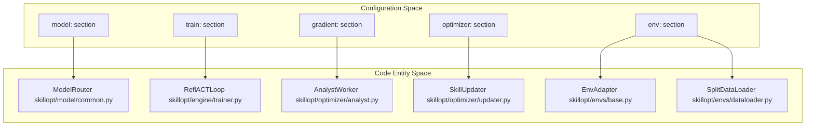
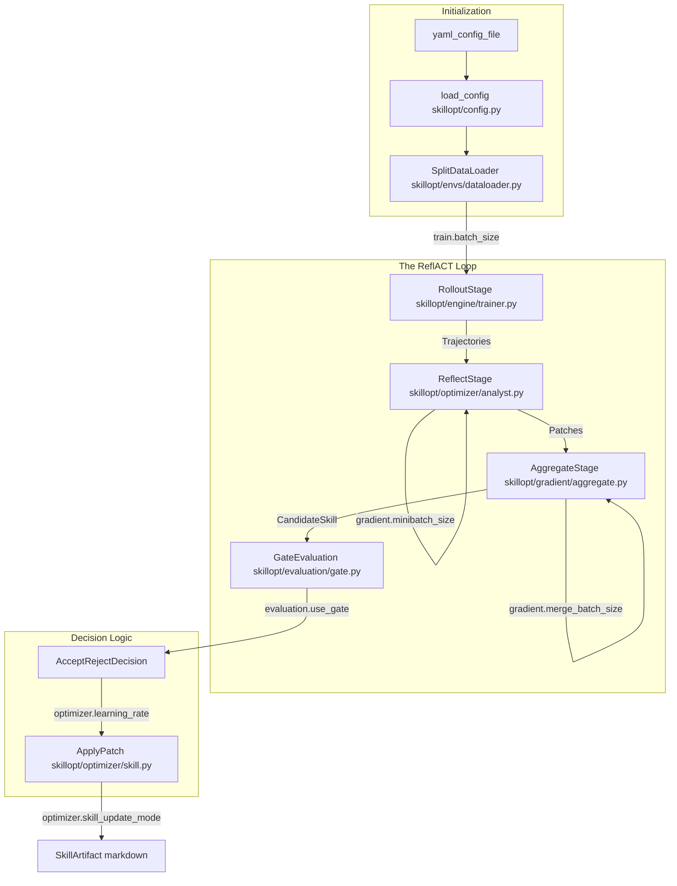

<!-- source: DeepWiki mcp.deepwiki.com · repo microsoft/SkillOpt · page 6.1 Configuration Reference · fetched 2026-10-26 -->

# Configuration Reference

Relevant source files

The following files were used as context for generating this wiki page:

- [ckpt/README.md](ckpt/README.md)
- [configs/_base_/default.yaml](configs/_base_/default.yaml)
- [configs/docvqa/default.yaml](configs/docvqa/default.yaml)
- [configs/features/soft_gate.yaml](configs/features/soft_gate.yaml)
- [configs/officeqa/default.yaml](configs/officeqa/default.yaml)
- [configs/searchqa/default.yaml](configs/searchqa/default.yaml)
- [configs/spreadsheetbench/default.yaml](configs/spreadsheetbench/default.yaml)
- [docs/guide/configuration.md](docs/guide/configuration.md)
- [docs/reference/config.md](docs/reference/config.md)
- [skillopt/config.py](skillopt/config.py)
- [skillopt/engine/trainer.py](skillopt/engine/trainer.py)

SkillOpt uses a structured YAML configuration system that supports inheritance via `_base_` and translation between structured sections and flat runtime dictionaries [skillopt/config.py:1-14](). Configurations define how the ReflACT training loop behaves, which model backends and reflection workers are dispatched, and how datasets are partitioned for training and evaluation.

## Configuration Architecture and Inheritance

Configurations are stored in `configs/` and typically inherit from `configs/_base_/default.yaml` [configs/_base_/default.yaml:1-3](). The configuration loader (`skillopt.config.load_config`) parses YAML files, resolves `_base_` recursion, normalizes aliases (such as Codex CLI settings), and flattens structured sections for consumption by the training loop [skillopt/config.py:1-14]().

### Code-to-Config Entity Mapping

The following diagram maps configuration sections to the core Python classes and modules that consume them, bridging Natural Language Space to Code Entity Space.

**System Entity Mapping**

Sources: [configs/_base_/default.yaml:4-122](), [skillopt/config.py:1-14](), [skillopt/engine/trainer.py:1-13]()

---

## 1. Model and Backend Configuration (`model`)

The `model` section defines the LLM backends and deployment parameters. SkillOpt supports a dual-model setup where the `optimizer` (analyst) and `target` (actor) can be different models or different backends [docs/reference/config.md:7-11]().

| Parameter | Type | Default | Description |
| :--- | :--- | :--- | :--- |
| `model.backend` | `str` | `azure_openai` | Backward-compatible high-level run label |
| `model.optimizer` | `str` | `gpt-5.5` | Model name/deployment used for reflection and updates |
| `model.target` | `str` | `gpt-5.5` | Model name/deployment used for task rollout |
| `model.optimizer_backend` | `str` | `openai_chat` | Client path for optimizer: `openai_chat`, `openai_compatible`, etc. |
| `model.target_backend` | `str` | `openai_chat` | Client path for target: chat or exec backend |
| `model.reasoning_effort` | `str` | `medium` | Shared reasoning effort level for reasoning models |
| `model.rewrite_reasoning_effort` | `str` | `""` | Optional full-rewrite effort override |
| `model.rewrite_max_completion_tokens` | `int` | `64000` | Full-rewrite output cap |

### Qwen Thinking Mode and Specialized Backends

`qwen_chat` supports an explicit three-state wire policy for `chat_template_kwargs.enable_thinking` to ensure compatibility across self-hosted vLLM/SGLang servers and strict gateways [docs/reference/config.md:64-92]().

| Parameter | Type | Default | Description |
| :--- | :--- | :--- | :--- |
| `model.qwen_chat_thinking_mode` | `str` | `""` | Wire policy: `server_default` (omit), `enabled`, or `disabled` |
| `model.minimax_region` | `str` | `""` | Region selector: `global_en` or `cn_zh` |
| `model.minimax_base_url` | `str` | `""` | Override base URL for MiniMax API |
| `model.codex_exec_path` | `str` | `""` | Executable path for Codex CLI |
| `model.codex_exec_sandbox` | `str` | `""` | Sandbox mode for Codex |
| `model.claude_code_exec_path` | `str` | `claude` | Executable path for Claude Code CLI |

Sources: [configs/_base_/default.yaml:4-78](), [docs/reference/config.md:7-119](), [skillopt/config.py:44-125]()

---

## 2. Training Configuration (`train`)

Defines the high-level execution parameters for the training loop across epochs and batches.

| Parameter | Type | Default | DL Analogy | Description |
| :--- | :--- | :--- | :--- | :--- |
| `train.num_epochs` | `int` | `4` | Epochs | Total passes over the training split |
| `train.train_size` | `int` | `0` | Dataset Size | Number of samples; `0` derives from split |
| `train.batch_size` | `int` | `40` | Batch Size | Tasks sampled from training set per step |
| `train.accumulation` | `int` | `1` | Grad Accumulation | Steps before a skill update is triggered |
| `train.seed` | `int` | `42` | Random Seed | Seed for deterministic sampling |

Sources: [configs/_base_/default.yaml:79-85](), [docs/guide/configuration.md:89-97]()

---

## 3. Gradient and Reflection Configuration (`gradient`)

These parameters control the textual gradient computation process during the reflect and aggregate stages [skillopt/engine/trainer.py:3-9]().

| Parameter | Type | Default | Description |
| :--- | :--- | :--- | :--- |
| `gradient.minibatch_size` | `int` | `8` | Trajectories per analyst worker to produce one patch |
| `gradient.merge_batch_size` | `int` | `8` | Patches merged at once during hierarchical aggregation |
| `gradient.analyst_workers` | `int` | `16` | Parallelism level for reflection LLM calls |
| `gradient.failure_only` | `bool` | `false` | If true, only analyze trajectories with score 0 |

Sources: [configs/_base_/default.yaml:86-91](), [docs/guide/configuration.md:99-106]()

---

## 4. Optimizer Configuration (`optimizer`)

Controls the update stage, learning rate schedules, and cross-epoch stabilization mechanisms.

| Parameter | Type | Default | DL Analogy | Description |
| :--- | :--- | :--- | :--- | :--- |
| `optimizer.learning_rate` | `int` | `4` | Edit Budget | Max edit patches allowed per update step |
| `optimizer.min_learning_rate` | `int` | `2` | Min LR | Minimum edits for decay schedulers |
| `optimizer.lr_scheduler` | `str` | `cosine` | Scheduler | `constant`, `linear`, `cosine`, `autonomous` |
| `optimizer.skill_update_mode` | `str` | `patch` | Update Rule | `patch`, `rewrite_from_suggestions`, `full_rewrite_minibatch` |
| `optimizer.use_slow_update` | `bool` | `true` | Momentum | Longitudinal comparison at epoch boundaries |
| `optimizer.slow_update_samples` | `int` | `20` | Sample Size | Samples evaluated during slow update |
| `optimizer.use_meta_skill` | `bool` | `true` | Meta-Learning | Optimizer-side memory of past strategies |
| `optimizer.use_skill_aware_reflection`| `bool` | `false` | Routing | Split failures into skill defects vs execution lapses |

Sources: [configs/_base_/default.yaml:92-106](), [docs/guide/configuration.md:108-148]()

---

## 5. Evaluation Configuration (`evaluation`)

Controls how candidate skills are validated against held-out splits before being accepted into the training state [skillopt/engine/trainer.py:27-27]().

| Parameter | Type | Default | Description |
| :--- | :--- | :--- | :--- |
| `evaluation.use_gate` | `bool` | `true` | Accept only improvements; if `false`, force-accept |
| `evaluation.gate_metric` | `str` | `hard` | Metric for comparison: `hard`, `soft`, or `mixed` |
| `evaluation.gate_mixed_weight`| `float`| `0.5` | Soft-score weight when `gate_metric` is `mixed` |
| `evaluation.sel_env_num` | `int` | `0` | Selection split size; `0` uses full split |
| `evaluation.test_env_num` | `int` | `0` | Test split size; `0` uses full split |
| `evaluation.eval_test` | `bool` | `true` | Run final test evaluation |

Sources: [configs/_base_/default.yaml:107-112](), [configs/features/soft_gate.yaml:37-47](), [docs/guide/configuration.md:150-164]()

---

## 6. Environment and Data Configuration (`env`)

Defines the interface between SkillOpt and specific benchmark environments [skillopt/envs/base.py]().

| Parameter | Type | Default | Description |
| :--- | :--- | :--- | :--- |
| `env.name` | `str` | `""` | Benchmark identifier (e.g., `searchqa`, `alfworld`) |
| `env.skill_init` | `str` | `""` | Path to the starting seed skill Markdown document |
| `env.split_mode` | `str` | `ratio` | `ratio` (dynamic split) or `split_dir` (fixed directory) |
| `env.split_seed` | `int` | `42` | Seed for deterministic data splitting |
| `env.split_dir` | `str` | `""` | Directory containing pre-split manifests |
| `env.data_path` | `str` | `""` | Path to raw dataset for ratio splitting |
| `env.exec_timeout` | `int` | `120` | Max seconds per target model/code-agent call |
| `env.out_root` | `str` | `""` | Root directory for training run outputs |

Sources: [configs/_base_/default.yaml:113-122](), [docs/guide/configuration.md:165-172]()

---

## Data Flow and Configuration Injection

Configuration parameters flow from YAML files through the configuration engine into the ReflACT training loop, driving worker allocation and update mechanics [skillopt/engine/trainer.py]().

**Configuration-Driven Data Flow**

Sources: [skillopt/config.py:1-14](), [skillopt/engine/trainer.py:1-10](), [docs/reference/config.md:1-6]()

---

