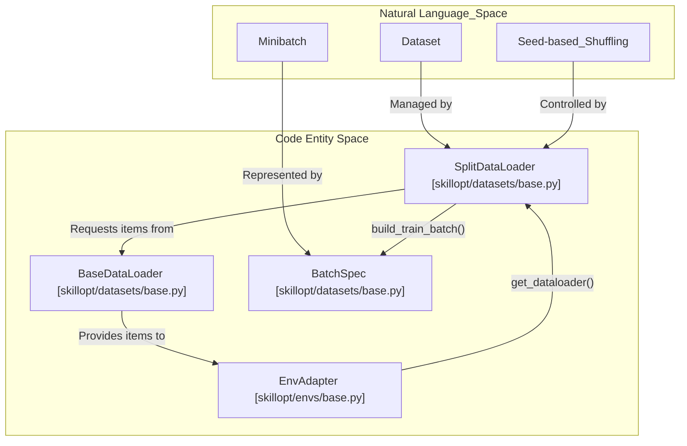
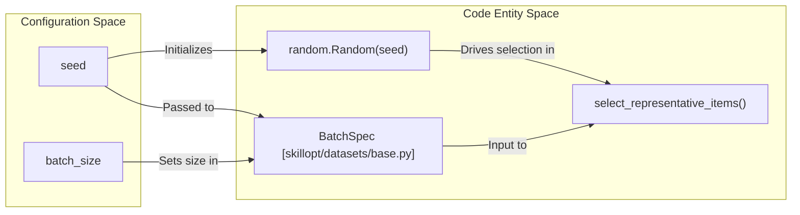

<!-- source: DeepWiki mcp.deepwiki.com · repo microsoft/SkillOpt · page 6.2 Dataset Splitting and DataLoader Abstractions · fetched 2026-10-26 -->

# Dataset Splitting and DataLoader Abstractions

<details>
<summary>Relevant source files</summary>

The following files were used as context for generating this wiki page:

- [data/README.md](data/README.md)
- [data/livemathematicianbench_id_split/split_manifest.json](data/livemathematicianbench_id_split/split_manifest.json)
- [data/livemathematicianbench_id_split/test/items.json](data/livemathematicianbench_id_split/test/items.json)
- [data/livemathematicianbench_id_split/val/items.json](data/livemathematicianbench_id_split/val/items.json)
- [tests/test_consolidate_split.py](tests/test_consolidate_split.py)
- [tests/test_data_manifests.py](tests/test_data_manifests.py)
- [tests/test_holdout_integrity.py](tests/test_holdout_integrity.py)

</details>


The Dataset Splitting and DataLoader system in SkillOpt provides a standardized mechanism for partitioning environment-specific data into training, selection (validation), and testing sets. It abstracts the underlying storage format (e.g., JSON manifests, directory structures) and ensures deterministic, seed-based batch sampling essential for reproducible ReflACT optimization steps and robust holdout evaluation.

### BaseDataLoader and SplitDataLoader Hierarchy

SkillOpt uses a hierarchical abstraction to manage data via classes defined in core dataset modules. The `BaseDataLoader` defines the interface for loading raw data samples, while the `SplitDataLoader` manages the logical partitioning and batching logic [docs/reference/api.md:78-98]().

*   **`BaseDataLoader`**: An abstract base class that environment adapters (like SearchQA or ALFWorld) implement. It defines the contract for building training and evaluation batches [skillopt/envs/base.py:33-33]().
*   **`SplitDataLoader`**: A concrete base for dataset-backed environments with on-disk splits. It handles the mechanics of shuffling and tracking items from `train/`, `val/`, and `test/` subdirectories [docs/reference/api.md:90-98]().

#### Code Entity Mapping: Data Loading Flow
This diagram shows how high-level dataset concepts map to the implementation classes and their interactions.


**Sources:** [skillopt/datasets/base.py:83-98](), [skillopt/envs/base.py:54-56](), [docs/reference/api.md:78-98]()

---

### BatchSpec Dataclass

The `BatchSpec` dataclass is the primary unit of data exchange between the DataLoader and the Rollout stage. It is a slotted dataclass describing one batch request the trainer hands to the adapter [docs/reference/api.md:112-124]().

| Field | Type | Description |
| :--- | :--- | :--- |
| `phase` | `str` | The training phase: `"train"` or `"eval"`. |
| `split` | `str` | The origin split: `"train"`, `"val"`, `"test"`, or `"valid_seen"`. |
| `seed` | `int` | Seed for deterministic sampling of this specific batch. |
| `batch_size` | `int` | Number of items requested in the batch. |
| `payload` | `object` | The actual task items produced by the loader (e.g., `list[dict]`). |

**Sources:** [docs/reference/api.md:112-124](), [skillopt/envs/base.py:171-185]()

---

### Split Modes and Holdout Contract

SkillOpt supports two primary methods for defining dataset splits, alongside strict holdout isolation protocols managed in consolidation workflows [docs/reference/api.md:100-105]():

1.  **Split Directory Mode (`split_mode: "split_dir"`)**:
    *   The system expects a directory containing `train/`, `val/`, and `test/` subdirectories already partitioned [docs/reference/api.md:104-104]().
    *   Subclasses implement `load_split_items(split_path)` to read these directories [docs/reference/api.md:96-96]().

2.  **Ratio Mode (`split_mode: "ratio"`)**:
    *   The system takes a raw dataset path and a `split_ratio` string (e.g., `"2:1:7"` or `"2:1:7"`) [docs/reference/api.md:105-105]().
    *   Subclasses implement `load_raw_items(data_path)` to provide the full item pool for partitioning [docs/reference/api.md:97-97]().

During consolidation cycles, the `_split` helper strictly partitions tasks to prevent data leakage between training and validation splits, explicitly flagging leaks when holdout sets are empty or overlap by task IDs [tests/test_holdout_integrity.py:22-50](), [tests/test_consolidate_split.py:22-48]().

**Sources:** [docs/reference/api.md:90-108](), [tests/test_holdout_integrity.py:22-50](), [tests/test_consolidate_split.py:22-48](), [data/README.md:14-22]()

---

### Deterministic Seed-Based Sampling

To ensure that textual reflections are comparable across different runs, SkillOpt enforces strict determinism in sampling through the `EnvAdapter` and `BaseDataLoader` interface.

*   **Batch Construction**: The trainer calls `build_env_from_batch` which routes requests to `build_train_env` or `build_eval_env` using the provided `seed` [skillopt/envs/base.py:171-185]().
*   **Representative Selection**: When selecting items for reflection, `select_representative_items` uses a `random.Random(seed)` instance to ensure diverse but deterministic picking of failures and successes [skillopt/envs/base.py:101-169]().
*   **Stratification**: The system uses `get_task_types()` to perform stratified sampling, ensuring the minibatch contains a variety of task categories [skillopt/envs/base.py:132-151]().

#### Code Entity Mapping: Configuration to Execution
This diagram bridges configuration concepts to the internal logic of the sampling and environment construction system.


**Sources:** [skillopt/envs/base.py:101-185](), [docs/reference/api.md:112-124]()

---

### Standardized Directory Layout and Manifests

For benchmarks released with SkillOpt, a standardized manifest-based layout is used under the `data/` directory [data/README.md:3-15](). This allows split loaders to discover tasks via `items.json` files while keeping split definitions lightweight [data/README.md:24-26]().

```text
data/<benchmark>_<manifest_type>/
|-- split_manifest.json
|-- train/items.json
|-- val/items.json
`-- test/items.json
```

Each `split_manifest.json` records source metadata, split counts, and item fields (e.g., `gamefile` for ALFWorld or `image_path` for DocVQA) [data/README.md:24-26](). Integrity tests ensure that declared manifest counts precisely match the actual item array lengths in each split subdirectory [tests/test_data_manifests.py:9-23]().

**Sources:** [data/README.md:12-38](), [tests/test_data_manifests.py:9-23](), [docs/reference/api.md:90-98]()

---

