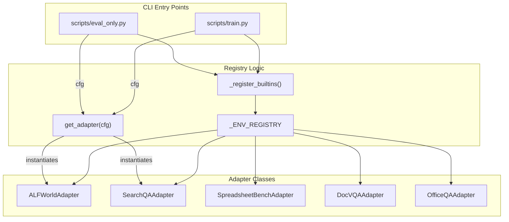
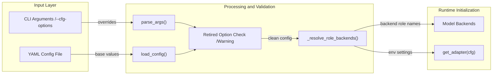

<!-- source: DeepWiki mcp.deepwiki.com · repo microsoft/SkillOpt · page 7 Scripts and CLI · fetched 2026-10-26 -->

# Scripts and CLI

Relevant source files

The following files were used as context for generating this wiki page:

- [CHANGELOG.md](CHANGELOG.md)
- [docs/guide/local-env-smoke.md](docs/guide/local-env-smoke.md)
- [docs/reference/cli.md](docs/reference/cli.md)
- [docs/sleep/README.md](docs/sleep/README.md)
- [plugins/README.md](plugins/README.md)
- [scripts/eval_only.py](scripts/eval_only.py)
- [scripts/materialize_searchqa.py](scripts/materialize_searchqa.py)
- [scripts/train.py](scripts/train.py)
- [skillopt/model/__init__.py](skillopt/model/__init__.py)
- [skillopt/utils/console.py](skillopt/utils/console.py)
- [tests/test_console_encoding.py](tests/test_console_encoding.py)
- [tests/test_materialize_searchqa.py](tests/test_materialize_searchqa.py)
- [tests/test_retired_cli_options.py](tests/test_retired_cli_options.py)
- [tests/test_role_backend_resolution.py](tests/test_role_backend_resolution.py)

This page provides a reference for the command-line entry points, helper scripts, and configuration management utilities of the SkillOpt repository. It covers the core training loop (`train.py`), standalone evaluation (`eval_only.py`), data materialization tools (`materialize_searchqa.py`), console encoding safeguards, and retired option handling.

For details on training run outputs, see [Training Output Structure](#7.1). For the Gradio-based interface, see [WebUI (skillopt_webui)](#7.2).

## Core Entry Points and Utilities

The execution layer of SkillOpt consists of several primary scripts located in the `scripts/` directory. All entry-point scripts force UTF-8 console output upon import to prevent `UnicodeEncodeError` crashes when logging box-drawing characters on non-UTF-8 terminals (such as Windows `cp1252` environments) [scripts/train.py:29-33](), [skillopt/utils/console.py:9-18]().

| Script | Purpose | Key Arguments |
| :--- | :--- | :--- |
| `scripts/train.py` | Main entry point for the ReflACT training loop. | `--config`, `--cfg-options`, `--out_root`, `--backend` |
| `scripts/eval_only.py` | Standalone evaluation of a specific skill file against a split. | `--config`, `--skill`, `--split`, `--cfg-options` |
| `scripts/materialize_searchqa.py` | Materializes and splits SearchQA raw data into trial manifests. | `--input_dir`, `--output_dir`, `--seed` |

### Environment Registry and Adapter Loading

Scripts instantiate benchmark environments dynamically using a lazy-loading registry (`_ENV_REGISTRY`) in `scripts/train.py` and `scripts/eval_only.py`. This avoids loading heavy benchmark dependencies (such as ALFWorld or SWE-bench) when running unrelated tasks [scripts/train.py:46-103](), [scripts/eval_only.py:72-127]().

**CLI to Code Entity Mapping**

**Sources:** [scripts/train.py:46-125](), [scripts/eval_only.py:72-144]()

---

## Configuration Processing and Retired Options

SkillOpt supports structured YAML configurations combined with command-line overrides via `--cfg-options` (structured as `section.key=value`) and legacy flat flags [scripts/train.py:139-143](), [docs/reference/cli.md:20-25](). Role-specific backend resolution is handled via functions such as `_resolve_role_backends()` [tests/test_role_backend_resolution.py:8-10]() and `_set_role_if_default()` [scripts/eval_only.py:55-65]().

### Retired Option Handling
When options are deprecated or retired (such as `gradient.max_analyst_rounds`), the configuration loader detects them across CLI flags, `--cfg-options`, structured config files, and legacy flat YAML files. Rather than failing or ignoring the parameter in silence, the loader emits a `FutureWarning` and safely strips the key before passing the configuration to the trainer [tests/test_retired_cli_options.py:59-121]().

**Configuration Loading and Resolution Flow**

**Sources:** [scripts/train.py:127-143](), [tests/test_retired_cli_options.py:59-163](), [skillopt/engine/trainer.py:8]()

---

## Sub-topics

### [Training Output Structure](#7.1)
Covers the hierarchical directory layout generated during training runs, including versioned snapshots under `skills/`, step-level diagnostics under `steps/`, state recovery tracking via `runtime_state.json`, and automatic run resumption. For details, see [Training Output Structure](#7.1).

### [WebUI (skillopt_webui)](#7.2)
Details the Gradio-based graphical interface that wraps training subprocesses, parses logs in real-time, surfaces configuration parameters, and visualizes historical progress. For details, see [WebUI (skillopt_webui)](#7.2).

---

