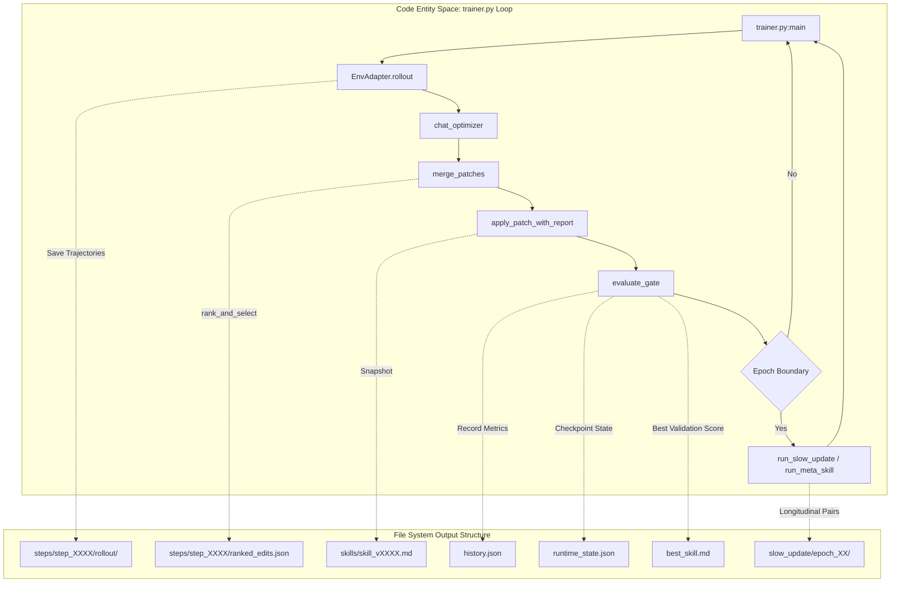
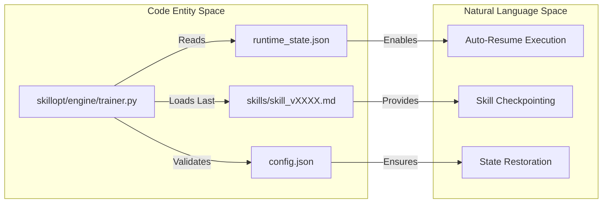

<!-- source: DeepWiki mcp.deepwiki.com · repo microsoft/SkillOpt · page 7.1 Training Output Structure · fetched 2026-10-26 -->

# Training Output Structure

<details>
<summary>Relevant source files</summary>

The following files were used as context for generating this wiki page:

- [ckpt/README.md](ckpt/README.md)
- [configs/_base_/default.yaml](configs/_base_/default.yaml)
- [configs/features/soft_gate.yaml](configs/features/soft_gate.yaml)
- [docs/guide/configuration.md](docs/guide/configuration.md)
- [docs/reference/config.md](docs/reference/config.md)
- [skillopt/config.py](skillopt/config.py)
- [skillopt/engine/trainer.py](skillopt/engine/trainer.py)

</details>


SkillOpt produces a structured output directory designed for transparency, reproducibility, and automatic resumption of interrupted training runs. The directory layout separates the evolving skill artifact from diagnostic logs, trajectory data, and epoch-level stabilization metadata.

## Directory Layout Overview

When a training run is initiated via `scripts/train.py`, an output directory is created (configured via `env.out_root` `[configs/_base_/default.yaml:122-122]()`). The structure is organized as follows:

```text
outputs/<run_name>/
├── config.json              # Flattened runtime configuration
├── history.json             # Step-by-step training metrics and logs
├── runtime_state.json       # Checkpoint for auto-resume
├── best_skill.md            # The highest-performing validated skill
├── summary.json             # Final run summary (created at completion)
├── skills/                  # Snapshots of the skill document at every step
│   └── skill_v0001.md
├── steps/                   # Detailed artifacts for every training step
│   └── step_0001/
│       ├── rollout/         # Raw trajectories (RolloutResult)
│       ├── analysis/        # LLM-generated error/success analyses
│       ├── ranked_edits.json # Output of Select stage (ranking metadata)
│       ├── candidate_skill.md # Skill after Update but before Gate
│       ├── step_record.json  # Internal step metrics
│       └── appendix_notes.json # Skill-aware reflection notes (if enabled)
├── slow_update/             # Longitudinal comparison logs (Epoch mechanism)
│   └── epoch_01/
└── meta_skill/              # Optimizer strategy memory (Epoch mechanism)
    └── epoch_01/
```

Sources: [skillopt/engine/trainer.py:1-13](), [configs/_base_/default.yaml:113-122]()

## Core Artifacts

### Skill Documents (`skills/` and `best_skill.md`)
The "trainable weights" in SkillOpt are stored as Markdown files. 
- **`skills/skill_vXXXX.md`**: A snapshot of the skill document as it existed at step `XXXX`. These are saved immediately after the **Update** stage `[skillopt/engine/trainer.py:8-8]()`.
- **`best_skill.md`**: The skill version that achieved the highest score on the validation split during the **Evaluate** (Gate) stage. This is updated whenever validation accepts a new candidate `[skillopt/engine/trainer.py:9-9]()`, `[skillopt/evaluation/gate.py:27-27]()`.

### Metadata and State
- **`config.json`**: Contains the fully resolved configuration, flattened via `flatten_config` `[skillopt/config.py:10-13]()`. This includes all inherited values from `_base_` YAML files and CLI overrides.
- **`history.json`**: A list of dictionaries where each entry corresponds to a step. It records metrics such as training accuracy, validation accuracy (gate scores), token usage via `get_token_summary`, and learning rate `[skillopt/engine/trainer.py:61-75]()`.
- **`runtime_state.json`**: Stores the current epoch, step index, and the last accepted skill state. This file is critical for the auto-resume feature.

Sources: [skillopt/engine/trainer.py:61-79](), [skillopt/config.py:10-14]()

## Step Artifacts (`steps/step_XXXX/`)

Each step directory contains the intermediate computations and reflection outputs of the ReflACT loop.

| File / Sub-directory | Code Entity / Logic | Description |
| :--- | :--- | :--- |
| `rollout/` | `RolloutResult` | JSON files containing trajectories, including full LLM conversation logs and environment rewards `[skillopt/engine/trainer.py:4-4]().` |
| `ranked_edits.json` | `rank_and_select` | The output of the Select stage, showing which proposed edits were chosen within the `edit_budget` `[skillopt/optimizer/clip.py:30-30]()`. |
| `appendix_notes.json` | `_flush_skill_aware_appendix` | Stores execution lapse notes if `use_skill_aware_reflection` is enabled `[skillopt/engine/trainer.py:86-123]()`. |
| `candidate_skill.md` | `apply_patch_with_report` | The temporary skill document generated for validation at the Gate `[skillopt/engine/trainer.py:34-34]()`. |

Sources: [skillopt/engine/trainer.py:4-34](), [skillopt/engine/trainer.py:86-123](), [skillopt/optimizer/clip.py:30-30]()

## Epoch-Boundary Mechanisms

SkillOpt implements two stabilization mechanisms that trigger at epoch boundaries, producing their own output sub-directories.

### Slow Update (`slow_update/`)
This directory contains longitudinal comparisons. It stores pairs of trajectories for the same task item across different epochs, built using `build_comparison_pairs` `[skillopt/engine/trainer.py:47-47]`.
- **Guidance Injection**: The resulting guidance is stored in the `SLOW_UPDATE` section of the skill document `[ckpt/README.md:29-31]()`.
- **Gating**: If `slow_update_gate_with_selection` is true, these updates are validated before being accepted `[ckpt/README.md:74-79]()`.

### Meta Skill (`meta_skill/`)
Stores the optimizer's internal "strategy memory," which is updated via `run_meta_skill` `[skillopt/engine/trainer.py:29-29]()`. Unlike the target skill, this artifact influences how the optimizer generates future patches but does not directly control the target agent's behavior.

Sources: [skillopt/engine/trainer.py:29-53](), [ckpt/README.md:29-87]()

## Data Flow and Persistence Diagram

The following diagram illustrates how the `trainer.py` loop interacts with the file system to produce the output structure, bridging natural language training stages with their filesystem code entities.

**Training State Persistence Flow**

Sources: [skillopt/engine/trainer.py:1-53](), [skillopt/evaluation/gate.py:27-27]()

## Implementation Details: Auto-Resume

The `trainer.py` script checks for the existence of `runtime_state.json` upon startup. If found, it loads the state and resumes from the exact epoch and step where it left off.

**Auto-Resume Mapping**


| Component | Code Reference | Description |
| :--- | :--- | :--- |
| **State Tracker** | `runtime_state.json` | Tracks `current_step`, `current_epoch`, and `best_score`. |
| **Skill Recovery** | `skill_hash` | Used to verify the integrity of the skill document during resume `[skillopt/engine/trainer.py:81-81]()`. |
| **Config Lock** | `config.json` | Ensures hyperparameters remain consistent across resumes `[skillopt/config.py:10-14]()`. |

Sources: [skillopt/engine/trainer.py:61-82](), [skillopt/config.py:1-14]()

---

