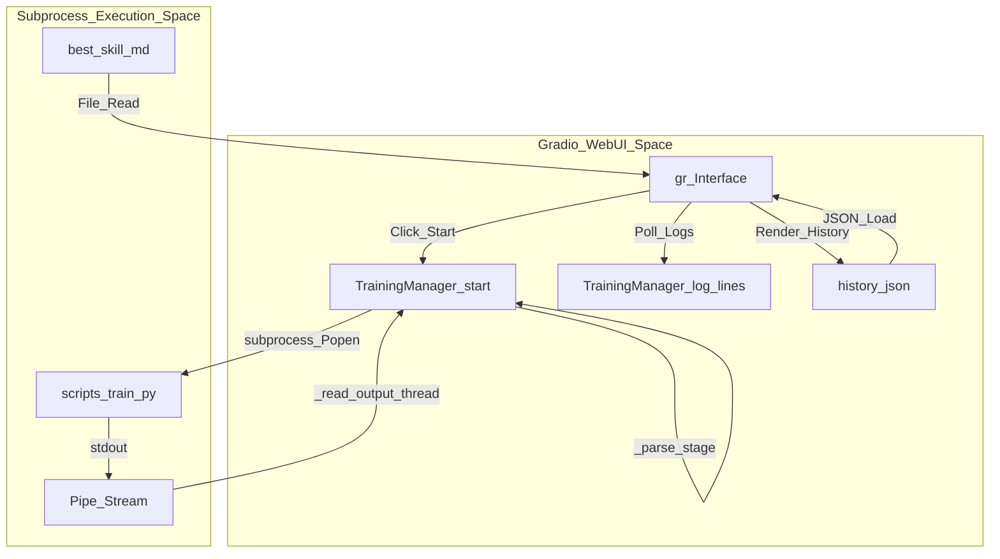
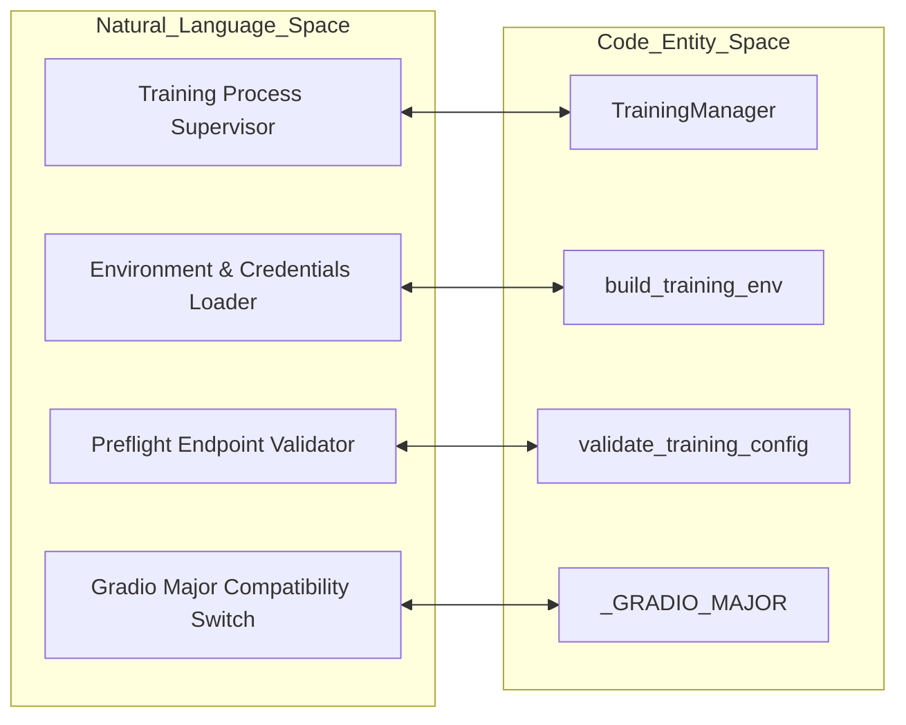
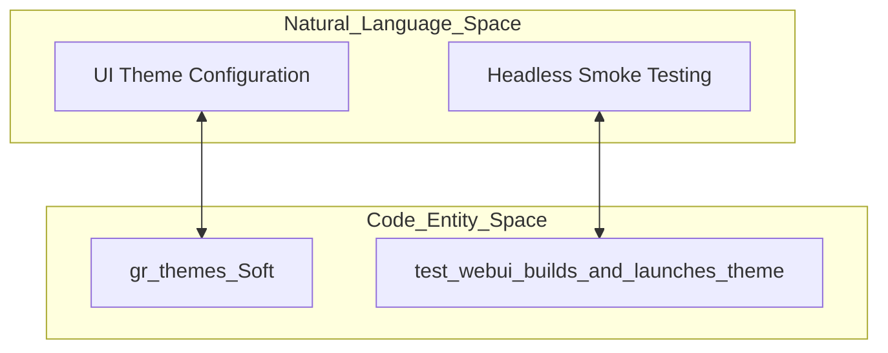

<!-- source: DeepWiki mcp.deepwiki.com · repo microsoft/SkillOpt · page 7.2 WebUI (skillopt_webui) · fetched 2026-10-26 -->

# WebUI (skillopt_webui)

Relevant source files

The following files were used as context for generating this wiki page:

- [.github/workflows/ci.yml](.github/workflows/ci.yml)
- [pyproject.toml](pyproject.toml)
- [skillopt_webui/app.py](skillopt_webui/app.py)
- [tests/test_webui_build_gradio.py](tests/test_webui_build_gradio.py)
- [tests/test_webui_env_preflight.py](tests/test_webui_env_preflight.py)
- [tests/test_webui_security.py](tests/test_webui_security.py)

The `skillopt_webui` package is a Gradio-based graphical interface designed to simplify the configuration, execution, and monitoring of SkillOpt training runs `[pyproject.toml:47-81]()`. It provides a dashboard for real-time log parsing, experiment history visualization, skill snapshot browsing, and preflight environment checks, abstracting the complexity of command-line execution and manual YAML configuration editing.

### Purpose and Scope
The WebUI functions as an orchestration and monitoring layer over the core training scripts (`scripts/train.py`). It enables users to:
*   **Discover and Modify Configs**: Automatically scan the `configs/` directory for experiment configurations and override parameters via UI inputs `[skillopt_webui/app.py:35-41]()`.
*   **Preflight Validation**: Verify model backend availability (Azure/OpenAI endpoints or local vLLM/Qwen servers) and environment variables before launching a subprocess `[skillopt_webui/app.py:104-176]()`.
*   **Manage Training Subprocesses**: Start, monitor, and terminate training runs safely via `TrainingManager` using process groups `[skillopt_webui/app.py:181-222]()`.
*   **Cross-Version Gradio Support**: Support both Gradio 5 (theme on `Blocks`) and Gradio 6 (theme on `launch()`) via dynamic major version detection `[skillopt_webui/app.py:27-31]()`, `[tests/test_webui_build_gradio.py:22-38]()`.
*   **Visualize Metrics & Artifacts**: Render performance trends from `history.json` and inspect historical skill documents (`skills/`) `[skillopt_webui/app.py:313-382]()`.

Sources: `[pyproject.toml:47-81]()`, `[skillopt_webui/app.py:1-31]()`, `[skillopt_webui/app.py:104-176]()`, `[tests/test_webui_build_gradio.py:22-38]()`

---

## Training Management Architecture

The WebUI does not execute training loops within the Gradio server process. Instead, it delegates execution to an isolated subprocess managed by the `TrainingManager` class `[skillopt_webui/app.py:181-194]()`.

### The TrainingManager Class
`TrainingManager` coordinates the subprocess lifecycle and captures asynchronous stdout streams:
*   **Subprocess Spawning**: Launches training using `subprocess.Popen` with `start_new_session=True` so that termination signals can be propagated to worker subprocesses `[skillopt_webui/app.py:213-222]()`.
*   **Environment Propagation**: Injects settings from `.env` and `.secrets/*.env` files into the subprocess environment using `build_training_env()` `[skillopt_webui/app.py:77-101]()`.
*   **Log Parsing**: Scans captured stdout streams line-by-line in a background thread to update internal progress indicators (`stage`, `step`, `epoch`) `[skillopt_webui/app.py:243-290]()`.

Sources: `[skillopt_webui/app.py:77-101]`, `[skillopt_webui/app.py:181-290]`, `[skillopt_webui/app.py:313-382]`

---

## Natural Language Space to Code Entity Space (Architecture)

To bridge high-level operational tasks with concrete source code implementations, the following mapping links user-facing abstractions to specific code entities within `skillopt_webui`:

Sources: `[skillopt_webui/app.py:27-31]`, `[skillopt_webui/app.py:77-101]`, `[skillopt_webui/app.py:104-176]`, `[skillopt_webui/app.py:181-194]`

---

## Configuration Discovery and Preflight Validation

Before any training run starts, the WebUI inspects configuration files and tests backend connectivity.

### Config Discovery & Overrides
The function `discover_configs()` scans the `configs/` directory recursively for `.yaml` files, excluding base configuration templates containing `_base_` in their filename `[skillopt_webui/app.py:35-41]`. Selected configurations can be modified dynamically via override inputs before being passed to `scripts/train.py`.

### Preflight Checks
`validate_training_config()` evaluates configuration parameters and environment variables to ensure:
1.  **YAML Syntax & Merging**: Configurations successfully flatten via `flatten_config(load_config(...))` `[skillopt_webui/app.py:104-118]`.
2.  **OpenAI / Azure Endpoint Resolution**: Roles configured with the `openai_chat` backend have valid endpoint credentials `[skillopt_webui/app.py:120-151]`.
3.  **Qwen / vLLM Connectivity**: Endpoints configured with `qwen_chat` are actively reachable using socket probes (`_can_connect_to_url`) `[skillopt_webui/app.py:152-176]`.

Sources: `[skillopt_webui/app.py:35-176]`, `[tests/test_webui_env_preflight.py:21-90]`

---

## Gradio Version Compatibility & Theme Placement

The WebUI supports multiple Gradio major versions (Gradio 5 and Gradio 6) by dynamically determining theme placement `[skillopt_webui/app.py:27-31]`, `[tests/test_webui_build_gradio.py:22-38]`):
*   **Gradio 5.x**: Themes are instantiated directly on the `gr.Blocks(theme=...)` container.
*   **Gradio 6.x**: Themes are passed as a keyword argument to `ui.launch(theme=...)` to prevent ignored-argument warnings or `TypeError` exceptions.

Sources: `[skillopt_webui/app.py:27-31]`, `[tests/test_webui_build_gradio.py:22-72]`

---

## Security Posture and Host Binding

To protect users from unintended network exposure, the WebUI enforces local-only binding by default `[tests/test_webui_security.py:27-41]` and emits a prominent warning when an explicit public bind (`0.0.0.0`) is requested `[tests/test_webui_security.py:43-58]`.

| Security Check | Implementation Target | Behavior |
| :--- | :--- | :--- |
| **Default Bind** | `main()` argument parser | Defaults `server_name` to `127.0.0.1` `[tests/test_webui_security.py:27-41]()` |
| **Public Exposure Warning** | `main()` host validator | Emits an unauthenticated exposure warning if `0.0.0.0` is specified `[tests/test_webui_security.py:43-57]()` |
| **Credential Masking** | `build_training_env()` | Securely loads `.secrets/*.env` files into subprocess environment `[skillopt_webui/app.py:86-90]()` |

Sources: `[skillopt_webui/app.py:86-90]`, `[tests/test_webui_security.py:27-58]`

---

