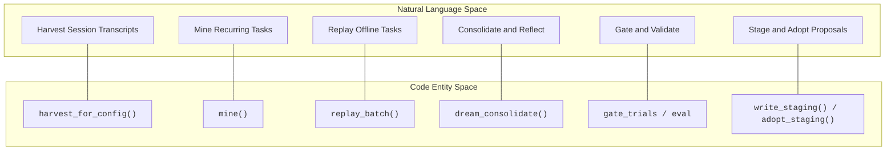
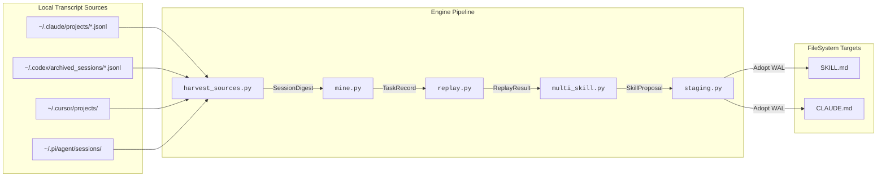

<!-- source: DeepWiki mcp.deepwiki.com · repo microsoft/SkillOpt · page 8 SkillOpt-Sleep · fetched 2026-10-26 -->

# SkillOpt-Sleep

Relevant source files

The following files were used as context for generating this wiki page:

- [CHANGELOG.md](CHANGELOG.md)
- [docs/guide/local-env-smoke.md](docs/guide/local-env-smoke.md)
- [docs/reference/cli.md](docs/reference/cli.md)
- [docs/sleep/README.md](docs/sleep/README.md)
- [plugins/README.md](plugins/README.md)
- [skillopt/__init__.py](skillopt/__init__.py)
- [skillopt_sleep/__init__.py](skillopt_sleep/__init__.py)
- [skillopt_sleep/__main__.py](skillopt_sleep/__main__.py)
- [skillopt_sleep/config.py](skillopt_sleep/config.py)
- [skillopt_sleep/cycle.py](skillopt_sleep/cycle.py)
- [tests/test_retired_cli_options.py](tests/test_retired_cli_options.py)

**SkillOpt-Sleep** is a deployment-time companion that applies the discipline of SkillOpt to a user's daily agent usage. It provides a local coding agent with a nightly "sleep cycle" that reviews past sessions, replays recurring tasks, and consolidates lessons into validated long-retrieved memory and skills. Unlike the core research engine (`skillopt/`), Sleep operates on real-world interaction transcripts, requires no weight training, and utilizes a simplified local-first architecture [docs/sleep/README.md:1-14](), [skillopt_sleep/__init__.py:1-16]().

### Purpose and Scope
The primary goal of SkillOpt-Sleep is to turn short-term agent experience into long-term competence without modifying live operational code or adding latency to active agent requests [docs/sleep/README.md:3-9](). It functions as an offline "Dream" cycle where inputs are never mutated during live execution [skillopt_sleep/__init__.py:8-16]().

The core nightly pipeline follows six distinct phases:
1.  **Harvest**: Extract transcripts from local agent logs (`harvest_for_config()`) [skillopt_sleep/cycle.py:27]().
2.  **Mine**: Identify recurring tasks and convert them into checkable `TaskRecord` objects (`mine()`) [skillopt_sleep/cycle.py:29]().
3.  **Replay**: Execute tasks offline against a baseline score (`replay_batch()`) [skillopt_sleep/cycle.py:30]().
4.  **Consolidate**: Reflect on failures and successes to produce structured edits (`dream_consolidate()`) [skillopt_sleep/cycle.py:25]().
5.  **Gate**: Validate candidate skills against held-out tasks using score comparison and regression checks [docs/sleep/README.md:29-36]().
6.  **Stage/Adopt**: Present validated multi-skill proposals via a versioned transaction ledger (`write_staging()` / `adopt_staging()`) [skillopt_sleep/cycle.py:40-48]().

Sources: [docs/sleep/README.md:1-36](), [skillopt_sleep/cycle.py:1-49](), [skillopt_sleep/__init__.py:1-16]()

### High-Level Architecture and Data Flow
The Sleep engine decouples transcript collection from model execution via the `Backend` abstraction, supporting diverse local toolchains and remote provider endpoints [skillopt_sleep/backend.py:1-20](). Multi-skill fan-out processes hinted skill boundaries independently, ensuring that specialized rules are gated and staged separately [CHANGELOG.md:15-25]().

**Sleep Cycle Logic to Code Mapping**

Sources: [skillopt_sleep/cycle.py:3-48](), [skillopt_sleep/backend.py:15-23]()

**Data Transformation Pipeline**

Sources: [skillopt_sleep/cycle.py:22-48](), [skillopt_sleep/config.py:26-37]()

### Core Components and Child Pages

#### 8.1 Sleep Engine Internals
The core engine (`skillopt_sleep/`) manages `SleepState`, transcript normalization across sources like Claude, Codex, Cursor, Pi, and OpenCode, dual-backend optimization routing, and multi-skill fan-out consolidation.
* For details, see [Sleep Engine Internals](#8.1).
* Sources: [skillopt_sleep/cycle.py:1-51](), [skillopt_sleep/state.py:1-50]()

#### 8.2 Handoff Backend and OpenAI-Compatible Endpoints
Supports asynchronous human-in-the-loop reflection via `PROMPTS.md` and `answers/`, alongside native integration for Azure OpenAI, DeepSeek, vLLM, and other OpenAI-compatible APIs.
* For details, see [Handoff Backend and OpenAI-Compatible Endpoints](#8.2).
* Sources: [CHANGELOG.md:63-77](), [skillopt_sleep/backend.py:15-24]()

#### 8.3 Agent Integrations
Wraps the shared `skillopt_sleep` CLI across multiple agent platforms including Claude Code marketplace plugins, Codex skills, Copilot MCP servers, Cursor plugins, Devin ATIF/MCP, and DeepSeek Harness (DSH).
* For details, see [Agent Integrations (Claude Code, Codex, Copilot, Cursor, Devin, OpenClaw, DSH)](#8.3).
* Sources: [plugins/README.md:1-25](), [CHANGELOG.md:15-58]()

#### 8.4 Sleep Scheduling and Automation
Automates nightly execution via platform-specific schedulers, managing crontab entries on Unix, Windows Task Scheduler via `schtasks`, and wrapper runners (`run-sleep.sh`/`cmd`/`ps1`).
* For details, see [Sleep Scheduling and Automation](#8.4).
* Sources: [docs/sleep/README.md:106](), [docs/reference/cli.md:142-175]()

#### 8.5 Sleep Results and Validation Experiments
Documents controlled multi-night deployment protocols, evaluation metrics, gate safety validation evidence, and paired A/B statistics via `skillopt_sleep.evalkit`.
* For details, see [Sleep Results and Validation Experiments](#8.5).
* Sources: [CHANGELOG.md:10-14](), [docs/reference/cli.md:151-154]()

#### 8.6 Superpowers Evaluation Adapter
Covers `skillopt_sleep/adapters/superpowers.py`, which provides pinned repository checkouts, candidate skill overlays, test shims, and rule-based judges within a controlled security boundary.
* For details, see [Superpowers Evaluation Adapter](#8.6).
* Sources: [docs/sleep/README.md:1-13]()

### CLI Usage Summary
The `skillopt-sleep` command-line interface provides access to nightly cycles, evaluation kits, and maintenance tasks [skillopt_sleep/__main__.py:1-26](), [docs/reference/cli.md:142-175]().

| Command | Description |
| :--- | :--- |
| `run` | Executes a full nightly cycle (harvest → mine → replay → gate → stage). |
| `dry-run` | Performs the cycle without staging or adopting proposed skill modifications. |
| `status` | Displays persistent state and pending staged proposals. |
| `adopt` | Promotes staged proposals into live project skill files with backup safety. |
| `schedule` / `unschedule` | Configures or removes OS-level automated execution blocks. |
| `evalkit` | Runs paired A/B validation statistics on a fixed task manifest. |

Sources: [CHANGELOG.md:10-25](), [docs/reference/cli.md:142-175](), [skillopt_sleep/__main__.py:1-26]()

---

