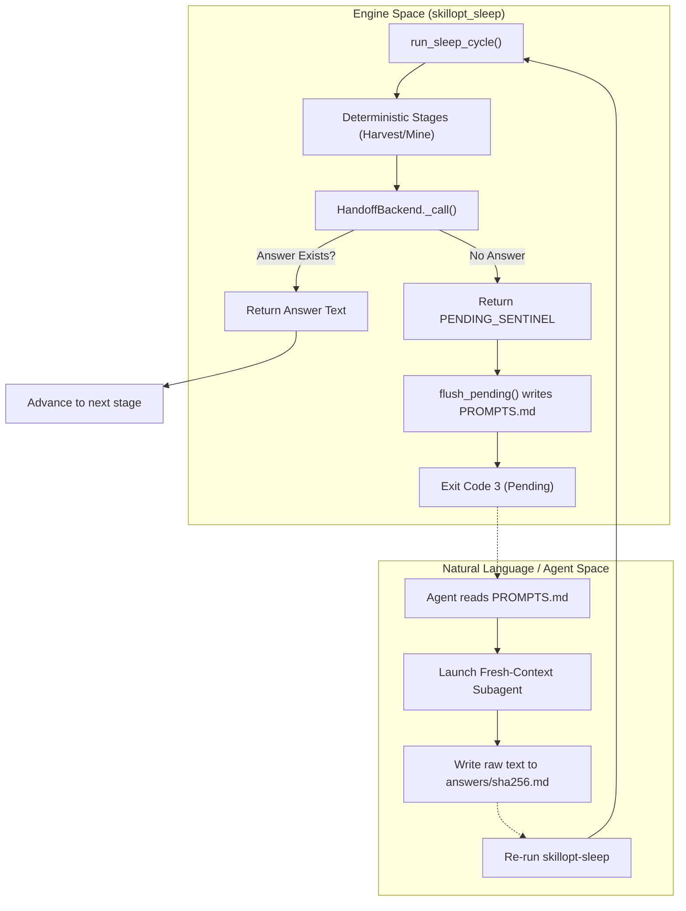
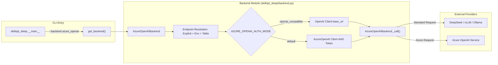

<!-- source: DeepWiki mcp.deepwiki.com · repo microsoft/SkillOpt · page 8.2 Handoff Backend and OpenAI-Compatible Endpoints · fetched 2026-10-26 -->

# Handoff Backend and OpenAI-Compatible Endpoints

<details>
<summary>Relevant source files</summary>

The following files were used as context for generating this wiki page:

- [docs/sleep/examples/runner.py](docs/sleep/examples/runner.py)
- [docs/sleep/examples/watchdog.py](docs/sleep/examples/watchdog.py)
- [docs/sleep/openai-compatible-endpoints.md](docs/sleep/openai-compatible-endpoints.md)
- [plugins/claude-code/commands/skillopt-sleep-handoff.md](plugins/claude-code/commands/skillopt-sleep-handoff.md)
- [skillopt_sleep/handoff_backend.py](skillopt_sleep/handoff_backend.py)
- [tests/test_azure_openai_compat.py](tests/test_azure_openai_compat.py)
- [tests/test_handoff_backend.py](tests/test_handoff_backend.py)

</details>


This page documents the integration of asynchronous human-in-the-loop workflows via the **Handoff Backend** and the support for **OpenAI-compatible endpoints** (such as DeepSeek, vLLM, and Ollama) within the SkillOpt-Sleep engine [docs/sleep/openai-compatible-endpoints.md:3-6](). These features allow the sleep cycle to run without direct API access or managed identity, supporting local-first and subscription-friendly deployments.

---

## Handoff Backend (`--backend handoff`)

The Handoff Backend allows the SkillOpt-Sleep engine to execute its nightly cycle without spawning model subprocesses or making direct API calls [skillopt_sleep/handoff_backend.py:3-4](). It decomposes the cycle into deterministic rounds where the engine identifies needed "intelligence" (reflection, judging, or task attempts), writes these as prompts to disk, and pauses for external answers [skillopt_sleep/handoff_backend.py:7-15]().

### Data Flow and State Management

The handoff process is stateless and relies on the determinism of the `harvest -> mine -> replay` pipeline [skillopt_sleep/handoff_backend.py:17-18](). If the engine is re-run with the same inputs, it generates identical prompt hashes, allowing the `answers/` directory to serve as a persistent call cache [skillopt_sleep/handoff_backend.py:18-20]().

| Entity | Role | Path |
| :--- | :--- | :--- |
| `PROMPTS.md` | Human-readable list of pending model calls with instructions [skillopt_sleep/handoff_backend.py:105-132](). | `.skillopt-sleep-handoff/PROMPTS.md` |
| `pending.json` | Machine-readable manifest for automated subagents [skillopt_sleep/handoff_backend.py:116-128](). | `.skillopt-sleep-handoff/pending.json` |
| `answers/` | Directory containing raw model responses indexed by prompt hash [skillopt_sleep/handoff_backend.py:77-85](). | `.skillopt-sleep-handoff/answers/<sha256>.md` |

### The Handoff Loop


Sources: [skillopt_sleep/handoff_backend.py:7-23](), [skillopt_sleep/handoff_backend.py:87-101](), [plugins/claude-code/commands/skillopt-sleep-handoff.md:22-50]()

### Key Classes and Functions

*   **`HandoffBackend`**: Inherits from `CliBackend`. It overrides `_call` to check for existing files in `self.answers_dir` [skillopt_sleep/handoff_backend.py:59-81]().
*   **`PendingCalls`**: A custom `RuntimeError` raised when a call depends on a placeholder (sentinel) value from a previous unanswered prompt. This prevents "garbage" propagation into scores or edits [skillopt_sleep/handoff_backend.py:49-56](), [skillopt_sleep/handoff_backend.py:88-90]().
*   **`skill_hash(prompt)`**: Generates a stable 16-character SHA256 prefix used to identify prompts and their corresponding answer files [skillopt_sleep/handoff_backend.py:94-95]().
*   **`flush_pending()`**: Aggregates all calls encountered during a round, redacts secrets using `redact_secrets`, and writes the handoff files [skillopt_sleep/handoff_backend.py:104-132]().

Sources: [skillopt_sleep/handoff_backend.py:1-165]()

---

## OpenAI-Compatible Endpoints (`azure_openai`)

The `azure_openai` backend in `skillopt_sleep` supports any provider implementing the OpenAI Chat Completions contract, such as DeepSeek, vLLM, or Ollama [docs/sleep/openai-compatible-endpoints.md:3-6]().

### Backend Resolution Logic

The `AzureOpenAIBackend` determines its behavior based on environment variables rather than model name substrings to ensure provider-neutral request shapes [docs/sleep/openai-compatible-endpoints.md:46-50]().

| Variable | Mode: Azure Managed Identity (Default) | Mode: `openai_compatible` |
| :--- | :--- | :--- |
| **Client Type** | `AzureOpenAI` [docs/sleep/openai-compatible-endpoints.md:33-34]() | `OpenAI` [docs/sleep/openai-compatible-endpoints.md:31-32]() |
| **Auth** | Azure AD Bearer Token [docs/sleep/openai-compatible-endpoints.md:39-40]() | `AZURE_OPENAI_API_KEY` [docs/sleep/openai-compatible-endpoints.md:31-32]() |
| **Endpoint** | `*.openai.azure.com` (Mandatory HTTPS) [docs/sleep/openai-compatible-endpoints.md:39-44]() | Custom (e.g., `http://localhost:8000/v1`) [docs/sleep/openai-compatible-endpoints.md:29-32]() |
| **Extra Body** | Ignored [docs/sleep/openai-compatible-endpoints.md:70-70]() | Supported via `SKILLOPT_SLEEP_CHAT_EXTRA_BODY` [docs/sleep/openai-compatible-endpoints.md:70-70]() |

Sources: [docs/sleep/openai-compatible-endpoints.md:57-71](), [skillopt_sleep/backend.py:117-123]()

### Implementation Details

1.  **Client Selection**: If `AZURE_OPENAI_AUTH_MODE` is set to `openai_compatible`, `_get_client()` instantiates a standard `openai.OpenAI` client. This avoids Azure-specific query parameters (`api-version`) that cause `404` errors on generic servers [docs/sleep/openai-compatible-endpoints.md:29-37](), [tests/test_azure_openai_compat.py:88-98]().
2.  **Credential Guard**: To prevent leaking AAD tokens, the backend enforces that managed-identity credentials are only sent to HTTPS endpoints with approved Azure hostnames (`*.openai.azure.com` or `*.cognitiveservices.azure.com`) [docs/sleep/openai-compatible-endpoints.md:39-44](), [tests/test_azure_openai_compat.py:99-120]().
3.  **Provider Extensions**: Provider-specific features (like DeepSeek's "thinking" channel) are enabled via `SKILLOPT_SLEEP_CHAT_EXTRA_BODY`, which is passed as the `extra_body` parameter in the completions call [docs/sleep/openai-compatible-endpoints.md:97-99](), [tests/test_azure_openai_compat.py:169-177]().

### System Architecture Diagram


Sources: [docs/sleep/openai-compatible-endpoints.md:20-55](), [skillopt_sleep/backend.py:117-123](), [tests/test_azure_openai_compat.py:131-149]()

### Example Configuration: DeepSeek
To use DeepSeek with SkillOpt-Sleep:
```bash
export AZURE_OPENAI_AUTH_MODE=openai_compatible
export AZURE_OPENAI_ENDPOINT=https://api.deepseek.com
export AZURE_OPENAI_API_KEY=sk-...
export SKILLOPT_SLEEP_CHAT_EXTRA_BODY='{"thinking": {"type": "enabled"}}'
export SKILLOPT_SLEEP_COMPAT_MAX_TOKENS=8192

skillopt-sleep run --backend azure_openai --model deepseek-v4-pro
```
Sources: [docs/sleep/openai-compatible-endpoints.md:92-105](), [docs/sleep/examples/runner.py:71-82]()

---
Sources:
* [skillopt_sleep/handoff_backend.py:1-165]()
* [skillopt_sleep/cycle.py:108-110](), [skillopt_sleep/cycle.py:117-123]()
* [skillopt_sleep/__main__.py:72-74](), [skillopt_sleep/__main__.py:107-108]()
* [docs/sleep/openai-compatible-endpoints.md:1-134]()
* [tests/test_azure_openai_compat.py:1-180]()
* [plugins/claude-code/commands/skillopt-sleep-handoff.md:1-75]()
* [docs/sleep/examples/runner.py:1-105]()

---

