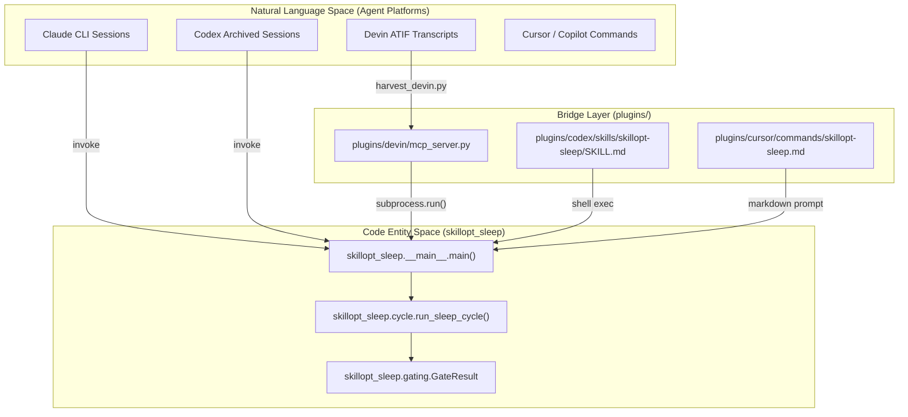
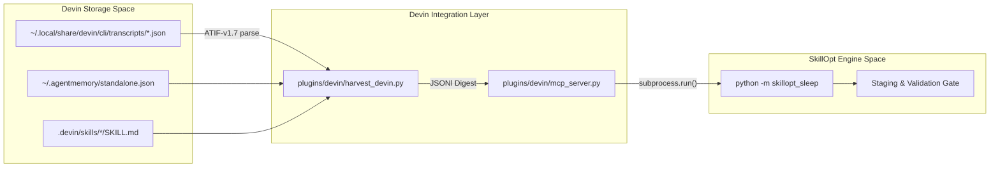

<!-- source: DeepWiki mcp.deepwiki.com · repo microsoft/SkillOpt · page 8.3 Agent Integrations (Claude Code, Codex, Copilot, Cursor, Devin, OpenClaw, DSH) · fetched 2026-10-26 -->

# Agent Integrations (Claude Code, Codex, Copilot, Cursor, Devin, OpenClaw, DSH)

Relevant source files

The following files were used as context for generating this wiki page:

- [docs/guideline.html](docs/guideline.html)
- [docs/reference/api.md](docs/reference/api.md)
- [plugins/claude-code/.claude-plugin/marketplace.json](plugins/claude-code/.claude-plugin/marketplace.json)
- [plugins/claude-code/.claude-plugin/plugin.json](plugins/claude-code/.claude-plugin/plugin.json)
- [plugins/claude-code/README.md](plugins/claude-code/README.md)
- [plugins/claude-code/commands/skillopt-sleep.md](plugins/claude-code/commands/skillopt-sleep.md)
- [plugins/claude-code/scripts/install-cron.sh](plugins/claude-code/scripts/install-cron.sh)
- [plugins/claude-code/skills/skillopt-sleep/SKILL.md](plugins/claude-code/skills/skillopt-sleep/SKILL.md)
- [plugins/codex/README.md](plugins/codex/README.md)
- [plugins/codex/install.sh](plugins/codex/install.sh)
- [plugins/codex/skills/skillopt-sleep/SKILL.md](plugins/codex/skills/skillopt-sleep/SKILL.md)
- [plugins/copilot/README.md](plugins/copilot/README.md)
- [plugins/copilot/copilot-instructions.snippet.md](plugins/copilot/copilot-instructions.snippet.md)
- [plugins/copilot/mcp_server.py](plugins/copilot/mcp_server.py)
- [plugins/copilot/skillopt/README.md](plugins/copilot/skillopt/README.md)
- [plugins/copilot/skillopt/copilot-instructions.snippet.md](plugins/copilot/skillopt/copilot-instructions.snippet.md)
- [plugins/copilot/skillopt/mcp-config.example.json](plugins/copilot/skillopt/mcp-config.example.json)
- [plugins/copilot/skillopt/mcp_server.py](plugins/copilot/skillopt/mcp_server.py)
- [plugins/cursor/README.md](plugins/cursor/README.md)
- [plugins/cursor/skills/skillopt-sleep/SKILL.md](plugins/cursor/skills/skillopt-sleep/SKILL.md)
- [plugins/devin/README.md](plugins/devin/README.md)
- [plugins/devin/devin-rules.snippet.md](plugins/devin/devin-rules.snippet.md)
- [plugins/devin/fixtures/devin_sample.json](plugins/devin/fixtures/devin_sample.json)
- [plugins/devin/harvest_devin.py](plugins/devin/harvest_devin.py)
- [plugins/devin/hooks/hooks.v1.json](plugins/devin/hooks/hooks.v1.json)
- [plugins/devin/hooks/on-session-end.sh](plugins/devin/hooks/on-session-end.sh)
- [plugins/devin/install.sh](plugins/devin/install.sh)
- [plugins/devin/judge.py](plugins/devin/judge.py)
- [plugins/devin/mcp-config.example.json](plugins/devin/mcp-config.example.json)
- [plugins/devin/mcp_server.py](plugins/devin/mcp_server.py)
- [plugins/dsh/LICENSE](plugins/dsh/LICENSE)
- [plugins/dsh/README.md](plugins/dsh/README.md)
- [plugins/dsh/README.zh.md](plugins/dsh/README.zh.md)
- [plugins/dsh/cordis.patch.yml](plugins/dsh/cordis.patch.yml)
- [plugins/dsh/package.json](plugins/dsh/package.json)
- [plugins/dsh/scripts/audit-control-chars.mjs](plugins/dsh/scripts/audit-control-chars.mjs)
- [plugins/dsh/scripts/audit-injection.mjs](plugins/dsh/scripts/audit-injection.mjs)
- [plugins/dsh/scripts/canary.mjs](plugins/dsh/scripts/canary.mjs)
- [plugins/dsh/scripts/sleep.py](plugins/dsh/scripts/sleep.py)
- [plugins/dsh/scripts/test-quoting-bash.mjs](plugins/dsh/scripts/test-quoting-bash.mjs)
- [plugins/dsh/skills/skillopt-sleep/SKILL.md](plugins/dsh/skills/skillopt-sleep/SKILL.md)
- [plugins/dsh/src/index.js](plugins/dsh/src/index.js)
- [plugins/openclaw/README.md](plugins/openclaw/README.md)
- [plugins/openclaw/SKILL.md](plugins/openclaw/SKILL.md)
- [plugins/openclaw/config.json](plugins/openclaw/config.json)
- [plugins/openclaw/run_sleep.py](plugins/openclaw/run_sleep.py)
- [plugins/openclaw/run_sleep_cron.sh](plugins/openclaw/run_sleep_cron.sh)
- [plugins/openclaw/tests/devops-tasks.json](plugins/openclaw/tests/devops-tasks.json)
- [plugins/openclaw/tests/research-cron-tasks.json](plugins/openclaw/tests/research-cron-tasks.json)
- [plugins/openclaw/tests/wiki-tasks.json](plugins/openclaw/tests/wiki-tasks.json)
- [tests/test_backend_opencode.py](tests/test_backend_opencode.py)
- [tests/test_devin_plugin.py](tests/test_devin_plugin.py)
- [tests/test_mcp_schema.py](tests/test_mcp_schema.py)
- [tests/test_plugin_sync.py](tests/test_plugin_sync.py)

This page details all agent platform integrations located in `plugins/`, covering the Claude Code marketplace plugin, Codex skill, Copilot MCP server, Cursor plugin, Devin MCP/ATIF server, OpenClaw integration, and the DSH JavaScript plugin alongside its security audit scripts. These integrations bridge host-specific agent environments and map them into the unified `skillopt_sleep` engine execution lifecycle.

## Shared Integration Architecture and Runner

Most platform integrations (`plugins/claude-code/`, `plugins/codex/`, `plugins/cursor/`, `plugins/devin/`) act as thin transport layers or skill wrappers around the shared `skillopt_sleep` CLI engine. They invoke standard shell runners or Model Context Protocol (MCP) servers to resolve the Python environment and execute engine actions like `status`, `dry-run`, `run`, `adopt`, `harvest`, `schedule`, and `unschedule`.

### Shared Runner Resolution
The common Unix runner (`plugins/run-sleep.sh`) and its Windows equivalents (`plugins/run-sleep.cmd`, `plugins/run-sleep.ps1`) perform deterministic environment resolution:
1. **Repo Root Discovery**: Resolves the `skillopt_sleep` package via the `SKILLOPT_SLEEP_REPO` environment variable or walks upward from the current working directory [plugins/codex/skills/skillopt-sleep/SKILL.md:50-55]().
2. **Interpreter Verification**: Locates a compatible Python interpreter ($\ge$ 3.10) [plugins/devin/README.md:38-44]().
3. **Execution Dispatch**: Forwards subcommand arguments directly to `python -m skillopt_sleep` [plugins/devin/mcp_server.py:16-20]().

**From Natural Language Space to Code Entity Space: Shared Engine Bridging**

*Sources: `[plugins/devin/mcp_server.py:16-20]()`, `[plugins/codex/skills/skillopt-sleep/SKILL.md:50-68]()`, `[tests/test_plugin_sync.py:81-90]()`*

---

## Claude Code Integration

The Claude Code integration is packaged as a marketplace plugin that exposes native commands, skills, and hooks inside the Claude CLI.

* **Mechanism**: Marketplace plugin (`plugin.json`, `marketplace.json`) defining managed prompts and scripts [plugins/claude-code/skills/skillopt-sleep/SKILL.md:1-12]().
* **Key Components**:
  * `plugins/claude-code/skills/skillopt-sleep/SKILL.md`: Defines the operational prompt and trigger phrases for memory consolidation (`CLAUDE.md`) and skill evolution (`SKILL.md`) [plugins/claude-code/skills/skillopt-sleep/SKILL.md:1-25]().
  * `plugins/claude-code/commands/skillopt-sleep.md`: Exposes short-form commands for status checks, dry-runs, and execution runs [plugins/claude-code/skills/skillopt-sleep/SKILL.md:53-60]().

Sources: `[plugins/claude-code/skills/skillopt-sleep/SKILL.md:1-60]()`, `[tests/test_plugin_sync.py:13-19]()`

---

## Codex Integration

The Codex integration is "skill-first," relying on `@openai/codex` skill distribution rather than deprecated custom prompt directories [plugins/codex/README.md:15-22]().

* **Installation**: `plugins/codex/install.sh` installs the `skillopt-sleep` skill into `~/.agents/skills/skillopt-sleep/SKILL.md` and safely migrates legacy prompt files [plugins/codex/README.md:23-44]().
* **Execution**: Codex uses its native `exec` capabilities to invoke the shared sleep runner [plugins/codex/skills/skillopt-sleep/SKILL.md:50-52]().
* **Transcript Source**: Consumes archived sessions from `~/.codex/archived_sessions` via `--source codex` [plugins/codex/README.md:69-70]().

Sources: `[plugins/codex/README.md:1-50]()`, `[plugins/codex/skills/skillopt-sleep/SKILL.md:1-68]()`

---

## GitHub Copilot Integration

The Copilot integration exposes the Sleep engine via a Model Context Protocol (MCP) server communicating over `stdio` [plugins/copilot/mcp_server.py:1-10]().

* **Mechanism**: Python standard library MCP server mapping JSON-RPC 2.0 tool calls to CLI actions [plugins/copilot/mcp_server.py:1-25]().
* **Tools Exposed**: `sleep_status`, `sleep_dry_run`, `sleep_run`, `sleep_adopt`, `sleep_harvest`, `sleep_schedule`, and `sleep_unschedule`.

Sources: `[plugins/copilot/mcp_server.py:1-30]()`, `[tests/test_plugin_sync.py:21-25]()`

---

## Cursor Plugin

The Cursor plugin integrates via Cursor's plugin system (`plugins/cursor/.cursor-plugin/plugin.json`) and registers with the workspace marketplace [plugins/cursor/.cursor-plugin/plugin.json]() [tests/test_plugin_sync.py:46-72]().

* **Key Components**:
  * `plugins/cursor/skills/skillopt-sleep/SKILL.md`: Skill instruction file pointing to relative staging targets such as `.cursor/skills/skillopt-sleep-learned/SKILL.md` [tests/test_plugin_sync.py:73-80]().
  * `plugins/cursor/commands/skillopt-sleep.md`: Thin command runner preserving safety defaults (e.g., defaulting to the `mock` backend and avoiding implicit auto-adoption) [tests/test_plugin_sync.py:81-90]().
  * Installation Scripts (`install.sh`, `install.ps1`): Package manifests, commands, skills, and licensing documents across Unix and PowerShell environments [tests/test_plugin_sync.py:91-104]().

Sources: `[tests/test_plugin_sync.py:46-113]()`

---

## Devin Integration

Devin (Cognition) uses a dedicated MCP server (`plugins/devin/mcp_server.py`) paired with a custom transcript harvester (`plugins/devin/harvest_devin.py`) to convert Devin's native formats into the engine's consumption schema [plugins/devin/README.md:1-16]().

### Devin MCP Server Architecture
The server implements JSON-RPC 2.0 over stdio without external dependencies [plugins/devin/mcp_server.py:1-7](). Before any data-reading action (`status`, `dry-run`, `run`, `harvest`), it triggers `harvest_devin.py` to translate local ATIF-v1.7 transcripts and `agentmemory` stores into Claude-compatible JSONL [plugins/devin/mcp_server.py:9-15]().

| MCP Tool | Engine Action | Description |
| :--- | :--- | :--- |
| `sleep_status` | `status` | Reports run counts and latest staged proposals [plugins/devin/mcp_server.py:42-44]() |
| `sleep_dry_run` | `dry-run` | Previews cycle without staging modifications [plugins/devin/mcp_server.py:45-46]() |
| `sleep_run` | `run` | Executes full harvest-mine-replay-reflect cycle [plugins/devin/mcp_server.py:46-47]() |
| `sleep_adopt` | `adopt` | Applies reviewed proposals with automatic backup [plugins/devin/mcp_server.py:48-49]() |
| `sleep_harvest` | `harvest` | Dumps mined recurring task items for debugging [plugins/devin/mcp_server.py:50-51]() |
| `sleep_schedule` | `schedule` | Installs background cron entries [plugins/devin/mcp_server.py:52-53]() |
| `sleep_unschedule` | `unschedule` | Removes scheduled cron jobs [plugins/devin/mcp_server.py:54-55]() |

**Devin Integration Data Flow & Translation**

*Sources: `[plugins/devin/README.md:24-35]()`, `[plugins/devin/mcp_server.py:9-15]()`*

Sources: `[plugins/devin/README.md:1-115]()`, `[plugins/devin/mcp_server.py:1-150]()`, `[tests/test_devin_plugin.py:51-118]()`

---

## OpenClaw Integration

OpenClaw is an independent reference implementation designed to integrate with custom agent environments and backends like DeepSeek or Ollama [plugins/openclaw/README.md:1-10]().

* **Key File**: `plugins/openclaw/run_sleep.py` and `plugins/openclaw/skillopt_sleep_openclaw.py` [plugins/openclaw/run_sleep.py:1-35]().
* **Mechanism**: Injects custom backend (`OpenClawDeepSeekBackend`) overrides into `skillopt_sleep.backend`, mapping external task records to `TaskRecord` entities before invoking `run_sleep_cycle()` [plugins/openclaw/run_sleep.py:30-119]().

Sources: `[plugins/openclaw/run_sleep.py:1-145]()`, `[tests/test_plugin_sync.py:114-156]()`

---

## DSH JS Plugin and Security Audit Scripts

The DSH (JavaScript) plugin provides integration for Node/JS-based agent environments (`plugins/dsh/`) alongside rigorous security validation scripts [plugins/dsh/scripts/audit-control-chars.mjs:1-10]().

* **Core Module**: `plugins/dsh/src/index.js` exports argument quoting utilities (`quoteArgv`, `IS_WINDOWS`) to safely serialize shell commands [plugins/dsh/scripts/audit-control-chars.mjs:8-10]().
* **Security Audits**:
  * `audit-control-chars.mjs`: Tests payloads containing newlines, carriage returns, null bytes, and backticks to verify that control characters are folded or bounded and cannot escape host shell quoting boundaries [plugins/dsh/scripts/audit-control-chars.mjs:11-58]().
  * `audit-injection.mjs`: Verifies shell command injection protection across structured option values.

Sources: `[plugins/dsh/scripts/audit-control-chars.mjs:1-63]()`, `[tests/test_plugin_sync.py:13-19]()`

---

