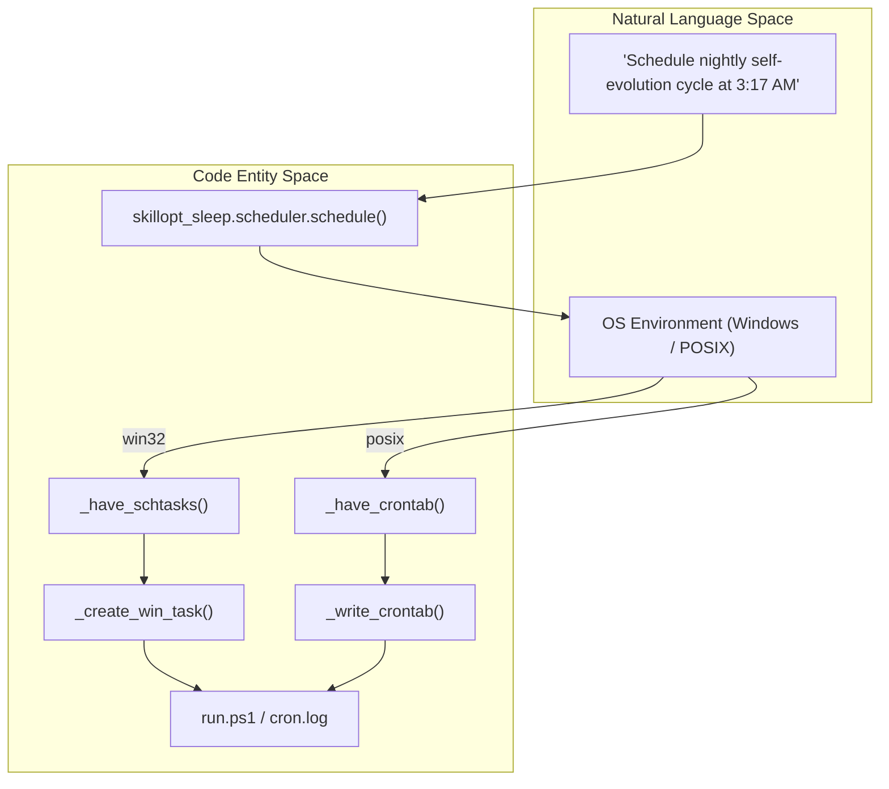
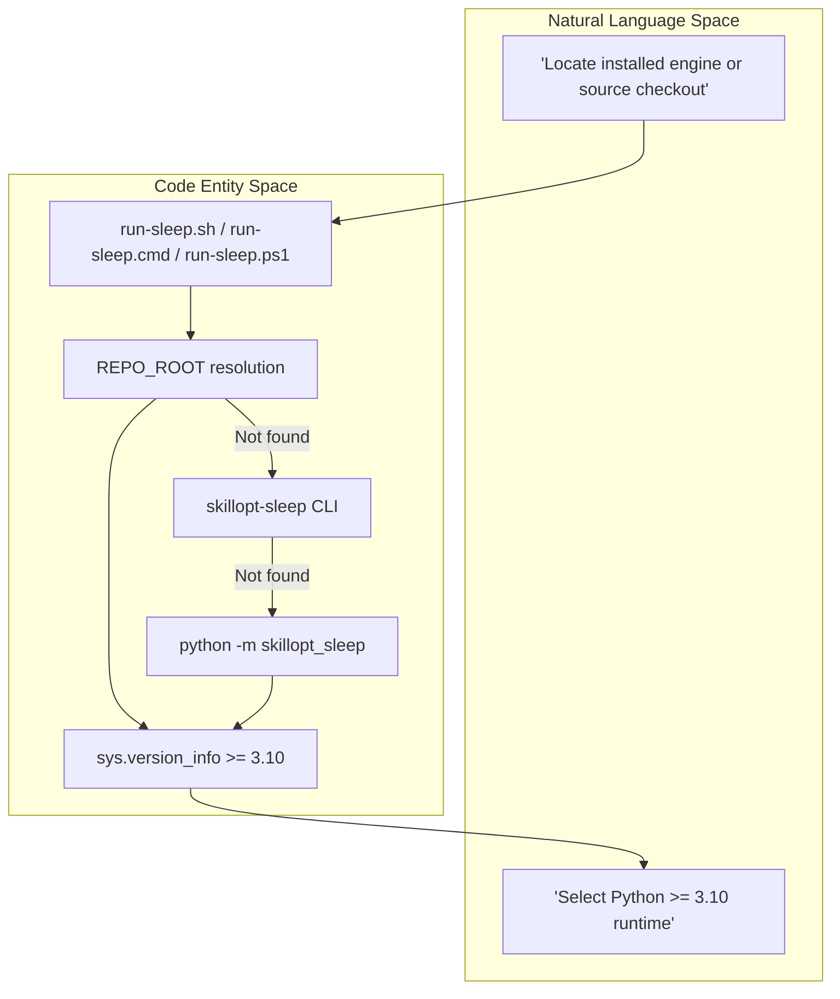

<!-- source: DeepWiki mcp.deepwiki.com · repo microsoft/SkillOpt · page 8.4 Sleep Scheduling and Automation · fetched 2026-10-26 -->

# Sleep Scheduling and Automation

Relevant source files

The following files were used as context for generating this wiki page:

- [plugins/claude-code/hooks/hooks.json](plugins/claude-code/hooks/hooks.json)
- [plugins/claude-code/hooks/on-session-end.sh](plugins/claude-code/hooks/on-session-end.sh)
- [plugins/claude-code/scripts/run-sleep.sh](plugins/claude-code/scripts/run-sleep.sh)
- [plugins/codex/install.ps1](plugins/codex/install.ps1)
- [plugins/run-sleep.cmd](plugins/run-sleep.cmd)
- [plugins/run-sleep.ps1](plugins/run-sleep.ps1)
- [plugins/run-sleep.sh](plugins/run-sleep.sh)
- [skillopt_sleep/scheduler.py](skillopt_sleep/scheduler.py)
- [tests/test_run_sleep_fallback.py](tests/test_run_sleep_fallback.py)
- [tests/test_runners.Tests.ps1](tests/test_runners.Tests.ps1)
- [tests/test_scheduler_windows.py](tests/test_scheduler_windows.py)

The SkillOpt-Sleep scheduling system provides a cross-platform mechanism for automating the nightly self-evolution cycle. It manages the installation, execution, and removal of recurring tasks that drive the harvest-mine-replay-gate pipeline without requiring manual intervention from the user [skillopt_sleep/scheduler.py:1-5]().

## System Architecture

The automation system consists of three layers:
1.  **The Scheduler Logic**: A Python module (`skillopt_sleep.scheduler`) that abstracts OS-specific scheduling APIs (crontab for Unix, `schtasks` for Windows) [skillopt_sleep/scheduler.py:1-5]().
2.  **The Runner Scripts**: Shell, Batch, and PowerShell scripts that resolve the environment, locate the `skillopt_sleep` package, and execute the engine CLI [plugins/run-sleep.sh:2-6](), [plugins/run-sleep.cmd:1-4]().
3.  **The Managed Block**: A structured section in the OS scheduler that allows SkillOpt to track and update its own entries without disturbing the user's existing tasks [skillopt_sleep/scheduler.py:16-17]().

### NL-to-Code Mapping: Scheduling Entities

| Natural Language Concept | Code Entity | Role |
| :--- | :--- | :--- |
| Nightly Trigger | `schedule()` | Entry point for installing a task [skillopt_sleep/scheduler.py:186-188]() |
| Unix Cron Block | `_BEGIN` / `_END` | Markers for managed crontab entries [skillopt_sleep/scheduler.py:16-17]() |
| Windows Task Name | `_win_task_name()` | Generates unique task IDs based on project path [skillopt_sleep/scheduler.py:62-65]() |
| Script Resolver | `REPO_ROOT` | Logic to find the engine from plugin subdirs [plugins/run-sleep.sh:14-26]() |
| Execution Log | `cron.log` | Standard output capture for scheduled runs [skillopt_sleep/scheduler.py:113-114]() |

Sources: [skillopt_sleep/scheduler.py:1-114](), [plugins/run-sleep.sh:1-26]()

---

## Cross-Platform Implementation

### Unix: Crontab Management
On Unix systems, the scheduler uses the `crontab` CLI to read and write the user's schedule. It implements a "managed block" strategy to ensure safety.

1.  **Discovery**: Checks for the existence of the `crontab` binary using `shutil.which` [skillopt_sleep/scheduler.py:20-21]().
2.  **Reading**: Executes `crontab -l` to fetch existing entries [skillopt_sleep/scheduler.py:24-29]().
3.  **Parsing**: The `_split_managed` function separates the crontab into lines outside the block and lines inside the `# >>> skillopt-sleep (managed) >>>` markers [skillopt_sleep/scheduler.py:41-55]().
4.  **Updating**: It filters out existing entries for the specific project path and appends the new entry [skillopt_sleep/scheduler.py:186-192]().
5.  **Writing**: Pipes the new content back via `crontab -` [skillopt_sleep/scheduler.py:32-38]().

### Windows: Task Scheduler (`schtasks`)
On Windows, the system interacts with `schtasks.exe` [skillopt_sleep/scheduler.py:58-60]().

1.  **Task Naming**: Since Windows tasks are identified by name rather than line content, `_win_task_name` converts the absolute project path into a secure SHA-256 digest hash (e.g., `SkillOpt-Sleep-<digest>`) [skillopt_sleep/scheduler.py:62-65]().
2.  **Helper Creation**: Because `schtasks` can struggle with complex command strings involving pipes and redirects, the scheduler creates a `run.ps1` helper script in the project's `.skillopt-sleep/` directory [skillopt_sleep/scheduler.py:128-142]().
3.  **Registration**: Calls `schtasks /create` with `/sc daily` and a specific `/st` (start time) [skillopt_sleep/scheduler.py:68-75]().

### NL-to-Code Mapping: Task Scheduling Flow

Sources: [skillopt_sleep/scheduler.py:20-75](), [skillopt_sleep/scheduler.py:128-192]()

---

## Runner Scripts and Environment Resolution

The runner scripts (`run-sleep.sh`, `run-sleep.cmd`, `run-sleep.ps1`) are designed to be portable and are bundled with agent plugins (e.g., Claude Code, Codex). Their primary responsibility is **Engine Resolution** and selecting an appropriate Python runtime.

### Resolution Logic Flow
The runners attempt to locate the `skillopt_sleep` package in the following order:
1.  **Source Checkout**: Checks if `../skillopt_sleep` exists relative to the script location [plugins/run-sleep.sh:13-14]().
2.  **Plugin Environment**: Checks for `CLAUDE_PLUGIN_ROOT` or `SKILLOPT_SLEEP_REPO` environment variables [plugins/run-sleep.sh:15-18]().
3.  **Upward Search**: Iteratively searches parent directories for a `skillopt_sleep` folder [plugins/run-sleep.sh:20-26]().
4.  **PATH Fallback**: If no source is found, it attempts to call the `skillopt-sleep` CLI directly (assuming a `pip install` or `uv tool install`) [plugins/run-sleep.sh:57-59]().
5.  **Module Fallback**: Attempts to run `python -m skillopt_sleep` if the package is importable in the active environment [plugins/run-sleep.sh:61-74]().

### Python Version Enforcement
All runners verify that the resolved Python interpreter is version **3.10 or higher** before execution [plugins/run-sleep.sh:36-41](), [plugins/run-sleep.ps1:42-44]().

### NL-to-Code Mapping: Package and Runner Resolution

Sources: [plugins/run-sleep.sh:1-79](), [plugins/run-sleep.ps1:1-94](), [plugins/run-sleep.cmd:1-74]()

---

## CLI Commands

The scheduler is exposed via the `skillopt_sleep` command-line interface.

### `schedule`
Installs a nightly entry for a target project directory.
*   **Arguments**: `--project`, `--backend`, `--hour`, `--minute`, `--extra`, `--python` [skillopt_sleep/scheduler.py:186-187]().
*   **Default Time**: 03:17 AM (chosen to avoid top-of-the-hour API concurrency spikes) [skillopt_sleep/scheduler.py:186-187]().

### `unschedule`
Removes managed schedule entries.
*   **Targeted**: Removes the entry associated with a specific project path [skillopt_sleep/scheduler.py:181-182]() (via `_delete_win_task()` or crontab file updates [skillopt_sleep/scheduler.py:78-84](), [skillopt_sleep/scheduler.py:41-55]()).

Sources: [skillopt_sleep/scheduler.py:78-195](), [tests/test_scheduler_windows.py:50-76]()

---

