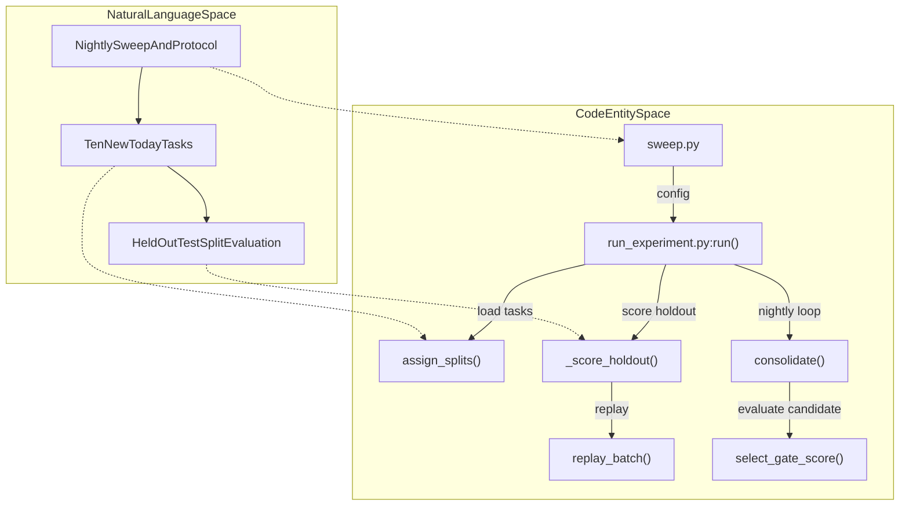

<!-- source: DeepWiki mcp.deepwiki.com · repo microsoft/SkillOpt · page 8.5 Sleep Results and Validation Experiments · fetched 2026-10-26 -->

# Sleep Results and Validation Experiments

<details>
<summary>Relevant source files</summary>

The following files were used as context for generating this wiki page:

- [docs/sleep/RESULTS.md](docs/sleep/RESULTS.md)
- [docs/sleep/evalkit.md](docs/sleep/evalkit.md)
- [skillopt_sleep/evalkit.py](skillopt_sleep/evalkit.py)
- [skillopt_sleep/experiments/run_experiment.py](skillopt_sleep/experiments/run_experiment.py)
- [tests/fixtures/evalkit/aa_manifest.json](tests/fixtures/evalkit/aa_manifest.json)
- [tests/fixtures/evalkit/aa_outcomes.json](tests/fixtures/evalkit/aa_outcomes.json)
- [tests/fixtures/evalkit/mcnemar_textbook.json](tests/fixtures/evalkit/mcnemar_textbook.json)
- [tests/test_evalkit.py](tests/test_evalkit.py)

</details>


SkillOpt-Sleep documents the controlled deployment-scale study of the Sleep companion engine. This includes empirical evidence for the safety of the validation gate, benchmark results across SearchQA, LiveMathematicianBench, and SpreadsheetBench, paired A/B statistics via the `skillopt_sleep.evalkit` module, and the `skillopt_sleep.experiments/` package which provides the infrastructure for running reproducible multi-night sweeps and validation runs [docs/sleep/RESULTS.md:1-27](), [skillopt_sleep/evalkit.py:1-21](), [skillopt_sleep/experiments/run_experiment.py:1-20]().

Sources: [docs/sleep/RESULTS.md:1-27](), [skillopt_sleep/evalkit.py:1-21](), [skillopt_sleep/experiments/run_experiment.py:1-20]()

## 5-Night Protocol and Study Recipe

The primary results are derived from a controlled 5-night protocol designed to simulate a deployed agent's lifecycle under offline optimization [docs/sleep/RESULTS.md:9-18]().

*   **Daily Tasks:** Each night adds 10 new real "today" tasks [docs/sleep/RESULTS.md:11-12]().
*   **Skill Persistence:** The skill document carries over and is refined night-to-night [docs/sleep/RESULTS.md:12-13]().
*   **Evaluation:** A full held-out test split is scored before Night 1 (`baseline`) and after Night 5 (`after`), with $\Delta = \text{after} - \text{baseline}$ [docs/sleep/RESULTS.md:13-15]().
*   **Optimizer Model:** Typically configured with GPT-5.5 (single seed 42) [docs/sleep/RESULTS.md:14-15]().
*   **Experiment vs Shipping Defaults:** The study recipe uses `dream_rollouts=5` and `recall_k=20`, whereas shipping defaults remain conservative (`dream_rollouts=1`, `recall_k=0`) [docs/sleep/RESULTS.md:120-123]().

### Experiment Data Flow and Code Mapping

The following diagram bridges natural language study orchestration to the concrete code entities in `skillopt_sleep.experiments` and `skillopt_sleep.consolidate`.

**Multi-Night Experiment Orchestration**

Sources: [docs/sleep/RESULTS.md:9-18](), [skillopt_sleep/experiments/run_experiment.py:42-94](), [skillopt_sleep/experiments/sweep.py:1-27]()

## Benchmark Results and Scaling

The evaluation suite relies on real evaluators rather than format heuristics across three benchmarks [docs/sleep/RESULTS.md:20-27]():

| Benchmark | Held-out Test Split | Scoring Method |
| :--- | :--- | :--- |
| **SearchQA** | 1,400 items | SQuAD exact-match vs gold [docs/sleep/RESULTS.md:24]() |
| **LiveMathematicianBench** | 124 items | Multiple-choice label (shuffled per item) [docs/sleep/RESULTS.md:25]() |
| **SpreadsheetBench** | 280 items | Executed generated `openpyxl` code, compared cell-by-cell to golden file [docs/sleep/RESULTS.md:26]() |

### Cross-Model Scaling and Headroom
Weaker target models exhibit significantly larger gains because they have more headroom to learn from a strong overnight optimizer (e.g., GPT-5.5 optimizer paired with GPT-5.4-nano target) [docs/sleep/RESULTS.md:58-82]().
*   **GPT-5.4-nano (SearchQA, gated, cumulative):** Baseline `0.560` $\rightarrow$ After `0.679` ($\Delta = \mathbf{+11.9}$) [docs/sleep/RESULTS.md:65]()
*   **GPT-5.5 (SearchQA, gated):** Baseline `0.798` $\rightarrow$ After `0.858` ($\Delta = \mathbf{+6.0}$) [docs/sleep/RESULTS.md:77]()

Sources: [docs/sleep/RESULTS.md:20-82]()

## Validation Gate Safety Evidence

Self-evolution without guardrails risks adopting plausible-but-wrong rules that degrade agent performance. The validation gate (`consolidate()` check) prevents this [docs/sleep/RESULTS.md:33-52]().

*   **Ungated Stress Case (GPT-5.4-nano on SearchQA):** Without the gate, the optimizer adopted a flawed verbatim-title rule, causing accuracy to collapse from `0.554` $\rightarrow$ `0.026` ($\Delta = \mathbf{-52.8}$) [docs/sleep/RESULTS.md:40-50]().
*   **Gated Twin:** The validation gate rejected every harmful edit, maintaining a flat `0.570` score ($\Delta = \mathbf{0.0}$) [docs/sleep/RESULTS.md:46-52]().

Sources: [docs/sleep/RESULTS.md:33-52]()

## Experience Replay and Dream-Diversity

Replay mechanisms (`recall_k`, `dream_rollouts`) transform a one-time improvement into a steady climb across nights [docs/sleep/RESULTS.md:86-114](). 
*   **Recall Scaling:** On SearchQA (GPT-5.5, gated), setting `recall_k=20` yields $\Delta = \mathbf{+4.5}$ ($0.803 \rightarrow 0.848$) compared to `+3.1` for `recall_k=10` [docs/sleep/RESULTS.md:94-95]().
*   **Dream-Diversity Fix:** Contrastive reflection requires independent dream rollouts. Collapsing rollouts to a single cached sample causes reflection failure (mean $\Delta = -2.66$ across cells), whereas diverse rollouts ($K=5$) eliminate catastrophic regressions at their source [docs/sleep/RESULTS.md:139-156]().

Sources: [docs/sleep/RESULTS.md:86-156]()

## Paired A/B Evalkit (`skillopt_sleep.evalkit`)

To standardize rigorous comparisons between conditions (such as comparing a baseline skill against a nightly candidate), SkillOpt-Sleep provides a pure stdlib paired A/B evaluation kit located in `skillopt_sleep/evalkit.py` [docs/sleep/evalkit.md:1-13](), [skillopt_sleep/evalkit.py:1-21]().

### Evalkit Capabilities and CLI
*   **Task Pairing:** Pairs outcomes by task ID from a fixed task manifest [docs/sleep/evalkit.md:3-9]().
*   **Statistical Tests:** Computes McNemar's test on binary successes and generates percentile-bootstrap confidence intervals on the success-rate delta [docs/sleep/evalkit.md:8-10]().
*   **CLI Entry Point:**
    ```text
    python -m skillopt_sleep.evalkit --manifest tasks.json --a cond_a.json --b cond_b.json
    ```
    [docs/sleep/evalkit.md:5-7]()

### Evalkit Code Architecture
The following diagram maps the evaluation kit's statistical functions to code symbols in `skillopt_sleep.evalkit`.

**Evalkit Code Architecture**
```mermaid
graph TD
    subgraph "NaturalLanguageSpace"
        CLI[""Command-LineInterface""] --> PAR[""PairByTaskId""]
        PAR --> MCN[""McNemarBinaryTest""]
        PAR --> BOOT[""PercentileBootstrapCI""]
    end

    subgraph "CodeEntitySpace"
        MAIN[""evalkit.py:main()""] --> CMP[""evalkit.py:compare()""]
        CMP --> MP[""evalkit.py:mcnemar_paired()""]
        MP --> EM[""evalkit.py:exact_mcnemar_p()""]
        CMP --> BC[""evalkit.py:bootstrap_delta_ci()""]
    end

    CLI -.-> MAIN
    MCN -.-> MP
    BOOT -.-> BC
```
Sources: [docs/sleep/evalkit.md:1-12](), [skillopt_sleep/evalkit.py:1-21](), [tests/test_evalkit.py:1-32]()

Sources: [docs/sleep/evalkit.md:1-77](), [skillopt_sleep/evalkit.py:1-21](), [tests/test_evalkit.py:1-32]()

## The experiments/ Package

The `skillopt_sleep.experiments` package contains the reproducible research harness [skillopt_sleep/experiments/run_experiment.py:1-20]()

### Key Files and Functions
*   **`run_experiment.py`**: Executes end-to-end validation experiments across personas (e.g., `researcher`), supporting mock and real backends (`--backend mock`, `--backend claude`), split assignment via `assign_splits()`, and gate-safety probes [skillopt_sleep/experiments/run_experiment.py:1-124]().
*   **`sweep.py`**: Automates multi-configuration parameter sweeps with resume capabilities.
*   **`gbrain_bench.py`**: Bridges external `gbrain-evals` data into internal `TaskRecord` structures.

Sources: [skillopt_sleep/experiments/run_experiment.py:1-178](), [skillopt_sleep/experiments/sweep.py:1-27]()

---

