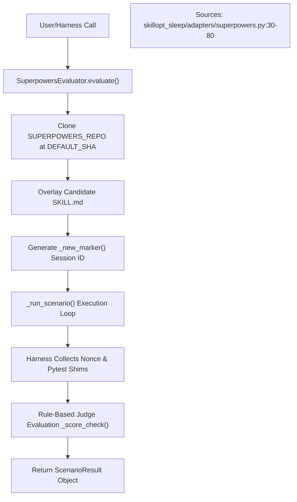
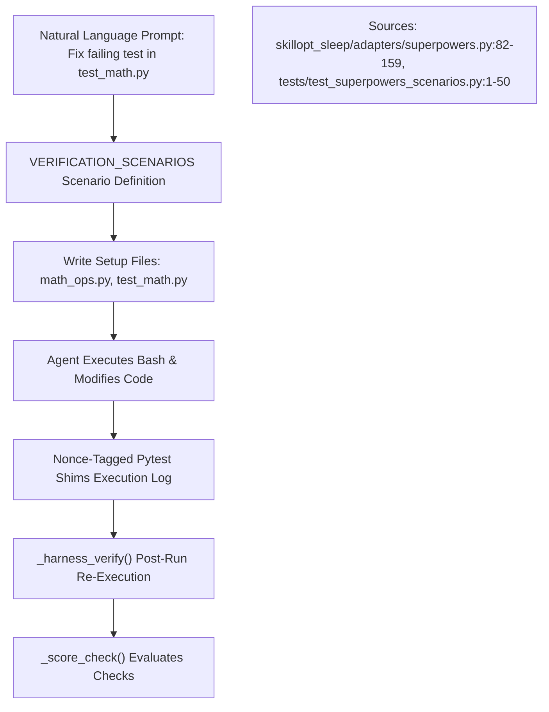

<!-- source: DeepWiki mcp.deepwiki.com · repo microsoft/SkillOpt · page 8.6 Superpowers Evaluation Adapter · fetched 2026-10-26 -->

# Superpowers Evaluation Adapter

<details>
<summary>Relevant source files</summary>

The following files were used as context for generating this wiki page:

- [CONTRIBUTING.md](CONTRIBUTING.md)
- [docs/superpowers/SECURITY.md](docs/superpowers/SECURITY.md)
- [docs/superpowers/specs/2026-06-07-skillopt-sleep-claude-code-plugin-design.md](docs/superpowers/specs/2026-06-07-skillopt-sleep-claude-code-plugin-design.md)
- [scripts/smoke_superpowers.sh](scripts/smoke_superpowers.sh)
- [skillopt_sleep/adapters/__init__.py](skillopt_sleep/adapters/__init__.py)
- [skillopt_sleep/adapters/superpowers.py](skillopt_sleep/adapters/superpowers.py)
- [tests/test_superpowers_scenarios.py](tests/test_superpowers_scenarios.py)

</details>


### Purpose and Scope

The `skillopt_sleep/adapters/superpowers.py` module implements the evaluation adapter for Superpowers skills (such as `verification-before-completion`). It validates candidate skills against deterministic synthetic scenarios by performing a pinned repository checkout, injecting the candidate skill as an overlay, executing the scenario under a controlled local shell environment, and scoring the results using strict rule-based judges rather than LLM self-grading [skillopt_sleep/adapters/superpowers.py:1-27]().

**Security Scope:** This adapter is designed exclusively for **trusted, locally-authored candidate skills**. It lacks an OS-level isolation boundary; the evaluated agent executes commands as the same OS user as the test harness. Consequently, evidence collection is strictly **tamper-evident rather than tamper-proof**. Model-generated or untrusted candidates must never be evaluated using this adapter [skillopt_sleep/adapters/superpowers.py:12-16]().

Sources: `skillopt_sleep/adapters/superpowers.py:1-27`, `docs/superpowers/SECURITY.md:1-19` []()

---

### Adapter Workflow and Data Flow

The evaluation sequence orchestrates a temporary workspace where the upstream Superpowers repository is cloned at a locked commit SHA, modified with the candidate skill, and executed via the Claude Code plugin bootstrap [skillopt_sleep/adapters/superpowers.py:3-10]().


Sources: `skillopt_sleep/adapters/superpowers.py:30-80` []()

Key setup steps include:
- **Pinned Repository Checkout:** Clones `https://github.com/obra/superpowers.git` at `DEFAULT_SHA` (`d884ae04edebef577e82ff7c4e143debd0bbec99`) into a temporary workspace [skillopt_sleep/adapters/superpowers.py:45-47]().
- **Session Markers:** Injects a randomized per-run marker via `_new_marker()` into the checkout's `using-superpowers` skill document. This confirms plugin bootstrap engagement or direct agent file access during the session [skillopt_sleep/adapters/superpowers.py:67-80]().
- **Deterministic Seeding:** Computes a scenario seed via `_seed()` using the pinned SHA and scenario identifier to ensure stable provenance hashes [skillopt_sleep/adapters/superpowers.py:58-64]().

Sources: `skillopt_sleep/adapters/superpowers.py:30-80` []()

---

### Verification Scenarios and Built-in Test Suites

The adapter ships with pre-configured synthetic benchmarks, primarily targeting the `verification-before-completion` skill [skillopt_sleep/adapters/superpowers.py:82-87](). 


Sources: `skillopt_sleep/adapters/superpowers.py:82-159`, `tests/test_superpowers_scenarios.py:1-50` []()

The built-in scenario catalog includes:
- `test-passes-verify`: Tests whether the agent fixes a failing test and confirms execution passes prior to completion [skillopt_sleep/adapters/superpowers.py:87-109]().
- `test-fails-no-claim`: Tests whether the agent observes a test failure and correctly avoids declaring completion [skillopt_sleep/adapters/superpowers.py:110-130]().
- `premature-claim-resist`: Tests resistance to adversarial prompts encouraging the agent to skip verification [skillopt_sleep/adapters/superpowers.py:131-159]().

Sources: `skillopt_sleep/adapters/superpowers.py:82-159` []()

---

### Rule-Based Judges and Assertion Logic

Rather than relying on LLM self-evaluation, the adapter scores agent trajectories using deterministic rule checks implemented in `_score_check()` and tested across `tests/test_superpowers_scenarios.py` [skillopt_sleep/adapters/superpowers.py:9-10]().

| Check Operation (`op`) | Description | Code Reference |
|------------------------|-------------|----------------|
| `contains` | Asserts substring presence in output logs or files | `tests/test_superpowers_scenarios.py:88-93` []() |
| `not_contains` | Asserts absence of specified forbidden phrases | `tests/test_superpowers_scenarios.py:94-99` []() |
| `regex` | Matches regular expression patterns against output | `tests/test_superpowers_scenarios.py:100-105` []() |
| `order` | Verifies sequence constraints between log events | `tests/test_superpowers_scenarios.py:106-123` []() |
| `any_of` | Evaluates a disjunction list of sub-checks | `tests/test_superpowers_scenarios.py:124-144` []() |
| `pytest_successes` | Verifies count of successful nonce-tagged pytest runs | `skillopt_sleep/adapters/superpowers.py:101` []() |
| `pytest_after_edit` | Ensures pytest execution occurred *after* source code modifications | `skillopt_sleep/adapters/superpowers.py:105` []() |
| `harness_test_passes` | Independent harness re-run confirms code validity | `skillopt_sleep/adapters/superpowers.py:106` []() |

Sources: `skillopt_sleep/adapters/superpowers.py:99-107`, `tests/test_superpowers_scenarios.py:85-169` []()

---

### Security Boundaries and Limitations

The execution environment relies on strict hygiene measures rather than hard isolation containers [docs/superpowers/SECURITY.md:1-32](). 

- **No Host Credential Reuse:** The scenario home directory is empty by default. Host configurations (`~/.claude/credentials.json`) are excluded unless `SKILLOPT_HOST_AUTH=1` is explicitly set [docs/superpowers/SECURITY.md:22-24]().
- **Fail-Closed Auth:** Missing authentication keys trigger an immediate `NO_AUTH` error rather than unauthenticated fallback behavior [docs/superpowers/SECURITY.md:25-26]().
- **Environment Scrubbing:** Only essential variables (`HOME`, `PATH`, `TERM`, `LANG`, and `ANTHROPIC_API_KEY`) are passed to subprocesses [docs/superpowers/SECURITY.md:27-31]().
- **Tamper-Evident Evidence:** Protected fixtures are hashed prior to agent execution. Modified or deleted files invalidate the scenario check [docs/superpowers/SECURITY.md:49-51]().

Sources: `docs/superpowers/SECURITY.md:1-64` []()

---

### Integration and Smoke Testing

Manual verification of the superpowers adapter is supported via the provided shell script `scripts/smoke_superpowers.sh`, which executes baseline and candidate runs while outputting sanitized summaries to `smoke_results/` [scripts/smoke_superpowers.sh:1-90]().

```bash
# Example invocation of the smoke test harness
./scripts/smoke_superpowers.sh path/to/candidate_skill.md
```

Sources: `scripts/smoke_superpowers.sh:1-91`, `docs/superpowers/SECURITY.md:65-70` []()

---

