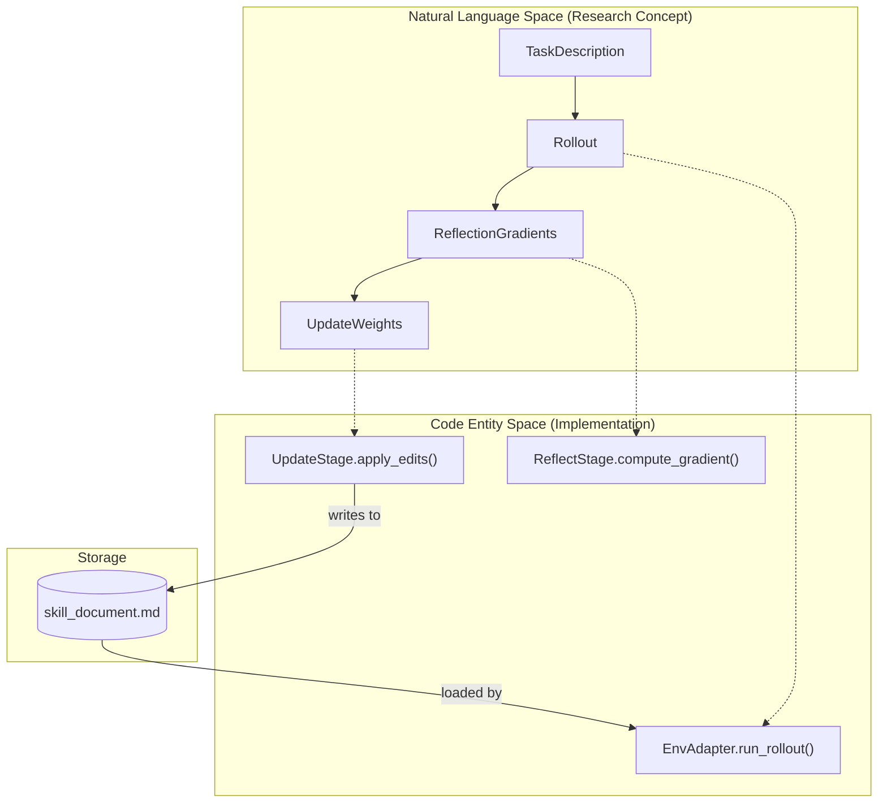
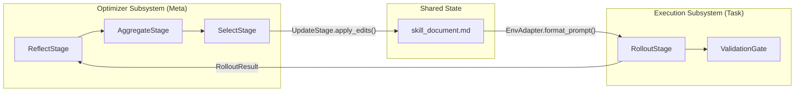

<!-- source: DeepWiki mcp.deepwiki.com · repo microsoft/SkillOpt · page 9 Project Assets and Research Paper · fetched 2026-10-26 -->

# Project Assets and Research Paper

Relevant source files

The following files were used as context for generating this wiki page:

- [README.md](README.md)
- [blog/gating-reflection-safe-updates/index.html](blog/gating-reflection-safe-updates/index.html)
- [blog/index.html](blog/index.html)
- [index.html](index.html)
- [skillopt-assets/arxiv-logomark-small.svg](skillopt-assets/arxiv-logomark-small.svg)
- [skillopt-assets/epoch-trends-1.png](skillopt-assets/epoch-trends-1.png)
- [skillopt-assets/openai.png](skillopt-assets/openai.png)
- [skillopt-assets/pipeline-1.png](skillopt-assets/pipeline-1.png)
- [skillopt-assets/qwen-color.png](skillopt-assets/qwen-color.png)
- [skillopt-assets/teaser-1.png](skillopt-assets/teaser-1.png)
- [skillopt.html](skillopt.html)

This page provides an overview of the external-facing project assets, including the project website, visual documentation aids, technical blog, and the associated research paper. These assets bridge the gap between the technical implementation and the conceptual framework of text-space optimization.

---

## Project Website and Documentation HTML

The repository contains standalone HTML pages that serve as the executive overview and landing page for the SkillOpt project. These pages are designed to communicate the "Self-Evolving Agent Skills" concept to both researchers and technical stakeholders.

### Webpage Structure
The primary entry points are `index.html` and `skillopt.html`. Both files serve as a responsive, single-page application (SPA) style overview of the project, including a header with navigation to the technical blog, paper, and code [index.html:1-125](), [skillopt.html:1-125]().

Key technical features of the project website include:
* **Visual Design System**: Uses a custom CSS variable system for a "paper" aesthetic, utilizing fonts like *Fraunces* for display and *JetBrains Mono* for code entities [index.html:12-33]().
* **Dynamic Reveal Effects**: Implements an intersection observer-based reveal system to animate sections as the user scrolls [index.html:67-78]().
* **Microsoft Brand Integration**: Includes standardized Microsoft branding and favicon assets [index.html:8-162]().
* **Navigation and Linking**: The `topbar` class manages a fixed navigation header that links to the **Technical Blog** (`/blog/`) and the **Documentation & Reproduction Guide** (`/docs/guideline.html`) [index.html:88-125](), [skillopt.html:88-125]().

### Relation to Codebase
While these are static assets, they directly reference the core concepts implemented in the Python backend:
* **ReflACT Loop**: The website visualizes the six-stage optimization loop managed by the training logic.
* **Text-Space Optimization**: Explains the transition from discrete prompt engineering to continuous textual gradients, which is the primary objective of the optimizer [index.html:149-155]().

Sources: [index.html:1-162](), [skillopt.html:1-162]()

---

## Technical Blog

The repository hosts a technical blog located in the `blog/` directory. This serves as a platform for deeper engineering analysis and supplemental research results.

### Content and Architecture
The blog is structured with a main index [blog/index.html:1-149]() and individual article directories.
* **Article Structure**: Articles like "Expanded SkillOpt Ablations, Skill-Aware Reflection, and SkillOpt-Sleep" [blog/gating-reflection-safe-updates/index.html:1-40]() provide technical deep dives into:
    * **Skill-Aware Reflection**: The design of memory consolidation in the optimizer.
    * **SkillOpt-Sleep**: Analysis of the nightly offline self-evolution engine.
    * **Ablation Studies**: Evidence for the necessity of the validation gate.
* **SEO and Metadata**: The blog uses JSON-LD schema for `BlogPosting` to ensure research visibility [blog/gating-reflection-safe-updates/index.html:23-40]().

Sources: [blog/index.html:1-149](), [blog/gating-reflection-safe-updates/index.html:1-40]()

---

## Static Visual Assets

The `skillopt-assets/` directory contains high-resolution diagrams and charts used within the documentation, the project website, and the research paper. These assets provide a visual map of the system's data flow and performance trends.

### Pipeline and Architecture Diagrams
The repository includes several versions of the SkillOpt pipeline, most notably `pipeline-1.png`. This diagram maps the internal Python classes to the conceptual optimization stages.

#### Data Flow: Natural Language Space to Code Entity
The following diagram illustrates how the conceptual stages map to specific code entities within the `SkillOpt` architecture.

Sources: [skillopt-assets/pipeline-1.png](), [skillopt-assets/teaser-1.png]()

### Performance Visualization
The asset `epoch-trends-1.png` visualizes the training dynamics of SkillOpt across multiple benchmarks [skillopt-assets/epoch-trends-1.png:1-200](). These charts track metrics such as success rate, edit magnitude, and token consumption.

Sources: [skillopt-assets/epoch-trends-1.png]()

### Model Integration Logos
The project supports multiple backends, reflected in the asset library:
* **OpenAI**: Represented by `openai.png` [skillopt-assets/openai.png:1-10]().
* **Qwen**: Represented by `qwen-color.png` [skillopt-assets/qwen-color.png:1-10]().

Sources: [skillopt-assets/openai.png](), [skillopt-assets/qwen-color.png]()

---

## Research Paper and ArXiv Integration

The SkillOpt project is grounded in a formal research paper titled **"SkillOpt: Executive Strategy for Self-Evolving Agent Skills"**. The repository includes branding and links specifically for the ArXiv publication (arXiv:2605.23904) [README.md:5](), [README.md:50]().

### ArXiv Assets
The `arxiv-logomark-small.svg` asset is used to link the documentation to the formal publication [skillopt-assets/arxiv-logomark-small.svg:1]().

### Conceptual Mapping
The research paper introduces the "Deep Learning Analogy," which is implemented throughout the codebase. The following table bridges the research terminology with the code symbols:

| Research Term | Code Symbol / Implementation | Role |
| :--- | :--- | :--- |
| **Weights** | `skill_document.md` | The trainable natural language artifact. |
| **Gradient** | `Patch` / `EditSuggestion` | Structured textual feedback from the Analyst. |
| **Learning Rate** | `edit_budget` | Constraint on the number of edits allowed per step. |
| **Optimizer** | `ReflectStage` + `SelectStage` | The LLM logic that processes failures into updates. |
| **Validation Set** | `selection_split` | Held-out tasks used by the validation gate. |

### System Overview Diagram
This diagram shows the relationship between the Optimizer Model (which handles the meta logic) and the Target Model (which performs the actual tasks).

Sources: [index.html:149-155](), [skillopt-assets/arxiv-logomark-small.svg:1](), [skillopt-assets/epoch-trends-1.png](), [README.md:31-38]()

---

