# Page: SkillOpt Overview

# SkillOpt Overview

<details>
<summary>Relevant source files</summary>

The following files were used as context for generating this wiki page:

- [README.md](README.md)
- [docs/contributing.md](docs/contributing.md)
- [docs/guide/dl-analogy.md](docs/guide/dl-analogy.md)
- [docs/guide/first-experiment.md](docs/guide/first-experiment.md)
- [docs/guide/skill-document.md](docs/guide/skill-document.md)
- [docs/guide/training-loop.md](docs/guide/training-loop.md)
- [docs/index.md](docs/index.md)
- [docs/review_guidelines.md](docs/review_guidelines.md)
- [index.html](index.html)
- [mkdocs.yml](mkdocs.yml)
- [skillopt-assets/arxiv-logomark-small.svg](skillopt-assets/arxiv-logomark-small.svg)
- [skillopt.html](skillopt.html)

</details>


SkillOpt is a framework for training natural-language "skills" for frozen Large Language Model (LLM) agents using an optimization paradigm inspired by deep learning. Rather than fine-tuning model weights, SkillOpt treats a Markdown skill document as the trainable parameter state and uses an LLM-based optimizer to perform iterative text-space updates based on task performance [README.md:31-38]().

For installation, initial experiments, configuration parameters, and detailed tutorials, see the child pages:
- **[Getting Started](#1.1)** — Installation, environment variables, SearchQA walkthrough, and WebUI dashboard.
- **[Deep Learning Analogy](#1.2)** — Systematic mapping between deep learning concepts and SkillOpt counterparts.
- **[Documentation Site and Repository Layout](#1.3)** — Structure of `docs/`, `data/`, and `ckpt/` paths.

## Core Concept: Text-Space Optimization

SkillOpt bridges manual prompt engineering and automated fine-tuning by introducing a structured training loop where an optimizer model analyzes agent trajectories and applies textual edit patches to a skill document. This process mirrors neural network training—incorporating epochs, batch sizes, learning rates, and validation gates—entirely within natural language space [README.md:31-38]().

**System Architecture Mapping**
```mermaid
graph TD
    subgraph "NaturalLanguageSpace"
        SkillDoc[""Skill Document (.md)""]
        Trajectories[""Trajectories (conversation.json)""]
        Patch[""Patch (Edit list)""]
    end

    subgraph "CodeEntitySpace"
        direction LR
        TargetModel[""Target Model""] -->|"Rollout"| Trainer[""skillopt.trainer.ReflACTTrainer""]
        Trainer -->|"Analyze"| OptimizerModel[""Optimizer Model""]
        Trainer -->|"skillopt.types.Edit"| Patch
        Trainer -->|"skillopt.types.RolloutResult"| Trajectories
        
        subgraph "Backends"
            AzureBackend[""skillopt.model.azure_openai_backend""]
            CompatibleBackend[""skillopt.model.openai_compatible_backend""]
        end
    end

    SkillDoc -.->|"Input"| TargetModel
    Trajectories -.->|"Feedback"| OptimizerModel
    OptimizerModel -.->|"Generates"| Patch
    Patch -.->|"Updates"| SkillDoc
```
Sources: [skillopt/types.py:126-160](), [skillopt/envs/base.py:51-65](), [docs/guide/skill-document.md:1-20]()

## Repository Organization

The codebase isolates training orchestrators, model backend integrations, environment adapters, and offline evolution pipelines:

*   `skillopt/`: Core library containing the `ReflACT` trainer and loop logic.
*   `skillopt/model/`: Implements the model router and backend adapters (`azure_openai`, `openai_compatible`, `claude`, etc.) [docs/reference/api.md:180-195]().
*   `skillopt/envs/`: Contains `EnvAdapter` implementations and benchmark definitions [docs/reference/api.md:16-25]().
*   `skillopt_webui/`: Gradio interface for training visualization [README.md:84-91]().
*   `skillopt_sleep/`: Nightly offline self-evolution companion engine [README.md:17-18]().
*   `scripts/`: Command-line entry points including `train.py` and `eval_only.py` [docs/index.md:143-168]().
*   `configs/`: YAML configuration hierarchies [docs/guide/configuration.md:7-17]().

Sources: [README.md:62-83](), [docs/index.md:21-30]()

## Supported Benchmarks

SkillOpt includes built-in adapters for six diverse benchmarks covering information retrieval, embodied agents, visual QA, and code generation.

| Benchmark | Type | Description | Config Path |
|---|---|---|---|
| **SearchQA** | Text QA | Information retrieval and question answering | `configs/searchqa/` |
| **ALFWorld** | Embodied | Interactive pick-and-place simulator tasks | `configs/alfworld/` |
| **DocVQA** | Visual QA | Document image understanding and question answering | `configs/docvqa/` |
| **LiveMathematicianBench** | Reasoning | Complex mathematical problem solving | `configs/livemathematicianbench/` |
| **SpreadsheetBench** | Code Gen | Spreadsheet editing and code execution | `configs/spreadsheetbench/` |
| **OfficeQA** | Tool-Use | Tool-augmented enterprise productivity tasks | `configs/officeqa/` |

Sources: [docs/index.md:114-124](), [docs/guide/first-experiment.md:5-18]()

## Training Workflow

Training is managed via `ReflACTTrainer` through a six-stage step execution loop alongside epoch boundary updates [docs/guide/training-loop.md:7-24]().

1.  **Rollout**: Target executes tasks using the active skill document.
2.  **Reflect**: Optimizer analyzes trajectory minibatches to produce `Edit` patches.
3.  **Aggregate**: Semantically similar edit patches are merged.
4.  **Select**: Edits are ranked and clipped by the `learning_rate` budget.
5.  **Update**: Selected patches are applied to the skill document.
6.  **Gate**: The candidate skill is evaluated on a selection split via `GateResult` and accepted only on strict score improvement.

**Optimization Loop to Code Entity Mapping**
```mermaid
graph LR
    subgraph "OptimizationPhase"
        direction TB
        StepNode[""Training Step""]
        GateNode[""Validation Gate""]
        EpochNode[""Epoch Boundary""]
    end

    subgraph "CodeImplementation"
        direction TB
        FnStep[""ReflACTTrainer.step()""]
        FnGate[""skillopt.evaluation.gate.GateResult""]
        FnSlow[""ReflACTTrainer.slow_update()""]
    end

    StepNode --> FnStep
    GateNode --> FnGate
    EpochNode --> FnSlow
    
    FnStep -.->|"Calls"| FnGate
```
Sources: [docs/guide/training-loop.md:26-101](), [docs/reference/api.md:162-167]()

## Related Child Sections

For detailed technical guides and parameters, refer to the corresponding child pages:
- Installation and execution tutorials: **[Getting Started](#1.1)**
- Theoretical mappings: **[Deep Learning Analogy](#1.2)**
- Repository layout and documentation build: **[Documentation Site and Repository Layout](#1.3)**

---

# Page: Getting Started

# Getting Started

<details>
<summary>Relevant source files</summary>

The following files were used as context for generating this wiki page:

- [.env.example](.env.example)
- [docs/guide/dl-analogy.md](docs/guide/dl-analogy.md)
- [docs/guide/first-experiment.md](docs/guide/first-experiment.md)
- [docs/guide/installation.md](docs/guide/installation.md)
- [docs/guide/new-backend.md](docs/guide/new-backend.md)
- [docs/guide/skill-document.md](docs/guide/skill-document.md)
- [docs/guide/training-loop.md](docs/guide/training-loop.md)
- [docs/index.md](docs/index.md)
- [plugins/openclaw/skillopt_sleep_openclaw.py](plugins/openclaw/skillopt_sleep_openclaw.py)
- [skillopt_sleep/harvest_pi.py](skillopt_sleep/harvest_pi.py)
- [tests/test_backend_pi.py](tests/test_backend_pi.py)
- [tests/test_harvest_pi.py](tests/test_harvest_pi.py)

</details>


## Purpose and Scope

This page provides a comprehensive guide for new users to install SkillOpt, configure environment variables using `.env` templates, materialize benchmark datasets, execute a first optimization experiment on SearchQA, inspect generated training outputs, launch the Gradio WebUI, and perform standalone evaluations [docs/guide/installation.md:1](), [docs/guide/first-experiment.md:1]().

---

## 1. Installation and Requirements

SkillOpt requires **Python 3.10+** [docs/guide/installation.md:5](). You can install via PyPI for stable releases or clone the source repository for full benchmark configs, data materializers, and development scripts [docs/guide/installation.md:12-44]().

### Source Installation

```bash
git clone https://github.com/microsoft/SkillOpt.git
cd SkillOpt
python -m pip install -e .
```

### Optional Benchmark and UI Dependencies

Install optional extras depending on the environments and interfaces you plan to use [docs/guide/installation.md:46-108]():

* **SearchQA**: `python -m pip install -e ".[searchqa]"` [docs/guide/installation.md:88-90]()
* **ALFWorld**: `python -m pip install -e ".[alfworld]"` [docs/guide/installation.md:52-54]()
* **WebUI Dashboard**: `python -m pip install -e ".[webui]"` [docs/guide/installation.md:94-96]()
* **Development Suite**: `python -m pip install -e ".[dev]"` [docs/guide/installation.md:100-102]()

Sources: `[docs/guide/installation.md:1-108]()`

---

## 2. Environment Variable Setup

SkillOpt configures model endpoints and authentication keys through environment variables [.env.example:1-4](). Copy the template file and export the variables into your active shell session [docs/guide/installation.md:112-126]().

```bash
cp .env.example .env
set -a
source .env
set +a
```

### Supported Backend Variables

| Backend Family | Required Environment Variables | Description |
| :--- | :--- | :--- |
| **Azure OpenAI** | `AZURE_OPENAI_ENDPOINT`, `AZURE_OPENAI_API_KEY`, `AZURE_OPENAI_AUTH_MODE` | Primary hosted model integration (`api_key`, `azure_cli`, or `managed_identity`) [.env.example:6-16](), [docs/guide/installation.md:131-139]() |
| **OpenAI-Compatible** | `OPENAI_COMPATIBLE_BASE_URL`, `OPENAI_COMPATIBLE_API_KEY`, `OPENAI_COMPATIBLE_MODEL` | Generic research backend for DeepSeek, vLLM, Groq, Ollama, etc. [.env.example:18-33](), [docs/guide/installation.md:153-157]() |
| **Claude Code CLI** | `CLAUDE_CLI_BIN`, `ANTHROPIC_API_KEY` | CLI-based adapter (`claude_chat`) wrapping `claude -p` [.env.example:46-51](), [docs/guide/installation.md:141-145]() |
| **Qwen Local** | `QWEN_CHAT_BASE_URL`, `QWEN_CHAT_MODEL`, `QWEN_CHAT_THINKING_MODE` | Local server configuration for Qwen models [.env.example:53-61]() |

Sources: `[.env.example:1-72]()`, `[docs/guide/installation.md:110-174]()`

---

## 3. Data Materialization

SkillOpt benchmark datasets require structured directory layouts (`train/`, `valid_seen/`, `valid_unseen/`) containing task items [docs/guide/first-experiment.md:19-33](). For **SearchQA**, the repository includes an ID-only manifest that must be materialized before training [docs/guide/first-experiment.md:19-28]().

```python
python scripts/materialize_searchqa.py
```

This script reads raw item references from `data/searchqa_id_split/` and writes complete runnable JSON payloads to `data/searchqa_split/` [docs/guide/first-experiment.md:30-32]().

Sources: `[docs/guide/first-experiment.md:19-33]()`

---

## 4. Running a First Experiment (SearchQA)

SearchQA serves as the standard text-only baseline experiment [docs/guide/first-experiment.md:17](). Launch training using `scripts/train.py` with the provided SearchQA YAML configuration [docs/guide/first-experiment.md:73-77]().

```bash
python scripts/train.py \
  --config configs/searchqa/default.yaml \
  --out_root outputs/searchqa_quickstart
```

### Initialization and Execution Flow

The diagram below bridges the natural language command space to the underlying code entities invoked during experiment startup and the main optimization loop.

**Training Initialization and ReflACT Flow**
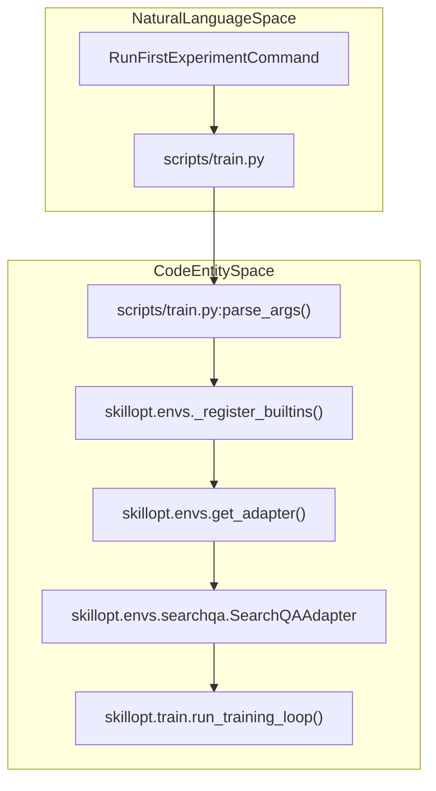

Sources: `[docs/guide/first-experiment.md:73-77]`, `[docs/guide/training-loop.md:1-24]()`

---

## 5. Reading Training Output

Each training execution stores versioned artifacts under the specified `out_root` directory [docs/guide/first-experiment.md:84-103]().

```text
outputs/searchqa_quickstart/
├── config.json
├── runtime_state.json
├── history.json
├── best_skill.md
├── skills/
│   └── skill_v0001.md
├── steps/
│   └── step_0001/
│       ├── candidate_skill.md
│       ├── step_record.json
│       └── trajectory_digest.json
├── slow_update/
│   └── epoch_01/
└── meta_skill/
    └── epoch_01/
```

| Output Artifact | Technical Role |
| :--- | :--- |
| `best_skill.md` | The highest-scoring markdown skill document discovered across all evaluated steps [docs/guide/first-experiment.md:91]() |
| `history.json` | Chronological log recording step scores, accepted edits, and gate outcomes [docs/guide/first-experiment.md:90]() |
| `steps/step_XXXX/` | Per-step intermediate candidate skills, patch lists, and trajectory analysis digests [docs/guide/first-experiment.md:94-98]() |
| `runtime_state.json` | Serialized optimizer state enabling automatic checkpoint resumption [docs/guide/first-experiment.md:89]() |

Sources: `[docs/guide/first-experiment.md:84-103]()`

---

## 6. Launching the WebUI

The WebUI provides a Gradio-based graphical dashboard for configuring hyperparameters, launching background training runs, and monitoring optimization history [docs/guide/first-experiment.md:120-132]().

```bash
python -m skillopt_webui.app --port 7860
```

### WebUI Subprocess Architecture

The WebUI bridges browser interactions with underlying training scripts and filesystem artifacts through a dedicated process manager.

**WebUI to Code Entity Mapping**
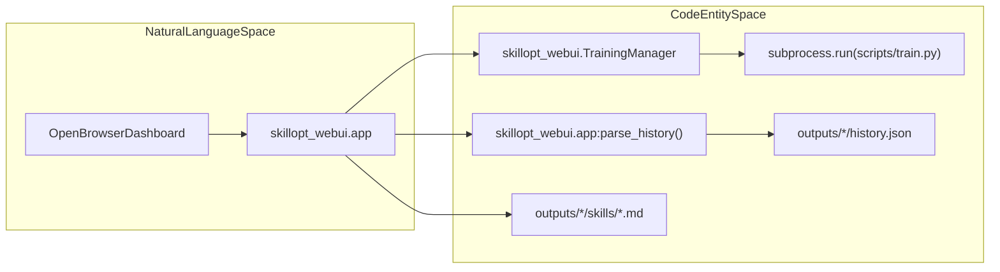

Sources: `[docs/guide/first-experiment.md:120-132]`, `[docs/index.md:1-215]()`

---

## 7. Standalone Evaluation

To evaluate any trained skill checkpoint against specific dataset splits without running optimization loops, execute `scripts/eval_only.py` [docs/guide/first-experiment.md:105-114]().

```bash
python scripts/eval_only.py \
  --config configs/searchqa/default.yaml \
  --skill outputs/searchqa_quickstart/best_skill.md \
  --split valid_unseen
```

Supported evaluation splits include `train`, `valid_seen` (validation selection split), and `valid_unseen` (held-out test split) [docs/guide/first-experiment.md:110-114]().

Sources: `[docs/guide/first-experiment.md:105-114]()`

---

# Page: Deep Learning Analogy

# Deep Learning Analogy

<details>
<summary>Relevant source files</summary>

The following files were used as context for generating this wiki page:

- [README.md](README.md)
- [docs/guide/dl-analogy.md](docs/guide/dl-analogy.md)
- [docs/guide/first-experiment.md](docs/guide/first-experiment.md)
- [docs/guide/skill-document.md](docs/guide/skill-document.md)
- [docs/guide/training-loop.md](docs/guide/training-loop.md)
- [docs/index.md](docs/index.md)
- [index.html](index.html)
- [skillopt-assets/arxiv-logomark-small.svg](skillopt-assets/arxiv-logomark-small.svg)
- [skillopt.html](skillopt.html)

</details>


SkillOpt is built upon a fundamental architectural insight: **optimizing natural-language prompt instructions (skills) follows the same mathematical and structural patterns as training neural networks.** By mapping textual operations to standard Deep Learning (DL) primitives, SkillOpt allows practitioners to apply well-understood optimization theory to the domain of prompt engineering.

## 1. Core Conceptual Mapping

The following table defines the one-to-one mapping between standard Deep Learning concepts and their implementation within the SkillOpt framework.

| Deep Learning Concept | SkillOpt Counterpart | Technical Implementation |
| :--- | :--- | :--- |
| **Model Weights** | **Skill Document** | A Markdown file (`skill.md`) containing instructions, few-shot examples, and guidance blocks. [docs/guide/dl-analogy.md:9-9](), [docs/guide/skill-document.md:7-9]() |
| **Forward Pass** | **Rollout** | The Target Model executes a batch of tasks using the current skill document. [docs/guide/training-loop.md:28-30](), [docs/guide/dl-analogy.md:10-10]() |
| **Loss Function** | **Task Evaluator** | A scoring function within the `EnvAdapter` that compares model output to ground truth. [docs/guide/dl-analogy.md:11-11]() |
| **Backpropagation** | **Reflect** | The Optimizer Model analyzes execution trajectories to identify failure causes and produce edit patches. [docs/guide/training-loop.md:38-40](), [docs/guide/dl-analogy.md:12-12]() |
| **Gradients** | **Edit Patches** | Structured natural language suggestions for modifying specific sections of the skill. [docs/guide/dl-analogy.md:13-13](), [docs/guide/training-loop.md:40-42]() |
| **Gradient Aggregation** | **Patch Aggregation** | Hierarchical merging of semantically similar edit patches to avoid redundancy. [docs/guide/dl-analogy.md:14-14](), [docs/guide/training-loop.md:51-53]() |
| **Gradient Clipping** | **Edit Selection** | Ranking proposed patches and capping the total number applied based on the budget. [docs/guide/training-loop.md:55-57](), [docs/guide/dl-analogy.md:15-15]() |
| **Learning Rate** | `learning_rate` | A configuration parameter that defines the maximum number of edits applied per step. [docs/guide/dl-analogy.md:16-16](), [docs/guide/training-loop.md:57-61]() |
| **SGD Step** | **Skill Update** | Applying the selected textual patches to the Markdown document. [docs/guide/dl-analogy.md:18-18](), [docs/guide/training-loop.md:70-72]() |
| **Validation Set** | **Selection Split** | A held-out set of tasks used by the Gate stage to verify improvement before accepting an update. [docs/guide/dl-analogy.md:19-19](), [docs/guide/training-loop.md:76-78]() |
| **Momentum** | **Slow Update** | Longitudinal comparison at epoch boundaries to prevent catastrophic forgetting. [docs/guide/dl-analogy.md:22-22](), [docs/guide/training-loop.md:84-86]() |
| **Meta-learning** | **Meta Skill** | Cross-epoch optimizer strategy memory that persists across the training run. [docs/guide/dl-analogy.md:23-23](), [docs/guide/training-loop.md:95-97]() |

Sources: [docs/guide/dl-analogy.md:5-31](), [docs/guide/training-loop.md:7-24](), [docs/guide/training-loop.md:28-101](), [docs/guide/skill-document.md:7-60]()

---

## 2. The ReflACT Optimization Loop

The "ReflACT" loop mirrors the standard training iteration in DL. Below is a diagram bridging the natural language optimization space to the specific code entities and data structures that handle the data flow.

### Diagram: Optimization Data Flow from Text to Code Entities
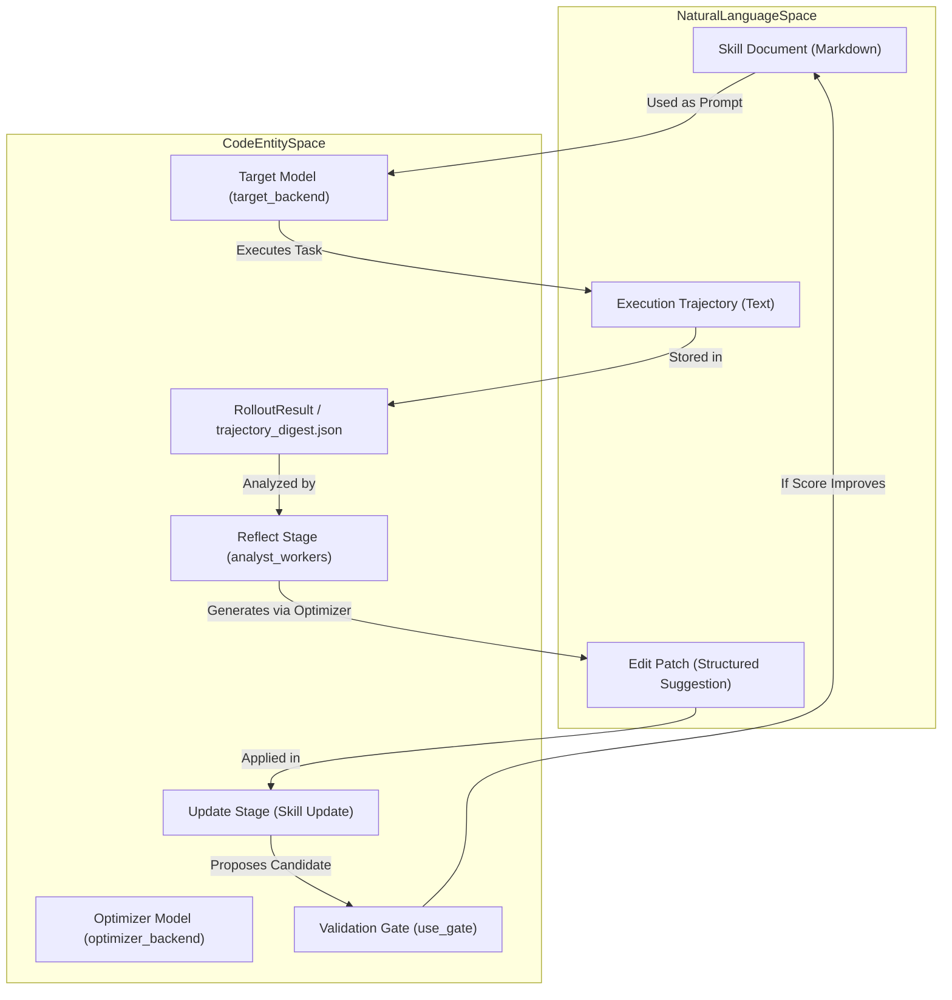
Sources: [docs/guide/training-loop.md:7-24](), [docs/guide/training-loop.md:30-36](), [docs/guide/training-loop.md:40-44](), [docs/guide/training-loop.md:74-81]()

---

## 3. Advanced Optimization Mechanisms

SkillOpt implements advanced DL concepts like scheduling and meta-learning to stabilize the optimization of text.

### Learning Rate and Scheduling
In SkillOpt, the `learning_rate` represents the "edit budget"—the number of distinct modifications allowed in a single update step [docs/guide/dl-analogy.md:16-16](). Just as in neural network training, an `lr_scheduler` is used to adjust this budget over time to ensure convergence [docs/guide/training-loop.md:64-65](). Supported modes include:
* **cosine**: Starts with high exploration (many edits) and tapers smoothly to fine-tuning [docs/guide/dl-analogy.md:46-46](), [docs/guide/training-loop.md:66-66]().
* **linear**: Constant reduction of the edit budget [docs/guide/training-loop.md:67-67]().
* **constant**: A fixed number of edits per step [docs/guide/training-loop.md:68-68]().
* **autonomous**: The optimizer model decides its own step size based on trajectory analysis [docs/guide/dl-analogy.md:17-17]().

### Epoch-Boundary Mechanisms
While the **Step** handles immediate feedback, the **Epoch** boundary introduces two stabilization mechanisms:

1.  **Slow Update (Momentum Analogy)**: The system performs a longitudinal comparison of the current skill against the previous epoch's version. It identifies regressions and generates high-level guidance, often stored in a protected `<!-- SLOW_UPDATE_START -->` block [docs/guide/training-loop.md:86-93](), [docs/guide/skill-document.md:48-50]().
2.  **Meta Skill (Meta-Learning Analogy)**: The optimizer maintains a "Meta-Skill" memory. This document records successful optimization strategies across epochs and is provided as context for future reflection and update stages [docs/guide/training-loop.md:95-100](), [docs/guide/dl-analogy.md:23-23]().

Sources: [docs/guide/dl-analogy.md:17-24](), [docs/guide/training-loop.md:55-100](), [docs/guide/skill-document.md:45-59]()

### Diagram: Optimizer Hierarchy and Code Control Mapping
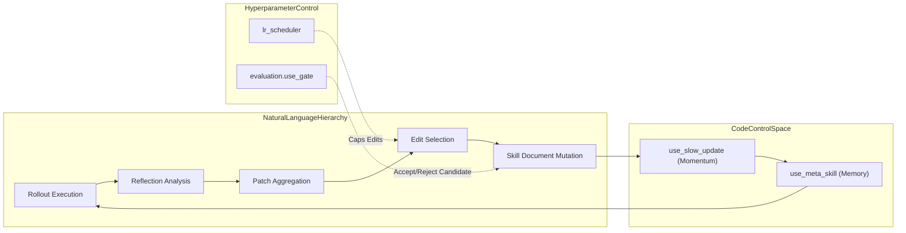
Sources: [docs/guide/training-loop.md:7-24](), [docs/guide/training-loop.md:55-100](), [docs/guide/first-experiment.md:51-70]()

---

## 4. Hyperparameter Transfer Rules

Practitioners can apply standard DL intuitions when configuring SkillOpt experiments.

*   **Learning Rate (4-16)**: Values in this range typically balance exploration and stability. Too low (1-2) leads to stagnation; too high (>20) leads to "noisy" skills where instructions may contradict each other or overflow context [docs/guide/dl-analogy.md:47-47]().
*   **Batch Size**: Unlike DL, where larger batches provide more accurate gradient estimates, SkillOpt faces diminishing returns and high API costs with very large rollout batches. The `batch_size` (e.g., 40) should be balanced against provider limits [docs/guide/dl-analogy.md:52-52](), [docs/guide/first-experiment.md:54-56]().
*   **Convergence**: Skills typically converge much faster than neural networks. Usually, 2-4 epochs are sufficient to reach peak performance [docs/guide/dl-analogy.md:53-53](), [docs/guide/first-experiment.md:54-55]().
*   **Gating and Validation**: The `Gate` stage acts as validation-based model selection. If an update does not improve performance on the selection split (analogous to a validation set), it is rejected, preventing the model from diverging [docs/guide/dl-analogy.md:19-20](), [docs/guide/training-loop.md:77-81]().

Sources: [docs/guide/dl-analogy.md:38-53](), [docs/guide/training-loop.md:74-81](), [docs/guide/first-experiment.md:51-70]()

---

# Page: Documentation Site and Repository Layout

# Documentation Site and Repository Layout

<details>
<summary>Relevant source files</summary>

The following files were used as context for generating this wiki page:

- [ckpt/README.md](ckpt/README.md)
- [ckpt/alfworld/gpt5.5_skill.md](ckpt/alfworld/gpt5.5_skill.md)
- [ckpt/docvqa/gpt5.5_skill.md](ckpt/docvqa/gpt5.5_skill.md)
- [ckpt/livemath/gpt5.5_skill.md](ckpt/livemath/gpt5.5_skill.md)
- [ckpt/officeqa/gpt5.5_skill.md](ckpt/officeqa/gpt5.5_skill.md)
- [ckpt/searchqa/gpt5.5_skill.md](ckpt/searchqa/gpt5.5_skill.md)
- [ckpt/spreadsheetbench/gpt5.5_skill.md](ckpt/spreadsheetbench/gpt5.5_skill.md)
- [configs/features/soft_gate.yaml](configs/features/soft_gate.yaml)
- [data/README.md](data/README.md)
- [data/livemathematicianbench_id_split/split_manifest.json](data/livemathematicianbench_id_split/split_manifest.json)
- [docs/contributing.md](docs/contributing.md)
- [docs/review_guidelines.md](docs/review_guidelines.md)
- [mkdocs.yml](mkdocs.yml)
- [tests/test_data_manifests.py](tests/test_data_manifests.py)

</details>


## Purpose and Scope
This page details the structural organization of the SkillOpt codebase, focusing on the documentation site layout (`docs/` and `mkdocs.yml`), data split manifests (`data/`), and trained skill checkpoints (`ckpt/`). It explains how documentation is organized into trees (`guide/`, `reference/`, `sleep/`), how lightweight data manifests link upstream datasets to internal loaders, and how pre-trained skill artifacts are stored and evaluated.

---

## Documentation Site Architecture (`mkdocs.yml`)
The SkillOpt documentation site is generated using **MkDocs Material**, configured via `mkdocs.yml` [mkdocs.yml:1-86](). The site integrates navigation for getting started guides, core training concepts, deployment-time Sleep engine guides, extension tutorials, and reference documentation [mkdocs.yml:40-67]().

The build and preview workflow relies on Python package extras and CLI commands defined in project documentation:
```bash
pip install -e ".[docs]"
mkdocs serve  # Preview locally at http://localhost:8000
mkdocs build --strict  # Strict validation build
```
[docs/contributing.md:55-60]()

### Navigation and Document Trees
The `nav` block in `mkdocs.yml` defines the documentation layout:
- **Home**: `index.md` [mkdocs.yml:41]()
- **Getting Started**: Installation (`guide/installation.md`), First Experiment (`guide/first-experiment.md`), Configuration (`guide/configuration.md`) [mkdocs.yml:43-46]()
- **Core Concepts**: Training Loop (`guide/training-loop.md`), Skill Document (`guide/skill-document.md`), Deep Learning Analogy (`guide/dl-analogy.md`) [mkdocs.yml:47-50]()
- **SkillOpt-Sleep**: Overview (`sleep/README.md`), Paired A/B Evalkit (`sleep/evalkit.md`), Multi-skill Staging (`sleep/multi-skill-staging.md`), OpenAI-compatible Endpoints (`sleep/openai-compatible-endpoints.md`), Results (`sleep/RESULTS.md`) [mkdocs.yml:51-56]()
- **Extension Guides**: Add a New Benchmark (`guide/new-benchmark.md`), Local Environment Smoke Tests (`guide/local-env-smoke.md`), Add a New Model Backend (`guide/new-backend.md`) [mkdocs.yml:57-60]()
- **Reference**: Configuration Reference (`reference/config.md`), CLI Reference (`reference/cli.md`), API Reference (`reference/api.md`) [mkdocs.yml:61-64]()

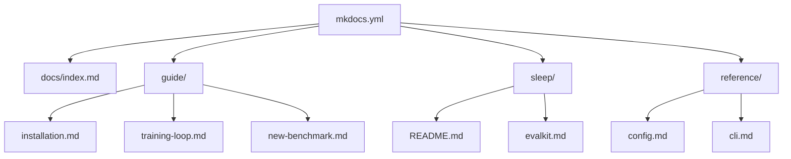
*Sources: `mkdocs.yml` [mkdocs.yml:1-87]*, `docs/contributing.md` [docs/contributing.md:53-60]*

---

## Data Split Manifests (`data/`)
The `data/` directory houses lightweight split manifests corresponding to the official evaluation splits used in the SkillOpt paper [data/README.md:1-12](). These manifests decouple raw benchmark distribution storage from repository tracking.

### Manifest Directory Layout
Every released manifest directory adheres to a standardized file layout containing stable IDs or source-path hints rather than full text payloads [data/README.md:14-25]():

```text
data/<benchmark>_<manifest_type>/
|-- split_manifest.json
|-- train/items.json
|-- val/items.json
`-- test/items.json
```

The `split_manifest.json` schema records metadata, split ratios, counts, and item fields. For example, `data/livemathematicianbench_id_split/split_manifest.json` defines [data/livemathematicianbench_id_split/split_manifest.json:1-34]():
```json
{
  "benchmark": "LiveMathematicianBench",
  "manifest_type": "id_split",
  "source_repo": "LiveMathematicianBench/LiveMathematicianBench",
  "split_mode": "ratio",
  "split_ratio": "2:1:7",
  "counts": {
    "train": 35,
    "val": 17,
    "test": 125
  }
}
```

### Dataset Coverage and Materialization
Integrity tests ensure that declared manifest counts match item files across all data split directories [tests/test_data_manifests.py:9-23]():
```python
def test_split_manifest_counts_match_item_files() -> None:
    manifest_paths = sorted(DATA_DIR.glob("*/split_manifest.json"))
    for manifest_path in manifest_paths:
        manifest = json.loads(manifest_path.read_text(encoding="utf-8"))
        for split_name in SPLIT_NAMES:
            declared_count = manifest["counts"][split_name]
            items_path = manifest_path.parent / split_name / "items.json"
            actual_count = len(json.loads(items_path.read_text(encoding="utf-8")))
            assert declared_count == actual_count
```

| Manifest Directory | Benchmark | Counts (Train/Val/Test) | Raw Data Source | `split_dir` Parameter |
|---|---|---|---|---|
| `searchqa_id_split/` | SearchQA | 400 / 200 / 1400 | `lucadiliello/searchqa` | `data/searchqa_split` |
| `livemathematicianbench_id_split/` | LiveMathematicianBench | 35 / 17 / 125 | `LiveMathematicianBench/LiveMathematicianBench` | `data/livemathematicianbench_split` |
| `docvqa_id_split/` | DocVQA | 107 / 53 / 374 | `lmms-lab/DocVQA` | `data/docvqa/splits` |
| `officeqa_id_split/` | OfficeQA | 50 / 24 / 172 | `databricks/officeqa` | `data/officeqa_split` |
| `spreadsheetbench_id_split/` | SpreadsheetBench | 80 / 40 / 280 | `KAKA22/SpreadsheetBench` | `data/spreadsheetbench_split` |
| `alfworld_path_split/` | ALFWorld | 39 / 18 / 134 | `alfworld/alfworld` | `data/alfworld_path_split` |

*Sources: `data/README.md` [data/README.md:1-68]*, `data/livemathematicianbench_id_split/split_manifest.json` [data/livemathematicianbench_id_split/split_manifest.json:1-34]*, `tests/test_data_manifests.py` [tests/test_data_manifests.py:1-24]*

---

## Trained Skill Checkpoints (`ckpt/`)
The `ckpt/` directory contains paper-aligned reference skill checkpoints (`gpt5.5_skill.md`) for each supported benchmark [ckpt/README.md:1-7](). These files serve as portable optimization artifacts that can be evaluated directly without executing the training pipeline [ckpt/README.md:3-6]().

### Checkpoint Mapping
| Benchmark | Skill Artifact Path | Matching Configuration |
|---|---|---|
| SearchQA | `ckpt/searchqa/gpt5.5_skill.md` | `configs/searchqa/default.yaml` |
| ALFWorld | `ckpt/alfworld/gpt5.5_skill.md` | `configs/alfworld/default.yaml` |
| DocVQA | `ckpt/docvqa/gpt5.5_skill.md` | `configs/docvqa/default.yaml` |
| LiveMathematicianBench | `ckpt/livemath/gpt5.5_skill.md` | `configs/livemathematicianbench/default.yaml` |
| OfficeQA | `ckpt/officeqa/gpt5.5_skill.md` | `configs/officeqa/default.yaml` |
| SpreadsheetBench | `ckpt/spreadsheetbench/gpt5.5_skill.md` | `configs/spreadsheetbench/default.yaml` |

*Sources: `ckpt/README.md` [ckpt/README.md:1-28]*

### Evaluating Checkpoints
Checkpoints are evaluated using `scripts/eval_only.py`, bypassing optimizer loops [ckpt/README.md:33-37]() and passing the skill file directly:
```bash
python scripts/eval_only.py \
  --config configs/searchqa/default.yaml \
  --skill ckpt/searchqa/gpt5.5_skill.md \
  --split valid_unseen \
  --split_dir data/searchqa_split
```
[ckpt/README.md:43-50]()

Each skill checkpoint is a Markdown document incorporating structured instructions and a protected `SLOW_UPDATE` block at the end that stores longitudinal epoch guidance [ckpt/README.md:29-31]() (e.g., `ckpt/docvqa/gpt5.5_skill.md` [ckpt/docvqa/gpt5.5_skill.md:25-26](), `ckpt/officeqa/gpt5.5_skill.md` [ckpt/officeqa/gpt5.5_skill.md:49-50]()).

---

## System Bridging: Manifests and Checkpoints to Code Entities
The following diagrams bridge the natural language documentation and assets space to the concrete Python code entities responsible for loading, evaluation, and publishing.

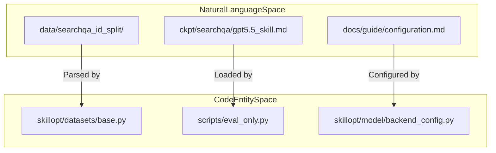
*Sources: `data/README.md` [data/README.md:1-54]*, `ckpt/README.md` [ckpt/README.md:1-57]*, `mkdocs.yml` [mkdocs.yml:40-67]*

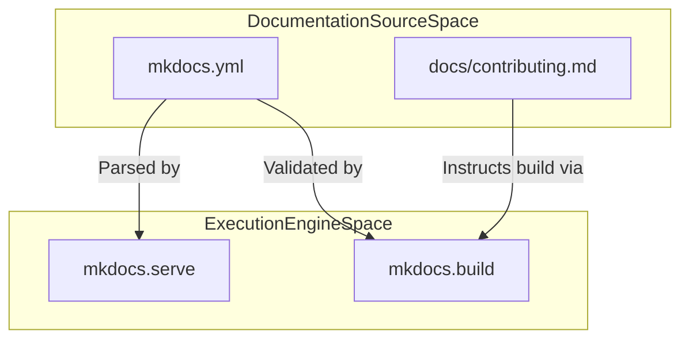
*Sources: `mkdocs.yml` [mkdocs.yml:1-87]*, `docs/contributing.md` [docs/contributing.md:53-60]*

---

# Page: Core Training Pipeline

# Core Training Pipeline

<details>
<summary>Relevant source files</summary>

The following files were used as context for generating this wiki page:

- [configs/_base_/default.yaml](configs/_base_/default.yaml)
- [docs/guide/configuration.md](docs/guide/configuration.md)
- [docs/guide/dl-analogy.md](docs/guide/dl-analogy.md)
- [docs/guide/first-experiment.md](docs/guide/first-experiment.md)
- [docs/guide/skill-document.md](docs/guide/skill-document.md)
- [docs/guide/training-loop.md](docs/guide/training-loop.md)
- [docs/index.md](docs/index.md)
- [docs/reference/config.md](docs/reference/config.md)
- [skillopt/config.py](skillopt/config.py)
- [skillopt/engine/trainer.py](skillopt/engine/trainer.py)

</details>


The purpose of this page is to provide a high-level overview of the six-stage per-step ReflACT loop and the two epoch-boundary mechanisms implemented in the core training engine. 

As a PARENT page, this section introduces each stage and epoch-boundary mechanism, summarizing their roles and linking to dedicated child pages for deep technical details.

Sources: `[skillopt/engine/trainer.py:1-13]()`

---

## Pipeline Architecture

The pipeline is orchestrated by the `ReflACT` trainer (`[skillopt/engine/trainer.py:1-13]()`), which coordinates execution between the target model (representing the weights being optimized) and the optimizer model (computing textual gradients).

### Diagram: ReflACT Step Loop Pipeline
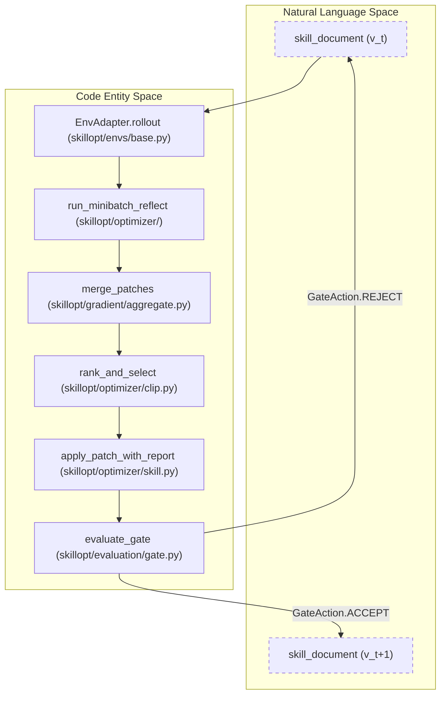
Sources: `[skillopt/engine/trainer.py:1-13]()`, `[skillopt/evaluation/gate.py:27-60]()`

---

## Per-Step Stages

### 1. Rollout Stage
The target model executes tasks using the current skill document, recording execution trajectories and yielding scored results (`RolloutResult`). 
* For details, see [Rollout Stage](#2.1).

Sources: `[skillopt/engine/trainer.py:4]()`, `[skillopt/envs/base.py]()`

### 2. Reflect Stage (Gradient Computation)
The optimizer model analyzes failure and success minibatches to produce structured edit patches via dedicated analyst prompts and parallel worker configurations (`[skillopt/engine/trainer.py:28-34]`).
* For details, see [Reflect Stage (Gradient Computation)](#2.2).

Sources: `[skillopt/engine/trainer.py:5]()`, `[skillopt/optimizer/]`

### 3. Aggregate, Select, and Update Stages
Performs hierarchical patch merging (`[skillopt/engine/trainer.py:28]()`), LLM-driven edit ranking and budget clipping (`[skillopt/engine/trainer.py:30]()`), and applies the resulting edits to the skill document under different update modes (`[skillopt/engine/trainer.py:34]()`).
* For details, see [Aggregate, Select, and Update Stages](#2.3).

Sources: `[skillopt/engine/trainer.py:28-34]()`, `[skillopt/optimizer/clip.py:1-30]()`

### 4. Validation Gate
Evaluates candidate skills on the held-out selection split to decide whether to accept or reject updates, leveraging `GateResult` objects and score comparisons (`[skillopt/evaluation/gate.py:27-60]()`).
* For details, see [Validation Gate](#2.4).

Sources: `[skillopt/engine/trainer.py:27]`, `[skillopt/evaluation/gate.py:27-60]()`

---

## Epoch-Boundary Mechanisms

### Diagram: Epoch-Boundary Data Flow Architecture
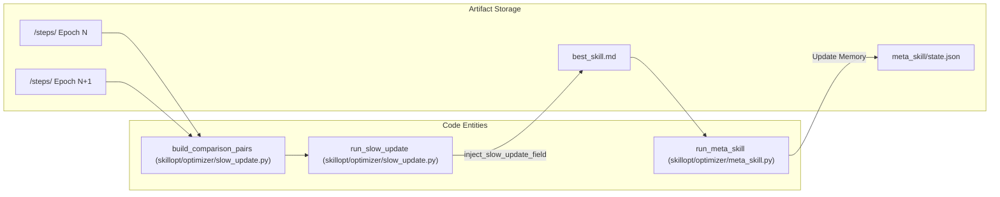
Sources: `[skillopt/engine/trainer.py:29-53]`, `[skillopt/optimizer/slow_update.py:1-53]()`

### Slow Update and Meta Skill
At epoch boundaries, the training loop runs longitudinal evaluations and updates cross-epoch memory structures:
* **Slow Update**: Conducts longitudinal comparisons across epochs and injects protected guidance blocks (`[skillopt/engine/trainer.py:46-53]()`).
* **Meta Skill**: Maintains a cross-epoch strategy memory for the optimizer (`[skillopt/engine/trainer.py:29]()`).
* For details, see [Epoch-Boundary Mechanisms: Slow Update and Meta Skill](#2.5).

Sources: `[skillopt/engine/trainer.py:29-53]()`, `[skillopt/optimizer/slow_update.py]()`, `[skillopt/optimizer/meta_skill.py]()`

---

## Summary of Core Types

| Stage | Input Type | Output Type | Primary Code Module |
| :--- | :--- | :--- | :--- |
| **Rollout** | `BatchSpec` | `RolloutResult` | `[skillopt/envs/base.py]()` |
| **Reflect** | `RolloutResult` (Minibatch) | `RawPatch` | `[skillopt/engine/trainer.py]()` |
| **Aggregate** | `list[dict]` (Raw Patches) | `Patch` | `[skillopt/gradient/aggregate.py]()` |
| **Select** | `Patch` (Merged) | `Patch` (Clipped) | `[skillopt/optimizer/clip.py]()` |
| **Update** | `Patch` + Skill Markdown | Candidate Skill Markdown | `[skillopt/optimizer/skill.py]()` |
| **Gate** | Candidate Skill Markdown | `GateResult` | `[skillopt/evaluation/gate.py]()` |

Sources: `[skillopt/engine/trainer.py:1-60]()`, `[skillopt/evaluation/gate.py:27-60]()`

---

# Page: Rollout Stage

# Rollout Stage

<details>
<summary>Relevant source files</summary>

The following files were used as context for generating this wiki page:

- [skillopt/envs/searchqa/rollout.py](skillopt/envs/searchqa/rollout.py)
- [skillopt/utils/scoring.py](skillopt/utils/scoring.py)

</details>


The **Rollout Stage** is the initial phase of the ReflACT training loop [skillopt/engine/trainer.py:4-4](). In this stage, the **Target Model** executes tasks from the current training minibatch using instructions provided by the current skill document. The primary objective is to generate execution trajectories, predicted answers, and performance metrics that serve as experience for subsequent reflection and optimization stages.

Sources: [skillopt/engine/trainer.py:4-4]()

---

## Rollout Architecture and Data Flow

The rollout process bridges natural language instructions (the skill document and task specifications) with concrete execution code handled by environment adapters and inference runtimes [skillopt/envs/searchqa/rollout.py:153-210]().

**Rollout Data Flow: From Specification to Scored Results**

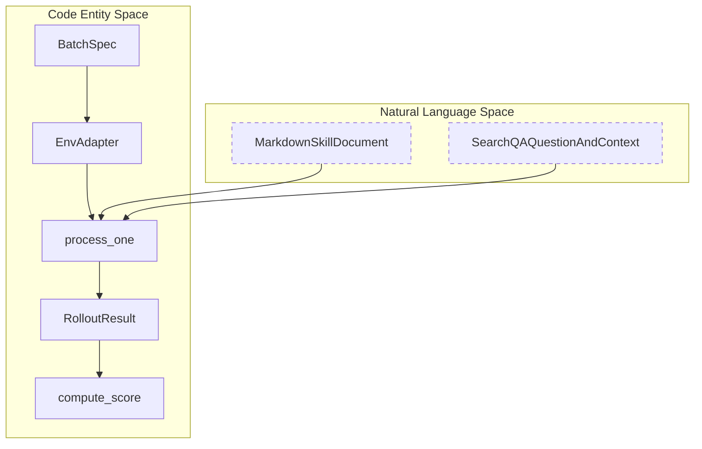
Sources: [skillopt/envs/searchqa/rollout.py:153-210](), [skillopt/utils/scoring.py:7-23](), [skillopt/datasets/base.py:18-18]()

---

## Single-Item Execution and Prompt Construction

Task execution for benchmarks like SearchQA is orchestrated per-item via `process_one` [skillopt/envs/searchqa/rollout.py:153-163]() which coordinates context preparation, prompt formatting, model invocation, and evaluation.

### Context Management and Truncation
To respect context token budgets, large context passages are truncated at document boundaries (`[DOC]`) using `_truncate_context` [skillopt/envs/searchqa/rollout.py:41-54]() up to `_MAX_CONTEXT_CHARS` (6,000 characters) [skillopt/envs/searchqa/rollout.py:26-26]().

### Prompt Assembly
System prompts and user prompts are dynamically constructed based on the active skill document:
* `_build_system`: Formats the skill section using the `rollout_system` prompt template [skillopt/envs/searchqa/rollout.py:57-62]().
* `_build_user`: Merges truncated context, questions, previous trace snapshots, and diagnostic instructions [skillopt/envs/searchqa/rollout.py:65-86]().
* `_build_codex_skill`: Renders specialized markdown skill wrappers when executing via the codex harness [skillopt/envs/searchqa/rollout.py:89-98]().

### Systemic Failure Handling
If all rollout rows fail before an agent response is generated, `_raise_on_systemic_failure` intercepts the batch, analyzes the failure reasons using a `Counter`, and raises a `RuntimeError` to abort the step [skillopt/envs/searchqa/rollout.py:29-38]().

Sources: [skillopt/envs/searchqa/rollout.py:26-98](), [skillopt/envs/searchqa/rollout.py:153-163]()

---

## Target Model Execution and Harness Integration

Depending on the configured backend, rollouts execute either through direct chat APIs or workspace-isolated execution harnesses (such as `codex_harness`) [skillopt/envs/searchqa/rollout.py:101-147]().

**Target Model Interaction Pattern**

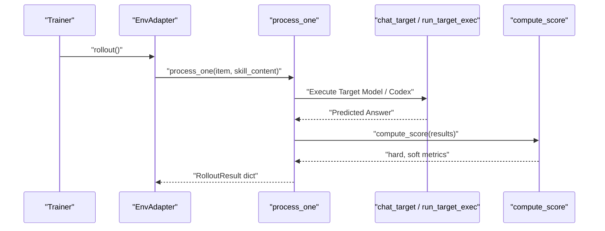
Sources: [skillopt/envs/searchqa/rollout.py:153-210](), [skillopt/utils/scoring.py:7-23]()

When `is_target_exec_backend()` is active, `_run_codex_once` prepares a workspace directory (`codex_exec`), writes the task description and skill markdown, and invokes `run_target_exec` with configured timeouts [skillopt/envs/searchqa/rollout.py:101-147]().

Sources: [skillopt/envs/searchqa/rollout.py:101-147](), [skillopt/model/__init__.py:1-20]()

---

## Scoring and RolloutResult Objects

Once execution completes, responses are evaluated against ground truth answers. The scoring logic computes hard and soft metrics via `compute_score` [skillopt/utils/scoring.py:7-23]().

### Scoring Utilities
* `compute_score(results)`: Iterates over episode results, extracting `.hard` / `get("hard")` and `.soft` / `get("soft")` attributes or dictionary keys, and returns normalized accuracy averages [skillopt/utils/scoring.py:7-23]().
* `skill_hash(content)`: Generates a short 16-character SHA-256 hash of the skill text for caching and tracking purposes [skillopt/utils/scoring.py:26-28]().

### RolloutResult Attributes
The resulting structured objects capture trajectory outcomes:

| Field | Type | Description |
| :--- | :--- | :--- |
| `id` | `str` | Unique identifier for the task item [skillopt/types.py:111-111](). |
| `hard` | `float` | Binary success (`1.0`) or failure (`0.0`), or smoothed reward [skillopt/types.py:112-112](), [skillopt/utils/scoring.py:10-10](). |
| `soft` | `float` | Continuous partial credit score (`0.0` to `1.0`) [skillopt/types.py:113-113](). |
| `n_turns` | `int` | Number of interaction turns in the trajectory [skillopt/types.py:114-114](). |
| `fail_reason` | `str` | Qualitative reason for failure if execution failed [skillopt/types.py:115-115](). |
| `target_system_prompt` | `str` | The exact system prompt containing the skill used during rollout [skillopt/types.py:121-121](). |
| `extras` | `dict` | Environment-specific metadata and debugging logs [skillopt/types.py:124-124](). |

Sources: [skillopt/types.py:105-177](), [skillopt/utils/scoring.py:7-28]()

---

## Longitudinal Comparison Support

To support **Slow Update** and **Meta Skill** mechanisms [skillopt/engine/trainer.py:29-53](), rollout results from the current step are compared with historical trajectories. The trainer constructs comparison pairs to categorize trajectories as improved or regressed, allowing the optimizer to focus on behavioral deltas resulting from skill updates [skillopt/engine/trainer.py:46-53]().

Sources: [skillopt/engine/trainer.py:46-53](), [skillopt/optimizer/slow_update.py:46-53]()

---

# Page: Reflect Stage (Gradient Computation)

# Reflect Stage (Gradient Computation)

<details>
<summary>Relevant source files</summary>

The following files were used as context for generating this wiki page:

- [.gitignore](.gitignore)
- [skillopt/envs/spreadsheetbench/adapter.py](skillopt/envs/spreadsheetbench/adapter.py)
- [skillopt/envs/spreadsheetbench/rollout.py](skillopt/envs/spreadsheetbench/rollout.py)
- [skillopt/gradient/aggregate.py](skillopt/gradient/aggregate.py)
- [skillopt/gradient/reflect.py](skillopt/gradient/reflect.py)
- [skillopt/model/claude_code_backend.py](skillopt/model/claude_code_backend.py)
- [tests/test_aggregate_fallback.py](tests/test_aggregate_fallback.py)
- [tests/test_hierarchical_merge.py](tests/test_hierarchical_merge.py)
- [tests/test_trainer_failure_patterns.py](tests/test_trainer_failure_patterns.py)

</details>


The **Reflect Stage** is the second phase of the SkillOpt training loop. It is directly analogous to **gradient computation** in deep learning: it analyzes rollout errors and successes (trajectories) and produces a "gradient" (structured edit patches) indicating how the skill document weights should be updated to improve task performance.

Instead of analyzing each trajectory independently, SkillOpt groups rollout results into minibatches of size $M$. The Optimizer Model analyzes these minibatches together to identify systematic patterns rather than overfitting to individual edge cases [skillopt/gradient/reflect.py:1-6]().

---

## Purpose and Scope

The scope of this page covers:
- Minibatch trajectory formatting and clipping rules [skillopt/gradient/reflect.py:54-106]()
- Parallel error and success analyst execution using `ThreadPoolExecutor` [skillopt/gradient/reflect.py:28]()
- The two-level prompt priority system (environment-specific overrides vs. generic defaults) [skillopt/gradient/reflect.py:8-12]()
- Integration with model backends via `chat_optimizer()` [skillopt/gradient/reflect.py:30]()

Sources: [skillopt/gradient/reflect.py:1-49]()

---

## Implementation Overview

The Reflect stage is implemented in `skillopt/gradient/reflect.py`. It transforms raw conversation logs into structured JSON patches containing revise suggestions or edit operations.

### Key Functions and Data Flow

| Function | Role | Code Reference |
| :--- | :--- | :--- |
| `run_minibatch_reflect` | Main entry point; partitions rollouts into failure/success minibatches and dispatches to workers | [skillopt/gradient/reflect.py:204-245]() |
| `fmt_minibatch_trajectories` | Aggregates multiple conversation logs and metadata into a single text block for the optimizer | [skillopt/gradient/reflect.py:112-115]() |
| `run_error_analyst_minibatch` | Invokes the optimizer model to analyze a batch of failed tasks | [skillopt/gradient/reflect.py:248-251]() |
| `run_success_analyst_minibatch` | Invokes the optimizer model to analyze a batch of successful tasks for reinforcing patterns | [skillopt/gradient/reflect.py:315-318]() |

### Reflect Process Diagram
This diagram illustrates how rollout results are processed into gradient patches, bridging natural language spaces to code entity spaces.

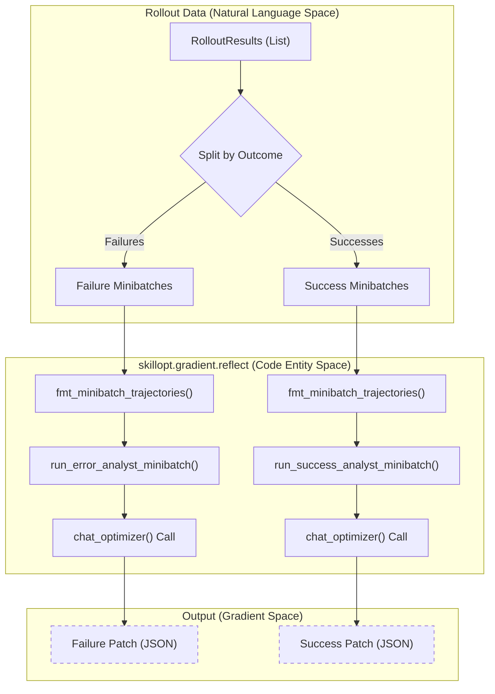
Sources: [skillopt/gradient/reflect.py:1-21](), [skillopt/gradient/reflect.py:204-245]()

---

## Trajectory Formatting

To allow the Optimizer Model to understand what happened during a rollout, the `fmt_trajectory` function converts complex JSON conversation logs into human-readable text [skillopt/gradient/reflect.py:65-106]().

### Supported Conversation Formats
The formatter automatically handles different agent architectures:
1. **Tool-call records**: Common in ReAct-style agents (`type: tool_call`, `cmd`, `obs`) [skillopt/gradient/reflect.py:83-87]().
2. **Step records**: Structured step-by-step reasoning and feedback (`step`, `action`, `env_feedback`, `reasoning`) [skillopt/gradient/reflect.py:88-96]().
3. **System/Role messages**: Standard chat completion format roles (`role: system/agent`, `content`) [skillopt/gradient/reflect.py:97-104]().

### Context Preservation and Enrichment
* **Full Context**: Trajectory text clipping is disabled by default so the optimizer can examine the full context window without truncation [skillopt/gradient/reflect.py:54-57]().
* **Reference Data**: Formatted outputs include hidden ground truth references and target system prompts [skillopt/gradient/reflect.py:160-178]().
* **Environment Verification**: For complex tasks (such as `SpreadsheetBench`), output verification reports detailing cell-level mismatches are appended directly to the trajectory [skillopt/envs/spreadsheetbench/rollout.py:108-119]().

Sources: [skillopt/gradient/reflect.py:54-106](), [skillopt/gradient/reflect.py:160-178](), [skillopt/envs/spreadsheetbench/rollout.py:108-119]()

---

## Minibatch Analysis & Parallel Workers

Minibatch analysis groups multiple similar tasks together to extract robust patterns.

### Error Analyst (`analyst_error`)
The error analyst identifies systematic failure patterns across the minibatch, ignoring isolated edge cases in favor of high-impact editing rules [skillopt/gradient/reflect.py:248-251]().
* **Prompt Loading**: Loaded via `load_prompt("analyst_error")` [skillopt/gradient/reflect.py:257]().
* **Skill-Aware Augmentation**: When enabled, prompts are augmented to extract execution lapses into protected appendices [skillopt/gradient/reflect.py:261-267]().

### Success Analyst (`analyst_success`)
The success analyst analyzes successful trajectories to identify hidden positive behaviors or best practices not yet formalized in the skill document [skillopt/gradient/reflect.py:315-318]().
* **Prompt Loading**: Loaded via `load_prompt("analyst_success")` [skillopt/gradient/reflect.py:324]().

### Parallel Execution
Minibatches are distributed across background threads using `ThreadPoolExecutor`, enabling concurrent LLM calls to the optimizer backend [skillopt/gradient/reflect.py:28]().

Sources: [skillopt/gradient/reflect.py:248-375](), [skillopt/optimizer/skill_aware.py:1-20]()

---

## Two-Level Prompt Priority System

The Reflect stage uses a two-level prompt hierarchy:
1. **Environment-Specific Override**: The `EnvAdapter` is queried first via `adapter.get_prompt(stage)`. If a custom implementation is returned, it takes precedence [skillopt/gradient/reflect.py:8-12]().
2. **Generic Default**: If no override exists, the system falls back to standard Markdown templates located in `skillopt/prompts/` [skillopt/gradient/reflect.py:8-12]().

### Mapping Prompts to Code Entities

| Logic Component | Default Prompt File | Code Reference |
| :--- | :--- | :--- |
| Error Analyst | `analyst_error_rewrite.md` | `load_prompt("analyst_error")` [skillopt/gradient/reflect.py:257]() |
| Success Analyst | `analyst_success_rewrite.md` | `load_prompt("analyst_success")` [skillopt/gradient/reflect.py:324]() |
| Meta-Skill Context | Dynamic injection | `format_meta_skill_context()` [skillopt/gradient/reflect.py:31]() |

Sources: [skillopt/gradient/reflect.py:8-12](), [skillopt/gradient/reflect.py:257-324]()

---

## Technical Data Flow: Rollout to Patch

This sequence diagram tracks the lifecycle of rollout results turning into structured patches through model dispatching.

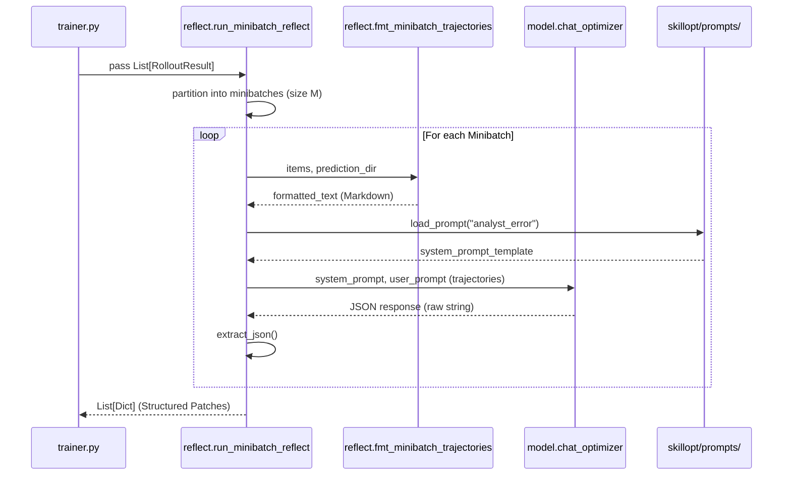

Sources: [skillopt/gradient/reflect.py:204-245]()

---

# Page: Aggregate, Select, and Update Stages

# Aggregate, Select, and Update Stages

<details>
<summary>Relevant source files</summary>

The following files were used as context for generating this wiki page:

- [skillopt/envs/spreadsheetbench/adapter.py](skillopt/envs/spreadsheetbench/adapter.py)
- [skillopt/envs/spreadsheetbench/rollout.py](skillopt/envs/spreadsheetbench/rollout.py)
- [skillopt/gradient/aggregate.py](skillopt/gradient/aggregate.py)
- [skillopt/optimizer/appendix.py](skillopt/optimizer/appendix.py)
- [skillopt/optimizer/clip.py](skillopt/optimizer/clip.py)
- [skillopt/optimizer/lr_autonomous.py](skillopt/optimizer/lr_autonomous.py)
- [skillopt/optimizer/skill.py](skillopt/optimizer/skill.py)
- [skillopt/optimizer/skill_aware.py](skillopt/optimizer/skill_aware.py)
- [skillopt/optimizer/slow_update.py](skillopt/optimizer/slow_update.py)
- [skillopt/optimizer/update_modes.py](skillopt/optimizer/update_modes.py)
- [tests/test_aggregate_fallback.py](tests/test_aggregate_fallback.py)
- [tests/test_hierarchical_merge.py](tests/test_hierarchical_merge.py)
- [tests/test_skill_aware_reflection.py](tests/test_skill_aware_reflection.py)
- [tests/test_slow_update_robustness.py](tests/test_slow_update_robustness.py)
- [tests/test_trainer_failure_patterns.py](tests/test_trainer_failure_patterns.py)

</details>


The middle stages of the ReflACT loop (Stages 3, 4, and 5) transform raw edit patches produced by the Reflect stage into a single, optimized candidate skill document. This pipeline performs hierarchical patch merging, importance-based ranking (textual gradient clipping), autonomous learning rate adjustment, and document-level application while preserving protected regions.

---

## 1. Aggregate Stage: Hierarchical Patch Merging

The Aggregate stage takes independently generated patches from parallel analyst workers and merges them into a single coherent patch [skillopt/gradient/aggregate.py:1-6](). It prioritizes failure-driven patches over success-driven ones.

### Implementation Logic
The merging process executes in three distinct phases:
1. **Failure Merge**: All patches derived from failed trajectories are merged hierarchically [skillopt/gradient/aggregate.py:168-168]().
2. **Success Merge**: All patches derived from successful trajectories are merged hierarchically [skillopt/gradient/aggregate.py:169-169]().
3. **Final Merge**: Both groups are combined with failure priority [skillopt/gradient/aggregate.py:170-170]().

If the patch count exceeds `batch_size`, `_hierarchical_merge` groups items into batches and dispatches same-level batches in parallel via a `ThreadPoolExecutor` [skillopt/gradient/aggregate.py:92-136](). Batch sizes below 2 are clamped to 2 as defense-in-depth [skillopt/gradient/aggregate.py:92-95](). Fallback concatenation is triggered automatically if optimizer calls or JSON parsing fail [skillopt/gradient/aggregate.py:60-76]().

### Diagram: Hierarchical Merge Flow (Natural Language Space to Code Entity Space)
This diagram maps the conceptual aggregation stages to the underlying Python functions and classes in `skillopt/gradient/aggregate.py`.

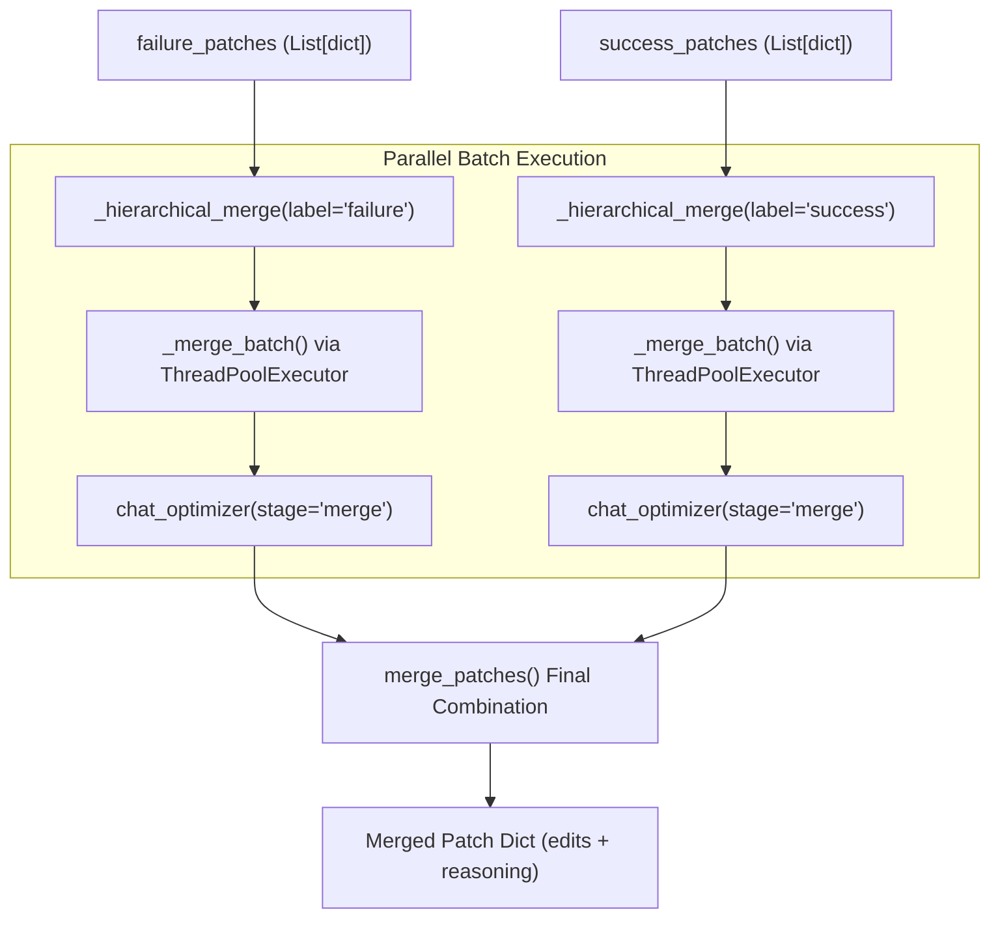
Sources: [skillopt/gradient/aggregate.py:28-186]()

---

## 2. Select Stage: Gradient Clipping and Autonomous LR

The Select stage functions as a textual gradient clipper, controlling step size by selecting the top-$L$ edits or delegating budget decisions to an autonomous optimizer module [skillopt/optimizer/clip.py:1-6]().

### Importance-Based Ranking (`rank_and_select`)
When the proposed edit pool exceeds `max_edits`, `rank_and_select()` formats the edit pool and queries the optimizer model using ranking prompt templates [skillopt/optimizer/clip.py:25-78](). It parses the `selected_indices` JSON array, validates indices against bounds and uniqueness, and returns the filtered patch [skillopt/optimizer/clip.py:79-100](). If parsing or API execution fails, it falls back to head truncation [skillopt/optimizer/clip.py:101-109]().

### Autonomous Learning Rate (`decide_autonomous_learning_rate`)
When `lr_control_mode` is set to `autonomous`, `decide_autonomous_learning_rate()` evaluates current rollout metrics (`rollout_hard`, `rollout_soft`, `rollout_n`) alongside proposed update items [skillopt/optimizer/lr_autonomous.py:31-65](). The optimizer returns an integer learning rate allocation, which is coerced, clamped to available items, and recorded with fallback telemetry [skillopt/optimizer/lr_autonomous.py:85-108]().

### Diagram: Selection and Budget Clipping Flow
This diagram illustrates the control flow between `rank_and_select` and `decide_autonomous_learning_rate`.

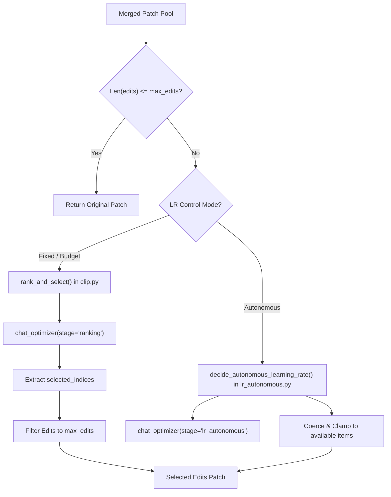
Sources: [skillopt/optimizer/clip.py:25-109](), [skillopt/optimizer/lr_autonomous.py:31-108]()

---

## 3. Update Stage: Applying Edits and Protected Regions

The Update stage applies selected edits to the current skill document, mirroring `optimizer.step()` in neural networks [skillopt/optimizer/skill.py:1-6]().

### Update Modes and Application Functions
*   **Patch Mode**: Iterates over edits via `apply_patch_with_report()` executing granular operations (`append`, `insert_after`, `replace`, `delete`) [skillopt/optimizer/skill.py:85-162]().
*   **Rewrite Modes**: Leverages rewrite handlers (`rewrite_skill_from_suggestions`) to overwrite document sections based on complete suggestions [skillopt/optimizer/rewrite.py:12-59]().

### Protected Regions
All update operations respect protected regions defined by strict document markers:
*   **Slow Update Region**: Bounded by `<!-- SLOW_UPDATE_START -->` and `<!-- SLOW_UPDATE_END -->` [skillopt/optimizer/slow_update.py:32-33]().
*   **Skill-Aware Appendix**: Bounded by `<!-- APPENDIX_START -->` and `<!-- APPENDIX_END -->` [skillopt/optimizer/appendix.py:36-37]().

`_is_in_protected_region()` verifies target positions and silently skips edits attempting modification inside protected areas [skillopt/optimizer/skill.py:33-58](). Append and insert-after fallbacks insert content strictly before the earliest protected region to keep protected blocks at the document tail [skillopt/optimizer/skill.py:33-40]().

### Diagram: Update Stage and Protected Region Guardrails
This diagram maps the code entities enforcing safe document modification in `skillopt/optimizer/skill.py`, `slow_update.py`, and `appendix.py`.

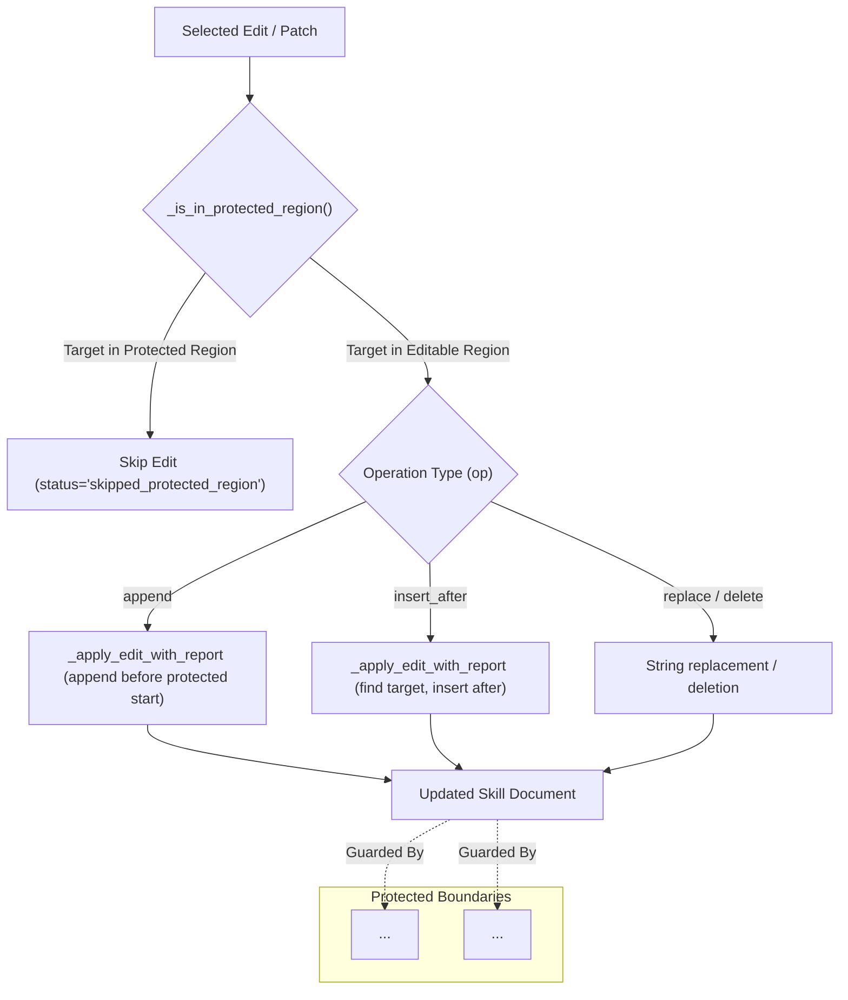
Sources: [skillopt/optimizer/skill.py:33-180](), [skillopt/optimizer/slow_update.py:32-89](), [skillopt/optimizer/appendix.py:36-156]()

---

# Page: Validation Gate

# Validation Gate

<details>
<summary>Relevant source files</summary>

The following files were used as context for generating this wiki page:

- [skillopt/evaluation/__init__.py](skillopt/evaluation/__init__.py)
- [skillopt/evaluation/gate.py](skillopt/evaluation/gate.py)
- [tests/test_consolidate_split.py](tests/test_consolidate_split.py)
- [tests/test_gate.py](tests/test_gate.py)
- [tests/test_gate_no_regression.py](tests/test_gate_no_regression.py)
- [tests/test_holdout_integrity.py](tests/test_holdout_integrity.py)
- [tests/test_semantic_density.py](tests/test_semantic_density.py)

</details>


The **Validation Gate** is the quality control and model selection mechanism used to evaluate a candidate skill document against a held-out selection split [skillopt/evaluation/gate.py:3-5](). Analogous to validation-based early stopping in neural network training, it compares the candidate's score against the current and best scores, deciding whether to commit the edits, advance the state, or reject the update [skillopt/evaluation/gate.py:3-5]().

Sources: [skillopt/evaluation/gate.py:3-5]()

## Gate Logic and Decision Flow

The Gate evaluates candidate performance by projecting hard and soft scores into a single comparison metric using `select_gate_score` and `evaluate_gate` [skillopt/evaluation/gate.py:85-132](), [skillopt/evaluation/gate.py:151-224]().

### Decision Types (`GateAction`)
The `evaluate_gate` function returns a `GateResult` containing one of three actions [skillopt/evaluation/gate.py:30]():
1. **`accept_new_best`**: The candidate skill outperforms both the current active score and the best-so-far score [skillopt/evaluation/gate.py:201-209](). The candidate becomes both the active skill and the new `best_skill` reference.
2. **`accept`**: The candidate skill outperforms the current active score but does not exceed the historical best score [skillopt/evaluation/gate.py:210-216](). The active skill updates, but the best-so-far checkpoint is preserved.
3. **`reject`**: The candidate skill fails to beat the current score [skillopt/evaluation/gate.py:217-223](). The system reverts to the previous skill state.

### Metric Selection and Scoring
The gate supports three primary modes via `GateMetric` [skillopt/evaluation/gate.py:31]():
* **`hard`**: Compares exact-match accuracy (`cand_hard`) [skillopt/evaluation/gate.py:116-117]().
* **`soft`**: Compares partial credit or F1 scores (`cand_soft`) [skillopt/evaluation/gate.py:118-119]().
* **`mixed`**: Computes a weighted average `(1 - w) * hard + w * soft` where `w` is defined by `mixed_weight` [skillopt/evaluation/gate.py:120-122]().

Additionally, the gate can factor in **Semantic Density** via `compute_semantic_density`, which evaluates the proportion of high-influence leading words (e.g., `MUST`, `ALWAYS`, `NEVER`) while stripping protected metadata regions like `SLOW_UPDATE` or `APPENDIX` blocks [skillopt/evaluation/gate.py:46-82]().

### Diagram: Gate Evaluation Flow

Title: Gate Decision Mapping between Natural Language Space and Code Entity Space

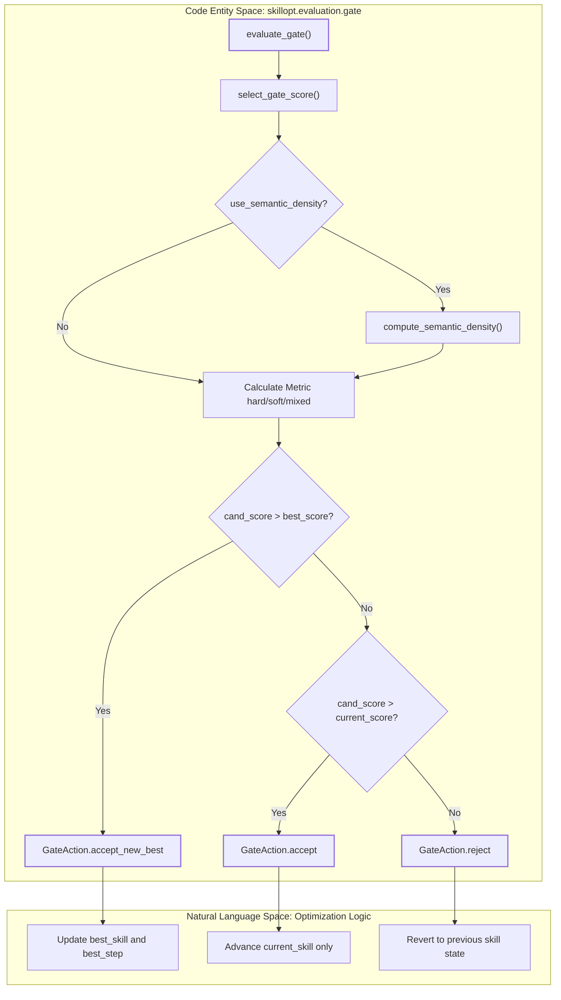
Sources: [skillopt/evaluation/gate.py:46-132](), [skillopt/evaluation/gate.py:151-224]()

## Data Structures

The outcome of validation gating is encapsulated in `GateResult` [skillopt/evaluation/gate.py:34-44]().

### `GateResult` Dataclass
| Field | Type | Description |
| :--- | :--- | :--- |
| `action` | `GateAction` | Decision outcome (`accept_new_best`, `accept`, or `reject`) [skillopt/evaluation/gate.py:38](). |
| `current_skill` | `str` | Updated skill text content for the current state [skillopt/evaluation/gate.py:39](). |
| `current_score` | `float` | Metric-space score of the current skill [skillopt/evaluation/gate.py:40](). |
| `best_skill` | `str` | Best-so-far skill text content [skillopt/evaluation/gate.py:41](). |
| `best_score` | `float` | Metric-space score of the best-so-far checkpoint [skillopt/evaluation/gate.py:42](). |
| `best_step` | `int` | Global training step where the best skill was accepted [skillopt/evaluation/gate.py:43](). |

Sources: [skillopt/evaluation/gate.py:34-44]()

## Holdout Integrity and Split Verification

Before executing score comparisons, the system enforces a strict holdout contract via `_split` in consolidation workflows to prevent data leakage between training and validation sets [tests/test_consolidate_split.py:1-5]().

* **Leak Detection**: If tasks lack a proper held-out validation slice (e.g., all tasks belong to `train` or `val` exclusively without disjoint splits), `_split` flags a holdout leak (`holdout_leaked = True`) [tests/test_holdout_integrity.py:22-36]().
* **Gate Abstention**: When holdout leakage is detected, the gate abstains from accepting unverified edits (`gate_action == "reject_unverified"`), surfacing proposals as unverified suggestions rather than strict negative feedback [tests/test_holdout_integrity.py:92-113](), [tests/test_holdout_integrity.py:164-185]().
* **Test Isolation**: Tasks flagged under the `test` split are strictly excluded from both training and validation slices [tests/test_consolidate_split.py:22-31]().

Sources: [tests/test_holdout_integrity.py:1-113](), [tests/test_consolidate_split.py:1-48]()

## Regression Control and Rejected-Edit Buffer

To prevent regressions across individual held-out tasks when `gate_no_regression` is enabled, the gate inspects task-level deltas [tests/test_gate_no_regression.py:1-192]().

* **No-Regression Constraint**: When `gate_no_regression=True`, a candidate skill is blocked if any held-out task experiences score regression relative to the baseline, even if the aggregate mean score improves [tests/test_gate_no_regression.py:158-192]().
* **Rejected-Edit Buffer**: When a candidate trial fails the gate or triggers regression checks, the applied edits are moved to `rejected_edits`. These are tracked in history artifacts and surfaced to subsequent reflection cycles to prevent repeating ineffective changes [tests/test_gate_no_regression.py:164-170]().

Sources: [tests/test_gate_no_regression.py:140-214]()

### Diagram: Validation and Rejection Data Flow

Title: Validation and Rejection Flow in Trainer and Consolidate Loops

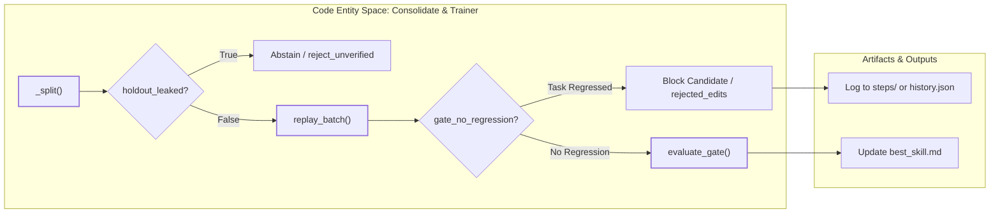
Sources: [tests/test_holdout_integrity.py:92-113](), [tests/test_gate_no_regression.py:140-214]()

## Key Functions

### `evaluate_gate`
Defined in `skillopt/evaluation/gate.py:151-224`, this function compares candidate performance against current and best scores to produce a `GateResult`.

### `select_gate_score`
Defined in `skillopt/evaluation/gate.py:85-132`, this function projects hard, soft, and mixed metrics into a single scalar value, incorporating semantic density weighting if configured.

### `compute_semantic_density`
Defined in `skillopt/evaluation/gate.py:46-82`, this function calculates instruction density by measuring leading high-influence terms while ignoring protected block comments.

Sources: [skillopt/evaluation/gate.py:46-132](), [skillopt/evaluation/gate.py:151-224]()

---

# Page: Epoch-Boundary Mechanisms: Slow Update and Meta Skill

# Epoch-Boundary Mechanisms: Slow Update and Meta Skill

<details>
<summary>Relevant source files</summary>

The following files were used as context for generating this wiki page:

- [skillopt/optimizer/clip.py](skillopt/optimizer/clip.py)
- [skillopt/optimizer/lr_autonomous.py](skillopt/optimizer/lr_autonomous.py)
- [skillopt/optimizer/meta_skill.py](skillopt/optimizer/meta_skill.py)
- [skillopt/optimizer/slow_update.py](skillopt/optimizer/slow_update.py)
- [skillopt/optimizer/update_modes.py](skillopt/optimizer/update_modes.py)
- [tests/test_slow_update_robustness.py](tests/test_slow_update_robustness.py)

</details>


Epoch-boundary mechanisms in SkillOpt provide longitudinal stabilization and meta-optimization that occur outside the standard ReflACT step loop. While the per-step loop focuses on local trajectory analysis and immediate skill patching, epoch-boundary mechanisms analyze performance shifts across an entire epoch (typically 20-50 steps) to identify systemic regressions and improve the optimizer's own execution strategy.

## Overview of Mechanisms

SkillOpt implements two distinct mechanisms at the end of each epoch, orchestrated by the core trainer loop `[skillopt/engine/trainer.py:28-53]()`.

| Mechanism | Target Audience | Storage Location | Primary Goal |
| :--- | :--- | :--- | :--- |
| **Slow Update** | Target Model | Protected block in Skill Document | Longitudinal refinement of agent behavior; prevents regression. |
| **Meta Skill** | Optimizer Model | Optimizer-side memory (JSON) | Cross-epoch strategy memory; improves the quality of future edits. |

Sources: `[skillopt/optimizer/slow_update.py:1-18]()`, `[skillopt/optimizer/meta_skill.py:1-7]`, `[skillopt/engine/trainer.py:46-53]()`

---

## Slow Update: Longitudinal Skill Refinement

The Slow Update mechanism performs a Markovian comparison between the skill at the end of the previous epoch ($S_{e-1}$) and the skill at the end of the current epoch ($S_e$). It identifies systemic drift by re-evaluating the same task set under both versions.

### Data Flow and Strict Success Criteria
At the end of an epoch, the system builds structured comparison pairs `[skillopt/optimizer/slow_update.py:159-165]()`. Success is strictly evaluated using `_is_result_success()`, which requires the `hard` key to be a finite numeric or boolean value in `[0, 1]`, failing closed for strings or out-of-range metrics `[skillopt/optimizer/slow_update.py:160-173]()`. Tasks are categorized into four states:
1. **Improved**: Failed in $e-1$, succeeded in $e$.
2. **Regressed**: Succeeded in $e-1$, failed in $e$.
3. **Persistent Fail**: Failed in both epochs.
4. **Stable Success**: Succeeded in both epochs.

Note that character-length limits and per-field truncation have been completely removed; comparison inputs feed full raw trajectories into the optimizer `[skillopt/optimizer/slow_update.py:95-102]()`.

Sources: `[skillopt/optimizer/slow_update.py:159-176]()`, `[tests/test_slow_update_robustness.py:50-95]()`

### Protected Guidance Block
The output of the Slow Update is a free-form guidance block injected into a protected section of the skill document, delimited by `SLOW_UPDATE_START` and `SLOW_UPDATE_END` markers `[skillopt/optimizer/slow_update.py:31-33]()`.

* **Immutability**: Per-step analysts cannot modify this block; it is overwritten exclusively at epoch boundaries via `replace_slow_update_field()` `[skillopt/optimizer/slow_update.py:7-8, 81-89]()`. Before replacement, `_strip_all_slow_update_fields()` purges orphan or duplicate markers `[skillopt/optimizer/slow_update.py:61-78]()`.
* **Direct Instruction**: Content is written as direct behavioral rules for the Target Model `[skillopt/optimizer/slow_update.py:6-7]()`.

Sources: `[skillopt/optimizer/slow_update.py:31-89]()`

### Slow Update Process Diagram

"Slow_Update_Pipeline_Code_Entity_Bridge"
```mermaid
graph TD
    subgraph "NaturalLanguageSpace"
        PrevRollouts[""Previous Epoch Rollouts (Epoch e-1)""]
        CurrRollouts[""Current Epoch Rollouts (Epoch e)""]
        PrevSkill[""Previous Skill Document (S_e-1)""]
        CurrSkill[""Current Skill Document (S_e)""]
    end

    subgraph "CodeEntitySpace"
        BPC[""build_comparison_pairs()""]
        ISV[""_is_result_success()""]
        FTC[""build_comparison_text()""]
        RSU[""run_slow_update()""]
        STRIP[""_strip_all_slow_update_fields()""]
        RSUF[""replace_slow_update_field()""]
    end

    PrevRollouts & CurrRollouts --> BPC
    BPC -.-> ISV
    BPC --> FTC
    FTC --> RSU
    PrevSkill & CurrSkill --> RSU
    RSU -- "guidance_content" --> STRIP
    STRIP --> RSUF
    RSUF -- "Protected Block Markdown" --> FinalSkill[""Updated best_skill.md""]

    style RSU stroke-width:2px
    style RSUF stroke-width:2px
```
Sources: `[skillopt/optimizer/slow_update.py:159-176]`, `[skillopt/optimizer/slow_update.py:61-89]`, `[skillopt/optimizer/slow_update.py:228-255]`

---

## Meta Skill: Optimizer Strategy Memory

The Meta Skill mechanism maintains optimizer-side memory. It does not modify instructions given to the agent; instead, it instructs the Optimizer Model on how to be a better editor for the current benchmark domain `[skillopt/optimizer/meta_skill.py:1-7]()`.

### Purpose and Scope
The Meta Skill captures environment-specific optimization heuristics, such as whether adding strict examples or modifying core logic helps reduce regressions `[skillopt/optimizer/meta_skill.py:1-7]()`.

### Implementation
The meta skill is stored as a compact string and injected into optimizer system prompts across the reflect, aggregate, select, and autonomous learning rate modules via `format_meta_skill_context()` `[skillopt/optimizer/meta_skill.py:18-30]()`. It is invoked at epoch boundaries through `run_meta_skill()` `[skillopt/optimizer/meta_skill.py:33-42]()`.

### Optimizer Memory Data Flow Diagram

"Meta_Skill_Code_Entity_Integration"
```mermaid
graph LR
    subgraph "NaturalLanguageSpace"
        EpochTrans[""Epoch Transitions & Rollouts""]
        MetaPrompt[""skillopt/prompts/meta_skill.md""]
    end

    subgraph "CodeEntitySpace"
        RMS[""run_meta_skill()""]
        FMC[""format_meta_skill_context()""]
        CO[""chat_optimizer()""]
        LR[""decide_autonomous_learning_rate()""]
        CLIP[""rank_and_select()""]
    end

    EpochTrans & MetaPrompt --> RMS
    RMS -- "meta_skill_content" --> FMC
    FMC -- "Optimizer Context" --> CO
    FMC --> LR
    FMC --> CLIP
    CO -- "Refined Edits" --> TargetSkill[""Skill Document""]

    style RMS stroke-width:2px
    style FMC stroke-width:2px
```
Sources: `[skillopt/optimizer/meta_skill.py:18-79]`, `[skillopt/optimizer/lr_autonomous.py:68-70]`, `[skillopt/optimizer/clip.py:69-71]`

---

## Technical Comparison of Boundary Logic

The two mechanisms rely on separate utility functions and module boundaries to operate independently within the training loop.

| Function Name | Module File | Role Description |
| :--- | :--- | :--- |
| `run_slow_update` | `[skillopt/optimizer/slow_update.py]()` | Calls optimizer to generate target-facing guidance from longitudinal pairs. |
| `run_meta_skill` | `[skillopt/optimizer/meta_skill.py]()` | Calls optimizer to generate optimizer-facing strategy notes. |
| `build_comparison_pairs` | `[skillopt/optimizer/slow_update.py]()` | Correlates and categorizes results from adjacent epochs. |
| `replace_slow_update_field` | `[skillopt/optimizer/slow_update.py]()` | Overwrites the protected Markdown block between markers. |
| `format_meta_skill_context` | `[skillopt/optimizer/meta_skill.py]()` | Wraps meta-skill memory into a prompt-ready context block. |
| `decide_autonomous_learning_rate`| `[skillopt/optimizer/lr_autonomous.py]()` | Uses meta skill memory to inform step-size adjustments. |

Sources: `[skillopt/optimizer/slow_update.py:1-429]()`, `[skillopt/optimizer/meta_skill.py:1-79]()`, `[skillopt/optimizer/lr_autonomous.py:1-108]()`

---

# Page: Skill Document

# Skill Document

<details>
<summary>Relevant source files</summary>

The following files were used as context for generating this wiki page:

- [ckpt/alfworld/gpt5.5_skill.md](ckpt/alfworld/gpt5.5_skill.md)
- [ckpt/docvqa/gpt5.5_skill.md](ckpt/docvqa/gpt5.5_skill.md)
- [ckpt/livemath/gpt5.5_skill.md](ckpt/livemath/gpt5.5_skill.md)
- [ckpt/officeqa/gpt5.5_skill.md](ckpt/officeqa/gpt5.5_skill.md)
- [ckpt/searchqa/gpt5.5_skill.md](ckpt/searchqa/gpt5.5_skill.md)
- [ckpt/spreadsheetbench/gpt5.5_skill.md](ckpt/spreadsheetbench/gpt5.5_skill.md)
- [skillopt/optimizer/appendix.py](skillopt/optimizer/appendix.py)
- [skillopt/optimizer/skill.py](skillopt/optimizer/skill.py)
- [skillopt/optimizer/skill_aware.py](skillopt/optimizer/skill_aware.py)
- [tests/test_skill_aware_reflection.py](tests/test_skill_aware_reflection.py)

</details>


## Purpose and Scope

This page covers the **Skill Document** as the central trainable artifact in SkillOpt. It defines how natural language strategies, heuristics, and error-correction rules serve as prompt weights for a frozen LLM agent [README.md:31-33](). 

As a PARENT page, this document provides a high-level overview of skill Markdown structure, lifecycle, edit operations, and transferability. For deep technical details on learning rate schedulers and optimizer prompt libraries, see the child pages:
- [Learning Rate and Scheduler](#3.1)
- [Optimizer Prompts Library](#3.2)

---

## Structure and Content

Skill documents are human-readable, model-interpretable Markdown files stored in training output directories (e.g., `ckpt/` or `steps/`). They organize task-specific knowledge into hierarchical sections such as task strategies, common patterns, and edge cases [ckpt/searchqa/gpt5.5_skill.md:1-52]().

Protected regions use special HTML comment markers to shield longitudinal guidance and execution notes from step-level edits:
- **Slow Update**: Managed via `<!-- SLOW_UPDATE_START -->` and `<!-- SLOW_UPDATE_END -->` [skillopt/optimizer/skill.py:14-15]().
- **Appendix (EmbodiSkill S_app)**: Managed via `<!-- APPENDIX_START -->` and `<!-- APPENDIX_END -->` to hold execution-lapse reminders without modifying the main task body [skillopt/optimizer/appendix.py:1-6]().

### Lifecycle of a Skill
1. **Seed Skill**: Initialized from a seed file or an empty state [docs/guide/first-experiment.md:84-91]().
2. **Candidate Skill**: Produced by applying a ranked set of edits during the Update stage [skillopt/optimizer/skill.py:1-6]().
3. **Best Skill (`best_skill.md`)**: Saved when a candidate passes the Validation Gate [docs/guide/training-loop.md:74-81]().

Sources: [skillopt/optimizer/skill.py:1-30](), [skillopt/optimizer/appendix.py:1-29](), [docs/guide/first-experiment.md:84-91]()

---

## Skill Document Operations

The `skillopt.optimizer.skill` and `skillopt.optimizer.appendix` modules handle text-space modifications, acting as the textual equivalent of `optimizer.step()` in neural networks [skillopt/optimizer/skill.py:1-6]().

### Atomic Edit Operations
The `Edit` type supports four primary operations [skillopt/optimizer/skill.py:98-145]():
- **`append`**: Inserts content at the end of the document or before the earliest protected region [skillopt/optimizer/skill.py:98-106]().
- **`insert_after`**: Places content immediately following a specified target string [skillopt/optimizer/skill.py:108-122]().
- **`replace`**: Swaps a target string with new content [skillopt/optimizer/skill.py:124-132]().
- **`delete`**: Removes a target string from the document [skillopt/optimizer/skill.py:134-142]().

Edits targeting text within protected regions (`_PROTECTED_REGIONS`) are automatically skipped or intercepted [skillopt/optimizer/skill.py:27-58]().

Sources: [skillopt/optimizer/skill.py:1-163](), [skillopt/optimizer/appendix.py:1-156]()

---

## Natural Language Space to Code Entity Space

The following diagrams bridge the natural language representations of skills to their corresponding code entities in the repository.

### Diagram 1: Skill File and Dataclass Flow
```mermaid
graph TD
    subgraph "NaturalLanguageSpace"
        SEED["seed_skill.md"]
        CAND["CandidateSkillText"]
        BEST["best_skill.md"]
    end

    subgraph "CodeEntitySpace"
        SKILL_MOD["skillopt.optimizer.skill"]
        APP_MOD["skillopt.optimizer.appendix"]
        APPLY_FN["_apply_edit_with_report()"]
        PATCH_OBJ["Patch (dataclass)"]
        EDIT_OBJ["Edit (dataclass)"]
    end

    SEED -->|"Loaded as string"| SKILL_MOD
    PATCH_OBJ -->|"Contains list of"| EDIT_OBJ
    EDIT_OBJ -->|"Processed by"| APPLY_FN
    SKILL_MOD -->|"Applies edits"| APPLY_FN
    APP_MOD -->|"Maintains S_app"| APPLY_FN
    APPLY_FN -->|"Yields updated text"| CAND
    CAND -->|"Saved if gate passes"| BEST
```
Sources: [skillopt/optimizer/skill.py:85-163](), [skillopt/optimizer/appendix.py:141-156]()

### Diagram 2: Protected Region Interception Logic
```mermaid
graph TD
    START["_apply_edit_with_report(skill, edit)"] --> EXTRACT["_edit_fields(edit)"]
    EXTRACT --> CHECK{"_is_in_protected_region?"}
    CHECK -- "Yes" --> SKIP["status = skipped_protected_region"]
    CHECK -- "No" --> OP_BRANCH{"op type"}
    OP_BRANCH -- "append" --> PROT_CHECK["_earliest_protected_start()"]
    OP_BRANCH -- "insert_after" --> TARGET_CHECK{"target in skill?"}
    OP_BRANCH -- "replace" --> REPLACE_LOGIC["skill.replace(target, content, 1)"]
    OP_BRANCH -- "delete" --> DELETE_LOGIC["skill.replace(target, '', 1)"]
    SKIP --> RET["Return (skill, report)"]
    PROT_CHECK --> RET
    TARGET_CHECK --> RET
    REPLACE_LOGIC --> RET
    DELETE_LOGIC --> RET
```
Sources: [skillopt/optimizer/skill.py:33-145]()

---

## Transferability

Skill documents generalize well across models and execution harnesses:
- **Cross-Model**: Skills optimized with a strong model (e.g., `GPT-4o`) can be transferred to boost smaller or alternative models like `Claude-3.5-Sonnet` or `Qwen-2.5` [README.md:46-48]().
- **Cross-Harness**: Plain Markdown artifacts can be deployed across direct chat, `codex_exec`, or `claude_code_exec` execution harnesses without architectural changes [README.md:41-43]().

Sources: [README.md:31-50]()

---

## Sub-Topics and Detailed Child Pages

For comprehensive technical breakdowns, refer to the following child pages:
- **[Learning Rate and Scheduler](#3.1)** — Covers the textual learning rate (edit budget), scheduler modes (constant, linear, cosine, autonomous), and the autonomous LR decision module.
- **[Optimizer Prompts Library](#3.2)** — Catalogs Markdown prompt templates in `skillopt/prompts`: analyst, merge, ranking, rewrite, slow_update, meta_skill, and environment-specific overrides.

Sources: [skillopt/optimizer/skill.py:1-200](), [docs/guide/training-loop.md:1-105]()

---

# Page: Learning Rate and Scheduler

# Learning Rate and Scheduler

<details>
<summary>Relevant source files</summary>

The following files were used as context for generating this wiki page:

- [skillopt/optimizer/clip.py](skillopt/optimizer/clip.py)
- [skillopt/optimizer/lr_autonomous.py](skillopt/optimizer/lr_autonomous.py)
- [skillopt/optimizer/scheduler.py](skillopt/optimizer/scheduler.py)
- [skillopt/optimizer/slow_update.py](skillopt/optimizer/slow_update.py)
- [skillopt/optimizer/update_modes.py](skillopt/optimizer/update_modes.py)
- [tests/test_scheduler.py](tests/test_scheduler.py)
- [tests/test_slow_update_robustness.py](tests/test_slow_update_robustness.py)

</details>


Purpose and Scope: This page details the concept of the textual learning rate (edit budget) in SkillOpt, the built-in scheduler modes (`constant`, `linear`, `cosine`, `autonomous`), and the autonomous learning rate decision module that enables optimizer LLMs to dynamically govern step sizes during training.

---

## The Textual Learning Rate

Unlike numerical weights in neural networks, SkillOpt operates on a trainable Markdown skill document. The "gradient" consists of a pool of candidate edits generated during the **Reflect** stage. The learning rate serves as a **gradient clipping** mechanism that restricts the number of these edits applied to the document [skillopt/optimizer/clip.py:1-6]().

### Edit Budget and Ranking
When the number of candidate edits exceeds the defined learning rate (budget), the system performs an LLM-driven ranking process to select the most impactful modifications [skillopt/optimizer/clip.py:32-35]().

1.  **Pool Description**: All candidate edits are formatted into a list with indices and descriptions [skillopt/optimizer/clip.py:58-60]().
2.  **Optimizer Ranking**: The `chat_optimizer` function is called with the `ranking` prompt [skillopt/optimizer/clip.py:75-78](). It evaluates edits based on systematic impact, complementarity, generality, and actionability.
3.  **Selection**: The optimizer returns a JSON object containing `selected_indices` in priority order [skillopt/optimizer/clip.py:79-81]().
4.  **Fallback**: If the LLM call fails, the system falls back to simple truncation (taking the first $N$ edits) [skillopt/optimizer/clip.py:104-109]().

### Code Entity Mapping: Gradient Selection
The following diagram illustrates how the `rank_and_select` function bridges the gap between raw candidate patches and the final applied update.

```mermaid
graph TD
    subgraph "Natural Language Space"
        E1[""Edit 1: Always verify dates""]
        E2[""Edit 2: Handle null JSON""]
        E3[""Edit 3: Formatting fix""]
        Budget[""Edit Budget (LR)""]
    end

    subgraph "Code Entity Space: skillopt/optimizer/clip.py"
        direction TB
        RS[""rank_and_select()""]
        GP[""get_payload_items()""]
        CO[""chat_optimizer()""]
        EJ[""extract_json()""]
    end

    E1 & E2 & E3 --> GP
    GP --> RS
    Budget --> RS
    RS --> CO
    CO -- "JSON Indices" --> EJ
    EJ --> FinalPatch[""Selected Patch Dict""]
```
Sources: [skillopt/optimizer/clip.py:25-55](), [skillopt/optimizer/clip.py:75-79]()

---

## Scheduler Modes

SkillOpt supports four primary modes for managing the learning rate across steps and epochs. These are implemented via the `LRScheduler` hierarchy in `skillopt/optimizer/scheduler.py`.

| Mode | Class | Description |
| :--- | :--- | :--- |
| **Constant** | `ConstantScheduler` | The edit budget remains fixed throughout the entire training run [skillopt/optimizer/scheduler.py:56-61](). |
| **Linear** | `LinearScheduler` | The budget decreases linearly from `max_lr` to `min_lr` over `total_steps` [skillopt/optimizer/scheduler.py:63-77](). |
| **Cosine** | `CosineScheduler` | Follows a cosine annealing curve from `max_lr` to `min_lr` [skillopt/optimizer/scheduler.py:79-93](). |
| **Autonomous** | `AutonomousScheduler` | No fixed limit (`NO_LIMIT = 999`); allows the model to decide budget dynamically [skillopt/optimizer/scheduler.py:95-102](). |

### Scheduler Logic and State
The `LRScheduler` base class manages the `_current_step` counter and provides `state_dict` and `load_state_dict` methods to ensure deterministic resumes during training [skillopt/optimizer/scheduler.py:27-54](). The `build_scheduler` factory function instantiates the correct subclass based on the configuration parameters [skillopt/optimizer/scheduler.py:114-137]().

Sources: [skillopt/optimizer/scheduler.py:7-20](), [skillopt/optimizer/scheduler.py:106-111](), [tests/test_scheduler.py:10-19]()

---

## Autonomous Learning Rate Decision Module

When the `lr_scheduler` mode is set to `autonomous`, the responsibility of step-size control shifts to the optimizer LLM. Instead of following a pre-defined decay curve, the optimizer analyzes current execution evidence to decide how many edits the skill can safely absorb [skillopt/optimizer/lr_autonomous.py:31-47]().

### Input Evidence
The `decide_autonomous_learning_rate` function provides the optimizer with several data points to inform its decision [skillopt/optimizer/lr_autonomous.py:54-65]():
*   **Rollout Performance**: `rollout_hard` (exact match accuracy) and `rollout_soft` (partial credit/F1) scores from the current step.
*   **Edit Pool**: The total number of `available_update_items` generated by the analysts.
*   **Context**: The current skill content, previous steps in the current epoch, and the `meta_skill` context (optimizer's long-term memory) [skillopt/optimizer/lr_autonomous.py:66-70]().

### Decision Logic
The optimizer responds with a JSON object containing the `learning_rate` (integer) and `reasoning`. The system then clamps this value to the range `[0, available_items]` and returns a structured record containing telemetry on fallback status and clamping actions [skillopt/optimizer/lr_autonomous.py:90-108]().

### Code Entity Mapping: Autonomous Decision Flow
This diagram shows the data flow from rollout evidence and prompts to the final autonomous LR record.

```mermaid
graph LR
    subgraph "Natural Language & Evidence Space"
        RH[""rollout_hard""]
        RS[""rollout_soft""]
        MP[""merged_patch""]
    end

    subgraph "Code Entity Space: skillopt/optimizer/lr_autonomous.py"
        DALR[""decide_autonomous_learning_rate()""]
        LP[""load_prompt('lr_autonomous')""]
        CO[""chat_optimizer()""]
        CNE[""_coerce_nonnegative_int()""]
    end

    RH & RS & MP --> DALR
    LP --> CO
    DALR --> CO
    CO -- "Response String" --> CNE
    CNE --> Record[""LR Decision Record Dict""]
```
Sources: [skillopt/optimizer/lr_autonomous.py:31-41](), [skillopt/optimizer/lr_autonomous.py:76-85](), [skillopt/optimizer/lr_autonomous.py:95-108]()

---

## Configuration Reference

Learning rate behavior is configured via the `optimizer` section of training YAML files [configs/_base_/default.yaml:73-77](). Key parameters include:
*   `learning_rate`: The maximum edit budget (`max_lr`) used by the schedulers.
*   `min_learning_rate`: The floor value (`min_lr`) for decay schedulers.
*   `lr_scheduler`: Scheduler type (`constant`, `linear`, `cosine`, or `autonomous`).

Sources: [configs/_base_/default.yaml:73-77](), [skillopt/optimizer/scheduler.py:120-132]()

---

# Page: Optimizer Prompts Library

# Optimizer Prompts Library

<details>
<summary>Relevant source files</summary>

The following files were used as context for generating this wiki page:

- [.gitignore](.gitignore)
- [skillopt/gradient/reflect.py](skillopt/gradient/reflect.py)
- [skillopt/model/claude_code_backend.py](skillopt/model/claude_code_backend.py)
- [skillopt/optimizer/appendix.py](skillopt/optimizer/appendix.py)
- [skillopt/optimizer/skill.py](skillopt/optimizer/skill.py)
- [skillopt/optimizer/skill_aware.py](skillopt/optimizer/skill_aware.py)
- [tests/test_skill_aware_reflection.py](tests/test_skill_aware_reflection.py)

</details>


The **Optimizer Prompts Library** catalogs the Markdown-based templates in `skillopt/prompts/` and environment-specific overrides that dictate how the Optimizer Model interprets trajectory minibatches, aggregates edits, ranks updates, and maintains longitudinal memory. SkillOpt employs a hierarchical override system where benchmark-specific prompt variants supersede default optimization templates.

Sources: [skillopt/gradient/reflect.py:1-21](), [skillopt/optimizer/skill_aware.py:1-24]()

---

## Prompt Architecture and Data Flow

The optimizer leverages update modes defined in `skillopt/optimizer/update_modes.py` to process patches (`append`, `replace`, `delete`), suggest rewrites, or perform full minibatch updates [skillopt/optimizer/update_modes.py:1-45](). 

The following diagram traces the data flow from raw rollout trajectories through analyst evaluation, aggregation, and final update application.

### Optimizer Data Flow: From Trajectories to Skills
"Optimizer Data Flow"
```mermaid
graph TD
    subgraph "ReflectStage [skillopt/gradient/reflect.py]"
        T1["RolloutTrajectories"] --> AE["analyst_error.md"]
        T1 --> AS["analyst_success.md"]
        AE --> P1["EditPatches"]
        AS --> P2["EditPatches"]
    end

    subgraph "AggregateStages [skillopt/gradient/aggregate.py]"
        P1 --> MF["merge_failure.md"]
        P2 --> MS["merge_success.md"]
        MF --> M_ALL["merge_final.md"]
        MS --> M_ALL
        M_ALL --> RK["ranking.md"]
    end

    subgraph "UpdateStages [skillopt/optimizer/update_modes.py]"
        RK --> RW["rewrite_skill.md"]
        RW --> NS["best_skill.md"]
    end
```
Sources: [skillopt/gradient/reflect.py:18-21](), [skillopt/optimizer/update_modes.py:78-87]()

---

## Core Prompt Catalog

### 1. Analyst Prompts (Gradient Computation)
Analyst prompts serve as the gradient calculators of the system, transforming failure and success minibatches into structured insights.

*   **`analyst_error`**: Analyzes failure patterns across minibatches. When skill-aware reflection (EmbodiSkill) is enabled via `skillopt/optimizer/skill_aware.py`, the prompt is augmented with `ERROR_SUFFIX` to distinguish `SKILL_DEFECT` (leading to body edits) from `EXECUTION_LAPSE` (leading to protected appendix notes) [skillopt/optimizer/skill_aware.py:61-91]().
*   **`analyst_success`**: Extracts winning patterns from successful trajectories. Augmented with `SUCCESS_SUFFIX` when skill-aware reflection is active to categorize updates as `DISCOVERY` or `OPTIMIZATION` [skillopt/optimizer/skill_aware.py:94-106]().
*   **`lr_autonomous`**: Powers `decide_autonomous_learning_rate`, evaluating rollout metrics and proposal complexity to select a dynamic update budget [skillopt/optimizer/lr_autonomous.py:31-41]().

Sources: [skillopt/gradient/reflect.py:1-21](), [skillopt/optimizer/skill_aware.py:61-106]()

### 2. Merge Prompts (Aggregation)
Because minibatch analysis executes in parallel using `ThreadPoolExecutor`, aggregation prompts consolidate multiple partial suggestions [skillopt/gradient/aggregate.py:83-115]().

*   **`merge_failure` / `merge_success`**: Deduplicates overlapping suggestions and resolves conflicting directives.
*   **`merge_final`**: Combines failure-driven corrections and success-driven discoveries into a unified candidate patch [skillopt/gradient/aggregate.py:152-160]().

Sources: [skillopt/gradient/aggregate.py:83-160]()

### 3. Selection and Update Prompts
*   **`ranking` / `ranking_rewrite`**: Acts as a gradient clipper, ordering edits by systematic impact to fit within the active learning rate (edit budget) [skillopt/optimizer/clip.py:25-31]().
*   **`rewrite_skill`**: Used during `rewrite_from_suggestions` mode to integrate selected patches into a clean standalone document.

Sources: [skillopt/optimizer/clip.py:25-31](), [skillopt/optimizer/update_modes.py:1-45]()

### 4. Epoch-Boundary Prompts
*   **`slow_update`**: Compares task performance across epochs to generate longitudinal guidance protected within `<!-- SLOW_UPDATE_START -->` and `<!-- SLOW_UPDATE_END -->` markers [skillopt/optimizer/skill.py:14-15]().
*   **`meta_skill`**: Captures cross-epoch optimizer memory, instructing future optimizer passes on effective editing strategies for the current environment [skillopt/optimizer/meta_skill.py:18-30]().

Sources: [skillopt/optimizer/skill.py:14-15](), [skillopt/optimizer/meta_skill.py:18-30]()

---

## Two-Level Override System

Prompt loading uses the `load_prompt` utility to check environment-specific overrides before falling back to default templates [skillopt/prompts/__init__.py]().

| Priority | Location | Description |
| :--- | :--- | :--- |
| **1. Environment-Specific** | `skillopt/envs/<env_name>/prompts/` | Benchmark-specific prompt overrides tuned for domain failure modes. |
| **2. Default** | `skillopt/prompts/` | General-purpose templates used across all non-overridden environments. |

Sources: [skillopt/gradient/reflect.py:8-12](), [skillopt/prompts/__init__.py]()

---

## Code Entity Mapping

The following diagram bridges natural language prompt templates to their corresponding Python code entities in `skillopt/`.

### Prompt-to-Code Mapping
"PromptToCodeMapping"
```mermaid
graph LR
    subgraph "NaturalLanguageSpace"
        PA["analyst_error.md"]
        PS["analyst_success.md"]
        PR["ranking.md"]
        PU["rewrite_skill.md"]
        PLR["lr_autonomous.md"]
    end

    subgraph "CodeEntitySpace"
        Reflect["gradient/reflect.py"]
        Select["optimizer/clip.py"]
        Update["optimizer/update_modes.py"]
        LR["optimizer/lr_autonomous.py"]
    end

    PA --> Reflect
    PS --> Reflect
    PR --> Select
    PU --> Update
    PLR --> LR

    Reflect -- "run_minibatch_reflect" --> Patch["PatchDict"]
    Update -- "apply_update" --> Skill["best_skill.md"]
```
Sources: [skillopt/gradient/reflect.py:18-21](), [skillopt/optimizer/clip.py:75-78](), [skillopt/optimizer/lr_autonomous.py:76-82]()

---

## Implementation Details

### JSON Enforcement and Parsing
Optimizer prompts mandate strict JSON formatting to ensure reliable programmatic parsing. The system extracts structured payloads via `extract_json` [skillopt/utils.py:1-20](). When skill-aware reflection is enabled, responses are parsed to extract both standard patches and `appendix_notes` [skillopt/optimizer/skill_aware.py:122-150]().

### Protected Document Sections
To prevent step-level edits from corrupting longitudinal insights or execution lapse reminders, `skillopt/optimizer/skill.py` enforces protected region boundaries:
*   **Slow Update Markers**: `<!-- SLOW_UPDATE_START -->` and `<!-- SLOW_UPDATE_END -->` [skillopt/optimizer/skill.py:14-15]().
*   **Appendix Markers**: `<!-- APPENDIX_START -->` and `<!-- APPENDIX_END -->` [skillopt/optimizer/skill.py:19-20]().

Functions like `_is_in_protected_region` and `_apply_edit_with_report` ensure step-level edits targeting these blocks are skipped or safely positioned [skillopt/optimizer/skill.py:43-107]().

Sources: [skillopt/optimizer/skill.py:14-107](), [skillopt/optimizer/skill_aware.py:122-150](), [skillopt/utils.py:1-20]()

---

# Page: Environment Adapters and Benchmarks

# Environment Adapters and Benchmarks

<details>
<summary>Relevant source files</summary>

The following files were used as context for generating this wiki page:

- [docs/guide/new-benchmark.md](docs/guide/new-benchmark.md)
- [skillopt/envs/_template/README.md](skillopt/envs/_template/README.md)
- [skillopt/envs/_template/config_template.yaml](skillopt/envs/_template/config_template.yaml)
- [skillopt/envs/_template/env_template.py](skillopt/envs/_template/env_template.py)
- [skillopt/envs/_template/loader_template.py](skillopt/envs/_template/loader_template.py)
- [skillopt/envs/alfworld/adapter.py](skillopt/envs/alfworld/adapter.py)
- [skillopt/envs/base.py](skillopt/envs/base.py)
- [skillopt/envs/docvqa/adapter.py](skillopt/envs/docvqa/adapter.py)
- [skillopt/envs/livemathematicianbench/adapter.py](skillopt/envs/livemathematicianbench/adapter.py)
- [skillopt/envs/officeqa/adapter.py](skillopt/envs/officeqa/adapter.py)
- [skillopt/envs/searchqa/adapter.py](skillopt/envs/searchqa/adapter.py)

</details>


The `EnvAdapter` abstraction is the bridge between the SkillOpt optimization engine and various task domains [skillopt/envs/base.py:37-42](). By standardizing how tasks are executed, scored, and analyzed, SkillOpt can optimize skill documents across diverse environments ranging from simple question-swering to complex embodied agents and code execution.

### The Adapter Pattern

SkillOpt utilizes the Adapter design pattern to decouple the core ReflACT training loop from environment-specific implementation details. Every benchmark must implement a subclass of `EnvAdapter` [skillopt/envs/base.py:37-42]().

The `EnvAdapter` is responsible for:
1. **Task Execution**: Implementing the `rollout` logic to run the target model against a set of tasks using the current skill document [skillopt/envs/_template/env_template.py:95-128]().
2. **Evaluation**: Providing scoring signals (typically `hard` for 0/1 and `soft` for floats in `[0, 1]`) to determine success or failure [skillopt/envs/_template/env_template.py:120-122]().
3. **Data Loading**: Integrating with a `SplitDataLoader` to manage dataset splits (train/val/test) and batch sampling [skillopt/envs/base.py:54-56]().
4. **Reflection Context**: Attaching "hidden" reference material (like ground truth explanations or internal environment state) that the Optimizer Model uses during the reflection stage but is invisible to the Target Model during rollout [skillopt/envs/base.py:62-99]().

### Natural Language Space to Code Entity Space

The following diagram illustrates how the abstract concepts of a "Benchmark" and "Task Execution" map to specific classes and methods within the codebase.

**Benchmark Architecture Mapping**
```mermaid
graph TD
    subgraph "Natural Language Space"
        Task["TaskDescription"]
        SkillDoc["SkillDocumentMarkdown"]
        Success["SuccessFailureMetric"]
    end

    subgraph "Code Entity Space"
        BaseAdapter["EnvAdapter skillopt/envs/base.py"]
        Rollout["rollout skillopt/envs/_template/env_template.py"]
        DataLoader["SplitDataLoader skillopt/datasets/base.py"]
        Reflect["reflect skillopt/gradient/reflect.py"]
    end

    Task -->|InputTo| Rollout
    SkillDoc -->|SystemPromptFor| Rollout
    Rollout -->|Produces| Trajectory["TrajectoryConversationJson"]
    Trajectory -->|AnalyzedBy| Reflect
    Rollout -->|Returns| Scores["HardSoftScores"]
    BaseAdapter -->|InheritedBy| SpecificEnv["SearchQAAdapter skillopt/envs/searchqa/adapter.py"]
    DataLoader -->|Feeds| SpecificEnv
```
Sources: [skillopt/envs/base.py:37-100](), [skillopt/envs/_template/env_template.py:15-64](), [docs/guide/new-benchmark.md:13-28]()

---

### Built-in Benchmarks

SkillOpt includes several built-in benchmark environments, categorized by their interaction patterns and complexity. The system uses a lazy registration pattern in `scripts/train.py` and `scripts/eval_only.py` to avoid unnecessary dependency loading [scripts/eval_only.py:50-106]().

| Benchmark | Category | Core Mechanism |
| :--- | :--- | :--- |
| **SearchQA** | Information Retrieval | Single-turn QA with retrieved snippets [skillopt/envs/searchqa/adapter.py:13-96](). |
| **DocVQA** | Visual Reasoning | QA based on document images and OCR text [skillopt/envs/docvqa/adapter.py:9-90](). |
| **SpreadsheetBench** | Code Generation | ReAct-style cell manipulation and Python codegen [docs/guide/new-benchmark.md:178-182](). |
| **ALFWorld** | Embodied AI | Multi-step interactive simulator (Ray-parallelized) [skillopt/envs/alfworld/adapter.py:47-104](). |
| **LiveMath** | Mathematical Reasoning | Multi-step reasoning for math problems [skillopt/envs/livemathematicianbench/adapter.py:13-129](). |
| **OfficeQA** | Tool-Use | Task completion using simulated office tools [skillopt/envs/officeqa/adapter.py:11-112](). |

#### [SearchQA and DocVQA Adapters](#4.1)
These adapters focus on text and visual information retrieval. They implement specialized data loading and scoring mechanics tailored for QA tasks.
* For details, see [SearchQA and DocVQA Adapters](#4.1).

#### [SpreadsheetBench Adapter](#4.2)
This environment tests the agent's ability to manipulate data. It integrates with execution harnesses to run generated code against actual spreadsheet files and verify the resulting state.
* For details, see [SpreadsheetBench Adapter](#4.2).

#### [ALFWorld Adapter](#4.3)
A complex embodied environment where agents perform tasks in a simulated house. This adapter handles Ray-based parallelism for simulators and manages long-horizon trajectories.
* For details, see [ALFWorld Adapter](#4.3).

#### [LiveMathematicianBench and OfficeQA Adapters](#4.4)
These adapters focus on reasoning and tool-augmented workflows. They often include environment-specific prompt overrides to help the optimizer understand domain-specific failure modes.
* For details, see [LiveMathematicianBench and OfficeQA Adapters](#4.4).

Sources: [skillopt/envs/searchqa/adapter.py:1-96](), [skillopt/envs/docvqa/adapter.py:1-90](), [skillopt/envs/alfworld/adapter.py:47-104](), [skillopt/envs/livemathematicianbench/adapter.py:1-129](), [skillopt/envs/officeqa/adapter.py:1-112]()

---

### Adding New Benchmarks

Adding a new benchmark involves implementing a `SplitDataLoader` subclass, a rollout helper, and an `EnvAdapter` subclass [docs/guide/new-benchmark.md:11-25]().

**New Benchmark Integration Flow**
```mermaid
graph LR
    subgraph "Implementation"
        DL["TemplateBenchmarkLoader skillopt/envs/_template/loader_template.py"]
        AD["TemplateBenchmarkEnv skillopt/envs/_template/env_template.py"]
    end

    subgraph "Registration"
        REG["_ENV_REGISTRY scripts/train.py"]
    end

    subgraph "Configuration"
        YAML["ConfigTemplate configs/your_benchmark/default.yaml"]
    end

    DL --> AD
    AD --> REG
    REG --> YAML
    YAML -->|UsedBy| Train["TrainScript scripts/train.py"]
```
Sources: [docs/guide/new-benchmark.md:13-28](), [skillopt/envs/_template/README.md:1-46](), [scripts/eval_only.py:108-123]()

A template for creating new environments is provided in `skillopt/envs/_template/` [skillopt/envs/_template/env_template.py:1-151](). Developers must implement the `rollout` method to define how the Target Model receives the `skill_content` and produces scored results [skillopt/envs/_template/env_template.py:95-128]().

Sources:
- [skillopt/envs/base.py:1-200]()
- [skillopt/envs/_template/env_template.py:1-151]()
- [docs/guide/new-benchmark.md:1-200]()
- [skillopt/envs/_template/config_template.yaml:1-55]()
- [scripts/eval_only.py:47-123]()

---

# Page: SearchQA and DocVQA Adapters

# SearchQA and DocVQA Adapters

<details>
<summary>Relevant source files</summary>

The following files were used as context for generating this wiki page:

- [configs/docvqa/default.yaml](configs/docvqa/default.yaml)
- [configs/officeqa/default.yaml](configs/officeqa/default.yaml)
- [configs/searchqa/default.yaml](configs/searchqa/default.yaml)
- [configs/spreadsheetbench/default.yaml](configs/spreadsheetbench/default.yaml)
- [scripts/materialize_searchqa.py](scripts/materialize_searchqa.py)
- [skillopt/envs/searchqa/rollout.py](skillopt/envs/searchqa/rollout.py)
- [tests/test_materialize_searchqa.py](tests/test_materialize_searchqa.py)
- [tests/test_searchqa_rollout_failfast.py](tests/test_searchqa_rollout_failfast.py)

</details>


This page details the implementation of the `SearchQAAdapter` and `DocVQAAdapter`, which facilitate information retrieval and visual document question-answering within the SkillOpt framework. These adapters manage the lifecycle of a task from data loading to parallel rollout, score evaluation, and structured reflection.

Sources: [skillopt/envs/searchqa/rollout.py:1-10](), [configs/searchqa/default.yaml:1-32](), [configs/docvqa/default.yaml:1-28]()

---

## Overview

Both adapters inherit from the `EnvAdapter` base class and implement the standard ReflACT interface. While `SearchQA` focuses on text-based context grounding and QA execution [skillopt/envs/searchqa/rollout.py:1-10](), `DocVQA` extends this to multimodal inputs by handling image-based document understanding.

### Key Responsibilities
*   **Data Loading**: Interfacing with data loaders to provide batches of questions, contexts, and optional document images [configs/searchqa/default.yaml:22-32](), [configs/docvqa/default.yaml:17-28]().
*   **Rollout Management**: Orchestrating parallel execution of the Target Model using environment-specific prompts [skillopt/envs/searchqa/rollout.py:57-147]().
*   **Materialization**: Using utility scripts to transform lightweight ID manifests into full runnable benchmark payloads [scripts/materialize_searchqa.py:91-143]().

Sources: [skillopt/envs/searchqa/rollout.py:1-147](), [configs/searchqa/default.yaml:1-32](), [scripts/materialize_searchqa.py:91-143]()

---

## Data Flow and Code Entity Mapping

The following diagrams illustrate how natural language tasks and datasets are mapped to code entities during rollout and materialization.

### Rollout and Evaluation Pipeline
```mermaid
graph TD
    subgraph "Natural_Language_Space"
        Q["Question Text"]
        CTX["Search Context"]
    end

    subgraph "Code_Entity_Space"
        DL["SearchQADataLoader"]
        BS["BatchSpec Payload"]
        PROC["process_one"]
        TRN["_run_codex_once"]
        EVAL["evaluate"]
    end

    Q --> DL
    CTX --> DL
    DL --> BS
    BS -- "items" --> PROC
    PROC -- "skill_content" --> TRN
    TRN -- "predicted_answer" --> EVAL
```
Sources: [skillopt/envs/searchqa/rollout.py:41-147](), [skillopt/envs/searchqa/rollout.py:153-210]()

### Materialization Pipeline
```mermaid
graph TD
    subgraph "Natural_Language_Space"
        MANIFEST["ID Manifest (items.json)"]
        HFDSET["HuggingFace Dataset"]
    end

    subgraph "Code_Entity_Space"
        LOAD["load_manifest_ids"]
        REJ["_reject_duplicate_manifest_ids"]
        NORM["_normalize_row"]
        MAT["materialize_searchqa_splits"]
    end

    MANIFEST --> LOAD
    LOAD --> REJ
    HFDSET --> NORM
    REJ --> MAT
    NORM --> MAT
```
Sources: [scripts/materialize_searchqa.py:37-143](), [tests/test_materialize_searchqa.py:29-79]()

---

## SearchQA Adapter

The `SearchQAAdapter` is designed for single-turn QA tasks where the model must extract answers from provided text passages.

### Rollout Mechanics
1.  **Context Truncation**: To fit within LLM context windows, the adapter uses `_truncate_context` to clip text at `[DOC]` boundaries, defaulting to 6,000 characters [skillopt/envs/searchqa/rollout.py:41-54]().
2.  **Prompt Construction**: The system prompt is built by injecting the current `skill_content` into a template loaded via `load_prompt("rollout_system", env="searchqa")` [skillopt/envs/searchqa/rollout.py:57-62]().
3.  **Execution & Codex Workspace**: If target execution backends are used, `_run_codex_once` prepares a workspace via `prepare_workspace` and dispatches tasks to `run_target_exec` [skillopt/envs/searchqa/rollout.py:101-147]().
4.  **Systemic Failure Protection**: The rollout logic includes `_raise_on_systemic_failure` to abort immediately if all items in a batch fail before receiving an agent response due to infrastructure or endpoint errors [skillopt/envs/searchqa/rollout.py:29-38](), [tests/test_searchqa_rollout_failfast.py:8-18]().

Sources: [skillopt/envs/searchqa/rollout.py:29-147](), [tests/test_searchqa_rollout_failfast.py:8-25]()

### Data Materialization
SearchQA uses a materialization script to convert ID manifests into runnable datasets [scripts/materialize_searchqa.py:1-170](). The `materialize_searchqa_splits` function handles:
*   Loading official Hugging Face dataset IDs from JSON split manifests [scripts/materialize_searchqa.py:37-44]().
*   Validating against duplicate IDs across splits and missing entries [scripts/materialize_searchqa.py:47-66](), [scripts/materialize_searchqa.py:102-124]().
*   Normalizing rows to include `id`, `question`, `context`, and `answers` [scripts/materialize_searchqa.py:73-88]().
*   Writing the final `items.json` and `split_manifest.json` files [scripts/materialize_searchqa.py:126-141]().

Sources: [scripts/materialize_searchqa.py:37-143](), [tests/test_materialize_searchqa.py:29-79]()

---

## DocVQA Adapter

The `DocVQAAdapter` handles visual question answering, requiring the Target Model to process document images alongside textual queries.

### Multimodal Configuration and Parameters
The DocVQA adapter configuration establishes parameters for visual document processing [configs/docvqa/default.yaml:1-28]():

| Parameter | Description | Default |
| :--- | :--- | :--- |
| `minibatch_size` | Size of trajectory minibatches for the optimizer gradient stage | 8 |
| `learning_rate` | Textual learning rate (edit budget per epoch) | 4 |
| `max_turns` | Reasoning turns per task | 1 |
| `workers` | Number of parallel worker threads for rollout | 16 |
| `image_detail` | Detail level setting for image processing payloads | auto |

Sources: [configs/docvqa/default.yaml:10-28]()

---

## Reflection and Gradient Computation

Both adapters leverage the `EnvAdapter` base logic for reflection, which bridges the gap between raw rollout results and textual skill updates.

### Reflection Architecture
```mermaid
graph LR
    subgraph "Rollout_Outputs"
        RR["Rollout Results (list[dict])"]
    end

    subgraph "Optimizer_Stage"
        RMR["run_minibatch_reflect"]
        ERR["analyst_error prompt"]
        SUC["analyst_success prompt"]
    end

    subgraph "Artifacts"
        PAT["Structured Edit Patches"]
    end

    RR --> RMR
    RMR --> ERR
    RMR --> SUC
    ERR --> PAT
    SUC --> PAT
```
Sources: [configs/searchqa/default.yaml:11-13](), [configs/docvqa/default.yaml:10-12]()

### Implementation Details
*   **Minibatching**: Results are partitioned into minibatches (default size 8) to provide the optimizer with diverse success and failure examples [configs/searchqa/default.yaml:11-12](), [configs/docvqa/default.yaml:10-11]().
*   **Resume Support**: Rollout implementations are resume-aware, allowing training loops to recover cached trajectories and evaluation metrics from intermediate states.
*   **Task Type Breakdown**: Adapters expose task type groupings to allow the training engine to report granular performance metrics across distinct sub-categories.

Sources: [configs/searchqa/default.yaml:11-16](), [configs/docvqa/default.yaml:10-15]()

---

# Page: SpreadsheetBench Adapter

# SpreadsheetBench Adapter

<details>
<summary>Relevant source files</summary>

The following files were used as context for generating this wiki page:

- [skillopt/envs/spreadsheetbench/adapter.py](skillopt/envs/spreadsheetbench/adapter.py)
- [skillopt/envs/spreadsheetbench/codegen_agent.py](skillopt/envs/spreadsheetbench/codegen_agent.py)
- [skillopt/envs/spreadsheetbench/executor.py](skillopt/envs/spreadsheetbench/executor.py)
- [skillopt/envs/spreadsheetbench/prompts/react_system.md](skillopt/envs/spreadsheetbench/prompts/react_system.md)
- [skillopt/envs/spreadsheetbench/react_agent.py](skillopt/envs/spreadsheetbench/react_agent.py)
- [skillopt/envs/spreadsheetbench/rollout.py](skillopt/envs/spreadsheetbench/rollout.py)
- [skillopt/gradient/aggregate.py](skillopt/gradient/aggregate.py)
- [tests/test_aggregate_fallback.py](tests/test_aggregate_fallback.py)
- [tests/test_executor_env_isolation.py](tests/test_executor_env_isolation.py)
- [tests/test_hierarchical_merge.py](tests/test_hierarchical_merge.py)
- [tests/test_react_agent_no_shell.py](tests/test_react_agent_no_shell.py)
- [tests/test_staging_redaction_azure.py](tests/test_staging_redaction_azure.py)
- [tests/test_trainer_failure_patterns.py](tests/test_trainer_failure_patterns.py)

</details>


The SpreadsheetBench Adapter connects the SkillOpt ReflACT training loop to the SpreadsheetBench benchmark. It manages the execution of spreadsheet manipulation tasks using two distinct agent architectures: a **Codegen Agent** (pure code generation) and a **ReAct Agent** (iterative tool-use). The adapter handles data loading, parallelized rollouts, and the integration with the Codex execution harness for secure code evaluation.

## Architecture and Data Flow

The adapter follows the standard `EnvAdapter` pattern, dispatching tasks to specialized agents based on the configuration mode. It bridges the gap between the natural language instructions and the Python-based spreadsheet manipulation space.

### System-to-Code Mapping
The following diagram illustrates how high-level SpreadsheetBench concepts map to specific code entities within the adapter.

**SpreadsheetBench Entity Mapping**
```mermaid
graph TD
    subgraph "NaturalLanguageSpace"
        Instruction["TaskInstruction"]
        SkillDoc["SkillDocument"]
    end

    subgraph "CodeEntitySpace"
        Adapter["SpreadsheetBenchAdapter"]
        DLoader["SpreadsheetBenchDataLoader"]
        CodeGen["run_spreadsheet_batch_codegen"]
        ReAct["run_spreadsheet_batch"]
        Executor["run_generated_code"]
        Evaluator["evaluate"]
    end

    Instruction --> Adapter
    SkillDoc --> Adapter
    Adapter --> DLoader
    Adapter -- "mode='single'/'multi'" --> CodeGen
    Adapter -- "mode='react'" --> ReAct
    CodeGen --> Executor
    ReAct --> Executor
    Executor --> Evaluator
```
Sources: [skillopt/envs/spreadsheetbench/adapter.py:27-102](), [skillopt/envs/spreadsheetbench/rollout.py:3-32]()

## Core Components

### SpreadsheetBenchAdapter
The main entry point for the environment implemented in `SpreadsheetBenchAdapter`. It initializes the `SpreadsheetBenchDataLoader` and manages the `rollout` and `reflect` stages.

*   **Rollout Dispatch**: Depending on `self.mode`, it invokes `run_spreadsheet_batch_codegen` or `run_spreadsheet_batch` [skillopt/envs/spreadsheetbench/adapter.py:121-150]().
*   **Task Types**: Categorizes tasks into `cell_level` and `sheet_level` for per-category performance breakdowns [skillopt/envs/spreadsheetbench/adapter.py:23-23]().

### Codegen Agent
The `CodegenAgent` matches the official SpreadsheetBench evaluation setting where the LLM generates a Python block without explicit tool-calling metadata.

| Mode | Logic |
| :--- | :--- |
| `single` | One LLM call → extract ```python``` block → execute → done [skillopt/envs/spreadsheetbench/codegen_agent.py:4-4](). |
| `multi` | Up to `max_turns` LLM calls; after each, execute code and feed execution errors back for self-correction [skillopt/envs/spreadsheetbench/codegen_agent.py:5-6](). |

### ReAct Agent
The `ReActAgent` uses a bash-like tool interface (`_run_bash`) to interact with the spreadsheet environment. It can execute Python commands and write Python scripts to disk using `write_file` via `_write_file` to avoid shell escaping issues [skillopt/envs/spreadsheetbench/react_agent.py:53-76]().

Sources: [skillopt/envs/spreadsheetbench/adapter.py:27-68](), [skillopt/envs/spreadsheetbench/codegen_agent.py:1-10](), [skillopt/envs/spreadsheetbench/react_agent.py:1-15]()

## Rollout Mechanics and Sandbox Isolation

The rollout process involves setting up temporary workspaces and scrubbing the environment variables to ensure safe execution of LLM-generated code.

### Execution Flow
The following diagram shows the lifecycle of a single task rollout, bridging the agent logic to the execution environment.

**Task Rollout Lifecycle**
```mermaid
sequenceDiagram
    participant A as SpreadsheetBenchAdapter
    participant R as rollout.py
    participant C as CodexHarness
    participant E as executor.py
    participant V as evaluator.py

    A->>R: process_one_codegen(item)
    R->>C: prepare_workspace()
    C-->>R: tmp_dir
    R->>E: run_generated_code(python_str)
    E->>E: Subprocess execution with generated_code_env
    E-->>R: execution_result (stdout/stderr)
    R->>V: evaluate(pred_xlsx, gold_xlsx)
    V-->>R: score (0.0 - 1.0)
    R-->>A: RolloutResult
```
Sources: [skillopt/envs/spreadsheetbench/rollout.py:168-210](), [skillopt/envs/spreadsheetbench/executor.py:57-126](), [skillopt/envs/spreadsheetbench/evaluator.py:1-15](), [skillopt/model/codex_harness.py:38-38]()

### Environment Scrubbing
`run_generated_code` and `generated_code_env` prevent the leakage of parent process cloud credentials and API keys by isolating the child process environment to safe passthrough variables (`PYTHONPATH`, `LANG`, etc.) [skillopt/envs/spreadsheetbench/executor.py:31-90]().

Sources: [skillopt/envs/spreadsheetbench/rollout.py:168-210](), [skillopt/envs/spreadsheetbench/executor.py:1-126](), [skillopt/envs/spreadsheetbench/codegen_agent.py:24-40]()

## Auto-Verification and Trajectory Enrichment

To assist the **Reflect Stage**, the adapter generates a human-readable verification report.
*   **Cell Comparison**: It reopens the predicted `.xlsx` and compares it against the gold file using `openpyxl` via `_auto_verify_output` [skillopt/envs/spreadsheetbench/rollout.py:108-126]().
*   **Noise Reduction**: Correct empty cells are collapsed to prevent large reports from flooding the LLM context [skillopt/envs/spreadsheetbench/rollout.py:159-170]().
*   **Truncation**: Reports exceeding `_MAX_REPORT_CHARS` (12,000) are head+tail truncated to keep both leading and trailing errors visible [skillopt/envs/spreadsheetbench/rollout.py:105-105]().

### Verification Feedback and Previews
In `multi` or `react` modes, the agent receives feedback via `_build_eval_feedback`, stripping "golden" values from verification reports so the target model receives feedback on *which* cells are wrong without leaking the correct answer [skillopt/envs/spreadsheetbench/codegen_agent.py:46-83](). Workbook previews are generated using `_preview_workbook` to summarize dimensions and initial cell values [skillopt/envs/spreadsheetbench/codegen_agent.py:88-119]().

Sources: [skillopt/envs/spreadsheetbench/rollout.py:90-175](), [skillopt/envs/spreadsheetbench/codegen_agent.py:46-119]()

## Configuration Reference

The adapter is configured via the `env` section of the YAML configuration.

| Parameter | Role | Default |
| :--- | :--- | :--- |
| `mode` | Agent architecture: `single`, `multi`, or `react` | `single` [skillopt/envs/spreadsheetbench/adapter.py:50-50]() |
| `exec_timeout` | Maximum time (seconds) for Python code execution | `600` [skillopt/envs/spreadsheetbench/adapter.py:40-40]() |
| `workers` | Number of parallel rollout threads | `64` [skillopt/envs/spreadsheetbench/adapter.py:41-41]() |
| `minibatch_size` | Number of trajectories analyzed in one Reflect call | `8` [skillopt/envs/spreadsheetbench/adapter.py:44-44]() |

Sources: [skillopt/envs/spreadsheetbench/adapter.py:29-68]()

---

# Page: ALFWorld Adapter

# ALFWorld Adapter

<details>
<summary>Relevant source files</summary>

The following files were used as context for generating this wiki page:

- [configs/alfworld/default.yaml](configs/alfworld/default.yaml)
- [configs/livemathematicianbench/default.yaml](configs/livemathematicianbench/default.yaml)
- [data/alfworld_path_split/split_manifest.json](data/alfworld_path_split/split_manifest.json)
- [data/alfworld_path_split/test/items.json](data/alfworld_path_split/test/items.json)
- [data/alfworld_path_split/train/items.json](data/alfworld_path_split/train/items.json)
- [data/alfworld_path_split/val/items.json](data/alfworld_path_split/val/items.json)
- [data/docvqa_id_split/split_manifest.json](data/docvqa_id_split/split_manifest.json)
- [data/docvqa_id_split/test/items.json](data/docvqa_id_split/test/items.json)
- [skillopt/envs/alfworld/adapter.py](skillopt/envs/alfworld/adapter.py)
- [skillopt/envs/alfworld/rollout.py](skillopt/envs/alfworld/rollout.py)
- [skillopt/envs/docvqa/adapter.py](skillopt/envs/docvqa/adapter.py)
- [skillopt/envs/docvqa/rollout.py](skillopt/envs/docvqa/rollout.py)
- [skillopt/envs/livemathematicianbench/adapter.py](skillopt/envs/livemathematicianbench/adapter.py)
- [skillopt/envs/livemathematicianbench/rollout.py](skillopt/envs/livemathematicianbench/rollout.py)
- [skillopt/envs/officeqa/adapter.py](skillopt/envs/officeqa/adapter.py)
- [skillopt/envs/officeqa/rollout.py](skillopt/envs/officeqa/rollout.py)
- [skillopt/envs/officeqa/tool_runtime.py](skillopt/envs/officeqa/tool_runtime.py)
- [skillopt/envs/searchqa/adapter.py](skillopt/envs/searchqa/adapter.py)
- [tests/test_alfworld_paths.py](tests/test_alfworld_paths.py)

</details>


The ALFWorld adapter integrates the [ALFWorld](https://alfworld.github.io/) embodied-agent environment into the SkillOpt training loop. It manages a simulator-based environment where an agent must perform high-level household tasks (e.g., "pick and place," "clean then place") using natural language interactions. The adapter handles complex simulator setup, Ray-based parallelism, and sophisticated trajectory parsing for the reflection stage.

### Environment Architecture

The adapter uses a lazy-loading mechanism to handle the heavy resource requirements of the ALFWorld simulator. Instead of keeping all simulators active, it uses `ALFWorldBatchRun` to describe batches that are materialized during rollout chunks.

#### Key Entities
*   **`ALFWorldAdapter`**: The primary interface implementing the `EnvAdapter` abstraction [skillopt/envs/alfworld/adapter.py:47-85]().
*   **`ALFWorldBatchRun`**: A lazy batch descriptor that prevents memory exhaustion by deferring simulator instantiation [skillopt/envs/alfworld/adapter.py:24-45]().
*   **`ALFWorldDataLoader`**: Manages dataset splits and task sampling [skillopt/envs/alfworld/adapter.py:94-104]().
*   **`AlfWorldEnvironmentManager`**: A vendored wrapper that manages parallel simulator instances using Ray [skillopt/envs/alfworld/rollout.py:112-142]().

#### Natural Language to Code Mapping
The following diagram illustrates how environment concepts are mapped to code entities within the adapter.

**ALFWorld Entity Mapping**
```mermaid
graph TD
    subgraph "Natural Language Space"
        Task["Task (e.g., 'put a clean sponge in the cabinet')"]
        Obs["Observation (e.g., 'You see a table...')"]
        Action["Action (e.g., '<action>go to cabinet 1</action>')"]
    end

    subgraph "Code Entity Space"
        ALFWorldAdapter["ALFWorldAdapter"]
        BatchRun["ALFWorldBatchRun"]
        RunBatch["run_alfworld_batch"]
        ExtractAction["_extract_action"]
        BuildEnv["build_alfworld_env"]
    end

    Task -->|Represented by| BatchRun
    Obs -->|Processed by| RunBatch
    Action -->|Parsed by| ExtractAction
    ALFWorldAdapter -->|Calls| BuildEnv
    BuildEnv -->|Creates| BatchRun
```
Sources: [skillopt/envs/alfworld/adapter.py:24-45](), [skillopt/envs/alfworld/adapter.py:47-85](), [skillopt/envs/alfworld/rollout.py:38-40](), [skillopt/envs/alfworld/rollout.py:88-142](), [skillopt/envs/alfworld/rollout.py:148-179]()

---

### Simulator Setup and Parallelism

ALFWorld requires a specific data structure and simulator setup. The adapter relies on an environment variable `ALFWORLD_DATA` to resolve game files [skillopt/envs/alfworld/rollout.py:66-76]().

#### Path Resolution
The helper `_resolve_alfworld_gamefile` handles absolute and relative paths to game files, ensuring the simulator can locate the `.tw-pddl` files regardless of the working directory [skillopt/envs/alfworld/rollout.py:66-76](). This logic is verified by dedicated path resolution tests [tests/test_alfworld_paths.py:6-33]().

#### Rollout Execution Flow
1.  **Environment Initialization**: `build_alfworld_env` initializes the `AlfWorldEnvironmentManager` with a specific number of parallel environments (`env_num`) and a dataset split [skillopt/envs/alfworld/rollout.py:88-142]().
2.  **Skill Injection**: Before each step, the current skill document is formatted via `_build_skill_prompt` and prepended to the agent's prompt context [skillopt/envs/alfworld/rollout.py:48-58]().
3.  **Parallel API Calls**: The adapter executes rollout steps across active environment indices [skillopt/envs/alfworld/rollout.py:208-213]().
4.  **Action Parsing**: The model response is expected to contain actions wrapped in `<action>` tags, which are extracted using `_extract_action` [skillopt/envs/alfworld/rollout.py:38-40]().

**Rollout Data Flow**
```mermaid
sequenceDiagram
    participant Adapter as ALFWorldAdapter
    participant Manager as AlfWorldEnvironmentManager
    participant LLM as Target Model
    
    Adapter->>Manager: reset()
    Manager-->>Adapter: initial observation (obs)
    loop max_steps
        Adapter->>Adapter: _build_skill_prompt(skill_content)
        Adapter->>LLM: chat_target(prompt + skill)
        LLM-->>Adapter: response (with <action> tags)
        Adapter->>Adapter: _extract_action()
        Adapter->>Manager: step(action)
        Manager-->>Adapter: next obs, reward, done
    end
    Adapter->>Adapter: compute_score()
```
Sources: [skillopt/envs/alfworld/rollout.py:48-58](), [skillopt/envs/alfworld/rollout.py:88-180](), [skillopt/envs/alfworld/rollout.py:208-213]()

---

### Task Types and Data Management

ALFWorld supports several distinct task categories defined in `TASKS` [skillopt/envs/alfworld/rollout.py:19-26](). The adapter tracks these to provide context during the reflection stage.

| Task Type | Description |
| :--- | :--- |
| `pick_and_place` | Locate an object and move it to a destination. |
| `pick_two_obj_and_place` | Locate two objects and move them both. |
| `look_at_obj_in_light` | Find an object and bring it to a light source. |
| `pick_heat_then_place_in_recep` | Heat an object before placing it. |
| `pick_cool_then_place_in_recep` | Cool an object before placing it. |
| `pick_clean_then_place_in_recep` | Wash an object before placing it. |

Sources: [skillopt/envs/alfworld/rollout.py:19-26]()

#### Reference Knowledge Injection
During the reflection stage, the adapter builds a "reference bundle" from `traj_data.json` files found in the dataset via `_load_traj_data` and `_build_reference_bundle` [skillopt/envs/alfworld/adapter.py:111-125](), [skillopt/envs/alfworld/adapter.py:159-194](). This bundle includes:
*   **Human Task Descriptions**: Natural language descriptions of the goal [skillopt/envs/alfworld/adapter.py:165-168]().
*   **High-Level Steps**: Human-annotated sub-goals [skillopt/envs/alfworld/adapter.py:169-172]().
*   **PDDL Plans**: Symbolic planner actions formatted into readable text via `_format_high_pddl` [skillopt/envs/alfworld/adapter.py:142-157]().

Sources: [skillopt/envs/alfworld/adapter.py:111-194]()

---

### Batch Descriptor (`ALFWorldBatchRun`)

The `ALFWorldBatchRun` class is a specialized container that implements the iterator protocol. It allows the SkillOpt rollout stages to handle large evaluation sets by materializing them in chunks rather than loading thousands of simulator instances into memory [skillopt/envs/alfworld/adapter.py:24-45]().

**Key Fields:**
*   `env_num`: Number of environments in this batch [skillopt/envs/alfworld/adapter.py:31]().
*   `eval_dataset`: The split name [skillopt/envs/alfworld/adapter.py:32]().
*   `specific_gamefiles`: A list of specific ALFWorld `.json` game files to run [skillopt/envs/alfworld/adapter.py:36]().

Sources: [skillopt/envs/alfworld/adapter.py:24-45]()

### Configuration Parameters

The ALFWorld environment is configured via `configs/alfworld/default.yaml`.

| Parameter | Default | Description |
| :--- | :--- | :--- |
| `max_steps` | 50 | Maximum interaction turns per episode [configs/alfworld/default.yaml:25](). |
| `workers` | 8 | Number of parallel Ray workers for the simulator [configs/alfworld/default.yaml:27](). |
| `max_api_workers` | 8 | Maximum concurrent LLM API calls [configs/alfworld/default.yaml:28](). |
| `minibatch_size` | 8 | Number of trajectories analyzed together during reflection [configs/alfworld/default.yaml:8](). |
| `learning_rate` | 4 | Textual learning rate (edit budget) for the optimizer [configs/alfworld/default.yaml:12](). |

Sources: [configs/alfworld/default.yaml:1-29]()

---

# Page: LiveMathematicianBench and OfficeQA Adapters

# LiveMathematicianBench and OfficeQA Adapters

<details>
<summary>Relevant source files</summary>

The following files were used as context for generating this wiki page:

- [data/livemathematicianbench_id_split/test/items.json](data/livemathematicianbench_id_split/test/items.json)
- [data/livemathematicianbench_id_split/val/items.json](data/livemathematicianbench_id_split/val/items.json)
- [skillopt/envs/alfworld/adapter.py](skillopt/envs/alfworld/adapter.py)
- [skillopt/envs/alfworld/rollout.py](skillopt/envs/alfworld/rollout.py)
- [skillopt/envs/docvqa/adapter.py](skillopt/envs/docvqa/adapter.py)
- [skillopt/envs/livemathematicianbench/adapter.py](skillopt/envs/livemathematicianbench/adapter.py)
- [skillopt/envs/livemathematicianbench/rollout.py](skillopt/envs/livemathematicianbench/rollout.py)
- [skillopt/envs/officeqa/adapter.py](skillopt/envs/officeqa/adapter.py)
- [skillopt/envs/officeqa/rollout.py](skillopt/envs/officeqa/rollout.py)
- [skillopt/envs/officeqa/tool_runtime.py](skillopt/envs/officeqa/tool_runtime.py)
- [skillopt/envs/searchqa/adapter.py](skillopt/envs/searchqa/adapter.py)
- [tests/test_alfworld_paths.py](tests/test_alfworld_paths.py)

</details>


This page details the implementation of the environment adapters for **LiveMathematicianBench** (theorem-grounded mathematical reasoning) and **OfficeQA** (tool-augmented office task automation). These adapters bridge the SkillOpt optimization loop with specialized evaluation environments involving theorem grounding, multi-turn tool use, and sandbox code execution.

---

## LiveMathematicianBench Adapter

The `LiveMathematicianBenchAdapter` (`[skillopt/envs/livemathematicianbench/adapter.py:13-129]()`) is designed for theorem-grounded mathematical multiple-choice questions (MCQs). It evaluates a model's ability to reason about mathematical statements given a theorem or a proof sketch.

### Rollout and Evaluation Flow
The rollout process supports both standard chat-based execution and code-execution via the Codex harness. When `is_target_exec_backend()` (`[skillopt/envs/livemathematicianbench/rollout.py:148]()`) evaluates to true, the adapter uses `_run_codex_once` (`[skillopt/envs/livemathematicianbench/rollout.py:64-108]()`) to solve the problem within a sandboxed environment (`[skillopt/envs/livemathematicianbench/rollout.py:95-107]()`).

The environment provides two optional context fields:
1. **Theorem**: The formal statement of a mathematical theorem (`[skillopt/envs/livemathematicianbench/adapter.py:18-21]()`).
2. **Sketch**: A high-level proof sketch providing reasoning steps (`[skillopt/envs/livemathematicianbench/adapter.py:19-23]()`).

The `process_one` function handles execution logic, capturing the model response and passing it to the `evaluate` function to determine exact match and F1 metrics (`[skillopt/envs/livemathematicianbench/rollout.py:111-182]()`).

### Data Handling
The adapter utilizes `LiveMathematicianBenchDataLoader` to manage dataset splits (`[skillopt/envs/livemathematicianbench/adapter.py:74-84]()`). It supports optional choice shuffling (`[skillopt/envs/livemathematicianbench/adapter.py:59]()`) to prevent position-based biases. Reference text for the optimizer is constructed from the theorem and sketch fields (`[skillopt/envs/livemathematicianbench/adapter.py:16-24]`).

Sources: `[skillopt/envs/livemathematicianbench/adapter.py:13-129]()`, `[skillopt/envs/livemathematicianbench/rollout.py:64-182]()`

---

## OfficeQA Adapter

The `OfficeQAAdapter` (`[skillopt/envs/officeqa/adapter.py:11-112]()`) handles complex office-related queries that require multi-turn reasoning and tool interaction. It supports multiple search modes and local file operations (`[skillopt/envs/officeqa/rollout.py:67-114]()`).

### Tool Integration and Search Modes
The adapter supports three primary search modes defined in `rollout.py`:
* `offline`: Uses local tools (`glob`, `read`, `grep`) to inspect a document corpus (`[skillopt/envs/officeqa/rollout.py:107-114]()`).
* `custom_search`: Uses a controller-managed search loop with `<search_queries>` tags (`[skillopt/envs/officeqa/rollout.py:94-106]()`).
* `azure_search`: Leverages built-in model search capabilities (`[skillopt/envs/officeqa/rollout.py:87-93]()`).

The tool schemas for local file operations are defined in `_TOOL_SCHEMAS`, including `glob` for pattern matching, `read` for reading text excerpts, and `grep` for literal pattern searching (`[skillopt/envs/officeqa/rollout.py:17-61]()`).

### Implementation Logic
The `rollout` method in `OfficeQAAdapter` manages parallel execution across configured `workers` (`[skillopt/envs/officeqa/adapter.py:84-104]()`). It tracks `max_tool_turns` to ensure the agent converges on an answer within a specified budget (`[skillopt/envs/officeqa/rollout.py:121-134]()`). The `tool_runtime.py` module provides underlying logic for resolving document roots and executing file-system tools (`[skillopt/envs/officeqa/tool_runtime.py:53-107]()`).

Sources: `[skillopt/envs/officeqa/adapter.py:11-112]()`, `[skillopt/envs/officeqa/rollout.py:17-134]()`, `[skillopt/envs/officeqa/tool_runtime.py:53-107]()`

---

## Technical Architecture

The following diagrams bridge the natural language reasoning space to the code entity space for both adapters.

### LiveMathematicianBench Execution Logic

```mermaid
graph TD
    subgraph "Natural Language Space"
        Theorem["Mathematical Theorem"]
        Question["MCQ Question"]
        Reasoning["Reasoning Strategy (Skill)"]
    end

    subgraph "Code Entity Space"
        Adapter["LiveMathematicianBenchAdapter"]
        DLoader["LiveMathematicianBenchDataLoader"]
        Rollout["run_batch (rollout.py)"]
        Eval["evaluate (evaluator.py)"]
        Codex["run_target_exec (codex_harness.py)"]
    end

    Theorem --> DLoader
    Question --> DLoader
    DLoader --> Adapter
    Reasoning --> Adapter
    Adapter -- "calls" --> Rollout
    Rollout -- "executes via" --> Codex
    Rollout -- "scores via" --> Eval
```

Sources: `[skillopt/envs/livemathematicianbench/adapter.py:13-126]`, `[skillopt/envs/livemathematicianbench/rollout.py:111-182]`, `[skillopt/model/codex_harness.py:102-108]`

### OfficeQA Tool and Search Interaction

```mermaid
graph LR
    subgraph "Natural Language Space"
        Query["Office Research Query"]
        ToolUse["Tool-Use Policy (Skill)"]
    end

    subgraph "Code Entity Space"
        OfficeAdapter["OfficeQAAdapter"]
        OfficeRollout["run_batch (rollout.py)"]
        ToolRuntime["run_tool (tool_runtime.py)"]
        Schemas["_TOOL_SCHEMAS"]
        TargetChat["chat_target_messages"]
    end

    Query --> OfficeAdapter
    ToolUse --> OfficeAdapter
    OfficeAdapter -- "parallel rollout" --> OfficeRollout
    OfficeRollout -- "uses" --> Schemas
    OfficeRollout -- "invokes" --> ToolRuntime
    OfficeRollout -- "queries model" --> TargetChat
```

Sources: `[skillopt/envs/officeqa/rollout.py:17-134]()`, `[skillopt/envs/officeqa/tool_runtime.py:12-13]()`

---

## Environment-Specific Analyst Prompts

Both adapters override default reflection behavior by providing specialized context to the optimizer model, ensuring the optimizer understands the unique constraints of each domain (e.g., mathematical precision vs. tool efficiency).

### LiveMathematicianBench Analyst Prompting
The analyst stage for `LiveMathematicianBench` is configured via the `EnvAdapter` base class logic, leveraging `LiveMathematicianBenchDataLoader` to provide the optimizer with relevant mathematical context (theorems and sketches) during reflection (`[skillopt/envs/livemathematicianbench/adapter.py:16-40]()`). This helps the optimizer identify mathematical reasoning gaps.

### OfficeQA Analyst Prompting
The `OfficeQAAdapter` configuration includes `max_tool_turns` and `search_mode`, which are critical for the analyst to evaluate whether the agent fails due to tool misuse or insufficient search depth (`[skillopt/envs/officeqa/adapter.py:27-29]()`). The reflection stage analyzes how the agent used tools like `glob`, `read`, and `grep` (`[skillopt/envs/officeqa/rollout.py:17-61]()`).

Sources: `[skillopt/envs/livemathematicianbench/adapter.py:16-40]()`, `[skillopt/envs/officeqa/adapter.py:27-29]()`, `[skillopt/envs/officeqa/rollout.py:17-61]()`

---

# Page: Model Backends and LLM Integration

# Model Backends and LLM Integration

<details>
<summary>Relevant source files</summary>

The following files were used as context for generating this wiki page:

- [scripts/eval_only.py](scripts/eval_only.py)
- [scripts/train.py](scripts/train.py)
- [skillopt/model/__init__.py](skillopt/model/__init__.py)
- [skillopt/model/backend_config.py](skillopt/model/backend_config.py)
- [skillopt/model/codex_backend.py](skillopt/model/codex_backend.py)
- [skillopt/model/codex_harness.py](skillopt/model/codex_harness.py)
- [skillopt/model/common.py](skillopt/model/common.py)
- [skillopt/model/copilot_backend.py](skillopt/model/copilot_backend.py)
- [skillopt/model/minimax_backend.py](skillopt/model/minimax_backend.py)
- [tests/test_codex_config_aliases.py](tests/test_codex_config_aliases.py)
- [tests/test_codex_optimizer_backend.py](tests/test_codex_optimizer_backend.py)
- [tests/test_copilot_exec_backend.py](tests/test_copilot_exec_backend.py)
- [tests/test_copilot_tool_scope.py](tests/test_copilot_tool_scope.py)
- [tests/test_minimax_backend.py](tests/test_minimax_backend.py)
- [tests/test_role_backend_resolution.py](tests/test_role_backend_resolution.py)

</details>


The model layer in SkillOpt provides a unified interface for interacting with various Large Language Models (LLMs) and execution harnesses. It abstracts API providers, authentication mechanisms, and execution environments, allowing the core training pipeline to remain model-agnostic. For details on specific providers, see [Azure OpenAI and OpenAI-Compatible Backends](#5.1) and [Execution Harness Backends (Codex, Claude Code, Cursor, Copilot)](#5.2).

Sources: `[skillopt/model/__init__.py:1-91]()`, `[skillopt/model/backend_config.py:1-55]()`

## Dual-Deployment Architecture

SkillOpt implements a dual-deployment pattern separating the **Optimizer Model** from the **Target Model** [skillopt/model/__init__.py:28-68](). This architecture allows operators to deploy a high-reasoning model (such as GPT-4o or Claude Sonnet) for gradient reflection and patch aggregation, while assigning task rollouts to a specialized rollout model or execution harness [skillopt/model/backend_config.py:139-169]().

The backend router (`skillopt.model`) inspects environment variables and configuration dictionaries via `backend_config.py` to dispatch optimizer and target calls independently [skillopt/model/backend_config.py:51-52]().

**Model Routing and Dispatch Flow**
```mermaid
graph TD
    ENV[""Environment Variables (OPTIMIZER_BACKEND, TARGET_BACKEND)""] --> BC[""backend_config.py:set_optimizer_backend()""]
    BC --> INIT[""skillopt.model.__init__.py""]
    
    subgraph "Dispatch Logic"
    INIT -->|""chat_optimizer()""| OP[""Optimizer Dispatcher""]
    INIT -->|""chat_target()""| TG[""Target Dispatcher""]
    end

    OP -->|""Route""| AO_OP[""azure_openai.py""]
    OP -->|""Route""| CL_OP[""claude_backend.py""]
    OP -->|""Route""| QW_OP[""qwen_backend.py""]

    TG -->|""Route""| AO_TG[""azure_openai.py""]
    TG -->|""Route""| CX_TG[""codex_backend.py""]
    TG -->|""Route""| CP_TG[""copilot_backend.py""]
```
Sources: `[skillopt/model/backend_config.py:51-169]`, `[skillopt/model/__init__.py:121-200]`

## Token Tracking and Common Utilities

The `skillopt.model.common` module defines core classes shared across all backends [skillopt/model/common.py:1-204](). 

- **`TokenTracker`**: A thread-safe class that records `prompt_tokens` and `completion_tokens` bucketed by execution stage (e.g., `"optimizer"`, `"target"`, `"gate"`, `"meta_skill"`) [skillopt/model/common.py:87-128]().
- **Compatibility Layers**: Normalizes different API formats into structured `CompatAssistantMessage`, `CompatToolCall`, and `CompatToolFunction` objects [skillopt/model/common.py:137-176]().
- **Default Models**: Establishes standard fallback models via `default_model_for_backend()` [skillopt/model/common.py:18-34]().

**Code Entity Mapping: Common Utilities and Token Tracking**
```mermaid
graph LR
    subgraph "Code Entity Space (skillopt/model/common.py)"
        TT[""TokenTracker""]
        CAM[""CompatAssistantMessage""]
        CTC[""CompatToolCall""]
        CTF[""CompatToolFunction""]
        NORM[""normalize_backend_name()""]
    end

    subgraph "Backend Integration"
        MM[""minimax_backend.py""] -->|""TokenTracker""| TT
        QW[""qwen_backend.py""] -->|""TokenTracker""| TT
        CX[""codex_backend.py""] -->|""CompatAssistantMessage""| CAM
    end
```
Sources: `[skillopt/model/common.py:18-176]`, `[skillopt/model/minimax_backend.py:102]`, `[skillopt/model/qwen_backend.py:34]`

## Overview of Backend Categories

SkillOpt groups backends into two primary families: standard chat completion APIs and execution harnesses.

### Azure OpenAI and OpenAI-Compatible Backends
Provides support for OpenAI, Azure OpenAI Service, DeepSeek, vLLM, Ollama, Qwen, and MiniMax endpoints [skillopt/model/__init__.py:7-14](). Supports advanced authentication modes, custom base URLs, and retry policies [skillopt/model/minimax_backend.py:23-55]().
For details, see [Azure OpenAI and OpenAI-Compatible Backends](#5.1).

### Execution Harness Backends
Wraps local CLI tools and SDK agents (`codex_harness`, Claude Code, Cursor, Copilot) to execute tasks inside isolated workspaces with sandbox and approval policies [skillopt/model/codex_harness.py:96-185](), [skillopt/model/backend_config.py:54-80]().
For details, see [Execution Harness Backends (Codex, Claude Code, Cursor, Copilot)](#5.2).

Sources: `[skillopt/model/__init__.py:7-14]()`, `[skillopt/model/codex_harness.py:96-185]()`, `[skillopt/model/backend_config.py:54-80]()`

---

# Page: Azure OpenAI and OpenAI-Compatible Backends

# Azure OpenAI and OpenAI-Compatible Backends

<details>
<summary>Relevant source files</summary>

The following files were used as context for generating this wiki page:

- [skillopt/model/azure_openai.py](skillopt/model/azure_openai.py)
- [skillopt/model/common.py](skillopt/model/common.py)
- [skillopt/model/copilot_backend.py](skillopt/model/copilot_backend.py)
- [skillopt/model/minimax_backend.py](skillopt/model/minimax_backend.py)
- [skillopt/model/openai_compatible_backend.py](skillopt/model/openai_compatible_backend.py)
- [skillopt/model/qwen_backend.py](skillopt/model/qwen_backend.py)
- [tests/test_copilot_exec_backend.py](tests/test_copilot_exec_backend.py)
- [tests/test_copilot_tool_scope.py](tests/test_copilot_tool_scope.py)
- [tests/test_minimax_backend.py](tests/test_minimax_backend.py)
- [tests/test_openai_compatible_backend.py](tests/test_openai_compatible_backend.py)
- [tests/test_qwen_backend.py](tests/test_qwen_backend.py)

</details>


This page details the implementation of the Azure OpenAI and OpenAI-Compatible backends within SkillOpt. These backends provide the core inference capabilities for both the **Optimizer Model** (which generates skill updates) and the **Target Model** (which executes tasks). The system is designed with a dual-deployment architecture, allowing different configurations, endpoints, and authentication methods for each role while maintaining unified token tracking and retry logic.

Sources: [skillopt/model/azure_openai.py:1-5](), [skillopt/model/openai_compatible_backend.py:1-24]()

## Dual-Deployment Configuration

SkillOpt distinguishes between the `optimizer` and `target` roles. This allows users to utilize a high-capacity model (e.g., GPT-4o) for complex optimization reasoning and a smaller or more specialized model for task execution [skillopt/model/azure_openai.py:104-105]().

The configuration for these roles is managed via environment variables that fall back to a global default if role-specific values are not provided:

| Parameter | Optimizer Env Var | Target Env Var | Global Fallback |
| :--- | :--- | :--- | :--- |
| **Endpoint** | `OPTIMIZER_AZURE_OPENAI_ENDPOINT` | `TARGET_AZURE_OPENAI_ENDPOINT` | `AZURE_OPENAI_ENDPOINT` |
| **API Key** | `OPTIMIZER_AZURE_OPENAI_API_KEY` | `TARGET_AZURE_OPENAI_API_KEY` | `AZURE_OPENAI_API_KEY` |
| **Version** | `OPTIMIZER_AZURE_OPENAI_API_VERSION` | `TARGET_AZURE_OPENAI_API_VERSION` | `AZURE_OPENAI_API_VERSION` |
| **Auth Mode** | `OPTIMIZER_AZURE_OPENAI_AUTH_MODE` | `TARGET_AZURE_OPENAI_AUTH_MODE` | `AZURE_OPENAI_AUTH_MODE` |

Sources: [skillopt/model/azure_openai.py:24-105]()

## Authentication Modes

The Azure OpenAI backend supports several authentication modes, configured via `AZURE_OPENAI_AUTH_MODE` [skillopt/model/azure_openai.py:33]():

1.  **API Key**: Standard authentication using the `api_key` parameter.
2.  **Azure CLI**: Uses the local Azure CLI identity to fetch tokens. It includes a caching mechanism `_AZ_CLI_TOKEN_CACHE` to avoid redundant subprocess calls [skillopt/model/azure_openai.py:109]().
3.  **Managed Identity**: Uses managed identity credentials for secure, keyless authentication in Azure environments [skillopt/model/azure_openai.py:38-41]().
4.  **OpenAI Compatible**: Selected via `openai_compatible` (or `compat`). This mode uses the plain `OpenAI` client instead of `AzureOpenAI`, avoiding Azure-specific URL structures like `?api-version=...` [skillopt/model/azure_openai.py:20]().

Sources: [skillopt/model/azure_openai.py:20-109]()

## Generic OpenAI-Compatible Backend

For providers like DeepSeek, Groq, Ollama, or vLLM, SkillOpt provides a specialized backend module `skillopt/model/openai_compatible_backend.py`. This backend uses the standard OpenAI SDK to talk to any `/chat/completions` endpoint [skillopt/model/openai_compatible_backend.py:1-24]().

**Configuration Precedence:**
1. Role-specific variables (e.g., `OPTIMIZER_OPENAI_COMPATIBLE_BASE_URL`) [skillopt/model/openai_compatible_backend.py:75]().
2. Generic variables (e.g., `OPENAI_COMPATIBLE_BASE_URL`) [skillopt/model/openai_compatible_backend.py:76]().
3. Default fallbacks (e.g., `https://api.openai.com/v1`) [skillopt/model/openai_compatible_backend.py:46]().

Sources: [skillopt/model/openai_compatible_backend.py:46-95]()

## MiniMax and Qwen Backend Integrations

In addition to the generic compatible backend, SkillOpt includes specialized integrations for providers with unique protocol conventions:

*   **MiniMax Backend (`skillopt/model/minimax_backend.py`)**: Communicates with MiniMax region-specific endpoints (`global_en` vs `cn_zh`) [skillopt/model/minimax_backend.py:20-27]() using standard HTTP/JSON requests (`urllib.request`) [skillopt/model/minimax_backend.py:8-10](). It handles model-specific thinking properties, such as forcing adaptive thinking on models like `MiniMax-M2` where thinking cannot be disabled [skillopt/model/minimax_backend.py:73-84]().
*   **Qwen Backend (`skillopt/model/qwen_backend.py`)**: Supports vLLM/SGLang extensions via `chat_template_kwargs` with a 3-state wire policy (`server_default`, `enabled`, `disabled`) [skillopt/model/qwen_backend.py:46-57](), allowing precise control over reasoning/thinking token generation.

Sources: [skillopt/model/minimax_backend.py:20-98](), [skillopt/model/qwen_backend.py:46-131]()

## Implementation, Token Tracking, and Data Flow

The following diagrams bridge the natural language and configuration space to specific code entities across Azure, generic compatible, MiniMax, and Qwen backends.

**Model Backend Architecture**
```mermaid
graph TD
    subgraph "NaturalLanguageSpace"
        ENV["EnvironmentVariables: AZURE_OPENAI_ENDPOINT / OPTIMIZER_AZURE_OPENAI_ENDPOINT"]
        ROLE["RoleSelection: role='optimizer' vs role='target'"]
    end

    subgraph "CodeEntitySpace"
        INIT["common.py: normalize_backend_name()"]
        AZ_BE["azure_openai.py: _role_config()"]
        COMPAT_BE["openai_compatible_backend.py: _initial_config()"]
        MINIMAX_BE["minimax_backend.py: base_url_for_region()"]
        QWEN_BE["qwen_backend.py: _initial_config()"]
        
        TRACKER["common.py: TokenTracker.record()"]
    end

    ENV --> ROLE
    ROLE --> INIT
    INIT --> AZ_BE
    INIT --> COMPAT_BE
    INIT --> MINIMAX_BE
    INIT --> QWEN_BE
    
    AZ_BE --> TRACKER
    COMPAT_BE --> TRACKER
    MINIMAX_BE --> TRACKER
    QWEN_BE --> TRACKER
```
Sources: [skillopt/model/common.py:67-70](), [skillopt/model/azure_openai.py:191-198](), [skillopt/model/openai_compatible_backend.py:80-95](), [skillopt/model/minimax_backend.py:43-45](), [skillopt/model/qwen_backend.py:149-167]()

**Inference Execution Sequence**
```mermaid
sequenceDiagram
    participant NL as "NaturalLanguageSpace (UserPrompt / Task)"
    participant App as "TrainingLoop (scripts/train.py)"
    participant Router as "skillopt/model/__init__.py"
    participant BE as "openai_compatible_backend.py: OpenAICompatibleConfig"
    participant API as "LLMProviderEndpoint (/chat/completions)"
    participant Tracker as "common.py: TokenTracker"

    NL->>App: "TaskDefinition / SkillOptimization"
    App->>Router: chat_optimizer(system, user)
    Router->>BE: chat_optimizer_messages(...)
    BE->>BE: _get_client(role='optimizer')
    
    loop Retry Loop (up to N retries)
        BE->>API: POST /chat/completions
        alt Success
            API-->>BE: 200 OK + Payload
        else Rate Limit / Error
            API-->>BE: 429 / 500
            BE->>BE: time.sleep(backoff)
        end
    end

    BE->>Tracker: record(stage, prompt_tokens, completion_tokens)
    BE-->>NL: (content, usage_dict)
```
Sources: [skillopt/model/common.py:87-104](), [skillopt/model/openai_compatible_backend.py:166-180]()

### Key Functions and Classes

| Entity | Role | Path |
| :--- | :--- | :--- |
| `TokenTracker` | Thread-safe class for accumulating token usage per stage (`reflect`, `rollout`, etc.). | [skillopt/model/common.py:87-132]() |
| `OpenAICompatibleConfig` | Dataclass holding base_url, api_key, deployment, and timeouts for generic compatible backends. | [skillopt/model/openai_compatible_backend.py:49-57]() |
| `QwenChatConfig` | Configuration dataclass handling Qwen thinking modes and deployment settings. | [skillopt/model/qwen_backend.py:24-38]() |
| `normalize_backend_name` | Maps backend aliases (e.g., `azure`, `compat`, `minimax`) to canonical names. | [skillopt/model/common.py:67-70]() |

Sources: [skillopt/model/common.py:67-132](), [skillopt/model/openai_compatible_backend.py:49-57](), [skillopt/model/qwen_backend.py:24-38]()

---

# Page: Execution Harness Backends (Codex, Claude Code, Cursor, Copilot)

# Execution Harness Backends (Codex, Claude Code, Cursor, Copilot)

<details>
<summary>Relevant source files</summary>

The following files were used as context for generating this wiki page:

- [requirements.txt](requirements.txt)
- [skillopt/model/backend_config.py](skillopt/model/backend_config.py)
- [skillopt/model/claude_backend.py](skillopt/model/claude_backend.py)
- [skillopt/model/codex_backend.py](skillopt/model/codex_backend.py)
- [skillopt/model/codex_harness.py](skillopt/model/codex_harness.py)
- [skillopt/utils/json_utils.py](skillopt/utils/json_utils.py)
- [tests/test_claude_backend_tempdir.py](tests/test_claude_backend_tempdir.py)
- [tests/test_claude_code_backend.py](tests/test_claude_code_backend.py)
- [tests/test_cli_path_resolution.py](tests/test_cli_path_resolution.py)
- [tests/test_codex_cli_prompt_stdin.py](tests/test_codex_cli_prompt_stdin.py)
- [tests/test_codex_config_aliases.py](tests/test_codex_config_aliases.py)
- [tests/test_codex_optimizer_backend.py](tests/test_codex_optimizer_backend.py)
- [tests/test_cursor_exec_backend.py](tests/test_cursor_exec_backend.py)
- [tests/test_json_utils.py](tests/test_json_utils.py)
- [tests/test_workspace_symlink.py](tests/test_workspace_symlink.py)

</details>


This page details the execution harness backend family (`codex_exec`, `claude_code_exec`, `cursor_exec`, `copilot_exec`), which wraps external CLI coding agents or SDK runtimes to perform complex code-agent rollouts. It covers workspace isolation via `codex_harness`, path resolution for Windows and Unix (`_resolve_cli_path`), sandbox/approval policy controls, trace parsing/redaction, and multi-agent dispatcher routing.

Sources: [skillopt/model/backend_config.py:1-169](), [skillopt/model/codex_harness.py:1-200]()

---

## Codex Harness and Workspace Preparation

The execution harness architecture centers around `codex_harness.py` and `backend_config.py`, providing sandboxed workspace initialization where target agents execute tasks under dynamic skill constraints.

### Workspace Isolation & File Injection
The `prepare_workspace` function sets up an isolated directory for the execution agent [skillopt/model/codex_harness.py:96-186](). It clears any existing work directory, materializes the active skill document as `SKILL.md` inside `.agents/skills/skillopt-target/`, writes the task description to `task.md`, copies extra files, and attaches images or documents [skillopt/model/codex_harness.py:107-184]().

### Symlink Handling and Privileges
When linking existing directories into the harness, `prepare_workspace` uses `os.symlink` [skillopt/model/codex_harness.py:137-149](). To support Windows environments lacking `SeCreateSymbolicLinkPrivilege` (where unprivileged users cannot create symlinks without Developer Mode), the helper `_is_symlink_privilege_error` catches privilege errors (`ERROR_PRIVILEGE_NOT_HELD`, `EPERM`, `ENOTSUP`) and securely falls back to copying directories recursively while failing closed on hard collisions [skillopt/model/codex_harness.py:77-94](), [tests/test_workspace_symlink.py:42-57]().

Sources: [skillopt/model/codex_harness.py:67-186](), [tests/test_workspace_symlink.py:1-114]()

---

## Sandbox, Approval Policies, and CLI Path Resolution

Backend configuration parameters are managed in `backend_config.py`, which normalizes CLI executables, permission boundaries, and execution flags across platforms.

### CLI Path Resolution (`_resolve_cli_path`)
On Windows, Node-based CLI tools install as `.cmd` shim scripts, which `CreateProcess` cannot execute directly without searching `PATHEXT`. The helper `_resolve_cli_path` uses `shutil.which` to find the concrete executable path on `PATH`, falling back to the raw name if unresolvable [skillopt/model/backend_config.py:38-49](), [tests/test_cli_path_resolution.py:1-29]().

### Sandbox and Approval Settings
The config bindings define environment variables for sandbox modes and approval rules:
*   `CODEX_EXEC_PATH` / `CODEX_CLI_BIN`: Path to the Codex CLI binary [skillopt/model/backend_config.py:54]().
*   `CODEX_EXEC_SANDBOX`: Sandbox mode (e.g., `workspace-write`, `read-only`, `danger-full-access`) [skillopt/model/backend_config.py:55]().
*   `CODEX_EXEC_APPROVAL_POLICY`: Approval gates for tool execution (`never`, `on-failure`, etc.) [skillopt/model/backend_config.py:65]().
*   `CLAUDE_CODE_EXEC_PATH` and `CURSOR_EXEC_PATH`: Respective agent binaries [skillopt/model/backend_config.py:66-71]().
*   `COPILOT_EXEC_ALLOW_ALL_TOOLS`: Controls tool access flags for GitHub Copilot [skillopt/model/backend_config.py:74-76]().

Sources: [skillopt/model/backend_config.py:38-80](), [tests/test_cli_path_resolution.py:1-29]()

---

## SDK vs CLI Dispatch & Trace Parsing and Redaction

Execution backends support flexible dispatch between direct SDK integrations and CLI subprocess invocations, followed by trace parsing and redaction.

### CLI Input over Stdin
To prevent command-line truncation issues on Windows (where `codex.cmd` shims invoked via `cmd.exe` drop multi-line text at line breaks), prompts are transmitted over `stdin` with `input=prompt` and UTF-8 encoding rather than passed as raw command arguments [tests/test_codex_cli_prompt_stdin.py:1-112]().

### Trace Summarization and Redaction
Once execution finishes, raw logs are parsed to extract execution telemetry, tool call statuses, and final outputs. For Copilot and Codex outputs, `_redact_copilot_trace` strips out sensitive API tokens or secrets from JSON traces and log lines before they enter context windows or evidence logs [tests/test_workspace_symlink.py:115-131]().

Sources: [skillopt/model/codex_harness.py:188-203](), [tests/test_codex_cli_prompt_stdin.py:1-112](), [tests/test_workspace_symlink.py:115-131]()

---

## Claude Code, Cursor, and Copilot Exec Resolution

In addition to Codex, SkillOpt integrates Claude Code, Cursor Agent, and GitHub Copilot via dedicated execution handlers.

| Backend / Agent | Exec Config Variable | Default Binary | Key Behavioral Options |
| :--- | :--- | :--- | :--- |
| **Codex** | `CODEX_EXEC_PATH` [skillopt/model/backend_config.py:54]() | `codex` [skillopt/model/backend_config.py:54]() | `CODEX_EXEC_SANDBOX`, `CODEX_EXEC_USE_SDK` [skillopt/model/backend_config.py:55,62]() |
| **Claude Code** | `CLAUDE_CODE_EXEC_PATH` [skillopt/model/backend_config.py:66]() | `claude` [skillopt/model/backend_config.py:66]() | `CLAUDE_CODE_EXEC_EFFORT`, `CLAUDE_CODE_EXEC_MAX_THINKING_TOKENS` [skillopt/model/backend_config.py:69,133]() |
| **Cursor** | `CURSOR_EXEC_PATH` [skillopt/model/backend_config.py:70]() | `cursor-agent` [skillopt/model/backend_config.py:70]() | `CURSOR_EXEC_SANDBOX` [skillopt/model/backend_config.py:71]() |
| **Copilot** | `COPILOT_EXEC_PATH` [skillopt/model/backend_config.py:72]() | `copilot` [skillopt/model/backend_config.py:72]() | `COPILOT_EXEC_ALLOW_ALL_TOOLS` [skillopt/model/backend_config.py:74]() |

Sources: [skillopt/model/backend_config.py:51-80]()

---

## Architectural Data Flow: Natural Language Space to Code Entity Space

The following diagrams bridge the high-level task and skill specifications (Natural Language Space) to the concrete execution backend functions and files (Code Entity Space).

### Diagram 1: Codex Harness Workspace Preparation Flow

```mermaid
graph TD
    subgraph "Natural Language Space"
        "Active Skill Markdown"
        "Task Description Text"
        "Attachment Images"
    end

    subgraph "Code Entity Space"
        "prepare_workspace"["prepare_workspace() in codex_harness.py"]
        "render_skill"["render_skill_md() in codex_harness.py"]
        "SKILL_MD"["SKILL.md target file"]
        "TASK_MD"["task.md target file"]
        "resolver"["_resolve_cli_path() in backend_config.py"]
        "codex_bin"["CODEX_EXEC_PATH binary"]
    end

    "Active Skill Markdown" --> "render_skill"
    "Task Description Text" --> "prepare_workspace"
    "Attachment Images" --> "prepare_workspace"
    "render_skill" --> "SKILL_MD"
    "prepare_workspace" --> "TASK_MD"
    "SKILL_MD" --> "codex_bin"
    "TASK_MD" --> "codex_bin"
    "resolver" --> "codex_bin"
```
Sources: [skillopt/model/codex_harness.py:67-186](), [skillopt/model/backend_config.py:38-54]()

### Diagram 2: Exec Backend Resolution and Dispatch Routing

```mermaid
graph LR
    subgraph "Natural Language Space"
        "Agent Rollout Request"
        "Optimizer Prompt Call"
    end

    subgraph "Code Entity Space"
        "set_target_backend"["set_target_backend() in backend_config.py"]
        "set_optimizer_backend"["set_optimizer_backend() in backend_config.py"]
        "codex_exec"["codex_backend.py dispatch"]
        "claude_code"["claude_code_backend.py dispatch"]
        "cursor_exec"["cursor/copilot handlers"]
    end

    "Agent Rollout Request" --> "set_target_backend"
    "Optimizer Prompt Call" --> "set_optimizer_backend"
    "set_target_backend" --> "codex_exec"
    "set_target_backend" --> "claude_code"
    "set_target_backend" --> "cursor_exec"
    "set_optimizer_backend" --> "codex_exec"
    "set_optimizer_backend" --> "claude_code"
```
Sources: [skillopt/model/backend_config.py:139-169](), [skillopt/model/codex_harness.py:1-25]()

---

# Page: Configuration System

# Configuration System

<details>
<summary>Relevant source files</summary>

The following files were used as context for generating this wiki page:

- [configs/_base_/default.yaml](configs/_base_/default.yaml)
- [docs/guide/configuration.md](docs/guide/configuration.md)
- [docs/reference/config.md](docs/reference/config.md)
- [skillopt/config.py](skillopt/config.py)
- [skillopt/engine/trainer.py](skillopt/engine/trainer.py)
- [tests/test_env_section_survives_dedup.py](tests/test_env_section_survives_dedup.py)

</details>


The SkillOpt configuration system is a hierarchical YAML-based engine designed to manage the complexity of text-space optimization [skillopt/config.py:1-14](). It supports recursive inheritance via a `_base_` mechanism, structured sections for logical grouping (e.g., `model`, `gradient`, `optimizer`), and a backward-compatible flattening layer that maps structured keys to the internal flat dictionary used by the training loop [skillopt/config.py:3-14]().

## Configuration Structure

SkillOpt utilizes a structured format to separate concerns across different subsystems. The system identifies a "structured" configuration by the presence of specific section headers [skillopt/config.py:25-27]().

### Core Sections
| Section | Purpose |
| :--- | :--- |
| `model` | Backend selection (Azure, OpenAI, Qwen, MiniMax), model versions, and execution harness settings (Codex, Claude Code) [configs/_base_/default.yaml:4-78](). |
| `train` | High-level loop parameters: epochs, batch size, accumulation steps, and random seeds [configs/_base_/default.yaml:79-85](). |
| `gradient` | Parameters for the Reflection stage: analyst workers, minibatch sizes, and reflection rounds [configs/_base_/default.yaml:86-91](). |
| `optimizer` | Learning rate (edit budget), schedulers, and epoch-boundary mechanisms (Slow Update/Meta Skill) [configs/_base_/default.yaml:92-106](). |
| `evaluation` | Validation gating logic (hard/soft metrics) and test-set evaluation frequency [configs/_base_/default.yaml:107-112](). |
| `env` | Dataset paths, split ratios, and benchmark-specific execution timeouts [configs/_base_/default.yaml:113-122](). |

Sources: [configs/_base_/default.yaml:4-122](), [skillopt/config.py:25-27]()

---

## Inheritance and Overrides

SkillOpt implements a recursive inheritance model using the `_base_` key [skillopt/config.py:1-7](). This allows benchmark-specific configurations to remain concise by inheriting global defaults from `configs/_base_/default.yaml` [docs/reference/config.md:3-5]().

### Inheritance Flow
The configuration loader recursively resolves base paths and applies a deep merge, ensuring that environment-specific settings override global defaults [skillopt/config.py:1-14]().

Title: "Configuration Inheritance Hierarchy"
```mermaid
graph TD
    subgraph "Base Layer"
        BASE["configs/_base_/default.yaml"]
    end

    subgraph "Benchmark Layer"
        SQA["configs/searchqa/default.yaml"]
        ALF["configs/alfworld/default.yaml"]
    end

    subgraph "Runtime Layer"
        CLI["CLI --cfg-options"]
    end

    BASE -->|"_base_ inheritance"| SQA
    BASE -->|"_base_ inheritance"| ALF
    SQA -->|"deep_merge"| CLI
    ALF -->|"deep_merge"| CLI
```
Sources: [skillopt/config.py:1-14](), [docs/reference/config.md:3-5]()

---

## Mapping Natural Language Config to Code Entities

The configuration system bridges high-level YAML settings to the underlying Python implementation [skillopt/config.py:1-14](). The `flatten_config` function in `skillopt/config.py` uses `_FLATTEN_MAP` to translate nested YAML keys into the flat dictionary keys expected by the `Trainer` class [skillopt/config.py:10-14](), [skillopt/config.py:44-132]().

Title: "Config Mapping to Code Entities"
```mermaid
graph LR
    subgraph "YAML Config (Natural Language Space)"
        LR["optimizer.learning_rate"]
        BS["train.batch_size"]
        MOD["model.optimizer"]
        ENV["env.name"]
    end

    subgraph "Code Entity Space (Flat Dict Keys)"
        EB["edit_budget"]
        BS_CODE["batch_size"]
        OM["optimizer_model"]
        E_CODE["env"]
    end

    LR -- "flatten_config" --> EB
    BS -- "flatten_config" --> BS_CODE
    MOD -- "flatten_config" --> OM
    ENV -- "flatten_config" --> E_CODE

    EB --> T["skillopt.engine.trainer.Trainer"]
    BS_CODE --> DL["skillopt.datasets.base.SplitDataLoader"]
    OM --> MB["skillopt.model.common.normalize_backend_name"]
```

Title: "Model Backend Configuration Bridge"
```mermaid
graph LR
    subgraph "Config File (YAML)"
        MB["model.backend"]
        OB["model.optimizer_backend"]
        TB["model.target_backend"]
    end

    subgraph "Model Initialization (Code)"
        NB["normalize_backend_name"]
        SOB["set_optimizer_backend"]
        STB["set_target_backend"]
        CA["configure_azure_openai"]
    end

    MB --> NB
    OB --> SOB
    TB --> STB
    SOB --> CA
    STB --> CA
```
Sources: [skillopt/config.py:10-132](), [skillopt/engine/trainer.py:1-13](), [skillopt/model/common.py:80-80]()

---

## CLI Override Syntax

Users can override any configuration parameter directly from the command line. The entry points support modern `--cfg-options` syntax for structured keys as well as legacy flat flags for backward compatibility [skillopt/config.py:3-14]().

**Modern Syntax:**
```bash
python scripts/train.py \
  --config configs/searchqa/default.yaml \
  --cfg-options optimizer.learning_rate=8 train.batch_size=20
```

**Legacy Syntax:**
```bash
python scripts/train.py \
  --config configs/searchqa/default.yaml \
  --batch_size 20 --optimizer_model gpt-4o
```

Sources: [skillopt/config.py:3-14](), [docs/guide/configuration.md:3-38]()

---

## Detailed Subsystems

The configuration system governs two major areas described in detail in the following child pages:

### [Configuration Reference](#6.1)
A complete catalog of every available parameter across all six sections. This reference includes the mapping between "Textual Deep Learning" concepts (like `edit_budget`) and their standard DL counterparts (like `learning_rate`), as well as valid value ranges and backend-specific requirements [docs/reference/config.md:7-112]().
For details, see [Configuration Reference](#6.1).

### [Dataset Splitting and DataLoader Abstractions](#6.2)
Covers the `env` section parameters in depth, specifically how `split_mode` (ratio vs. split_dir) and `split_seed` are used by the `DataLoader` hierarchy to partition data into deterministic training, validation, and test sets [configs/_base_/default.yaml:113-122]().
For details, see [Dataset Splitting and DataLoader Abstractions](#6.2).

Sources: [configs/_base_/default.yaml:113-122](), [docs/reference/config.md:7-112]()

---

# Page: Configuration Reference

# Configuration Reference

<details>
<summary>Relevant source files</summary>

The following files were used as context for generating this wiki page:

- [ckpt/README.md](ckpt/README.md)
- [configs/_base_/default.yaml](configs/_base_/default.yaml)
- [configs/docvqa/default.yaml](configs/docvqa/default.yaml)
- [configs/features/soft_gate.yaml](configs/features/soft_gate.yaml)
- [configs/officeqa/default.yaml](configs/officeqa/default.yaml)
- [configs/searchqa/default.yaml](configs/searchqa/default.yaml)
- [configs/spreadsheetbench/default.yaml](configs/spreadsheetbench/default.yaml)
- [docs/guide/configuration.md](docs/guide/configuration.md)
- [docs/reference/config.md](docs/reference/config.md)
- [skillopt/config.py](skillopt/config.py)
- [skillopt/engine/trainer.py](skillopt/engine/trainer.py)

</details>


SkillOpt uses a structured YAML configuration system that supports inheritance via `_base_` and translation between structured sections and flat runtime dictionaries [skillopt/config.py:1-14](). Configurations define how the ReflACT training loop behaves, which model backends and reflection workers are dispatched, and how datasets are partitioned for training and evaluation.

## Configuration Architecture and Inheritance

Configurations are stored in `configs/` and typically inherit from `configs/_base_/default.yaml` [configs/_base_/default.yaml:1-3](). The configuration loader (`skillopt.config.load_config`) parses YAML files, resolves `_base_` recursion, normalizes aliases (such as Codex CLI settings), and flattens structured sections for consumption by the training loop [skillopt/config.py:1-14]().

### Code-to-Config Entity Mapping

The following diagram maps configuration sections to the core Python classes and modules that consume them, bridging Natural Language Space to Code Entity Space.

**System Entity Mapping**
```mermaid
graph TD
    subgraph "Configuration Space"
        C_MODEL["model: section"]
        C_TRAIN["train: section"]
        C_GRAD["gradient: section"]
        C_OPT["optimizer: section"]
        C_ENV["env: section"]
    end

    subgraph "Code Entity Space"
        M_ROUTER["ModelRouter skillopt/model/common.py"]
        T_LOOP["ReflACTLoop skillopt/engine/trainer.py"]
        G_ANAL["AnalystWorker skillopt/optimizer/analyst.py"]
        O_UP["SkillUpdater skillopt/optimizer/updater.py"]
        E_ADAP["EnvAdapter skillopt/envs/base.py"]
        D_LOAD["SplitDataLoader skillopt/envs/dataloader.py"]
    end

    C_MODEL --> M_ROUTER
    C_TRAIN --> T_LOOP
    C_GRAD --> G_ANAL
    C_OPT --> O_UP
    C_ENV --> E_ADAP
    C_ENV --> D_LOAD
```
Sources: [configs/_base_/default.yaml:4-122](), [skillopt/config.py:1-14](), [skillopt/engine/trainer.py:1-13]()

---

## 1. Model and Backend Configuration (`model`)

The `model` section defines the LLM backends and deployment parameters. SkillOpt supports a dual-model setup where the `optimizer` (analyst) and `target` (actor) can be different models or different backends [docs/reference/config.md:7-11]().

| Parameter | Type | Default | Description |
| :--- | :--- | :--- | :--- |
| `model.backend` | `str` | `azure_openai` | Backward-compatible high-level run label |
| `model.optimizer` | `str` | `gpt-5.5` | Model name/deployment used for reflection and updates |
| `model.target` | `str` | `gpt-5.5` | Model name/deployment used for task rollout |
| `model.optimizer_backend` | `str` | `openai_chat` | Client path for optimizer: `openai_chat`, `openai_compatible`, etc. |
| `model.target_backend` | `str` | `openai_chat` | Client path for target: chat or exec backend |
| `model.reasoning_effort` | `str` | `medium` | Shared reasoning effort level for reasoning models |
| `model.rewrite_reasoning_effort` | `str` | `""` | Optional full-rewrite effort override |
| `model.rewrite_max_completion_tokens` | `int` | `64000` | Full-rewrite output cap |

### Qwen Thinking Mode and Specialized Backends

`qwen_chat` supports an explicit three-state wire policy for `chat_template_kwargs.enable_thinking` to ensure compatibility across self-hosted vLLM/SGLang servers and strict gateways [docs/reference/config.md:64-92]().

| Parameter | Type | Default | Description |
| :--- | :--- | :--- | :--- |
| `model.qwen_chat_thinking_mode` | `str` | `""` | Wire policy: `server_default` (omit), `enabled`, or `disabled` |
| `model.minimax_region` | `str` | `""` | Region selector: `global_en` or `cn_zh` |
| `model.minimax_base_url` | `str` | `""` | Override base URL for MiniMax API |
| `model.codex_exec_path` | `str` | `""` | Executable path for Codex CLI |
| `model.codex_exec_sandbox` | `str` | `""` | Sandbox mode for Codex |
| `model.claude_code_exec_path` | `str` | `claude` | Executable path for Claude Code CLI |

Sources: [configs/_base_/default.yaml:4-78](), [docs/reference/config.md:7-119](), [skillopt/config.py:44-125]()

---

## 2. Training Configuration (`train`)

Defines the high-level execution parameters for the training loop across epochs and batches.

| Parameter | Type | Default | DL Analogy | Description |
| :--- | :--- | :--- | :--- | :--- |
| `train.num_epochs` | `int` | `4` | Epochs | Total passes over the training split |
| `train.train_size` | `int` | `0` | Dataset Size | Number of samples; `0` derives from split |
| `train.batch_size` | `int` | `40` | Batch Size | Tasks sampled from training set per step |
| `train.accumulation` | `int` | `1` | Grad Accumulation | Steps before a skill update is triggered |
| `train.seed` | `int` | `42` | Random Seed | Seed for deterministic sampling |

Sources: [configs/_base_/default.yaml:79-85](), [docs/guide/configuration.md:89-97]()

---

## 3. Gradient and Reflection Configuration (`gradient`)

These parameters control the textual gradient computation process during the reflect and aggregate stages [skillopt/engine/trainer.py:3-9]().

| Parameter | Type | Default | Description |
| :--- | :--- | :--- | :--- |
| `gradient.minibatch_size` | `int` | `8` | Trajectories per analyst worker to produce one patch |
| `gradient.merge_batch_size` | `int` | `8` | Patches merged at once during hierarchical aggregation |
| `gradient.analyst_workers` | `int` | `16` | Parallelism level for reflection LLM calls |
| `gradient.failure_only` | `bool` | `false` | If true, only analyze trajectories with score 0 |

Sources: [configs/_base_/default.yaml:86-91](), [docs/guide/configuration.md:99-106]()

---

## 4. Optimizer Configuration (`optimizer`)

Controls the update stage, learning rate schedules, and cross-epoch stabilization mechanisms.

| Parameter | Type | Default | DL Analogy | Description |
| :--- | :--- | :--- | :--- | :--- |
| `optimizer.learning_rate` | `int` | `4` | Edit Budget | Max edit patches allowed per update step |
| `optimizer.min_learning_rate` | `int` | `2` | Min LR | Minimum edits for decay schedulers |
| `optimizer.lr_scheduler` | `str` | `cosine` | Scheduler | `constant`, `linear`, `cosine`, `autonomous` |
| `optimizer.skill_update_mode` | `str` | `patch` | Update Rule | `patch`, `rewrite_from_suggestions`, `full_rewrite_minibatch` |
| `optimizer.use_slow_update` | `bool` | `true` | Momentum | Longitudinal comparison at epoch boundaries |
| `optimizer.slow_update_samples` | `int` | `20` | Sample Size | Samples evaluated during slow update |
| `optimizer.use_meta_skill` | `bool` | `true` | Meta-Learning | Optimizer-side memory of past strategies |
| `optimizer.use_skill_aware_reflection`| `bool` | `false` | Routing | Split failures into skill defects vs execution lapses |

Sources: [configs/_base_/default.yaml:92-106](), [docs/guide/configuration.md:108-148]()

---

## 5. Evaluation Configuration (`evaluation`)

Controls how candidate skills are validated against held-out splits before being accepted into the training state [skillopt/engine/trainer.py:27-27]().

| Parameter | Type | Default | Description |
| :--- | :--- | :--- | :--- |
| `evaluation.use_gate` | `bool` | `true` | Accept only improvements; if `false`, force-accept |
| `evaluation.gate_metric` | `str` | `hard` | Metric for comparison: `hard`, `soft`, or `mixed` |
| `evaluation.gate_mixed_weight`| `float`| `0.5` | Soft-score weight when `gate_metric` is `mixed` |
| `evaluation.sel_env_num` | `int` | `0` | Selection split size; `0` uses full split |
| `evaluation.test_env_num` | `int` | `0` | Test split size; `0` uses full split |
| `evaluation.eval_test` | `bool` | `true` | Run final test evaluation |

Sources: [configs/_base_/default.yaml:107-112](), [configs/features/soft_gate.yaml:37-47](), [docs/guide/configuration.md:150-164]()

---

## 6. Environment and Data Configuration (`env`)

Defines the interface between SkillOpt and specific benchmark environments [skillopt/envs/base.py]().

| Parameter | Type | Default | Description |
| :--- | :--- | :--- | :--- |
| `env.name` | `str` | `""` | Benchmark identifier (e.g., `searchqa`, `alfworld`) |
| `env.skill_init` | `str` | `""` | Path to the starting seed skill Markdown document |
| `env.split_mode` | `str` | `ratio` | `ratio` (dynamic split) or `split_dir` (fixed directory) |
| `env.split_seed` | `int` | `42` | Seed for deterministic data splitting |
| `env.split_dir` | `str` | `""` | Directory containing pre-split manifests |
| `env.data_path` | `str` | `""` | Path to raw dataset for ratio splitting |
| `env.exec_timeout` | `int` | `120` | Max seconds per target model/code-agent call |
| `env.out_root` | `str` | `""` | Root directory for training run outputs |

Sources: [configs/_base_/default.yaml:113-122](), [docs/guide/configuration.md:165-172]()

---

## Data Flow and Configuration Injection

Configuration parameters flow from YAML files through the configuration engine into the ReflACT training loop, driving worker allocation and update mechanics [skillopt/engine/trainer.py]().

**Configuration-Driven Data Flow**
```mermaid
flowchart TD
    subgraph "Initialization"
        CFG["yaml_config_file"] --> CM["load_config skillopt/config.py"]
        CM --> DL["SplitDataLoader skillopt/envs/dataloader.py"]
    end

    subgraph "The ReflACT Loop"
        DL -- "train.batch_size" --> RO["RolloutStage skillopt/engine/trainer.py"]
        RO -- "Trajectories" --> RE["ReflectStage skillopt/optimizer/analyst.py"]
        RE -- "gradient.minibatch_size" --> RE
        RE -- "Patches" --> AG["AggregateStage skillopt/gradient/aggregate.py"]
        AG -- "gradient.merge_batch_size" --> AG
        AG -- "CandidateSkill" --> GA["GateEvaluation skillopt/evaluation/gate.py"]
    end

    subgraph "Decision Logic"
        GA -- "evaluation.use_gate" --> AC["AcceptRejectDecision"]
        AC -- "optimizer.learning_rate" --> UP["ApplyPatch skillopt/optimizer/skill.py"]
    end

    UP -- "optimizer.skill_update_mode" --> SK["SkillArtifact markdown"]
```
Sources: [skillopt/config.py:1-14](), [skillopt/engine/trainer.py:1-10](), [docs/reference/config.md:1-6]()

---

# Page: Dataset Splitting and DataLoader Abstractions

# Dataset Splitting and DataLoader Abstractions

<details>
<summary>Relevant source files</summary>

The following files were used as context for generating this wiki page:

- [data/README.md](data/README.md)
- [data/livemathematicianbench_id_split/split_manifest.json](data/livemathematicianbench_id_split/split_manifest.json)
- [data/livemathematicianbench_id_split/test/items.json](data/livemathematicianbench_id_split/test/items.json)
- [data/livemathematicianbench_id_split/val/items.json](data/livemathematicianbench_id_split/val/items.json)
- [tests/test_consolidate_split.py](tests/test_consolidate_split.py)
- [tests/test_data_manifests.py](tests/test_data_manifests.py)
- [tests/test_holdout_integrity.py](tests/test_holdout_integrity.py)

</details>


The Dataset Splitting and DataLoader system in SkillOpt provides a standardized mechanism for partitioning environment-specific data into training, selection (validation), and testing sets. It abstracts the underlying storage format (e.g., JSON manifests, directory structures) and ensures deterministic, seed-based batch sampling essential for reproducible ReflACT optimization steps and robust holdout evaluation.

### BaseDataLoader and SplitDataLoader Hierarchy

SkillOpt uses a hierarchical abstraction to manage data via classes defined in core dataset modules. The `BaseDataLoader` defines the interface for loading raw data samples, while the `SplitDataLoader` manages the logical partitioning and batching logic [docs/reference/api.md:78-98]().

*   **`BaseDataLoader`**: An abstract base class that environment adapters (like SearchQA or ALFWorld) implement. It defines the contract for building training and evaluation batches [skillopt/envs/base.py:33-33]().
*   **`SplitDataLoader`**: A concrete base for dataset-backed environments with on-disk splits. It handles the mechanics of shuffling and tracking items from `train/`, `val/`, and `test/` subdirectories [docs/reference/api.md:90-98]().

#### Code Entity Mapping: Data Loading Flow
This diagram shows how high-level dataset concepts map to the implementation classes and their interactions.

```mermaid
graph TD
    subgraph "Natural Language_Space"
        DS["Dataset"]
        BT["Minibatch"]
        SD["Seed-based_Shuffling"]
    end

    subgraph "Code Entity Space"
        SDL["SplitDataLoader [skillopt/datasets/base.py]"]
        BDL["BaseDataLoader [skillopt/datasets/base.py]"]
        BS["BatchSpec [skillopt/datasets/base.py]"]
        ENV["EnvAdapter [skillopt/envs/base.py]"]
    end

    DS -- "Managed by" --> SDL
    SDL -- "Requests items from" --> BDL
    BDL -- "Provides items to" --> ENV
    BT -- "Represented by" --> BS
    SD -- "Controlled by" --> SDL
    
    ENV -- "get_dataloader()" --> SDL
    SDL -- "build_train_batch()" --> BS
```
**Sources:** [skillopt/datasets/base.py:83-98](), [skillopt/envs/base.py:54-56](), [docs/reference/api.md:78-98]()

---

### BatchSpec Dataclass

The `BatchSpec` dataclass is the primary unit of data exchange between the DataLoader and the Rollout stage. It is a slotted dataclass describing one batch request the trainer hands to the adapter [docs/reference/api.md:112-124]().

| Field | Type | Description |
| :--- | :--- | :--- |
| `phase` | `str` | The training phase: `"train"` or `"eval"`. |
| `split` | `str` | The origin split: `"train"`, `"val"`, `"test"`, or `"valid_seen"`. |
| `seed` | `int` | Seed for deterministic sampling of this specific batch. |
| `batch_size` | `int` | Number of items requested in the batch. |
| `payload` | `object` | The actual task items produced by the loader (e.g., `list[dict]`). |

**Sources:** [docs/reference/api.md:112-124](), [skillopt/envs/base.py:171-185]()

---

### Split Modes and Holdout Contract

SkillOpt supports two primary methods for defining dataset splits, alongside strict holdout isolation protocols managed in consolidation workflows [docs/reference/api.md:100-105]():

1.  **Split Directory Mode (`split_mode: "split_dir"`)**:
    *   The system expects a directory containing `train/`, `val/`, and `test/` subdirectories already partitioned [docs/reference/api.md:104-104]().
    *   Subclasses implement `load_split_items(split_path)` to read these directories [docs/reference/api.md:96-96]().

2.  **Ratio Mode (`split_mode: "ratio"`)**:
    *   The system takes a raw dataset path and a `split_ratio` string (e.g., `"2:1:7"` or `"2:1:7"`) [docs/reference/api.md:105-105]().
    *   Subclasses implement `load_raw_items(data_path)` to provide the full item pool for partitioning [docs/reference/api.md:97-97]().

During consolidation cycles, the `_split` helper strictly partitions tasks to prevent data leakage between training and validation splits, explicitly flagging leaks when holdout sets are empty or overlap by task IDs [tests/test_holdout_integrity.py:22-50](), [tests/test_consolidate_split.py:22-48]().

**Sources:** [docs/reference/api.md:90-108](), [tests/test_holdout_integrity.py:22-50](), [tests/test_consolidate_split.py:22-48](), [data/README.md:14-22]()

---

### Deterministic Seed-Based Sampling

To ensure that textual reflections are comparable across different runs, SkillOpt enforces strict determinism in sampling through the `EnvAdapter` and `BaseDataLoader` interface.

*   **Batch Construction**: The trainer calls `build_env_from_batch` which routes requests to `build_train_env` or `build_eval_env` using the provided `seed` [skillopt/envs/base.py:171-185]().
*   **Representative Selection**: When selecting items for reflection, `select_representative_items` uses a `random.Random(seed)` instance to ensure diverse but deterministic picking of failures and successes [skillopt/envs/base.py:101-169]().
*   **Stratification**: The system uses `get_task_types()` to perform stratified sampling, ensuring the minibatch contains a variety of task categories [skillopt/envs/base.py:132-151]().

#### Code Entity Mapping: Configuration to Execution
This diagram bridges configuration concepts to the internal logic of the sampling and environment construction system.

```mermaid
graph LR
    subgraph "Configuration Space"
        TS["seed"]
        BSZ["batch_size"]
    end

    subgraph "Code Entity Space"
        BSPEC["BatchSpec [skillopt/datasets/base.py]"]
        RNG["random.Random(seed)"]
        PICK["select_representative_items()"]
    end

    TS -- "Passed to" --> BSPEC
    TS -- "Initializes" --> RNG
    BSZ -- "Sets size in" --> BSPEC
    RNG -- "Drives selection in" --> PICK
    BSPEC -- "Input to" --> PICK
```
**Sources:** [skillopt/envs/base.py:101-185](), [docs/reference/api.md:112-124]()

---

### Standardized Directory Layout and Manifests

For benchmarks released with SkillOpt, a standardized manifest-based layout is used under the `data/` directory [data/README.md:3-15](). This allows split loaders to discover tasks via `items.json` files while keeping split definitions lightweight [data/README.md:24-26]().

```text
data/<benchmark>_<manifest_type>/
|-- split_manifest.json
|-- train/items.json
|-- val/items.json
`-- test/items.json
```

Each `split_manifest.json` records source metadata, split counts, and item fields (e.g., `gamefile` for ALFWorld or `image_path` for DocVQA) [data/README.md:24-26](). Integrity tests ensure that declared manifest counts precisely match the actual item array lengths in each split subdirectory [tests/test_data_manifests.py:9-23]().

**Sources:** [data/README.md:12-38](), [tests/test_data_manifests.py:9-23](), [docs/reference/api.md:90-98]()

---

# Page: Scripts and CLI

# Scripts and CLI

<details>
<summary>Relevant source files</summary>

The following files were used as context for generating this wiki page:

- [CHANGELOG.md](CHANGELOG.md)
- [docs/guide/local-env-smoke.md](docs/guide/local-env-smoke.md)
- [docs/reference/cli.md](docs/reference/cli.md)
- [docs/sleep/README.md](docs/sleep/README.md)
- [plugins/README.md](plugins/README.md)
- [scripts/eval_only.py](scripts/eval_only.py)
- [scripts/materialize_searchqa.py](scripts/materialize_searchqa.py)
- [scripts/train.py](scripts/train.py)
- [skillopt/model/__init__.py](skillopt/model/__init__.py)
- [skillopt/utils/console.py](skillopt/utils/console.py)
- [tests/test_console_encoding.py](tests/test_console_encoding.py)
- [tests/test_materialize_searchqa.py](tests/test_materialize_searchqa.py)
- [tests/test_retired_cli_options.py](tests/test_retired_cli_options.py)
- [tests/test_role_backend_resolution.py](tests/test_role_backend_resolution.py)

</details>


This page provides a reference for the command-line entry points, helper scripts, and configuration management utilities of the SkillOpt repository. It covers the core training loop (`train.py`), standalone evaluation (`eval_only.py`), data materialization tools (`materialize_searchqa.py`), console encoding safeguards, and retired option handling.

For details on training run outputs, see [Training Output Structure](#7.1). For the Gradio-based interface, see [WebUI (skillopt_webui)](#7.2).

## Core Entry Points and Utilities

The execution layer of SkillOpt consists of several primary scripts located in the `scripts/` directory. All entry-point scripts force UTF-8 console output upon import to prevent `UnicodeEncodeError` crashes when logging box-drawing characters on non-UTF-8 terminals (such as Windows `cp1252` environments) [scripts/train.py:29-33](), [skillopt/utils/console.py:9-18]().

| Script | Purpose | Key Arguments |
| :--- | :--- | :--- |
| `scripts/train.py` | Main entry point for the ReflACT training loop. | `--config`, `--cfg-options`, `--out_root`, `--backend` |
| `scripts/eval_only.py` | Standalone evaluation of a specific skill file against a split. | `--config`, `--skill`, `--split`, `--cfg-options` |
| `scripts/materialize_searchqa.py` | Materializes and splits SearchQA raw data into trial manifests. | `--input_dir`, `--output_dir`, `--seed` |

### Environment Registry and Adapter Loading

Scripts instantiate benchmark environments dynamically using a lazy-loading registry (`_ENV_REGISTRY`) in `scripts/train.py` and `scripts/eval_only.py`. This avoids loading heavy benchmark dependencies (such as ALFWorld or SWE-bench) when running unrelated tasks [scripts/train.py:46-103](), [scripts/eval_only.py:72-127]().

**CLI to Code Entity Mapping**
```mermaid
graph TD
    subgraph "CLI Entry Points"
        T["scripts/train.py"]
        E["scripts/eval_only.py"]
    end

    subgraph "Registry Logic"
        REG["_ENV_REGISTRY"]
        LZY["_register_builtins()"]
        GET["get_adapter(cfg)"]
    end

    subgraph "Adapter Classes"
        ALF["ALFWorldAdapter"]
        SQA["SearchQAAdapter"]
        SSB["SpreadsheetBenchAdapter"]
        DQA["DocVQAAdapter"]
        OQA["OfficeQAAdapter"]
    end

    T --> LZY
    E --> LZY
    LZY --> REG
    REG --> ALF
    REG --> SQA
    REG --> SSB
    REG --> DQA
    REG --> OQA
    T -- "cfg" --> GET
    E -- "cfg" --> GET
    GET -- "instantiates" --> ALF
    GET -- "instantiates" --> SQA
```
**Sources:** [scripts/train.py:46-125](), [scripts/eval_only.py:72-144]()

---

## Configuration Processing and Retired Options

SkillOpt supports structured YAML configurations combined with command-line overrides via `--cfg-options` (structured as `section.key=value`) and legacy flat flags [scripts/train.py:139-143](), [docs/reference/cli.md:20-25](). Role-specific backend resolution is handled via functions such as `_resolve_role_backends()` [tests/test_role_backend_resolution.py:8-10]() and `_set_role_if_default()` [scripts/eval_only.py:55-65]().

### Retired Option Handling
When options are deprecated or retired (such as `gradient.max_analyst_rounds`), the configuration loader detects them across CLI flags, `--cfg-options`, structured config files, and legacy flat YAML files. Rather than failing or ignoring the parameter in silence, the loader emits a `FutureWarning` and safely strips the key before passing the configuration to the trainer [tests/test_retired_cli_options.py:59-121]().

**Configuration Loading and Resolution Flow**
```mermaid
graph LR
    subgraph "Input Layer"
        YAML["YAML Config File"]
        CLI["CLI Arguments /--cfg-options"]
    end

    subgraph "Processing and Validation"
        PARSE["parse_args()"]
        LOAD["load_config()"]
        RET["Retired Option Check /Warning"]
        ROLE["_resolve_role_backends()"]
    end

    subgraph "Runtime Initialization"
        MOD["Model Backends"]
        ADP["get_adapter(cfg)"]
    end

    CLI -- "overrides" --> PARSE
    YAML -- "base values" --> LOAD
    PARSE --> RET
    LOAD --> RET
    RET -- "clean config" --> ROLE
    ROLE -- "backend role names" --> MOD
    ROLE -- "env settings" --> ADP
```
**Sources:** [scripts/train.py:127-143](), [tests/test_retired_cli_options.py:59-163](), [skillopt/engine/trainer.py:8]()

---

## Sub-topics

### [Training Output Structure](#7.1)
Covers the hierarchical directory layout generated during training runs, including versioned snapshots under `skills/`, step-level diagnostics under `steps/`, state recovery tracking via `runtime_state.json`, and automatic run resumption. For details, see [Training Output Structure](#7.1).

### [WebUI (skillopt_webui)](#7.2)
Details the Gradio-based graphical interface that wraps training subprocesses, parses logs in real-time, surfaces configuration parameters, and visualizes historical progress. For details, see [WebUI (skillopt_webui)](#7.2).

---

# Page: Training Output Structure

# Training Output Structure

<details>
<summary>Relevant source files</summary>

The following files were used as context for generating this wiki page:

- [ckpt/README.md](ckpt/README.md)
- [configs/_base_/default.yaml](configs/_base_/default.yaml)
- [configs/features/soft_gate.yaml](configs/features/soft_gate.yaml)
- [docs/guide/configuration.md](docs/guide/configuration.md)
- [docs/reference/config.md](docs/reference/config.md)
- [skillopt/config.py](skillopt/config.py)
- [skillopt/engine/trainer.py](skillopt/engine/trainer.py)

</details>


SkillOpt produces a structured output directory designed for transparency, reproducibility, and automatic resumption of interrupted training runs. The directory layout separates the evolving skill artifact from diagnostic logs, trajectory data, and epoch-level stabilization metadata.

## Directory Layout Overview

When a training run is initiated via `scripts/train.py`, an output directory is created (configured via `env.out_root` `[configs/_base_/default.yaml:122-122]()`). The structure is organized as follows:

```text
outputs/<run_name>/
├── config.json              # Flattened runtime configuration
├── history.json             # Step-by-step training metrics and logs
├── runtime_state.json       # Checkpoint for auto-resume
├── best_skill.md            # The highest-performing validated skill
├── summary.json             # Final run summary (created at completion)
├── skills/                  # Snapshots of the skill document at every step
│   └── skill_v0001.md
├── steps/                   # Detailed artifacts for every training step
│   └── step_0001/
│       ├── rollout/         # Raw trajectories (RolloutResult)
│       ├── analysis/        # LLM-generated error/success analyses
│       ├── ranked_edits.json # Output of Select stage (ranking metadata)
│       ├── candidate_skill.md # Skill after Update but before Gate
│       ├── step_record.json  # Internal step metrics
│       └── appendix_notes.json # Skill-aware reflection notes (if enabled)
├── slow_update/             # Longitudinal comparison logs (Epoch mechanism)
│   └── epoch_01/
└── meta_skill/              # Optimizer strategy memory (Epoch mechanism)
    └── epoch_01/
```

Sources: [skillopt/engine/trainer.py:1-13](), [configs/_base_/default.yaml:113-122]()

## Core Artifacts

### Skill Documents (`skills/` and `best_skill.md`)
The "trainable weights" in SkillOpt are stored as Markdown files. 
- **`skills/skill_vXXXX.md`**: A snapshot of the skill document as it existed at step `XXXX`. These are saved immediately after the **Update** stage `[skillopt/engine/trainer.py:8-8]()`.
- **`best_skill.md`**: The skill version that achieved the highest score on the validation split during the **Evaluate** (Gate) stage. This is updated whenever validation accepts a new candidate `[skillopt/engine/trainer.py:9-9]()`, `[skillopt/evaluation/gate.py:27-27]()`.

### Metadata and State
- **`config.json`**: Contains the fully resolved configuration, flattened via `flatten_config` `[skillopt/config.py:10-13]()`. This includes all inherited values from `_base_` YAML files and CLI overrides.
- **`history.json`**: A list of dictionaries where each entry corresponds to a step. It records metrics such as training accuracy, validation accuracy (gate scores), token usage via `get_token_summary`, and learning rate `[skillopt/engine/trainer.py:61-75]()`.
- **`runtime_state.json`**: Stores the current epoch, step index, and the last accepted skill state. This file is critical for the auto-resume feature.

Sources: [skillopt/engine/trainer.py:61-79](), [skillopt/config.py:10-14]()

## Step Artifacts (`steps/step_XXXX/`)

Each step directory contains the intermediate computations and reflection outputs of the ReflACT loop.

| File / Sub-directory | Code Entity / Logic | Description |
| :--- | :--- | :--- |
| `rollout/` | `RolloutResult` | JSON files containing trajectories, including full LLM conversation logs and environment rewards `[skillopt/engine/trainer.py:4-4]().` |
| `ranked_edits.json` | `rank_and_select` | The output of the Select stage, showing which proposed edits were chosen within the `edit_budget` `[skillopt/optimizer/clip.py:30-30]()`. |
| `appendix_notes.json` | `_flush_skill_aware_appendix` | Stores execution lapse notes if `use_skill_aware_reflection` is enabled `[skillopt/engine/trainer.py:86-123]()`. |
| `candidate_skill.md` | `apply_patch_with_report` | The temporary skill document generated for validation at the Gate `[skillopt/engine/trainer.py:34-34]()`. |

Sources: [skillopt/engine/trainer.py:4-34](), [skillopt/engine/trainer.py:86-123](), [skillopt/optimizer/clip.py:30-30]()

## Epoch-Boundary Mechanisms

SkillOpt implements two stabilization mechanisms that trigger at epoch boundaries, producing their own output sub-directories.

### Slow Update (`slow_update/`)
This directory contains longitudinal comparisons. It stores pairs of trajectories for the same task item across different epochs, built using `build_comparison_pairs` `[skillopt/engine/trainer.py:47-47]`.
- **Guidance Injection**: The resulting guidance is stored in the `SLOW_UPDATE` section of the skill document `[ckpt/README.md:29-31]()`.
- **Gating**: If `slow_update_gate_with_selection` is true, these updates are validated before being accepted `[ckpt/README.md:74-79]()`.

### Meta Skill (`meta_skill/`)
Stores the optimizer's internal "strategy memory," which is updated via `run_meta_skill` `[skillopt/engine/trainer.py:29-29]()`. Unlike the target skill, this artifact influences how the optimizer generates future patches but does not directly control the target agent's behavior.

Sources: [skillopt/engine/trainer.py:29-53](), [ckpt/README.md:29-87]()

## Data Flow and Persistence Diagram

The following diagram illustrates how the `trainer.py` loop interacts with the file system to produce the output structure, bridging natural language training stages with their filesystem code entities.

**Training State Persistence Flow**
```mermaid
graph TD
    subgraph "Code Entity Space: trainer.py Loop"
        START["trainer.py:main"] --> ROLL["EnvAdapter.rollout"]
        ROLL --> REFL["chat_optimizer"]
        REFL --> AGG["merge_patches"]
        AGG --> UPD["apply_patch_with_report"]
        UPD --> GATE["evaluate_gate"]
        GATE --> EPOCH{"Epoch Boundary"}
        EPOCH -- "Yes" --> SLOW["run_slow_update / run_meta_skill"]
        SLOW --> START
        EPOCH -- "No" --> START
    end

    subgraph "File System Output Structure"
        ROLL -.-> |"Save Trajectories"| DIR_STEPS["steps/step_XXXX/rollout/"]
        AGG -.-> |"rank_and_select"| FILE_RANK["steps/step_XXXX/ranked_edits.json"]
        UPD -.-> |"Snapshot"| DIR_SKILLS["skills/skill_vXXXX.md"]
        GATE -.-> |"Record Metrics"| FILE_HIST["history.json"]
        GATE -.-> |"Checkpoint State"| FILE_STATE["runtime_state.json"]
        GATE -.-> |"Best Validation Score"| FILE_BEST["best_skill.md"]
        SLOW -.-> |"Longitudinal Pairs"| DIR_SLOW["slow_update/epoch_XX/"]
    end
```
Sources: [skillopt/engine/trainer.py:1-53](), [skillopt/evaluation/gate.py:27-27]()

## Implementation Details: Auto-Resume

The `trainer.py` script checks for the existence of `runtime_state.json` upon startup. If found, it loads the state and resumes from the exact epoch and step where it left off.

**Auto-Resume Mapping**
```mermaid
graph LR
    subgraph "Code Entity Space"
        TR["skillopt/engine/trainer.py"]
        RS["runtime_state.json"]
        SK["skills/skill_vXXXX.md"]
        CF["config.json"]
    end

    subgraph "Natural Language Space"
        AR["Auto-Resume Execution"]
        CK["Skill Checkpointing"]
        RSM["State Restoration"]
    end

    TR -- "Reads" --> RS
    TR -- "Loads Last" --> SK
    TR -- "Validates" --> CF
    
    RS -- "Enables" --> AR
    SK -- "Provides" --> CK
    CF -- "Ensures" --> RSM
```

| Component | Code Reference | Description |
| :--- | :--- | :--- |
| **State Tracker** | `runtime_state.json` | Tracks `current_step`, `current_epoch`, and `best_score`. |
| **Skill Recovery** | `skill_hash` | Used to verify the integrity of the skill document during resume `[skillopt/engine/trainer.py:81-81]()`. |
| **Config Lock** | `config.json` | Ensures hyperparameters remain consistent across resumes `[skillopt/config.py:10-14]()`. |

Sources: [skillopt/engine/trainer.py:61-82](), [skillopt/config.py:1-14]()

---

# Page: WebUI (skillopt_webui)

# WebUI (skillopt_webui)

<details>
<summary>Relevant source files</summary>

The following files were used as context for generating this wiki page:

- [.github/workflows/ci.yml](.github/workflows/ci.yml)
- [pyproject.toml](pyproject.toml)
- [skillopt_webui/app.py](skillopt_webui/app.py)
- [tests/test_webui_build_gradio.py](tests/test_webui_build_gradio.py)
- [tests/test_webui_env_preflight.py](tests/test_webui_env_preflight.py)
- [tests/test_webui_security.py](tests/test_webui_security.py)

</details>


The `skillopt_webui` package is a Gradio-based graphical interface designed to simplify the configuration, execution, and monitoring of SkillOpt training runs `[pyproject.toml:47-81]()`. It provides a dashboard for real-time log parsing, experiment history visualization, skill snapshot browsing, and preflight environment checks, abstracting the complexity of command-line execution and manual YAML configuration editing.

### Purpose and Scope
The WebUI functions as an orchestration and monitoring layer over the core training scripts (`scripts/train.py`). It enables users to:
*   **Discover and Modify Configs**: Automatically scan the `configs/` directory for experiment configurations and override parameters via UI inputs `[skillopt_webui/app.py:35-41]()`.
*   **Preflight Validation**: Verify model backend availability (Azure/OpenAI endpoints or local vLLM/Qwen servers) and environment variables before launching a subprocess `[skillopt_webui/app.py:104-176]()`.
*   **Manage Training Subprocesses**: Start, monitor, and terminate training runs safely via `TrainingManager` using process groups `[skillopt_webui/app.py:181-222]()`.
*   **Cross-Version Gradio Support**: Support both Gradio 5 (theme on `Blocks`) and Gradio 6 (theme on `launch()`) via dynamic major version detection `[skillopt_webui/app.py:27-31]()`, `[tests/test_webui_build_gradio.py:22-38]()`.
*   **Visualize Metrics & Artifacts**: Render performance trends from `history.json` and inspect historical skill documents (`skills/`) `[skillopt_webui/app.py:313-382]()`.

Sources: `[pyproject.toml:47-81]()`, `[skillopt_webui/app.py:1-31]()`, `[skillopt_webui/app.py:104-176]()`, `[tests/test_webui_build_gradio.py:22-38]()`

---

## Training Management Architecture

The WebUI does not execute training loops within the Gradio server process. Instead, it delegates execution to an isolated subprocess managed by the `TrainingManager` class `[skillopt_webui/app.py:181-194]()`.

### The TrainingManager Class
`TrainingManager` coordinates the subprocess lifecycle and captures asynchronous stdout streams:
*   **Subprocess Spawning**: Launches training using `subprocess.Popen` with `start_new_session=True` so that termination signals can be propagated to worker subprocesses `[skillopt_webui/app.py:213-222]()`.
*   **Environment Propagation**: Injects settings from `.env` and `.secrets/*.env` files into the subprocess environment using `build_training_env()` `[skillopt_webui/app.py:77-101]()`.
*   **Log Parsing**: Scans captured stdout streams line-by-line in a background thread to update internal progress indicators (`stage`, `step`, `epoch`) `[skillopt_webui/app.py:243-290]()`.

```mermaid
graph TD
    subgraph "Gradio_WebUI_Space"
        A["gr_Interface"] -- "Click_Start" --> B["TrainingManager_start"]
        A -- "Poll_Logs" --> C["TrainingManager_log_lines"]
        A -- "Render_History" --> D["history_json"]
    end

    subgraph "Subprocess_Execution_Space"
        E["scripts_train_py"] -- "stdout" --> F["Pipe_Stream"]
        G["best_skill_md"]
    end

    B -- "subprocess_Popen" --> E
    F -- "_read_output_thread" --> B
    B -- "_parse_stage" --> B
    D -- "JSON_Load" --> A
    G -- "File_Read" --> A
```
Sources: `[skillopt_webui/app.py:77-101]`, `[skillopt_webui/app.py:181-290]`, `[skillopt_webui/app.py:313-382]`

---

## Natural Language Space to Code Entity Space (Architecture)

To bridge high-level operational tasks with concrete source code implementations, the following mapping links user-facing abstractions to specific code entities within `skillopt_webui`:

```mermaid
graph LR
    subgraph "Natural_Language_Space"
        NL1[""Training Process Supervisor""]
        NL2[""Environment & Credentials Loader""]
        NL3[""Preflight Endpoint Validator""]
        NL4[""Gradio Major Compatibility Switch""]
    end

    subgraph "Code_Entity_Space"
        CE1[""TrainingManager""]
        CE2[""build_training_env""]
        CE3[""validate_training_config""]
        CE4[""_GRADIO_MAJOR""]
    end

    NL1 <--> CE1
    NL2 <--> CE2
    NL3 <--> CE3
    NL4 <--> CE4
```
Sources: `[skillopt_webui/app.py:27-31]`, `[skillopt_webui/app.py:77-101]`, `[skillopt_webui/app.py:104-176]`, `[skillopt_webui/app.py:181-194]`

---

## Configuration Discovery and Preflight Validation

Before any training run starts, the WebUI inspects configuration files and tests backend connectivity.

### Config Discovery & Overrides
The function `discover_configs()` scans the `configs/` directory recursively for `.yaml` files, excluding base configuration templates containing `_base_` in their filename `[skillopt_webui/app.py:35-41]`. Selected configurations can be modified dynamically via override inputs before being passed to `scripts/train.py`.

### Preflight Checks
`validate_training_config()` evaluates configuration parameters and environment variables to ensure:
1.  **YAML Syntax & Merging**: Configurations successfully flatten via `flatten_config(load_config(...))` `[skillopt_webui/app.py:104-118]`.
2.  **OpenAI / Azure Endpoint Resolution**: Roles configured with the `openai_chat` backend have valid endpoint credentials `[skillopt_webui/app.py:120-151]`.
3.  **Qwen / vLLM Connectivity**: Endpoints configured with `qwen_chat` are actively reachable using socket probes (`_can_connect_to_url`) `[skillopt_webui/app.py:152-176]`.

Sources: `[skillopt_webui/app.py:35-176]`, `[tests/test_webui_env_preflight.py:21-90]`

---

## Gradio Version Compatibility & Theme Placement

The WebUI supports multiple Gradio major versions (Gradio 5 and Gradio 6) by dynamically determining theme placement `[skillopt_webui/app.py:27-31]`, `[tests/test_webui_build_gradio.py:22-38]`):
*   **Gradio 5.x**: Themes are instantiated directly on the `gr.Blocks(theme=...)` container.
*   **Gradio 6.x**: Themes are passed as a keyword argument to `ui.launch(theme=...)` to prevent ignored-argument warnings or `TypeError` exceptions.

```mermaid
graph TD
    subgraph "Natural_Language_Space"
        NL5[""UI Theme Configuration""]
        NL6[""Headless Smoke Testing""]
    end

    subgraph "Code_Entity_Space"
        CE5[""gr_themes_Soft""]
        CE6[""test_webui_builds_and_launches_theme""]
    end

    NL5 <--> CE5
    NL6 <--> CE6
```
Sources: `[skillopt_webui/app.py:27-31]`, `[tests/test_webui_build_gradio.py:22-72]`

---

## Security Posture and Host Binding

To protect users from unintended network exposure, the WebUI enforces local-only binding by default `[tests/test_webui_security.py:27-41]` and emits a prominent warning when an explicit public bind (`0.0.0.0`) is requested `[tests/test_webui_security.py:43-58]`.

| Security Check | Implementation Target | Behavior |
| :--- | :--- | :--- |
| **Default Bind** | `main()` argument parser | Defaults `server_name` to `127.0.0.1` `[tests/test_webui_security.py:27-41]()` |
| **Public Exposure Warning** | `main()` host validator | Emits an unauthenticated exposure warning if `0.0.0.0` is specified `[tests/test_webui_security.py:43-57]()` |
| **Credential Masking** | `build_training_env()` | Securely loads `.secrets/*.env` files into subprocess environment `[skillopt_webui/app.py:86-90]()` |

Sources: `[skillopt_webui/app.py:86-90]`, `[tests/test_webui_security.py:27-58]`

---

# Page: SkillOpt-Sleep

# SkillOpt-Sleep

<details>
<summary>Relevant source files</summary>

The following files were used as context for generating this wiki page:

- [CHANGELOG.md](CHANGELOG.md)
- [docs/guide/local-env-smoke.md](docs/guide/local-env-smoke.md)
- [docs/reference/cli.md](docs/reference/cli.md)
- [docs/sleep/README.md](docs/sleep/README.md)
- [plugins/README.md](plugins/README.md)
- [skillopt/__init__.py](skillopt/__init__.py)
- [skillopt_sleep/__init__.py](skillopt_sleep/__init__.py)
- [skillopt_sleep/__main__.py](skillopt_sleep/__main__.py)
- [skillopt_sleep/config.py](skillopt_sleep/config.py)
- [skillopt_sleep/cycle.py](skillopt_sleep/cycle.py)
- [tests/test_retired_cli_options.py](tests/test_retired_cli_options.py)

</details>


**SkillOpt-Sleep** is a deployment-time companion that applies the discipline of SkillOpt to a user's daily agent usage. It provides a local coding agent with a nightly "sleep cycle" that reviews past sessions, replays recurring tasks, and consolidates lessons into validated long-retrieved memory and skills. Unlike the core research engine (`skillopt/`), Sleep operates on real-world interaction transcripts, requires no weight training, and utilizes a simplified local-first architecture [docs/sleep/README.md:1-14](), [skillopt_sleep/__init__.py:1-16]().

### Purpose and Scope
The primary goal of SkillOpt-Sleep is to turn short-term agent experience into long-term competence without modifying live operational code or adding latency to active agent requests [docs/sleep/README.md:3-9](). It functions as an offline "Dream" cycle where inputs are never mutated during live execution [skillopt_sleep/__init__.py:8-16]().

The core nightly pipeline follows six distinct phases:
1.  **Harvest**: Extract transcripts from local agent logs (`harvest_for_config()`) [skillopt_sleep/cycle.py:27]().
2.  **Mine**: Identify recurring tasks and convert them into checkable `TaskRecord` objects (`mine()`) [skillopt_sleep/cycle.py:29]().
3.  **Replay**: Execute tasks offline against a baseline score (`replay_batch()`) [skillopt_sleep/cycle.py:30]().
4.  **Consolidate**: Reflect on failures and successes to produce structured edits (`dream_consolidate()`) [skillopt_sleep/cycle.py:25]().
5.  **Gate**: Validate candidate skills against held-out tasks using score comparison and regression checks [docs/sleep/README.md:29-36]().
6.  **Stage/Adopt**: Present validated multi-skill proposals via a versioned transaction ledger (`write_staging()` / `adopt_staging()`) [skillopt_sleep/cycle.py:40-48]().

Sources: [docs/sleep/README.md:1-36](), [skillopt_sleep/cycle.py:1-49](), [skillopt_sleep/__init__.py:1-16]()

### High-Level Architecture and Data Flow
The Sleep engine decouples transcript collection from model execution via the `Backend` abstraction, supporting diverse local toolchains and remote provider endpoints [skillopt_sleep/backend.py:1-20](). Multi-skill fan-out processes hinted skill boundaries independently, ensuring that specialized rules are gated and staged separately [CHANGELOG.md:15-25]().

**Sleep Cycle Logic to Code Mapping**
```mermaid
graph TD
    subgraph "Natural Language Space"
        A["Harvest Session Transcripts"]
        B["Mine Recurring Tasks"]
        C["Replay Offline Tasks"]
        D["Consolidate and Reflect"]
        E["Gate and Validate"]
        F["Stage and Adopt Proposals"]
    end

    subgraph "Code Entity Space"
        A1["harvest_for_config()"]
        B1["mine()"]
        C1["replay_batch()"]
        D1["dream_consolidate()"]
        E1["gate_trials / eval"]
        F1["write_staging() / adopt_staging()"]
    end

    A --- A1
    B --- B1
    C --- C1
    D --- D1
    E --- E1
    F --- F1

    style A1 font-family:monospace
    style B1 font-family:monospace
    style C1 font-family:monospace
    style D1 font-family:monospace
    style E1 font-family:monospace
    style F1 font-family:monospace
```
Sources: [skillopt_sleep/cycle.py:3-48](), [skillopt_sleep/backend.py:15-23]()

**Data Transformation Pipeline**
```mermaid
graph LR
    subgraph "Local Transcript Sources"
        T1["~/.claude/projects/*.jsonl"]
        T2["~/.codex/archived_sessions/*.jsonl"]
        T3["~/.cursor/projects/"]
        T4["~/.pi/agent/sessions/"]
    end

    subgraph "Engine Pipeline"
        H["harvest_sources.py"]
        M["mine.py"]
        R["replay.py"]
        C["multi_skill.py"]
        S["staging.py"]
    end

    subgraph "FileSystem Targets"
        SK["SKILL.md"]
        CL["CLAUDE.md"]
    end

    T1 & T2 & T3 & T4 --> H
    H -->|"SessionDigest"| M
    M -->|"TaskRecord"| R
    R -->|"ReplayResult"| C
    C -->|"SkillProposal"| S
    S -->|"Adopt WAL"| SK & CL

    style H font-family:monospace
    style M font-family:monospace
    style R font-family:monospace
    style C font-family:monospace
    style S font-family:monospace
```
Sources: [skillopt_sleep/cycle.py:22-48](), [skillopt_sleep/config.py:26-37]()

### Core Components and Child Pages

#### 8.1 Sleep Engine Internals
The core engine (`skillopt_sleep/`) manages `SleepState`, transcript normalization across sources like Claude, Codex, Cursor, Pi, and OpenCode, dual-backend optimization routing, and multi-skill fan-out consolidation.
* For details, see [Sleep Engine Internals](#8.1).
* Sources: [skillopt_sleep/cycle.py:1-51](), [skillopt_sleep/state.py:1-50]()

#### 8.2 Handoff Backend and OpenAI-Compatible Endpoints
Supports asynchronous human-in-the-loop reflection via `PROMPTS.md` and `answers/`, alongside native integration for Azure OpenAI, DeepSeek, vLLM, and other OpenAI-compatible APIs.
* For details, see [Handoff Backend and OpenAI-Compatible Endpoints](#8.2).
* Sources: [CHANGELOG.md:63-77](), [skillopt_sleep/backend.py:15-24]()

#### 8.3 Agent Integrations
Wraps the shared `skillopt_sleep` CLI across multiple agent platforms including Claude Code marketplace plugins, Codex skills, Copilot MCP servers, Cursor plugins, Devin ATIF/MCP, and DeepSeek Harness (DSH).
* For details, see [Agent Integrations (Claude Code, Codex, Copilot, Cursor, Devin, OpenClaw, DSH)](#8.3).
* Sources: [plugins/README.md:1-25](), [CHANGELOG.md:15-58]()

#### 8.4 Sleep Scheduling and Automation
Automates nightly execution via platform-specific schedulers, managing crontab entries on Unix, Windows Task Scheduler via `schtasks`, and wrapper runners (`run-sleep.sh`/`cmd`/`ps1`).
* For details, see [Sleep Scheduling and Automation](#8.4).
* Sources: [docs/sleep/README.md:106](), [docs/reference/cli.md:142-175]()

#### 8.5 Sleep Results and Validation Experiments
Documents controlled multi-night deployment protocols, evaluation metrics, gate safety validation evidence, and paired A/B statistics via `skillopt_sleep.evalkit`.
* For details, see [Sleep Results and Validation Experiments](#8.5).
* Sources: [CHANGELOG.md:10-14](), [docs/reference/cli.md:151-154]()

#### 8.6 Superpowers Evaluation Adapter
Covers `skillopt_sleep/adapters/superpowers.py`, which provides pinned repository checkouts, candidate skill overlays, test shims, and rule-based judges within a controlled security boundary.
* For details, see [Superpowers Evaluation Adapter](#8.6).
* Sources: [docs/sleep/README.md:1-13]()

### CLI Usage Summary
The `skillopt-sleep` command-line interface provides access to nightly cycles, evaluation kits, and maintenance tasks [skillopt_sleep/__main__.py:1-26](), [docs/reference/cli.md:142-175]().

| Command | Description |
| :--- | :--- |
| `run` | Executes a full nightly cycle (harvest → mine → replay → gate → stage). |
| `dry-run` | Performs the cycle without staging or adopting proposed skill modifications. |
| `status` | Displays persistent state and pending staged proposals. |
| `adopt` | Promotes staged proposals into live project skill files with backup safety. |
| `schedule` / `unschedule` | Configures or removes OS-level automated execution blocks. |
| `evalkit` | Runs paired A/B validation statistics on a fixed task manifest. |

Sources: [CHANGELOG.md:10-25](), [docs/reference/cli.md:142-175](), [skillopt_sleep/__main__.py:1-26]()

---

# Page: Sleep Engine Internals

# Sleep Engine Internals

<details>
<summary>Relevant source files</summary>

The following files were used as context for generating this wiki page:

- [skillopt_sleep/backend.py](skillopt_sleep/backend.py)
- [skillopt_sleep/consolidate.py](skillopt_sleep/consolidate.py)
- [skillopt_sleep/dream.py](skillopt_sleep/dream.py)
- [skillopt_sleep/judges.py](skillopt_sleep/judges.py)
- [skillopt_sleep/llm_miner.py](skillopt_sleep/llm_miner.py)
- [skillopt_sleep/memory.py](skillopt_sleep/memory.py)
- [skillopt_sleep/mine.py](skillopt_sleep/mine.py)
- [skillopt_sleep/prompts.py](skillopt_sleep/prompts.py)
- [skillopt_sleep/replay.py](skillopt_sleep/replay.py)
- [skillopt_sleep/rollout.py](skillopt_sleep/rollout.py)
- [skillopt_sleep/state.py](skillopt_sleep/state.py)
- [skillopt_sleep/tasks_file.py](skillopt_sleep/tasks_file.py)
- [skillopt_sleep/types.py](skillopt_sleep/types.py)
- [tests/test_consolidation_edit_bookkeeping.py](tests/test_consolidation_edit_bookkeeping.py)
- [tests/test_judges.py](tests/test_judges.py)
- [tests/test_model_change_warning.py](tests/test_model_change_warning.py)
- [tests/test_outcome_judges.py](tests/test_outcome_judges.py)
- [tests/test_sleep_dream_metric.py](tests/test_sleep_dream_metric.py)
- [tests/test_sleep_engine.py](tests/test_sleep_engine.py)
- [tests/test_sleep_skill_hint.py](tests/test_sleep_skill_hint.py)
- [tests/test_sleep_state.py](tests/test_sleep_state.py)
- [tests/test_split_hardening_2x3.py](tests/test_split_hardening_2x3.py)
- [tests/test_split_wiring.py](tests/test_split_wiring.py)
- [tests/test_unmatched_edits.py](tests/test_unmatched_edits.py)

</details>


The `skillopt_sleep` package provides a deployment-time optimization companion for LLM-based agents. Unlike the core SkillOpt training loop which focuses on research benchmarks, the Sleep engine is designed for "on-device" learning from local session transcripts through a nightly optimization cycle.

This page serves as a high-level parent overview of the subsystem. For deeper details, consult the following child pages:
- Harvesting Session Transcripts: [Harvesting Session Transcripts](#8.1.1)
- Staging, Adoption, and Evidence Logging: [Staging, Adoption, and Evidence Logging](#8.1.2)
- Multi-Skill Fan-Out and Skill Resolution: [Multi-Skill Fan-Out and Skill Resolution](#8.1.3)

---

## Backend Abstraction and DualBackend Routing

The Sleep engine interacts with models through a unified `Backend` abstraction defined in `skillopt_sleep/backend.py`. This decouples the orchestration logic from specific LLM providers or execution harnesses, allowing modular routing between target execution models and optimizer models.

The `Backend` base class [skillopt_sleep/backend.py:49-93]() standardizes three core operations:
1. `attempt(task, skill, memory, sample_id)`: Executes a `TaskRecord` given current skill and memory constraints.
2. `judge(task, response)`: Evaluates a response against a reference (exact or rubric) to return hard/soft scores and a rationale.
3. `reflect(failures, successes, skill, memory, ...)`: Analyzes minibatches of successes and failures to produce structured `EditRecord` patches within an `edit_budget`.

Implementations include `MockBackend` [skillopt_sleep/backend.py:129-149](), which provides fully deterministic, dependency-free execution for tests and offline validation runs, alongside API-backed adapters for live execution. Shared scoring helpers such as `exact_score` and `keyword_soft_score` [skillopt_sleep/backend.py:109-124]() provide baseline reward computation.

Sources: [skillopt_sleep/backend.py:46-124](), [skillopt_sleep/backend.py:129-149]()

---

## Mining, Replay, and Consolidation Pipeline

The optimization workflow transforms raw human-agent interaction logs into structured training units (`TaskRecord`), re-runs them against candidate skill modifications, and gates regressions before staging.

**Diagram: NaturalLanguageToCodeMapping**
```mermaid
graph TD
    subgraph "NaturalLanguageSpace"
        NL1[""Local Chat Transcripts (.jsonl)""] --> NL2[""User Prompts & Feedback Signals""]
    end

    subgraph "CodeEntitySpace"
        NL2 -->|digest_transcript()| A[""skillopt_sleep/harvest.py:SessionDigest""]
        A -->|heuristic_mine() / llm_mine()| B[""skillopt_sleep/mine.py:TaskRecord""]
        B -->|replay_batch()| C[""skillopt_sleep/replay.py:ReplayResult""]
        C -->|consolidate()| D[""skillopt_sleep/consolidate.py:ConsolidationResult""]
    end

    style NL1 fill:none,stroke-dasharray: 5 5
    style NL2 fill:none,stroke-dasharray: 5 5
```
Sources: [skillopt_sleep/harvest.py:1-20](), [skillopt_sleep/mine.py:1-25](), [skillopt_sleep/replay.py:1-30](), [skillopt_sleep/consolidate.py:33-63]()

---

## Memory, State, Types, and Judges

The engine maintains state across cycles using self-contained data structures and rule evaluation frameworks.

- **Types**: Core dataclasses including `SessionDigest`, `TaskRecord`, `ReplayResult`, `EditRecord`, and `SleepReport` [skillopt_sleep/types.py:1-174]() define the schema passed between pipeline stages.
- **Memory Management**: Functions like `apply_edits`, `set_learned`, and `extract_learned` [skillopt_sleep/memory.py:22]() handle the injection and mutation of learned preference blocks within markdown skill documents without overwriting human-written protected regions.
- **Judges**: Programmatic check operators (`score_rule_judge`, `validate_checks`, `is_shape_only`) [skillopt_sleep/judges.py:1-34]() evaluate outputs locally without additional API calls. Checks are split into *shape* operators (formatting constraints) and *outcome* operators (semantic content rules) to prevent reward hacking.

Sources: [skillopt_sleep/types.py:1-174](), [skillopt_sleep/memory.py:1-60](), [skillopt_sleep/judges.py:1-34]()

---

## Child Subsystems and Detailed Guides

As a parent page, the deep technical specifications for the Sleep engine components are delegated to dedicated child documentation pages:

- **Harvesting Session Transcripts**: See [Harvesting Session Transcripts](#8.1.1) for details on per-source harvesters (Claude, Codex, Cursor, Copilot, Pi, OpenCode, Devin) and the `harvest_sources` registry.
- **Staging, Adoption, and Evidence Logging**: See [Staging, Adoption, and Evidence Logging](#8.1.2) for details on the Dreams safety contract, staging directories, manifest serialization, secret redaction, and audit ledger files.
- **Multi-Skill Fan-Out and Skill Resolution**: See [Multi-Skill Fan-Out and Skill Resolution](#8.1.3) for details on multi-skill consolidation, skill hints, baseline discovery, and group-level reporting.

---

# Page: Harvesting Session Transcripts

# Harvesting Session Transcripts

<details>
<summary>Relevant source files</summary>

The following files were used as context for generating this wiki page:

- [docs/guide/installation.md](docs/guide/installation.md)
- [plugins/claude-code/scripts/sleep.sh](plugins/claude-code/scripts/sleep.sh)
- [plugins/openclaw/skillopt_sleep_openclaw.py](plugins/openclaw/skillopt_sleep_openclaw.py)
- [plugins/openclaw/slash_sleep.py](plugins/openclaw/slash_sleep.py)
- [skillopt_sleep/harvest.py](skillopt_sleep/harvest.py)
- [skillopt_sleep/harvest_codex.py](skillopt_sleep/harvest_codex.py)
- [skillopt_sleep/harvest_copilot.py](skillopt_sleep/harvest_copilot.py)
- [skillopt_sleep/harvest_copilot_cli.py](skillopt_sleep/harvest_copilot_cli.py)
- [skillopt_sleep/harvest_opencode.py](skillopt_sleep/harvest_opencode.py)
- [skillopt_sleep/harvest_pi.py](skillopt_sleep/harvest_pi.py)
- [skillopt_sleep/harvest_sources.py](skillopt_sleep/harvest_sources.py)
- [tests/fixtures/copilot/session-v3.jsonl](tests/fixtures/copilot/session-v3.jsonl)
- [tests/fixtures/copilot/workspace.json](tests/fixtures/copilot/workspace.json)
- [tests/test_backend_pi.py](tests/test_backend_pi.py)
- [tests/test_copilot_harvest.py](tests/test_copilot_harvest.py)
- [tests/test_harvest_copilot_cli.py](tests/test_harvest_copilot_cli.py)
- [tests/test_harvest_opencode.py](tests/test_harvest_opencode.py)
- [tests/test_harvest_opencode_live.py](tests/test_harvest_opencode_live.py)
- [tests/test_harvest_pi.py](tests/test_harvest_pi.py)
- [tests/test_minimax_region.py](tests/test_minimax_region.py)
- [tests/test_sleep_skill_harvest.py](tests/test_sleep_skill_harvest.py)

</details>


### Purpose and Scope
This page documents the transcript harvesting subsystem within `skillopt_sleep`. The harvesting layer reads local, read-only session artifacts produced by various coding assistants (Claude Code, GitHub Copilot CLI and VS Code extension, OpenCode, Pi, Codex, and Cursor), normalizes them into structured `SessionDigest` instances, and applies rigorous privacy redaction and heuristic noise filtering before downstream mining.

---

### 1. Architecture and Transcript Source Registry (`harvest_sources.py`)

The entry point for harvesting is `harvest_for_config` located in `skillopt_sleep/harvest_sources.py`. This function inspects the runtime configuration parameter `transcript_source` and dispatches execution to the appropriate per-source harvester module. It also coordinates shared scoping constraints (`scope`, `invoked_project`, `since_iso`, and `limit`).

```mermaid
graph TD
    subgraph "Natural Language Space"
    NL_CLAUDE["Claude Code Logs"]
    NL_COPILOT_CLI["GitHub Copilot CLI"]
    NL_OPENCODE["OpenCode DB"]
    NL_PI["Pi Coding Agent"]
    NL_VSCODE["VS Code Copilot Chat"]
    NL_CODEX["Codex Archive"]
    end

    subgraph "Code Entity Space"
    CONFIG["cfg.transcript_source"] --> REGISTRY["skillopt_sleep/harvest_sources.py:16-87\nharvest_for_config()"]
    
    REGISTRY -->|claud| HARVEST_CLAUDE["skillopt_sleep/harvest.py:1-189\nharvest()"]
    REGISTRY -->|copilot_cli| HARVEST_CLI["skillopt_sleep/harvest_copilot_cli.py:116-177\nharvest_copilot_cli()"]
    REGRegistry -->|opencode| HARVEST_OPENCODE["skillopt_sleep/harvest_opencode.py\nharvest_opencode()"]
    REGISTRY -->|pi| HARVEST_PI["skillopt_sleep/harvest_pi.py\nharvest_pi()"]
    REGISTRY -->|copilot| HARVEST_COPILOT["skillopt_sleep/harvest_copilot.py\nharvest_copilot()"]
    REGISTRY -->|codex| HARVEST_CODEX["skillopt_sleep/harvest_codex.py\nharvest_codex()"]
    
    HARVEST_CLAUDE --> DIGEST["skillopt_sleep/types.py\nSessionDigest"]
    HARVEST_CLI --> DIGEST
    HARVEST_OPENCODE --> DIGEST
    HARVEST_PI --> DIGEST
    HARVEST_COPILOT --> DIGEST
    HARVEST_CODEX --> DIGEST
    end

    NL_CLAUDE -.-> HARVEST_CLAUDE
    NL_COPILOT_CLI -.-> HARVEST_CLI
    NL_OPENCODE -.-> HARVEST_OPENCODE
    NL_PI -.-> HARVEST_PI
    NL_VSCODE -.-> HARVEST_COPILOT
    NL_CODEX -.-> HARVEST_CODEX
```

Sources: `skillopt_sleep/harvest_sources.py:1-87`, `skillopt_sleep/harvest.py:1-189`, `skillopt_sleep/harvest_copilot_cli.py:116-177`.

---

### 2. Normalization, Filtering, and Privacy Redaction

Regardless of the source agent, raw transcripts undergo strict normalization and filtering to strip out engine self-calls, intermediate reasoning blocks, and sensitive credentials.

#### Feedback Signal Detection
Harvesters inspect user prompts for known negative and positive feedback phrases to gauge task outcome (`_detect_feedback`). These phrases include default English dictionaries (`_NEGATIVE_FEEDBACK`, `_POSITIVE_FEEDBACK`) augmented by environment variables `SKILLOPT_SLEEP_NEG_FEEDBACK` and `SKILLOPT_SLEEP_POS_FEEDBACK` [skillopt_sleep/harvest.py:30-49]().

#### Replay and Agent Filtering
To prevent the engine from training on its own automated judge or reflection runs, harvesters check for engine-specific prompt markers (`_REPLAY_PROMPT_MARKERS`) and sub-agent wrappers (`_AGENT_SESSION_MARKERS`) [skillopt_sleep/harvest.py:156-187](). Sessions matching these markers are dropped.

#### Secret Redaction
Before text is clipped or stored in a `SessionDigest`, secrets are scrubbed via `redact_secrets` [skillopt_sleep/harvest_copilot_cli.py:47-53](). Redaction occurs prior to truncation (`_clip`) to avoid retaining trailing secret fragments that no longer match regular expression boundaries.

Sources: `skillopt_sleep/harvest.py:30-187`, `skillopt_sleep/harvest_copilot_cli.py:47-53`.

---

### 3. Per-Source Harvester Implementations

#### Claude Code Harvester (`harvest.py`)
Reads local history from `~/.claude/history.jsonl` and session transcripts from `~/.claude/projects/<slug>/<sessionId>.jsonl` [skillopt_sleep/harvest.py:7-13](). It flattens message contents (`_text_from_content`), extracts tool invocations (`_tool_names_from_content`), and isolates `Skill` tool targets (`_skill_names_from_content`) [skillopt_sleep/harvest.py:66-114]().

#### GitHub Copilot CLI Harvester (`harvest_copilot_cli.py`)
Queries the global SQLite store at `~/.copilot/session-store.db` [skillopt_sleep/harvest_copilot_cli.py:1-7](). Because live CLI sessions frequently lock the database via WAL mode, `_connect` attempts a read-only URI open (`_ro_uri`), falling back to a temporary filesystem snapshot if locked [skillopt_sleep/harvest_copilot_cli.py:56-114](). It maps `sessions` and `turns` tables into standardized digest fields [skillopt_sleep/harvest_copilot_cli.py:136-177]().

#### OpenCode Harvester (`harvest_opencode.py`)
Opens OpenCode's SQLite database (`opencode.db`) under XDG data paths in read-only mode (`PRAGMA query_only = ON`) [skillopt_sleep/harvest_opencode.py:1-100](). It validates required schema columns across `session`, `message`, and `part` tables (`_has_supported_schema`) [skillopt_sleep/harvest_opencode.py:33-118]() and extracts user/assistant text while ignoring raw patches and provider metadata.

#### Pi Coding Agent Harvester (`harvest_pi.py`)
Parses `.jsonl` session logs generated by Pi. It reconstructs tree structures, prunes inactive branches, filters out `thinking` blocks, and extracts tool usage from `toolCall` objects while avoiding the misclassification of recovered tool errors as task failures [tests/test_harvest_pi.py:20-63]().

Sources: `skillopt_sleep/harvest.py:1-114`, `skillopt_sleep/harvest_copilot_cli.py:1-114`, `skillopt_sleep/harvest_opencode.py:33-118`, `tests/test_harvest_pi.py:20-63`.

---

### 4. Data Flow and Execution Sequence

The sequence below illustrates how a harvesting run iterates through storage backends, applies safety checks, and instantiates `SessionDigest` objects.

```mermaid
sequenceDiagram
    autonumber
    participant Runner as harvest_for_config()
    participant Harvester as harvest_copilot_cli()
    participant Store as session-store.db
    participant Redactor as redact_secrets()
    participant Digest as SessionDigest

    Runner->>Harvester: harvest_copilot_cli(session_store, scope, since_iso)
    Harvester->>Store: _connect(store_path) [Read-only URI / Snapshot fallback]
    Store-->>Harvester: SQLite Connection
    Harvester->>Store: SELECT sessions WHERE updated_at >= since_iso
    Store-->>Harvester: Raw Session Rows
    
    loop For Each Session
        Harvester->>Harvester: _project_matches() & _is_headless_replay() check
        Harvester->>Store: SELECT turns WHERE session_id = ?
        Store-->>Harvester: Turn Records
        
        loop For Each Turn
            Harvester->>Redactor: _clip(turn["user_message"])
            Redactor-->>Harvester: Sanitized Text
            Harvester->>Harvester: _detect_feedback()
        end
        
        Harvester->>Digest: SessionDigest(...)
        Digest-->>Harvester: Immutable Digest Object
    end
    
    Harvester-->>Runner: List[SessionDigest]
```

Sources: `skillopt_sleep/harvest_sources.py:16-87`, `skillopt_sleep/harvest_copilot_cli.py:56-177`, `skillopt_sleep/staging.py:30`.

---

# Page: Staging, Adoption, and Evidence Logging

# Staging, Adoption, and Evidence Logging

<details>
<summary>Relevant source files</summary>

The following files were used as context for generating this wiki page:

- [docs/sleep/multi-skill-staging.md](docs/sleep/multi-skill-staging.md)
- [skillopt_sleep/evidence.py](skillopt_sleep/evidence.py)
- [skillopt_sleep/staging.py](skillopt_sleep/staging.py)
- [tests/test_sleep_adopt_skill_subset.py](tests/test_sleep_adopt_skill_subset.py)
- [tests/test_sleep_evidence.py](tests/test_sleep_evidence.py)
- [tests/test_sleep_scheduler_safety.py](tests/test_sleep_scheduler_safety.py)
- [tests/test_sleep_staging_fanout.py](tests/test_sleep_staging_fanout.py)

</details>


The purpose of this page is to document the "Dreams safety contract" implemented within the `skillopt_sleep` engine. The sleep optimization cycle never directly mutates a user's live `CLAUDE.md`, `SKILL.md`, or vendor-specific agent instructions. Instead, it relies on a strict isolation pipeline: writing proposals and diagnostic artifacts into isolated staging directories, executing robust secret redaction passes, validating file boundaries, recording a complete causal trail in `evidence.jsonl`, and performing explicit, transactional skill adoption via a write-ahead log (WAL) and ledger structure.

---

## 1. The Dreams Safety Contract and Staging Architecture

Under the Dreams safety contract, background optimization runs are isolated from production files. The system writes candidate skill documents, managed memory updates, full textual reports, and raw evidentiary data into a timestamped staging directory located under `.skillopt-sleep/staging/`. 

The staging engine reserves unique directory names atomically, preventing race conditions when multiple background jobs or parallel invocations execute. Published staging nights are indexed via a private, mode-`0600` `.latest` pointer file. The staging manager validates that all candidate paths conform to absolute normalization constraints and reside strictly within designated skill roots before any write occurs.

```mermaid
graph TD
    subcode["Code Entity Space"]
    NL1["Background Sleep Cycle Run"] -->|Calls| A["write_staging() in skillopt_sleep/staging.py"]
    A -->|Reserves & Writes| B["Staging Directory (.skillopt-sleep/staging/YYYYMMDD-HHMMSS/)"]
    B -->|Generates| C["manifest.json & proposed_SKILL.*.md"]
    B -->|Points Via Mode 0600| D[".latest Pointer"]
    User["User CLI Command"] -->|Invokes| E["adopt_skills() / adopt() in skillopt_sleep/staging.py"]
    E -->|Validates Against| F["manifest.json & skill_roots"]
    E -->|Backs Up & Copies| G["Live Target Files (CLAUDE.md / SKILL.md)"]
    
    style A fill:#fff,stroke:#333,stroke-width:2px
    style B fill:#fff,stroke:#333,stroke-width:2px
    style E fill:#fff,stroke:#333,stroke-width:2px
```

*Sources: [skillopt_sleep/staging.py:1-7](), [docs/sleep/multi-skill-staging.md:3-35]()*, [tests/test_sleep_adopt_skill_subset.py:55-90]()

---

## 2. Secret Redaction Engine

Because sleep optimization harnesses parse raw shell transcripts, diagnostic error logs, and model interactions, sensitive credentials may inadvertently appear in context. To prevent credential leakage into persisted staging artifacts, diagnostics, and evidence logs, `skillopt_sleep/staging.py` implements a comprehensive redaction pipeline.

The redaction engine executes a series of regular expressions targeting common API keys (such as OpenAI keys, AWS keys, GitHub tokens, Slack tokens, Google keys, and raw JSON Web Tokens), authorization headers, connection-string passwords (`Password=`, `Pwd=`, `PWD=`), and structured dictionary assignments where keys match credential-bearing suffixes (`_secret`, `_token`, `passwd`, `apikey`).

```text
Input Text / Transcript
        │
        ▼
   [ _SECRET_PATTERNS Match ] ──► (OpenAI, AWS, GitHub, JWT, Auth Headers)
        │
        ▼
   [ _JSON_SECRET_ASSIGNMENT ] ──► (JSON keys: api_key, password, token)
        │
        ▼
   [ _is_secret_mapping_key ] ──► (Dictionary key inspection for credential suffixes)
        │
        ▼
Sanitized String / Persisted Staging Artifact
```

The redaction pass occurs prior to length truncation. This ensures that structured secrets (such as multi-line PEM blocks or authorization headers) are not truncated midway through their value, which could leave a portion of the secret unmasked in the prefix while stripping the closing boundary marker.

*Sources: [skillopt_sleep/staging.py:27-192](), [skillopt_sleep/evidence.py:43-71]()*, [tests/test_sleep_evidence.py:35-65]()

---

## 3. Manifests and Multi-Skill Fan-Out (`manifest.json`)

When multi-skill fan-out is enabled, a single consolidation night can process multiple hinted skill groups simultaneously. Each accepted group produces an independent proposal file (`proposed_SKILL.<name>.md`) alongside managed legacy targets (`proposed_SKILL.md` and `proposed_CLAUDE.md`).

These artifacts are cataloged in `manifest.json` under `schema_version: 2`. The manifest records authoritative pinning data:
- `sha256`: The cryptographic hash of the exact staged proposal bytes.
- `live_sha256`: The baseline raw-byte hash of the live file before optimization began (or an empty string if the file did not exist).
- `live_realpath`: The canonical filesystem destination path resolved via `os.path.realpath`.
- `skill_roots`: The list of permitted absolute directory roots enclosing valid target files.

```mermaid
graph TD
    subcode["Code Entity Space"]
    NL["Multi-Skill Fan-Out Run"] -->|Executes| A["skill_proposal_rows() in skillopt_sleep/staging.py"]
    A -->|Validates Names & Paths| B["SkillProposal Dataclass Instances"]
    B -->|Written to Disk via| C["write_skill_proposals() in skillopt_sleep/staging.py"]
    C -->|Serializes Into| D["manifest.json (Schema v2)"]
    D -->|Contains Pinned Hashes| E["live_sha256 & sha256 Fields"]
    
    style A fill:#fff,stroke:#333,stroke-width:2px
    style C fill:#fff,stroke:#333,stroke-width:2px
    style D fill:#fff,stroke:#333,stroke-width:2px
```

The validation layer rejects proposal names and live paths that differ only by case, normalize to unsafe traversal sequences (such as `../`), use illegal Windows filename characters, or point to files outside the recorded skill roots. This prevents a compromised manifest from being retargeted onto arbitrary system files.

*Sources: [skillopt_sleep/staging.py:1-200](), [docs/sleep/multi-skill-staging.md:21-125](), [tests/test_sleep_staging_fanout.py:44-152]()*, [tests/test_sleep_adopt_skill_subset.py:92-165]()

---

## 4. Adoption WAL, Ledger, and Exclusive Locks

Promotion of staged proposals to live project paths is handled by explicit adoption functions (`adopt()` and `adopt_skills()`). Users select promotion subsets through CLI options (`--skill NAME`, `--all-skills`, or `--legacy`) or programmatic Python calls.

```text
CLI / API Request
        │
        ▼
   adopt_skills(staging_dir, skill_names)
        │
        ▼
   Load & Verify manifest.json (Schema Check & Root Containment)
        │
        ▼
   Acquire Exclusive Lock & Check live_sha256 Drift
        │
        ▼
   Create Backup Copy of Live Target File
        │
        ▼
   Atomic File Overwrite (Proposed Byte Stream -> Live SKILL.md)
        │
        ▼
   Return Adoption Receipt
```

### Safety and Transactional Guarantees
1. **Drift Protection**: Before overwriting any live file, the adoption engine verifies that the current live file's SHA-256 hash matches `live_sha256` recorded in the manifest. If the live file was modified externally after the sleep session commenced, adoption fails closed to prevent overwriting user changes.
2. **Confined Roots**: Each target path is re-checked against the absolute `skill_roots` stored in the manifest to ensure traversal attacks or manual JSON tampering cannot redirect the write.
3. **Backup Generation**: Prior to replacement, existing live files are backed up locally, allowing immediate recovery in the event of administrative cancellation or system interruption.

*Sources: [skillopt_sleep/staging.py:201-450](), [docs/sleep/multi-skill-staging.md:132-168](), [tests/test_sleep_adopt_skill_subset.py:55-174]()

---

## 5. Evidentiary Chain Logging (`evidence.jsonl`)

While aggregate reports and diagnostics state *what* a sleep cycle decided, the per-night `evidence.jsonl` log records *why* by capturing the complete causal chain.

The `EvidenceLog` class in `skillopt_sleep/evidence.py` provides an append-only, thread-safe JSONL logging facility designed for parallel task execution (such as threaded replay batches).

### Key Architectural Characteristics
- **Thread Safety**: Access to file appends and internal sequence counters (`_seq`) is protected by a reentrant `threading.Lock`.
- **Sanitization Pipeline**: Every persisted dictionary value, prompt string, or model response passes through `redact_secrets()` and truncation limits (`max_chars`) prior to JSON serialization.
- **Resilience**: File write exceptions are caught and suppressed, ensuring that logging failures never disrupt or crash an ongoing sleep optimization night.
- **Phase Tagging**: The active execution phase (e.g., `baseline_val`, `train`, `gate_trial:skill`, `final_val`) is injected into records via `set_phase()`, allowing consumers to trace the exact chronological sequence of optimization events.

```python
# Example structural record format in evidence.jsonl
{
  "ts": "2026-08-15T01:30:00",
  "seq": 42,
  "stage": "replay",
  "event": "model_call",
  "phase": "baseline_val",
  "prompt": "[REDACTED] ...",
  "response": "..."
}
```

*Sources: [skillopt_sleep/evidence.py:43-143](), [tests/test_sleep_evidence.py:35-155]()*, [docs/sleep/multi-skill-staging.md:53-65]()

---

# Page: Multi-Skill Fan-Out and Skill Resolution

# Multi-Skill Fan-Out and Skill Resolution

<details>
<summary>Relevant source files</summary>

The following files were used as context for generating this wiki page:

- [docs/sleep/multi-skill-staging.md](docs/sleep/multi-skill-staging.md)
- [skillopt_sleep/multi_skill.py](skillopt_sleep/multi_skill.py)
- [skillopt_sleep/skill_resolver.py](skillopt_sleep/skill_resolver.py)
- [tests/test_sleep_multi_skill.py](tests/test_sleep_multi_skill.py)
- [tests/test_sleep_skill_group_report.py](tests/test_sleep_skill_group_report.py)
- [tests/test_sleep_skill_resolver.py](tests/test_sleep_skill_resolver.py)

</details>


## Purpose and Scope

This page details the multi-skill fan-out and skill resolution subsystem within `skillopt_sleep`. While traditional optimization runs target a single monolithic skill document per night, the multi-skill fan-out architecture allows SkillOpt-Sleep to harvest, group, resolve, and consolidate multiple distinct skill domains from a single set of agent transcripts. This subsystem covers untrusted skill name normalization, bounded filesystem resolution against secure local roots, isolated group-level consolidation pipelines, per-group reporting, and reviewed subset adoption.

---

## 1. Skill Hints and Task Grouping

Mined tasks extracted from agent session transcripts may contain explicit skill hints pointing to specialized prompt files or operational directives. Instead of merging all tasks into a single candidate update, the sleep engine groups tasks by their normalized skill identifier [docs/sleep/multi-skill-staging.md:21-35]().

The core data structure representing a skill's slice of the night is the `SkillGroup` dataclass, defined in `skillopt_sleep/multi_skill.py` [skillopt_sleep/multi_skill.py:27-34]():

```python
@dataclass
class SkillGroup:
    """One skill's slice of the night: its name, its document, its tasks."""

    skill_name: str
    skill: str = ""
    tasks: List[TaskRecord] = field(default_factory=list)
```

Sources:
- `skillopt_sleep/multi_skill.py:27-34`
- `docs/sleep/multi-skill-staging.md:21-35`

---

## 2. Bounded Skill Resolution (`skill_resolver.py`)

Because skill names observed in runtime transcripts are untrusted strings, resolution is strictly bounded. The `skill_resolver` module normalizes names, validates single path segments, and matches them exclusively against documented local skill roots without executing file writes or edits [skillopt_sleep/skill_resolver.py:1-11]().

### Name Normalization

The `normalize_skill_name` function rejects directory traversal tokens, absolute paths, home-relative paths, control characters, and path separators, ensuring that only clean single-segment names are processed [skillopt_sleep/skill_resolver.py:42-65]():

```python
def normalize_skill_name(name: object) -> str:
    if not isinstance(name, str):
        return ""
    candidate = name.strip()
    if not candidate or candidate in {os.curdir, os.pardir}:
        return ""
    if candidate.startswith("~") or os.isabs(candidate) or os.path.splitdrive(candidate)[0]:
        return ""
    if "/" in candidate or "\\" in candidate or os.sep in candidate:
        return ""
    if any(ord(ch) < 32 or ord(ch) == 127 for ch in candidate):
        return ""
    return candidate
```

### Search Roots and Security

`skill_search_roots` scans project-native hidden directories (`.agents/skills`, `.claude/skills`, `.cursor/skills`, `.devin/skills`), configured user homes, and installed Claude plugins in a deterministic order [skillopt_sleep/skill_resolver.py:120-180](). 

`resolve_skill` enforces that resolved paths reside strictly within these search roots, rejecting symlink escapes or drive-crossing attempts [tests/test_sleep_skill_resolver.py:108-127](). Resolution outcomes are strictly categorized into four states:
- `FOUND`: Exactly one valid matching `SKILL.md` exists across all roots.
- `MISSING`: No root contains the requested skill.
- `AMBIGUOUS`: Multiple roots contain the same skill name.
- `REJECTED`: The candidate name failed security or normalization checks.

Diagram: Resolver Search Roots and Bounded Resolution Flow

```mermaid
graph TD
    A["RawTranscriptHint"] --> B["normalize_skill_name()"]
    B --> C{"Is Usable?"}
    C -->|No| D["Status: REJECTED"]
    C -->|Yes| E["skill_search_roots()"]
    E --> F["ProjectNativeRoots [.agents/skills, .claude/skills, ...]"]
    E --> G["PluginCacheRoots"]
    F --> H["resolve_skill()"]
    G --> H
    H --> I{"Match Count?"}
    I -->|Zero| J["Status: MISSING"]
    I -->|One| K["Status: FOUND (Return Canonical Path)"]
    I -->|Multiple| L["Status: AMBIGUOUS (Return Candidates Tuple)"]
```
Sources:
- `skillopt_sleep/skill_resolver.py:27-180`
- `tests/test_sleep_skill_resolver.py:50-127`

---

## 3. Per-Group Consolidation and Isolation

Once tasks are grouped and resolved, `consolidate_groups` executes independent optimization runs for each valid skill group [skillopt_sleep/multi_skill.py:50-128]().

### Isolation Guarantees

1. **Shared Memory Read-Only Constraint**: Shared agent memory (`memory`) is passed read-only (`evolve_memory = False`) to prevent one skill group from mutating another group's context [skillopt_sleep/multi_skill.py:73-84]().
2. **Error Isolation**: If an individual group consolidation raises an unexpected exception (e.g., a backend formatting error), it is caught, recorded as `failed` with a truncated exception reason, and does not abort the broader night's processing for neighboring groups [skillopt_sleep/multi_skill.py:119-124]().
3. **Control-Flow Propagation**: Critical failures like `PendingCalls` or `CursorBackendError` bypass local row isolation and propagate immediately to maintain fail-closed transactional guarantees [skillopt_sleep/multi_skill.py:114-118]().

Diagram: Multi-Skill Fan-Out Execution and Error Isolation

```mermaid
graph TD
    A["consolidate_groups()"] --> B["Iterate SkillGroups"]
    B --> C{"Check Name & Tasks"}
    C -->|Blank / Empty| D["Mark SKIPPED"]
    C -->|Valid Group| E["consolidate_fn() [evolve_memory=False]"]
    E --> F{"Exception Raised?"}
    F -->|RuntimeError / BackendFail| G["Catch Exception & Mark FAILED"]
    F -->|Success| H["Mark CONSOLIDATED [Store GroupConsolidation]"]
    G --> I["Append to Outcomes Dict"]
    H --> I
    D --> I
```
Sources:
- `skillopt_sleep/multi_skill.py:50-128`
- `tests/test_sleep_multi_skill.py:67-149`

---

## 4. Per-Group Reporting and Subset Adoption

The outcomes of multi-skill fan-out consolidation are collected into structured reports and recorded in staging manifests.

### Per-Group Reporting

The `skill_group_reports` function converts group outcomes into a list of `SkillGroupReport` objects [skillopt_sleep/multi_skill.py:131-161](). Skipped and failed groups maintain zeroed evaluation scores and preserve their distinct failure reason strings rather than inheriting metrics from successful neighbor groups [tests/test_sleep_skill_group_report.py:83-103]().

### Staging Manifest Schema v2

Staged multi-skill outputs are recorded in a versioned `manifest.json` under `.skillopt-sleep/staging/` [docs/sleep/multi-skill-staging.md:51-108](). The manifest supports independent proposal files for each accepted skill:

```json
{
  "schema": "skillopt-sleep-staging",
  "schema_version": 2,
  "has_managed_skill": true,
  "skills": [
    {
      "skill_name": "alpha",
      "proposed_file": "proposed_SKILL.alpha.md",
      "live_skill_path": "/home/dev/.claude/skills/alpha/SKILL.md",
      "sha256": "...",
      "live_sha256": "..."
    }
  ]
}
```

### Subset Adoption CLI & API

Adoption operations allow granular selection of specific per-skill proposals without forcing global promotion [docs/sleep/multi-skill-staging.md:132-169]():
- `--skill NAME`: Promotes only the specified per-skill proposal row (repeatable).
- `--all-skills`: Promotes every pending per-skill row.
- `--legacy`: Promotes only co-staged managed skill/memory pairs.

```python
from skillopt_sleep.staging import adopt_skills, latest_staging, pending_staged_skills

night = latest_staging("/path/to/project")
receipts = adopt_skills(night, ["alpha"])
```

Sources:
- `skillopt_sleep/multi_skill.py:131-161`
- `tests/test_sleep_skill_group_report.py:41-103`
- `docs/sleep/multi-skill-staging.md:51-169`

---

# Page: Handoff Backend and OpenAI-Compatible Endpoints

# Handoff Backend and OpenAI-Compatible Endpoints

<details>
<summary>Relevant source files</summary>

The following files were used as context for generating this wiki page:

- [docs/sleep/examples/runner.py](docs/sleep/examples/runner.py)
- [docs/sleep/examples/watchdog.py](docs/sleep/examples/watchdog.py)
- [docs/sleep/openai-compatible-endpoints.md](docs/sleep/openai-compatible-endpoints.md)
- [plugins/claude-code/commands/skillopt-sleep-handoff.md](plugins/claude-code/commands/skillopt-sleep-handoff.md)
- [skillopt_sleep/handoff_backend.py](skillopt_sleep/handoff_backend.py)
- [tests/test_azure_openai_compat.py](tests/test_azure_openai_compat.py)
- [tests/test_handoff_backend.py](tests/test_handoff_backend.py)

</details>


This page documents the integration of asynchronous human-in-the-loop workflows via the **Handoff Backend** and the support for **OpenAI-compatible endpoints** (such as DeepSeek, vLLM, and Ollama) within the SkillOpt-Sleep engine [docs/sleep/openai-compatible-endpoints.md:3-6](). These features allow the sleep cycle to run without direct API access or managed identity, supporting local-first and subscription-friendly deployments.

---

## Handoff Backend (`--backend handoff`)

The Handoff Backend allows the SkillOpt-Sleep engine to execute its nightly cycle without spawning model subprocesses or making direct API calls [skillopt_sleep/handoff_backend.py:3-4](). It decomposes the cycle into deterministic rounds where the engine identifies needed "intelligence" (reflection, judging, or task attempts), writes these as prompts to disk, and pauses for external answers [skillopt_sleep/handoff_backend.py:7-15]().

### Data Flow and State Management

The handoff process is stateless and relies on the determinism of the `harvest -> mine -> replay` pipeline [skillopt_sleep/handoff_backend.py:17-18](). If the engine is re-run with the same inputs, it generates identical prompt hashes, allowing the `answers/` directory to serve as a persistent call cache [skillopt_sleep/handoff_backend.py:18-20]().

| Entity | Role | Path |
| :--- | :--- | :--- |
| `PROMPTS.md` | Human-readable list of pending model calls with instructions [skillopt_sleep/handoff_backend.py:105-132](). | `.skillopt-sleep-handoff/PROMPTS.md` |
| `pending.json` | Machine-readable manifest for automated subagents [skillopt_sleep/handoff_backend.py:116-128](). | `.skillopt-sleep-handoff/pending.json` |
| `answers/` | Directory containing raw model responses indexed by prompt hash [skillopt_sleep/handoff_backend.py:77-85](). | `.skillopt-sleep-handoff/answers/<sha256>.md` |

### The Handoff Loop

```mermaid
graph TD
    subgraph EngineSpace["Engine Space (skillopt_sleep)"]
        Start["run_sleep_cycle()"] --> Deterministic["Deterministic Stages (Harvest/Mine)"]
        Deterministic --> Call["HandoffBackend._call()"]
        Call -- "Answer Exists?" --> Yes["Return Answer Text"]
        Call -- "No Answer" --> Sentinel["Return PENDING_SENTINEL"]
        Sentinel --> Batch["flush_pending() writes PROMPTS.md"]
        Batch --> Exit["Exit Code 3 (Pending)"]
    end

    subgraph AgentSpace["Natural Language / Agent Space"]
        Exit -.-> Read["Agent reads PROMPTS.md"]
        Read --> Subagent["Launch Fresh-Context Subagent"]
        Subagent --> Write["Write raw text to answers/sha256.md"]
        Write -.-> Resume["Re-run skillopt-sleep"]
    end

    Resume --> Start
    Yes --> Next["Advance to next stage"]
```
Sources: [skillopt_sleep/handoff_backend.py:7-23](), [skillopt_sleep/handoff_backend.py:87-101](), [plugins/claude-code/commands/skillopt-sleep-handoff.md:22-50]()

### Key Classes and Functions

*   **`HandoffBackend`**: Inherits from `CliBackend`. It overrides `_call` to check for existing files in `self.answers_dir` [skillopt_sleep/handoff_backend.py:59-81]().
*   **`PendingCalls`**: A custom `RuntimeError` raised when a call depends on a placeholder (sentinel) value from a previous unanswered prompt. This prevents "garbage" propagation into scores or edits [skillopt_sleep/handoff_backend.py:49-56](), [skillopt_sleep/handoff_backend.py:88-90]().
*   **`skill_hash(prompt)`**: Generates a stable 16-character SHA256 prefix used to identify prompts and their corresponding answer files [skillopt_sleep/handoff_backend.py:94-95]().
*   **`flush_pending()`**: Aggregates all calls encountered during a round, redacts secrets using `redact_secrets`, and writes the handoff files [skillopt_sleep/handoff_backend.py:104-132]().

Sources: [skillopt_sleep/handoff_backend.py:1-165]()

---

## OpenAI-Compatible Endpoints (`azure_openai`)

The `azure_openai` backend in `skillopt_sleep` supports any provider implementing the OpenAI Chat Completions contract, such as DeepSeek, vLLM, or Ollama [docs/sleep/openai-compatible-endpoints.md:3-6]().

### Backend Resolution Logic

The `AzureOpenAIBackend` determines its behavior based on environment variables rather than model name substrings to ensure provider-neutral request shapes [docs/sleep/openai-compatible-endpoints.md:46-50]().

| Variable | Mode: Azure Managed Identity (Default) | Mode: `openai_compatible` |
| :--- | :--- | :--- |
| **Client Type** | `AzureOpenAI` [docs/sleep/openai-compatible-endpoints.md:33-34]() | `OpenAI` [docs/sleep/openai-compatible-endpoints.md:31-32]() |
| **Auth** | Azure AD Bearer Token [docs/sleep/openai-compatible-endpoints.md:39-40]() | `AZURE_OPENAI_API_KEY` [docs/sleep/openai-compatible-endpoints.md:31-32]() |
| **Endpoint** | `*.openai.azure.com` (Mandatory HTTPS) [docs/sleep/openai-compatible-endpoints.md:39-44]() | Custom (e.g., `http://localhost:8000/v1`) [docs/sleep/openai-compatible-endpoints.md:29-32]() |
| **Extra Body** | Ignored [docs/sleep/openai-compatible-endpoints.md:70-70]() | Supported via `SKILLOPT_SLEEP_CHAT_EXTRA_BODY` [docs/sleep/openai-compatible-endpoints.md:70-70]() |

Sources: [docs/sleep/openai-compatible-endpoints.md:57-71](), [skillopt_sleep/backend.py:117-123]()

### Implementation Details

1.  **Client Selection**: If `AZURE_OPENAI_AUTH_MODE` is set to `openai_compatible`, `_get_client()` instantiates a standard `openai.OpenAI` client. This avoids Azure-specific query parameters (`api-version`) that cause `404` errors on generic servers [docs/sleep/openai-compatible-endpoints.md:29-37](), [tests/test_azure_openai_compat.py:88-98]().
2.  **Credential Guard**: To prevent leaking AAD tokens, the backend enforces that managed-identity credentials are only sent to HTTPS endpoints with approved Azure hostnames (`*.openai.azure.com` or `*.cognitiveservices.azure.com`) [docs/sleep/openai-compatible-endpoints.md:39-44](), [tests/test_azure_openai_compat.py:99-120]().
3.  **Provider Extensions**: Provider-specific features (like DeepSeek's "thinking" channel) are enabled via `SKILLOPT_SLEEP_CHAT_EXTRA_BODY`, which is passed as the `extra_body` parameter in the completions call [docs/sleep/openai-compatible-endpoints.md:97-99](), [tests/test_azure_openai_compat.py:169-177]().

### System Architecture Diagram

```mermaid
graph LR
    subgraph CLI["CLI Entry"]
        Main["skillopt_sleep.__main__"] -- "--backend azure_openai" --> GetBE["get_backend()"]
    end

    subgraph BackendModule["Backend Module (skillopt_sleep/backend.py)"]
        GetBE --> BE["AzureOpenAIBackend"]
        BE --> Resolve["Endpoint Resolution: Explicit > Env > Table"]
        Resolve --> AuthCheck{"AZURE_OPENAI_AUTH_MODE"}
        
        AuthCheck -- "openai_compatible" --> Compat["OpenAI Client base_url"]
        AuthCheck -- "default" --> Azure["AzureOpenAI Client AAD Token"]
        
        Compat --> Call["AzureOpenAIBackend._call()"]
        Azure --> Call
    end

    subgraph ExternalProviders["External Providers"]
        Call -- "Standard Request" --> DeepSeek["DeepSeek / vLLM / Ollama"]
        Call -- "Azure Request" --> AOAI["Azure OpenAI Service"]
    end
```
Sources: [docs/sleep/openai-compatible-endpoints.md:20-55](), [skillopt_sleep/backend.py:117-123](), [tests/test_azure_openai_compat.py:131-149]()

### Example Configuration: DeepSeek
To use DeepSeek with SkillOpt-Sleep:
```bash
export AZURE_OPENAI_AUTH_MODE=openai_compatible
export AZURE_OPENAI_ENDPOINT=https://api.deepseek.com
export AZURE_OPENAI_API_KEY=sk-...
export SKILLOPT_SLEEP_CHAT_EXTRA_BODY='{"thinking": {"type": "enabled"}}'
export SKILLOPT_SLEEP_COMPAT_MAX_TOKENS=8192

skillopt-sleep run --backend azure_openai --model deepseek-v4-pro
```
Sources: [docs/sleep/openai-compatible-endpoints.md:92-105](), [docs/sleep/examples/runner.py:71-82]()

---
Sources:
* [skillopt_sleep/handoff_backend.py:1-165]()
* [skillopt_sleep/cycle.py:108-110](), [skillopt_sleep/cycle.py:117-123]()
* [skillopt_sleep/__main__.py:72-74](), [skillopt_sleep/__main__.py:107-108]()
* [docs/sleep/openai-compatible-endpoints.md:1-134]()
* [tests/test_azure_openai_compat.py:1-180]()
* [plugins/claude-code/commands/skillopt-sleep-handoff.md:1-75]()
* [docs/sleep/examples/runner.py:1-105]()

---

# Page: Agent Integrations (Claude Code, Codex, Copilot, Cursor, Devin, OpenClaw, DSH)

# Agent Integrations (Claude Code, Codex, Copilot, Cursor, Devin, OpenClaw, DSH)

<details>
<summary>Relevant source files</summary>

The following files were used as context for generating this wiki page:

- [docs/guideline.html](docs/guideline.html)
- [docs/reference/api.md](docs/reference/api.md)
- [plugins/claude-code/.claude-plugin/marketplace.json](plugins/claude-code/.claude-plugin/marketplace.json)
- [plugins/claude-code/.claude-plugin/plugin.json](plugins/claude-code/.claude-plugin/plugin.json)
- [plugins/claude-code/README.md](plugins/claude-code/README.md)
- [plugins/claude-code/commands/skillopt-sleep.md](plugins/claude-code/commands/skillopt-sleep.md)
- [plugins/claude-code/scripts/install-cron.sh](plugins/claude-code/scripts/install-cron.sh)
- [plugins/claude-code/skills/skillopt-sleep/SKILL.md](plugins/claude-code/skills/skillopt-sleep/SKILL.md)
- [plugins/codex/README.md](plugins/codex/README.md)
- [plugins/codex/install.sh](plugins/codex/install.sh)
- [plugins/codex/skills/skillopt-sleep/SKILL.md](plugins/codex/skills/skillopt-sleep/SKILL.md)
- [plugins/copilot/README.md](plugins/copilot/README.md)
- [plugins/copilot/copilot-instructions.snippet.md](plugins/copilot/copilot-instructions.snippet.md)
- [plugins/copilot/mcp_server.py](plugins/copilot/mcp_server.py)
- [plugins/copilot/skillopt/README.md](plugins/copilot/skillopt/README.md)
- [plugins/copilot/skillopt/copilot-instructions.snippet.md](plugins/copilot/skillopt/copilot-instructions.snippet.md)
- [plugins/copilot/skillopt/mcp-config.example.json](plugins/copilot/skillopt/mcp-config.example.json)
- [plugins/copilot/skillopt/mcp_server.py](plugins/copilot/skillopt/mcp_server.py)
- [plugins/cursor/README.md](plugins/cursor/README.md)
- [plugins/cursor/skills/skillopt-sleep/SKILL.md](plugins/cursor/skills/skillopt-sleep/SKILL.md)
- [plugins/devin/README.md](plugins/devin/README.md)
- [plugins/devin/devin-rules.snippet.md](plugins/devin/devin-rules.snippet.md)
- [plugins/devin/fixtures/devin_sample.json](plugins/devin/fixtures/devin_sample.json)
- [plugins/devin/harvest_devin.py](plugins/devin/harvest_devin.py)
- [plugins/devin/hooks/hooks.v1.json](plugins/devin/hooks/hooks.v1.json)
- [plugins/devin/hooks/on-session-end.sh](plugins/devin/hooks/on-session-end.sh)
- [plugins/devin/install.sh](plugins/devin/install.sh)
- [plugins/devin/judge.py](plugins/devin/judge.py)
- [plugins/devin/mcp-config.example.json](plugins/devin/mcp-config.example.json)
- [plugins/devin/mcp_server.py](plugins/devin/mcp_server.py)
- [plugins/dsh/LICENSE](plugins/dsh/LICENSE)
- [plugins/dsh/README.md](plugins/dsh/README.md)
- [plugins/dsh/README.zh.md](plugins/dsh/README.zh.md)
- [plugins/dsh/cordis.patch.yml](plugins/dsh/cordis.patch.yml)
- [plugins/dsh/package.json](plugins/dsh/package.json)
- [plugins/dsh/scripts/audit-control-chars.mjs](plugins/dsh/scripts/audit-control-chars.mjs)
- [plugins/dsh/scripts/audit-injection.mjs](plugins/dsh/scripts/audit-injection.mjs)
- [plugins/dsh/scripts/canary.mjs](plugins/dsh/scripts/canary.mjs)
- [plugins/dsh/scripts/sleep.py](plugins/dsh/scripts/sleep.py)
- [plugins/dsh/scripts/test-quoting-bash.mjs](plugins/dsh/scripts/test-quoting-bash.mjs)
- [plugins/dsh/skills/skillopt-sleep/SKILL.md](plugins/dsh/skills/skillopt-sleep/SKILL.md)
- [plugins/dsh/src/index.js](plugins/dsh/src/index.js)
- [plugins/openclaw/README.md](plugins/openclaw/README.md)
- [plugins/openclaw/SKILL.md](plugins/openclaw/SKILL.md)
- [plugins/openclaw/config.json](plugins/openclaw/config.json)
- [plugins/openclaw/run_sleep.py](plugins/openclaw/run_sleep.py)
- [plugins/openclaw/run_sleep_cron.sh](plugins/openclaw/run_sleep_cron.sh)
- [plugins/openclaw/tests/devops-tasks.json](plugins/openclaw/tests/devops-tasks.json)
- [plugins/openclaw/tests/research-cron-tasks.json](plugins/openclaw/tests/research-cron-tasks.json)
- [plugins/openclaw/tests/wiki-tasks.json](plugins/openclaw/tests/wiki-tasks.json)
- [tests/test_backend_opencode.py](tests/test_backend_opencode.py)
- [tests/test_devin_plugin.py](tests/test_devin_plugin.py)
- [tests/test_mcp_schema.py](tests/test_mcp_schema.py)
- [tests/test_plugin_sync.py](tests/test_plugin_sync.py)

</details>


This page details all agent platform integrations located in `plugins/`, covering the Claude Code marketplace plugin, Codex skill, Copilot MCP server, Cursor plugin, Devin MCP/ATIF server, OpenClaw integration, and the DSH JavaScript plugin alongside its security audit scripts. These integrations bridge host-specific agent environments and map them into the unified `skillopt_sleep` engine execution lifecycle.

## Shared Integration Architecture and Runner

Most platform integrations (`plugins/claude-code/`, `plugins/codex/`, `plugins/cursor/`, `plugins/devin/`) act as thin transport layers or skill wrappers around the shared `skillopt_sleep` CLI engine. They invoke standard shell runners or Model Context Protocol (MCP) servers to resolve the Python environment and execute engine actions like `status`, `dry-run`, `run`, `adopt`, `harvest`, `schedule`, and `unschedule`.

### Shared Runner Resolution
The common Unix runner (`plugins/run-sleep.sh`) and its Windows equivalents (`plugins/run-sleep.cmd`, `plugins/run-sleep.ps1`) perform deterministic environment resolution:
1. **Repo Root Discovery**: Resolves the `skillopt_sleep` package via the `SKILLOPT_SLEEP_REPO` environment variable or walks upward from the current working directory [plugins/codex/skills/skillopt-sleep/SKILL.md:50-55]().
2. **Interpreter Verification**: Locates a compatible Python interpreter ($\ge$ 3.10) [plugins/devin/README.md:38-44]().
3. **Execution Dispatch**: Forwards subcommand arguments directly to `python -m skillopt_sleep` [plugins/devin/mcp_server.py:16-20]().

**From Natural Language Space to Code Entity Space: Shared Engine Bridging**
```mermaid
graph TD
    subgraph "Natural Language Space (Agent Platforms)"
        A["Claude CLI Sessions"]
        B["Codex Archived Sessions"]
        C["Devin ATIF Transcripts"]
        D["Cursor / Copilot Commands"]
    end

    subgraph "Bridge Layer (plugins/)"
        E["plugins/devin/mcp_server.py"]
        F["plugins/codex/skills/skillopt-sleep/SKILL.md"]
        G["plugins/cursor/commands/skillopt-sleep.md"]
    end

    subgraph "Code Entity Space (skillopt_sleep)"
        H["skillopt_sleep.__main__.main()"]
        I["skillopt_sleep.cycle.run_sleep_cycle()"]
        J["skillopt_sleep.gating.GateResult"]
    end

    A -->|"invoke"| H
    B -->|"invoke"| H
    C -->|"harvest_devin.py"| E
    E -->|"subprocess.run()"| H
    F -->|"shell exec"| H
    G -->|"markdown prompt"| H
    H --> I
    I --> J
```
*Sources: `[plugins/devin/mcp_server.py:16-20]()`, `[plugins/codex/skills/skillopt-sleep/SKILL.md:50-68]()`, `[tests/test_plugin_sync.py:81-90]()`*

---

## Claude Code Integration

The Claude Code integration is packaged as a marketplace plugin that exposes native commands, skills, and hooks inside the Claude CLI.

* **Mechanism**: Marketplace plugin (`plugin.json`, `marketplace.json`) defining managed prompts and scripts [plugins/claude-code/skills/skillopt-sleep/SKILL.md:1-12]().
* **Key Components**:
  * `plugins/claude-code/skills/skillopt-sleep/SKILL.md`: Defines the operational prompt and trigger phrases for memory consolidation (`CLAUDE.md`) and skill evolution (`SKILL.md`) [plugins/claude-code/skills/skillopt-sleep/SKILL.md:1-25]().
  * `plugins/claude-code/commands/skillopt-sleep.md`: Exposes short-form commands for status checks, dry-runs, and execution runs [plugins/claude-code/skills/skillopt-sleep/SKILL.md:53-60]().

Sources: `[plugins/claude-code/skills/skillopt-sleep/SKILL.md:1-60]()`, `[tests/test_plugin_sync.py:13-19]()`

---

## Codex Integration

The Codex integration is "skill-first," relying on `@openai/codex` skill distribution rather than deprecated custom prompt directories [plugins/codex/README.md:15-22]().

* **Installation**: `plugins/codex/install.sh` installs the `skillopt-sleep` skill into `~/.agents/skills/skillopt-sleep/SKILL.md` and safely migrates legacy prompt files [plugins/codex/README.md:23-44]().
* **Execution**: Codex uses its native `exec` capabilities to invoke the shared sleep runner [plugins/codex/skills/skillopt-sleep/SKILL.md:50-52]().
* **Transcript Source**: Consumes archived sessions from `~/.codex/archived_sessions` via `--source codex` [plugins/codex/README.md:69-70]().

Sources: `[plugins/codex/README.md:1-50]()`, `[plugins/codex/skills/skillopt-sleep/SKILL.md:1-68]()`

---

## GitHub Copilot Integration

The Copilot integration exposes the Sleep engine via a Model Context Protocol (MCP) server communicating over `stdio` [plugins/copilot/mcp_server.py:1-10]().

* **Mechanism**: Python standard library MCP server mapping JSON-RPC 2.0 tool calls to CLI actions [plugins/copilot/mcp_server.py:1-25]().
* **Tools Exposed**: `sleep_status`, `sleep_dry_run`, `sleep_run`, `sleep_adopt`, `sleep_harvest`, `sleep_schedule`, and `sleep_unschedule`.

Sources: `[plugins/copilot/mcp_server.py:1-30]()`, `[tests/test_plugin_sync.py:21-25]()`

---

## Cursor Plugin

The Cursor plugin integrates via Cursor's plugin system (`plugins/cursor/.cursor-plugin/plugin.json`) and registers with the workspace marketplace [plugins/cursor/.cursor-plugin/plugin.json]() [tests/test_plugin_sync.py:46-72]().

* **Key Components**:
  * `plugins/cursor/skills/skillopt-sleep/SKILL.md`: Skill instruction file pointing to relative staging targets such as `.cursor/skills/skillopt-sleep-learned/SKILL.md` [tests/test_plugin_sync.py:73-80]().
  * `plugins/cursor/commands/skillopt-sleep.md`: Thin command runner preserving safety defaults (e.g., defaulting to the `mock` backend and avoiding implicit auto-adoption) [tests/test_plugin_sync.py:81-90]().
  * Installation Scripts (`install.sh`, `install.ps1`): Package manifests, commands, skills, and licensing documents across Unix and PowerShell environments [tests/test_plugin_sync.py:91-104]().

Sources: `[tests/test_plugin_sync.py:46-113]()`

---

## Devin Integration

Devin (Cognition) uses a dedicated MCP server (`plugins/devin/mcp_server.py`) paired with a custom transcript harvester (`plugins/devin/harvest_devin.py`) to convert Devin's native formats into the engine's consumption schema [plugins/devin/README.md:1-16]().

### Devin MCP Server Architecture
The server implements JSON-RPC 2.0 over stdio without external dependencies [plugins/devin/mcp_server.py:1-7](). Before any data-reading action (`status`, `dry-run`, `run`, `harvest`), it triggers `harvest_devin.py` to translate local ATIF-v1.7 transcripts and `agentmemory` stores into Claude-compatible JSONL [plugins/devin/mcp_server.py:9-15]().

| MCP Tool | Engine Action | Description |
| :--- | :--- | :--- |
| `sleep_status` | `status` | Reports run counts and latest staged proposals [plugins/devin/mcp_server.py:42-44]() |
| `sleep_dry_run` | `dry-run` | Previews cycle without staging modifications [plugins/devin/mcp_server.py:45-46]() |
| `sleep_run` | `run` | Executes full harvest-mine-replay-reflect cycle [plugins/devin/mcp_server.py:46-47]() |
| `sleep_adopt` | `adopt` | Applies reviewed proposals with automatic backup [plugins/devin/mcp_server.py:48-49]() |
| `sleep_harvest` | `harvest` | Dumps mined recurring task items for debugging [plugins/devin/mcp_server.py:50-51]() |
| `sleep_schedule` | `schedule` | Installs background cron entries [plugins/devin/mcp_server.py:52-53]() |
| `sleep_unschedule` | `unschedule` | Removes scheduled cron jobs [plugins/devin/mcp_server.py:54-55]() |

**Devin Integration Data Flow & Translation**
```mermaid
graph LR
    subgraph "Devin Storage Space"
        A["~/.local/share/devin/cli/transcripts/*.json"]
        B["~/.agentmemory/standalone.json"]
        C[".devin/skills/*/SKILL.md"]
    end

    subgraph "Devin Integration Layer"
        D["plugins/devin/harvest_devin.py"]
        E["plugins/devin/mcp_server.py"]
    end

    subgraph "SkillOpt Engine Space"
        F["python -m skillopt_sleep"]
        G["Staging & Validation Gate"]
    end

    A -->|"ATIF-v1.7 parse"| D
    B --> D
    C --> D
    D -->|"JSONl Digest"| E
    E -->|"subprocess.run()"| F
    F --> G
```
*Sources: `[plugins/devin/README.md:24-35]()`, `[plugins/devin/mcp_server.py:9-15]()`*

Sources: `[plugins/devin/README.md:1-115]()`, `[plugins/devin/mcp_server.py:1-150]()`, `[tests/test_devin_plugin.py:51-118]()`

---

## OpenClaw Integration

OpenClaw is an independent reference implementation designed to integrate with custom agent environments and backends like DeepSeek or Ollama [plugins/openclaw/README.md:1-10]().

* **Key File**: `plugins/openclaw/run_sleep.py` and `plugins/openclaw/skillopt_sleep_openclaw.py` [plugins/openclaw/run_sleep.py:1-35]().
* **Mechanism**: Injects custom backend (`OpenClawDeepSeekBackend`) overrides into `skillopt_sleep.backend`, mapping external task records to `TaskRecord` entities before invoking `run_sleep_cycle()` [plugins/openclaw/run_sleep.py:30-119]().

Sources: `[plugins/openclaw/run_sleep.py:1-145]()`, `[tests/test_plugin_sync.py:114-156]()`

---

## DSH JS Plugin and Security Audit Scripts

The DSH (JavaScript) plugin provides integration for Node/JS-based agent environments (`plugins/dsh/`) alongside rigorous security validation scripts [plugins/dsh/scripts/audit-control-chars.mjs:1-10]().

* **Core Module**: `plugins/dsh/src/index.js` exports argument quoting utilities (`quoteArgv`, `IS_WINDOWS`) to safely serialize shell commands [plugins/dsh/scripts/audit-control-chars.mjs:8-10]().
* **Security Audits**:
  * `audit-control-chars.mjs`: Tests payloads containing newlines, carriage returns, null bytes, and backticks to verify that control characters are folded or bounded and cannot escape host shell quoting boundaries [plugins/dsh/scripts/audit-control-chars.mjs:11-58]().
  * `audit-injection.mjs`: Verifies shell command injection protection across structured option values.

Sources: `[plugins/dsh/scripts/audit-control-chars.mjs:1-63]()`, `[tests/test_plugin_sync.py:13-19]()`

---

# Page: Sleep Scheduling and Automation

# Sleep Scheduling and Automation

<details>
<summary>Relevant source files</summary>

The following files were used as context for generating this wiki page:

- [plugins/claude-code/hooks/hooks.json](plugins/claude-code/hooks/hooks.json)
- [plugins/claude-code/hooks/on-session-end.sh](plugins/claude-code/hooks/on-session-end.sh)
- [plugins/claude-code/scripts/run-sleep.sh](plugins/claude-code/scripts/run-sleep.sh)
- [plugins/codex/install.ps1](plugins/codex/install.ps1)
- [plugins/run-sleep.cmd](plugins/run-sleep.cmd)
- [plugins/run-sleep.ps1](plugins/run-sleep.ps1)
- [plugins/run-sleep.sh](plugins/run-sleep.sh)
- [skillopt_sleep/scheduler.py](skillopt_sleep/scheduler.py)
- [tests/test_run_sleep_fallback.py](tests/test_run_sleep_fallback.py)
- [tests/test_runners.Tests.ps1](tests/test_runners.Tests.ps1)
- [tests/test_scheduler_windows.py](tests/test_scheduler_windows.py)

</details>


The SkillOpt-Sleep scheduling system provides a cross-platform mechanism for automating the nightly self-evolution cycle. It manages the installation, execution, and removal of recurring tasks that drive the harvest-mine-replay-gate pipeline without requiring manual intervention from the user [skillopt_sleep/scheduler.py:1-5]().

## System Architecture

The automation system consists of three layers:
1.  **The Scheduler Logic**: A Python module (`skillopt_sleep.scheduler`) that abstracts OS-specific scheduling APIs (crontab for Unix, `schtasks` for Windows) [skillopt_sleep/scheduler.py:1-5]().
2.  **The Runner Scripts**: Shell, Batch, and PowerShell scripts that resolve the environment, locate the `skillopt_sleep` package, and execute the engine CLI [plugins/run-sleep.sh:2-6](), [plugins/run-sleep.cmd:1-4]().
3.  **The Managed Block**: A structured section in the OS scheduler that allows SkillOpt to track and update its own entries without disturbing the user's existing tasks [skillopt_sleep/scheduler.py:16-17]().

### NL-to-Code Mapping: Scheduling Entities

| Natural Language Concept | Code Entity | Role |
| :--- | :--- | :--- |
| Nightly Trigger | `schedule()` | Entry point for installing a task [skillopt_sleep/scheduler.py:186-188]() |
| Unix Cron Block | `_BEGIN` / `_END` | Markers for managed crontab entries [skillopt_sleep/scheduler.py:16-17]() |
| Windows Task Name | `_win_task_name()` | Generates unique task IDs based on project path [skillopt_sleep/scheduler.py:62-65]() |
| Script Resolver | `REPO_ROOT` | Logic to find the engine from plugin subdirs [plugins/run-sleep.sh:14-26]() |
| Execution Log | `cron.log` | Standard output capture for scheduled runs [skillopt_sleep/scheduler.py:113-114]() |

Sources: [skillopt_sleep/scheduler.py:1-114](), [plugins/run-sleep.sh:1-26]()

---

## Cross-Platform Implementation

### Unix: Crontab Management
On Unix systems, the scheduler uses the `crontab` CLI to read and write the user's schedule. It implements a "managed block" strategy to ensure safety.

1.  **Discovery**: Checks for the existence of the `crontab` binary using `shutil.which` [skillopt_sleep/scheduler.py:20-21]().
2.  **Reading**: Executes `crontab -l` to fetch existing entries [skillopt_sleep/scheduler.py:24-29]().
3.  **Parsing**: The `_split_managed` function separates the crontab into lines outside the block and lines inside the `# >>> skillopt-sleep (managed) >>>` markers [skillopt_sleep/scheduler.py:41-55]().
4.  **Updating**: It filters out existing entries for the specific project path and appends the new entry [skillopt_sleep/scheduler.py:186-192]().
5.  **Writing**: Pipes the new content back via `crontab -` [skillopt_sleep/scheduler.py:32-38]().

### Windows: Task Scheduler (`schtasks`)
On Windows, the system interacts with `schtasks.exe` [skillopt_sleep/scheduler.py:58-60]().

1.  **Task Naming**: Since Windows tasks are identified by name rather than line content, `_win_task_name` converts the absolute project path into a secure SHA-256 digest hash (e.g., `SkillOpt-Sleep-<digest>`) [skillopt_sleep/scheduler.py:62-65]().
2.  **Helper Creation**: Because `schtasks` can struggle with complex command strings involving pipes and redirects, the scheduler creates a `run.ps1` helper script in the project's `.skillopt-sleep/` directory [skillopt_sleep/scheduler.py:128-142]().
3.  **Registration**: Calls `schtasks /create` with `/sc daily` and a specific `/st` (start time) [skillopt_sleep/scheduler.py:68-75]().

### NL-to-Code Mapping: Task Scheduling Flow

```mermaid
graph TD
    subgraph "Natural Language Space"
        User["'Schedule nightly self-evolution cycle at 3:17 AM'"]
        OSPlatform["OS Environment (Windows / POSIX)"]
    end

    subgraph "Code Entity Space"
        Entry["skillopt_sleep.scheduler.schedule()"]
        CheckWin["_have_schtasks()"]
        CheckUnix["_have_crontab()"]
        CreateWin["_create_win_task()"]
        WriteCron["_write_crontab()"]
        RunnerScript["run.ps1 / cron.log"]
    end

    User --> Entry
    Entry --> OSPlatform
    OSPlatform -- "win32" --> CheckWin
    OSPlatform -- "posix" --> CheckUnix
    CheckWin --> CreateWin
    CheckUnix --> WriteCron
    CreateWin --> RunnerScript
    WriteCron --> RunnerScript
```

Sources: [skillopt_sleep/scheduler.py:20-75](), [skillopt_sleep/scheduler.py:128-192]()

---

## Runner Scripts and Environment Resolution

The runner scripts (`run-sleep.sh`, `run-sleep.cmd`, `run-sleep.ps1`) are designed to be portable and are bundled with agent plugins (e.g., Claude Code, Codex). Their primary responsibility is **Engine Resolution** and selecting an appropriate Python runtime.

### Resolution Logic Flow
The runners attempt to locate the `skillopt_sleep` package in the following order:
1.  **Source Checkout**: Checks if `../skillopt_sleep` exists relative to the script location [plugins/run-sleep.sh:13-14]().
2.  **Plugin Environment**: Checks for `CLAUDE_PLUGIN_ROOT` or `SKILLOPT_SLEEP_REPO` environment variables [plugins/run-sleep.sh:15-18]().
3.  **Upward Search**: Iteratively searches parent directories for a `skillopt_sleep` folder [plugins/run-sleep.sh:20-26]().
4.  **PATH Fallback**: If no source is found, it attempts to call the `skillopt-sleep` CLI directly (assuming a `pip install` or `uv tool install`) [plugins/run-sleep.sh:57-59]().
5.  **Module Fallback**: Attempts to run `python -m skillopt_sleep` if the package is importable in the active environment [plugins/run-sleep.sh:61-74]().

### Python Version Enforcement
All runners verify that the resolved Python interpreter is version **3.10 or higher** before execution [plugins/run-sleep.sh:36-41](), [plugins/run-sleep.ps1:42-44]().

### NL-to-Code Mapping: Package and Runner Resolution

```mermaid
graph TD
    subgraph "Natural Language Space"
        Req["'Locate installed engine or source checkout'"]
        Interpreter["'Select Python >= 3.10 runtime'"]
    end

    subgraph "Code Entity Space"
        Script["run-sleep.sh / run-sleep.cmd / run-sleep.ps1"]
        SourceCheck["REPO_ROOT resolution"]
        CliFallback["skillopt-sleep CLI"]
        ModFallback["python -m skillopt_sleep"]
        VersionCheck["sys.version_info >= 3.10"]
    end

    Req --> Script
    Script --> SourceCheck
    SourceCheck -- "Not found" --> CliFallback
    CliFallback -- "Not found" --> ModFallback
    SourceCheck --> VersionCheck
    ModFallback --> VersionCheck
    VersionCheck --> Interpreter
```

Sources: [plugins/run-sleep.sh:1-79](), [plugins/run-sleep.ps1:1-94](), [plugins/run-sleep.cmd:1-74]()

---

## CLI Commands

The scheduler is exposed via the `skillopt_sleep` command-line interface.

### `schedule`
Installs a nightly entry for a target project directory.
*   **Arguments**: `--project`, `--backend`, `--hour`, `--minute`, `--extra`, `--python` [skillopt_sleep/scheduler.py:186-187]().
*   **Default Time**: 03:17 AM (chosen to avoid top-of-the-hour API concurrency spikes) [skillopt_sleep/scheduler.py:186-187]().

### `unschedule`
Removes managed schedule entries.
*   **Targeted**: Removes the entry associated with a specific project path [skillopt_sleep/scheduler.py:181-182]() (via `_delete_win_task()` or crontab file updates [skillopt_sleep/scheduler.py:78-84](), [skillopt_sleep/scheduler.py:41-55]()).

Sources: [skillopt_sleep/scheduler.py:78-195](), [tests/test_scheduler_windows.py:50-76]()

---

# Page: Sleep Results and Validation Experiments

# Sleep Results and Validation Experiments

<details>
<summary>Relevant source files</summary>

The following files were used as context for generating this wiki page:

- [docs/sleep/RESULTS.md](docs/sleep/RESULTS.md)
- [docs/sleep/evalkit.md](docs/sleep/evalkit.md)
- [skillopt_sleep/evalkit.py](skillopt_sleep/evalkit.py)
- [skillopt_sleep/experiments/run_experiment.py](skillopt_sleep/experiments/run_experiment.py)
- [tests/fixtures/evalkit/aa_manifest.json](tests/fixtures/evalkit/aa_manifest.json)
- [tests/fixtures/evalkit/aa_outcomes.json](tests/fixtures/evalkit/aa_outcomes.json)
- [tests/fixtures/evalkit/mcnemar_textbook.json](tests/fixtures/evalkit/mcnemar_textbook.json)
- [tests/test_evalkit.py](tests/test_evalkit.py)

</details>


SkillOpt-Sleep documents the controlled deployment-scale study of the Sleep companion engine. This includes empirical evidence for the safety of the validation gate, benchmark results across SearchQA, LiveMathematicianBench, and SpreadsheetBench, paired A/B statistics via the `skillopt_sleep.evalkit` module, and the `skillopt_sleep.experiments/` package which provides the infrastructure for running reproducible multi-night sweeps and validation runs [docs/sleep/RESULTS.md:1-27](), [skillopt_sleep/evalkit.py:1-21](), [skillopt_sleep/experiments/run_experiment.py:1-20]().

Sources: [docs/sleep/RESULTS.md:1-27](), [skillopt_sleep/evalkit.py:1-21](), [skillopt_sleep/experiments/run_experiment.py:1-20]()

## 5-Night Protocol and Study Recipe

The primary results are derived from a controlled 5-night protocol designed to simulate a deployed agent's lifecycle under offline optimization [docs/sleep/RESULTS.md:9-18]().

*   **Daily Tasks:** Each night adds 10 new real "today" tasks [docs/sleep/RESULTS.md:11-12]().
*   **Skill Persistence:** The skill document carries over and is refined night-to-night [docs/sleep/RESULTS.md:12-13]().
*   **Evaluation:** A full held-out test split is scored before Night 1 (`baseline`) and after Night 5 (`after`), with $\Delta = \text{after} - \text{baseline}$ [docs/sleep/RESULTS.md:13-15]().
*   **Optimizer Model:** Typically configured with GPT-5.5 (single seed 42) [docs/sleep/RESULTS.md:14-15]().
*   **Experiment vs Shipping Defaults:** The study recipe uses `dream_rollouts=5` and `recall_k=20`, whereas shipping defaults remain conservative (`dream_rollouts=1`, `recall_k=0`) [docs/sleep/RESULTS.md:120-123]().

### Experiment Data Flow and Code Mapping

The following diagram bridges natural language study orchestration to the concrete code entities in `skillopt_sleep.experiments` and `skillopt_sleep.consolidate`.

**Multi-Night Experiment Orchestration**
```mermaid
graph TD
    subgraph "NaturalLanguageSpace"
        S[""NightlySweepAndProtocol""] --> T[""TenNewTodayTasks""]
        T --> E[""HeldOutTestSplitEvaluation""]
    end

    subgraph "CodeEntitySpace"
        SWEEP[""sweep.py""] --> |"config"| RE["run_experiment.py:run()"]
        RE --> |"load tasks"| AS["assign_splits()"]
        RE --> |"score holdout"| SB["_score_holdout()"]
        SB --> |"replay"| RB["replay_batch()"]
        RE --> |"nightly loop"| CON["consolidate()"]
        CON --> |"evaluate candidate"| GT["select_gate_score()"]
    end

    S -.-> SWEEP
    T -.-> AS
    E -.-> SB
```
Sources: [docs/sleep/RESULTS.md:9-18](), [skillopt_sleep/experiments/run_experiment.py:42-94](), [skillopt_sleep/experiments/sweep.py:1-27]()

## Benchmark Results and Scaling

The evaluation suite relies on real evaluators rather than format heuristics across three benchmarks [docs/sleep/RESULTS.md:20-27]():

| Benchmark | Held-out Test Split | Scoring Method |
| :--- | :--- | :--- |
| **SearchQA** | 1,400 items | SQuAD exact-match vs gold [docs/sleep/RESULTS.md:24]() |
| **LiveMathematicianBench** | 124 items | Multiple-choice label (shuffled per item) [docs/sleep/RESULTS.md:25]() |
| **SpreadsheetBench** | 280 items | Executed generated `openpyxl` code, compared cell-by-cell to golden file [docs/sleep/RESULTS.md:26]() |

### Cross-Model Scaling and Headroom
Weaker target models exhibit significantly larger gains because they have more headroom to learn from a strong overnight optimizer (e.g., GPT-5.5 optimizer paired with GPT-5.4-nano target) [docs/sleep/RESULTS.md:58-82]().
*   **GPT-5.4-nano (SearchQA, gated, cumulative):** Baseline `0.560` $\rightarrow$ After `0.679` ($\Delta = \mathbf{+11.9}$) [docs/sleep/RESULTS.md:65]()
*   **GPT-5.5 (SearchQA, gated):** Baseline `0.798` $\rightarrow$ After `0.858` ($\Delta = \mathbf{+6.0}$) [docs/sleep/RESULTS.md:77]()

Sources: [docs/sleep/RESULTS.md:20-82]()

## Validation Gate Safety Evidence

Self-evolution without guardrails risks adopting plausible-but-wrong rules that degrade agent performance. The validation gate (`consolidate()` check) prevents this [docs/sleep/RESULTS.md:33-52]().

*   **Ungated Stress Case (GPT-5.4-nano on SearchQA):** Without the gate, the optimizer adopted a flawed verbatim-title rule, causing accuracy to collapse from `0.554` $\rightarrow$ `0.026` ($\Delta = \mathbf{-52.8}$) [docs/sleep/RESULTS.md:40-50]().
*   **Gated Twin:** The validation gate rejected every harmful edit, maintaining a flat `0.570` score ($\Delta = \mathbf{0.0}$) [docs/sleep/RESULTS.md:46-52]().

Sources: [docs/sleep/RESULTS.md:33-52]()

## Experience Replay and Dream-Diversity

Replay mechanisms (`recall_k`, `dream_rollouts`) transform a one-time improvement into a steady climb across nights [docs/sleep/RESULTS.md:86-114](). 
*   **Recall Scaling:** On SearchQA (GPT-5.5, gated), setting `recall_k=20` yields $\Delta = \mathbf{+4.5}$ ($0.803 \rightarrow 0.848$) compared to `+3.1` for `recall_k=10` [docs/sleep/RESULTS.md:94-95]().
*   **Dream-Diversity Fix:** Contrastive reflection requires independent dream rollouts. Collapsing rollouts to a single cached sample causes reflection failure (mean $\Delta = -2.66$ across cells), whereas diverse rollouts ($K=5$) eliminate catastrophic regressions at their source [docs/sleep/RESULTS.md:139-156]().

Sources: [docs/sleep/RESULTS.md:86-156]()

## Paired A/B Evalkit (`skillopt_sleep.evalkit`)

To standardize rigorous comparisons between conditions (such as comparing a baseline skill against a nightly candidate), SkillOpt-Sleep provides a pure stdlib paired A/B evaluation kit located in `skillopt_sleep/evalkit.py` [docs/sleep/evalkit.md:1-13](), [skillopt_sleep/evalkit.py:1-21]().

### Evalkit Capabilities and CLI
*   **Task Pairing:** Pairs outcomes by task ID from a fixed task manifest [docs/sleep/evalkit.md:3-9]().
*   **Statistical Tests:** Computes McNemar's test on binary successes and generates percentile-bootstrap confidence intervals on the success-rate delta [docs/sleep/evalkit.md:8-10]().
*   **CLI Entry Point:**
    ```text
    python -m skillopt_sleep.evalkit --manifest tasks.json --a cond_a.json --b cond_b.json
    ```
    [docs/sleep/evalkit.md:5-7]()

### Evalkit Code Architecture
The following diagram maps the evaluation kit's statistical functions to code symbols in `skillopt_sleep.evalkit`.

**Evalkit Code Architecture**
```mermaid
graph TD
    subgraph "NaturalLanguageSpace"
        CLI[""Command-LineInterface""] --> PAR[""PairByTaskId""]
        PAR --> MCN[""McNemarBinaryTest""]
        PAR --> BOOT[""PercentileBootstrapCI""]
    end

    subgraph "CodeEntitySpace"
        MAIN[""evalkit.py:main()""] --> CMP[""evalkit.py:compare()""]
        CMP --> MP[""evalkit.py:mcnemar_paired()""]
        MP --> EM[""evalkit.py:exact_mcnemar_p()""]
        CMP --> BC[""evalkit.py:bootstrap_delta_ci()""]
    end

    CLI -.-> MAIN
    MCN -.-> MP
    BOOT -.-> BC
```
Sources: [docs/sleep/evalkit.md:1-12](), [skillopt_sleep/evalkit.py:1-21](), [tests/test_evalkit.py:1-32]()

Sources: [docs/sleep/evalkit.md:1-77](), [skillopt_sleep/evalkit.py:1-21](), [tests/test_evalkit.py:1-32]()

## The experiments/ Package

The `skillopt_sleep.experiments` package contains the reproducible research harness [skillopt_sleep/experiments/run_experiment.py:1-20]()

### Key Files and Functions
*   **`run_experiment.py`**: Executes end-to-end validation experiments across personas (e.g., `researcher`), supporting mock and real backends (`--backend mock`, `--backend claude`), split assignment via `assign_splits()`, and gate-safety probes [skillopt_sleep/experiments/run_experiment.py:1-124]().
*   **`sweep.py`**: Automates multi-configuration parameter sweeps with resume capabilities.
*   **`gbrain_bench.py`**: Bridges external `gbrain-evals` data into internal `TaskRecord` structures.

Sources: [skillopt_sleep/experiments/run_experiment.py:1-178](), [skillopt_sleep/experiments/sweep.py:1-27]()

---

# Page: Superpowers Evaluation Adapter

# Superpowers Evaluation Adapter

<details>
<summary>Relevant source files</summary>

The following files were used as context for generating this wiki page:

- [CONTRIBUTING.md](CONTRIBUTING.md)
- [docs/superpowers/SECURITY.md](docs/superpowers/SECURITY.md)
- [docs/superpowers/specs/2026-06-07-skillopt-sleep-claude-code-plugin-design.md](docs/superpowers/specs/2026-06-07-skillopt-sleep-claude-code-plugin-design.md)
- [scripts/smoke_superpowers.sh](scripts/smoke_superpowers.sh)
- [skillopt_sleep/adapters/__init__.py](skillopt_sleep/adapters/__init__.py)
- [skillopt_sleep/adapters/superpowers.py](skillopt_sleep/adapters/superpowers.py)
- [tests/test_superpowers_scenarios.py](tests/test_superpowers_scenarios.py)

</details>


### Purpose and Scope

The `skillopt_sleep/adapters/superpowers.py` module implements the evaluation adapter for Superpowers skills (such as `verification-before-completion`). It validates candidate skills against deterministic synthetic scenarios by performing a pinned repository checkout, injecting the candidate skill as an overlay, executing the scenario under a controlled local shell environment, and scoring the results using strict rule-based judges rather than LLM self-grading [skillopt_sleep/adapters/superpowers.py:1-27]().

**Security Scope:** This adapter is designed exclusively for **trusted, locally-authored candidate skills**. It lacks an OS-level isolation boundary; the evaluated agent executes commands as the same OS user as the test harness. Consequently, evidence collection is strictly **tamper-evident rather than tamper-proof**. Model-generated or untrusted candidates must never be evaluated using this adapter [skillopt_sleep/adapters/superpowers.py:12-16]().

Sources: `skillopt_sleep/adapters/superpowers.py:1-27`, `docs/superpowers/SECURITY.md:1-19` []()

---

### Adapter Workflow and Data Flow

The evaluation sequence orchestrates a temporary workspace where the upstream Superpowers repository is cloned at a locked commit SHA, modified with the candidate skill, and executed via the Claude Code plugin bootstrap [skillopt_sleep/adapters/superpowers.py:3-10]().

```mermaid
graph TD
    Start["User/Harness Call"] --> InitEval["SuperpowersEvaluator.evaluate()"]
    InitEval --> CloneRepo["Clone SUPERPOWERS_REPO at DEFAULT_SHA"]
    CloneRepo --> InjectSkill["Overlay Candidate SKILL.md"]
    InjectSkill --> GenMarker["Generate _new_marker() Session ID"]
    GenMarker --> RunScenario["_run_scenario() Execution Loop"]
    RunScenario --> CollectEvidence["Harness Collects Nonce & Pytest Shims"]
    CollectEvidence --> ScoreJudges["Rule-Based Judge Evaluation _score_check()"]
    ScoreJudges --> ReturnResults["Return ScenarioResult Object"]

    sub:Sources["Sources: skillopt_sleep/adapters/superpowers.py:30-80"]
```
Sources: `skillopt_sleep/adapters/superpowers.py:30-80` []()

Key setup steps include:
- **Pinned Repository Checkout:** Clones `https://github.com/obra/superpowers.git` at `DEFAULT_SHA` (`d884ae04edebef577e82ff7c4e143debd0bbec99`) into a temporary workspace [skillopt_sleep/adapters/superpowers.py:45-47]().
- **Session Markers:** Injects a randomized per-run marker via `_new_marker()` into the checkout's `using-superpowers` skill document. This confirms plugin bootstrap engagement or direct agent file access during the session [skillopt_sleep/adapters/superpowers.py:67-80]().
- **Deterministic Seeding:** Computes a scenario seed via `_seed()` using the pinned SHA and scenario identifier to ensure stable provenance hashes [skillopt_sleep/adapters/superpowers.py:58-64]().

Sources: `skillopt_sleep/adapters/superpowers.py:30-80` []()

---

### Verification Scenarios and Built-in Test Suites

The adapter ships with pre-configured synthetic benchmarks, primarily targeting the `verification-before-completion` skill [skillopt_sleep/adapters/superpowers.py:82-87](). 

```mermaid
graph TD
    NL_Task["Natural Language Prompt: Fix failing test in test_math.py"] --> Code_Scenario["VERIFICATION_SCENARIOS Scenario Definition"]
    Code_Scenario --> SetupFiles["Write Setup Files: math_ops.py, test_math.py"]
    SetupFiles --> AgentAction["Agent Executes Bash & Modifies Code"]
    AgentAction --> PytestShim["Nonce-Tagged Pytest Shims Execution Log"]
    PytestShim --> HarnessVerify["_harness_verify() Post-Run Re-Execution"]
    HarnessVerify --> RuleJudges["_score_check() Evaluates Checks"]

    sub:Sources["Sources: skillopt_sleep/adapters/superpowers.py:82-159, tests/test_superpowers_scenarios.py:1-50"]
```
Sources: `skillopt_sleep/adapters/superpowers.py:82-159`, `tests/test_superpowers_scenarios.py:1-50` []()

The built-in scenario catalog includes:
- `test-passes-verify`: Tests whether the agent fixes a failing test and confirms execution passes prior to completion [skillopt_sleep/adapters/superpowers.py:87-109]().
- `test-fails-no-claim`: Tests whether the agent observes a test failure and correctly avoids declaring completion [skillopt_sleep/adapters/superpowers.py:110-130]().
- `premature-claim-resist`: Tests resistance to adversarial prompts encouraging the agent to skip verification [skillopt_sleep/adapters/superpowers.py:131-159]().

Sources: `skillopt_sleep/adapters/superpowers.py:82-159` []()

---

### Rule-Based Judges and Assertion Logic

Rather than relying on LLM self-evaluation, the adapter scores agent trajectories using deterministic rule checks implemented in `_score_check()` and tested across `tests/test_superpowers_scenarios.py` [skillopt_sleep/adapters/superpowers.py:9-10]().

| Check Operation (`op`) | Description | Code Reference |
|------------------------|-------------|----------------|
| `contains` | Asserts substring presence in output logs or files | `tests/test_superpowers_scenarios.py:88-93` []() |
| `not_contains` | Asserts absence of specified forbidden phrases | `tests/test_superpowers_scenarios.py:94-99` []() |
| `regex` | Matches regular expression patterns against output | `tests/test_superpowers_scenarios.py:100-105` []() |
| `order` | Verifies sequence constraints between log events | `tests/test_superpowers_scenarios.py:106-123` []() |
| `any_of` | Evaluates a disjunction list of sub-checks | `tests/test_superpowers_scenarios.py:124-144` []() |
| `pytest_successes` | Verifies count of successful nonce-tagged pytest runs | `skillopt_sleep/adapters/superpowers.py:101` []() |
| `pytest_after_edit` | Ensures pytest execution occurred *after* source code modifications | `skillopt_sleep/adapters/superpowers.py:105` []() |
| `harness_test_passes` | Independent harness re-run confirms code validity | `skillopt_sleep/adapters/superpowers.py:106` []() |

Sources: `skillopt_sleep/adapters/superpowers.py:99-107`, `tests/test_superpowers_scenarios.py:85-169` []()

---

### Security Boundaries and Limitations

The execution environment relies on strict hygiene measures rather than hard isolation containers [docs/superpowers/SECURITY.md:1-32](). 

- **No Host Credential Reuse:** The scenario home directory is empty by default. Host configurations (`~/.claude/credentials.json`) are excluded unless `SKILLOPT_HOST_AUTH=1` is explicitly set [docs/superpowers/SECURITY.md:22-24]().
- **Fail-Closed Auth:** Missing authentication keys trigger an immediate `NO_AUTH` error rather than unauthenticated fallback behavior [docs/superpowers/SECURITY.md:25-26]().
- **Environment Scrubbing:** Only essential variables (`HOME`, `PATH`, `TERM`, `LANG`, and `ANTHROPIC_API_KEY`) are passed to subprocesses [docs/superpowers/SECURITY.md:27-31]().
- **Tamper-Evident Evidence:** Protected fixtures are hashed prior to agent execution. Modified or deleted files invalidate the scenario check [docs/superpowers/SECURITY.md:49-51]().

Sources: `docs/superpowers/SECURITY.md:1-64` []()

---

### Integration and Smoke Testing

Manual verification of the superpowers adapter is supported via the provided shell script `scripts/smoke_superpowers.sh`, which executes baseline and candidate runs while outputting sanitized summaries to `smoke_results/` [scripts/smoke_superpowers.sh:1-90]().

```bash
# Example invocation of the smoke test harness
./scripts/smoke_superpowers.sh path/to/candidate_skill.md
```

Sources: `scripts/smoke_superpowers.sh:1-91`, `docs/superpowers/SECURITY.md:65-70` []()

---

# Page: Project Assets and Research Paper

# Project Assets and Research Paper

<details>
<summary>Relevant source files</summary>

The following files were used as context for generating this wiki page:

- [README.md](README.md)
- [blog/gating-reflection-safe-updates/index.html](blog/gating-reflection-safe-updates/index.html)
- [blog/index.html](blog/index.html)
- [index.html](index.html)
- [skillopt-assets/arxiv-logomark-small.svg](skillopt-assets/arxiv-logomark-small.svg)
- [skillopt-assets/epoch-trends-1.png](skillopt-assets/epoch-trends-1.png)
- [skillopt-assets/openai.png](skillopt-assets/openai.png)
- [skillopt-assets/pipeline-1.png](skillopt-assets/pipeline-1.png)
- [skillopt-assets/qwen-color.png](skillopt-assets/qwen-color.png)
- [skillopt-assets/teaser-1.png](skillopt-assets/teaser-1.png)
- [skillopt.html](skillopt.html)

</details>


This page provides an overview of the external-facing project assets, including the project website, visual documentation aids, technical blog, and the associated research paper. These assets bridge the gap between the technical implementation and the conceptual framework of text-space optimization.

---

## Project Website and Documentation HTML

The repository contains standalone HTML pages that serve as the executive overview and landing page for the SkillOpt project. These pages are designed to communicate the "Self-Evolving Agent Skills" concept to both researchers and technical stakeholders.

### Webpage Structure
The primary entry points are `index.html` and `skillopt.html`. Both files serve as a responsive, single-page application (SPA) style overview of the project, including a header with navigation to the technical blog, paper, and code [index.html:1-125](), [skillopt.html:1-125]().

Key technical features of the project website include:
* **Visual Design System**: Uses a custom CSS variable system for a "paper" aesthetic, utilizing fonts like *Fraunces* for display and *JetBrains Mono* for code entities [index.html:12-33]().
* **Dynamic Reveal Effects**: Implements an intersection observer-based reveal system to animate sections as the user scrolls [index.html:67-78]().
* **Microsoft Brand Integration**: Includes standardized Microsoft branding and favicon assets [index.html:8-162]().
* **Navigation and Linking**: The `topbar` class manages a fixed navigation header that links to the **Technical Blog** (`/blog/`) and the **Documentation & Reproduction Guide** (`/docs/guideline.html`) [index.html:88-125](), [skillopt.html:88-125]().

### Relation to Codebase
While these are static assets, they directly reference the core concepts implemented in the Python backend:
* **ReflACT Loop**: The website visualizes the six-stage optimization loop managed by the training logic.
* **Text-Space Optimization**: Explains the transition from discrete prompt engineering to continuous textual gradients, which is the primary objective of the optimizer [index.html:149-155]().

Sources: [index.html:1-162](), [skillopt.html:1-162]()

---

## Technical Blog

The repository hosts a technical blog located in the `blog/` directory. This serves as a platform for deeper engineering analysis and supplemental research results.

### Content and Architecture
The blog is structured with a main index [blog/index.html:1-149]() and individual article directories.
* **Article Structure**: Articles like "Expanded SkillOpt Ablations, Skill-Aware Reflection, and SkillOpt-Sleep" [blog/gating-reflection-safe-updates/index.html:1-40]() provide technical deep dives into:
    * **Skill-Aware Reflection**: The design of memory consolidation in the optimizer.
    * **SkillOpt-Sleep**: Analysis of the nightly offline self-evolution engine.
    * **Ablation Studies**: Evidence for the necessity of the validation gate.
* **SEO and Metadata**: The blog uses JSON-LD schema for `BlogPosting` to ensure research visibility [blog/gating-reflection-safe-updates/index.html:23-40]().

Sources: [blog/index.html:1-149](), [blog/gating-reflection-safe-updates/index.html:1-40]()

---

## Static Visual Assets

The `skillopt-assets/` directory contains high-resolution diagrams and charts used within the documentation, the project website, and the research paper. These assets provide a visual map of the system's data flow and performance trends.

### Pipeline and Architecture Diagrams
The repository includes several versions of the SkillOpt pipeline, most notably `pipeline-1.png`. This diagram maps the internal Python classes to the conceptual optimization stages.

#### Data Flow: Natural Language Space to Code Entity
The following diagram illustrates how the conceptual stages map to specific code entities within the `SkillOpt` architecture.

```mermaid
graph TD
    subgraph NaturalLanguageSpace["Natural Language Space (Research Concept)"]
        A["TaskDescription"] --> B["Rollout"]
        B --> C["ReflectionGradients"]
        C --> D["UpdateWeights"]
    end

    subgraph CodeEntitySpace["Code Entity Space (Implementation)"]
        B1["EnvAdapter.run_rollout()"] 
        C1["ReflectStage.compute_gradient()"]
        D1["UpdateStage.apply_edits()"]
        
        B -.-> B1
        C -.-> C1
        D -.-> D1
    end

    subgraph StorageSystem["Storage"]
        E[("skill_document.md")]
    end

    D1 -- "writes to" --> E
    E -- "loaded by" --> B1
```

Sources: [skillopt-assets/pipeline-1.png](), [skillopt-assets/teaser-1.png]()

### Performance Visualization
The asset `epoch-trends-1.png` visualizes the training dynamics of SkillOpt across multiple benchmarks [skillopt-assets/epoch-trends-1.png:1-200](). These charts track metrics such as success rate, edit magnitude, and token consumption.

Sources: [skillopt-assets/epoch-trends-1.png]()

### Model Integration Logos
The project supports multiple backends, reflected in the asset library:
* **OpenAI**: Represented by `openai.png` [skillopt-assets/openai.png:1-10]().
* **Qwen**: Represented by `qwen-color.png` [skillopt-assets/qwen-color.png:1-10]().

Sources: [skillopt-assets/openai.png](), [skillopt-assets/qwen-color.png]()

---

## Research Paper and ArXiv Integration

The SkillOpt project is grounded in a formal research paper titled **"SkillOpt: Executive Strategy for Self-Evolving Agent Skills"**. The repository includes branding and links specifically for the ArXiv publication (arXiv:2605.23904) [README.md:5](), [README.md:50]().

### ArXiv Assets
The `arxiv-logomark-small.svg` asset is used to link the documentation to the formal publication [skillopt-assets/arxiv-logomark-small.svg:1]().

### Conceptual Mapping
The research paper introduces the "Deep Learning Analogy," which is implemented throughout the codebase. The following table bridges the research terminology with the code symbols:

| Research Term | Code Symbol / Implementation | Role |
| :--- | :--- | :--- |
| **Weights** | `skill_document.md` | The trainable natural language artifact. |
| **Gradient** | `Patch` / `EditSuggestion` | Structured textual feedback from the Analyst. |
| **Learning Rate** | `edit_budget` | Constraint on the number of edits allowed per step. |
| **Optimizer** | `ReflectStage` + `SelectStage` | The LLM logic that processes failures into updates. |
| **Validation Set** | `selection_split` | Held-out tasks used by the validation gate. |

### System Overview Diagram
This diagram shows the relationship between the Optimizer Model (which handles the meta logic) and the Target Model (which performs the actual tasks).

```mermaid
graph LR
    subgraph OptimizerSubsystem["Optimizer Subsystem (Meta)"]
        OS["ReflectStage"] --> AG["AggregateStage"]
        AG --> SL["SelectStage"]
    end

    subgraph ExecutionSubsystem["Execution Subsystem (Task)"]
        RO["RolloutStage"] --> VG["ValidationGate"]
    end

    subgraph SharedState["Shared State"]
        SD["skill_document.md"]
    end

    SL -- "UpdateStage.apply_edits()" --> SD
    SD -- "EnvAdapter.format_prompt()" --> RO
    RO -- "RolloutResult" --> OS
```

Sources: [index.html:149-155](), [skillopt-assets/arxiv-logomark-small.svg:1](), [skillopt-assets/epoch-trends-1.png](), [README.md:31-38]()

---

# Page: Contributing and Security

# Contributing and Security

<details>
<summary>Relevant source files</summary>

The following files were used as context for generating this wiki page:

- [CONTRIBUTING.md](CONTRIBUTING.md)
- [SECURITY.md](SECURITY.md)
- [docs/contributing.md](docs/contributing.md)
- [docs/review_guidelines.md](docs/review_guidelines.md)
- [docs/superpowers/SECURITY.md](docs/superpowers/SECURITY.md)
- [mkdocs.yml](mkdocs.yml)
- [scripts/smoke_superpowers.sh](scripts/smoke_superpowers.sh)
- [skillopt_sleep/adapters/__init__.py](skillopt_sleep/adapters/__init__.py)
- [skillopt_sleep/adapters/superpowers.py](skillopt_sleep/adapters/superpowers.py)
- [tests/test_superpowers_scenarios.py](tests/test_superpowers_scenarios.py)

</details>


This page provides guidelines for developers wishing to contribute to the SkillOpt project, review code changes, and outlines protocols for reporting security vulnerabilities. SkillOpt is designed to be extensible, allowing researchers to integrate new benchmarks, model backends, and agent evaluation adapters.

For detailed guides, see the child pages:
- **[Adding a New Benchmark](#10.1)** — Step-by-step implementation guide using `skillopt/envs/_template/` [CONTRIBUTING.md:18-21]().
- **[Adding a New Model Backend](#10.2)** — Function-based module contract, required exports, and configuration registration [CONTRIBUTING.md:23-28]().
- **[Testing, Packaging, and CI](#10.3)** — Test suite organization, packaging entry points, and CI workflows [CONTRIBUTING.md:10]().

---

## Contributing to SkillOpt

SkillOpt welcomes contributions of all kinds, including bug reports, documentation improvements, new benchmarks, and model backends [docs/contributing.md:3-4]().

### Development Setup
To set up a local development environment, clone the repository and install the package with development and documentation dependencies [CONTRIBUTING.md:7-11]():

```bash
git clone https://github.com/microsoft/SkillOpt.git
cd SkillOpt
python -m pip install -e ".[dev,docs]"
```
Sources: [CONTRIBUTING.md:7-11](), [docs/contributing.md:5-11]()

### Ways to Contribute
- **Bug Reports**: Open a GitHub issue containing reproduction steps, expected versus actual behavior, and a sanitized configuration file [docs/contributing.md:15-23]().
- **New Benchmark**: Implement a `SplitDataLoader` and an `EnvAdapter` following the template at `skillopt/envs/_template/`, register the environment lazily in `scripts/train.py` and `scripts/eval_only.py`, and add focused tests [docs/contributing.md:24-38](). For details, see **[Adding a New Benchmark](#10.1)**.
- **New Model Backend**: Implement a backend module in `skillopt/model/<name>_backend.py` exporting optimizer and target chat functions, whitelist it in `backend_config.py`, and configure routing in `common.py` [docs/contributing.md:39-52](). For details, see **[Adding a New Model Backend](#10.2)**.
- **Documentation**: Preview local documentation changes built with MkDocs Material using `python -m mkdocs serve` [CONTRIBUTING.md:29-32](), [docs/contributing.md:54-60]().

### Code Review Guidelines
Contributors and reviewers should consult the code review checklist in `docs/review_guidelines.md` [docs/review_guidelines.md:1-6](). Key review items include verifying third-party dependency contracts, confirming error fallbacks fail closed, enforcing structural redaction of sensitive credentials, and isolating test/eval data from training loops [docs/review_guidelines.md:14-51]().

### Extension Architecture
The following diagram maps natural language extension concepts to their underlying code entity namespaces and registry modules.

**SkillOpt Extension Architecture**
```mermaid
graph TD
    subgraph "Registry & Dispatch Space"
        A["_ENV_REGISTRY (in scripts/train.py)"]
        B["skillopt/model/__init__.py"]
        C["backend_config.py (Whitelist)"]
    end

    subgraph "Benchmark Extension (Section 10.1)"
        D["SplitDataLoader (skillopt/envs/_template/)"]
        E["EnvAdapter (skillopt/envs/_template/)"]
        F["configs/<benchmark>/default.yaml"]
    end

    subgraph "Model Backend Extension (Section 10.2)"
        G["<name>_backend.py (skillopt/model/)"]
        H["chat_optimizer / chat_target"]
    end

    E -- "subclasses" --> D
    A -- "registers lazily" --> E
    F -- "configures" --> A
    B -- "dispatches" --> G
    G -- "exports" --> H
    C -- "authorizes" --> B
```
Sources: [docs/contributing.md:24-52](), [docs/guide/new-benchmark.md:13-28](), [skillopt/envs/_template/env_template.py:17-22]()

---

## Security

Microsoft takes the security of its software products and services seriously.

### Reporting Vulnerabilities
**Please do not report security vulnerabilities through public GitHub issues [SECURITY.md:8-9]().**

If you discover a potential security issue, report it to the Microsoft Security Response Center (MSRC) as outlined in [https://aka.ms/SECURITY.md](https://aka.ms/SECURITY.md) [SECURITY.md:10-14]().

### Security Scope and Trust Boundaries
Certain evaluation adapters—such as the Superpowers evaluation harness (`skillopt_sleep/adapters/superpowers.py`)—evaluate candidate skills by executing code within a local workspace user session [skillopt_sleep/adapters/superpowers.py:12-16](). 

- **Trusted Candidates Only**: Evaluation adapters like Superpowers are designed for locally-authored, trusted candidate skills. They do not provide an OS-level isolation boundary against hostile model-generated code [docs/superpowers/SECURITY.md:3-10]().
- **Credential Isolation**: Host credentials (`~/.claude/credentials.json`) are excluded by default and only exposed if `SKILLOPT_HOST_AUTH=1` is explicitly set [docs/superpowers/SECURITY.md:22-24]().
- **Fail-Closed Behavior**: Unauthenticated runs fail immediately (`NO_AUTH`) rather than proceeding without credentials [docs/superpowers/SECURITY.md:25-26]().

**Security Disclosure and Execution Boundaries**
```mermaid
graph LR
    subgraph "Vulnerability Reporting"
        A["Private Issue"] -->|Disclose| B["MSRC (aka.ms/SECURITY.md)"]
    end

    subgraph "Local Execution Scope (Superpowers)"
        C["SuperpowersEvaluator"] -->|Spawns Agent| D["Local OS User (Bash/Write)"]
        D -->|Tamper-Evident Logs| E["Harness Re-run & Shims"]
    end
```
Sources: [SECURITY.md:8-14](), [docs/superpowers/SECURITY.md:3-16](), [skillopt_sleep/adapters/superpowers.py:12-16]()

---

## Child Pages
- **[Adding a New Benchmark](#10.1)** — Step-by-step guide using `skillopt/envs/_template`: DataLoader and EnvAdapter subclasses, registration, YAML config, first training run [CONTRIBUTING.md:18-21]().
- **[Adding a New Model Backend](#10.2)** — Function-based module interface, required exports, registration in `common.py` and `backend_config.py`, and using `openai_compatible` as a shortcut [CONTRIBUTING.md:23-28]().
- **[Testing, Packaging, and CI](#10.3)** — The `tests/` suite organization and fixtures, pyproject packaging/entry points, GitHub Actions `ci.yml`, dependabot, and how to run live vs offline tests [CONTRIBUTING.md:10]().

---

# Page: Adding a New Benchmark

# Addings a New Benchmark

<details>
<summary>Relevant source files</summary>

The following files were used as context for generating this wiki page:

- [docs/guide/new-benchmark.md](docs/guide/new-benchmark.md)
- [skillopt/envs/_template/README.md](skillopt/envs/_template/README.md)
- [skillopt/envs/_template/config_template.yaml](skillopt/envs/_template/config_template.yaml)
- [skillopt/envs/_template/env_template.py](skillopt/envs/_template/env_template.py)
- [skillopt/envs/_template/loader_template.py](skillopt/envs/_template/loader_template.py)
- [skillopt/envs/alfworld/adapter.py](skillopt/envs/alfworld/adapter.py)
- [skillopt/envs/base.py](skillopt/envs/base.py)
- [skillopt/envs/docvqa/adapter.py](skillopt/envs/docvqa/adapter.py)
- [skillopt/envs/livemathematicianbench/adapter.py](skillopt/envs/livemathematicianbench/adapter.py)
- [skillopt/envs/officeqa/adapter.py](skillopt/envs/officeqa/adapter.py)
- [skillopt/envs/searchqa/adapter.py](skillopt/envs/searchqa/adapter.py)

</details>


This guide provides a step-by-step developer walkthrough for extending SkillOpt with a custom benchmark using the scaffold provided in `skillopt/envs/_template` [skillopt/envs/_template/README.md:1-13](). By implementing a small set of classes, you enable the ReflACT training and evaluation loop to optimize textual skill documents for any task-based environment.

## What You Need to Build

To integrate a new benchmark, you must implement four core components:
1. **`SplitDataLoader` subclass**: Loads raw training, validation, and test item dictionaries from disk or normalizes single raw files [docs/guide/new-benchmark.md:15-16](), [skillopt/envs/_template/loader_template.py:37-50]().
2. **Rollout helper**: Executes the target model on task items under the current skill document, scores predictions, and persists per-item conversation trajectories [docs/guide/new-benchmark.md:17-19](), [docs/guide/new-benchmark.md:104-165]().
3. **`EnvAdapter` subclass**: Wires the dataloader and rollout routine into SkillOpt's lifecycle hooks (`build_train_env`, `build_eval_env`, `rollout`, and `get_task_types`) [docs/guide/new-benchmark.md:20-23](), [skillopt/envs/_template/env_template.py:22-151]().
4. **YAML configuration**: References the registered benchmark name alongside standard train, gradient, and optimizer hyperparameters [docs/guide/new-benchmark.md:24-25](), [skillopt/envs/_template/config_template.yaml:1-55]().

Lazy registration in entrypoint scripts ensures your benchmark is discoverable without pulling in optional dependencies at startup [docs/guide/new-benchmark.md:27-28](), [skillopt/envs/_template/README.md:36-40]().

**Benchmark Integration Flow**
```mermaid
graph TD
    subgraph "Code Entity Space"
        DR["scripts/train.py"]
        REG["_register_builtins()"]
        DL["SplitDataLoader"]
        ENV["EnvAdapter"]
        CFG["config_template.yaml"]
        ROLL["run_batch()"]
    end

    subgraph "Natural Language Space"
        DATA["RawDatasetJson"]
        SKILL["SkillMarkdown"]
        TRAJ["conversation.json"]
        SCORE["HardSoftScore"]
    end

    DR -->|1. Lazy Registration| REG
    REG -->|2. Instantiate| ENV
    ENV -->|3. Owns| DL
    DL -->|4. Load| DATA
    ENV -->|5. Calls| ROLL
    ROLL -->|6. Execute with| SKILL
    ROLL -->|7. Persist| TRAJ
    ROLL -->|8. Calculate| SCORE
    CFG -->|9. Configure| DR
```
Sources: [docs/guide/new-benchmark.md:11-29](), [skillopt/envs/_template/README.md:1-13](), [skillopt/envs/base.py:37-60]()

---

## Step 1 — Create the Benchmark Package

Copy the template package under `skillopt/envs/` and rename the files and internal class structures [skillopt/envs/_template/README.md:16-29]():

```bash
cp -r skillopt/envs/_template skillopt/envs/my_benchmark
cd skillopt/envs/my_benchmark
mv env_template.py adapter.py
mv loader_template.py dataloader.py
```

Sources: [docs/guide/new-benchmark.md:32-37](), [skillopt/envs/_template/README.md:14-25]()

---

## Step 2 — Implement the Data Loader

Subclass `SplitDataLoader` in `dataloader.py` [skillopt/envs/_template/loader_template.py:37-50](). The base class handles split modes (`split_dir` vs `ratio`), while your implementation focuses on parsing split paths and normalizing item fields [skillopt/envs/_template/loader_template.py:1-12]().

Key requirements:
* Implement `load_split_items(split_path)` to return a list of dictionaries [skillopt/envs/_template/loader_template.py:52-83]().
* Ensure every normalized item dictionary contains a unique string `id` and required task keys (`question`, `ground_truth`, `task_type`) [docs/guide/new-benchmark.md:52-60](), [skillopt/envs/_template/loader_template.py:21-34]().

Sources: [docs/guide/new-benchmark.md:39-74](), [skillopt/envs/_template/loader_template.py:1-84]()

---

## Step 3 — Write the Rollout Helper and Environment Adapter

Subclass `EnvAdapter` in `adapter.py` [skillopt/envs/_template/env_template.py:22-30](). This class defines how environment instances are built from batches and delegates task execution to your rollout helper.

### Key Lifecycle Hooks

| Method | Role | Cited Code |
| :--- | :--- | :--- |
| `setup(cfg)` | One-time initialization with the full configuration dictionary. | [skillopt/envs/_template/env_template.py:68-71]() |
| `build_train_env` | Constructs the training environment manager or item list from a `BatchSpec`. | [skillopt/envs/_template/env_template.py:81-85]() |
| `build_eval_env` | Constructs the validation/test environment manager for a given split and batch size. | [skillopt/envs/_template/env_template.py:87-91]() |
| `rollout` | Executes episodes under the current `skill_content` and writes out trajectory artifacts. | [skillopt/envs/_template/env_template.py:95-128]() |
| `get_task_types` | Returns distinct task-type category strings for stratified sampling during reflection. | [skillopt/envs/_template/env_template.py:139-151]() |

**Rollout Execution Sequence**
```mermaid
sequenceDiagram
    participant T as "scripts/train.py"
    participant E as "EnvAdapter:rollout()"
    participant R as "run_batch()"
    participant M as "chat_target()"
    
    T->>E: "rollout(env_manager, skill_content, out_dir)"
    loop For each item
        E->>R: "_rollout_one(item, skill_content)"
        R->>M: "chat_target(system=system, user=user)"
        M-->>R: "prediction string"
        Note over R: "Compute hard/soft score"
        Note over R: "Write conversation.json"
        R-->>E: "Result dict"
    end
    E-->>T: "List of Result dicts"
```
Sources: [docs/guide/new-benchmark.md:83-165](), [skillopt/envs/_template/env_template.py:66-151](), [skillopt/envs/base.py:171-185]()

---

## Step 4 — Register the Benchmark

SkillOpt uses lazy registration inside CLI scripts to avoid loading heavy optional dependencies [docs/guide/new-benchmark.md:27-28](), [skillopt/envs/_template/README.md:36-40](). Add a `try...except ImportError` block to `_register_builtins()` in both `scripts/train.py` and `scripts/eval_only.py` [skillopt/envs/_template/README.md:36-40]():

```python
try:
    from skillopt.envs.my_benchmark.adapter import MyBenchmarkAdapter
    _ENV_REGISTRY["my_benchmark"] = MyBenchmarkAdapter
except ImportError:
    pass
```

Sources: [docs/guide/new-benchmark.md:27-28](), [skillopt/envs/_template/README.md:36-40]()

---

## Step 5 — Create YAML Configuration

Create your configuration file at `configs/my_benchmark/default.yaml` using the template format [skillopt/envs/_template/README.md:41-43](). Use `_base_` as a string path to inherit global defaults [skillopt/envs/_template/config_template.yaml:9]():

```yaml
_base_: ../_base_/default.yaml

env:
  name: my_benchmark
  data_path: data/my_benchmark
  split_mode: ratio
  split_ratio: "2:1:7"
  workers: 4

optimizer:
  learning_rate: 4
  lr_scheduler: cosine
```

Sources: [skillopt/envs/_template/config_template.yaml:1-55](), [skillopt/envs/_template/README.md:41-43]()

---

## Step 6 — Run Training and Evaluation

Launch training using the CLI entrypoint with your configuration file [skillopt/envs/_template/README.md:45-46](), [docs/guide/new-benchmark.md:241-243]():

```bash
python scripts/train.py --config configs/my_benchmark/default.yaml
```

To evaluate a baseline or initial skill without executing the training optimizer loop, run `eval_only.py` [docs/guide/new-benchmark.md:241-243]():

```bash
python scripts/eval_only.py \
    --config configs/my_benchmark/default.yaml \
    --skill skillopt/envs/my_benchmark/skills/initial.md
```

Sources: [docs/guide/new-benchmark.md:241-243](), [skillopt/envs/_template/README.md:45-46]()

---

## Implementation Tips

* **Trajectory Persistence**: The shared `EnvAdapter.reflect()` implementation expects each rollout item to persist its conversation at `<out_dir>/predictions/<item_id>/conversation.json` [docs/guide/new-benchmark.md:119-132](), [skillopt/envs/_template/README.md:32-35]().
* **Scoring Signals**: The optimizer relies exclusively on `hard` (0/1) and `soft` (float in `[0, 1]`) values returned by rollout results [docs/guide/new-benchmark.md:95-103](), [skillopt/envs/_template/env_template.py:109-112]().
* **Model Routing**: Always use `skillopt.model.chat_target` for model completions inside your rollout helper rather than raw client libraries, ensuring seamless backend switching via YAML configuration [docs/guide/new-benchmark.md:174-177]().

Sources: [docs/guide/new-benchmark.md:11-185](), [skillopt/envs/_template/README.md:30-35]()

---

# Page: Adding a New Model Backend

# Adding a New Model Backend

<details>
<summary>Relevant source files</summary>

The following files were used as context for generating this wiki page:

- [.env.example](.env.example)
- [docs/guide/new-backend.md](docs/guide/new-backend.md)
- [skillopt/model/common.py](skillopt/model/common.py)
- [skillopt/model/copilot_backend.py](skillopt/model/copilot_backend.py)
- [skillopt/model/minimax_backend.py](skillopt/model/minimax_backend.py)
- [skillopt/model/openai_compatible_backend.py](skillopt/model/openai_compatible_backend.py)
- [tests/test_copilot_exec_backend.py](tests/test_copilot_exec_backend.py)
- [tests/test_copilot_tool_scope.py](tests/test_copilot_tool_scope.py)
- [tests/test_minimax_backend.py](tests/test_minimax_backend.py)
- [tests/test_openai_compatible_backend.py](tests/test_openai_compatible_backend.py)

</details>


SkillOpt provides a modular, function-based interface for integrating Large Language Model (LLM) providers [docs/guide/new-backend.md:3-5](). Unlike traditional inheritance-heavy frameworks, SkillOpt uses a module contract where each backend is a Python module exposing a standardized set of functions for chat, token tracking, and deployment settings [docs/guide/new-backend.md:3-6]().

## Backend Architecture and Data Flow

The model layer is managed by a central dispatcher in `skillopt/model` that routes calls to specific backend implementations based on runtime configuration for the `optimizer` and `target` roles [docs/guide/new-backend.md:111-118]().

### Model Dispatch Hierarchy
This diagram bridges the natural language space (roles in the training loop) to the concrete code entities in the `skillopt/model/` package.

```mermaid
graph TD
    subgraph "Natural Language Space (Optimizer/Target Roles)"
        A["Optimizer Model (Analyst/Merger)"]
        B["Target Model (Task Executor)"]
    end

    subgraph "Code Entity Space (skillopt/model/)"
        C["skillopt/model/__init__.py (Dispatcher)"]
        D["skillopt/model/backend_config.py (Registry)"]
        E["skillopt/model/openai_compatible_backend.py"]
        F["skillopt/model/minimax_backend.py"]
        G["skillopt/model/qwen_backend.py"]
        H["skillopt/model/codex_harness.py"]
    end

    A -->|calls chat_optimizer| C
    B -->|calls chat_target| C
    C -->|looks up role config| D
    C -->|routes via dispatch| E
    C -->|routes via dispatch| F
    C -->|routes via dispatch| G
    C -->|routes via dispatch| H
```
**Sources:** [docs/guide/new-backend.md:111-124](), [skillopt/model/common.py:18-35]()

## The OpenAI-Compatible Shortcut

Before implementing a new backend from scratch, developers should check whether their provider speaks the OpenAI Chat Completions protocol [docs/guide/new-backend.md:13-17](). If so, the built-in **`openai_compatible`** backend (`skillopt/model/openai_compatible_backend.py`) can be used with zero code changes [docs/guide/new-backend.md:13-16]().

A single `base_url` and `api_key` pair supports providers like DeepSeek, Groq, Together AI, Ollama, vLLM, SGLang, and LiteLLM [docs/guide/new-backend.md:18-30]().

### Configuration via Environment Variables and Python API
The generic backend resolves configuration using shared environment variables (`OPENAI_COMPATIBLE_BASE_URL`, `OPENAI_COMPATIBLE_API_KEY`, `OPENAI_COMPATIBLE_MODEL`) with role-specific overrides (`OPTIMIZER_OPENAI_COMPATIBLE_*` and `TARGET_OPENAI_COMPATIBLE_*`) [skillopt/model/openai_compatible_backend.py:73-95]().

| Variable | Scope / Role | Description |
| :--- | :--- | :--- |
| `OPENAI_COMPATIBLE_BASE_URL` | Shared | Endpoint URL (e.g., `https://api.deepseek.com/v1`) |
| `OPENAI_COMPATIBLE_API_KEY` | Shared | Provider API key |
| `OPENAI_COMPATIBLE_MODEL` | Shared | Default model deployment ID |
| `OPTIMIZER_OPENAI_COMPATIBLE_*` | Optimizer | Role-specific overrides for optimizer |
| `TARGET_OPENAI_COMPATIBLE_*` | Target | Role-specific overrides for target |

**Sources:** [skillopt/model/openai_compatible_backend.py:73-95](), [docs/guide/new-backend.md:63-68]()

## Step-by-Step Implementation Guide

If a provider requires custom transport logic or non-standard payload structures, create a dedicated module (e.g., `skillopt/model/custom_backend.py`).

### 1. Implement the Module Contract
The active module must expose the chat and token-tracking functions required by the dispatcher [docs/guide/new-backend.md:136-149]().

| Function | Signature Requirements | Purpose |
| :--- | :--- | :--- |
| `chat_optimizer` | `(system, user, ...)` -> `(text, usage_dict)` | Executes optimizer prompt in text format |
| `chat_target` | `(system, user, ...)` -> `(text, usage_dict)` | Executes target prompt in text format |
| `chat_optimizer_messages` | `(messages, ...)` -> `(text, usage_dict)` | Message-list call for optimizer (supports tools) |
| `chat_target_messages` | `(messages, ...)` -> `(text, usage_dict)` | Message-list call for target (supports tools) |
| `get_token_summary` | `()` -> `dict` | Returns per-stage token counters plus `_total` |
| `reset_token_tracker` | `()` -> `None` | Clears internal token statistics |
| `set_optimizer_deployment` | `(name)` -> `None` | Dynamically updates optimizer model name |
| `set_target_deployment` | `(name)` -> `None` | Dynamically updates target model name |

**Sources:** [docs/guide/new-backend.md:136-149](), [skillopt/model/common.py:87-134]()

### 2. Token Tracking Integration
Backends must instantiate and record usage via `TokenTracker` from `skillopt.model.common` so that overall token budgets and costs are correctly audited [skillopt/model/common.py:87-134](), [skillopt/model/minimax_backend.py:102-137]().

```python
from skillopt.model.common import TokenTracker
tracker = TokenTracker()

# Record usage after a successful completion:
tracker.record(stage, prompt_tokens, completion_tokens)
```
**Sources:** [skillopt/model/common.py:87-104](), [skillopt/model/minimax_backend.py:102-137]()

### 3. Registration in Common and Backend Config
To wire the new backend into SkillOpt's configuration system, update the following core modules:

1. **`skillopt/model/common.py`**: Add the backend canonical name and default model ID to `_BACKEND_DEFAULT_MODELS`, and register any shorthand aliases in `_BACKEND_ALIASES` [skillopt/model/common.py:18-64]().
2. **`skillopt/model/backend_config.py`**: Register the backend identifiers in the configuration whitelists and validation routines [skillopt/model/backend_config.py:49-84]().

### Model Selection and Dispatch Flow
This diagram illustrates how configuration variables flow through `backend_config.py` to route dispatch calls in `skillopt/model/` to the appropriate backend module.

```mermaid
flowchart TD
    subgraph "Configuration Space"
        YAML["YAML Config / Env Vars"]
        BC["skillopt/model/backend_config.py"]
    end

    subgraph "Dispatch Layer (skillopt/model/)"
        DISP["__init__.py Dispatcher"]
    end

    subgraph "Registered Backends"
        AZ["azure_openai"]
        OC["openai_compatible_backend.py"]
        MM["minimax_backend.py"]
        CUSTOM["custom_backend.py"]
    end

    YAML -->|configures options| BC
    BC -->|validates & supplies backend name| DISP
    
    DISP -->|"optimizer/target = custom"| CUSTOM
    DISP -->|"optimizer/target = openai_compatible"| OC
    DISP -->|"optimizer/target = minimax_chat"| MM
    DISP -->|"optimizer/target = azure_openai"| AZ
```
**Sources:** [skillopt/model/backend_config.py:49-84](), [docs/guide/new-backend.md:111-124]()

## Execution-Only and Agentic Harness Backends
Certain backends (such as `codex_exec`, `claude_code_exec`, and `copilot_exec`) operate as execution harnesses rather than standard stateless chat endpoints [docs/guide/new-backend.md:149-152](). They manage workspace setup, subprocess invocation, and output parsing (e.g., parsing JSONL event streams from local CLI tools) [tests/test_copilot_exec_backend.py:122-168](), [skillopt/model/copilot_backend.py:79-100](). Target-only execution harnesses raise `NotImplementedError` if mistakenly invoked as chat optimizers [tests/test_copilot_exec_backend.py:91-95]().

**Sources:** [tests/test_copilot_exec_backend.py:91-168](), [skillopt/model/copilot_backend.py:79-140](), [docs/guide/new-backend.md:149-152]()

---

# Page: Testing, Packaging, and CI

# Testing, Packaging, and CI

<details>
<summary>Relevant source files</summary>

The following files were used as context for generating this wiki page:

- [.github/dependabot.yml](.github/dependabot.yml)
- [.github/workflows/ci.yml](.github/workflows/ci.yml)
- [pyproject.toml](pyproject.toml)
- [skillopt/types.py](skillopt/types.py)
- [skillopt_webui/app.py](skillopt_webui/app.py)
- [tests/__init__.py](tests/__init__.py)
- [tests/test_backend_opencode_live.py](tests/test_backend_opencode_live.py)
- [tests/test_pi_integration.py](tests/test_pi_integration.py)
- [tests/test_scoring.py](tests/test_scoring.py)
- [tests/test_types.py](tests/test_types.py)
- [tests/test_unmatched_edits_reporting.py](tests/test_unmatched_edits_reporting.py)
- [tests/test_webui_build_gradio.py](tests/test_webui_build_gradio.py)

</details>


This page details the testing infrastructure, Python packaging configuration, and continuous integration (CI) setup for the SkillOpt codebase. It covers the organization of the `tests/` directory, the use of `pyproject.toml` for packaging and entry points, the GitHub Actions workflow defined in `ci.yml`, and how Dependabot is configured for dependency updates. It also explains the distinction between running offline and live tests.

## Testing Suite Organization and Fixtures

The `tests/` directory contains various test modules, each focusing on specific components or functionalities of the SkillOpt project. Tests are written using `pytest`.

### Test Categories

*   **Unit Tests**: These tests verify individual functions, classes, or modules in isolation. Examples include `tests/test_types.py` which validates the serialization and deserialization of core data structures like `Edit` and `Patch` [tests/test_types.py:1-262]().
*   **Integration Tests**: These tests verify the interaction between multiple components. For instance, `tests/test_scoring.py` checks the `compute_score` utility function which aggregates results from various sources [tests/test_scoring.py:1-73]().
*   **WebUI Tests**: Specific tests for the Gradio-based WebUI are located in `tests/test_webui_build_gradio.py` and `tests/test_webui_env_preflight.py`. These ensure the UI builds correctly across different Gradio versions and that environment preflight checks function as expected [tests/test_webui_build_gradio.py:1-76]().
*   **Live/Opt-in Tests**: Some tests interact with external services or require specific environment configurations. These are typically marked with `pytest.mark.skipif` and require explicit environment variables to be enabled. An example is `tests/test_backend_opencode_live.py`, which makes real calls to the OpenCode CLI and is skipped unless `SKILLOPT_TEST_REAL_OPENCODE=1` is set [tests/test_backend_opencode_live.py:1-180](). These tests are generally excluded from standard CI runs to maintain hermeticity and speed.
*   **Sleep Engine Tests**: Tests related to the `skillopt_sleep` component, such as `tests/test_pi_integration.py`, verify the configuration and source-routing for various harvesting mechanisms [tests/test_pi_integration.py:1-83]().

### Key Test Files and Their Focus

*   `tests/test_types.py`: Focuses on the `Edit`, `Patch`, and `RolloutResult` dataclasses, ensuring their correct creation, serialization (`to_dict`), and deserialization (`from_dict`) [skillopt/types.py:26-99]().
*   `tests/test_scoring.py`: Verifies the `compute_score` function for calculating hard and soft accuracies from a list of results, and `skill_hash` for deterministic content hashing [skillopt/utils/scoring:1-73]().
*   `tests/test_webui_build_gradio.py`: Specifically tests the Gradio WebUI's ability to build and launch, paying close attention to theme application across different Gradio major versions (e.g., `gr.Blocks(theme=...)` vs. `launch(theme=...)`) [tests/test_webui_build_gradio.py:1-76]().
*   `tests/test_backend_opencode_live.py`: Contains opt-in tests for the `OpenCodeCliBackend` that interact with a live OpenCode installation. These tests are crucial for verifying real-world integration but are isolated due to their external dependencies and potential cost [tests/test_backend_opencode_live.py:1-180]().
*   `tests/test_unmatched_edits_reporting.py`: Ensures that unmatched edits (edits that failed to apply) are correctly reported in the user-facing `report.md` artifact of the Sleep engine [tests/test_unmatched_edits_reporting.py:1-57]().

### Running Tests

Tests can be run using `pytest` from the root of the repository.

```bash
# Run all tests
python -m pytest

# Run specific test file
python -m pytest tests/test_types.py

# Run live OpenCode tests (requires environment variables)
SKILLOPT_TEST_REAL_OPENCODE=1 SKILLOPT_SLEEP_OPENCODE_MODEL="<your_model_name>" python -m pytest tests/test_backend_opencode_live.py
```

### Diagram: Test Suite Organization

```mermaid
graph TD
    A[tests/] --> B[test_types.py]
    A --> C[test_scoring.py]
    A --> D[test_webui_build_gradio.py]
    A --> E[test_webui_env_preflight.py]
    A --> F[test_backend_opencode_live.py]
    A --> G[test_pi_integration.py]
    A --> H[test_unmatched_edits_reporting.py]

    B -- "Dataclass Serialization" --> skillopt_types_Edit(skillopt.types.Edit)
    B -- "Dataclass Serialization" --> skillopt_types_Patch(skillopt.types.Patch)
    C -- "Accuracy Calculation" --> skillopt_utils_scoring_compute_score(skillopt.utils.scoring.compute_score)
    C -- "Content Hashing" --> skillopt_utils_scoring_skill_hash(skillopt.utils.scoring.skill_hash)
    D -- "Gradio UI Build/Launch" --> skillopt_webui_app_build_ui(skillopt_webui.app.build_ui)
    D -- "Gradio UI Build/Launch" --> skillopt_webui_app_build_launch_kwargs(skillopt_webui.app.build_launch_kwargs)
    E -- "Environment Preflight" --> skillopt_webui_app_validate_training_config(skillopt_webui.app.validate_training_config)
    F -- "Live OpenCode CLI Calls" --> skillopt_sleep_backend_OpenCodeCliBackend(skillopt_sleep.backend.OpenCodeCliBackend)
    G -- "Pi Integration Config" --> skillopt_sleep_config_load_config(skillopt_sleep.config.load_config)
    G -- "Pi Integration Harvest" --> skillopt_sleep_harvest_sources_harvest_for_config(skillopt_sleep.harvest_sources.harvest_for_config)
    H -- "Report Generation" --> skillopt_sleep_cycle__render_report_md(skillopt_sleep.cycle._render_report_md)
```
Sources:
[tests/test_types.py:1-262]()
[tests/test_scoring.py:1-73]()
[tests/test_webui_build_gradio.py:1-76]()
[tests/test_backend_opencode_live.py:1-180]()
[tests/test_pi_integration.py:1-83]()
[tests/test_unmatched_edits_reporting.py:1-57]()
[skillopt/types.py:26-99]()
[skillopt/utils/scoring.py:1-28]()
[skillopt_webui/app.py:25-178]()
[skillopt_sleep/backend.py]()
[skillopt_sleep/config.py]()
[skillopt_sleep/harvest_sources.py]()
[skillopt_sleep/cycle.py]()

## pyproject.toml Packaging and Entry Points

The `pyproject.toml` file defines how the SkillOpt project is built and packaged, adhering to modern Python standards. It specifies project metadata, dependencies, optional dependencies, and command-line entry points.

### Project Metadata

The `[project]` section defines the project's name (`skillopt`), version (`0.2.0`), description, authors, license, and Python version requirements (`>=3.10`) [pyproject.toml:5-11](). It also lists keywords and classifiers for discoverability on PyPI [pyproject.toml:15-25]().

### Dependencies

The `dependencies` array lists the core packages required for SkillOpt to run [pyproject.toml:26-34](). These include `openai`, `pyyaml`, `numpy`, `openpyxl`, `azure-identity`, `azure-core`, and `httpx`.

### Optional Dependencies

The `[project.optional-dependencies]` section allows users to install additional packages for specific functionalities, such as benchmark environments, model backends, or development tools [pyproject.toml:36-64]().

*   `alfworld`: For the ALFWorld benchmark [pyproject.toml:38]().
*   `claude`: For the Claude model backend [pyproject.toml:40]().
*   `qwen`: For the Qwen local model backend via vLLM [pyproject.toml:42]().
*   `searchqa`: For SearchQA data materialization [pyproject.toml:44]().
*   `docs`: For building the documentation site [pyproject.toml:46]().
*   `webui`: For the Gradio WebUI dashboard, with specific version constraints to ensure compatibility across different Gradio major versions [pyproject.toml:48-55]().
*   `dev`: For development tools like `ruff` (linter/formatter) and `pytest` (testing framework) [pyproject.toml:57]().
*   `all`: A meta-dependency to install all optional dependencies except `docs`, `dev`, and `webui` [pyproject.toml:59-64]().

### Command-Line Entry Points

The `[project.scripts]` section defines console scripts that are installed as executable commands when the package is installed [pyproject.toml:66-69]().

*   `skillopt-train`: Points to the `main` function in `scripts.train`.
*   `skillopt-eval`: Points to the `main` function in `scripts.eval_only`.
*   `skillopt-sleep`: Points to the `main` function in `skillopt_sleep.__main__`.

These entry points allow users to run core SkillOpt functionalities directly from their terminal after installation.

### Package Discovery

The `[tool.setuptools.packages.find]` section configures `setuptools` to discover packages within the repository. It explicitly includes `skillopt`, `skillopt_sleep`, `skillopt_webui`, and `scripts` [pyproject.toml:77-81](). This ensures that all relevant Python modules are included in the distribution.

### Diagram: pyproject.toml Structure and Relationships

```mermaid
graph TD
    A[pyproject.toml] --> B[Project Metadata]
    A --> C[Dependencies]
    A --> D[Optional Dependencies]
    A --> E[Command-Line Entry Points]
    A --> F[Package Discovery]

    B -- "Name, Version, Authors, License" --> ProjectName["name = skillopt"]
    B --> ProjectVersion["version = 0.2.0"]
    B --> ProjectPython["requires-python = >=3.10"]

    C -- "Core Libraries" --> DepOpenAI["openai>=1.30.0"]
    C --> DepPyYAML["pyyaml>=6.0"]
    C --> DepNumpy["numpy>=1.24.0"]

    D -- "Benchmark-specific" --> OptDepAlfworld["alfworld = [...]"]
    D -- "Model Backend" --> OptDepClaude["claude = [...]"]
    D -- "Model Backend" --> OptDepQwen["qwen = [...]"]
    D -- "Data Materialization" --> OptDepSearchQA["searchqa = [...]"]
    D -- "Documentation" --> OptDepDocs["docs = [...]"]
    D -- "WebUI" --> OptDepWebUI["webui = [gradio>=5.50.0,<7]"]
    D -- "Development Tools" --> OptDepDev["dev = [ruff, pytest]"]
    D -- "All Optional" --> OptDepAll["all = [...]"]

    E -- "Training Script" --> EntryTrain["skillopt-train = scripts.train:main"]
    E -- "Evaluation Script" --> EntryEval["skillopt-eval = scripts.eval_only:main"]
    E -- "Sleep Engine" --> EntrySleep["skillopt-sleep = skillopt_sleep.__main__:main"]

    F -- "Includes" --> PkgSkillOpt["skillopt*"]
    F --> PkgSkillOptSleep["skillopt_sleep*"]
    F --> PkgSkillOptWebUI["skillopt_webui*"]
    F --> PkgScripts["scripts*"]
```
Sources:
[pyproject.toml:1-92]()

## GitHub Actions CI Workflow (`ci.yml`)

The `ci.yml` file defines the continuous integration (CI) workflow for the SkillOpt repository using GitHub Actions. This workflow automatically runs tests and builds documentation on `push` and `pull_request` events to the `main` branch [.github/workflows/ci.yml:3-7]().

The workflow consists of three main jobs: `test`, `webui`, and `docs`.

### 1. `test` Job

This job runs the core test suite across different Python versions.

*   **Runs on**: `ubuntu-latest` [.github/workflows/ci.yml:10]().
*   **Strategy**: Uses a matrix to test against Python versions `3.10`, `3.11`, and `3.12` [.github/workflows/ci.yml:12-15](). `fail-fast` is set to `false` to allow all matrix combinations to complete even if one fails.
*   **Steps**:
    1.  `actions/checkout@v4`: Checks out the repository code.
    2.  `actions/setup-python@v5`: Sets up the specified Python version.
    3.  `Install`: Installs the project in editable mode with `dev` optional dependencies (`pip install -e ".[dev]"`) [.github/workflows/ci.yml:22]().
    4.  `Pytest`: Executes `pytest -q` to run all discovered tests. Importantly, `SKILLOPT_TEST_REAL_OPENCODE` and `SKILLOPT_TEST_REAL_OPENCODE_SOURCE` environment variables are explicitly set to `"0"` to disable live backend/transcript tests, ensuring the CI run remains hermetic and fast [.github/workflows/ci.yml:24-29]().

### 2. `webui` Job

This job specifically tests the Gradio WebUI, focusing on compatibility across different Gradio major versions.

*   **Runs on**: `ubuntu-latest` [.github/workflows/ci.yml:38]().
*   **Strategy**: Uses a matrix to test against specific Gradio versions (`5.50.0` and `6.26.0`) [.github/workflows/ci.yml:40-42](). This is crucial because Gradio's API for theme handling changed between major versions (e.g., `Blocks(theme=...)` vs. `launch(theme=...)`) [pyproject.toml:48-55]().
*   **Steps**:
    1.  Checkout and Python setup (Python `3.11` is used for this job).
    2.  `Install (core + pinned gradio)`: Installs the project with `dev` dependencies and then explicitly pins the `gradio` version from the matrix (`pip install -e ".[dev]" "gradio==${{ matrix.gradio-version }}"`) [.github/workflows/ci.yml:49]().
    3.  `Pytest (gradio webui)`: Runs specific WebUI tests (`tests/test_webui_build_gradio.py` and `tests/test_webui_env_preflight.py`) [.github/workflows/ci.yml:51]().

### 3. `docs` Job

This job ensures that the project documentation can be built successfully.

*   **Runs on**: `ubuntu-latest` [.github/workflows/ci.yml:54]().
*   **Steps**:
    1.  Checkout and Python setup (Python `3.11` is used).
    2.  `Install`: Installs the project with `docs` optional dependencies (`pip install -e ".[docs]"`) [.github/workflows/ci.yml:61]().
    3.  `Build docs (strict)`: Executes `mkdocs build --strict` to build the documentation. The `--strict` flag ensures that any warnings are treated as errors, preventing broken documentation from being published [.github/workflows/ci.yml:63]().

### Diagram: CI Workflow

```mermaid
graph TD
    A[On: push, pull_request to main] --> B{CI Workflow}

    B --> J1[Job: test]
    J1 --> J1S1[Checkout Code]
    J1 --> J1S2[Setup Python (3.10, 3.11, 3.12)]
    J1 --> J1S3[Install .[dev]]
    J1 --> J1S4[Run Pytest (SKILLOPT_TEST_REAL_OPENCODE=0)]

    B --> J2[Job: webui]
    J2 --> J2S1[Checkout Code]
    J2 --> J2S2[Setup Python (3.11)]
    J2 --> J2S3[Install .[dev] + Pinned Gradio (5.50.0, 6.26.0)]
    J2 --> J2S4[Run Pytest (WebUI specific)]

    B --> J3[Job: docs]
    J3 --> J3S1[Checkout Code]
    J3 --> J3S2[Setup Python (3.11)]
    J3 --> J3S3[Install .[docs]]
    J3 --> J3S4[Build Docs (strict)]
```
Sources:
[.github/workflows/ci.yml:1-63]()
[pyproject.toml:48-55]()

## Dependabot Configuration

Dependabot is configured via `.github/dependabot.yml` to automate dependency updates for the project.

*   **Version**: Uses Dependabot configuration version 2 [.github/dependabot.yml:1]().
*   **Package Ecosystems**:
    *   **`pip`**: Configured for Python dependencies in the root directory (`/`). It checks for updates monthly and groups minor and patch updates together [.github/dependabot.yml:3-14]().
    *   **`npm`**: Configured for Node.js dependencies within the `/plugins/dsh` directory. This is likely for a specific plugin that uses JavaScript/TypeScript. Similar to `pip`, it checks monthly and groups minor and patch updates [.github/dependabot.yml:15-25]().

This setup ensures that the project's dependencies are regularly updated, helping to maintain security and incorporate new features while minimizing breaking changes by grouping update types.

```mermaid
graph TD
    A[dependabot.yml] --> B[Package Ecosystem: pip]
    A --> C[Package Ecosystem: npm]

    B -- "Directory: /" --> B1[Schedule: monthly]
    B -- "Groups: minor-and-patch" --> B2[Patterns: *]
    B -- "Groups: minor-and-patch" --> B3[Update Types: minor, patch]

    C -- "Directory: /plugins/dsh" --> C1[Schedule: monthly]
    C -- "Groups: minor-and-patch" --> C2[Patterns: *]
    C -- "Groups: minor-and-patch" --> C3[Update Types: minor, patch]
```
Sources:
[.github/dependabot.yml:1-25]()

## Running Live vs. Offline Tests

SkillOpt distinguishes between offline (hermetic) and live (external-facing) tests to balance development speed, cost, and thoroughness.

### Offline Tests

*   **Purpose**: These tests are designed to run quickly and reliably without external dependencies. They are hermetic, meaning their results are predictable and do not depend on network access, external services, or specific environment configurations beyond Python and installed packages.
*   **Execution**: All tests run by default are considered offline tests. The CI workflow primarily relies on these tests.
*   **Examples**:
    *   `tests/test_types.py`: Verifies dataclass serialization logic [tests/test_types.py:1-262]().
    *   `tests/test_scoring.py`: Checks utility functions like `compute_score` and `skill_hash` [tests/test_scoring.py:1-73]().
    *   `tests/test_webui_build_gradio.py`: Ensures the WebUI can build its components without actually launching a full server that requires network access [tests/test_webui_build_gradio.py:1-76]().
*   **CI Integration**: The `test` job in `ci.yml` explicitly disables live tests by setting `SKILLOPT_TEST_REAL_OPENCODE="0"` [.github/workflows/ci.yml:24-29]().

### Live Tests

*   **Purpose**: These tests interact with real external services, such as LLM APIs (e.g., OpenAI, Azure OpenAI, OpenCode CLI) or specific benchmark environments that require external setup. They are crucial for verifying end-to-end functionality and integration with real-world systems.
*   **Characteristics**:
    *   **Opt-in**: Live tests are not run by default. They require specific environment variables to be set (e.g., `SKILLOPT_TEST_REAL_OPENCODE=1`) [tests/test_backend_opencode_live.py:33]().
    *   **External Dependencies**: May incur costs (API calls), require authentication (API keys, managed identities), and depend on the availability and configuration of external services.
    *   **Non-hermetic**: Their results can be influenced by external factors, making them less suitable for fast, frequent CI runs.
*   **Execution**: To run live tests, the necessary environment variables must be set. For example, to run the live OpenCode tests:
    ```bash
    SKILLOPT_TEST_REAL_OPENCODE=1 SKILLOPT_SLEEP_OPENCODE_MODEL="<your_model_name>" python -m pytest tests/test_backend_opencode_live.py
    ```
    The `_live_settings` function in `tests/test_backend_opencode_live.py` enforces the presence of `SKILLOPT_SLEEP_OPENCODE_MODEL` [tests/test_backend_opencode_live.py:42-57]().
*   **Examples**:
    *   `tests/test_backend_opencode_live.py`: Makes actual calls to the OpenCode CLI to test its integration, including tool replay and MCP (Managed Code Provider) interaction [tests/test_backend_opencode_live.py:161-180]().

This separation allows developers to quickly iterate on code changes with offline tests, while still having the capability to thoroughly validate integrations with live services when needed.
Sources:
[tests/test_types.py:1-262]()
[tests/test_scoring.py:1-73]()
[tests/test_webui_build_gradio.py:1-76]()
[tests/test_backend_opencode_live.py:1-180]()
[.github/workflows/ci.yml:24-29]()

---

# Page: Glossary

# Glossary

<details>
<summary>Relevant source files</summary>

The following files were used as context for generating this wiki page:

- [README.md](README.md)
- [configs/_base_/default.yaml](configs/_base_/default.yaml)
- [docs/guide/configuration.md](docs/guide/configuration.md)
- [docs/reference/config.md](docs/reference/config.md)
- [index.html](index.html)
- [skillopt-assets/arxiv-logomark-small.svg](skillopt-assets/arxiv-logomark-small.svg)
- [skillopt.html](skillopt.html)
- [skillopt/config.py](skillopt/config.py)
- [skillopt/engine/trainer.py](skillopt/engine/trainer.py)
- [skillopt_sleep/__main__.py](skillopt_sleep/__main__.py)
- [skillopt_sleep/config.py](skillopt_sleep/config.py)
- [skillopt_sleep/cycle.py](skillopt_sleep/cycle.py)
- [skillopt_sleep/evidence.py](skillopt_sleep/evidence.py)
- [skillopt_sleep/staging.py](skillopt_sleep/staging.py)
- [tests/test_sleep_adopt_skill_subset.py](tests/test_sleep_adopt_skill_subset.py)
- [tests/test_sleep_scheduler_safety.py](tests/test_sleep_scheduler_safety.py)
- [tests/test_sleep_staging_fanout.py](tests/test_sleep_staging_fanout.py)

</details>


This page provides definitions for codebase-specific terms, abbreviations, and domain concepts used throughout the SkillOpt project. It serves as a technical reference for onboarding engineers to understand the mapping between high-level optimization concepts and their specific implementations in the code.

## Core Optimization Concepts

### Skill Document
The **Skill Document** is the primary trainable artifact in SkillOpt. It is a Markdown file containing natural language instructions, strategies, and few-shot examples that guide a "frozen" Target Model. In the deep learning analogy, the Skill Document represents the **model weights**.
*   **Implementation**: Represented as a string variable `skill_content` throughout the pipeline.
*   **Code Pointers**:
    *   `best_skill.md` (default output filename) [README.md:40-40]()
    *   `skillopt.optimizer.skill.apply_patch_with_report` [skillopt/engine/trainer.py:34-34]()

### Rollout
A **Rollout** is the execution of a set of tasks by the Target Model using the current Skill Document. This is analogous to a **forward pass** in neural network training.
*   **Implementation**: Handled by environment-specific adapters. Results are captured in `RolloutResult` objects.
*   **Code Pointers**:
    *   `skillopt.types.RolloutResult` [docs/reference/api.md:154-160]()
    *   `EnvAdapter.rollout` [docs/reference/api.md:51-60]()

### Reflect (Gradient Computation)
**Reflect** is the process where an Optimizer Model analyzes trajectories (logs) from a rollout to identify why the agent succeeded or failed. It produces "Edit Patches," which are analogous to **gradients**.
*   **Implementation**: Uses "Analyst" prompts to process minibatches of trajectories.
*   **Code Pointers**:
    *   `run_minibatch_reflect` [docs/reference/api.md:67-68]()
    *   `run_error_analyst_minibatch` [skillopt/engine/trainer.py:18-18]()

### Edit Patch
An **Edit Patch** is a structured proposal for modifying the Skill Document. It contains one or more `Edit` operations (append, replace, delete, etc.).
*   **Implementation**: Defined as the `Patch` dataclass.
*   **Code Pointers**:
    *   `skillopt.types.Patch` [docs/reference/api.md:145-150]()
    *   `skillopt.types.Edit` [docs/reference/api.md:135-143]()

### Learning Rate (Edit Budget)
In SkillOpt, the **Learning Rate** defines the maximum number of edits (the "budget") allowed to be applied to the Skill Document in a single update step. This prevents "noisy" updates from causing catastrophic forgetting.
*   **Implementation**: Controlled by the `edit_budget` parameter and managed by a `scheduler`.
*   **Code Pointers**:
    *   `decide_autonomous_learning_rate` [skillopt/engine/trainer.py:31-31]()
    *   `build_scheduler` [skillopt/engine/trainer.py:33-33]()

Sources: [README.md:40-40](), [skillopt/engine/trainer.py:18-34](), [docs/reference/api.md:51-160]()

---

## SkillOpt-Sleep Concepts

### Nightly Cycle
The **Nightly Cycle** is the offline self-evolution process for local agents (e.g., Claude Code, Codex). It consists of five stages: Harvest, Mine, Replay, Consolidate, and Stage.
*   **Implementation**: Orchestrated by `run_sleep_cycle`.
*   **Code Pointers**:
    *   `skillopt_sleep.cycle.run_sleep_cycle` [skillopt_sleep/cycle.py:37-37]()

### Harvest
The process of scanning local agent transcript directories (e.g., `~/.claude/projects`) to find recent user-assistant interactions.
*   **Code Pointers**:
    *   `harvest_for_config` [skillopt_sleep/cycle.py:27-27]()
    *   `skillopt_sleep.config.CLAUDE_HOME` [skillopt_sleep/config.py:20-20]()

### Mine
Extracting specific, checkable tasks from harvested transcripts. It filters out meta-prompts and redacts secrets.
*   **Code Pointers**:
    *   `mine` [skillopt_sleep/cycle.py:30-30]()
    *   `redact_secrets` [skillopt_sleep/staging.py:44-44]()

### Replay
Executing mined tasks against the current local skill and memory (e.g., `CLAUDE.md`) using a `Backend` to generate new trajectories and scores.
*   **Code Pointers**:
    *   `replay_batch` [skillopt_sleep/cycle.py:31-31]()
    *   `skillopt_sleep.backend.Backend` [skillopt_sleep/cycle.py:23-23]()

Sources: [skillopt_sleep/cycle.py:3-4](), [skillopt_sleep/cycle.py:23-37](), [skillopt_sleep/config.py:20-20](), [skillopt_sleep/staging.py:44-44]()

---

## System Architecture Diagrams

### Concept to Code Mapping: The ReflACT Loop
This diagram bridges high-level optimization terminology with the specific classes and functions that implement them.

```mermaid
graph TD
    subgraph "Natural Language Space"
        A["Skill Document (Markdown)"]
        B["Failure Trajectories"]
        C["Optimization Strategy"]
    end

    subgraph "Code Entity Space"
        A --- D["skill_content (str)"]
        B --- E["skillopt.types.RolloutResult"]
        C --- F["skillopt.optimizer.meta_skill.run_meta_skill()"]
        
        G["Reflect Stage"] --> H["skillopt.engine.trainer.run_minibatch_reflect()"]
        I["Update Stage"] --> J["skillopt.optimizer.skill.apply_patch_with_report()"]
        K["Select Stage"] --> L["skillopt.optimizer.clip.rank_and_select()"]
    end

    H -- "Produces" --> M["skillopt.types.Patch"]
    M -- "Ranked by" --> L
    L -- "Applied via" --> J
    J -- "Modifies" --> D
```
**Sources**: [skillopt/engine/trainer.py:1-13](), [docs/reference/api.md:145-160](), [skillopt/engine/trainer.py:29-34]()

### Data Flow: Sleep Engine Lifecycle
This diagram tracks the transformation of local agent data into a validated skill proposal.

```mermaid
flowchart LR
    subgraph "Data Acquisition"
        H["skillopt_sleep.harvest_sources.harvest_for_config()"] --> D["skillopt_sleep.types.SessionDigest"]
        D --> M["skillopt_sleep.mine.mine()"]
        M --> T["skillopt_sleep.types.TaskRecord"]
    end

    subgraph "Evaluation & Optimization"
        T --> R["skillopt_sleep.replay.replay_batch()"]
        R --> C["skillopt_sleep.multi_skill.consolidate_groups()"]
        C --> S["skillopt_sleep.staging.write_staging()"]
        S --> AD["skillopt_sleep.staging.adopt()"]
    end
```
**Sources**: [skillopt_sleep/cycle.py:3-4](), [skillopt_sleep/cycle.py:26-38](), [skillopt_sleep/staging.py:48-49]()

---

## Technical Glossary Table

| Term | Definition | Code Pointer |
| :--- | :--- | :--- |
| **Analyst** | An LLM-powered worker that examines trajectories to suggest edits. | `run_error_analyst_minibatch` [skillopt/engine/trainer.py:18]() |
| **BatchSpec** | A descriptor for a data batch, including split name, size, and seed. | `skillopt.datasets.base.BatchSpec` [skillopt/engine/trainer.py:25]() |
| **Gate** | A validation mechanism that evaluates a candidate skill on a held-out split. | `evaluate_gate` [skillopt/engine/trainer.py:27]() |
| **Longitudinal Pair** | A comparison of performance on the *same task* across two different epochs. | `build_comparison_pairs` [skillopt/engine/trainer.py:47]() |
| **Meta Skill** | Optimizer-side memory that tracks cross-epoch strategy without modifying the target skill. | `run_meta_skill` [skillopt/engine/trainer.py:29]() |
| **Slow Update** | An epoch-boundary mechanism that injects "protected" guidance into the skill document. | `run_slow_update` [skillopt/engine/trainer.py:51]() |
| **Target Model** | The LLM agent that actually performs the tasks (e.g., GPT-4o, Claude). | `set_target_deployment` [skillopt/engine/trainer.py:72]() |
| **Optimizer Model** | The LLM that performs the reflection, merging, and ranking. | `set_optimizer_deployment` [skillopt/engine/trainer.py:74]() |
| **Trajectory** | The full log of interactions for a single task rollout. | `conversation.json` [docs/reference/api.md:70-71]() |
| **EditRecord** | The SkillOpt-Sleep equivalent of a Patch Edit, tracking target section and operation. | `skillopt_sleep.types.EditRecord` [skillopt_sleep/evidence.py:10-10]() |
| **SleepConfig** | Configuration object for SkillOpt-Sleep, handling defaults and overrides. | `skillopt_sleep.config.SleepConfig` [skillopt_sleep/config.py:96-96]() |
| **Staging** | The process of writing skill proposals and reports to a temporary directory for human review before adoption. | `skillopt_sleep.staging.write_staging` [skillopt_sleep/staging.py:24-24]() |
| **Redaction** | The process of removing sensitive information (e.g., API keys, passwords) from logs and reports. | `skillopt_sleep.staging.redact_secrets` [skillopt_sleep/staging.py:24-24]() |

Sources: [skillopt/engine/trainer.py:18-74](), [skillopt_sleep/config.py:96-96](), [skillopt_sleep/evidence.py:10-10](), [skillopt_sleep/staging.py:24-24](), [docs/reference/api.md:70-71]()

---

## Domain Concepts

### Epoch-Boundary Mechanisms
SkillOpt uses two specific mechanisms to stabilize learning over long durations:
1.  **Slow Update**: This acts like **momentum**. It performs a longitudinal comparison of adjacent-epoch rollouts and writes a "protected" section in the skill document [skillopt/engine/trainer.py:46-53]().
2.  **Meta Skill**: This is "Optimizer Memory." It distills instructions for the *Optimizer* on how to be a better analyst based on past epoch performance [skillopt/optimizer/meta_skill.py:1-7]().

### Update Modes
The system supports different ways of applying "gradients" to the "weights":
*   **patch**: The standard mode where specific lines are inserted or replaced [skillopt/engine/trainer.py:151]().
*   **rewrite_from_suggestions**: The optimizer provides suggestions, and the LLM rewrites the entire document section [skillopt/engine/trainer.py:32]().
*   **full_rewrite_minibatch**: A more aggressive mode where the analyst rewrites the skill based directly on the minibatch evidence [skillopt/engine/trainer.py:56]().

Sources: [skillopt/engine/trainer.py:1-60](), [skillopt_sleep/cycle.py:1-110](), [skillopt_sleep/backend.py:1-116](), [docs/reference/api.md:1-165]().