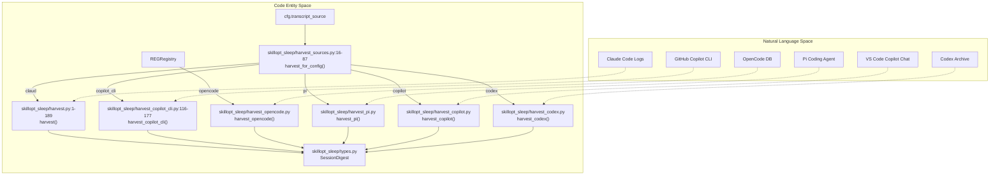
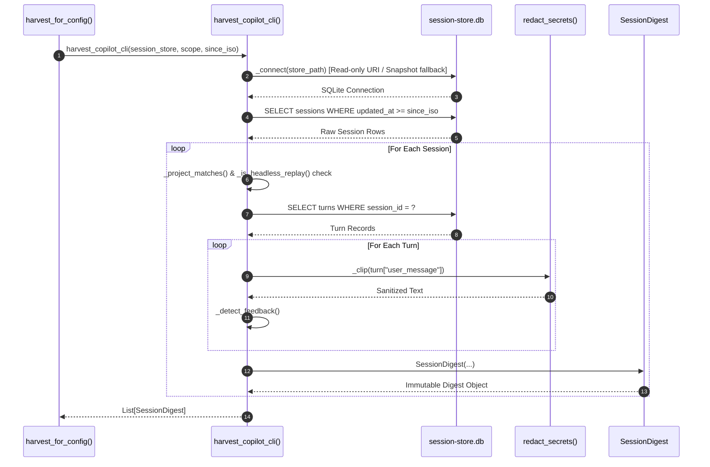

<!-- source: DeepWiki mcp.deepwiki.com · repo microsoft/SkillOpt · extra page Harvesting Session Transcripts · fetched 2026-10-26 -->

# Harvesting Session Transcripts

Relevant source files

The following files were used as context for generating this wiki page:

- [docs/guide/installation.md](docs/guide/installation.md)
- [plugins/claude-code/scripts/sleep.sh](plugins/claude-code/scripts/sleep.sh)
- [plugins/openclaw/skillopt_sleep_openclaw.py](plugins/openclaw/skillopt_sleep_openclaw.py)
- [plugins/openclaw/slash_sleep.py](plugins/openclaw/slash_sleep.py)
- [skillopt_sleep/harvest.py](skillopt_sleep/harvest.py)
- [skillopt_sleep/harvest_codex.py](skillopt_sleep/harvest_codex.py)
- [skillopt_sleep/harvest_copilot.py](skillopt_sleep/harvest_copilot.py)
- [skillopt_sleep/harvest_copilot_cli.py](skillopt_sleep/harvest_copilot_cli.py)
- [skillopt_sleep/harvest_opencode.py](skillopt_sleep/harvest_opencode.py)
- [skillopt_sleep/harvest_pi.py](skillopt_sleep/harvest_pi.py)
- [skillopt_sleep/harvest_sources.py](skillopt_sleep/harvest_sources.py)
- [tests/fixtures/copilot/session-v3.jsonl](tests/fixtures/copilot/session-v3.jsonl)
- [tests/fixtures/copilot/workspace.json](tests/fixtures/copilot/workspace.json)
- [tests/test_backend_pi.py](tests/test_backend_pi.py)
- [tests/test_copilot_harvest.py](tests/test_copilot_harvest.py)
- [tests/test_harvest_copilot_cli.py](tests/test_harvest_copilot_cli.py)
- [tests/test_harvest_opencode.py](tests/test_harvest_opencode.py)
- [tests/test_harvest_opencode_live.py](tests/test_harvest_opencode_live.py)
- [tests/test_harvest_pi.py](tests/test_harvest_pi.py)
- [tests/test_minimax_region.py](tests/test_minimax_region.py)
- [tests/test_sleep_skill_harvest.py](tests/test_sleep_skill_harvest.py)

### Purpose and Scope
This page documents the transcript harvesting subsystem within `skillopt_sleep`. The harvesting layer reads local, read-only session artifacts produced by various coding assistants (Claude Code, GitHub Copilot CLI and VS Code extension, OpenCode, Pi, Codex, and Cursor), normalizes them into structured `SessionDigest` instances, and applies rigorous privacy redaction and heuristic noise filtering before downstream mining.

---

### 1. Architecture and Transcript Source Registry (`harvest_sources.py`)

The entry point for harvesting is `harvest_for_config` located in `skillopt_sleep/harvest_sources.py`. This function inspects the runtime configuration parameter `transcript_source` and dispatches execution to the appropriate per-source harvester module. It also coordinates shared scoping constraints (`scope`, `invoked_project`, `since_iso`, and `limit`).

Sources: `skillopt_sleep/harvest_sources.py:1-87`, `skillopt_sleep/harvest.py:1-189`, `skillopt_sleep/harvest_copilot_cli.py:116-177`.

---

### 2. Normalization, Filtering, and Privacy Redaction

Regardless of the source agent, raw transcripts undergo strict normalization and filtering to strip out engine self-calls, intermediate reasoning blocks, and sensitive credentials.

#### Feedback Signal Detection
Harvesters inspect user prompts for known negative and positive feedback phrases to gauge task outcome (`_detect_feedback`). These phrases include default English dictionaries (`_NEGATIVE_FEEDBACK`, `_POSITIVE_FEEDBACK`) augmented by environment variables `SKILLOPT_SLEEP_NEG_FEEDBACK` and `SKILLOPT_SLEEP_POS_FEEDBACK` [skillopt_sleep/harvest.py:30-49]().

#### Replay and Agent Filtering
To prevent the engine from training on its own automated judge or reflection runs, harvesters check for engine-specific prompt markers (`_REPLAY_PROMPT_MARKERS`) and sub-agent wrappers (`_AGENT_SESSION_MARKERS`) [skillopt_sleep/harvest.py:156-187](). Sessions matching these markers are dropped.

#### Secret Redaction
Before text is clipped or stored in a `SessionDigest`, secrets are scrubbed via `redact_secrets` [skillopt_sleep/harvest_copilot_cli.py:47-53](). Redaction occurs prior to truncation (`_clip`) to avoid retaining trailing secret fragments that no longer match regular expression boundaries.

Sources: `skillopt_sleep/harvest.py:30-187`, `skillopt_sleep/harvest_copilot_cli.py:47-53`.

---

### 3. Per-Source Harvester Implementations

#### Claude Code Harvester (`harvest.py`)
Reads local history from `~/.claude/history.jsonl` and session transcripts from `~/.claude/projects/<slug>/<sessionId>.jsonl` [skillopt_sleep/harvest.py:7-13](). It flattens message contents (`_text_from_content`), extracts tool invocations (`_tool_names_from_content`), and isolates `Skill` tool targets (`_skill_names_from_content`) [skillopt_sleep/harvest.py:66-114]().

#### GitHub Copilot CLI Harvester (`harvest_copilot_cli.py`)
Queries the global SQLite store at `~/.copilot/session-store.db` [skillopt_sleep/harvest_copilot_cli.py:1-7](). Because live CLI sessions frequently lock the database via WAL mode, `_connect` attempts a read-only URI open (`_ro_uri`), falling back to a temporary filesystem snapshot if locked [skillopt_sleep/harvest_copilot_cli.py:56-114](). It maps `sessions` and `turns` tables into standardized digest fields [skillopt_sleep/harvest_copilot_cli.py:136-177]().

#### OpenCode Harvester (`harvest_opencode.py`)
Opens OpenCode's SQLite database (`opencode.db`) under XDG data paths in read-only mode (`PRAGMA query_only = ON`) [skillopt_sleep/harvest_opencode.py:1-100](). It validates required schema columns across `session`, `message`, and `part` tables (`_has_supported_schema`) [skillopt_sleep/harvest_opencode.py:33-118]() and extracts user/assistant text while ignoring raw patches and provider metadata.

#### Pi Coding Agent Harvester (`harvest_pi.py`)
Parses `.jsonl` session logs generated by Pi. It reconstructs tree structures, prunes inactive branches, filters out `thinking` blocks, and extracts tool usage from `toolCall` objects while avoiding the misclassification of recovered tool errors as task failures [tests/test_harvest_pi.py:20-63]().

Sources: `skillopt_sleep/harvest.py:1-114`, `skillopt_sleep/harvest_copilot_cli.py:1-114`, `skillopt_sleep/harvest_opencode.py:33-118`, `tests/test_harvest_pi.py:20-63`.

---

### 4. Data Flow and Execution Sequence

The sequence below illustrates how a harvesting run iterates through storage backends, applies safety checks, and instantiates `SessionDigest` objects.

Sources: `skillopt_sleep/harvest_sources.py:16-87`, `skillopt_sleep/harvest_copilot_cli.py:56-177`, `skillopt_sleep/staging.py:30`.

---

