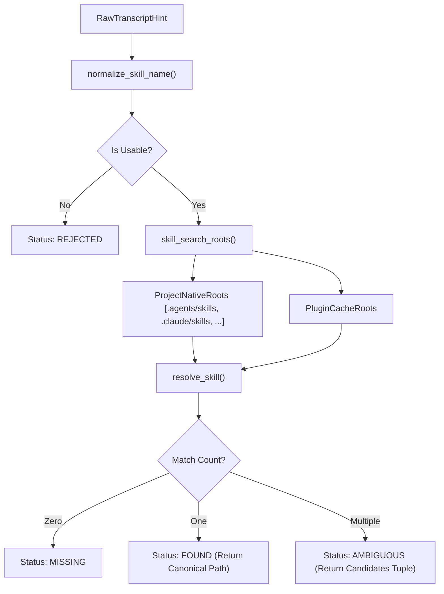
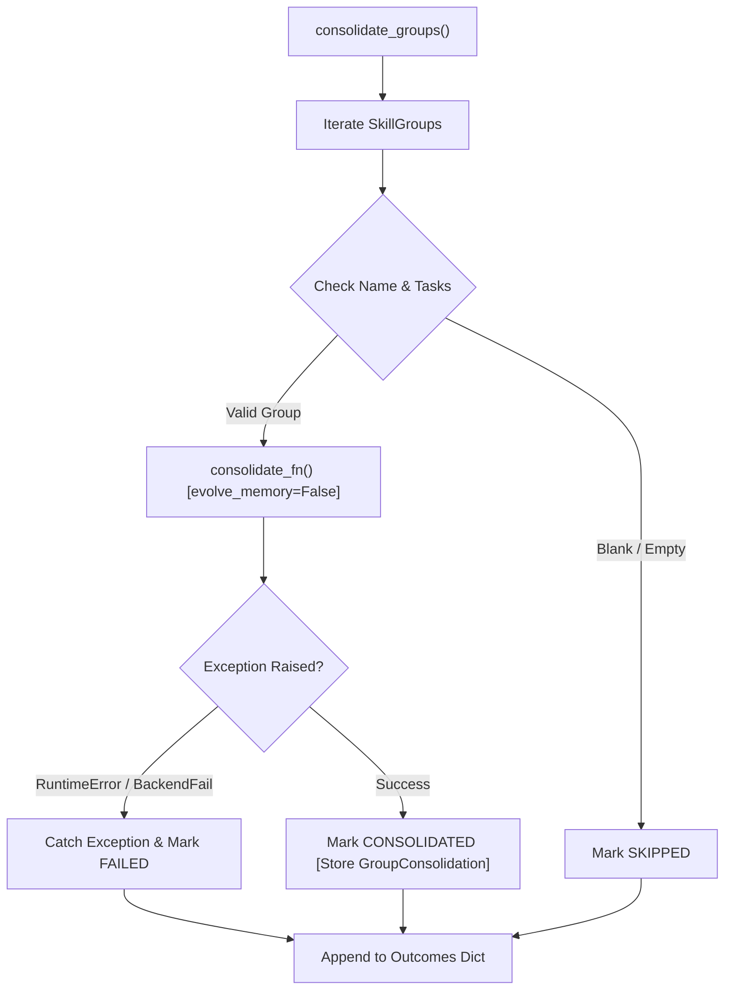

<!-- source: DeepWiki mcp.deepwiki.com · repo microsoft/SkillOpt · extra page Multi-Skill Fan-Out and Skill Resolution · fetched 2026-10-26 -->

# Multi-Skill Fan-Out and Skill Resolution

<details>
<summary>Relevant source files</summary>

The following files were used as context for generating this wiki page:

- [docs/sleep/multi-skill-staging.md](docs/sleep/multi-skill-staging.md)
- [skillopt_sleep/multi_skill.py](skillopt_sleep/multi_skill.py)
- [skillopt_sleep/skill_resolver.py](skillopt_sleep/skill_resolver.py)
- [tests/test_sleep_multi_skill.py](tests/test_sleep_multi_skill.py)
- [tests/test_sleep_skill_group_report.py](tests/test_sleep_skill_group_report.py)
- [tests/test_sleep_skill_resolver.py](tests/test_sleep_skill_resolver.py)

</details>


## Purpose and Scope

This page details the multi-skill fan-out and skill resolution subsystem within `skillopt_sleep`. While traditional optimization runs target a single monolithic skill document per night, the multi-skill fan-out architecture allows SkillOpt-Sleep to harvest, group, resolve, and consolidate multiple distinct skill domains from a single set of agent transcripts. This subsystem covers untrusted skill name normalization, bounded filesystem resolution against secure local roots, isolated group-level consolidation pipelines, per-group reporting, and reviewed subset adoption.

---

## 1. Skill Hints and Task Grouping

Mined tasks extracted from agent session transcripts may contain explicit skill hints pointing to specialized prompt files or operational directives. Instead of merging all tasks into a single candidate update, the sleep engine groups tasks by their normalized skill identifier [docs/sleep/multi-skill-staging.md:21-35]().

The core data structure representing a skill's slice of the night is the `SkillGroup` dataclass, defined in `skillopt_sleep/multi_skill.py` [skillopt_sleep/multi_skill.py:27-34]():

```python
@dataclass
class SkillGroup:
    """One skill's slice of the night: its name, its document, its tasks."""

    skill_name: str
    skill: str = ""
    tasks: List[TaskRecord] = field(default_factory=list)
```

Sources:
- `skillopt_sleep/multi_skill.py:27-34`
- `docs/sleep/multi-skill-staging.md:21-35`

---

## 2. Bounded Skill Resolution (`skill_resolver.py`)

Because skill names observed in runtime transcripts are untrusted strings, resolution is strictly bounded. The `skill_resolver` module normalizes names, validates single path segments, and matches them exclusively against documented local skill roots without executing file writes or edits [skillopt_sleep/skill_resolver.py:1-11]().

### Name Normalization

The `normalize_skill_name` function rejects directory traversal tokens, absolute paths, home-relative paths, control characters, and path separators, ensuring that only clean single-segment names are processed [skillopt_sleep/skill_resolver.py:42-65]():

```python
def normalize_skill_name(name: object) -> str:
    if not isinstance(name, str):
        return ""
    candidate = name.strip()
    if not candidate or candidate in {os.curdir, os.pardir}:
        return ""
    if candidate.startswith("~") or os.isabs(candidate) or os.path.splitdrive(candidate)[0]:
        return ""
    if "/" in candidate or "\\" in candidate or os.sep in candidate:
        return ""
    if any(ord(ch) < 32 or ord(ch) == 127 for ch in candidate):
        return ""
    return candidate
```

### Search Roots and Security

`skill_search_roots` scans project-native hidden directories (`.agents/skills`, `.claude/skills`, `.cursor/skills`, `.devin/skills`), configured user homes, and installed Claude plugins in a deterministic order [skillopt_sleep/skill_resolver.py:120-180](). 

`resolve_skill` enforces that resolved paths reside strictly within these search roots, rejecting symlink escapes or drive-crossing attempts [tests/test_sleep_skill_resolver.py:108-127](). Resolution outcomes are strictly categorized into four states:
- `FOUND`: Exactly one valid matching `SKILL.md` exists across all roots.
- `MISSING`: No root contains the requested skill.
- `AMBIGUOUS`: Multiple roots contain the same skill name.
- `REJECTED`: The candidate name failed security or normalization checks.

Diagram: Resolver Search Roots and Bounded Resolution Flow


Sources:
- `skillopt_sleep/skill_resolver.py:27-180`
- `tests/test_sleep_skill_resolver.py:50-127`

---

## 3. Per-Group Consolidation and Isolation

Once tasks are grouped and resolved, `consolidate_groups` executes independent optimization runs for each valid skill group [skillopt_sleep/multi_skill.py:50-128]().

### Isolation Guarantees

1. **Shared Memory Read-Only Constraint**: Shared agent memory (`memory`) is passed read-only (`evolve_memory = False`) to prevent one skill group from mutating another group's context [skillopt_sleep/multi_skill.py:73-84]().
2. **Error Isolation**: If an individual group consolidation raises an unexpected exception (e.g., a backend formatting error), it is caught, recorded as `failed` with a truncated exception reason, and does not abort the broader night's processing for neighboring groups [skillopt_sleep/multi_skill.py:119-124]().
3. **Control-Flow Propagation**: Critical failures like `PendingCalls` or `CursorBackendError` bypass local row isolation and propagate immediately to maintain fail-closed transactional guarantees [skillopt_sleep/multi_skill.py:114-118]().

Diagram: Multi-Skill Fan-Out Execution and Error Isolation


Sources:
- `skillopt_sleep/multi_skill.py:50-128`
- `tests/test_sleep_multi_skill.py:67-149`

---

## 4. Per-Group Reporting and Subset Adoption

The outcomes of multi-skill fan-out consolidation are collected into structured reports and recorded in staging manifests.

### Per-Group Reporting

The `skill_group_reports` function converts group outcomes into a list of `SkillGroupReport` objects [skillopt_sleep/multi_skill.py:131-161](). Skipped and failed groups maintain zeroed evaluation scores and preserve their distinct failure reason strings rather than inheriting metrics from successful neighbor groups [tests/test_sleep_skill_group_report.py:83-103]().

### Staging Manifest Schema v2

Staged multi-skill outputs are recorded in a versioned `manifest.json` under `.skillopt-sleep/staging/` [docs/sleep/multi-skill-staging.md:51-108](). The manifest supports independent proposal files for each accepted skill:

```json
{
  "schema": "skillopt-sleep-staging",
  "schema_version": 2,
  "has_managed_skill": true,
  "skills": [
    {
      "skill_name": "alpha",
      "proposed_file": "proposed_SKILL.alpha.md",
      "live_skill_path": "/home/dev/.claude/skills/alpha/SKILL.md",
      "sha256": "...",
      "live_sha256": "..."
    }
  ]
}
```

### Subset Adoption CLI & API

Adoption operations allow granular selection of specific per-skill proposals without forcing global promotion [docs/sleep/multi-skill-staging.md:132-169]():
- `--skill NAME`: Promotes only the specified per-skill proposal row (repeatable).
- `--all-skills`: Promotes every pending per-skill row.
- `--legacy`: Promotes only co-staged managed skill/memory pairs.

```python
from skillopt_sleep.staging import adopt_skills, latest_staging, pending_staged_skills

night = latest_staging("/path/to/project")
receipts = adopt_skills(night, ["alpha"])
```

Sources:
- `skillopt_sleep/multi_skill.py:131-161`
- `tests/test_sleep_skill_group_report.py:41-103`
- `docs/sleep/multi-skill-staging.md:51-169`

---

