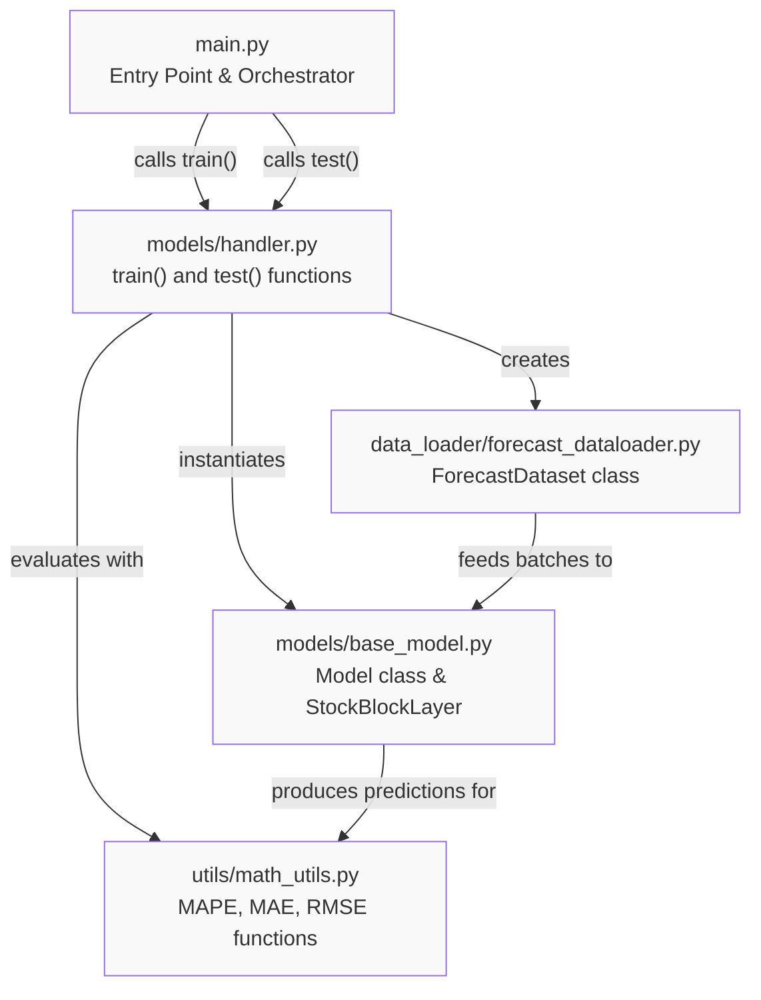
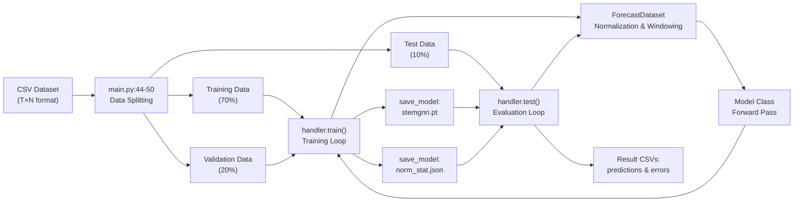
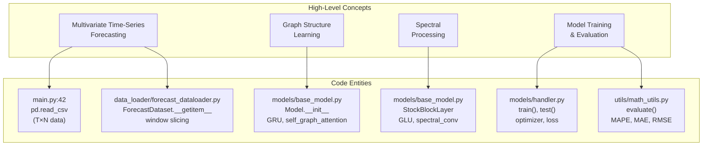

<!-- source: DeepWiki mcp.deepwiki.com · repo microsoft/StemGNN · page 1 Overview · fetched 2026-10-26 -->

# Overview

<details>
<summary>Relevant source files</summary>

The following files were used as context for generating this wiki page:

- [README.md](README.md)
- [main.py](main.py)

</details>


This document provides an introduction to the STemGNN (Spectral Temporal Graph Neural Network) repository, explaining the system's purpose, core concepts, and architectural components. For detailed installation instructions, see [Installation](#2.1). For complete command-line reference, see [Command-Line Interface](#3.1). For architectural deep dives, see [System Architecture](#4).

## Purpose and Scope

The STemGNN repository implements a neural network architecture for **multivariate time-series forecasting**. The system takes multiple time-series sequences (e.g., traffic flow measurements from multiple sensors, power consumption from multiple households) and predicts future values across all sequences simultaneously while learning the relationships between them.

The repository provides a complete end-to-end solution including data loading, model training, evaluation, and inference capabilities.

**Sources:** [README.md:1-4](), [README.md:37-39]()

## What is Multivariate Time-Series Forecasting

Multivariate time-series forecasting predicts future values for multiple related time-series sequences. Unlike univariate forecasting (predicting one sequence), multivariate forecasting:

- **Handles multiple nodes**: Each node represents a distinct time-series (e.g., a traffic sensor, a power meter)
- **Learns inter-node relationships**: The system discovers how nodes influence each other
- **Produces simultaneous predictions**: Forecasts future values for all nodes together

### Input-Output Structure

| Component | Shape | Description |
|-----------|-------|-------------|
| Input Data | `T × N` | `T` timestamps, `N` nodes (no header) |
| Window Size | `window_size` | Number of historical time steps used for prediction |
| Prediction Horizon | `horizon` | Number of future time steps to predict |
| Output Predictions | `horizon × N` | Future values for all N nodes |

**Sources:** [README.md:37-39](), [main.py:13-14]()

## Core System Components

The STemGNN system consists of five primary components that work together to enable multivariate forecasting:



### Component Responsibilities

| Component | File Path | Key Classes/Functions | Responsibility |
|-----------|-----------|----------------------|----------------|
| Entry Point | `main.py` | N/A (script) | Argument parsing, data splitting, orchestration |
| Lifecycle Manager | `models/handler.py` | `train()`, `test()` | Training loops, model persistence, evaluation orchestration |
| Neural Architecture | `models/base_model.py` | `Model`, `StockBlockLayer`, `GLU` | Graph learning, spectral processing, predictions |
| Data Pipeline | `data_loader/forecast_dataloader.py` | `ForecastDataset` | Data loading, normalization, windowing |
| Evaluation | `utils/math_utils.py` | `evaluate()` | Metric computation (MAPE, MAE, RMSE) |

**Sources:** [main.py:1-68](), High-level system architecture diagrams (Diagram 1)

## System Workflow

The following diagram shows how data flows through the system during training and evaluation:



**Sources:** [main.py:44-50](), [main.py:54-67](), High-level system architecture diagrams (Diagram 2)

## Key Features

### 1. Spectral Temporal Graph Learning

The neural architecture combines three powerful techniques:

- **Graph Structure Learning**: Automatically discovers relationships between nodes using self-attention mechanisms
- **Spectral Processing**: Processes time-series in the frequency domain using Fast Fourier Transform (FFT)
- **Temporal Modeling**: Captures temporal dependencies through stacked layers with Gated Linear Units (GLU)

The `Model` class in [models/base_model.py]() implements these capabilities through `StockBlockLayer` components that perform graph convolution followed by spectral sequence processing.

### 2. Flexible Normalization

Two normalization methods are supported via the `norm_method` parameter:

| Method | Formula | Use Case |
|--------|---------|----------|
| `z_score` | `(x - μ) / σ` | Default, handles varying scales |
| `min_max` | `(x - min) / (max - min)` | When data has known bounds |

Normalization statistics are persisted in `norm_stat.json` to ensure consistent preprocessing during evaluation.

### 3. Multiple Dataset Support

The system supports various multivariate time-series datasets:

| Dataset Type | Examples | Node Count Range | Typical Window/Horizon |
|--------------|----------|------------------|------------------------|
| Traffic Flow/Speed | PEMS03, PEMS04, PEMS07, PEMS08, METR-LA, PEMS-BAY | 170-358 | 12/3 |
| Energy | Solar, Electricity | 137+ | 12/3 |
| Physiological | ECG5000 | 140 | 12/3 |
| Epidemiological | COVID-19 | 25 | 28/28 |

**Sources:** [README.md:22-36](), [README.md:71-81](), [main.py:24]()

## Command-Line Arguments

The system is configured entirely through command-line arguments parsed in [main.py:9-33](). Key parameters include:

```python
# Core configuration
--dataset        # Name of CSV file (without extension)
--train          # Enable training (default: True)
--evaluate       # Enable evaluation (default: True)

# Data parameters
--window_size    # Historical steps for prediction (default: 12)
--horizon        # Future steps to predict (default: 3)
--train_length   # Proportion for training (default: 7)
--valid_length   # Proportion for validation (default: 2)
--test_length    # Proportion for testing (default: 1)

# Training parameters
--epoch          # Number of training epochs (default: 50)
--lr             # Learning rate (default: 1e-4)
--batch_size     # Batch size (default: 32)
--norm_method    # 'z_score' or 'min_max' (default: 'z_score')

# Model architecture
--multi_layer    # Number of StockBlockLayers (default: 5)
--dropout_rate   # Dropout probability (default: 0.5)
```

For complete parameter documentation, see [Command-Line Interface](#3.1).

**Sources:** [main.py:9-31](), [README.md:49-68]()

## Execution Modes

The system supports two primary execution modes controlled by the `--train` and `--evaluate` flags:

### Training Mode

When `--train True` is specified, the system:

1. Creates `ForecastDataset` instances for training and validation data
2. Instantiates the `Model` neural network
3. Executes the training loop in `handler.train()`
4. Performs periodic validation
5. Saves the best model to `stemgnn.pt`
6. Saves normalization statistics to `norm_stat.json`

### Evaluation Mode

When `--evaluate True` is specified, the system:

1. Loads the trained model from `stemgnn.pt`
2. Loads normalization statistics from `norm_stat.json`
3. Creates a `ForecastDataset` for test data
4. Executes inference via `handler.test()`
5. Computes MAPE, MAE, and RMSE metrics
6. Saves prediction results to CSV files

Both modes can run independently or sequentially in a single execution.

**Sources:** [main.py:54-68](), High-level system architecture diagrams (Diagram 3)

## Performance Metrics

The system evaluates model performance using three metrics implemented in `utils/math_utils.py`:

| Metric | Full Name | Formula | Interpretation |
|--------|-----------|---------|----------------|
| **MAE** | Mean Absolute Error | `mean(\|y_true - y_pred\|)` | Average magnitude of errors |
| **RMSE** | Root Mean Squared Error | `sqrt(mean((y_true - y_pred)²))` | Penalizes large errors more |
| **MAPE** | Mean Absolute Percentage Error | `mean(\|y_true - y_pred\| / \|y_true\|) × 100` | Relative error percentage |

Lower values indicate better performance for all three metrics.

**Sources:** [README.md:84-101](), High-level system architecture diagrams (Diagram 2, Diagram 5)

## Typical Results

The following table shows representative performance achieved on benchmark datasets:

**Traffic Datasets (horizon: 3 steps)**

| Dataset | Nodes | MAE | RMSE | MAPE (%) |
|---------|-------|-----|------|----------|
| METR-LA | 207 | 2.56 | 5.06 | 6.46 |
| PEMS-BAY | 325 | 1.23 | 2.48 | 2.63 |
| PEMS03 | 358 | 14.32 | 21.64 | 16.24 |
| PEMS04 | 307 | 20.24 | 32.15 | 10.03 |
| PEMS07 | 228 | 2.14 | 4.01 | 5.01 |
| PEMS08 | 170 | 15.83 | 24.93 | 9.26 |

**COVID-19 Dataset (horizon: 28 steps)**

| Dataset | Nodes | MAE | RMSE | MAPE (%) |
|---------|-------|-----|------|----------|
| COVID-19 | 25 | 662.24 | 1023.19 | 19.3 |

**Sources:** [README.md:84-101]()

## Code-to-Concept Mapping

The following diagram maps high-level concepts to their concrete implementations in the codebase:



**Sources:** [main.py:42](), High-level system architecture diagrams (Diagram 1, Diagram 4)

## Output Artifacts

Each training and evaluation run produces the following artifacts in the `output/<dataset>/` directory structure:

### Training Outputs (`output/<dataset>/train/`)

| Artifact | Filename | Contents |
|----------|----------|----------|
| Model checkpoint | `stemgnn.pt` | Trained model parameters (state_dict) |
| Normalization stats | `norm_stat.json` | Mean/std (z_score) or min/max (min_max) |

### Evaluation Outputs (`output/<dataset>/test/`)

| Artifact | Filename | Contents |
|----------|----------|----------|
| Predictions | Various CSV files | Model predictions for test data |
| Metrics | Logged to console | MAPE, MAE, RMSE values |

**Sources:** [main.py:36-41]()

## Quick Example

To train and evaluate on the provided ECG dataset:

```bash
python main.py --train True --evaluate True --dataset ECG_data
```

This command:
1. Loads [dataset/ECG_data.csv]() (5000 timestamps × 140 nodes)
2. Splits data into 70% training, 20% validation, 10% testing
3. Trains a `Model` with 5 `StockBlockLayer` components
4. Evaluates on test data and reports MAPE, MAE, RMSE
5. Saves results to `output/ECG_data/`

For more examples and detailed usage, see [Quick Start](#2.2) and [Training Models](#3.2).

**Sources:** [README.md:39](), [main.py:12]()

## System Requirements

The system requires:

- **OS**: Ubuntu 18.04.2 LTS (recommended)
- **Python**: 3.7
- **Key Dependencies**: PyTorch, pandas, numpy, scipy (see [requirements.txt]())

For installation instructions, see [Installation](#2.1). For detailed dependency information, see [Dependencies](#6.2).

**Sources:** [README.md:6-20]()

## Next Steps

- **To get started**: See [Getting Started](#2) for installation and quick start guides
- **To understand the architecture**: See [System Architecture](#4) for detailed component documentation
- **To train models**: See [Training Models](#3.2) for workflow details
- **To work with custom datasets**: See [Working with Datasets](#3.4) for format specifications
- **To extend the system**: See [Development Guide](#6) for contribution guidelines

---

