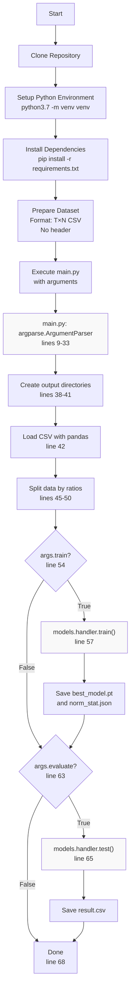
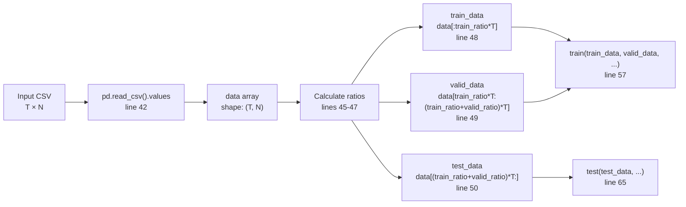
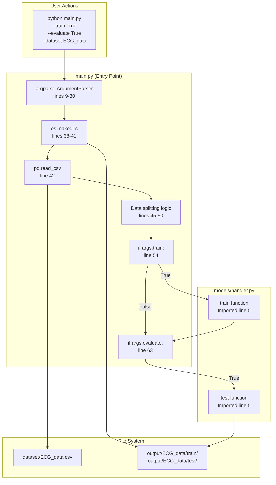

<!-- source: DeepWiki mcp.deepwiki.com · repo microsoft/StemGNN · page 2 Getting Started · fetched 2026-10-26 -->

# Getting Started

<details>
<summary>Relevant source files</summary>

The following files were used as context for generating this wiki page:

- [README.md](README.md)
- [main.py](main.py)
- [requirements.txt](requirements.txt)

</details>


This document provides an overview of the setup process and initial execution workflow for the STemGNN system. It covers the prerequisites, system requirements, and high-level execution flow to help users prepare their environment and run their first training and evaluation session.

For detailed installation instructions, see [Installation](#2.1). For a minimal working example with step-by-step commands, see [Quick Start](#2.2). For comprehensive usage documentation, see [User Guide](#3).

## Prerequisites

The STemGNN system requires Python 3.7 and several scientific computing dependencies. The system is designed to run on both CPU and GPU (CUDA-enabled) devices.

**Recommended Environment:**

| Component | Specification |
|-----------|---------------|
| Operating System | Ubuntu 18.04.2 LTS |
| Python Version | 3.7 |
| Virtual Environment | python3.7-venv |
| Package Manager | pip 20.1.1 or higher |
| setuptools | 41.2.0 or higher |

**Core Dependencies:**

| Package | Version | Purpose |
|---------|---------|---------|
| `torch` | 1.7.1 | Neural network framework |
| `numpy` | 1.19.5 | Numerical computation |
| `pandas` | 1.1.5 | Data loading and manipulation |
| `scipy` | 1.5.4 | Scientific computing utilities |

Sources: [README.md:8-20](), [requirements.txt:1-5]()

## Repository Structure

After cloning the repository, the following directory structure is used:

```
StemGNN/
├── main.py                           # Entry point and orchestrator
├── requirements.txt                  # Python dependencies
├── dataset/                          # Input data directory
│   ├── ECG_data.csv                 # Sample dataset (5000×140)
│   └── <custom>.csv                 # User datasets (T×N format)
├── models/
│   ├── handler.py                   # Training and evaluation functions
│   └── base_model.py                # Neural network architecture
├── data_loader/
│   └── forecast_dataloader.py       # Data preprocessing and windowing
├── utils/
│   └── math_utils.py                # Evaluation metrics
└── output/
    └── <dataset_name>/
        ├── train/                   # Training outputs
        │   ├── norm_stat.json       # Normalization statistics
        │   └── best_model.pt        # Trained model checkpoint
        └── test/                    # Evaluation outputs
            └── result.csv           # Prediction results
```

The system automatically creates `output/` subdirectories based on the dataset name specified in command-line arguments.

Sources: [main.py:35-41](), [README.md:39]()

## Execution Workflow

The following diagram shows the high-level workflow from setup to evaluation:



**Workflow Stages:**

1. **Environment Setup**: Create virtual environment and install dependencies from `requirements.txt`
2. **Data Preparation**: Format dataset as T×N CSV file without headers, place in `dataset/` directory
3. **Execution**: Run `main.py` with appropriate command-line arguments
4. **Training** (if `--train True`): Invokes `train()` from [models/handler.py](), saves model to `output/<dataset>/train/`
5. **Evaluation** (if `--evaluate True`): Invokes `test()` from [models/handler.py](), saves results to `output/<dataset>/test/`

Sources: [main.py:1-68](), [README.md:15-20, 43-47]()

## Command-Line Interface

The system is executed through `main.py` with command-line arguments. The argument parser is initialized at [main.py:9]() and defines all configuration parameters.

**Basic Command Structure:**

```bash
python main.py --train <bool> --evaluate <bool> --dataset <name> [options]
```

**Essential Arguments:**

| Argument | Type | Default | Description |
|----------|------|---------|-------------|
| `--train` | bool | True | Enable training phase |
| `--evaluate` | bool | True | Enable evaluation phase |
| `--dataset` | str | 'ECG_data' | Dataset filename (without .csv extension) |
| `--window_size` | int | 12 | Length of input sliding window |
| `--horizon` | int | 3 | Number of future steps to predict |
| `--device` | str | 'cpu' | Execution device ('cpu' or 'cuda:x') |

For complete parameter documentation, see [Command-Line Interface](#3.1).

Sources: [main.py:9-30](), [README.md:49-68]()

## Data Requirements

Input datasets must conform to the following specification:

**CSV Format Requirements:**
- **No header row**: The CSV must contain only numerical data
- **Shape**: T×N where T = number of timestamps, N = number of nodes (variables)
- **Location**: Place files in `dataset/` directory
- **Naming**: Specify filename without extension in `--dataset` argument

**Example:**
```
# dataset/ECG_data.csv
# Shape: 5000 rows × 140 columns
# No header, comma-separated values
0.123,0.456,0.789,...
0.234,0.567,0.890,...
...
```

The system includes a sample dataset `ECG_data.csv` (5000×140) for testing.

Sources: [README.md:37-39]()

## Data Splitting

The system automatically splits loaded data into train/validation/test sets based on ratio arguments:



**Default Split Ratios:**
- `--train_length 7`: Training portion
- `--valid_length 2`: Validation portion  
- `--test_length 1`: Testing portion
- Actual ratios: 7/10, 2/10, 1/10 of total data

The split is performed sequentially (no shuffling), which is appropriate for time-series data.

Sources: [main.py:45-50]()

## Output Artifacts

After execution, the following artifacts are generated:

**Training Outputs** (`output/<dataset>/train/`):
- `norm_stat.json`: Normalization statistics (mean, std or min, max) for inference reproducibility
- `best_model.pt`: PyTorch checkpoint containing trained model weights

**Evaluation Outputs** (`output/<dataset>/test/`):
- `result.csv`: Prediction results with metrics
- Performance metrics printed to console (MAPE, MAE, RMSE)

The system automatically creates these directories if they don't exist [main.py:38-41]().

Sources: [main.py:36-41]()

## Execution Flow Mapping

This diagram maps the execution stages to specific code entities:



**Key Code Entities:**
- Entry point: `if __name__ == '__main__':` at [main.py:53]()
- Argument parsing: `parser = argparse.ArgumentParser()` at [main.py:9]()
- Training invocation: `train(train_data, valid_data, args, result_train_file)` at [main.py:57]()
- Evaluation invocation: `test(test_data, args, result_train_file, result_test_file)` at [main.py:65]()

Sources: [main.py:1-68]()

## Next Steps

After understanding the execution workflow:

1. **For installation**: Proceed to [Installation](#2.1) for detailed environment setup instructions
2. **For first run**: See [Quick Start](#2.2) for a complete minimal example
3. **For customization**: Review [Command-Line Interface](#3.1) for all configuration options
4. **For custom datasets**: See [Working with Datasets](#3.4) for format specifications and preprocessing
5. **For architecture details**: See [System Architecture](#4) for implementation internals

## Minimal Example

For reference, the most basic execution command using the included sample dataset:

```bash
# Activate virtual environment
source venv/bin/activate

# Train and evaluate on sample ECG dataset
python main.py

# This uses all defaults:
# --train True --evaluate True --dataset ECG_data
# --window_size 12 --horizon 3 --epoch 50
# --device cpu --norm_method z_score
```

This command will:
1. Load `dataset/ECG_data.csv` (5000×140)
2. Split data 7:2:1 into train/valid/test
3. Train for 50 epochs with validation
4. Save model to `output/ECG_data/train/best_model.pt`
5. Evaluate on test set
6. Save results to `output/ECG_data/test/result.csv`
7. Print timing and metrics to console

Sources: [main.py:10-26](), [README.md:39]()

---

