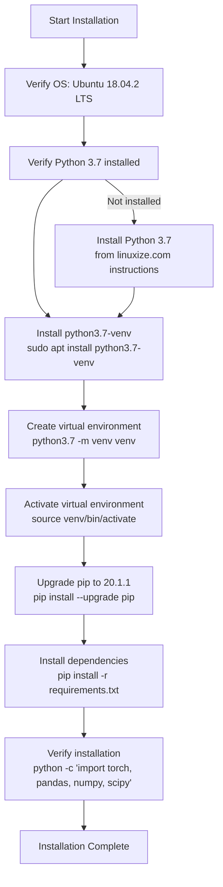
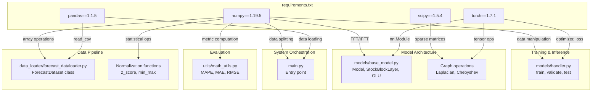
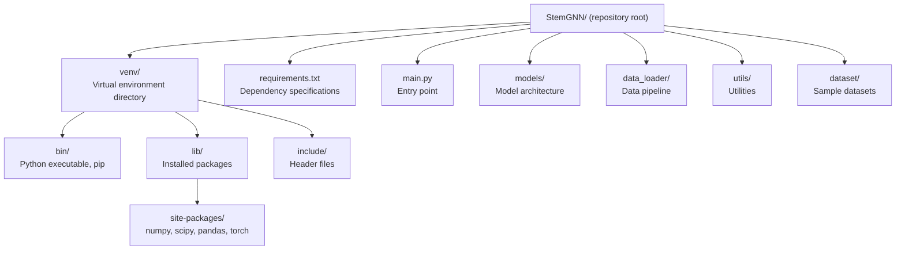

<!-- source: DeepWiki mcp.deepwiki.com · repo microsoft/StemGNN · page 2.1 Installation · fetched 2026-10-26 -->

# Installation

<details>
<summary>Relevant source files</summary>

The following files were used as context for generating this wiki page:

- [README.md](README.md)
- [requirements.txt](requirements.txt)

</details>


This page details the steps required to install STemGNN and set up the Python environment for training and evaluating models. This covers operating system requirements, Python version requirements, virtual environment creation, and dependency installation.

For information about running your first training session after installation, see [Quick Start](#2.2). For detailed documentation of each dependency's role in the system, see [Dependencies](#6.2).

---

## System Requirements

The STemGNN codebase has been verified to work on the following configuration:

| Component | Requirement |
|-----------|-------------|
| Operating System | Ubuntu 18.04.2 LTS (recommended) |
| Python Version | Python 3.7 |
| Package Manager | pip 20.1.1 |
| Setup Tools | setuptools 41.2.0 |

**Sources:** [README.md:8-13]()

### Python 3.7 Installation

If Python 3.7 is not installed on your system, follow the installation instructions for Ubuntu 18.04:

```bash
# Installation steps available at:
# https://linuxize.com/post/how-to-install-python-3-7-on-ubuntu-18-04/
```

After Python 3.7 is installed, install the virtual environment package:

```bash
sudo apt install python3.7-venv
```

**Sources:** [README.md:11-13]()

---

## Installation Process Overview

The following diagram illustrates the complete installation workflow from system preparation through dependency installation:



**Sources:** [README.md:13-20]()

---

## Step-by-Step Installation

### Step 1: Create Virtual Environment

Navigate to the repository root directory and create a Python 3.7 virtual environment:

```bash
python3.7 -m venv venv
```

This command creates a directory named `venv` containing an isolated Python environment. Using `virtualenv` is recommended to avoid conflicts with system-wide Python packages.

**Sources:** [README.md:16]()

### Step 2: Activate Virtual Environment

Activate the virtual environment using:

```bash
source venv/bin/activate
```

After activation, your shell prompt should be prefixed with `(venv)` indicating the virtual environment is active. All subsequent Python and pip commands will use the isolated environment.

**Sources:** [README.md:17]()

### Step 3: Upgrade pip

Upgrade pip to the verified version:

```bash
pip install --upgrade pip
```

This ensures pip version 20.1.1 is installed, which has been verified to work correctly with all dependencies.

**Sources:** [README.md:18]()

### Step 4: Install Dependencies

Install all required Python packages from the requirements file:

```bash
pip install -r requirements.txt
```

This command reads [requirements.txt]() and installs the following packages with their pinned versions:

**Sources:** [README.md:19]()

---

## Dependency Specifications

The [requirements.txt:1-4]() file specifies four core dependencies with exact version pins:

| Package | Version | Primary Purpose in STemGNN |
|---------|---------|---------------------------|
| `numpy` | 1.19.5 | Array operations, numerical computations in model layers |
| `scipy` | 1.5.4 | Sparse matrix operations, Laplacian computation for graph structure |
| `pandas` | 1.1.5 | CSV data loading, time series data manipulation |
| `torch` | 1.7.1 | Deep learning framework, neural network implementation |

**Sources:** [requirements.txt:1-4]()

### Dependency Relationships in System Architecture

The following diagram shows how each dependency is utilized across the codebase:



**Sources:** [requirements.txt:1-4](), [README.md:13-20]()

---

## Verification

After installation, verify that all dependencies are correctly installed by attempting to import them:

```bash
python -c "import torch; import pandas; import numpy; import scipy; print('All dependencies successfully imported')"
```

If the command executes without errors and prints the success message, the installation is complete.

### Checking Installed Versions

To verify the exact versions installed:

```bash
pip list | grep -E "(numpy|scipy|pandas|torch)"
```

Expected output should match:
```
numpy    1.19.5
pandas   1.1.5
scipy    1.5.4
torch    1.7.1
```

---

## Post-Installation Structure

After completing the installation steps, your repository directory structure should include the virtual environment:



**Sources:** [README.md:13-20]()

---

## Troubleshooting Common Issues

### Issue: `python3.7: command not found`

**Solution:** Python 3.7 is not installed. Follow the installation instructions linked in the System Requirements section above.

### Issue: `pip: command not found` after activation

**Solution:** The virtual environment may not have been created correctly. Delete the `venv` directory and repeat Step 1.

### Issue: Version mismatch for installed packages

**Solution:** Ensure pip is upgraded to version 20.1.1 before installing requirements:
```bash
pip install --upgrade pip==20.1.1
pip install -r requirements.txt
```

### Issue: PyTorch installation fails

**Solution:** PyTorch 1.7.1 may require specific system libraries. Ensure you have the appropriate CUDA version if using GPU, or use CPU-only version. The [requirements.txt:4]() specifies `torch==1.7.1` which defaults to CPU on most systems.

**Sources:** [README.md:13-20]()

---

## Next Steps

After successful installation, proceed to [Quick Start](#2.2) to run your first training session on the provided ECG dataset. For understanding all available command-line options, see [Command-Line Interface](#3.1). To use custom datasets, refer to [Working with Datasets](#3.4).

---

