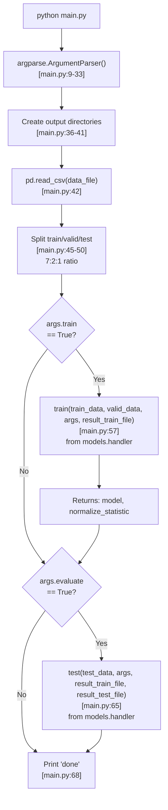
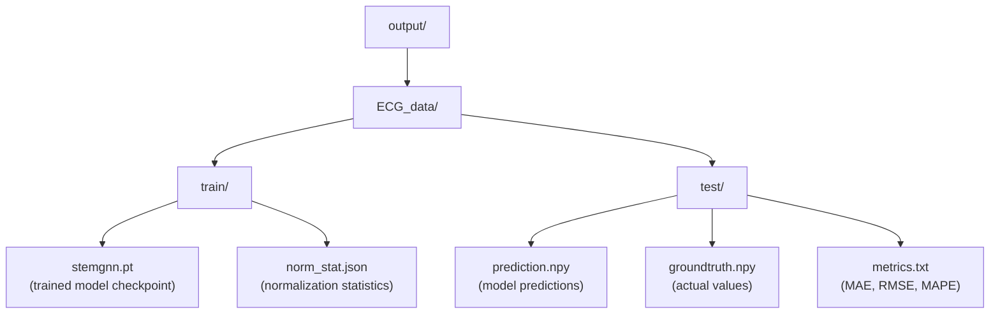
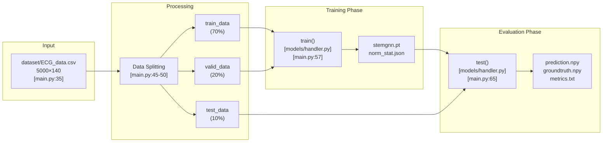

<!-- source: DeepWiki mcp.deepwiki.com · repo microsoft/StemGNN · page 2.2 Quick Start · fetched 2026-10-26 -->

# Quick Start

<details>
<summary>Relevant source files</summary>

The following files were used as context for generating this wiki page:

- [README.md](README.md)
- [dataset/ECG_data.csv](dataset/ECG_data.csv)
- [main.py](main.py)

</details>


This page provides a minimal working example to get you running training and evaluation with STemGNN immediately. It covers the basic command-line execution, what happens during runtime, and what outputs to expect.

For detailed explanations of all command-line options, see [Command-Line Interface](#3.1). For in-depth training and evaluation workflows, see [Training Models](#3.2) and [Evaluating Models](#3.3). For installation prerequisites, see [Installation](#2.1).

---

## Basic Execution

The simplest way to run STemGNN is with the default configuration on the provided ECG dataset:

```bash
python main.py
```

This single command will:
1. Load the ECG_data.csv dataset (5000 timestamps × 140 nodes)
2. Split data into train/validation/test sets (7:2:1 ratio)
3. Train the STemGNN model for 50 epochs
4. Evaluate the trained model on the test set
5. Save results to the `output/ECG_data/` directory

**Sources:** [README.md:39-39](), [main.py:12-26]()

---

## Default Configuration

When running without arguments, `main.py` uses these default parameters:

| Parameter | Default Value | Description |
|-----------|--------------|-------------|
| `--train` | `True` | Enable training phase |
| `--evaluate` | `True` | Enable evaluation phase |
| `--dataset` | `ECG_data` | Dataset filename (without .csv) |
| `--window_size` | `12` | Length of input sliding window |
| `--horizon` | `3` | Number of future timesteps to predict |
| `--train_length` | `7` | Relative length of training data |
| `--valid_length` | `2` | Relative length of validation data |
| `--test_length` | `1` | Relative length of test data |
| `--epoch` | `50` | Number of training epochs |
| `--lr` | `0.0001` | Learning rate for optimizer |
| `--multi_layer` | `5` | Number of StockBlockLayer stacks |
| `--device` | `cpu` | Computation device |
| `--batch_size` | `32` | Training batch size |
| `--norm_method` | `z_score` | Normalization method |

**Sources:** [main.py:9-30]()

---

## Execution Flow Diagram



**Execution Flow with Actual Code Entities**

This diagram shows the execution path through `main.py` with references to actual functions and line numbers. The `train()` and `test()` functions are imported from `models.handler` and orchestrate the machine learning lifecycle.

**Sources:** [main.py:1-68](), [main.py:5]()

---

## Output Directory Structure

Running `python main.py` creates the following directory structure:



**Output Files Generated During Execution**

The `output/` directory is organized by dataset name. The `train/` subdirectory contains model artifacts, while `test/` contains evaluation results.

**Sources:** [main.py:36-41]()

---

## Understanding the Output

### Training Output

During training, you will see periodic validation metrics printed to the console:

```
Training configs: Namespace(train=True, evaluate=True, dataset='ECG_data', ...)
epoch 1, validate loss: 0.8234
epoch 2, validate loss: 0.7891
...
epoch 50, validate loss: 0.3421
Training took 15.3 minutes
```

The training phase saves:
- **stemgnn.pt**: PyTorch model checkpoint containing trained weights
- **norm_stat.json**: Normalization statistics (mean/std or min/max) required for inference

**Sources:** [main.py:54-59]()

### Evaluation Output

After training completes, evaluation runs automatically:

```
Evaluation took 2.1 minutes
done
```

The evaluation phase creates three files in `output/ECG_data/test/`:
- **prediction.npy**: Model's predicted values (NumPy array)
- **groundtruth.npy**: Actual test set values (NumPy array)
- **metrics.txt**: Performance metrics (MAE, RMSE, MAPE)

**Sources:** [main.py:63-68]()

---

## Data Flow Through the System



**Complete Data Flow from CSV to Results**

This diagram shows how data flows from the input CSV file through splitting, training, and evaluation, mapping to specific code locations in `main.py`.

**Sources:** [main.py:35-68]()

---

## Customizing the Quick Start

### Running with a Different Dataset

To use a custom dataset (must be in `dataset/` directory):

```bash
python main.py --dataset your_data --n_route 100 --window_size 12 --horizon 3
```

Where:
- `your_data` is the filename without `.csv` extension
- `n_route` is the number of nodes (columns) in your CSV
- `window_size` and `horizon` define the forecasting window

**Note:** Your CSV must have shape `T×N` (timestamps × nodes) with no header row.

**Sources:** [README.md:37-37](), [main.py:12]()

### Running Only Training or Evaluation

To train without evaluating:

```bash
python main.py --train True --evaluate False
```

To evaluate a previously trained model:

```bash
python main.py --train False --evaluate True
```

**Sources:** [main.py:10-11](), [main.py:54-67]()

### Using GPU

If CUDA is available, specify the device:

```bash
python main.py --device cuda:0
```

**Sources:** [main.py:21]()

---

## Verifying Successful Execution

After running `python main.py`, verify success by checking:

1. **Training completed**: Look for the message `Training took X minutes`
2. **Files created**: Verify `output/ECG_data/train/stemgnn.pt` exists
3. **Evaluation completed**: Look for the message `Evaluation took X minutes`
4. **Metrics computed**: Check `output/ECG_data/test/metrics.txt` exists
5. **Final message**: See `done` printed to console

**Sources:** [main.py:59](), [main.py:67](), [main.py:68]()

---

## Quick Start Command Reference

| Use Case | Command |
|----------|---------|
| Basic training and evaluation | `python main.py` |
| Custom dataset | `python main.py --dataset PEMS07 --n_route 228` |
| GPU training | `python main.py --device cuda:0` |
| More epochs | `python main.py --epoch 100` |
| Different data split | `python main.py --train_length 8 --valid_length 1 --test_length 1` |
| Only training | `python main.py --train True --evaluate False` |
| Only evaluation | `python main.py --train False --evaluate True` |
| Early stopping | `python main.py --early_stop True` |

**Sources:** [main.py:9-30](), [README.md:45-47]()

---

## Next Steps

After successfully running the quick start:

- **Explore all configuration options**: See [Command-Line Interface](#3.1) for complete parameter documentation
- **Understand training details**: Read [Training Models](#3.2) for optimization, learning rate scheduling, and early stopping
- **Learn about evaluation metrics**: See [Evaluating Models](#3.3) for MAPE, MAE, and RMSE calculations
- **Use your own data**: Review [Working with Datasets](#3.4) for dataset format requirements
- **Understand the architecture**: See [Neural Network Architecture](#4.3) for model internals

**Sources:** [README.md:43-68]()

---

