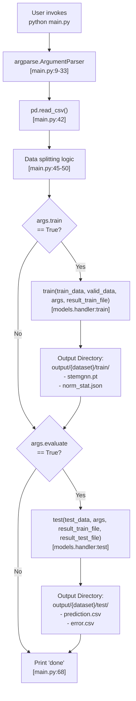
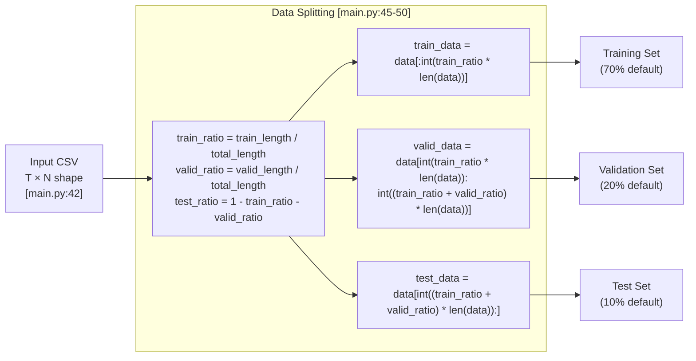
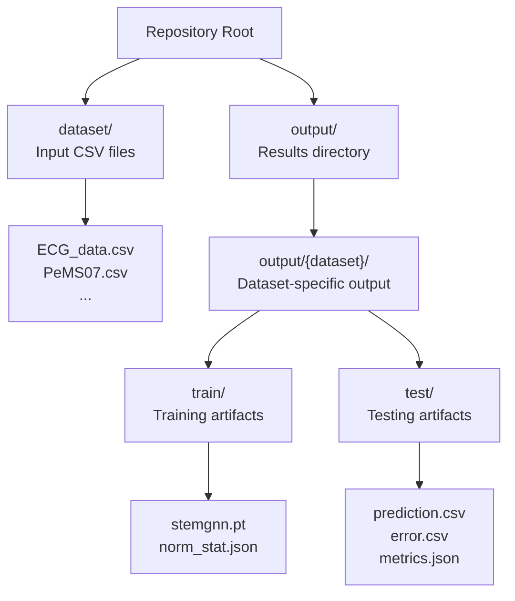

<!-- source: DeepWiki mcp.deepwiki.com · repo microsoft/StemGNN · page 3 User Guide · fetched 2026-10-26 -->

# User Guide

<details>
<summary>Relevant source files</summary>

The following files were used as context for generating this wiki page:

- [README.md](README.md)
- [main.py](main.py)

</details>


## Purpose and Scope

This user guide provides comprehensive documentation for operating the STemGNN system. It covers all command-line options, typical workflows, and practical usage patterns for training and evaluating spectral temporal graph neural networks on multivariate time-series data.

For installation and initial setup instructions, see [Getting Started](#2). For detailed technical explanations of the system architecture and internal components, see [System Architecture](#4). For complete parameter reference and API documentation, see [Reference](#5).

This guide is organized into specialized subsections covering the command-line interface ([CLI](#3.1)), training procedures ([Training Models](#3.2)), evaluation procedures ([Evaluating Models](#3.3)), dataset management ([Working with Datasets](#3.4)), and normalization methods ([Normalization Methods](#3.5)).

Sources: [README.md:1-103](), [main.py:1-68]()

---

## System Invocation

The STemGNN system is invoked through the `main.py` entry point. All operations are controlled via command-line arguments that configure the training and evaluation pipelines. The system operates in three primary modes:

1. **Training only**: Creates a trained model from input data
2. **Evaluation only**: Tests a pre-trained model on test data
3. **Training + Evaluation**: Complete end-to-end workflow

### Basic Invocation Pattern

```bash
python main.py \
    --train <True|False> \
    --evaluate <True|False> \
    --dataset <dataset_name> \
    --window_size <int> \
    --horizon <int> \
    --norm_method <z_score|min_max>
```

The system automatically:
- Creates output directories under `output/<dataset>/train/` and `output/<dataset>/test/`
- Splits data into training, validation, and test sets based on specified ratios
- Saves trained models as `stemgnn.pt`
- Saves normalization statistics as `norm_stat.json`
- Generates prediction and error CSV files

Sources: [main.py:9-51](), [README.md:43-68]()

---

## Workflow Overview

The following diagram illustrates how user commands flow through the system's execution pipeline:



Sources: [main.py:9-68](), [README.md:43-46]()

---

## Data Splitting Strategy

The system divides input data into three non-overlapping segments based on user-specified length parameters. The default configuration uses a 7:2:1 ratio for training, validation, and testing respectively.



| Parameter | Purpose | Default | Controls |
|-----------|---------|---------|----------|
| `train_length` | Training set size weight | 7 | Portion of data used for optimization |
| `valid_length` | Validation set size weight | 2 | Portion of data used for hyperparameter tuning |
| `test_length` | Test set size weight | 1 | Portion of data used for final evaluation |

The system performs splitting chronologically, preserving temporal order. The first `train_ratio` portion becomes training data, the next `valid_ratio` becomes validation data, and the remainder becomes test data.

Sources: [main.py:15-17](), [main.py:45-50](), [README.md:58-60]()

---

## Common Usage Patterns

### Pattern 1: Training and Evaluation on Provided Dataset

The simplest invocation uses default parameters with the included ECG dataset:

```bash
python main.py
```

This executes with defaults:
- Dataset: `ECG_data.csv` (5000 timestamps × 140 nodes)
- Training enabled, evaluation enabled
- Window size: 12, horizon: 3
- Normalization: z-score
- Data split: 7:2:1 ratio

Sources: [main.py:10-24](), [README.md:39]()

### Pattern 2: Training Only with Custom Parameters

To train a model without immediate evaluation:

```bash
python main.py \
    --train True \
    --evaluate False \
    --dataset PeMS07 \
    --window_size 12 \
    --horizon 3 \
    --epoch 100 \
    --lr 1e-4 \
    --batch_size 64
```

This produces:
- `output/PeMS07/train/stemgnn.pt` - Trained model checkpoint
- `output/PeMS07/train/norm_stat.json` - Normalization statistics

Sources: [main.py:54-59](), [README.md:46-47]()

### Pattern 3: Evaluation of Pre-Trained Model

To evaluate an existing model without retraining:

```bash
python main.py \
    --train False \
    --evaluate True \
    --dataset PeMS07
```

Requirements:
- `output/PeMS07/train/stemgnn.pt` must exist
- `output/PeMS07/train/norm_stat.json` must exist
- Other parameters must match those used during training

Sources: [main.py:63-67]()

---

## Parameter Categories

The system accepts parameters in four functional categories:

### Execution Control Parameters

| Parameter | Type | Default | Description |
|-----------|------|---------|-------------|
| `train` | bool | True | Enable training phase |
| `evaluate` | bool | True | Enable evaluation phase |
| `device` | str | 'cpu' | Computation device ('cpu' or 'cuda:x') |

### Dataset Configuration Parameters

| Parameter | Type | Default | Description |
|-----------|------|---------|-------------|
| `dataset` | str | 'ECG_data' | Base name of CSV file in dataset/ directory |
| `window_size` | int | 12 | Length of input sliding window |
| `horizon` | int | 3 | Number of future steps to predict |
| `train_length` | float | 7 | Training set size weight |
| `valid_length` | float | 2 | Validation set size weight |
| `test_length` | float | 1 | Test set size weight |
| `norm_method` | str | 'z_score' | Normalization method ('z_score' or 'min_max') |

### Training Hyperparameters

| Parameter | Type | Default | Description |
|-----------|------|---------|-------------|
| `epoch` | int | 50 | Number of training epochs |
| `lr` | float | 1e-4 | Learning rate |
| `batch_size` | int | 32 | Training batch size |
| `optimizer` | str | 'RMSProp' | Optimizer algorithm |
| `validate_freq` | int | 1 | Validation frequency (epochs) |
| `early_stop` | bool | False | Enable early stopping |
| `exponential_decay_step` | int | 5 | Learning rate decay step |
| `decay_rate` | float | 0.5 | Learning rate decay rate |

### Model Architecture Parameters

| Parameter | Type | Default | Description |
|-----------|------|---------|-------------|
| `multi_layer` | int | 5 | Number of StockBlockLayers (controls model depth) |
| `dropout_rate` | float | 0.5 | Dropout probability |
| `leakyrelu_rate` | float | 0.2 | LeakyReLU negative slope |

Sources: [main.py:9-30](), [README.md:51-68]()

---

## File System Organization

The system follows a consistent directory structure for all operations:



### Directory Creation

The system automatically creates output directories if they do not exist:

```python
# From main.py:36-41
result_train_file = os.path.join('output', args.dataset, 'train')
result_test_file = os.path.join('output', args.dataset, 'test')
if not os.path.exists(result_train_file):
    os.makedirs(result_train_file)
if not os.path.exists(result_test_file):
    os.makedirs(result_test_file)
```

Sources: [main.py:35-41]()

---

## Execution Timing

The system reports execution time for both training and evaluation phases:

| Phase | Timing Measurement | Output Format |
|-------|-------------------|---------------|
| Training | Start: before `train()` call<br/>End: after `train()` returns | "Training took X minutes" |
| Evaluation | Start: before `test()` call<br/>End: after `test()` returns | "Evaluation took X minutes" |

Example output:
```
Training configs: Namespace(train=True, evaluate=True, ...)
Training took 45.3 minutes
Evaluation took 2.1 minutes
done
```

Sources: [main.py:56-67]()

---

## Error Handling

The system implements keyboard interrupt handling during training to allow graceful early termination:

```python
# From main.py:55-62
try:
    before_train = datetime.now().timestamp()
    _, normalize_statistic = train(train_data, valid_data, args, result_train_file)
    after_train = datetime.now().timestamp()
    print(f'Training took {(after_train - before_train) / 60} minutes')
except KeyboardInterrupt:
    print('-' * 99)
    print('Exiting from training early')
```

When Ctrl+C is pressed during training, the system prints a separator line and exits cleanly without raising an exception. Partial training results may not be saved depending on when the interrupt occurs.

Sources: [main.py:55-62]()

---

## Subsection Overview

This user guide is organized into the following detailed subsections:

- **[Command-Line Interface](#3.1)**: Complete reference for all command-line arguments including detailed descriptions, value constraints, and usage examples for each parameter.

- **[Training Models](#3.2)**: Detailed explanation of the training pipeline including data preparation, model initialization, optimization loop, learning rate scheduling, validation, early stopping, and checkpoint saving.

- **[Evaluating Models](#3.3)**: Complete guide to model evaluation including loading pre-trained models, inference procedures, metric calculation (MAPE, MAE, RMSE), and result interpretation.

- **[Working with Datasets](#3.4)**: Comprehensive documentation of dataset requirements including file format specifications (T×N shape, no header), supported datasets, data preparation procedures, and instructions for using custom datasets.

- **[Normalization Methods](#3.5)**: In-depth explanation of z-score and min-max normalization methods, mathematical formulations, when to use each method, and how normalization affects model performance.

Each subsection provides focused, detailed information about its specific topic. Refer to the appropriate subsection for comprehensive coverage of each area.

Sources: [README.md:1-103](), [main.py:1-68]()

---

