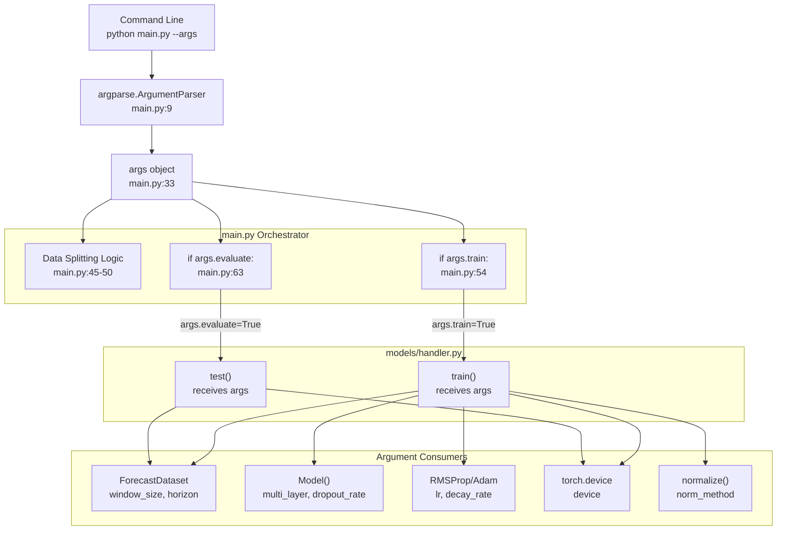
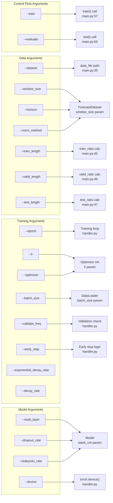

<!-- source: DeepWiki mcp.deepwiki.com · repo microsoft/StemGNN · page 3.1 Command-Line Interface · fetched 2026-10-26 -->

# Command-Line Interface

<details>
<summary>Relevant source files</summary>

The following files were used as context for generating this wiki page:

- [README.md](README.md)
- [main.py](main.py)

</details>


## Purpose and Scope

This document provides comprehensive documentation for the command-line interface of the STemGNN system. The CLI is the primary method for interacting with the system, controlling training, evaluation, and all model configuration through command-line arguments.

For information about the training workflow enabled by these arguments, see [Training Models](#3.2). For evaluation procedures, see [Evaluating Models](#3.3). For dataset-specific configurations, see [Working with Datasets](#3.4).

**Sources:** [main.py:1-68](), [README.md:43-68]()

## Entry Point

The system's entry point is `main.py`, which uses Python's `argparse` module to define and parse command-line arguments. The parser is instantiated at [main.py:9]() and all arguments are registered from [main.py:10-30]().

```bash
python main.py --train True --evaluate True --dataset ECG_data
```

After parsing, arguments are passed to the training and evaluation handlers that orchestrate the system's execution flow.

**Sources:** [main.py:9-34]()

## Argument Processing Flow

The following diagram shows how command-line arguments flow from the CLI through the system to their respective consumers:

**Diagram: CLI Argument Flow to System Components**



**Sources:** [main.py:9-68]()

## Argument Categories

### Control Flags

Arguments that control which phases of the pipeline execute:

| Argument | Type | Default | Description |
|----------|------|---------|-------------|
| `--train` | `bool` | `True` | Enable training phase. When `False`, skips training and only performs evaluation if `--evaluate` is `True` |
| `--evaluate` | `bool` | `True` | Enable evaluation phase. Loads trained model from `result_train_file` and evaluates on test data |

These flags are checked at [main.py:54]() and [main.py:63]() to conditionally execute training and evaluation.

**Sources:** [main.py:10-11](), [main.py:54-67](), [README.md:53-54]()

### Data Configuration

Arguments that define dataset characteristics and temporal split parameters:

| Argument | Type | Default | Description |
|----------|------|---------|-------------|
| `--dataset` | `str` | `'ECG_data'` | Base name of the CSV file (without `.csv` extension) in the `dataset/` directory |
| `--window_size` | `int` | `12` | Length of the sliding window for input sequences (number of historical timesteps) |
| `--horizon` | `int` | `3` | Number of future timesteps to predict |
| `--train_length` | `float` | `7` | Relative length of training data in the data split ratio |
| `--valid_length` | `float` | `2` | Relative length of validation data in the data split ratio |
| `--test_length` | `float` | `1` | Relative length of test data in the data split ratio |

The data split ratios are computed at [main.py:45-50]() as:
- `train_ratio = train_length / (train_length + valid_length + test_length)`
- `valid_ratio = valid_length / (train_length + valid_length + test_length)`
- `test_ratio = 1 - train_ratio - valid_ratio`

**Sources:** [main.py:12-17](), [main.py:45-50](), [README.md:55-60]()

### Training Hyperparameters

Arguments that control the optimization process:

| Argument | Type | Default | Description |
|----------|------|---------|-------------|
| `--epoch` | `int` | `50` | Maximum number of training epochs |
| `--lr` | `float` | `1e-4` | Initial learning rate for the optimizer |
| `--batch_size` | `int` | `32` | Batch size for mini-batch gradient descent |
| `--optimizer` | `str` | `'RMSProp'` | Optimizer algorithm (options: `'RMSProp'`, `'Adam'`) |
| `--validate_freq` | `int` | `1` | Validation frequency in epochs (validate every N epochs) |
| `--early_stop` | `bool` | `False` | Enable early stopping based on validation performance |

**Sources:** [main.py:18-26](), [README.md:61-68]()

### Learning Rate Scheduling

Arguments that control exponential learning rate decay:

| Argument | Type | Default | Description |
|----------|------|---------|-------------|
| `--exponential_decay_step` | `int` | `5` | Number of epochs between learning rate decay steps |
| `--decay_rate` | `float` | `0.5` | Multiplicative factor for learning rate decay |

The learning rate is updated as: `lr = lr * decay_rate` every `exponential_decay_step` epochs.

**Sources:** [main.py:27-28]()

### Model Architecture

Arguments that define the neural network structure:

| Argument | Type | Default | Description |
|----------|------|---------|-------------|
| `--multi_layer` | `int` | `5` | Number of `StockBlockLayer` instances stacked in the model (controls depth) |
| `--dropout_rate` | `float` | `0.5` | Dropout probability applied in GLU units for regularization |
| `--leakyrelu_rate` | `int` | `0.2` | Negative slope coefficient for LeakyReLU activation functions |

The `multi_layer` parameter is referred to as `stack_cnt` in the model architecture documentation. See [Neural Network Architecture](#4.3) for details.

**Sources:** [main.py:20](), [main.py:29-30](), [README.md:63]()

### Normalization

Argument controlling data normalization strategy:

| Argument | Type | Default | Description |
|----------|------|---------|-------------|
| `--norm_method` | `str` | `'z_score'` | Normalization method. Options: `'z_score'` (zero mean, unit variance) or `'min_max'` (scale to [0,1]) |

Normalization is applied by the `ForecastDataset` class. See [Normalization Methods](#3.5) for detailed comparison.

**Sources:** [main.py:24](), [README.md:67]()

### Hardware Configuration

Argument specifying compute device:

| Argument | Type | Default | Description |
|----------|------|---------|-------------|
| `--device` | `str` | `'cpu'` | PyTorch device specification. Options: `'cpu'`, `'cuda:0'`, `'cuda:1'`, etc. |

The device string is passed directly to `torch.device()`. Multiple GPUs can be specified via `CUDA_VISIBLE_DEVICES` environment variable at [main.py:3]().

**Sources:** [main.py:21](), [README.md:64]()

## Argument-to-Code Entity Mapping

The following diagram shows how CLI arguments map to specific code entities and their usage locations:

**Diagram: CLI Arguments to Code Entities**



**Sources:** [main.py:10-68]()

## Complete Parameter Reference Table

The following table provides a complete reference of all CLI parameters with their specifications:

| Argument | Type | Default | Valid Values | Line Reference |
|----------|------|---------|--------------|----------------|
| `--train` | `bool` | `True` | `True`, `False` | [main.py:10]() |
| `--evaluate` | `bool` | `True` | `True`, `False` | [main.py:11]() |
| `--dataset` | `str` | `'ECG_data'` | Any CSV filename (without extension) | [main.py:12]() |
| `--window_size` | `int` | `12` | Positive integer | [main.py:13]() |
| `--horizon` | `int` | `3` | Positive integer | [main.py:14]() |
| `--train_length` | `float` | `7` | Positive number | [main.py:15]() |
| `--valid_length` | `float` | `2` | Positive number | [main.py:16]() |
| `--test_length` | `float` | `1` | Positive number | [main.py:17]() |
| `--epoch` | `int` | `50` | Positive integer | [main.py:18]() |
| `--lr` | `float` | `1e-4` | Positive float (typically 1e-5 to 1e-2) | [main.py:19]() |
| `--multi_layer` | `int` | `5` | Positive integer | [main.py:20]() |
| `--device` | `str` | `'cpu'` | `'cpu'`, `'cuda:0'`, `'cuda:1'`, etc. | [main.py:21]() |
| `--validate_freq` | `int` | `1` | Positive integer | [main.py:22]() |
| `--batch_size` | `int` | `32` | Positive integer | [main.py:23]() |
| `--norm_method` | `str` | `'z_score'` | `'z_score'`, `'min_max'` | [main.py:24]() |
| `--optimizer` | `str` | `'RMSProp'` | `'RMSProp'`, `'Adam'` | [main.py:25]() |
| `--early_stop` | `bool` | `False` | `True`, `False` | [main.py:26]() |
| `--exponential_decay_step` | `int` | `5` | Positive integer | [main.py:27]() |
| `--decay_rate` | `float` | `0.5` | Float in (0, 1) | [main.py:28]() |
| `--dropout_rate` | `float` | `0.5` | Float in [0, 1] | [main.py:29]() |
| `--leakyrelu_rate` | `int` | `0.2` | Note: type is `int` but should be float | [main.py:30]() |

**Note:** There is a type inconsistency at [main.py:30]() where `leakyrelu_rate` is declared as `int` but should be `float` since it's used as a coefficient.

**Sources:** [main.py:10-30]()

## Usage Examples

### Basic Training and Evaluation

Minimal command using all defaults:

```bash
python main.py
```

This executes with:
- Training enabled on `dataset/ECG_data.csv`
- Default window size of 12, horizon of 3
- Default 7:2:1 train/valid/test split
- 50 epochs with learning rate 1e-4
- CPU execution

**Sources:** [README.md:39](), [main.py:10-30]()

### Custom Dataset with Configuration

Training on a custom dataset with specific hyperparameters:

```bash
python main.py \
  --dataset PeMS07 \
  --window_size 12 \
  --horizon 3 \
  --train_length 7 \
  --validate_length 2 \
  --test_length 1 \
  --norm_method z_score
```

This loads `dataset/PeMS07.csv` and applies z-score normalization with a 7:2:1 data split.

**Sources:** [README.md:46-47]()

### GPU Training with Custom Architecture

Training on GPU with deeper model:

```bash
python main.py \
  --dataset METR-LA \
  --device cuda:0 \
  --multi_layer 8 \
  --batch_size 64 \
  --epoch 100 \
  --lr 1e-3
```

This uses GPU 0, stacks 8 `StockBlockLayer` instances, and trains for 100 epochs with larger batch size.

**Sources:** [main.py:20-23]()

### Evaluation Only

Running evaluation on a previously trained model:

```bash
python main.py \
  --train False \
  --evaluate True \
  --dataset ECG_data
```

This skips training ([main.py:54-59]() is bypassed) and only executes the test phase ([main.py:63-67]()), loading the model checkpoint from `output/ECG_data/train/`.

**Sources:** [main.py:54-67]()

### Advanced Learning Rate Configuration

Training with aggressive learning rate decay and early stopping:

```bash
python main.py \
  --dataset COVID-19 \
  --window_size 28 \
  --horizon 28 \
  --lr 1e-3 \
  --exponential_decay_step 3 \
  --decay_rate 0.7 \
  --early_stop True \
  --validate_freq 1
```

This validates every epoch, decays learning rate by 0.7 every 3 epochs, and stops early if validation performance plateaus.

**Sources:** [main.py:27-28](), [README.md:80]()

### Dataset-Specific Configurations

The README provides recommended configurations for various datasets:

| Dataset | Command |
|---------|---------|
| METR-LA | `python main.py --dataset METR-LA --n_route 207 --window_size 12 --horizon 3 --norm_method z_score` |
| PEMS-BAY | `python main.py --dataset PEMS-BAY --n_route 325 --window_size 12 --horizon 3 --norm_method z_score` |
| COVID-19 | `python main.py --dataset COVID-19 --window_size 28 --horizon 28 --norm_method z_score` |

**Note:** The `--n_route` parameter appears in the README but is not defined in the argparse configuration at [main.py:9-30](). This parameter likely represents the number of nodes and may be inferred from the dataset shape.

**Sources:** [README.md:72-81]()

## Output Directory Structure

Arguments control the output directory structure created at [main.py:36-41]():

```
output/
└── {dataset}/
    ├── train/
    │   ├── stemgnn.pt          # Model checkpoint
    │   ├── norm_stat.json      # Normalization statistics
    │   └── result_train.csv    # Training results
    └── test/
        └── result_test.csv     # Test predictions and metrics
```

- `result_train_file`: `output/{dataset}/train/` created at [main.py:36]()
- `result_test_file`: `output/{dataset}/test/` created at [main.py:37]()

**Sources:** [main.py:36-41]()

## Argument Validation

The system performs minimal validation at the CLI level. Most validation occurs downstream:

- **File existence**: Dataset file existence is validated implicitly by `pd.read_csv()` at [main.py:42]()
- **Device validity**: Device string validity is checked by PyTorch when creating `torch.device()`
- **Numeric constraints**: No explicit bounds checking; invalid values may cause runtime errors

For robust operation, ensure:
- Dataset CSV files exist in the `dataset/` directory
- Data split ratios sum to a positive value
- `window_size` < total data length
- `horizon` is reasonable for the forecasting task

**Sources:** [main.py:35-42]()

## Environment Configuration

Additional configuration beyond CLI arguments:

**CUDA Device Selection**: The environment variable `CUDA_VISIBLE_DEVICES` is set at [main.py:3]() to `'0,1'`, making GPUs 0 and 1 visible. This is hardcoded and should be modified in the source code if different GPU configuration is needed.

**Random Seed**: A fixed random seed is set at [main.py:52]() via `torch.manual_seed(0)` for reproducibility.

**Sources:** [main.py:3](), [main.py:52]()

---

