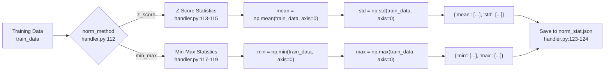
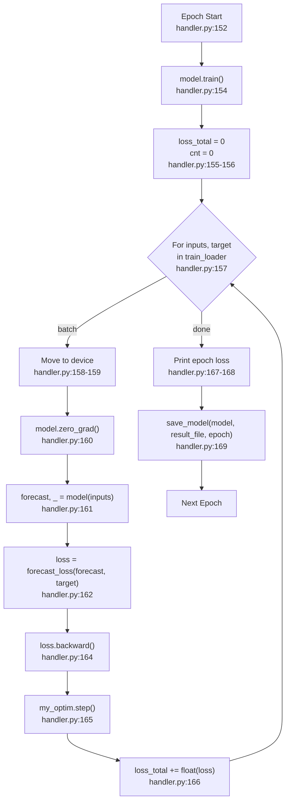
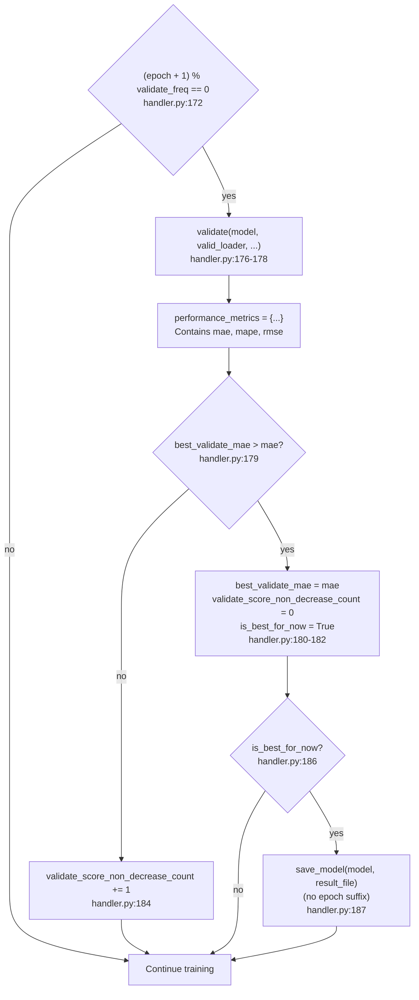

<!-- source: DeepWiki mcp.deepwiki.com · repo microsoft/StemGNN · page 3.2 Training Models · fetched 2026-10-26 -->

# Training Models

<details>
<summary>Relevant source files</summary>

The following files were used as context for generating this wiki page:

- [README.md](README.md)
- [main.py](main.py)
- [models/handler.py](models/handler.py)

</details>


This page explains the training process for STemGNN models, including data splitting, normalization, optimization loops, validation, and model persistence. This documentation covers the complete training workflow from data preparation through model checkpointing.

For information about command-line arguments and configuration options, see [Command-Line Interface](#3.1). For details about evaluation metrics and testing, see [Evaluating Models](#3.3). For normalization method details, see [Normalization Methods](#3.5).

---

## Training Workflow Overview

The training process is orchestrated by the `train()` function in [models/handler.py:103-191]() and invoked from [main.py:54-59](). The workflow consists of data preparation, iterative optimization with periodic validation, and model persistence.

```mermaid
flowchart TD
    Start["Training Invoked<br/>main.py:57"]
    Split["Data Split<br/>main.py:45-50<br/>train/valid/test"]
    CallTrain["train() function<br/>handler.py:103"]
    
    ComputeStats["Compute Normalization<br/>Statistics<br/>handler.py:112-124"]
    SaveStats["Save norm_stat.json<br/>handler.py:123-124"]
    
    CreateModel["Instantiate Model<br/>handler.py:105"]
    CreateOptim["Create Optimizer<br/>handler.py:126-130"]
    CreateLR["Create LR Scheduler<br/>handler.py:130"]
    
    CreateDatasets["Create ForecastDataset<br/>handler.py:132-138"]
    CreateLoaders["Create DataLoaders<br/>handler.py:136-138"]
    
    EpochLoop{"For epoch in<br/>range(args.epoch)<br/>handler.py:152"}
    
    TrainMode["model.train()<br/>handler.py:154"]
    BatchLoop["Batch Loop<br/>handler.py:157-166"]
    Forward["Forward Pass<br/>handler.py:161"]
    Loss["Compute MSE Loss<br/>handler.py:162"]
    Backward["loss.backward()<br/>handler.py:164"]
    OptimStep["my_optim.step()<br/>handler.py:165"]
    
    SaveEpoch["save_model(epoch)<br/>handler.py:169"]
    
    LRCheck{"epoch % decay_step?<br/>handler.py:170"}
    LRStep["lr_scheduler.step()<br/>handler.py:171"]
    
    ValidCheck{"epoch % validate_freq?<br/>handler.py:172"}
    ValidCall["validate()<br/>handler.py:176-178"]
    CheckBest{"MAE improved?<br/>handler.py:179-184"}
    SaveBest["save_model()<br/>(best model)<br/>handler.py:187"]
    
    EarlyCheck{"Early stop?<br/>handler.py:189"}
    
    End["Return metrics<br/>handler.py:191"]
    
    Start --> Split
    Split --> CallTrain
    CallTrain --> ComputeStats
    ComputeStats --> SaveStats
    SaveStats --> CreateModel
    CreateModel --> CreateOptim
    CreateOptim --> CreateLR
    CreateLR --> CreateDatasets
    CreateDatasets --> CreateLoaders
    CreateLoaders --> EpochLoop
    
    EpochLoop -->|continue| TrainMode
    TrainMode --> BatchLoop
    BatchLoop --> Forward
    Forward --> Loss
    Loss --> Backward
    Backward --> OptimStep
    OptimStep --> SaveEpoch
    
    SaveEpoch --> LRCheck
    LRCheck -->|yes| LRStep
    LRCheck -->|no| ValidCheck
    LRStep --> ValidCheck
    
    ValidCheck -->|yes| ValidCall
    ValidCheck -->|no| EpochLoop
    ValidCall --> CheckBest
    CheckBest -->|yes| SaveBest
    CheckBest -->|no| EarlyCheck
    SaveBest --> EarlyCheck
    
    EarlyCheck -->|stop| End
    EarlyCheck -->|continue| EpochLoop
    EpochLoop -->|done| End
```



**Sources:** [main.py:54-59](), [models/handler.py:103-191]()

---

## Data Splitting

Before training begins, the dataset is split into training, validation, and test sets using ratio-based splitting in [main.py:45-50](). The split is performed sequentially on the time-series data to preserve temporal ordering.

### Split Ratios

The split ratios are controlled by three parameters:

| Parameter | Default | Description |
|-----------|---------|-------------|
| `train_length` | 7 | Proportional length of training data |
| `valid_length` | 2 | Proportional length of validation data |
| `test_length` | 1 | Proportional length of test data |

The actual ratios are computed as:

```
train_ratio = train_length / (train_length + valid_length + test_length)
valid_ratio = valid_length / (train_length + valid_length + test_length)
test_ratio = 1 - train_ratio - valid_ratio
```

With defaults (7:2:1), this yields a 70% / 20% / 10% split.

### Split Implementation

The data is split using array slicing:

```
train_data = data[:int(train_ratio * len(data))]
valid_data = data[int(train_ratio * len(data)):int((train_ratio + valid_ratio) * len(data))]
test_data = data[int((train_ratio + valid_ratio) * len(data)):]
```

Only `train_data` and `valid_data` are passed to the `train()` function. The `test_data` is reserved for final evaluation.

**Sources:** [main.py:45-50](), [main.py:57]()

---

## Normalization Statistics

Normalization statistics are computed from the training data only and stored for later use during validation and testing. This ensures that the model is evaluated using the same normalization as training.



### Statistics Storage

The normalization statistics are saved to `norm_stat.json` in the output directory [models/handler.py:123-124](). This JSON file is loaded during evaluation to ensure consistent normalization.

**Z-Score Statistics Format:**
```json
{
  "mean": [value1, value2, ...],
  "std": [value1, value2, ...]
}
```

**Min-Max Statistics Format:**
```json
{
  "min": [value1, value2, ...],
  "max": [value1, value2, ...]
}
```

Each list contains one value per node in the multivariate time series.

**Sources:** [models/handler.py:112-124]()

---

## Model and Optimizer Initialization

### Model Creation

The model is instantiated at [models/handler.py:105]() with the following signature:

```
model = Model(node_cnt, 2, args.window_size, args.multi_layer, horizon=args.horizon)
```

Where:
- `node_cnt` = number of nodes (time series variables)
- `2` = input dimension (hardcoded)
- `args.window_size` = lookback window size
- `args.multi_layer` = number of stacked layers (default: 5)
- `horizon` = prediction horizon

The model is moved to the specified device (CPU or CUDA) using `model.to(args.device)` [models/handler.py:106]().

### Optimizer Configuration

Two optimizer options are supported [models/handler.py:126-129]():

| Optimizer | Implementation | Parameters |
|-----------|----------------|------------|
| `RMSProp` (default) | `torch.optim.RMSprop` | `lr=args.lr`, `eps=1e-08` |
| `Adam` | `torch.optim.Adam` | `lr=args.lr`, `betas=(0.9, 0.999)` |

The learning rate (`args.lr`) defaults to `1e-4` [main.py:19]().

### Learning Rate Scheduler

An exponential learning rate scheduler is created [models/handler.py:130]():

```
my_lr_scheduler = torch.optim.lr_scheduler.ExponentialLR(optimizer=my_optim, gamma=args.decay_rate)
```

The scheduler is invoked every `exponential_decay_step` epochs (default: 5) [main.py:27](), multiplying the learning rate by `decay_rate` (default: 0.5) [main.py:28]().

**Sources:** [models/handler.py:105-106](), [models/handler.py:126-130](), [main.py:19](), [main.py:27-28]()

---

## Dataset and DataLoader Creation

Training and validation data are wrapped in `ForecastDataset` objects [models/handler.py:132-135]():

```
train_set = ForecastDataset(train_data, window_size=args.window_size, horizon=args.horizon,
                            normalize_method=args.norm_method, norm_statistic=normalize_statistic)
valid_set = ForecastDataset(valid_data, window_size=args.window_size, horizon=args.horizon,
                            normalize_method=args.norm_method, norm_statistic=normalize_statistic)
```

The datasets are then wrapped in PyTorch `DataLoader` objects [models/handler.py:136-138]():

| DataLoader | Batch Size | Drop Last | Shuffle | Workers |
|------------|-----------|-----------|---------|---------|
| `train_loader` | `args.batch_size` | False | True | 0 |
| `valid_loader` | `args.batch_size` | - | False | 0 |

The training loader shuffles batches for better generalization, while the validation loader maintains order for consistent evaluation.

**Sources:** [models/handler.py:132-138]()

---

## Training Loop

The main training loop iterates for `args.epoch` epochs (default: 50) [main.py:18](), performing forward passes, loss computation, and backpropagation.



### Loss Function

The training uses Mean Squared Error (MSE) loss [models/handler.py:140]():

```
forecast_loss = nn.MSELoss(reduction='mean').to(args.device)
```

The loss is computed between the model's forecast and the target values [models/handler.py:162]().

### Batch Processing

For each batch [models/handler.py:157-166]():

1. **Move to device:** Input and target tensors are moved to the specified device
2. **Zero gradients:** `model.zero_grad()` clears previous gradients
3. **Forward pass:** `forecast, _ = model(inputs)` generates predictions (the second return value is the attention matrix, which is ignored during training)
4. **Compute loss:** MSE between forecast and target
5. **Backward pass:** `loss.backward()` computes gradients
6. **Optimizer step:** `my_optim.step()` updates model parameters

**Sources:** [models/handler.py:140](), [models/handler.py:152-168]()

---

## Validation During Training

Validation is performed periodically during training to monitor model performance on unseen data. The frequency is controlled by `validate_freq` (default: 1 epoch) [main.py:22]().



### Validation Metrics

The `validate()` function returns a dictionary of metrics [models/handler.py:99-100]():

```python
{
    'mae': float,           # Mean Absolute Error
    'mae_node': np.array,   # MAE per node
    'mape': float,          # Mean Absolute Percentage Error
    'mape_node': np.array,  # MAPE per node
    'rmse': float,          # Root Mean Squared Error
    'rmse_node': np.array   # RMSE per node
}
```

### Best Model Tracking

The system tracks the best model based on validation MAE [models/handler.py:179-187]():

- If the current MAE is lower than `best_validate_mae`, the model is saved without an epoch suffix (as `_stemgnn.pt`)
- This becomes the model used for final evaluation
- The `validate_score_non_decrease_count` tracks consecutive epochs without improvement for early stopping

**Sources:** [models/handler.py:172-187](), [main.py:22]()

---

## Learning Rate Scheduling

The learning rate is decayed exponentially at regular intervals [models/handler.py:170-171]():

```python
if (epoch+1) % args.exponential_decay_step == 0:
    my_lr_scheduler.step()
```

### Scheduling Parameters

| Parameter | Default | Description |
|-----------|---------|-------------|
| `exponential_decay_step` | 5 | Epochs between LR decay |
| `decay_rate` | 0.5 | Multiplicative decay factor |

For example, with default settings:
- Initial LR: `1e-4`
- After epoch 5: `1e-4 * 0.5 = 5e-5`
- After epoch 10: `5e-5 * 0.5 = 2.5e-5`
- And so on...

This helps the model converge by reducing the learning rate as training progresses.

**Sources:** [models/handler.py:170-171](), [main.py:27-28]()

---

## Model Persistence

The training process saves models at multiple checkpoints:

### Per-Epoch Checkpoints

After each epoch, the model is saved with an epoch suffix [models/handler.py:169]():

```python
save_model(model, result_file, epoch)
```

This creates files like: `0_stemgnn.pt`, `1_stemgnn.pt`, `2_stemgnn.pt`, etc.

### Best Model Checkpoint

When validation MAE improves, the model is saved without an epoch suffix [models/handler.py:187]():

```python
save_model(model, result_file)  # No epoch parameter
```

This creates: `_stemgnn.pt`

### Save Implementation

The `save_model()` function [models/handler.py:16-24]():

1. Creates the model directory if it doesn't exist
2. Constructs the filename: `{epoch}_stemgnn.pt` or `_stemgnn.pt`
3. Serializes the entire model using `torch.save(model, f)`

The saved file contains the complete model architecture and trained weights, allowing it to be loaded without reconstructing the model manually.

**Sources:** [models/handler.py:16-24](), [models/handler.py:169](), [models/handler.py:187]()

---

## Early Stopping

Early stopping prevents overfitting by terminating training when validation performance stops improving.

### Configuration

Early stopping is controlled by two parameters:

| Parameter | Default | Description |
|-----------|---------|-------------|
| `early_stop` | False | Enable early stopping |
| `early_stop_step` | Not set | Patience (epochs without improvement) |

### Implementation

The early stopping logic [models/handler.py:189-190]():

```python
if args.early_stop and validate_score_non_decrease_count >= args.early_stop_step:
    break
```

The training loop exits when the validation MAE hasn't improved for `early_stop_step` consecutive validation checks.

**Note:** The `early_stop_step` parameter is referenced in the code but not defined in the argument parser [main.py:9-30](), so users must add it manually if they want to use early stopping with a custom patience value.

**Sources:** [models/handler.py:149-150](), [models/handler.py:183-190](), [main.py:26]()

---

## Training Outputs

The training process produces several outputs in the result directory:

### Output Files

| File | Description | Created By |
|------|-------------|------------|
| `norm_stat.json` | Normalization statistics (mean/std or min/max) | [handler.py:123-124]() |
| `{epoch}_stemgnn.pt` | Per-epoch model checkpoints | [handler.py:169]() |
| `_stemgnn.pt` | Best model (lowest validation MAE) | [handler.py:187]() |
| `target.csv` | Validation targets (first forecast step) | [handler.py:92]() |
| `predict.csv` | Validation predictions (first forecast step) | [handler.py:93]() |
| `predict_abs_error.csv` | Absolute errors | [handler.py:94-95]() |
| `predict_ape.csv` | Absolute percentage errors | [handler.py:96-97]() |

### Directory Structure

For a dataset named `ECG_data`, the output structure is:

```
output/
└── ECG_data/
    └── train/
        ├── norm_stat.json
        ├── _stemgnn.pt
        ├── 0_stemgnn.pt
        ├── 1_stemgnn.pt
        ├── ...
        ├── target.csv
        ├── predict.csv
        ├── predict_abs_error.csv
        └── predict_ape.csv
```

The directory is created by [main.py:36-39]() before training begins.

**Sources:** [models/handler.py:85-97](), [models/handler.py:123-124](), [models/handler.py:169](), [models/handler.py:187](), [main.py:36-39]()

---

## Training Duration Tracking

The training duration is tracked and reported using timestamps [main.py:56-59]():

```python
before_train = datetime.now().timestamp()
_, normalize_statistic = train(train_data, valid_data, args, result_train_file)
after_train = datetime.now().timestamp()
print(f'Training took {(after_train - before_train) / 60} minutes')
```

This provides users with feedback on training time, which can vary significantly based on dataset size, model complexity, and hardware.

**Sources:** [main.py:56-59]()

---

## Training Summary Table

The following table summarizes key training components and their locations:

| Component | File | Function/Lines | Purpose |
|-----------|------|----------------|---------|
| Training orchestration | `main.py` | [54-59]() | Invoke training, track duration |
| Data splitting | `main.py` | [45-50]() | Split into train/valid/test |
| Main training loop | `models/handler.py` | `train()` [103-191]() | Complete training workflow |
| Normalization stats | `models/handler.py` | [112-124]() | Compute and save statistics |
| Model initialization | `models/handler.py` | [105-106]() | Create and move to device |
| Optimizer setup | `models/handler.py` | [126-129]() | RMSProp or Adam |
| LR scheduler | `models/handler.py` | [130](), [170-171]() | Exponential decay |
| Dataset creation | `models/handler.py` | [132-135]() | ForecastDataset wrapper |
| DataLoader creation | `models/handler.py` | [136-138]() | Batch loading |
| Loss function | `models/handler.py` | [140]() | MSE loss |
| Epoch loop | `models/handler.py` | [152-191]() | Training iterations |
| Batch processing | `models/handler.py` | [157-166]() | Forward/backward passes |
| Validation | `models/handler.py` | [172-178]() | Periodic evaluation |
| Best model tracking | `models/handler.py` | [179-187]() | Save best checkpoint |
| Early stopping | `models/handler.py` | [189-190]() | Terminate if no improvement |
| Model saving | `models/handler.py` | `save_model()` [16-24]() | Serialize model to disk |

**Sources:** [main.py](), [models/handler.py]()

---

