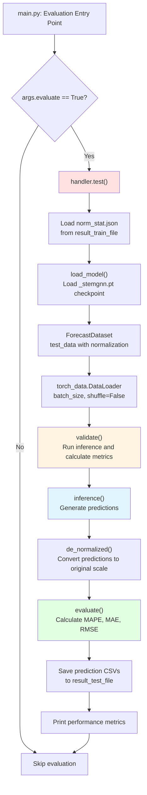
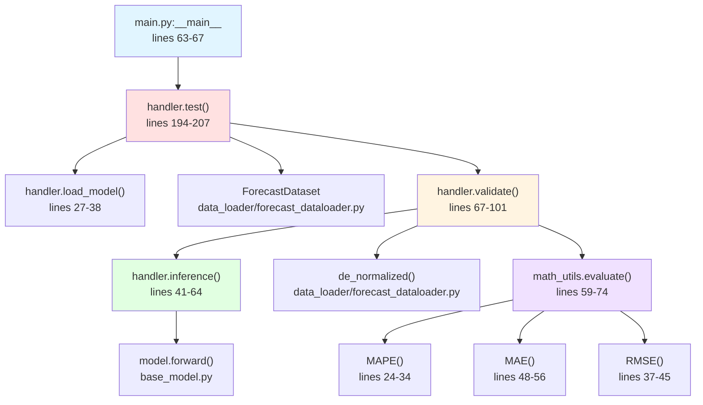
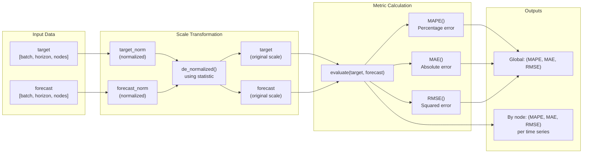

<!-- source: DeepWiki mcp.deepwiki.com · repo microsoft/StemGNN · page 3.3 Evaluating Models · fetched 2026-10-26 -->

# Evaluating Models

<details>
<summary>Relevant source files</summary>

The following files were used as context for generating this wiki page:

- [README.md](README.md)
- [main.py](main.py)
- [models/handler.py](models/handler.py)
- [utils/math_utils.py](utils/math_utils.py)

</details>


## Purpose and Scope

This page explains the model evaluation process in StemGNN, including how to run evaluation on test data, what metrics are calculated, and how to interpret the results. Evaluation is the process of measuring a trained model's forecasting performance on held-out test data.

For information about training models, see [Training Models](#3.2). For technical details about the metric implementations, see [Evaluation Metrics](#4.5). For expected performance benchmarks, see [Supported Datasets](#5.2).

---

## Overview

Model evaluation in StemGNN consists of three main steps:

1. **Loading** a trained model checkpoint and normalization statistics
2. **Inference** on test data to generate predictions
3. **Metric Calculation** comparing predictions against ground truth

The evaluation process is independent of training and can be run at any time using a saved model checkpoint.

**Sources:** [main.py:63-67](), [models/handler.py:194-207]()

---

## Running Evaluation

### Command-Line Execution

To evaluate a trained model, set the `--evaluate` flag to `True`:

```bash
python main.py --evaluate True --dataset ECG_data --train False
```

The evaluation process will:
- Load the trained model from `output/<dataset>/train/_stemgnn.pt`
- Load normalization statistics from `output/<dataset>/train/norm_stat.json`
- Run inference on test data
- Calculate and print performance metrics
- Save prediction results to `output/<dataset>/test/`

### Key Parameters

| Parameter | Purpose | Default |
|-----------|---------|---------|
| `--evaluate` | Enable evaluation | `True` |
| `--train` | Whether to train before evaluating | `True` |
| `--dataset` | Name of dataset CSV file | `ECG_data` |
| `--window_size` | Input window size | `12` |
| `--horizon` | Prediction horizon | `3` |
| `--batch_size` | Batch size for inference | `32` |
| `--norm_method` | Normalization method used during training | `z_score` |

**Note:** The evaluation parameters (`window_size`, `horizon`, `norm_method`) must match those used during training.

**Sources:** [main.py:10-11](), [main.py:63-67](), [README.md:41-46]()

---

## Evaluation Workflow

### High-Level Flow



**Diagram: Evaluation Execution Flow**

**Sources:** [main.py:63-67](), [models/handler.py:194-207](), [models/handler.py:67-101]()

---

## Code Entity Mapping

### Function Call Hierarchy



**Diagram: Code Entity Relationships in Evaluation**

**Sources:** [main.py:63-67](), [models/handler.py:194-207](), [models/handler.py:67-101](), [models/handler.py:41-64](), [utils/math_utils.py:59-74]()

---

## Inference Process

The `inference()` function generates predictions using an autoregressive approach:

### Autoregressive Forecasting

1. **Initial Input:** The model receives a window of historical data (size `window_size`)
2. **Iterative Prediction:** The model predicts multiple future steps iteratively:
   - Predict next time step(s)
   - Shift the input window: remove oldest values, append predictions
   - Repeat until `horizon` steps are predicted
3. **Output:** Full forecast of shape `[batch, horizon, nodes]`

### Implementation Details

The inference loop at [models/handler.py:49-61]():

```python
while step < horizon:
    forecast_result, a = model(inputs)
    # Update input window with predictions
    inputs[:, :window_size - len_model_output, :] = inputs[:, len_model_output:window_size, :].clone()
    inputs[:, window_size - len_model_output:, :] = forecast_result.clone()
    # Accumulate forecast steps
    forecast_steps[:, step:min(horizon - step, len_model_output) + step, :] = ...
    step += min(horizon - step, len_model_output)
```

**Key characteristics:**
- Model runs in evaluation mode: `model.eval()` [models/handler.py:44]()
- No gradient computation: `with torch.no_grad()` [models/handler.py:45]()
- Predictions are detached and moved to CPU for storage [models/handler.py:60]()

**Sources:** [models/handler.py:41-64]()

---

## Metrics Calculation

### Supported Metrics

StemGNN calculates three standard forecasting metrics:

| Metric | Function | Formula | Purpose |
|--------|----------|---------|---------|
| **MAPE** | `MAPE()` | Mean Absolute Percentage Error | Measures relative error as percentage |
| **MAE** | `MAE()` | Mean Absolute Error | Measures average absolute error in original units |
| **RMSE** | `RMSE()` | Root Mean Squared Error | Penalizes large errors more than MAE |

### Calculation Workflow



**Diagram: Metric Calculation Pipeline**

**Sources:** [models/handler.py:67-101](), [utils/math_utils.py:59-74]()

### Aggregation Options

The `evaluate()` function supports different aggregation strategies via the `by_node` and `by_step` parameters:

- **Default** (`by_node=False`, `by_step=False`): Aggregate over all dimensions → single score
- **By node** (`by_node=True`): Calculate metrics separately for each time series → array of length `nodes`
- **By step** (`by_step=True`): Calculate metrics separately for each forecast step → array of length `horizon`
- **Both** (`by_node=True`, `by_step=True`): Calculate metrics for each node and step → matrix `[horizon, nodes]`

**Sources:** [utils/math_utils.py:59-74](), [models/handler.py:79]()

### MAPE Implementation Details

The MAPE function includes special handling to prevent numerical instability:

1. **Epsilon addition:** Adds `1e-5` to denominator to avoid division by zero [utils/math_utils.py:32]()
2. **Capping:** Clips MAPE values at 5 (500%) to prevent outliers from dominating [utils/math_utils.py:33]()

An alternative `masked_MAPE()` function is available that uses NumPy masked arrays to properly handle zero ground truth values [utils/math_utils.py:4-21]().

**Sources:** [utils/math_utils.py:24-34](), [utils/math_utils.py:4-21]()

---

## Output Files

### Generated Files

The evaluation process saves results to `output/<dataset>/test/`:

| File | Content | Shape | Description |
|------|---------|-------|-------------|
| `target.csv` | Ground truth values | `[samples, nodes]` | Actual values at first forecast step |
| `predict.csv` | Model predictions | `[samples, nodes]` | Predicted values at first forecast step |
| `predict_abs_error.csv` | Absolute errors | `[samples, nodes]` | `|predict - target|` |
| `predict_ape.csv` | Percentage errors | `[samples, nodes]` | `|predict - target| / |target|` |

**Note:** Only the first forecast step (`step_to_print = 0`) is saved to files [models/handler.py:88]().

### File Generation Logic

The output files are generated in the `validate()` function at [models/handler.py:85-97]():

```python
if result_file:
    step_to_print = 0
    forcasting_2d = forecast[:, step_to_print, :]
    forcasting_2d_target = target[:, step_to_print, :]
    
    np.savetxt(f'{result_file}/target.csv', forcasting_2d_target, delimiter=",")
    np.savetxt(f'{result_file}/predict.csv', forcasting_2d, delimiter=",")
    np.savetxt(f'{result_file}/predict_abs_error.csv', 
               np.abs(forcasting_2d - forcasting_2d_target), delimiter=",")
    np.savetxt(f'{result_file}/predict_ape.csv',
               np.abs((forcasting_2d - forcasting_2d_target) / forcasting_2d_target), delimiter=",")
```

**Sources:** [models/handler.py:85-97]()

---

## Result Interpretation

### Console Output

During evaluation, the system prints two sets of metrics:

```
NORM: MAPE 12.345678%; MAE 0.123456789; RMSE 0.123456789.
RAW : MAPE 6.456789%; MAE 2.567890123; RMSE 5.067890123.
Performance on test set: MAPE: 6.46 | MAE: 2.57 | RMSE: 5.07
```

- **NORM metrics:** Calculated on normalized data (z-score or min-max scaled)
- **RAW metrics:** Calculated on denormalized data (original scale) - **these are the reported results**

**Sources:** [models/handler.py:83-84](), [models/handler.py:207]()

### Metric Interpretation

| Metric | Unit | Interpretation | Lower is Better |
|--------|------|----------------|-----------------|
| **MAPE** | Percentage (%) | Average percentage deviation from true values | ✓ |
| **MAE** | Original data units | Average absolute deviation | ✓ |
| **RMSE** | Original data units | Root mean squared deviation (penalizes outliers) | ✓ |

**Example:** For traffic speed forecasting:
- MAE = 2.56 means the model's predictions are off by 2.56 mph on average
- MAPE = 6.46% means predictions deviate by 6.46% from actual values on average
- RMSE = 5.06 indicates the typical magnitude of errors, with larger weight on big mistakes

### Benchmark Comparison

The README provides reference results for various datasets. For example, on METR-LA with horizon=3:

| Metric | Expected Value |
|--------|---------------|
| MAE | 2.56 |
| RMSE | 5.06 |
| MAPE | 6.46% |

Compare your evaluation results against these benchmarks to assess model performance.

**Sources:** [README.md:82-101](), [models/handler.py:83-84]()

---

## Evaluation Without Training

To evaluate an existing model without retraining:

```bash
python main.py --train False --evaluate True --dataset ECG_data
```

This workflow:
1. Skips the training phase [main.py:54-62]()
2. Proceeds directly to evaluation [main.py:63-67]()
3. Loads the saved model checkpoint from `output/<dataset>/train/`
4. Requires that training was previously completed for this dataset

**Error conditions:**
- If `norm_stat.json` doesn't exist, the system will fail at [models/handler.py:195-196]()
- If `_stemgnn.pt` doesn't exist, `load_model()` returns `None` [models/handler.py:34-38]()

**Sources:** [main.py:54-67](), [models/handler.py:194-207](), [models/handler.py:27-38]()

---

## Advanced: Per-Node Metrics

The `validate()` function calculates metrics both globally and per-node:

```python
score = evaluate(target, forecast)  # Global metrics
score_by_node = evaluate(target, forecast, by_node=True)  # Per-node metrics
```

The per-node metrics are stored in the returned dictionary:
- `mae_node`: MAE for each time series
- `mape_node`: MAPE for each time series  
- `rmse_node`: RMSE for each time series

These enable identification of which time series are harder to predict and analysis of spatial patterns in forecasting performance.

**Sources:** [models/handler.py:78-79](), [models/handler.py:99-100]()

---

## Summary

The evaluation process in StemGNN:

1. **Loads** trained model and normalization statistics
2. **Generates** predictions using autoregressive inference
3. **Denormalizes** predictions and targets to original scale
4. **Calculates** MAPE, MAE, and RMSE metrics
5. **Saves** prediction results and error analysis to CSV files
6. **Reports** performance metrics to console

The `test()` function orchestrates this workflow, delegating to `validate()` for inference and metric calculation, which in turn uses `inference()` for prediction generation and `evaluate()` for metric computation.

**Sources:** [models/handler.py:194-207](), [models/handler.py:67-101](), [models/handler.py:41-64](), [utils/math_utils.py:59-74]()

---

