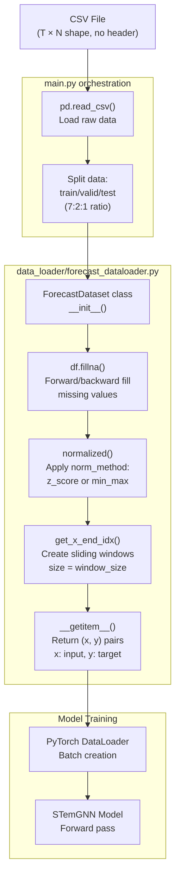
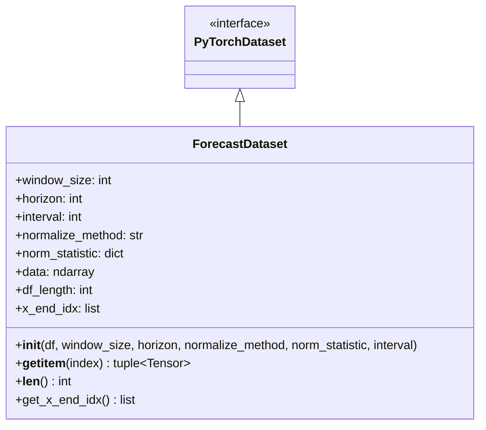
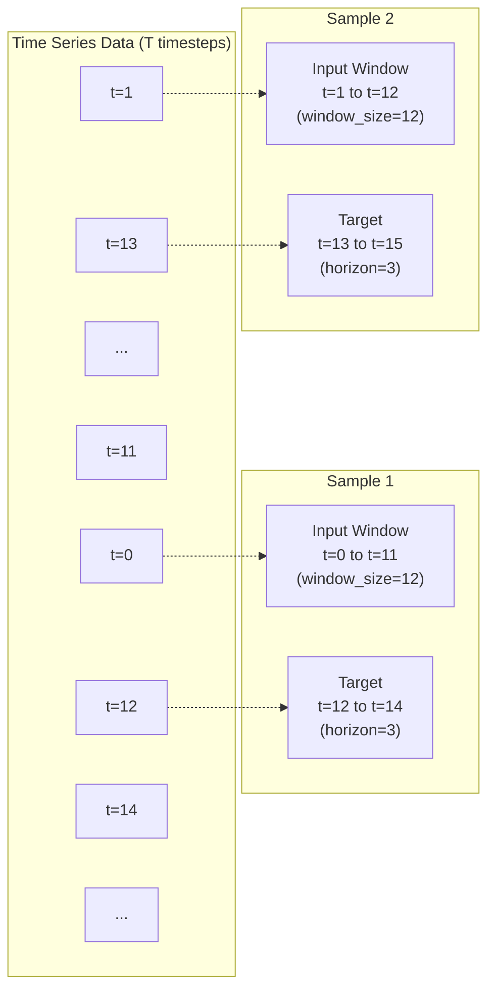
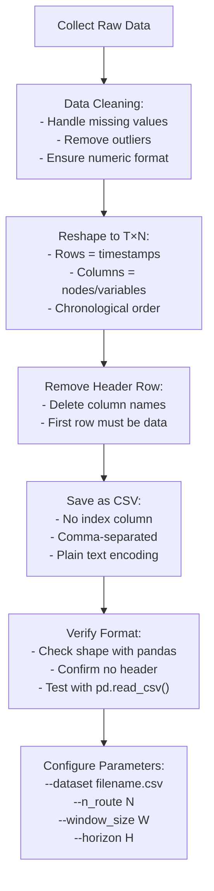
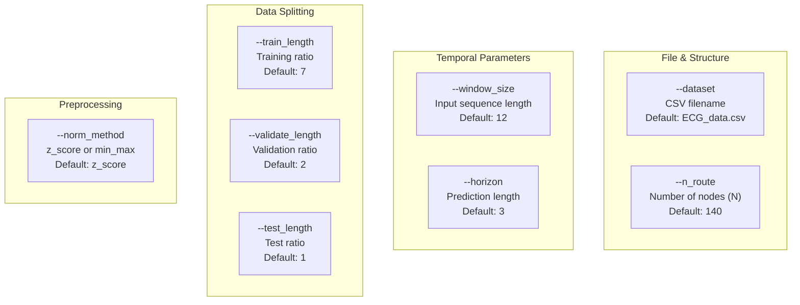
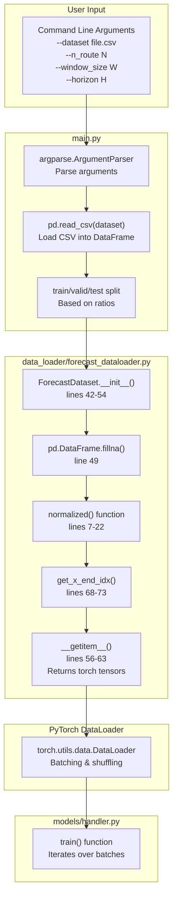

<!-- source: DeepWiki mcp.deepwiki.com · repo microsoft/StemGNN · page 3.4 Working with Datasets · fetched 2026-10-26 -->

# Working with Datasets

<details>
<summary>Relevant source files</summary>

The following files were used as context for generating this wiki page:

- [README.md](README.md)
- [data_loader/forecast_dataloader.py](data_loader/forecast_dataloader.py)
- [dataset/ECG_data.csv](dataset/ECG_data.csv)
- [dataset/PeMS07.csv](dataset/PeMS07.csv)

</details>


This page explains the dataset requirements, format specifications, and procedures for using custom datasets with STemGNN. It covers the expected data structure, how data is loaded and preprocessed, and the configuration parameters that control dataset handling.

For information about normalization methods (z-score vs min-max), see [Normalization Methods](#3.5). For details on command-line arguments for specifying datasets, see [Command-Line Interface](#3.1). For the complete list of supported datasets with expected results, see [Supported Datasets](#5.2).

---

## Dataset Format Requirements

STemGNN requires datasets in a specific CSV format to ensure proper processing through the data pipeline.

### Basic Structure

All input datasets must follow these requirements:

| Requirement | Description | Example |
|------------|-------------|---------|
| **Format** | CSV file | `my_dataset.csv` |
| **Shape** | `T × N` where T = timestamps, N = nodes | 5000 rows × 140 columns |
| **Header** | **No header row** | First row must be data, not column names |
| **Values** | Numeric (float or integer) | `3.6908442, 0.71141435, -2.1140915, ...` |
| **Missing Values** | Handled via forward/backward fill | Automatically processed |

**Shape Convention**: The CSV file should have `T` rows (time steps) and `N` columns (nodes/variables). Each row represents one timestamp, and each column represents one node/variable in the multivariate time series.

```
# Correct format (no header):
3.6908442,0.71141435,-2.1140915,-4.1410068
-1.3481323,-3.9960376,-4.2267496,-4.2511874
1.0242946,-0.59031419,-1.9169491,-2.8069890
...

# Incorrect format (has header):
node1,node2,node3,node4          <- DO NOT INCLUDE
3.6908442,0.71141435,-2.1140915,-4.1410068
```

Sources: [README.md:37](), [data_loader/forecast_dataloader.py:41-54]()

---

## Data Loading and Processing Pipeline

### Overview

The following diagram shows how raw CSV data flows through the STemGNN system from disk to model input:



Sources: [main.py](), [data_loader/forecast_dataloader.py:41-74]()

### ForecastDataset Class

The `ForecastDataset` class in `data_loader/forecast_dataloader.py` is the core component for data handling:



**Key responsibilities:**
- **Missing value handling**: Forward-fill then backward-fill to handle NaN values [data_loader/forecast_dataloader.py:49]()
- **Normalization**: Apply z-score or min-max normalization [data_loader/forecast_dataloader.py:54]()
- **Sliding windows**: Create overlapping windows of size `window_size` [data_loader/forecast_dataloader.py:68-73]()
- **Sample generation**: Return (input, target) pairs where input is `window_size` timesteps and target is next `horizon` timesteps [data_loader/forecast_dataloader.py:56-63]()

Sources: [data_loader/forecast_dataloader.py:41-74]()

### Sliding Window Mechanism

The dataset uses a sliding window approach to create training samples:



**Parameters:**
- `window_size`: Length of input sequence (default: 12)
- `horizon`: Length of prediction sequence (default: 3)
- `interval`: Step size between consecutive samples (default: 1)

The number of samples created is: `(T - window_size - horizon + 1) / interval`

Sources: [data_loader/forecast_dataloader.py:68-73](), [README.md:46-47]()

---

## Provided Example Dataset

The repository includes a preprocessed sample dataset for immediate testing:

| Property | Value |
|----------|-------|
| **File** | `dataset/ECG_data.csv` |
| **Shape** | 5000 timesteps × 140 nodes |
| **Domain** | ECG (electrocardiogram) time series |
| **Source** | Cleaned version of ECG5000 dataset |
| **Purpose** | Reproduction and testing convenience |

**Quick Start**: Run `python main.py` without arguments to train on this dataset using default parameters.

Sources: [README.md:39](), [dataset/ECG_data.csv]()

---

## Public Dataset Sources

The following table lists datasets mentioned in the original paper and README:

| Dataset | Domain | Nodes | Source URL | Data Type |
|---------|--------|-------|------------|-----------|
| **PEMS03** | Traffic flow | 358 | [PeMS District 3](http://pems.dot.ca.gov/?dnode=Clearinghouse&type=station_5min&district_id=3&submit=Submit) | 5-minute aggregated flow |
| **PEMS04** | Traffic speed | 307 | [PeMS District 4](http://pems.dot.ca.gov/?dnode=Clearinghouse&type=station_5min&district_id=4&submit=Submit) | 5-minute aggregated speed |
| **PEMS07** | Traffic flow | 228 | [PeMS District 7](http://pems.dot.ca.gov/?dnode=Clearinghouse&type=station_5min&district_id=7&submit=Submit) | 5-minute aggregated flow |
| **PEMS08** | Traffic flow | 170 | [PeMS District 8](http://pems.dot.ca.gov/?dnode=Clearinghouse&type=station_5min&district_id=8&submit=Submit) | 5-minute aggregated flow |
| **METR-LA** | Traffic speed | 207 | [DCRNN GitHub](https://github.com/liyaguang/DCRNN) | Speed sensors |
| **PEMS-BAY** | Traffic speed | 325 | [DCRNN GitHub](https://github.com/liyaguang/DCRNN) | Speed sensors |
| **Solar** | Solar power | 137 | [NREL Database](https://www.nrel.gov/grid/solar-power-data.html) | Alabama (Eastern States) |
| **Electricity** | Power consumption | Variable | [UCI Repository](https://archive.ics.uci.edu/ml/datasets/ElectricityLoadDiagrams20112014) | Load diagrams |
| **ECG5000** | ECG signals | 140 | [Time Series Classification](http://www.timeseriesclassification.com/description.php?Dataset=ECG5000) | ECG readings |
| **COVID-19** | Pandemic data | 25 | [JHU CSSE](https://github.com/CSSEGISandData/COVID-19/tree/master) | Daily confirmed cases |

**Important**: These datasets require preprocessing before use. The raw data from the URLs needs to be cleaned, formatted, and shaped according to the requirements (T×N, no header, CSV format).

Sources: [README.md:22-35]()

### Dataset-Specific Preprocessing Notes

**COVID-19 Dataset**:
- File: `csse_covid_19_data/csse_covid_19_time_series/time_series_covid19_confirmed_global.csv`
- Transform: Calculate daily newly confirmed cases from cumulative data
- Period: 1/22/2020 to 5/10/2020
- Countries: 25 selected countries including US, Canada, Mexico, Russia, UK, Italy, Germany, France, etc.

**Solar Dataset**:
- Files: Multiple 5-minute CSV files for Alabama region
- Transform: Merge 137 time series into single CSV
- Action: Delete header and index columns

**Electricity Dataset**:
- Transform: Delete header and index from downloaded file

Sources: [README.md:34-36]()

---

## Preparing Custom Datasets

### Step-by-Step Process



Sources: [README.md:37-47](), [data_loader/forecast_dataloader.py:41-49]()

### Example: Creating a Custom Dataset

**Scenario**: You have temperature sensor readings from 50 locations collected every hour for 1000 hours.

**Python preprocessing script:**
```python
import pandas as pd
import numpy as np

# 1. Load your raw data (assume it has headers and datetime index)
df = pd.read_csv('raw_temperature_data.csv', index_col=0)
# Shape: (1000 rows with datetime index, 50 columns with sensor names)

# 2. Remove any non-numeric columns
df = df.select_dtypes(include=[np.number])

# 3. Handle missing values (will also be done by ForecastDataset, but good practice)
df = df.fillna(method='ffill').fillna(method='bfill')

# 4. Save without header and without index
df.to_csv('temperature_1000x50.csv', header=False, index=False)

# 5. Verify
test = pd.read_csv('temperature_1000x50.csv', header=None)
print(f"Shape: {test.shape}")  # Should print: Shape: (1000, 50)
print(f"Data types: {test.dtypes.unique()}")  # Should be numeric
```

**Command to train:**
```bash
python main.py \
    --train True \
    --evaluate True \
    --dataset temperature_1000x50.csv \
    --n_route 50 \
    --window_size 24 \
    --horizon 6 \
    --norm_method z_score
```

Sources: [data_loader/forecast_dataloader.py:48-49](), [README.md:46-47]()

### Common Issues and Solutions

| Issue | Symptom | Solution |
|-------|---------|----------|
| **Header present** | First row treated as data | Remove header row: `df.to_csv(file, header=False)` |
| **Index column included** | Extra column in data | Remove index: `df.to_csv(file, index=False)` |
| **Wrong shape orientation** | N×T instead of T×N | Transpose: `df = df.T` before saving |
| **Non-numeric values** | ValueError during training | Convert or drop non-numeric columns |
| **Inconsistent delimiters** | Parse errors | Ensure comma-separated: `df.to_csv(file, sep=',')` |
| **Wrong file path** | FileNotFoundError | Place in `dataset/` directory or use absolute path |

Sources: [README.md:37](), [data_loader/forecast_dataloader.py:48-49]()

---

## Configuration Parameters

### Dataset-Related Parameters

The following command-line arguments control dataset handling:



### Parameter Details

| Parameter | Type | Description | Example |
|-----------|------|-------------|---------|
| `--dataset` | string | CSV filename (relative to working directory or in `dataset/`) | `--dataset my_data.csv` |
| `--n_route` | int | Number of nodes/variables (N) in the dataset | `--n_route 50` |
| `--window_size` | int | Length of input sequence for prediction | `--window_size 12` |
| `--horizon` | int | Number of future timesteps to predict | `--horizon 3` |
| `--train_length` | int | Relative length for training split | `--train_length 7` |
| `--validate_length` | int | Relative length for validation split | `--validate_length 2` |
| `--test_length` | int | Relative length for test split | `--test_length 1` |
| `--norm_method` | string | Normalization method: `z_score` or `min_max` | `--norm_method z_score` |

**Data Splitting**: The ratio `train_length:validate_length:test_length` determines how the temporal data is split. Default `7:2:1` means 70% training, 20% validation, 10% testing.

Sources: [README.md:49-68](), [main.py]()

### Configuration Examples

**Example 1: Standard traffic forecasting**
```bash
python main.py \
    --dataset PEMS07.csv \
    --n_route 228 \
    --window_size 12 \
    --horizon 3 \
    --norm_method z_score \
    --train_length 7 \
    --validate_length 2 \
    --test_length 1
```

**Example 2: Long-term COVID-19 prediction**
```bash
python main.py \
    --dataset covid19.csv \
    --n_route 25 \
    --window_size 28 \
    --horizon 28 \
    --norm_method z_score
```

**Example 3: Custom sensor network**
```bash
python main.py \
    --dataset sensors_500x100.csv \
    --n_route 100 \
    --window_size 24 \
    --horizon 6 \
    --norm_method min_max \
    --train_length 8 \
    --validate_length 1 \
    --test_length 1
```

Sources: [README.md:46-47, 71-81]()

---

## Data Flow in Code

This diagram connects the natural language concepts to actual code entities:



**Key code locations:**
- CSV loading: [main.py]() - Uses `pandas.read_csv()`
- Data splitting: [main.py]() - Splits DataFrame by ratio
- Dataset class: [data_loader/forecast_dataloader.py:41-74]()
- Missing value handling: [data_loader/forecast_dataloader.py:49]()
- Normalization: [data_loader/forecast_dataloader.py:7-38]()
- Windowing: [data_loader/forecast_dataloader.py:68-73]()
- Batch iteration: [models/handler.py]() - Uses PyTorch DataLoader

Sources: [main.py](), [data_loader/forecast_dataloader.py:1-74](), [models/handler.py]()

---

## Recommended Dataset Configurations

Based on the paper results and README examples:

| Dataset | n_route | window_size | horizon | norm_method | Purpose |
|---------|---------|-------------|---------|-------------|---------|
| METR-LA | 207 | 12 | 3 | z_score | Traffic speed forecasting |
| PEMS-BAY | 325 | 12 | 3 | z_score | Traffic speed forecasting |
| PEMS03 | 358 | 12 | 3 | z_score | Traffic flow forecasting |
| PEMS04 | 307 | 12 | 3 | z_score | Traffic speed forecasting |
| PEMS07 | 228 | 12 | 3 | z_score | Traffic flow forecasting |
| PEMS08 | 170 | 12 | 3 | z_score | Traffic flow forecasting |
| COVID-19 | 25 | 28 | 28 | z_score | Pandemic forecasting |
| ECG_data | 140 | 12 | 3 | z_score | ECG signal analysis |

**Note**: These configurations have been tested and produce the results reported in [README.md:82-102](). Use them as starting points for similar problems.

Sources: [README.md:71-81]()

---

## Validation Checklist

Before running training, verify your dataset meets all requirements:

- [ ] CSV file format with comma separators
- [ ] Shape is T×N (timestamps as rows, nodes as columns)
- [ ] No header row (first row is data)
- [ ] No index column
- [ ] All values are numeric (integers or floats)
- [ ] File is accessible from working directory or in `dataset/` folder
- [ ] `--n_route` parameter matches number of columns (N)
- [ ] `window_size + horizon` is less than total timestamps (T)
- [ ] Data has chronological temporal ordering

**Quick verification script:**
```python
import pandas as pd

# Load without header
df = pd.read_csv('your_dataset.csv', header=None)

print(f"Shape: {df.shape}")  # Should be (T, N)
print(f"Data types: {df.dtypes.unique()}")  # Should be numeric
print(f"Missing values: {df.isna().sum().sum()}")  # Can be non-zero (will be filled)
print(f"First row sample: {df.iloc[0, :5].values}")  # Check it's data, not names
```

Sources: [README.md:37](), [data_loader/forecast_dataloader.py:41-54]()

---

