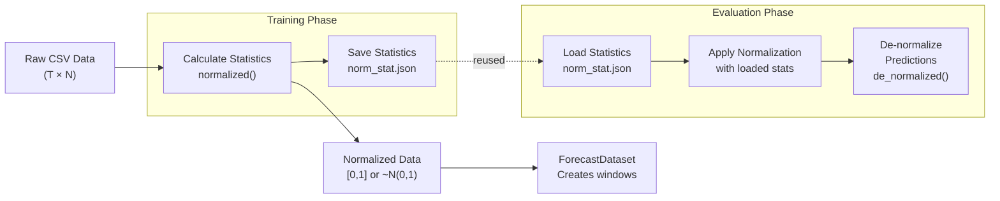
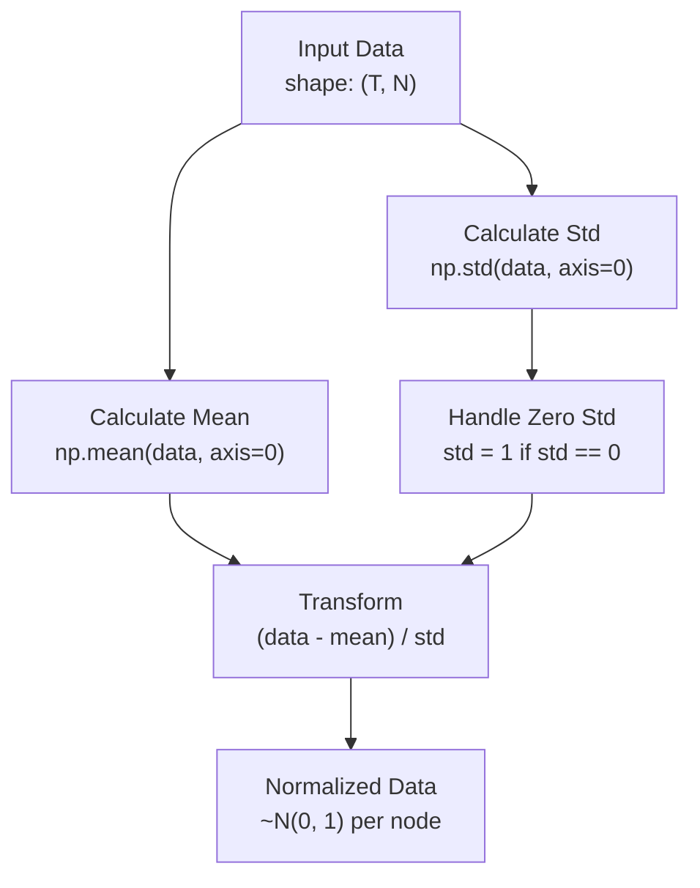
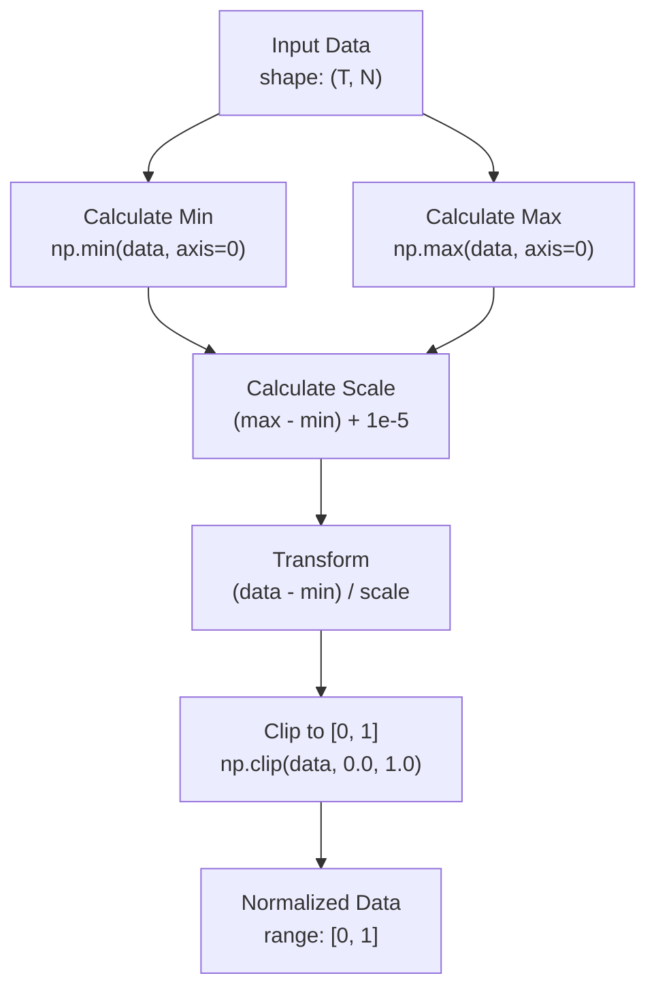
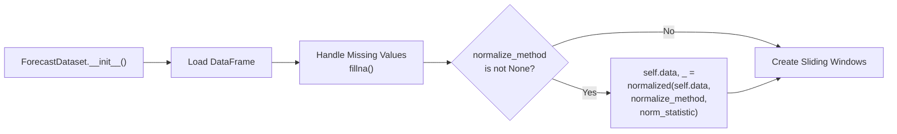
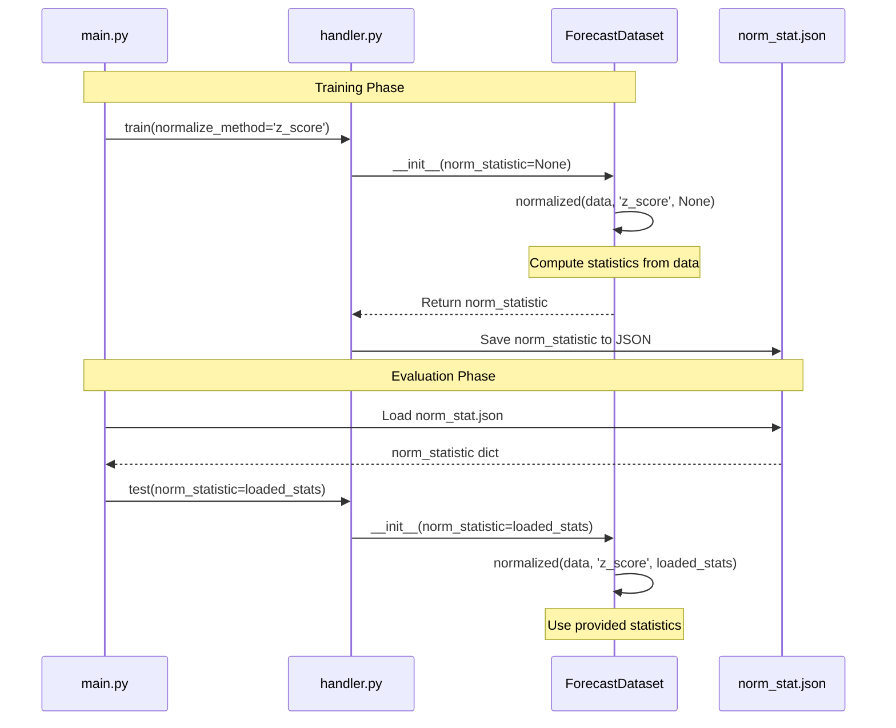

<!-- source: DeepWiki mcp.deepwiki.com · repo microsoft/StemGNN · page 3.5 Normalization Methods · fetched 2026-10-26 -->

# Normalization Methods

<details>
<summary>Relevant source files</summary>

The following files were used as context for generating this wiki page:

- [README.md](README.md)
- [data_loader/forecast_dataloader.py](data_loader/forecast_dataloader.py)

</details>


## Purpose and Scope

This document explains the normalization methods available in STemGNN and their implementation in the data preprocessing pipeline. Normalization transforms raw time-series data to a standardized scale before feeding it to the neural network, which is essential for stable training and convergence.

This page covers the two supported normalization methods (`z_score` and `min_max`), their mathematical formulations, implementation details, and guidance on method selection. For information about the broader data loading pipeline and dataset windowing, see [Data Pipeline](#4.4). For dataset format requirements, see [Working with Datasets](#3.4).

---

## Overview

STemGNN applies normalization during data preprocessing to ensure that different time series with varying scales can be processed together effectively. The system supports two normalization strategies, both implemented in the `normalized()` and `de_normalized()` functions.

### Normalization in the Data Pipeline



**Diagram 1: Normalization Flow in Training and Evaluation**

Sources: [data_loader/forecast_dataloader.py:7-22](), [data_loader/forecast_dataloader.py:25-38]()

The normalization process occurs in two phases:
- **Training**: Statistics are computed from training data and saved to `norm_stat.json`
- **Evaluation**: Saved statistics are loaded and applied to test data to ensure consistent scaling

---

## Z-Score Normalization

Z-score normalization (also called standardization) transforms data to have zero mean and unit variance. This method is recommended for most datasets and is the default in STemGNN.

### Mathematical Definition

For each node (column) in the time series:

```
z = (x - μ) / σ
```

Where:
- `x` is the raw value
- `μ` is the mean across all timestamps
- `σ` is the standard deviation across all timestamps

### Implementation



**Diagram 2: Z-Score Normalization Process**

The implementation in [data_loader/forecast_dataloader.py:14-22]() computes statistics along axis 0 (temporal axis), producing per-node statistics:

| Step | Operation | Code Reference |
|------|-----------|----------------|
| 1. Compute mean | `mean = np.mean(data, axis=0)` | Line 16 |
| 2. Compute std | `std = np.std(data, axis=0)` | Line 16 |
| 3. Handle zero std | `std = [1 if i == 0 else i for i in std]` | Line 19 |
| 4. Normalize | `data = (data - mean) / std` | Line 20 |

**Zero Standard Deviation Handling**: If a node has constant values (std = 0), the standard deviation is set to 1 to avoid division by zero. This effectively leaves that node's values unchanged.

### Denormalization

The inverse transformation reconstructs original values:

```
x = z × σ + μ
```

Implementation: [data_loader/forecast_dataloader.py:31-37]()

Sources: [data_loader/forecast_dataloader.py:14-22](), [data_loader/forecast_dataloader.py:31-37]()

---

## Min-Max Normalization

Min-max normalization scales data to the range [0, 1] by using the minimum and maximum values observed in the training data.

### Mathematical Definition

For each node:

```
x_norm = (x - min) / (max - min)
```

Where:
- `x` is the raw value
- `min` is the minimum value across all timestamps
- `max` is the maximum value across all timestamps

### Implementation



**Diagram 3: Min-Max Normalization Process**

The implementation in [data_loader/forecast_dataloader.py:8-13]() includes numerical stability measures:

| Step | Operation | Code Reference |
|------|-----------|----------------|
| 1. Compute min | `min = np.min(data, axis=0)` | Line 10 |
| 2. Compute max | `max = np.max(data, axis=0)` | Line 10 |
| 3. Calculate scale | `scale = max - min + 1e-5` | Line 11 |
| 4. Normalize | `data = (data - min) / scale` | Line 12 |
| 5. Clip | `np.clip(data, 0.0, 1.0)` | Line 13 |

**Numerical Stability**: A small epsilon (1e-5) is added to the scale to prevent division by zero when max equals min. The clipping operation ensures all values remain in [0, 1] even with floating-point rounding errors.

### Denormalization

The inverse transformation:

```
x = x_norm × (max - min) + min
```

Note: The denormalization uses epsilon of 1e-8 instead of 1e-5 ([data_loader/forecast_dataloader.py:29]()), which is sufficient since we're not dividing by this value.

Sources: [data_loader/forecast_dataloader.py:8-13](), [data_loader/forecast_dataloader.py:26-30]()

---

## Implementation Details

### Function Signatures

The `normalized()` function handles both normalization methods:

```python
def normalized(data, normalize_method, norm_statistic=None):
    """
    Parameters:
        data: numpy array of shape (T, N)
        normalize_method: 'z_score' or 'min_max'
        norm_statistic: dict with pre-computed statistics (optional)
    
    Returns:
        (normalized_data, norm_statistic)
    """
```

The `de_normalized()` function reverses the transformation:

```python
def de_normalized(data, normalize_method, norm_statistic):
    """
    Parameters:
        data: normalized numpy array
        normalize_method: 'z_score' or 'min_max'
        norm_statistic: dict with statistics from training
    
    Returns:
        denormalized_data
    """
```

Sources: [data_loader/forecast_dataloader.py:7-22](), [data_loader/forecast_dataloader.py:25-38]()

### Integration with ForecastDataset

The `ForecastDataset` class applies normalization during initialization:



**Diagram 4: Normalization in ForecastDataset Initialization**

Key points:
- Normalization is applied once during dataset initialization [data_loader/forecast_dataloader.py:53-54]()
- If `norm_statistic` is provided (during evaluation), those statistics are used
- If `norm_statistic` is None (during training), statistics are computed from the data
- All subsequent window creation operates on normalized data

Sources: [data_loader/forecast_dataloader.py:41-54]()

---

## Statistics Dictionary Structure

Both normalization methods store statistics in a dictionary that is serialized to JSON for persistence between training and evaluation.

### Z-Score Statistics

```python
norm_statistic = {
    'mean': np.array([...]),  # shape: (N,)
    'std': np.array([...])    # shape: (N,)
}
```

### Min-Max Statistics

```python
norm_statistic = {
    'max': np.array([...]),   # shape: (N,)
    'min': np.array([...])    # shape: (N,)
}
```

Where `N` is the number of nodes in the dataset. Each array contains per-node statistics computed across the temporal dimension.

Sources: [data_loader/forecast_dataloader.py:10](), [data_loader/forecast_dataloader.py:16]()

---

## Choosing a Normalization Method

### Comparison Table

| Criterion | Z-Score | Min-Max |
|-----------|---------|---------|
| **Output Range** | Unbounded (~N(0,1)) | [0, 1] |
| **Outlier Sensitivity** | Robust (uses mean/std) | Sensitive (uses min/max) |
| **Recommended Use** | General purpose, default choice | When bounded output is required |
| **Command-Line Argument** | `--norm_method z_score` | `--norm_method min_max` |

### Recommendations

**Use Z-Score when:**
- Working with traffic forecasting datasets (METR-LA, PEMS, etc.)
- Data contains outliers that should not dominate the scaling
- Following the recommended configurations in Table 1 of [README.md:71-81]()

**Use Min-Max when:**
- Input data is already bounded (e.g., percentages, probabilities)
- You need output values strictly in [0, 1] for interpretability
- Training data is representative and contains no extreme outliers

### Default Configuration

All datasets in the official experiments use `z_score` normalization ([README.md:72-80]()):

| Dataset | Normalization Method |
|---------|---------------------|
| METR-LA | z_score |
| PEMS-BAY | z_score |
| PEMS03 | z_score |
| PEMS04 | z_score |
| PEMS07 | z_score |
| PEMS08 | z_score |
| COVID-19 | z_score |

Sources: [README.md:67](), [README.md:71-81]()

---

## Practical Usage

### Command-Line Interface

Specify the normalization method using the `--norm_method` argument:

```bash
# Using z-score (default)
python main.py --train True --evaluate True --dataset data.csv --norm_method z_score

# Using min-max
python main.py --train True --evaluate True --dataset data.csv --norm_method min_max
```

For complete command-line documentation, see [Command-Line Interface](#3.1).

### Persistence Workflow



**Diagram 5: Normalization Statistics Lifecycle**

During training:
1. `normalized()` is called with `norm_statistic=None`
2. Statistics are computed from training data
3. Statistics are saved to `norm_stat.json` by the handler

During evaluation:
1. Statistics are loaded from `norm_stat.json`
2. `normalized()` is called with the loaded statistics
3. Test data is normalized using training statistics (critical for consistency)
4. Predictions are denormalized using the same statistics

Sources: [data_loader/forecast_dataloader.py:7-22](), [data_loader/forecast_dataloader.py:53-54]()

---

## Edge Cases and Numerical Stability

### Zero Standard Deviation

When a node has constant values (σ = 0), the z-score implementation sets σ = 1 to avoid division by zero [data_loader/forecast_dataloader.py:19]():

```python
std = [1 if i == 0 else i for i in std]
```

This means constant-valued nodes remain unchanged after normalization.

### Zero Range (Min = Max)

When a node has constant values in min-max normalization, the epsilon (1e-5) prevents division by zero [data_loader/forecast_dataloader.py:11]():

```python
scale = norm_statistic['max'] - norm_statistic['min'] + 1e-5
```

The result will be close to 0 (depending on whether values equal min or max).

### Clipping in Min-Max

The `np.clip()` operation ensures all values remain in [0, 1] even with floating-point arithmetic errors [data_loader/forecast_dataloader.py:13]():

```python
data = np.clip(data, 0.0, 1.0)
```

### Missing Values

Missing values are handled before normalization by the `ForecastDataset` using forward-fill and backward-fill [data_loader/forecast_dataloader.py:49]():

```python
df = df.fillna(method='ffill', limit=len(df)).fillna(method='bfill', limit=len(df)).values
```

Sources: [data_loader/forecast_dataloader.py:11](), [data_loader/forecast_dataloader.py:13](), [data_loader/forecast_dataloader.py:19](), [data_loader/forecast_dataloader.py:49]()

---

## Summary

Normalization is essential for STemGNN's performance:

- **Z-score normalization** (default) is recommended for most use cases and is used across all official experiments
- **Min-max normalization** is available for specialized cases requiring bounded outputs
- Normalization statistics are computed from training data and persisted to ensure consistent scaling during evaluation
- The implementation includes safeguards for numerical stability and edge cases

For training workflows that use normalization, see [Training Models](#3.2). For evaluation procedures that load normalization statistics, see [Evaluating Models](#3.3).

---

