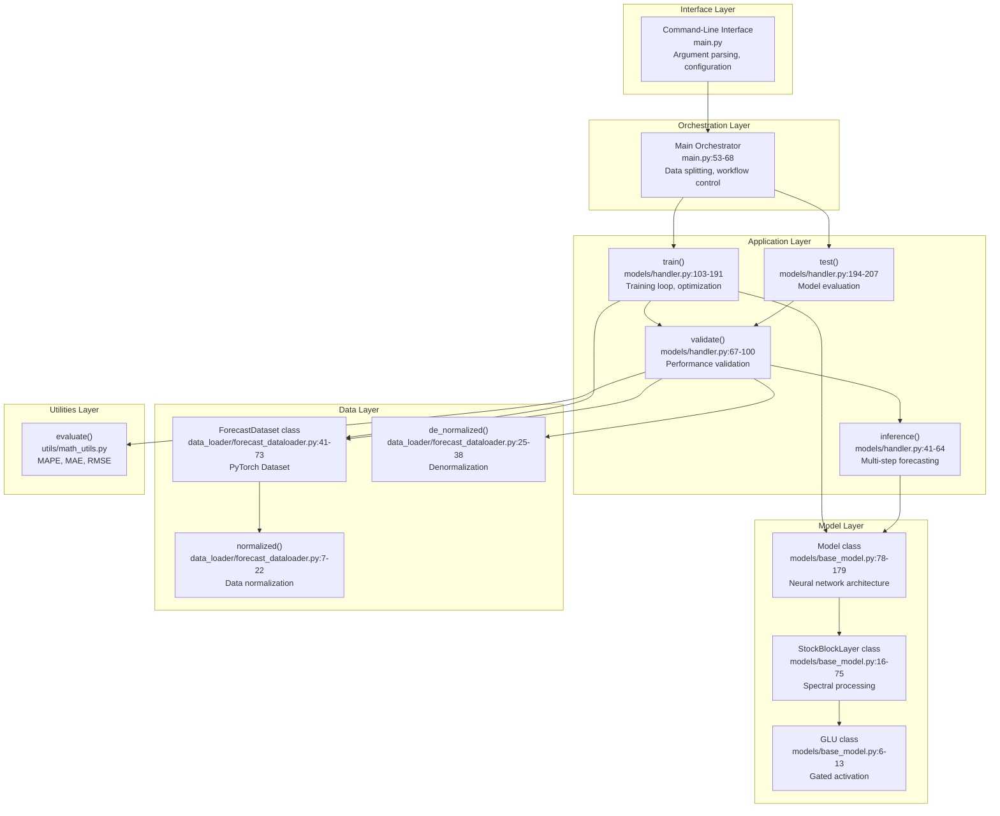
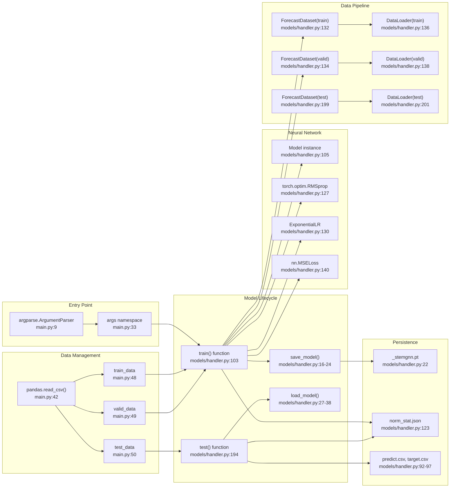
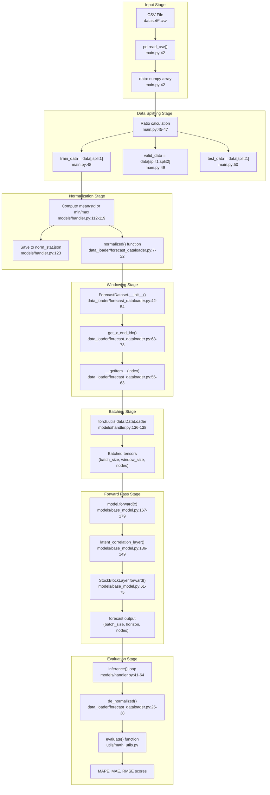
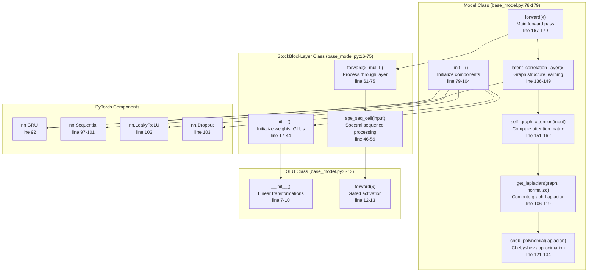
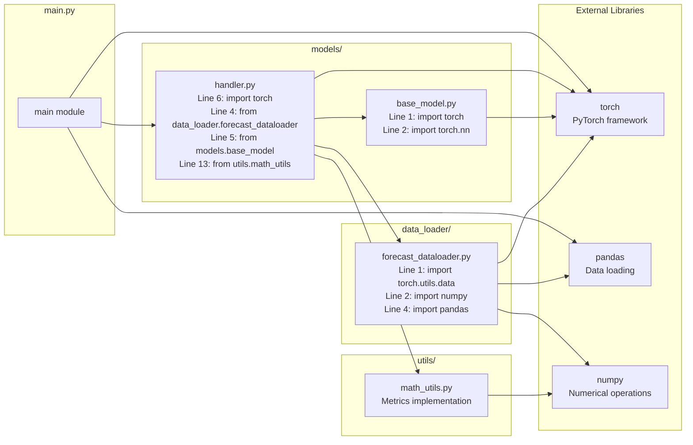

<!-- source: DeepWiki mcp.deepwiki.com · repo microsoft/StemGNN · page 4 System Architecture · fetched 2026-10-26 -->

# System Architecture

<details>
<summary>Relevant source files</summary>

The following files were used as context for generating this wiki page:

- [data_loader/forecast_dataloader.py](data_loader/forecast_dataloader.py)
- [main.py](main.py)
- [models/base_model.py](models/base_model.py)
- [models/handler.py](models/handler.py)

</details>


This document provides a high-level overview of the STemGNN system architecture, describing the major components, their relationships, and how data flows through the system during training and evaluation. This page focuses on the overall structure and interactions between components.

For detailed information about specific subsystems, see:
- Main entry point orchestration: [Main Entry Point](#4.1)
- Training and validation loops: [Model Lifecycle Manager](#4.2)
- Neural network implementation: [Neural Network Architecture](#4.3)
- Data loading and preprocessing: [Data Pipeline](#4.4)
- Performance metrics: [Evaluation Metrics](#4.5)

## Layered Architecture Overview

The STemGNN system is organized as a four-layer architecture with clear separation of concerns. Each layer has specific responsibilities and communicates through well-defined interfaces.



**Sources:** [main.py:1-68](), [models/handler.py:1-207](), [models/base_model.py:1-180](), [data_loader/forecast_dataloader.py:1-74]()

## Core Component Relationships

The system's components interact through a clearly defined dependency graph. The following diagram maps natural language concepts to their concrete implementations in the codebase.



**Sources:** [main.py:9-68](), [models/handler.py:16-207]()

## Data Flow Through the System

Data flows through multiple transformation stages from raw CSV input to final predictions. This diagram shows the complete pipeline with actual function and class names from the codebase.



**Sources:** [main.py:35-50](), [models/handler.py:41-191](), [data_loader/forecast_dataloader.py:7-73](), [models/base_model.py:136-179]()

## Execution Flow State Machine

The system operates as a state machine controlled by command-line flags. This diagram shows the complete execution flow with actual code references.

```mermaid
stateDiagram-v2
    [*] --> ParseArguments: python main.py
    
    ParseArguments: Parse command-line args<br/>argparse.ArgumentParser<br/>main.py:9-33
    
    ParseArguments --> CreateDirectories
    
    CreateDirectories: Create output directories<br/>os.makedirs()<br/>main.py:38-41
    
    CreateDirectories --> LoadCSV
    
    LoadCSV: Load dataset<br/>pd.read_csv()<br/>main.py:42
    
    LoadCSV --> SplitData
    
    SplitData: Split into train/valid/test<br/>Using ratio parameters<br/>main.py:44-50
    
    SplitData --> CheckTrainFlag
    
    state CheckTrainFlag <<choice>>
    CheckTrainFlag --> TrainingPhase: args.train == True
    CheckTrainFlag --> CheckEvalFlag: args.train == False
    
    state TrainingPhase {
        [*] --> InitializeModel: Model(node_cnt, 2, ...)<br/>models/handler.py:105
        InitializeModel --> ComputeNormStats: Calculate mean/std<br/>models/handler.py:112-124
        ComputeNormStats --> CreateDatasets: ForecastDataset instances<br/>models/handler.py:132-138
        CreateDatasets --> SetupOptimizer: RMSProp or Adam<br/>models/handler.py:126-130
        SetupOptimizer --> EpochLoop: for epoch in range(args.epoch)<br/>models/handler.py:152
        
        state EpochLoop {
            [*] --> TrainMode: model.train()<br/>models/handler.py:154
            TrainMode --> ForwardPass: forecast, _ = model(inputs)<br/>models/handler.py:161
            ForwardPass --> ComputeLoss: MSELoss(forecast, target)<br/>models/handler.py:162
            ComputeLoss --> Backward: loss.backward()<br/>models/handler.py:164
            Backward --> OptimizerStep: my_optim.step()<br/>models/handler.py:165
            OptimizerStep --> SaveCheckpoint: save_model(model, ...)<br/>models/handler.py:169
            SaveCheckpoint --> CheckValidation
            
            state CheckValidation <<choice>>
            CheckValidation --> Validate: epoch % validate_freq == 0<br/>models/handler.py:172
            CheckValidation --> CheckEarlyStop: else
            
            Validate --> CallValidateFunc: validate(model, valid_loader, ...)<br/>models/handler.py:176-178
            CallValidateFunc --> CompareBestMAE: Check if MAE improved<br/>models/handler.py:179-187
            CompareBestMAE --> CheckEarlyStop
            
            state CheckEarlyStop <<choice>>
            CheckEarlyStop --> [*]: Early stop triggered<br/>models/handler.py:189
            CheckEarlyStop --> TrainMode: Continue training
        }
        
        EpochLoop --> [*]: Training complete
    }
    
    TrainingPhase --> CheckEvalFlag
    
    state CheckEvalFlag <<choice>>
    CheckEvalFlag --> TestingPhase: args.evaluate == True
    CheckEvalFlag --> Done: args.evaluate == False
    
    state TestingPhase {
        [*] --> LoadNormStats: Load norm_stat.json<br/>models/handler.py:195-196
        LoadNormStats --> LoadTrainedModel: load_model(result_train_file)<br/>models/handler.py:197
        LoadTrainedModel --> CreateTestDataset: ForecastDataset(test_data, ...)<br/>models/handler.py:199-200
        CreateTestDataset --> CreateTestLoader: DataLoader(test_set, ...)<br/>models/handler.py:201-202
        CreateTestLoader --> CallValidate: validate(model, test_loader, ...)<br/>models/handler.py:203-205
        CallValidate --> SavePredictions: Save predict.csv, target.csv<br/>models/handler.py:92-97
        SavePredictions --> PrintResults: Print MAPE, MAE, RMSE<br/>models/handler.py:206-207
        PrintResults --> [*]
    }
    
    TestingPhase --> Done
    Done --> [*]: Print "done"<br/>main.py:68
```



**Sources:** [main.py:9-68](), [models/handler.py:103-207]()

## Component Responsibility Matrix

The following table summarizes the responsibilities of each major component and maps them to their code locations:

| Component | Primary Responsibility | Key Functions/Classes | File Location |
|-----------|------------------------|----------------------|---------------|
| **CLI Parser** | Parse command-line arguments, provide configuration | `argparse.ArgumentParser` | [main.py:9-33]() |
| **Data Splitter** | Split raw data into train/valid/test sets | Direct array slicing logic | [main.py:44-50]() |
| **Training Orchestrator** | Coordinate training workflow, manage lifecycle | `train()` function | [models/handler.py:103-191]() |
| **Testing Orchestrator** | Coordinate evaluation workflow | `test()` function | [models/handler.py:194-207]() |
| **Validation Engine** | Run inference and compute metrics | `validate()` function | [models/handler.py:67-100]() |
| **Inference Engine** | Multi-step forecasting with auto-regression | `inference()` function | [models/handler.py:41-64]() |
| **Model Persistence** | Save and load trained models | `save_model()`, `load_model()` | [models/handler.py:16-38]() |
| **Neural Network** | STemGNN architecture implementation | `Model` class | [models/base_model.py:78-179]() |
| **Spectral Processing** | Graph convolution and spectral transforms | `StockBlockLayer` class | [models/base_model.py:16-75]() |
| **Gated Activation** | Gated Linear Unit implementation | `GLU` class | [models/base_model.py:6-13]() |
| **Dataset Abstraction** | PyTorch Dataset for time series windows | `ForecastDataset` class | [data_loader/forecast_dataloader.py:41-73]() |
| **Normalization** | Z-score and min-max normalization | `normalized()`, `de_normalized()` | [data_loader/forecast_dataloader.py:7-38]() |
| **Metrics Calculation** | Compute MAPE, MAE, RMSE | `evaluate()` function | Referenced in [models/handler.py:13]() |

**Sources:** [main.py:1-68](), [models/handler.py:1-207](), [models/base_model.py:1-180](), [data_loader/forecast_dataloader.py:1-74]()

## Model Architecture Hierarchy

The neural network implementation follows a hierarchical structure where each layer builds upon lower-level components.



**Sources:** [models/base_model.py:1-180]()

## File System and Package Structure

The codebase follows a standard Python package structure with clear module separation:

```
StemGNN/
├── main.py                           # Entry point, orchestration
├── dataset/                          # Data storage
│   ├── ECG_data.csv                 # Sample dataset
│   └── PeMS07.csv                   # Sample dataset
├── models/                          # Neural network models
│   ├── __init__.py                 # Package marker
│   ├── base_model.py               # Model, StockBlockLayer, GLU classes
│   └── handler.py                  # train(), test(), validate(), inference()
├── data_loader/                     # Data preprocessing
│   ├── __init__.py                 # Package marker
│   └── forecast_dataloader.py      # ForecastDataset, normalization functions
├── utils/                           # Utility functions
│   ├── __init__.py                 # Package marker
│   └── math_utils.py               # evaluate() function for metrics
└── output/                          # Generated during runtime
    └── {dataset_name}/
        ├── train/
        │   ├── _stemgnn.pt         # Trained model checkpoint
        │   └── norm_stat.json      # Normalization statistics
        └── test/
            ├── predict.csv          # Predictions
            ├── target.csv           # Ground truth
            ├── predict_abs_error.csv # Absolute errors
            └── predict_ape.csv      # Absolute percentage errors
```

**Sources:** [main.py:35-41](), [models/handler.py:16-24](), [models/handler.py:92-97](), [models/handler.py:123]()

## Key Design Patterns

The system implements several software design patterns that contribute to its modularity and maintainability:

### Separation of Concerns
- **Interface Layer** ([main.py:9-33]()): Handles user interaction and configuration
- **Orchestration Layer** ([main.py:53-68]()): Controls workflow and delegates to subsystems
- **Application Layer** ([models/handler.py]()): Implements ML operations
- **Model Layer** ([models/base_model.py]()): Pure neural network logic
- **Data Layer** ([data_loader/forecast_dataloader.py]()): Data abstraction

### Factory Pattern
The system creates datasets and models based on configuration:
- `ForecastDataset` instantiation with different parameters for train/valid/test ([models/handler.py:132-138](), [models/handler.py:199-200]())
- Model instantiation with configuration-driven architecture ([models/handler.py:105]())

### Strategy Pattern
Normalization methods are selected at runtime:
- `z_score` or `min_max` normalization ([models/handler.py:112-119]())
- Optimizer selection: `RMSProp` or `Adam` ([models/handler.py:126-129]())

### Template Method Pattern
The training loop follows a template with customizable steps:
- Fixed structure: initialization → epoch loop → validation → early stopping
- Customizable: validation frequency, learning rate scheduling, early stopping criteria
- Implementation in [models/handler.py:152-190]()

**Sources:** [main.py:9-68](), [models/handler.py:103-191](), [data_loader/forecast_dataloader.py:41-73]()

## Dependencies Between Subsystems

The following diagram shows the import dependencies between modules, illustrating the coupling structure:



**Sources:** [main.py:1-8](), [models/handler.py:1-13](), [models/base_model.py:1-3](), [data_loader/forecast_dataloader.py:1-4]()

## Workflow Summary

The complete system workflow can be summarized in these stages:

1. **Configuration Stage** ([main.py:9-33]()): Parse command-line arguments into `args` namespace
2. **Data Loading Stage** ([main.py:35-50]()): Load CSV and split into train/valid/test arrays
3. **Training Stage** ([models/handler.py:103-191]()):
   - Initialize `Model` instance
   - Compute normalization statistics
   - Create `ForecastDataset` instances
   - Run optimization loop with periodic validation
   - Save best model to `_stemgnn.pt`
4. **Testing Stage** ([models/handler.py:194-207]()):
   - Load trained model from `_stemgnn.pt`
   - Load normalization stats from `norm_stat.json`
   - Run inference on test data
   - Compute and save evaluation metrics
5. **Output Stage**: Save predictions, errors, and metrics to CSV files

Each stage is independent and can be executed separately by setting appropriate command-line flags (`--train` and `--evaluate`).

**Sources:** [main.py:53-68](), [models/handler.py:103-207]()

---

