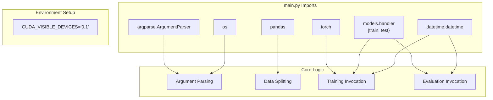
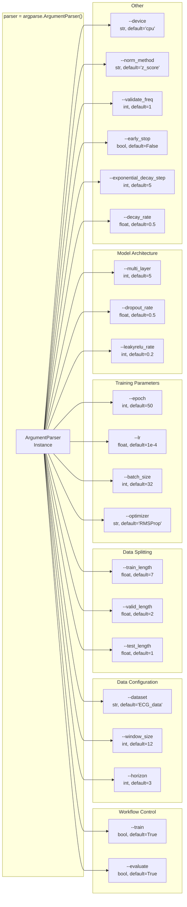
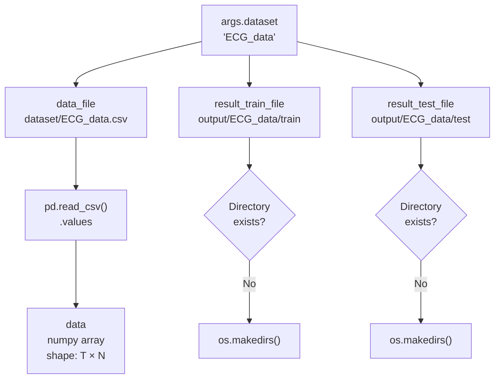
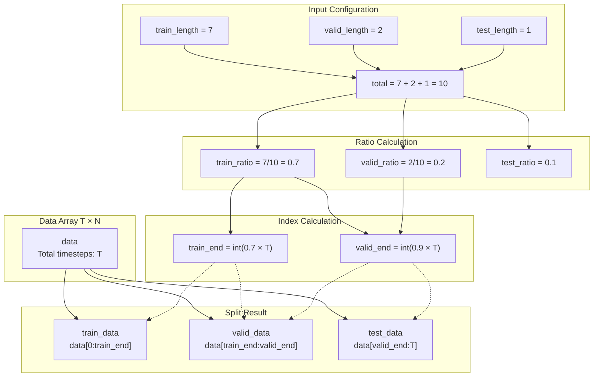
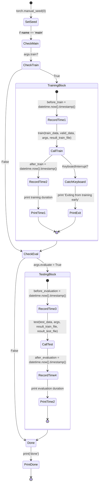
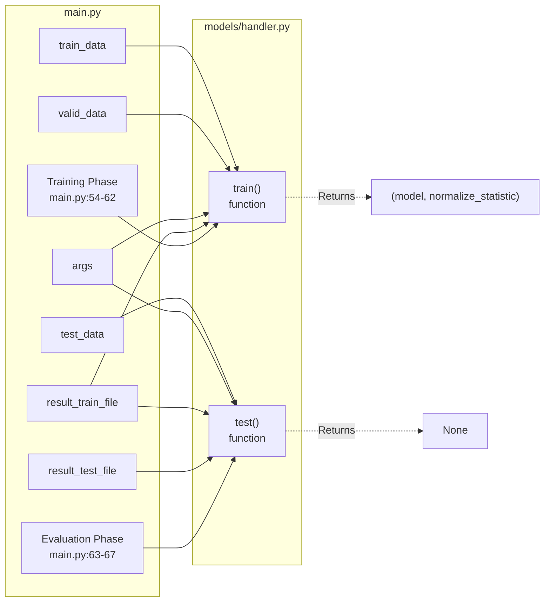
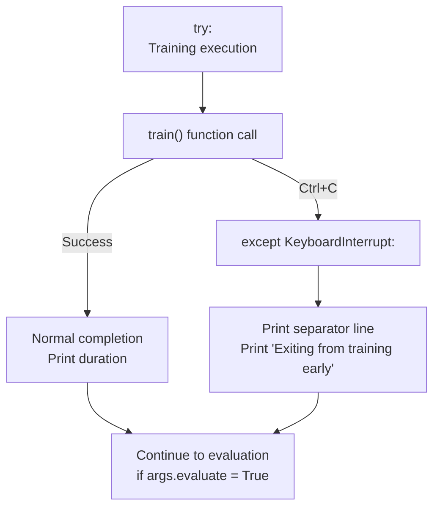

<!-- source: DeepWiki mcp.deepwiki.com · repo microsoft/StemGNN · page 4.1 Main Entry Point · fetched 2026-10-26 -->

# Main Entry Point

<details>
<summary>Relevant source files</summary>

The following files were used as context for generating this wiki page:

- [README.md](README.md)
- [main.py](main.py)

</details>


## Purpose and Scope

This page provides a detailed technical explanation of [`main.py`](main.py:1-68)(), the primary entry point for the STemGNN system. It covers argument parsing, data loading, train/test data splitting, output directory management, and orchestration of training and evaluation workflows.

For information about the training and evaluation implementations that `main.py` delegates to, see [Model Lifecycle Manager](#4.2). For details about command-line usage from a user perspective, see [Command-Line Interface](#3.1).

## Overview

[`main.py`](main.py:1-68)() serves as the system orchestrator with an importance score of 38.64. It performs the following responsibilities:

1. Parses command-line arguments using `argparse`
2. Loads CSV dataset files
3. Splits data into training, validation, and test sets based on configurable ratios
4. Creates output directory structure
5. Conditionally invokes training and evaluation functions from `models.handler`
6. Tracks and reports execution time for each phase

The file is intentionally minimal (68 lines), delegating actual machine learning operations to the handler module while maintaining control over the overall workflow.

**Sources:** [`main.py:1-68`](main.py:1-68)()

## File Structure and Imports



The file begins with environment configuration [`main.py:3`](main.py:3)() that sets `CUDA_VISIBLE_DEVICES` to control GPU visibility. Key imports include:

- **`models.handler`**: Provides `train()` and `test()` functions for ML operations
- **`argparse`**: Command-line argument parsing
- **`pandas`**: CSV data loading
- **`torch`**: Sets random seed for reproducibility
- **`datetime`**: Execution time tracking

**Sources:** [`main.py:1-7`](main.py:1-7)()

## Argument Parser Configuration

The argument parser is configured with 17 parameters that control all aspects of system behavior:



### Complete Argument Reference

| Argument | Type | Default | Line | Purpose |
|----------|------|---------|------|---------|
| `train` | bool | True | 10 | Enable/disable training phase |
| `evaluate` | bool | True | 11 | Enable/disable evaluation phase |
| `dataset` | str | 'ECG_data' | 12 | Dataset filename (without .csv extension) |
| `window_size` | int | 12 | 13 | Length of input sliding window |
| `horizon` | int | 3 | 14 | Prediction horizon (timesteps ahead) |
| `train_length` | float | 7 | 15 | Relative length of training set |
| `valid_length` | float | 2 | 16 | Relative length of validation set |
| `test_length` | float | 1 | 17 | Relative length of test set |
| `epoch` | int | 50 | 18 | Number of training epochs |
| `lr` | float | 1e-4 | 19 | Initial learning rate |
| `multi_layer` | int | 5 | 20 | Number of StockBlockLayers in model |
| `device` | str | 'cpu' | 21 | Compute device ('cpu' or 'cuda:x') |
| `validate_freq` | int | 1 | 22 | Validation frequency (in epochs) |
| `batch_size` | int | 32 | 23 | Training batch size |
| `norm_method` | str | 'z_score' | 24 | Normalization method ('z_score' or 'min_max') |
| `optimizer` | str | 'RMSProp' | 25 | Optimizer type |
| `early_stop` | bool | False | 26 | Enable early stopping |
| `exponential_decay_step` | int | 5 | 27 | Learning rate decay step size |
| `decay_rate` | float | 0.5 | 28 | Learning rate decay multiplier |
| `dropout_rate` | float | 0.5 | 29 | Dropout probability |
| `leakyrelu_rate` | float | 0.2 | 30 | LeakyReLU negative slope |

The parsed arguments are stored in the `args` namespace object [`main.py:33`](main.py:33)() and passed to downstream functions.

**Sources:** [`main.py:9-34`](main.py:9-34)()

## Data Loading and Path Configuration

After argument parsing, `main.py` constructs file paths and creates necessary directories:



The path construction logic [`main.py:35-41`](main.py:35-41)():

1. **Data file path**: `os.path.join('dataset', args.dataset + '.csv')` - constructs the input CSV path
2. **Train output directory**: `os.path.join('output', args.dataset, 'train')` - stores training artifacts
3. **Test output directory**: `os.path.join('output', args.dataset, 'test')` - stores evaluation results

Directory creation is conditional - only creates if not already existing. The CSV data is loaded using `pandas.read_csv()` and immediately converted to a NumPy array with `.values` [`main.py:42`](main.py:42)().

**Sources:** [`main.py:35-42`](main.py:35-42)()

## Data Splitting Logic

The data splitting mechanism uses ratio-based partitioning to create three disjoint sets:



### Splitting Implementation

The splitting algorithm [`main.py:44-50`](main.py:44-50)() operates as follows:

1. **Compute ratios**: Each length parameter is divided by the total sum
   ```
   train_ratio = train_length / (train_length + valid_length + test_length)
   valid_ratio = valid_length / (train_length + valid_length + test_length)
   test_ratio = 1 - train_ratio - valid_ratio
   ```

2. **Calculate split indices**: Multiply ratios by total data length
   ```
   train_end_idx = int(train_ratio × len(data))
   valid_end_idx = int((train_ratio + valid_ratio) × len(data))
   ```

3. **Slice arrays**: Use Python array slicing to create three subsets
   ```
   train_data = data[:train_end_idx]
   valid_data = data[train_end_idx:valid_end_idx]
   test_data = data[valid_end_idx:]
   ```

**Key characteristics:**
- **Sequential splitting**: Data is split in temporal order (no shuffling)
- **Configurable ratios**: Default 7:2:1 can be adjusted via command-line
- **Integer truncation**: Uses `int()` which may cause minor ratio deviations
- **No overlap**: Sets are strictly disjoint

**Sources:** [`main.py:44-50`](main.py:44-50)()

## Execution Flow and Conditional Logic

The main execution block implements a state machine with conditional branching based on the `--train` and `--evaluate` flags:



### Main Execution Block

The main execution block [`main.py:52-68`](main.py:52-68)() contains:

1. **Random seed initialization** [`main.py:52`](main.py:52)(): 
   ```
   torch.manual_seed(0)
   ```
   Ensures reproducibility across runs.

2. **Name guard** [`main.py:53`](main.py:53)():
   ```
   if __name__ == '__main__':
   ```
   Prevents execution when imported as a module.

3. **Training phase** [`main.py:54-62`](main.py:54-62)():
   - Checks `args.train` flag
   - Wraps training in try-except to handle `KeyboardInterrupt`
   - Records timestamps before and after training
   - Calls `train()` from `models.handler` with `train_data`, `valid_data`, `args`, and `result_train_file`
   - Returns model and `normalize_statistic` (though only the latter is captured)
   - Prints training duration in minutes

4. **Evaluation phase** [`main.py:63-67`](main.py:63-67)():
   - Checks `args.evaluate` flag independently of training
   - Records timestamps before and after evaluation
   - Calls `test()` from `models.handler` with `test_data`, `args`, `result_train_file`, and `result_test_file`
   - Prints evaluation duration in minutes

5. **Completion** [`main.py:68`](main.py:68)(): Prints 'done' when all phases complete

**Sources:** [`main.py:52-68`](main.py:52-68)()

## Integration with Model Lifecycle Manager

`main.py` delegates all machine learning operations to the handler module:



### Training Function Call

The training invocation [`main.py:57`](main.py:57)():
```
_, normalize_statistic = train(train_data, valid_data, args, result_train_file)
```

**Parameters:**
- `train_data`: NumPy array of training samples (T_train × N)
- `valid_data`: NumPy array of validation samples (T_valid × N)
- `args`: Parsed argument namespace containing all configuration
- `result_train_file`: Path to output directory for training artifacts

**Returns:**
- Model object (unused, discarded with `_`)
- `normalize_statistic`: Dictionary containing normalization parameters (unused in current implementation)

### Test Function Call

The evaluation invocation [`main.py:65`](main.py:65)():
```
test(test_data, args, result_train_file, result_test_file)
```

**Parameters:**
- `test_data`: NumPy array of test samples (T_test × N)
- `args`: Same argument namespace from training
- `result_train_file`: Path where training artifacts (model checkpoint) are stored
- `result_test_file`: Path to output directory for evaluation results

**Returns:** None (results written to files)

**Note:** The `test()` function expects a pre-trained model checkpoint to exist in `result_train_file`, enabling independent evaluation without retraining.

**Sources:** [`main.py:5`](main.py:5)(), [`main.py:57`](main.py:57)(), [`main.py:65`](main.py:65)()

## Error Handling and Graceful Termination

The training phase includes keyboard interrupt handling [`main.py:55-62`](main.py:55-62)():



**Behavior:**
- **Normal completion**: Prints training duration and proceeds to evaluation
- **Keyboard interrupt** (Ctrl+C): Prints a 99-character separator line and exit message, then continues to evaluation phase if enabled
- **No system exit**: The interrupt is caught but doesn't terminate the program, allowing evaluation to run with any partially trained model

This design allows users to interrupt long training runs while still performing evaluation on the current model state.

**Sources:** [`main.py:55-62`](main.py:55-62)()

## Environment Configuration

The file sets GPU visibility at the module level [`main.py:3`](main.py:3)():

```python
os.environ['CUDA_VISIBLE_DEVICES'] = '0,1'
```

**Purpose:** Restricts CUDA operations to GPUs 0 and 1, limiting the devices PyTorch can access.

**Implications:**
- This is a global setting affecting the entire Python process
- Set before any PyTorch operations occur
- Users can modify this line or override via environment variable before running
- When `args.device = 'cpu'`, this setting has no effect
- When `args.device = 'cuda:2'`, this would cause an error (device 2 is not visible)

**Sources:** [`main.py:3`](main.py:3)()

## Summary of File Operations

### Input Files
| File Path Pattern | Purpose | Read Location |
|------------------|---------|---------------|
| `dataset/{dataset}.csv` | Raw time-series data | [`main.py:42`](main.py:42)() |

### Output Files/Directories
| Path Pattern | Purpose | Created Location |
|-------------|---------|------------------|
| `output/{dataset}/train/` | Training artifacts (model checkpoint, normalization stats) | [`main.py:38-39`](main.py:38-39)() |
| `output/{dataset}/test/` | Evaluation results (predictions, metrics) | [`main.py:40-41`](main.py:40-41)() |

**Note:** The specific files written within these directories are managed by `models.handler.train()` and `models.handler.test()` functions. See [Model Lifecycle Manager](#4.2) for details.

**Sources:** [`main.py:35-41`](main.py:35-41)()

---

