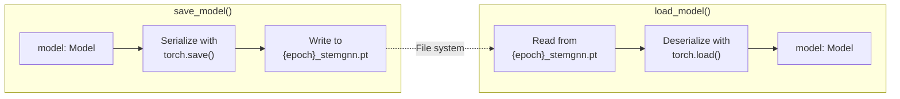
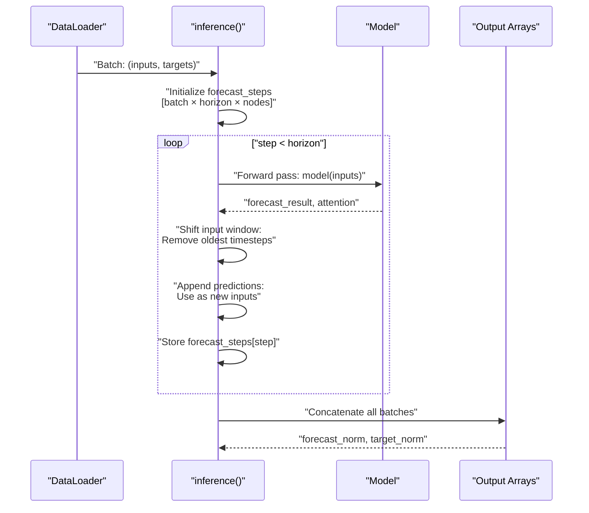
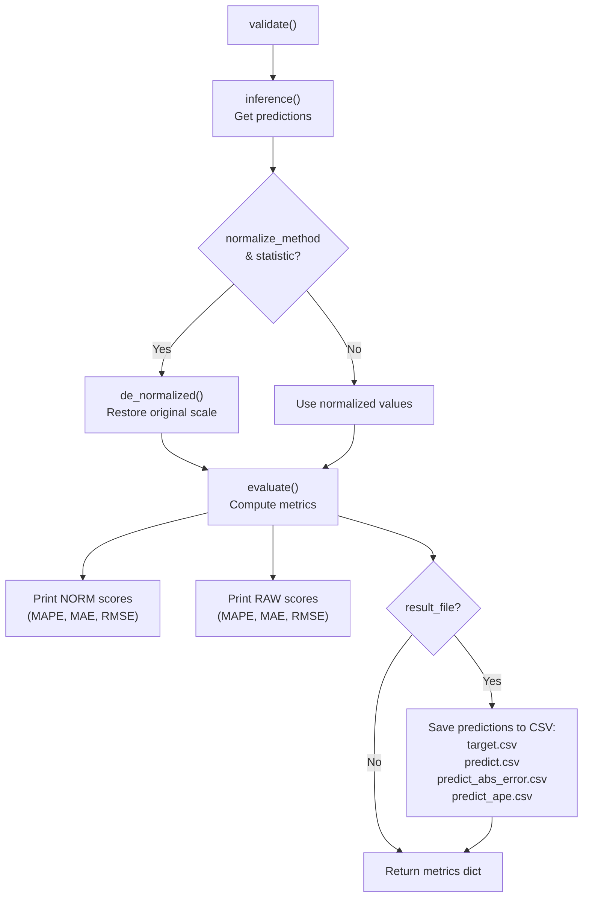
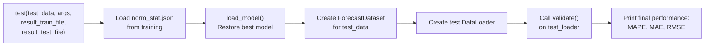
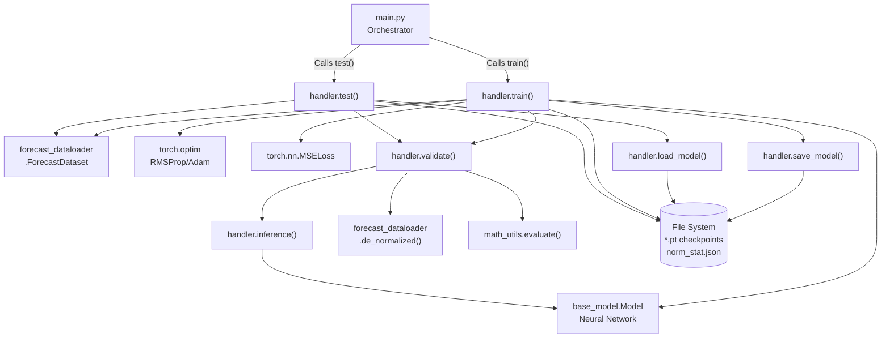

<!-- source: DeepWiki mcp.deepwiki.com · repo microsoft/StemGNN · page 4.2 Model Lifecycle Manager · fetched 2026-10-26 -->

# Model Lifecycle Manager

<details>
<summary>Relevant source files</summary>

The following files were used as context for generating this wiki page:

- [main.py](main.py)
- [models/handler.py](models/handler.py)

</details>


## Purpose and Scope

The Model Lifecycle Manager is the central component responsible for orchestrating all machine learning operations in the STemGNN system. Implemented in [models/handler.py:1-207](), this module manages the complete lifecycle of neural network models including training, validation, testing, inference, and persistence.

This document covers the training loops, model checkpointing, validation procedures, and inference mechanisms. For details about the neural network architecture itself, see [Neural Network Architecture](#4.3). For information about data preprocessing and loading, see [Data Pipeline](#4.4). For evaluation metrics implementation, see [Evaluation Metrics](#4.5).

**Sources:** [models/handler.py:1-207](), high-level system diagrams

---

## Overview of Responsibilities

The Model Lifecycle Manager provides five core capabilities organized into distinct functional areas:

| Responsibility | Functions | Primary Purpose |
|----------------|-----------|-----------------|
| **Model Persistence** | `save_model()`, `load_model()` | Serialize and restore trained models |
| **Inference** | `inference()` | Generate multi-step forecasts using autoregressive approach |
| **Validation** | `validate()` | Evaluate model performance on validation/test sets |
| **Training** | `train()` | Execute complete training procedure with optimization |
| **Testing** | `test()` | Load trained model and evaluate on held-out test data |

All functions accept configuration arguments passed from the main orchestrator in [main.py:33]() and coordinate with the data loader [data_loader/forecast_dataloader.py](), neural network [models/base_model.py](), and evaluation utilities [utils/math_utils.py]().

**Sources:** [models/handler.py:1-207](), [main.py:1-68]()

---

## Model Persistence

### Save and Load Mechanisms

The system provides simple file-based model persistence using PyTorch's serialization:



#### save_model Function

[models/handler.py:16-24]() implements model checkpoint saving:

- **Parameters:**
  - `model`: The trained `Model` instance to save
  - `model_dir`: Directory path for saving checkpoints
  - `epoch`: Optional epoch number to include in filename
- **Behavior:** Creates directory if needed, saves entire model object to `{epoch}_stemgnn.pt` or `_stemgnn.pt` if epoch is None
- **Usage:** Called after each training epoch and when best validation performance is achieved

#### load_model Function

[models/handler.py:27-38]() implements model checkpoint loading:

- **Parameters:**
  - `model_dir`: Directory path containing checkpoints
  - `epoch`: Optional epoch number to load specific checkpoint
- **Return:** Loaded `Model` instance or `None` if file doesn't exist
- **Usage:** Called by `test()` function to restore best model for evaluation

**Sources:** [models/handler.py:16-38]()

---

## Inference Engine

### Autoregressive Multi-Step Forecasting

The `inference()` function [models/handler.py:41-64]() implements the core prediction mechanism using an autoregressive approach for multi-horizon forecasting:



#### Key Implementation Details

**Function Signature:**
```python
def inference(model, dataloader, device, node_cnt, window_size, horizon)
```

**Algorithm:** [models/handler.py:41-64]()

1. **Initialization:** Set model to eval mode, disable gradients with `torch.no_grad()`
2. **Batch Processing:** Iterate through dataloader batches
3. **Autoregressive Loop:** For each step until horizon is reached:
   - Forward pass through model to get next predictions
   - Shift input window: remove oldest predictions [models/handler.py:56-57]()
   - Append new predictions to input window [models/handler.py:58]()
   - Store predictions in output array [models/handler.py:59-60]()
4. **Accumulation:** Collect forecasts and targets from all batches
5. **Return:** Concatenated arrays of shape `[num_samples, horizon, node_cnt]`

**Input Window Management:** The autoregressive approach maintains a sliding window of size `window_size`. After each prediction, the window is updated by removing the oldest timesteps and appending the newly predicted values, allowing the model to forecast multiple steps ahead iteratively.

**Sources:** [models/handler.py:41-64]()

---

## Validation and Evaluation

### validate Function

The `validate()` function [models/handler.py:67-100]() performs comprehensive model evaluation with denormalization and metric computation:



#### Parameters and Behavior

**Function Signature:**
```python
def validate(model, dataloader, device, normalize_method, statistic,
             node_cnt, window_size, horizon, result_file=None)
```

**Processing Steps:** [models/handler.py:67-100]()

1. **Inference:** Call `inference()` to generate predictions [models/handler.py:71-72]()
2. **Denormalization:** If normalization was applied during training, restore original scale using `de_normalized()` [models/handler.py:73-77]()
3. **Metric Calculation:**
   - Compute overall metrics: MAPE, MAE, RMSE [models/handler.py:78]()
   - Compute per-node metrics: MAPE, MAE, RMSE [models/handler.py:79]()
   - Evaluate both normalized and denormalized predictions [models/handler.py:82-84]()
4. **Output Generation:**
   - Print normalized and raw metric scores to console
   - If `result_file` is provided, save detailed predictions to CSV files [models/handler.py:85-97]()
5. **Return:** Dictionary containing MAE, MAPE, RMSE (overall and per-node) [models/handler.py:99-100]()

#### Output Files

When `result_file` is specified, four CSV files are generated [models/handler.py:92-97]():

| File | Content | Shape |
|------|---------|-------|
| `target.csv` | Ground truth values at first forecast step | `[num_samples, node_cnt]` |
| `predict.csv` | Model predictions at first forecast step | `[num_samples, node_cnt]` |
| `predict_abs_error.csv` | Absolute error per sample and node | `[num_samples, node_cnt]` |
| `predict_ape.csv` | Absolute percentage error per sample and node | `[num_samples, node_cnt]` |

**Sources:** [models/handler.py:67-100](), [data_loader/forecast_dataloader.py:4](), [utils/math_utils.py:13]()

---

## Training Loop

### train Function

The `train()` function [models/handler.py:103-191]() implements the complete training procedure including model initialization, optimization, learning rate scheduling, validation, and early stopping:

```mermaid
graph TB
    T1["train(train_data,<br/>valid_data, args)"] --> T2["Initialize Model<br/>from base_model.py"]
    T2 --> T3["Compute normalization<br/>statistics (mean/std or min/max)"]
    T3 --> T4["Save norm_stat.json"]
    T4 --> T5["Create optimizer<br/>(RMSProp or Adam)"]
    T5 --> T6["Create LR scheduler<br/>(ExponentialLR)"]
    T6 --> T7["Create ForecastDataset<br/>instances"]
    T7 --> T8["Create DataLoaders"]
    T8 --> T9["Initialize MSELoss"]
    T9 --> T10["Print total parameters"]
    T10 --> T11["Training Loop<br/>for epoch in range(args.epoch)"]
    
    T11 --> T12["Set model.train()"]
    T12 --> T13["Iterate train_loader batches"]
    T13 --> T14["Forward pass: model(inputs)"]
    T14 --> T15["Compute loss: MSELoss"]
    T15 --> T16["Backward pass: loss.backward()"]
    T16 --> T17["Optimizer step"]
    T17 --> T18{"More batches?"}
    T18 -->|"Yes"| T13
    T18 -->|"No"| T19["Print epoch loss"]
    T19 --> T20["save_model(epoch)"]
    T20 --> T21{"epoch % decay_step == 0?"}
    T21 -->|"Yes"| T22["LR scheduler step"]
    T21 -->|"No"| T23{"epoch % validate_freq == 0?"}
    T22 --> T23
    T23 -->|"Yes"| T24["Call validate() on valid_data"]
    T23 -->|"No"| T25{"More epochs?"}
    T24 --> T26{"mae < best_validate_mae?"}
    T26 -->|"Yes"| T27["Update best_validate_mae<br/>save_model() as best<br/>Reset non-decrease count"]
    T26 -->|"No"| T28["Increment non-decrease count"]
    T27 --> T29{"early_stop &<br/>count >= threshold?"}
    T28 --> T29
    T29 -->|"Yes"| T30["Break training loop"]
    T29 -->|"No"| T25
    T25 -->|"Yes"| T11
    T25 -->|"No"| T31["Return metrics and<br/>normalize_statistic"]
    T30 --> T31
```



### Initialization Phase

[models/handler.py:104-147]() sets up all components required for training:

1. **Model Creation:** Instantiate `Model` with node count, input dimensions, window size, layer count, and horizon [models/handler.py:105-106]()
2. **Normalization Statistics:** Compute and save mean/std (z-score) or min/max statistics from training data [models/handler.py:112-124]()
3. **Optimizer Selection:** Create RMSProp or Adam optimizer based on `args.optimizer` [models/handler.py:126-129]()
4. **Learning Rate Scheduler:** Configure exponential decay with `gamma=args.decay_rate` [models/handler.py:130]()
5. **Dataset Creation:** Instantiate `ForecastDataset` objects for training and validation [models/handler.py:132-135]()
6. **DataLoader Setup:** Create PyTorch DataLoaders with batch size and shuffling [models/handler.py:136-138]()
7. **Loss Function:** Initialize MSELoss for forecast error [models/handler.py:140]()

### Training Iteration

[models/handler.py:152-191]() implements the main training loop:

**Per-Epoch Operations:**

| Step | Code Reference | Description |
|------|----------------|-------------|
| Set train mode | [models/handler.py:154]() | Enable gradient computation and dropout |
| Batch iteration | [models/handler.py:157-166]() | Forward pass, loss computation, backpropagation |
| Save checkpoint | [models/handler.py:169]() | Save model after each epoch |
| LR decay | [models/handler.py:170-171]() | Apply learning rate decay every `exponential_decay_step` epochs |
| Validation | [models/handler.py:172-178]() | Run validation every `validate_freq` epochs |
| Best model tracking | [models/handler.py:179-187]() | Save best model based on validation MAE |
| Early stopping | [models/handler.py:189-190]() | Terminate if validation performance plateaus |

### Optimization Details

**Gradient Descent:** [models/handler.py:157-166]()
- Zero gradients with `model.zero_grad()`
- Forward pass: `forecast, _ = model(inputs)`
- Compute MSE loss between forecast and target
- Backpropagate: `loss.backward()`
- Update parameters: `my_optim.step()`

**Learning Rate Schedule:** Exponential decay applied every `args.exponential_decay_step` epochs [models/handler.py:170-171]()
- New LR = Old LR × `args.decay_rate`
- Default: decay by 0.5 every 5 epochs

**Best Model Selection:** Tracks validation MAE [models/handler.py:179-187]()
- If current MAE < best MAE: save model without epoch suffix
- Otherwise: increment non-decrease counter for early stopping

**Sources:** [models/handler.py:103-191](), [models/base_model.py:5](), [data_loader/forecast_dataloader.py:4]()

---

## Testing

### test Function

The `test()` function [models/handler.py:194-207]() performs evaluation on held-out test data using a previously trained model:



#### Implementation Details

**Function Signature:**
```python
def test(test_data, args, result_train_file, result_test_file)
```

**Procedure:** [models/handler.py:194-207]()

1. **Load Normalization Stats:** Read `norm_stat.json` from training output directory [models/handler.py:195-196]()
2. **Load Model:** Restore best model checkpoint from training directory [models/handler.py:197]()
3. **Create Test Dataset:** Initialize `ForecastDataset` with test data and normalization stats [models/handler.py:199-200]()
4. **Create DataLoader:** Wrap dataset in PyTorch DataLoader [models/handler.py:201-202]()
5. **Run Validation:** Call `validate()` function to compute metrics [models/handler.py:203-205]()
6. **Print Results:** Display final test performance to console [models/handler.py:206-207]()

**Key Design Decision:** The `test()` function reuses the `validate()` function for consistency, ensuring identical evaluation logic across validation and testing phases. The only differences are the data being evaluated and the output directories for saving predictions.

**Sources:** [models/handler.py:194-207]()

---

## Integration with System Components

### Component Dependencies

The Model Lifecycle Manager serves as the integration hub between multiple system components:



### Data Flow Summary

| Source | Function | Destination | Data Type |
|--------|----------|-------------|-----------|
| `main.py` | `train()` | Training data, validation data, args | NumPy arrays, argparse.Namespace |
| `train()` | `ForecastDataset` | Normalized windowed samples | PyTorch Dataset |
| `ForecastDataset` | `DataLoader` | Batched tensors | PyTorch tensors |
| `DataLoader` | `Model` | Input windows | Tensor [batch, window_size, nodes] |
| `Model` | Loss function | Predictions, attention | Tensor [batch, horizon, nodes] |
| `validate()` | `evaluate()` | Denormalized forecasts and targets | NumPy arrays |
| `evaluate()` | Console/Files | Performance metrics | Dict of floats |

**Sources:** [models/handler.py:1-207](), [main.py:54-67](), [models/base_model.py](), [data_loader/forecast_dataloader.py](), [utils/math_utils.py]()

---

## Configuration Parameters

The Model Lifecycle Manager accepts configuration through the `args` parameter, which contains parsed command-line arguments from [main.py:9-30](). Key parameters affecting model lifecycle:

### Training Configuration

| Parameter | Type | Default | Used In | Purpose |
|-----------|------|---------|---------|---------|
| `epoch` | int | 50 | `train()` | Maximum training epochs |
| `lr` | float | 1e-4 | `train()` | Initial learning rate |
| `optimizer` | str | 'RMSProp' | `train()` | Optimizer selection |
| `batch_size` | int | 32 | `train()`, `test()` | Batch size for DataLoader |
| `validate_freq` | int | 1 | `train()` | Validation frequency (epochs) |
| `early_stop` | bool | False | `train()` | Enable early stopping |
| `exponential_decay_step` | int | 5 | `train()` | LR decay frequency (epochs) |
| `decay_rate` | float | 0.5 | `train()` | LR decay multiplier |

### Model Architecture Configuration

| Parameter | Type | Default | Used In | Purpose |
|-----------|------|---------|---------|---------|
| `multi_layer` | int | 5 | `train()` | Number of StockBlockLayers |
| `window_size` | int | 12 | All functions | Input sequence length |
| `horizon` | int | 3 | All functions | Forecast horizon |
| `dropout_rate` | float | 0.5 | `Model` init | Dropout probability |
| `leakyrelu_rate` | float | 0.2 | `Model` init | LeakyReLU slope |

### Data Processing Configuration

| Parameter | Type | Default | Used In | Purpose |
|-----------|------|---------|---------|---------|
| `norm_method` | str | 'z_score' | `train()`, `test()` | Normalization method |
| `device` | str | 'cpu' | All functions | Computation device (cpu/cuda) |

**Sources:** [models/handler.py:103-207](), [main.py:9-30]()

---

## Error Handling

The Model Lifecycle Manager implements defensive checks for common error conditions:

### Training Errors

**Empty Dataset Detection:** [models/handler.py:107-110]()
```python
if len(train_data) == 0:
    raise Exception('Cannot organize enough training data')
if len(valid_data) == 0:
    raise Exception('Cannot organize enough validation data')
```

**Blank Inference Results:** [models/handler.py:54-55]()
```python
if len_model_output == 0:
    raise Exception('Get blank inference result')
```

### Graceful Degradation

**Missing Model Files:** The `load_model()` function returns `None` if checkpoint file doesn't exist [models/handler.py:34-35](), allowing the caller to handle the absence gracefully.

**Missing Result Directory:** Both `save_model()` and `validate()` create output directories if they don't exist [models/handler.py:19-20](), [models/handler.py:86-87](), preventing write failures.

**Sources:** [models/handler.py:16-207]()

---

