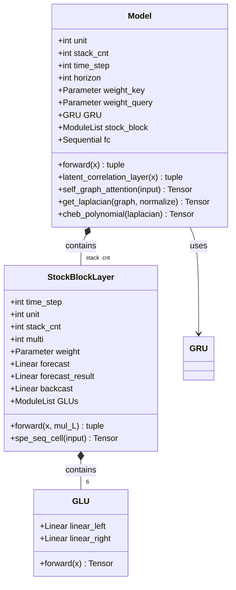
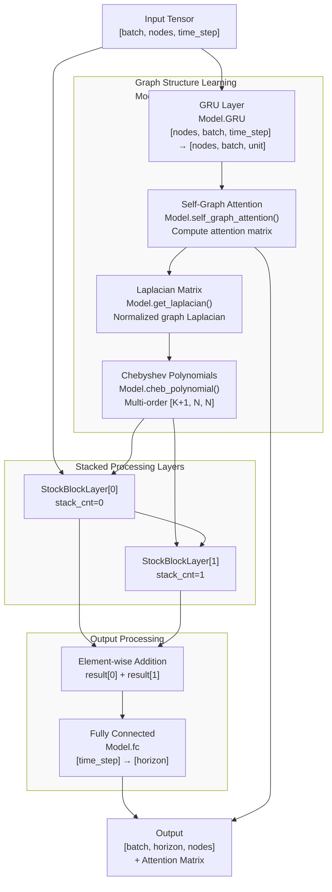
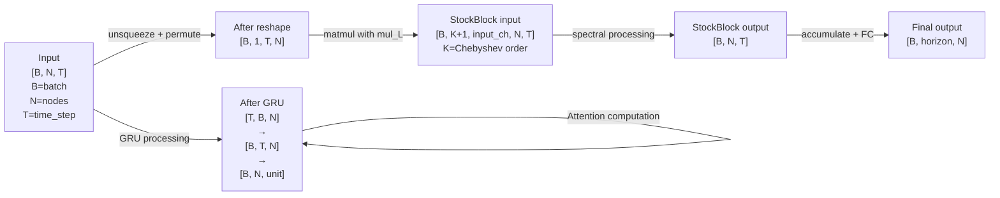
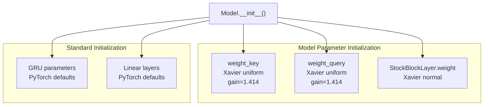
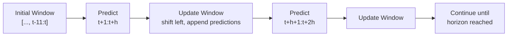

<!-- source: DeepWiki mcp.deepwiki.com · repo microsoft/StemGNN · page 4.3 Neural Network Architecture · fetched 2026-10-26 -->

# Neural Network Architecture

<details>
<summary>Relevant source files</summary>

The following files were used as context for generating this wiki page:

- [models/base_model.py](models/base_model.py)
- [models/handler.py](models/handler.py)

</details>


## Purpose and Scope

This page provides an in-depth technical overview of the STemGNN (Spectral Temporal Graph Neural Network) model architecture implemented in [`models/base_model.py`](). The document covers the overall model structure, the relationship between major components, and how data flows through the network during forward propagation.

For detailed explanations of specific subsystems, see:
- **Graph learning mechanisms** (self-attention, Laplacian computation, Chebyshev polynomials): [Graph Learning Components](#4.3.1)
- **Internal structure of StockBlockLayer** (spectral sequence cells, GLU processing): [StockBlockLayer](#4.3.2)
- **Model instantiation and training lifecycle**: [Model Lifecycle Manager](#4.2)
- **Configuration parameters**: [Configuration Parameters](#5.1)

## Overview

The STemGNN model is a deep learning architecture for multivariate time-series forecasting that combines graph neural networks with spectral processing. The model learns both spatial relationships between time series (via graph structure learning) and temporal patterns (via spectral sequence processing in the frequency domain).

The architecture is implemented in three main classes:
- `Model` - The top-level model orchestrating graph learning and stacked layers
- `StockBlockLayer` - The core processing block performing spectral convolutions
- `GLU` - Gated Linear Unit activation for non-linear transformations

Sources: [`models/base_model.py:1-180`]()

## Model Class Hierarchy



**Diagram: Class Structure in base_model.py**

This diagram shows the three primary classes and their relationships. The `Model` class contains multiple `StockBlockLayer` instances (determined by `stack_cnt` parameter), and each `StockBlockLayer` contains 6 `GLU` units for spectral processing.

Sources: [`models/base_model.py:6-180`]()

## Model Instantiation

The model is instantiated in the training pipeline with the following signature:

```python
Model(node_cnt, 2, args.window_size, args.multi_layer, horizon=args.horizon)
```

| Parameter | Source | Purpose | Typical Value |
|-----------|--------|---------|---------------|
| `units` | `node_cnt` from data | Number of nodes/time series | Dataset-dependent (e.g., 140 for ECG) |
| `stack_cnt` | Hard-coded | Number of stacked StockBlockLayers | 2 |
| `time_step` | `args.window_size` | Input sequence length | 12 |
| `multi_layer` | `args.multi_layer` | Spectral expansion multiplier | 5 |
| `horizon` | `args.horizon` | Output forecast length | 3 |

Sources: [`models/handler.py:105`](), [`models/base_model.py:78-104`]()

## Overall Architecture Flow



**Diagram: High-Level Model Forward Pass**

The forward pass consists of three main stages:
1. **Graph Structure Learning**: Discovers spatial relationships between nodes
2. **Stacked Processing**: Applies spectral convolutions through StockBlockLayers
3. **Output Generation**: Combines layer outputs and projects to forecast horizon

Sources: [`models/base_model.py:167-179`]()

## Model Forward Pass Implementation

The forward method coordinates the entire inference process:

```python
def forward(self, x):
    mul_L, attention = self.latent_correlation_layer(x)
    X = x.unsqueeze(1).permute(0, 1, 3, 2).contiguous()
    result = []
    for stack_i in range(self.stack_cnt):
        forecast, X = self.stock_block[stack_i](X, mul_L)
        result.append(forecast)
    forecast = result[0] + result[1]
    forecast = self.fc(forecast)
    if forecast.size()[-1] == 1:
        return forecast.unsqueeze(1).squeeze(-1), attention
    else:
        return forecast.permute(0, 2, 1).contiguous(), attention
```

### Step-by-Step Execution

1. **Graph Learning** [`models/base_model.py:168`](): Computes multi-order Laplacian (`mul_L`) and attention matrix
2. **Reshape Input** [`models/base_model.py:169`](): Transforms input from `[batch, nodes, time_step]` to `[batch, 1, time_step, nodes]`
3. **Sequential Block Processing** [`models/base_model.py:171-173`](): Each StockBlockLayer processes the data and passes transformed features to the next
4. **Aggregation** [`models/base_model.py:174`](): Sums outputs from both layers
5. **Temporal Projection** [`models/base_model.py:175`](): Maps from `time_step` to `horizon` using fully connected layers
6. **Output Formatting** [`models/base_model.py:176-179`](): Reshapes to `[batch, horizon, nodes]` or `[batch, nodes, horizon]` depending on horizon size

Sources: [`models/base_model.py:167-179`]()

## Data Shape Transformations



**Diagram: Tensor Shape Transformations Through Model**

This diagram illustrates how tensor dimensions change as data flows through the model. Understanding these transformations is critical for debugging and extending the architecture.

Sources: [`models/base_model.py:136-179`]()

## Key Components Summary

### GLU (Gated Linear Unit)

The `GLU` class implements gated activation combining linear transformations with sigmoid gating:

```
output = linear_left(x) ⊙ σ(linear_right(x))
```

Where `⊙` denotes element-wise multiplication and `σ` is the sigmoid function.

| Component | Input Dim | Output Dim | Purpose |
|-----------|-----------|------------|---------|
| `linear_left` | `input_channel` | `output_channel` | Left transformation |
| `linear_right` | `input_channel` | `output_channel` | Gating signal |

Sources: [`models/base_model.py:6-13`]()

### StockBlockLayer

Each `StockBlockLayer` performs:
1. **Graph Convolution**: Multiplies input with Chebyshev polynomial matrices
2. **Spectral Sequence Processing**: Transforms to frequency domain (FFT), applies GLU units, transforms back (IFFT)
3. **Forecast/Backcast Generation**: Produces predictions and residual signals

Key parameters:
- `weight`: Learnable tensor `[1, K+1, 1, time_step*multi, multi*time_step]` for graph convolution
- `forecast`: Projects spectral features to forecast
- `backcast` (only in first layer): Generates residual for next layer

Sources: [`models/base_model.py:16-75`]()

### Model (Top-Level)

The `Model` class orchestrates:
- **Graph Structure Learning**: Attention-based discovery of node relationships
- **Laplacian Computation**: Normalized graph Laplacian matrix
- **Chebyshev Approximation**: Multi-order polynomial approximation for efficient graph convolution
- **Layer Stacking**: Sequential processing through `stack_cnt` StockBlockLayers
- **Output Projection**: Temporal forecasting via fully connected layers

Key learnable parameters:
- `weight_key`, `weight_query`: Self-attention parameters `[unit, 1]`
- `GRU`: Temporal feature extraction `[time_step → unit]`
- `stock_block`: List of StockBlockLayer modules
- `fc`: Output projection `[time_step → time_step → horizon]`

Sources: [`models/base_model.py:78-104`]()

## Parameter Initialization



**Diagram: Parameter Initialization Scheme**

Critical parameters use Xavier initialization to ensure proper gradient flow:
- Attention weights: [`models/base_model.py:89-91`]()
- Graph convolution weights: [`models/base_model.py:26`]()

Sources: [`models/base_model.py:23-26`](), [`models/base_model.py:88-91`]()

## Integration with Training Pipeline

The model integrates with the training system through the `handler.py` interface:

| Operation | Handler Function | Model Usage |
|-----------|------------------|-------------|
| **Instantiation** | `train()` line 105 | `Model(node_cnt, 2, window_size, multi_layer, horizon)` |
| **Forward pass** | `train()` line 161 | `forecast, _ = model(inputs)` |
| **Inference** | `inference()` line 52 | `forecast_result, a = model(inputs)` |
| **Validation** | `validate()` line 71 | Calls `inference()` |
| **Persistence** | `save_model()` / `load_model()` | `torch.save(model)` / `torch.load()` |

The handler abstracts away training logistics (batching, optimization, metrics) while the model focuses solely on the forward computation graph.

Sources: [`models/handler.py:41-64`](), [`models/handler.py:103-191`]()

## Model Output

The forward pass returns a tuple:

```python
(forecast, attention)
```

| Output | Shape | Description |
|--------|-------|-------------|
| `forecast` | `[batch, horizon, nodes]` (if horizon > 1)<br/>or `[batch, nodes]` (if horizon = 1) | Predicted future values |
| `attention` | `[batch, nodes, nodes]` | Learned attention/adjacency matrix representing spatial relationships |

The attention matrix provides interpretability, showing which nodes the model considers related during graph structure learning.

Sources: [`models/base_model.py:177-179`]()

## Model Size and Complexity

During training initialization, the total number of trainable parameters is computed and logged:

```python
total_params = 0
for name, parameter in model.named_parameters():
    if not parameter.requires_grad: continue
    param = parameter.numel()
    total_params += param
print(f"Total Trainable Params: {total_params}")
```

The parameter count depends on:
- **Number of nodes** (`units`): Affects attention parameters and GRU size
- **Time window** (`time_step`): Affects linear layer dimensions
- **Multi-layer expansion** (`multi_layer`): Multiplies spectral processing dimensions
- **Number of stacked blocks** (`stack_cnt`): Multiplies StockBlockLayer parameters

Sources: [`models/handler.py:142-147`]()

## Device Management

The model supports GPU acceleration with explicit device placement:

```python
model.to(args.device)
```

During inference, input tensors are moved to the model's device:

```python
inputs = inputs.to(device)
target = target.to(device)
```

All internal operations inherit the device from model parameters, ensuring consistent computation location.

Sources: [`models/base_model.py:104`](), [`models/handler.py:106`](), [`models/handler.py:47-48`]()

## Autoregressive Forecasting

For multi-step forecasting beyond the model's direct horizon, the inference function implements an autoregressive scheme:



**Diagram: Autoregressive Multi-Step Forecasting**

The implementation shifts the input window and appends predictions iteratively:

```python
while step < horizon:
    forecast_result, a = model(inputs)
    len_model_output = forecast_result.size()[1]
    inputs[:, :window_size - len_model_output, :] = inputs[:, len_model_output:window_size, :].clone()
    inputs[:, window_size - len_model_output:, :] = forecast_result.clone()
    forecast_steps[:, step:min(horizon - step, len_model_output) + step, :] = \
        forecast_result[:, :min(horizon - step, len_model_output), :].detach().cpu().numpy()
    step += min(horizon - step, len_model_output)
```

This allows forecasting arbitrarily long horizons using a model trained with a shorter output length.

Sources: [`models/handler.py:49-61`]()

---

**Page Summary**: This page documented the overall STemGNN neural network architecture, covering the `Model`, `StockBlockLayer`, and `GLU` classes, their relationships, data flow, and integration with the training pipeline. For implementation details of graph learning and spectral processing, refer to the subsection pages [4.3.1](#4.3.1) and [4.3.2](#4.3.2).

---

